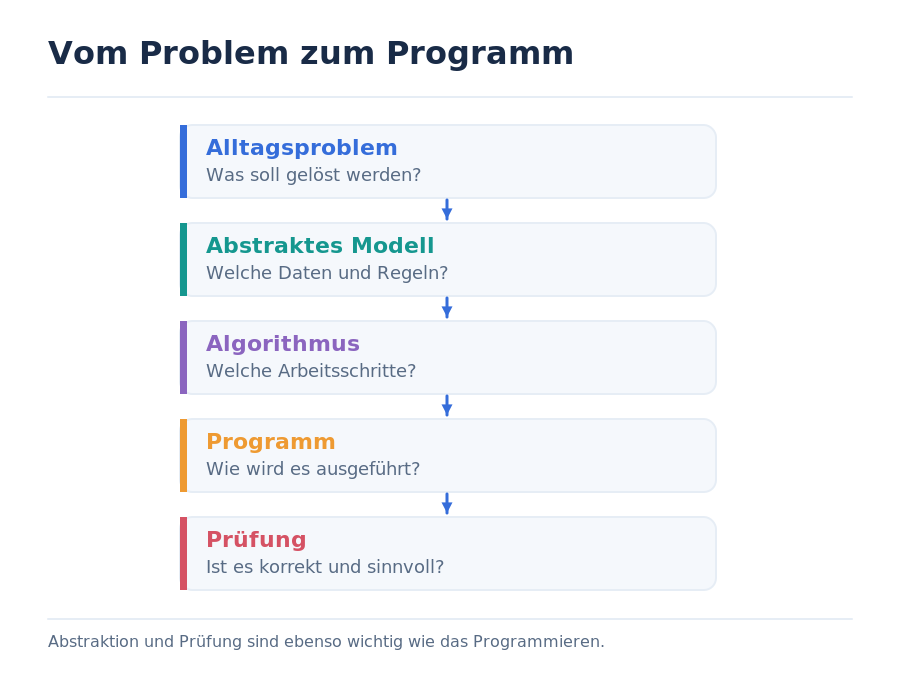

# M1-L1 – Was ist Informatik? {#L1}

**Kursbereich:** M1 – Bachelor: Informatik-Grundlagen

**Niveau:** Bachelor

**Vorwissen:** Keine festen Voraussetzungen angegeben.

**Lernziel:** Informatik als Wissenschaft verstehen, Programmierung davon unterscheiden und die Begriffe Daten, Information, Algorithmus, Modell, Abstraktion, Berechenbarkeit und Aufwand auf reale Softwaresysteme beziehen.

## Überblick: Hinter jedem Programm steckt ein Modell der Welt {#S1}

Stell dir ein Programm vor, das eine große Sammlung von Filmen verwaltet. An der Oberfläche sieht man Eingabefelder, Listen und Suchergebnisse. Darunter stellen sich grundlegende Fragen: Was genau ist ein Film? Gehört eine alternative Sprachfassung zum selben Werk? Wie eindeutig ist ein Titel? Wie findet man einen Eintrag schnell, ohne alles zu durchsuchen? Was geschieht, wenn zwei Personen gleichzeitig Änderungen vornehmen?

{alt="Abfolge von Problem, Modell, Algorithmus, Programm und Prüfung"}


Diese Fragen beantwortet nicht allein die Wahl einer Programmiersprache. Sie betreffen **Informatik**: die systematische Beschreibung und Verarbeitung von Information durch formale Modelle und ausführbare Verfahren. Informatik untersucht, welche Aufgaben grundsätzlich berechenbar sind, welche Verfahren gut funktionieren und wie zuverlässige technische Systeme daraus entstehen.

**Programmieren** bedeutet, eine Lösung in einer Programmiersprache zu formulieren. **Softwareentwicklung** schließt außerdem Planung, Tests, Änderungen, Veröffentlichung und Wartung ein. Beides sind wichtige praktische Tätigkeiten, aber nicht das ganze Fach. Auch ein Informatiker, der gerade keine Zeile Code schreibt, kann Algorithmen analysieren, ein Datenmodell entwerfen oder die Sicherheit einer Architektur beurteilen.

``` text
Alltagsproblem: „Finde einen Film trotz abweichendem Titel.“
                 │
                 ▼
Fachliches Modell: Werk, Titelvarianten, Sprache, Kennung
                 │
                 ▼
Verfahren: normalisieren, suchen, Treffer bewerten
                 │
                 ▼
Programm: Benutzeroberfläche + Suchlogik + Datenspeicher
                 │
                 ▼
Prüfung: richtige Treffer, Laufzeit, Fehlerfälle, Datenschutz
```

Das ist ein erster Leitgedanke für den gesamten Kurs: **Nicht die Anzahl der Server macht ein System gut, sondern die Eignung seiner Modelle und Verfahren für das tatsächliche Problem.**

## Daten sind noch keine verständliche Information {#S2}

Angenommen, eine Datei enthält `12, 18, 25, 19`. Das sind zunächst **Daten**: festgehaltene Zeichen oder Werte. Werden sie als Temperaturen in Grad Celsius an vier Tagen interpretiert, entsteht ein sachlicher Zusammenhang. Sind es dagegen Besucherzahlen oder Preise, verändert sich ihre Bedeutung.

**Information** ist kein eigenständiger Stoff, der automatisch in einer Zahl steckt. Sie entsteht dadurch, dass Daten in einen sinnvollen Kontext gesetzt und interpretiert werden. Dabei sind Einheit, Zeitpunkt, Herkunft und Messverfahren manchmal genauso wichtig wie der eigentliche Wert.

Ein Computer speichert auf niedriger Ebene nur codierte Zustände. Ob die Bitfolge für eine Zahl, einen Buchstaben, einen Bildpunkt oder einen Maschinenbefehl steht, hängt von Regeln und Vereinbarungen ab. Schon ein Text muss **codiert** werden: Eine Zeichenkodierung ordnet Zeichen bestimmten Bytefolgen zu. Eine Datenbank ergänzt die Codierung durch ein Schema, das unter anderem beschreibt, welche Felder zusammengehören.

Bei einem Medienarchiv können etwa diese Informationen wichtig sein:

  Gespeicherter Wert   Erst durch den Kontext verständlich
  -------------------- -------------------------------------------------------------------------------
  `2024`               Erscheinungsjahr oder Dateigröße?
  `de`                 Sprachcode, Länderkennzeichen oder Teil eines Namens?
  `000417`             Eindeutige Kennung oder eine Zahl, bei der führende Nullen entfallen dürften?
  `3,7`                Bewertung mit welcher Skala und welchem Dezimalformat?

Ein häufiges Softwareproblem ist deshalb kein Rechenfehler, sondern eine **falsche Interpretation von Daten**. Werden führende Nullen einer Kennung entfernt, kann ein gespeicherter Schlüssel seine Bedeutung verlieren. Werden Zeitzonen ignoriert, erscheinen Ereignisse in der falschen Reihenfolge.

### Das Verhältnis von Daten, Information und Wissen

Ein Datensatz kann eine Beobachtung festhalten. Aus einer Reihe von Beobachtungen lässt sich ein Muster ableiten. Ob dieses Muster eine zuverlässige Erklärung oder eine geeignete Entscheidungsgrundlage ist, muss zusätzlich geprüft werden. Diese Ebenen sollte man nicht gleichsetzen: Ein Statistikdiagramm kann korrekt berechnet sein und trotzdem wegen unvollständiger Daten in die Irre führen.

## Ein Algorithmus ist eine allgemein beschriebene Vorgehensweise {#S3}

Ein **Algorithmus** beschreibt eine Aufgabe durch wohldefinierte Arbeitsschritte. Die Beschreibung selbst ist noch kein bestimmtes JavaScript-, PureBasic- oder Python-Programm. Eine Implementierung übersetzt das Verfahren in eine konkrete Sprache und Laufzeitumgebung.

Beispiel: Aus der Liste `12, 18, 25, 19` soll der größte Wert ermittelt werden.

1.  Nimm den ersten Wert als vorläufiges Maximum.
2.  Vergleiche nacheinander jeden folgenden Wert mit diesem Maximum.
3.  Falls ein Wert größer ist, merke ihn als neues Maximum.
4.  Gib am Ende den gemerkten Wert aus.

``` text
Start: Maximum = 12
18 > 12  → Maximum = 18
25 > 18  → Maximum = 25
19 > 25  → Maximum bleibt 25
Ergebnis: 25
```

Die Stärke liegt darin, dass die Regel nicht speziell für diese vier Zahlen gebaut ist. Sie funktioniert auch für andere **nichtleere** Zahlenlisten. Die Bedingung „nichtleer“ gehört zu den Voraussetzungen. Bei einer leeren Liste muss man festlegen, ob es kein Ergebnis oder einen ausdrücklich definierten Sonderwert geben soll.

Eine zusätzliche Besonderheit: Ein Algorithmus wird üblicherweise als endlich beschreibbares, schrittweises Verfahren mit einer klaren Zielbedingung verstanden. **Nicht jedes beliebige Computerprogramm hält für alle Eingaben an.** Programme können etwa absichtlich dauerhaft auf Ereignisse warten. Deshalb muss man bei einem konkreten Algorithmus seine Eingaben und das gewünschte Ende genau angeben.

### Korrektheit und Aufwand sind verschiedene Fragen

Der Maximalwert-Algorithmus muss zwei Eigenschaften erfüllen: Er soll das **richtige Ergebnis** liefern und dabei einen akzeptablen **Aufwand** verursachen. Für eine Liste mit einer Million Werten untersucht das lineare Verfahren grundsätzlich jeden Wert. Das ist hier vernünftig, wenn keine zusätzlichen Vorinformationen existieren.

Eine bereits geordnete Liste erlaubt unter Umständen eine einfachere Abfrage. Eine Datenbank mit Index kann andere Zugriffswege benutzen. Dafür muss der Index angelegt, gespeichert und bei Änderungen aktualisiert werden. **Schnelleres Lesen kann mehr Speicher und langsamere Schreibvorgänge bedeuten.** Solche Zielkonflikte sind ein wiederkehrendes Thema der Informatik.

In **M1-L3 – Algorithmen und Datenstrukturen** werden solche Verfahren und ihre Wachstumsraten ausführlich behandelt. Hier genügt die Grundidee: Man bewertet nicht nur den einzelnen Programmaufruf, sondern auch, wie sich der Aufwand bei größeren Eingaben entwickelt.

## Abstraktion: Den richtigen Ausschnitt auswählen {#S4}

Eine **Abstraktion** beschreibt ein Problem unter Auslassung von Details, die für die aktuelle Fragestellung nicht notwendig sind. Das macht umfangreiche Zusammenhänge überhaupt erst bearbeitbar.

Für eine Bestellverwaltung könnte man zunächst folgendes fachliches Modell aufstellen:

``` text
Kunde (Kunden-ID)
   │  1 zu viele
   ▼
Bestellung (Bestell-ID, Datum, Status)
   │  1 zu viele
   ▼
Bestellposition (Artikel, Menge, Einzelpreis)
```

Die Zeichnung ist kein Datenbankschema und keine fertige Software. Sie beschreibt lediglich Beziehungen. Danach kann man entscheiden, wie diese Informationen als Tabellen, Dokumente oder Dateien organisiert werden und welche Regeln das System durchsetzt.

Ein **Modell** ist also eine zweckgerichtete Darstellung der Wirklichkeit oder eines technischen Vorgangs. Modelle sind nützlich, weil man mit ihnen über ein Problem reden und es prüfen kann, bevor man eine konkrete Implementierung auswählt.

Doch jede Abstraktion hat Grenzen. Ein Modell, das nur „Bestellung ist bezahlt“ kennt, kann beispielsweise bei Teilzahlungen, Rückerstattungen oder gleichzeitigen Zahlungsversuchen scheitern. Fehlerhaft wird eine Abstraktion nicht dadurch, dass sie einfach ist, sondern wenn sie für eine benötigte Aussage **wesentliche Eigenschaften verschweigt**.

### Drei Ebenen, die man auseinanderhalten sollte

  Ebene                  Beispiel                                     Was sie beantwortet
  ---------------------- -------------------------------------------- ---------------------------------------
  Fachliches Modell      Ein Werk besitzt mehrere alternative Titel   Was bedeutet ein Gegenstand?
  Logisches Modell       Tabellen, Felder und eindeutige Schlüssel    Wie hängen Informationen zusammen?
  Technische Umsetzung   SQLite-Datei, PostgreSQL-Server, API         Auf welcher Technik läuft die Lösung?

Eine gute Trennung ermöglicht spätere Änderungen. Man kann den Speicher austauschen und das Fachmodell weitgehend beibehalten; man kann aber auch ein ungeeignetes Fachmodell **nicht** durch mehr Hardware reparieren.

## Die vier klassischen Blickrichtungen der Informatik {#S5}

Die Einteilung in **theoretische, praktische, technische und angewandte Informatik** ist als Orientierung im deutschsprachigen Raum verbreitet. Sie ist keine abschließende, weltweit einheitliche Fächerliste. Moderne Studienpläne unterscheiden zahlreiche weitere Wissensgebiete, etwa Sicherheit, Mensch-Computer-Interaktion und künstliche Intelligenz.

### Theoretische Informatik – Was ist grundsätzlich möglich?

Hier geht es um formale Sprachen, Logik, Berechenbarkeit, Algorithmen und deren Grenzen. Eine Leitfrage lautet: Gibt es für eine genau beschriebene Aufgabe überhaupt ein Verfahren, das immer die richtige Antwort findet? Eine andere: Wie stark wächst der nötige Rechenaufwand, wenn die Eingabe größer wird?

Die theoretische Informatik ist also nicht bloß „Mathematik ohne Anwendung“. Sie liefert Grundlagen für Compiler, Kryptografie, Datenbanken und die Beurteilung von Algorithmen.

### Praktische Informatik – Wie entwickelt man komplexe Software?

Sie befasst sich unter anderem mit Programmiersprachen, Softwaretechnik, Betriebssystemen, Datenbanken und der Organisation von Softwaresystemen. Typische Fragen sind: Welche Schnittstellen sind zuverlässig? Wie werden Änderungen getestet? Wie verhindert man, dass gleichzeitige Zugriffe Daten beschädigen?

### Technische Informatik – Wie rechnet ein physischer Computer?

Hier treffen digitale Schaltungen, Rechnerarchitektur, Speicher, Netzwerke und eingebettete Systeme zusammen. Sie erklärt, warum ein Prozessor Befehle ausführen kann, weshalb Speicherzugriffe Zeit kosten und weshalb eine Grafikprozessoreinheit für bestimmte Arbeiten geeigneter sein kann als ein allgemeiner Prozessor.

### Angewandte Informatik – Welche Lösung eignet sich für eine Fachaufgabe?

Hier werden Verfahren für konkrete Gebiete entwickelt und angepasst: Medizin, Medienverwaltung, Wirtschaft, Fertigung, Wissenschaft, Robotik oder Verwaltung. Ein zuverlässiges System benötigt dabei häufig alle drei anderen Perspektiven.

``` text
Theorie      → Ist ein Verfahren möglich und wie aufwendig ist es?
Praxis       → Wie wird daraus wartbare Software?
Technik      → Wie arbeitet die zugrunde liegende Maschine?
Anwendung    → Erfüllt die Lösung das reale Bedürfnis?
```

Als fachliche Einordnung nennt das gemeinsame Curriculum **CS2023 von ACM, IEEE Computer Society und AAAI** unter anderem Algorithmik, Rechnerarchitektur, Datenmanagement, Betriebssysteme, Sicherheit, Softwaretechnik, künstliche Intelligenz sowie mathematisch-statistische Grundlagen. Ein Lesekurs kann diese Themen verständlich ordnen, ersetzt aber weder den Gesamtumfang noch die Leistungsnachweise eines akkreditierten Studiums.

## Berechenbarkeit ist nicht dasselbe wie praktische Lösbarkeit {#S6}

Man kann Informatikprobleme in drei bewusst vereinfachte Gruppen einteilen.

1. **Berechenbar und im Alltag gut handhabbar.** Das Addieren einer Zahlenliste oder das Finden ihres Maximums lässt sich auch bei umfangreichen Datenbeständen mit überschaubarem Verfahren erledigen.

2. **Prinzipiell berechenbar, aber möglicherweise sehr aufwendig.** Bei manchen Planungs- und kombinatorischen Optimierungsproblemen wächst die Zahl möglicher Lösungen extrem schnell. Ein exaktes Ergebnis kann dann für große Eingaben zu teuer werden; Näherungsverfahren oder Heuristiken können praktisch sinnvoller sein. „Schwer“ bedeutet hier nicht automatisch „unlösbar“.

3. **Allgemein algorithmisch unentscheidbar.** Das klassische **Halteproblem** fragt, ob ein beliebiges Programm bei einer beliebigen Eingabe irgendwann endet. Es gibt kein allgemeines Verfahren, das diese Frage für sämtliche Programme und Eingaben korrekt entscheidet. Für bestimmte eingeschränkte Programme kann man sie natürlich trotzdem beantworten.

Die Unterscheidung ist wichtig: **Mehr Prozessoren helfen gegen manche Ressourcenengpässe, aber nicht gegen eine prinzipielle Unentscheidbarkeit.** Auch künstliche Intelligenz beseitigt diese Grenze nicht; sie kann bei vielen konkreten Problemen jedoch nützliche Schätzungen oder Lösungsvorschläge liefern.

## Korrektheit, Qualität und Verantwortung {#S7}

Eine Anwendung kann technisch laufen und fachlich dennoch falsch sein. Drei Ebenen helfen bei der Beurteilung:

- **Fachliche Korrektheit:** Entsprechen die Ergebnisse dem vereinbarten Problem und seinen Ausnahmen?
- **Technische Zuverlässigkeit:** Übersteht das System fehlerhafte Eingaben, unterbrochene Verbindungen und gleichzeitige Nutzung?
- **Angemessene Verantwortung:** Werden Rechte, sensible Informationen, Aufbewahrungsfristen und die Auswirkungen falscher Ergebnisse berücksichtigt?

Ein Programm, das lokale Dateien durchsucht, hat andere Risiken als ein öffentlich zugänglicher Dienst mit Kundenkonten. Ein KI-System, das Texte empfiehlt, benötigt andere Schutzmaßnahmen als ein Roboter, der einen Motor antreibt. Diese Unterschiede beeinflussen Architektur und Aufwand bereits in der frühen Modellierungsphase.

**Tests** können einzelne Fehler nachweisen oder das Vertrauen in eine Implementierung erhöhen. Sie beweisen aber nicht automatisch, dass alle denkbaren Fälle korrekt behandelt werden. Umgekehrt können mathematische Beweise bestimmte Eigenschaften unter klar benannten Annahmen belegen; ein formaler Beweis ersetzt nicht die Prüfung, ob die Annahmen zur realen Umgebung passen.

## Drei praktische Szenarien {#S8}

### Szenario A – Lokaler Medienkatalog

**Ausgangsproblem:** Eine Person verwaltet viele Dateien und möchte Duplikate sowie alternative Titel finden.

**Angemessene Lösung:** Ein Datenmodell mit stabilen Kennungen, eine lokale Datenbank oder zunächst eine Datei, dazu Such- und Vergleichsverfahren. Der Benutzer kann Ergebnisse überprüfen, bevor Einträge zusammengeführt werden.

**Was wäre überdimensioniert?** Ein aus vielen Servern bestehender Cloud-Cluster. Für eine einzelne lokale Sammlung wären Hosting-, Datenschutz- und Wartungskosten häufig größer als der Nutzen.

### Szenario B – Kleines Online-Analysewerkzeug

**Ausgangsproblem:** Mehrere Kunden sollen eine Auswertung hochladen und Ergebnisse abrufen können.

``` text
Browser → Anwendung/API → Verarbeitung → Datenbank
                  │
                  └── Rechteprüfung, Protokollierung, Fehlerbehandlung
```

Die Fachlogik kann der lokalen Variante ähneln; hinzu kommen Berechtigungen, gemeinsame Nutzung, Ausfälle und laufende Hostingkosten. **API** bedeutet *Application Programming Interface*, also eine definierte Programmschnittstelle. Ob man diese Anwendung zuerst auf einem einzelnen Server oder verteilt betreibt, hängt von Auslastung und Risiko ab, nicht von einem Modewort.

### Szenario C – KI-Unterstützung und verteilte Verarbeitung

**Ausgangsproblem:** Viele Dokumente oder Medien sollen automatisch bewertet und kategorisiert werden.

**Angemessene Lösung:** Fachlich zuerst festlegen, welche Aussagen geprüft werden sollen und wie Fehlklassifikationen erkennbar sind. Danach einen geeigneten Algorithmus oder ein Modell wählen. Bei hoher Last kann eine Warteschlange Aufgaben an mehrere Verarbeitungsprogramme verteilen.

**Grenze:** Ein leistungsfähiges KI-Modell liefert nicht zwangsläufig die sachlich richtige Bewertung. Herkunft und Vertraulichkeit der Daten sowie menschliche Korrekturmöglichkeiten bleiben wichtig. Die späteren Lektionen M5-L2–M6-L6 erläutern, wie solche Modelle technisch funktionieren und betrieben werden.

## Wann braucht man welchen Informatikaufwand? {#S9}

  Situation                              Meist hilfreicher erster Schritt                                Typisch unnötig am Anfang
  -------------------------------------- --------------------------------------------------------------- ----------------------------------------------
  Kleine einmalige Datenumwandlung       Einfaches Verfahren, Plausibilitätskontrolle                    Verteiltes System
  Wachsende lokale Datenbank             Sauberes Datenmodell, passender Index, Backup                   Mehrere Datenbankregionen
  Öffentliche Webanwendung               Rechte, Tests, sichere Bereitstellung, Messung                  Komplexe Microservice-Landschaft
  KI-Verarbeitung mit vielen Aufträgen   Qualitätsmaß, Warteschlange, Kostenlimit                        Eigenes Training eines riesigen Basismodells
  Sicherheitskritische Steuerung         Überprüfbare Randbedingungen und unabhängige Schutzfunktionen   Unkontrollierter LLM-Zugriff auf Aktoren

Manchmal ist die korrekte Lösung, **weniger** Technik einzusetzen. Ein überschaubares Programm ist oft leichter zu prüfen, preiswerter zu warten und sicherer zu betreiben als ein unnötig komplexes System.

## Zusammenfassung und Übergang {#S10}

Informatik untersucht die Darstellung, Verarbeitung und Übertragung von Information. Ihre Werkzeuge sind nicht nur Programmiersprachen, sondern auch **Abstraktionen, Modelle, Algorithmen, Korrektheitsüberlegungen und Architekturentscheidungen**. Die beste technische Lösung ist diejenige, die das konkrete Problem unter realistischen Grenzen zuverlässig und wirtschaftlich löst.

**Weiterlesen:** [M1-L2 – Wie Computer wirklich funktionieren](M1-L2.md) erklärt die Maschine hinter dem Programm. [M1-L3 – Algorithmen und Datenstrukturen](M1-L3.md) vertieft die Auswahl von Verfahren. Die Mathematik-Verbindungen werden in der vorläufigen Mathematik-Brücke erläutert; konkrete Mathematik-Modulkennungen sind noch nicht verifiziert.


## Quellen {#S11}

**Letzte Quellenprüfung:** 04.11.2026

- **ACM/IEEE-CS/AAAI, CS2023 – Knowledge Areas:** [https://csed.acm.org/knowledge-areas/](https://csed.acm.org/knowledge-areas/) (curriculare Einordnung; überprüft 04.11.2026).
- **ACM/IEEE-CS/AAAI, CS2023 – Überblick:** [https://csed.acm.org/](https://csed.acm.org/) (überprüft 04.11.2026).
- Weiterführende Grundlagen im Kurs: [M1-L2](M1-L2.md)–[M1-L7](M1-L7.md); die Abgrenzung zwischen praktischer und theoretischer Informatik ist als didaktische Einteilung zu verstehen, nicht als vollständige Fächerliste.
