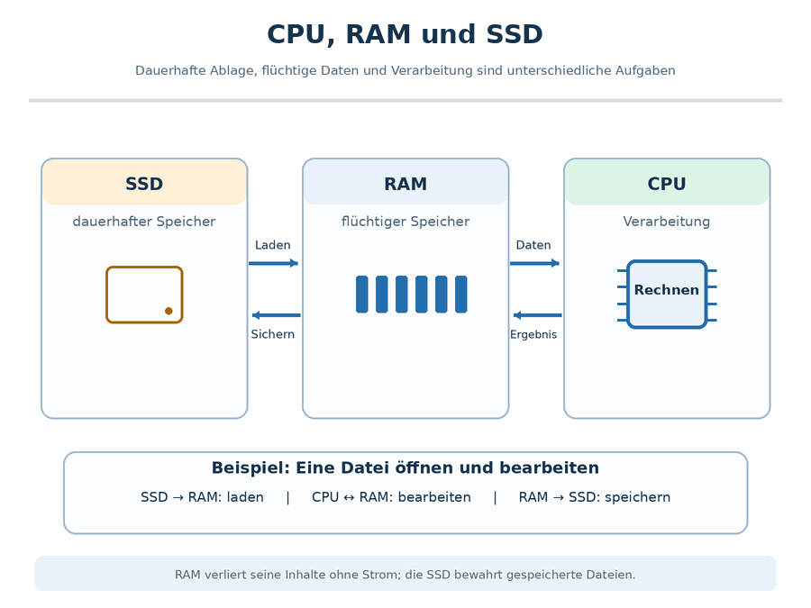

# M1-L2 – Wie Computer wirklich funktionieren {#L2}

**Kursbereich:** M1 – Bachelor: Informatik-Grundlagen

**Niveau:** Bachelor

**Vorwissen:** Keine festen Voraussetzungen angegeben.

**Lernziel:** Vom einzelnen Bit über die Arbeit eines Prozessors und Betriebssystems bis zum startenden Programm nachvollziehen, warum Computer rechnen können und welche Grenzen ihre Hardware in Desktop-, Server- und KI-Anwendungen setzt.

## Überblick: Von einer gespeicherten Datei zur laufenden Anwendung {#S1}

Ein Computer wirkt von außen wie eine Einheit: Man öffnet eine Anwendung, klickt auf „Suchen“, und wenig später erscheint ein Ergebnis. Tatsächlich müssen mehrere Schichten zusammenarbeiten. Ein dauerhaft gespeichertes Programm wird mithilfe des Betriebssystems ausführbar gemacht; ein Prozessor verarbeitet Befehle; Speicher hält Daten bereit; Geräte liefern Eingaben und nehmen Ausgaben entgegen.

``` text
Mensch / anderes Programm
          │
          ▼
Anwendung (Benutzeroberfläche, Fachlogik)
          │
          ▼
Betriebssystem (Prozesse, Speicher, Dateien, Geräte)
          │
          ▼
CPU ── Cache ── RAM
 │                 │
 ├── Geräte / Netz │
 ├── GPU (optional)│
 └──────── SSD / andere dauerhafte Speicher
```

Das ist ein **Funktionsbild**, kein exakter Schaltplan. Ein moderner Computer hat mehrere Kerne, Controller, Caches und Verbindungen. Die folgenden Abschnitte zerlegen das Gesamtbild in verständliche Teile.

## Bits, Bytes und die Bedeutung von Codierung {#S2}

Ein **Bit**, von *Binary Digit* (binäre Ziffer), kann logisch einen von zwei Werten darstellen: `0` oder `1`. Acht Bits bilden ein **Byte**. Damit sind $2^{8} = 256$ Bitmuster möglich. Ob man ein Muster als vorzeichenlose Zahl, als Teil eines Textes oder als etwas anderes versteht, entscheidet die **Codierung**.

Das **Binärsystem** verwendet statt der Dezimalstellenwerte 1, 10, 100 die Werte 1, 2, 4, 8, 16, 32 und so weiter.

  Bitposition (von rechts)     Wert
  -------------------------- ------
  0                               1
  1                               2
  2                               4
  3                               8
  4                              16
  5                              32
  6                              64
  7                             128

Das Bitmuster `00001101` bedeutet als **vorzeichenlose** Binärzahl $8 + 4 + 1 = 13$. Das Muster `11111111` steht unter derselben Interpretation für `255`. Acht Bits können ohne weitere Festlegung **nicht** jede ganze Zahl darstellen. Je nach Datentyp werden auch negative Zahlen, andere Wertebereiche oder besondere Codierungen verwendet.

### Warum ein und dieselbe Bytefolge Verschiedenes bedeuten kann

Ein bestimmtes Byte kann unter einer Zeichenkodierung für einen Buchstaben stehen, unter einer Zahlenkodierung für eine Ganzzahl oder in einer Bilddatei Bestandteil eines Farbwerts sein. **UTF-8** ist eine verbreitete Zeichenkodierung, die Unicode-Zeichen in eine oder mehrere Bytes überführt. Der Computer „weiß“ also nicht von selbst, dass eine Bytefolge ein Wort bezeichnet: Programme und Dateiformate liefern die Regeln für ihre Interpretation.

Bei einer Datenbank ist das entscheidend: Eine Filmkennung `000417` sollte als Kennung erhalten bleiben. Interpretiert man sie unbedacht als Zahl, können die führenden Nullen verschwinden. Bereits an dieser Stelle berühren sich Rechnertechnik, Informatikmodelle und die Datenhaltung aus M1-L5.

### Wenn der Wertebereich nicht reicht

In einer auf acht Bits beschränkten **vorzeichenlosen** Rechnung ergibt $200 + 100 = 300$. Dieser Wert kann nicht in acht Bits dargestellt werden. Würde das System das Ergebnis einfach auf die untersten acht Bits kürzen, bliebe `44`, weil $300 = 256 + 44$. Andere Ausführungsumgebungen erkennen den Überlauf, verwenden größere Datentypen oder definieren anderes Verhalten. **Ein mathematisch richtiges Ergebnis muss nicht in jeden technischen Datentyp passen.**

## Logikgatter: Rechnen aus einfachen Entscheidungen {#S3}

Digitaltechnik nutzt unterscheidbare elektrische Zustände. Oft werden sie vereinfacht als `0` und `1` bezeichnet. Das heißt nicht, dass überall „null Volt“ und „eine feste Eins-Spannung“ gelten: Elektrische Pegel, Störabstände und Schaltungsfamilien unterscheiden sich.

Ein **Transistor** kann in digitalen Schaltungen vereinfacht wie ein steuerbarer Schalter eingesetzt werden. Viele Transistoren bilden **Logikgatter**, die bestimmte logische Funktionen umsetzen. Drei grundlegende Funktionen der **Booleschen Algebra** sind:

- **UND (AND):** Ergebnis `1`, wenn beide Eingänge `1` sind.
- **ODER (OR):** Ergebnis `1`, wenn mindestens ein Eingang `1` ist.
- **NICHT (NOT):** Ein einzelner Eingang wird logisch umgekehrt.

  A   B   A UND B   A ODER B
  --- --- --------- ----------
  0   0   0         0
  0   1   0         1
  1   0   0         1
  1   1   1         1

Dazu kommt die Funktion **XOR** (*Exclusive OR*, exklusives Oder): Sie ergibt `1`, wenn genau einer der beiden Eingänge `1` ist. Mit XOR und UND lässt sich ein einfacher **Halbaddierer** bauen:

``` text
Eingänge A, B
     │
     ├── XOR ──► Summenbit
     └── UND ──► Übertragsbit

Beispiel: 1 + 1 → Summenbit 0, Übertrag 1
                 Ergebnis 10₂ = 2₁₀
```

Mehrere Addierer, Speicherbausteine und Steuerlogik ermöglichen kompliziertere Rechenschritte. Das ist der Übergang von einzelnen logischen Regeln zu einer Maschine, die Anweisungen ausführen kann.

### Rechenlogik und gespeicherter Zustand

Ein Gatter reagiert im Grundmodell nur auf seine aktuellen Eingänge. Eine Maschine muss sich aber auch etwas **merken** können. Dafür verwendet die Digitalelektronik Schaltungen mit Zustand, beispielsweise Flipflops; daraus lassen sich Register und weitere Speicherstrukturen aufbauen. Ein Computer kombiniert fortlaufend **Kombinationslogik** (rechnen) und **Speicherlogik** (Zustand halten).

## Die wichtigsten Hardwarebausteine {#S4}



*Abbildung: Die Pfeile zeigen typische logische Vorgänge. Der tatsächliche Weg über Betriebssystem, Speichercontroller, Cache und Ein-/Ausgabe ist komplexer; CPU, RAM und SSD kommunizieren nicht in jeder Architektur über direkte Punkt-zu-Punkt-Leitungen.*

  Baustein    Langform / Aufgabe                                      Merksatz
  ----------- ------------------------------------------------------- -------------------------------------------------------------
  **CPU**     *Central Processing Unit*, zentraler Prozessor          Führt allgemeine Maschinenbefehle aus
  **RAM**     *Random Access Memory*, Arbeitsspeicher                 Hält aktuell benötigte Daten und Code bereit
  **SSD**     *Solid State Drive*, Flash-Massenspeicher               Speichert Dateien normalerweise ohne Strom weiter
  **GPU**     *Graphics Processing Unit*, Grafik-/Parallelprozessor   Beschleunigt geeignete viele gleichartige Rechenoperationen
  **Cache**   Schneller Zwischenspeicher                              Vermeidet manche Zugriffe auf langsameren Speicher

Dazu kommen das Mainboard, Controller, Netzwerkschnittstellen, Stromversorgung und Verbindungswege. Das Wort **Bus** beschreibt in der Rechnertechnik einen Übertragungsweg beziehungsweise ein System für den Austausch von Daten und Steuersignalen. Moderne Computer besitzen verschiedene Punkt-zu-Punkt-Verbindungen und Busstrukturen statt einer einzigen Verbindung, über die alles laufen muss.

Ein Computer ist nicht allein deshalb leistungsfähig, weil seine CPU schnell ist. Daten müssen rechtzeitig verfügbar sein. Eine schnelle CPU kann auf Daten warten, eine GPU kann mangels Speicher ungenutzt bleiben, und ein Server kann durch langsamen Datenträgerzugriff oder Netzwerkverkehr ausgebremst werden.

## Was die CPU bei einem Befehl tut {#S5}

Ein Prozessor führt **Maschineninstruktionen** aus, zum Beispiel Werte laden, addieren, vergleichen, Ergebnisse ablegen oder an eine andere Programmstelle springen.

Das vereinfachte Grundprinzip nennt man oft **Fetch–Decode–Execute**:

``` text
Maschinenbefehl holen (Fetch)
             │
             ▼
Befehl erkennen (Decode)
             │
             ▼
Operation ausführen (Execute)
             │
             ▼
Ergebnis verfügbar machen → weitere Befehle
```

**Register** sind kleine, sehr schnelle Speicherbereiche direkt im Prozessor. Eine **arithmetisch-logische Einheit** (Arithmetic Logic Unit, **ALU**) führt unter anderem Additionen und logische Verknüpfungen aus. Die Steuerlogik koordiniert, welche Schritte stattfinden. Für eine Addition müssen zum Beispiel Operanden in geeigneter Form verfügbar sein; das Ergebnis wird in einem Register oder später an anderer Stelle abgelegt.

### Instruktionssatz und konkrete Prozessorbauweise

Eine **Instruktionssatzarchitektur** (*Instruction Set Architecture*, **ISA**) beschreibt den für Programme sichtbaren Vertrag: welche Befehle, Register und Regeln ein Prozessor bereitstellt. Beispiele sind **x86-64** und verschiedene **Arm**-Architekturen. Eine konkrete **Mikroarchitektur** legt dagegen fest, *wie* ein bestimmter Prozessor diesen Vertrag intern erfüllt.

Deshalb können zwei Prozessoren denselben Instruktionssatz verstehen und dennoch unterschiedlich schnell, sparsam oder teuer sein. Moderne Prozessoren können Operationen in **Pipelines** überlappen, Befehle teils **außerhalb der ursprünglichen Reihenfolge** vorbereiten und auf mehreren **Kernen** parallel arbeiten. Das einfache Holen–Dekodieren–Ausführen bleibt trotzdem ein hilfreiches gedankliches Modell.

Eine Taktfrequenz von beispielsweise drei Gigahertz beschreibt vereinfacht drei Milliarden Taktzyklen pro Sekunde – **nicht** drei Milliarden vollständig erledigte Programmzeilen. Pro Zyklus können je nach Prozessor, Instruktion und Betriebszustand unterschiedlich viele Teile einer Arbeit erledigt werden.

## Speicherhierarchie: Weshalb Datenwege so wichtig sind {#S6}

Der Prozessor benötigt Daten, doch nicht alle Speicherarten sind gleich schnell, groß oder teuer. Daher werden verschiedene Ebenen kombiniert:

``` text
CPU-Register         sehr nah, sehr klein
      ▲
CPU-Caches (L1/L2/L3) schnell, begrenzte Kapazität
      ▲
Arbeitsspeicher RAM  größer, im Normalfall flüchtig
      ▲
SSD / Massenspeicher dauerhaft, bei vielen Zugriffen langsamer
      ▲
Backup / Archiv      zusätzliche, getrennt geschützte Kopie
```

Die Pfeile stellen keine zwingende physische Reihenschaltung dar. Vielmehr zeigt die Skizze eine typische Hierarchie von Zugriffsarten. Ein **Cache** speichert häufig oder voraussichtlich benötigte Informationen nahe am Rechenwerk. Passt der Arbeitsdatensatz gut in einen Cache, kann ein Programm schnell sein. Muss ständig auf deutlich langsamere Speicher zugegriffen werden, ändert sich das Bild.

**RAM** verliert bei herkömmlicher Technik seine Inhalte ohne Strom. **SSDs** verwenden nichtflüchtigen Speicher und behalten Daten normalerweise ohne Strom. Trotzdem ist eine SSD nicht automatisch ein Backup: Eine versehentlich gelöschte Datei, ein defektes Laufwerk oder Schadsoftware kann auch dort Daten zerstören. **Datenspeicherung**, **Datenhaltbarkeit** und **Wiederherstellbarkeit** sind unterschiedliche Eigenschaften.

Ein Beispiel aus einer Medienverwaltung: Die große Videodatei liegt auf der SSD; für eine Suchanfrage werden vorzugsweise nur ihre kleinen Metadaten benötigt. Ein Suchindex kann verhindern, dass das Programm jedes Video erneut durchsuchen muss. Darum können Datenstruktur und Speicherzugriffsstrategie wichtiger sein als eine noch schnellere CPU.

### RAM, Auslagerungsdatei und virtueller Speicher nicht verwechseln

Das Betriebssystem stellt einem Prozess meist einen **virtuellen Adressraum** zur Verfügung. Das Programm benutzt virtuelle Adressen; Hardware und Betriebssystem bilden diese auf geeignete physische Speicherbereiche ab. Das schützt Prozesse voneinander und erleichtert die Speicherverwaltung.

**Virtueller Speicher bedeutet nicht automatisch Auslagerung auf die SSD.** Viele virtuelle Speicherseiten liegen im RAM oder werden bei Bedarf mit Dateien verbunden. Erst unter bestimmten Umständen können geeignete Speicherseiten über eine Auslagerungsdatei oder Swap-Partition auf Massenspeicher verschoben werden. Häufiges Nachladen aus langsamerem Speicher kann die Leistung massiv verschlechtern. Mehr Auslagerungsplatz ersetzt deshalb nicht ohne Weiteres den fehlenden RAM.

## CPU und GPU: Unterschiedliche Arten von Arbeit {#S7}

Eine **CPU** eignet sich für vielfältige Programmlogik mit vielen Entscheidungen und wechselnden Aufgaben. Eine **GPU** besitzt sehr viele Recheneinheiten, die besonders gut zusammengehörige, datenparallele Operationen verarbeiten können. Deshalb wird GPU-Hardware neben Grafik auch für bestimmte Matrixrechnungen der künstlichen Intelligenz genutzt.

``` text
CPU:  Entscheidungslogik → viele unterschiedliche Operationen
GPU:  große Datenmengen  → viele ähnliche Teilrechnungen parallel
```

Das ist keine absolute Trennung: CPUs sind ebenfalls parallel, GPUs können komplexe Programme ausführen. Nicht jeder Algorithmus lässt sich effektiv parallelisieren. Werden kleine Datenmengen erst aufwendig zwischen Hauptspeicher und Grafikspeicher übertragen, kann eine GPU trotz höherer theoretischer Rechenleistung im konkreten Fall unvorteilhaft sein.

**VRAM** (*Video Random Access Memory*) bezeichnet im Alltagssprechen den Grafikspeicher. Für große Sprachmodelle kann er zum limitierenden Faktor werden. Reine Modellgewichte, Zwischenergebnisse, Kontext und parallel laufende Anfragen benötigen Speicher – ein Zusammenhang, den **M6-L6 – KI-Infrastruktur und verteilte Berechnung** genauer erklärt.

## Vom Quelltext zum ausführbaren Befehl {#S8}

Ein Prozessor versteht nicht unmittelbar die Syntax einer Hochsprache. Ein **Compiler** übersetzt Programmtext in eine andere Form, häufig vorab in Maschinenbefehle oder über Zwischenstufen. **Assembler** ist eine maschinennahe Textdarstellung von Befehlen und steht als Begriff sowohl für diese Sprache als auch für das Werkzeug, das sie übersetzt.

Ein **Interpreter** verarbeitet eine Programmdarstellung mithilfe einer ausführenden Umgebung. Manche Systeme kombinieren beide Techniken. **JIT** heißt *Just-in-Time*-Kompilierung: Geeigneter Code wird erst zur Laufzeit in Maschinencode übersetzt, häufig um wiederholte Ausführung zu beschleunigen.

``` text
PureBasic-Quelltext → Compiler → ausführbare Datei → CPU

JavaScript-Text     → JavaScript-Engine
                    → Interpretation und/oder JIT-Kompilierung
                    → ausführbare Operationen auf der CPU
```

Diese Beispiele sind vereinfachte typische Ausführungswege, keine zwingenden Regeln für jede mögliche Implementierung. Die **Laufzeitumgebung** liefert oft weitere Funktionen wie Speicherverwaltung, Standardbibliotheken, Fehlerbehandlung und Zugriff auf bestimmte Schnittstellen.

Ein Maschinenprogramm ist außerdem an die vereinbarte **Prozessorarchitektur** und häufig an ein bestimmtes Betriebssystemformat gebunden. Derselbe Quelltext kann für unterschiedliche Zielsysteme neu übersetzt werden müssen. Deshalb bedeutet „läuft auf meinem Computer“ nicht automatisch „läuft unverändert auf jedem Server“.

## Was das Betriebssystem verwaltet {#S9}

Windows, Linux und macOS übernehmen unter anderem Prozessverwaltung, Speicherverwaltung, Dateizugriffe, Geräteansteuerung, Benutzerrechte und Netzwerkkommunikation. Der **Kernel** ist der besonders privilegierte Kern des Betriebssystems, der grundlegende Ressourcen verwaltet und Schnittstellen zu Programmen bereitstellt.

Ein **Programm** ist zunächst eine gespeicherte Beschreibung von Anweisungen. Ein **Prozess** ist eine laufende Programminstanz mit zugewiesenen Ressourcen und normalerweise eigenem virtuellem Adressraum. Innerhalb eines Prozesses können mehrere **Threads** – Ausführungsstränge – existieren. Sie teilen wesentliche Ressourcen, besitzen aber eigene Ausführungszustände.

``` text
             Betriebssystem / Scheduler
                       │
             ┌─────────┼─────────┐
             │         │         │
          Browser   Datenbank  Medien-Tool
          Prozess    Prozess    Prozess
             │
        mehrere Threads möglich
```

Ein **Scheduler** entscheidet, wann Ausführungsstränge Rechenzeit erhalten. **Nebenläufigkeit** heißt, dass mehrere Aufgaben überlappend Fortschritte machen; **Parallelität** heißt, dass sie tatsächlich gleichzeitig laufen. Ein Computer mit einem Kern kann Aufgaben durch Wechsel zwischen ihnen nebenläufig bearbeiten, ohne sie im selben Moment parallel auszuführen.

### Gleichzeitige Änderungen brauchen Regeln

Zwei Threads lesen denselben Zähler mit dem Wert `0`. Beide möchten ihn erhöhen. Wenn beide zuerst `0` lesen, unabhängig `1` berechnen und danach `1` zurückschreiben, ist das Ergebnis `1` statt `2`. Das ist ein **Race Condition** genanntes Wettlaufproblem: Das Resultat hängt von der zeitlichen Reihenfolge ab.

Solche Situationen können **Synchronisation** erforderlich machen, etwa geeignete Sperren oder atomare Operationen. Bei einer Einzelbenutzeranwendung ist das möglicherweise leicht beherrschbar; bei einem Online-Dienst mit vielen gleichzeitigen Änderungen wird es deutlich wichtiger. Spätere Lektionen M1-L7 und M3-L5 behandeln die Details.

## Geräte, Ein- und Ausgabe, Unterbrechungen {#S10}

Die **Ein-/Ausgabe** (*Input/Output*, kurz **I/O**) umfasst Datenaustausch mit SSDs, Tastaturen, Kameras, Netzwerkgeräten und vielen anderen Komponenten. Anwendungen verwenden dafür normalerweise Betriebssystemfunktionen statt jede Geräteelektronik direkt zu steuern.

Ein Gerät oder Controller kann über eine **Unterbrechung** (*Interrupt*) Aufmerksamkeit anfordern. So muss die CPU nicht ständig selbst prüfen, ob beispielsweise eine neue Eingabe eingetroffen ist. Bei größeren Datenübertragungen können spezialisierte Mechanismen wie **Direct Memory Access** (**DMA**, direkter Speicherzugriff) Datenbewegungen ermöglichen, ohne dass die CPU jedes einzelne Byte persönlich kopieren müsste. Das heißt nicht, dass die CPU dabei überhaupt keine organisatorische Arbeit mehr erledigt.

``` text
Anwendung → Betriebssystem-Schnittstelle → Gerätetreiber
                                          │
                                          ▼
                                   Gerätecontroller
                                          │
                                          ▼
                                        SSD / Netz
```

Ein langsamer Datei- oder Netzwerkzugriff ist daher nicht zwangsläufig langsame Rechenarbeit. Der Prozess kann auf eine externe Antwort warten. Das ist ein wichtiger Unterschied bei der späteren Leistungsanalyse von Servern.

## Dateisysteme und dauerhafte Daten {#S11}

Ein **Dateisystem** organisiert Dateien, Verzeichnisse, Zugriffsrechte, Metadaten und die Zuordnung von Inhalten zu Speicherbereichen. Beispiele sind **NTFS** unter Windows, **ext4** unter Linux und **APFS** unter macOS. Ein bestimmtes Betriebssystem kann je nach Konfiguration auch weitere Dateisysteme verwenden.

``` text
Anwendung → Betriebssystem → Dateisystem → SSD
```

Die Anwendung kennt einen Dateinamen. Das Dateisystem verwaltet, wo die zugehörigen Inhalte abgelegt sind und wie sie wiedergefunden werden. Dateisysteme können Verfahren besitzen, um bestimmte strukturelle Fehler nach einem Absturz zu begrenzen. Sie garantieren aber nicht automatisch, dass eine gerade laufende Änderung der Anwendung vollständig und korrekt geschrieben wurde.

Eine Datenbank erweitert einfache Dateiablage durch Abfragen, Konsistenzregeln und oft Transaktionen. Ein **Backup** erzeugt wiederum eine gesonderte Sicherung für den Fall, dass der Originaldatenbestand verloren geht. Die Einzelheiten folgen in M1-L5 und M3-L6.

## Ein Programmstart – der gesamte Ablauf {#S12}

Wenn eine Anwendung gestartet wird, passiert vereinfacht Folgendes:

1.  Das Betriebssystem erhält die Anforderung, eine ausführbare Programmdatei zu starten.
2.  Es prüft grundlegende Zugriffs- und Ausführungsbedingungen und richtet einen Prozess ein.
3.  Benötigter Code und Daten werden dem virtuellen Adressraum zugeordnet; nicht alles muss sofort vollständig von der SSD in den RAM kopiert werden.
4.  Das System weist Ausführungszeit zu. Die CPU beginnt, die passenden Maschinenbefehle zu verarbeiten.
5.  Das Programm fordert bei Bedarf Dateien, Grafikdarstellung, Netzwerknachrichten oder andere Dienste an.
6.  Beim Beenden werden Ressourcen wieder freigegeben; nur ausdrücklich gespeicherte oder anderweitig persistierte Daten bleiben typischerweise erhalten.

``` text
Programmdatei auf SSD
         │
         ▼
Lader des Betriebssystems → Prozess / virtueller Adressraum
         │
         ▼
Scheduler → CPU verarbeitet Befehle
         │
         ├── Daten aus Cache und RAM
         ├── Datei-/Netzzugriffe über Betriebssystem
         └── bei geeigneten Aufgaben GPU
         │
         ▼
Ausgabe / dauerhafte Speicherung
```

Damit schließt sich der Kreis vom Bitmuster zur konkreten Anwendung: Die Ebenen sind verschieden, wirken aber ständig zusammen.

## Drei Praxisbeispiele: Wie Hardwarewissen Entscheidungen verändert {#S13}

### Szenario A – Lokaler Medienkatalog

Eine lokale Anwendung verwaltet Filmtitel und Dateipfade. Die Datenbankabfrage ist langsam. Ein teurerer Prozessor würde vielleicht helfen, aber zuerst sollte man klären, ob bei jeder Suche der gesamte Datensatz erneut gelesen wird. Ein geeigneter **Index** kann wesentlich mehr bewirken als zusätzliche CPU-Leistung. Auch ein häufiger SSD-Zugriff oder unnötiges Laden großer Vorschaubilder kann zum Engpass werden.

**Sinnvolle Betriebsfrage:** Wie schützt man das Archiv vor Ausfall, Fehlbedienung und fehlerhaften Importen? Für eine lokale Anwendung kann ein einfaches Datensicherungskonzept wichtiger sein als eine Serverarchitektur.

### Szenario B – Kleiner öffentlicher Dienst

Mehrere Nutzer senden gleichzeitig Anfragen. Hier müssen Prozesse, Threads, RAM, Netzwerk und Datenträger gemeinsam betrachtet werden. Liegt die Verzögerung an einer langsam reagierenden Datenbank, behebt eine größere CPU des Webservers das Problem möglicherweise nicht.

``` text
Browser ──Netz──► Webanwendung ──► Datenbank
                    │                │
                   CPU/RAM         Index/SSD/RAM
                    └── Messwerte + Protokolle ─┘
```

**Betriebsfolgen:** Updates, Benutzerrechte, Überwachung, Backups, Verschlüsselung, Datenschutz und laufende Kosten gehören dazu. Eine schlichte Anwendung auf einem einzelnen gemieteten Server kann zunächst sinnvoller sein als ein komplizierter Cluster.

### Szenario C – Bilder und KI verarbeiten

Eine Bild- oder KI-Anwendung nutzt gegebenenfalls eine GPU. Ob das hilft, hängt von der Parallelisierbarkeit, der Modellgröße und den Speicherwegen ab. Eine Grafikkarte mit hoher Rechenleistung, aber zu wenig Grafikspeicher kann für ein bestimmtes Modell ungeeignet sein. Wenn Bilddateien zuerst langsam von einem Datenträger oder aus dem Netz geladen werden, nützt zusätzliche GPU-Leistung womöglich wenig.

**Betriebsfolgen:** Strombedarf, Abwärme, Speicherausstattung, Softwarekompatibilität, Rechenzeit und bei Cloud-GPUs laufende Mietkosten. Für seltene Aufgaben kann die Nutzung eines entfernten Dienstes geeigneter sein; für vertrauliche Daten kann ein lokaler Betrieb Vorteile haben, erzeugt aber eigene Wartungspflichten.

## Häufige Denkfehler {#S14}

  Annahme                                                        Fachlich präzisere Einordnung
  -------------------------------------------------------------- --------------------------------------------------------------------------------------------------------------
  „Doppelte Taktfrequenz bedeutet doppelte Geschwindigkeit.“     Instruktionen pro Zyklus, Kerne, Speicher und Arbeitslast beeinflussen die Leistung.
  „Virtueller Speicher ist einfach Speicherplatz auf der SSD.“   Virtuelle Adressen sind ein Adressierungs- und Schutzkonzept; Auslagerung ist nur ein möglicher Mechanismus.
  „Mehr Threads machen jedes Programm schneller.“                Zusätzliche Threads können konkurrieren und Synchronisation benötigen.
  „Die SSD ist dauerhaft, also brauche ich kein Backup.“         Dauerhaftigkeit bei Stromausfall schützt nicht vor Löschung, Defekt und Angriffen.
  „GPU ist grundsätzlich schneller als CPU.“                     Der Vorteil hängt von Aufgabentyp, Datenbewegung, Speicher und Software ab.
  „Ein Server ist eine völlig andere Art von Computer.“          Server bezeichnet zunächst eine Rolle; Hardware und Betrieb können anders dimensioniert sein.

## Zusammenfassung und Übergang {#S15}

Elektronische Schaltungen repräsentieren logische Zustände als Bits. Aus Logikgattern, Registern und weiteren Komponenten entstehen Prozessoren, die festgelegte Maschinenbefehle ausführen. Betriebssysteme koordinieren Prozesse, Threads, Dateien, Speicher und Geräte. Cache, RAM, SSD, CPU und GPU unterscheiden sich in Eigenschaften und Aufgaben. Daraus folgen Leistungsgrenzen ebenso wie Architekturentscheidungen.

**Weiterlesen:** [M1-L3 – Algorithmen und Datenstrukturen](M1-L3.md) vertieft die Auswahl effizienter Verfahren. [M1-L7 – Weitere Gebiete der Informatik](M1-L7.md) erklärt weitere Aspekte von Nebenläufigkeit und Compilern. [M2-L1 – Vom PC zum Server](M2-L1.md) knüpft unmittelbar an die Hardware- und Betriebssystemgrundlagen an.


## Quellen {#S16}

**Letzte Quellenprüfung:** 04.11.2026

- **Arm Developer – Einführung in die Arm-Architektur:** [https://developer.arm.com/-/media/Arm%20Developer%20Community/PDF/Learn%20the%20Architecture/Introducing%20the%20Arm%20architecture.pdf?revision=0b6b67ea-edd7-4975-b23c-d4904ac0cb35](https://developer.arm.com/-/media/Arm%20Developer%20Community/PDF/Learn%20the%20Architecture/Introducing%20the%20Arm%20architecture.pdf?revision=0b6b67ea-edd7-4975-b23c-d4904ac0cb35) (Instruktionssatz, Register, Software-/Hardwarevertrag; überprüft 04.11.2026).
- **Linux-Kerneldokumentation – Memory Management:** [https://docs.kernel.org/admin-guide/mm/index.html](https://docs.kernel.org/admin-guide/mm/index.html) (virtueller Speicher, Demand Paging, Prozesse; überprüft 04.11.2026).
- **Mozilla Developer Network – JavaScript Engine:** [https://developer.mozilla.org/en-US/docs/Glossary/Engine/JavaScript](https://developer.mozilla.org/en-US/docs/Glossary/Engine/JavaScript) (Interpretation und JIT-Kompilierung; überprüft 04.11.2026).
- **ACM/IEEE-CS/AAAI – CS2023 Computer Architecture and Organization:** [https://csed.acm.org/knowledge-areas/](https://csed.acm.org/knowledge-areas/) (akademische Einordnung; überprüft 04.11.2026).
