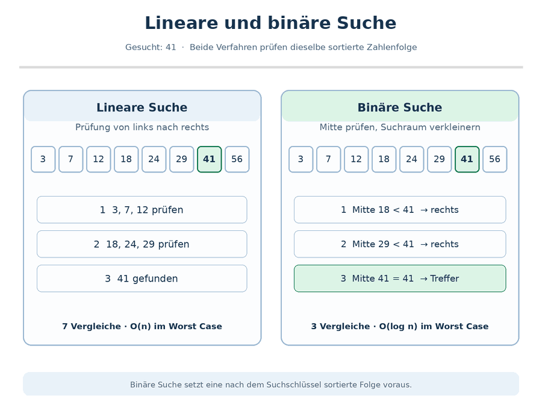

# M1-L3 – Algorithmen und Datenstrukturen {#L3}

**Kursbereich:** M1 – Bachelor: Informatik-Grundlagen

**Niveau:** Bachelor

**Vorwissen:** [M1-L1](M1-L1.md) · [M1-L2](M1-L2.md)

**Weiterführend:** [M1-L4 – Softwaretechnik und Systementwurf](M1-L4.md) · [M8-L4 – Algorithmen und Datenstrukturen vertieft](M8-L4.md)

## Überblick: Warum ein richtiger Algorithmus wichtiger sein kann als ein schneller Prozessor {#S1}

Angenommen, ein Programm verwaltet eine Sammlung von Dateien. Es soll den Eintrag mit einer bestimmten Kennung finden. Bei 20 Einträgen spielt die Suchmethode kaum eine Rolle. Bei zehn Millionen Einträgen kann dieselbe Entscheidung über die Datenorganisation den Unterschied zwischen einer fast sofortigen Antwort und vielen unnötigen Vergleichen ausmachen.

Die Informatik untersucht deshalb nicht nur, *wie* ein Programm geschrieben wird, sondern auch, **welches Verfahren** ein Problem löst und **wie** Daten dafür bereitgestellt werden.

- Ein **Algorithmus** ist eine eindeutig beschriebene, endliche Folge von Schritten zur Lösung einer Klasse von Aufgaben.
- Eine **Datenstruktur** ist eine organisierte Form, Daten zu speichern und auf sie zuzugreifen.
- Die **Komplexitätsanalyse** betrachtet, wie viel Zeit und Speicher ein Verfahren je nach Größe der Eingabe benötigt.

Eine gute Datenstruktur macht bestimmte Algorithmen effizient. Ein guter Algorithmus nutzt die Eigenschaften der Datenstruktur aus. Beide Entscheidungen gehören zusammen.

### Mini-Architektur

``` text
Anfrage: "Finde Kunde 4711"
              │
              ▼
     Algorithmus (Suchregel)
              │
              ▼
  Datenstruktur (z. B. Liste,
       Hash-Tabelle, Baum)
              │
              ▼
       Ergebnis / nicht gefunden
```

**Ausgangsproblem:** Ohne eine geeignete Organisation muss die Anwendung womöglich viele irrelevante Datensätze ansehen. **Wann unnötig?** Bei einer kleinen, selten durchsuchten Liste ist eine komplizierte Struktur oft teurer in Entwicklung und Wartung als eine einfache Schleife.

------------------------------------------------------------------------

## Suchen: Vom Durchgehen bis zum gezielten Zugriff {#S2}

### Lineare Suche {#11-lineare-suche}



*Abbildung: Didaktisches Beispiel für diese acht Werte und den Suchwert 41. Die Zahl der Vergleiche hängt von der Position ab; die Worst-Case-Abschätzungen $O(n)$ und $O(\log n)$ gelten unter den jeweiligen Voraussetzungen. Binäre Suche erfordert eine passend sortierte Folge.*

Die **lineare Suche** prüft einen Eintrag nach dem anderen, bis der gesuchte Wert gefunden wurde oder alle Einträge geprüft wurden. Sie funktioniert auch dann, wenn die Daten völlig ungeordnet sind. Ihr Vorteil ist die Einfachheit; sie benötigt keinen besonderen Suchindex. Ihr Nachteil: Im ungünstigsten Fall muss sie jeden Eintrag prüfen.

``` text
[Anna] [Berta] [Cem] [Dora] [Emil]
  ↓       ↓      ↓      ↓
     Suche nach "Dora"
```

Bei `n` Einträgen sind im ungünstigsten Fall ungefähr `n` Vergleiche nötig: **$O(n)$**, gesprochen „O von n“.

### Binäre Suche {#12-binäre-suche}

Wenn die Daten **sortiert** vorliegen und ein direkter Zugriff auf mittlere Elemente möglich ist, kann man jeweils die Hälfte des verbleibenden Suchbereichs ausschließen. Man vergleicht zuerst mit dem mittleren Eintrag und sucht danach ausschließlich links oder rechts weiter. Dieses Vorgehen wiederholt sich, bis der Eintrag gefunden oder der Suchbereich leer ist.

``` text
Sortierte Kennungen:  [ 2  5  8  12  17  21  28  35 ]
                              │
                     Mitte vergleichen
                        /           \
             kleinere Werte      größere Werte
                   │                 │
                 erneut halbieren
```

Bei etwa einer Million Einträgen sind höchstens rund 20 solcher Halbierungsschritte nötig, sofern wir jede Position direkt erreichen können. Das Wachstum ist **$O(\log n)$**, genauer hier meist zur Basis 2. Die Basis spielt für die grobe O-Einordnung keine Rolle.

**Wichtige Einschränkung:** Die Sortierung muss vorhanden sein oder erst hergestellt werden. Eine einmalig aufgebaute sortierte Struktur kann viele spätere Suchanfragen beschleunigen; bei ständig eintreffenden Änderungen können ihre Pflegekosten relevant werden. Auf einer einfach verketteten Liste ist der Zugriff auf das mittlere Element nicht ohne Weiteres schnell – binäre Suche ist dort trotz sortierter Werte nicht automatisch sinnvoll.

### Suche per Hash-Tabelle {#13-suche-per-hash-tabelle}

Eine **Hash-Funktion** berechnet aus einem Suchschlüssel einen Wert, der zur Auswahl eines Speicherbereichs dient. Statt die Liste von Anfang an zu durchlaufen, kann die Anwendung gezielt den passenden Bereich aufsuchen. Das funktioniert besonders gut, wenn man die genaue Kennung kennt, etwa eine Kunden-ID.

``` text
Kunden-ID "4711"
       │
       ▼
  Hash-Funktion
       │
       ▼
    Bereich 42 ──► [Eintrag mit ID 4711]
```

Im üblichen Fall erreicht eine gut organisierte Hash-Tabelle Suchen, Einfügen und Löschen mit **erwartetem $O(1)$**, also einem Aufwand, der nicht proportional zur Anzahl aller Einträge steigt. Das ist **keine** absolute Garantie: Unterschiedliche Schlüssel können denselben Bereich zugewiesen bekommen (**Kollision**). Eine ungeeignete Hash-Funktion, schlechte Auslastung oder gezielt gewählte Eingaben können Zugriffe deutlich verlangsamen. Außerdem bewahrt eine klassische Hash-Tabelle die Schlüssel nicht automatisch in Sortierreihenfolge auf.

**Merksatz:** Für exakte Schlüsselabfragen kann eine Hash-Tabelle ideal sein; für geordnete Bereiche wie „alle Bestellungen zwischen zwei Daten“ ist ein Suchbaum oder Datenbankindex häufig passender.

------------------------------------------------------------------------

## Sortieren: Warum die Methode auf große Datenmengen wirkt {#S3}

Sortieren bedeutet, Einträge nach einer festgelegten Reihenfolge anzuordnen, zum Beispiel nach Namen, Datum oder Betrag. Die Reihenfolge kann spätere Such-, Filter- und Auswertungsoperationen vereinfachen. Einfache Sortierverfahren vergleichen und verschieben wiederholt Elemente; leistungsfähigere Verfahren zerlegen die Aufgabe in kleinere Teile oder nutzen zusätzliche Hilfsstrukturen.

### Drei typische Strategien

**Insertion Sort (Einfügesortierung):** Man nimmt einen Wert nach dem anderen und fügt ihn in den bereits sortierten Teil ein. Für wenige oder fast sortierte Daten kann das sehr gut funktionieren. Im ungünstigsten Fall sind jedoch ungefähr quadratisch viele Verschiebungen/Vergleiche erforderlich.

**Merge Sort (Mischsortierung):** Die Eingabe wird wiederholt in kleinere Teile zerlegt. Anschließend werden sortierte Teile kontrolliert zusammengeführt. Die Laufzeit ist auch im ungünstigsten Fall typischerweise **$O(n\log n)$**; die übliche Array-Variante benötigt zusätzlichen Speicher in der Größenordnung **$O(n)$**.

**Quicksort (Schnellsortierung):** Ein ausgewählter Vergleichswert (*Pivot*) trennt die Daten in Bereiche, die rekursiv sortiert werden. Im Durchschnitt sind vergleichsbasierte Standardvarianten sehr schnell und benötigen **$O(n\log n)$** Zeit. Bei ungünstiger Aufteilung kann eine einfache Variante aber auf **$O(n^2)$** fallen. Gute Implementierungen verwenden Schutzmaßnahmen oder wechseln bei Bedarf die Strategie.

  Verfahren           Typischer oder garantierter Zeitaufwand   Stärke                                  Grenze
  ------------------- ----------------------------------------- --------------------------------------- ---------------------------------------------------------
  Einfügesortierung   ungünstig $O(n^2)$                        einfach; kleine/fast sortierte Mengen   große, ungünstig angeordnete Mengen
  Mischsortierung     $O(n\log n)$, auch ungünstig              zuverlässig vorhersagbar                zusätzlicher Speicher in gängiger Array-Implementierung
  Quicksort           durchschnittlich $O(n\log n)$             oft schnell in der Praxis               einfache Varianten ungünstig $O(n^2)$

**Sortierstabilität** ist ein weiterer Begriff: Eine stabile Sortierung erhält die ursprüngliche Reihenfolge von Elementen, deren Sortierschlüssel gleich ist. Das kann wichtig sein, wenn man etwa erst nach Name und dann stabil nach Wohnort sortiert. Eine pauschale Aussage „Algorithmus X ist immer am schnellsten“ wäre falsch – Datenmuster, Speichernutzung und Implementierung entscheiden mit.

### Mini-Ablauf einer Mischsortierung

``` text
[8, 3, 7, 1]
     │ aufteilen
[8, 3]     [7, 1]
  │           │
[3, 8]     [1, 7]
     │ zusammenführen
 [1, 3, 7, 8]
```

**Wann unnötig?** Wenn wenige Werte nur einmal durchlaufen werden, kostet vorheriges Sortieren möglicherweise mehr als die spätere Ersparnis. Auch ein Datenbankindex ist nicht kostenlos: Er beansprucht Speicher und muss bei Änderungen gepflegt werden.

------------------------------------------------------------------------

## Datenstrukturen: Nicht alles ist eine Liste {#S4}

Die richtige Struktur hängt davon ab, *welche Operation häufig ausgeführt wird*. Für eine Warteschlange benötigt man andere Eigenschaften als für eine Kundensuche oder die Darstellung eines Straßennetzes.

### Array / Feld {#31-array-feld}

Ein **Array** speichert Elemente in einer geordneten Folge, üblicherweise so, dass über eine Positionsnummer schnell zugegriffen werden kann. Bei einem klassischen zusammenhängenden Array ist der Zugriff auf ein bekanntes Element **$O(1)$**. Einfügen mitten in einem dichten Array kann dagegen das Verschieben vieler nachfolgender Elemente erfordern, also **$O(n)$**.

``` text
Index:  0     1     2     3
Wert: [12]  [18]  [25]  [19]
                    ▲
             direkter Zugriff
```

Dynamische Arrays können wachsen; dabei müssen sie gelegentlich einen größeren Speicherbereich anfordern und Werte kopieren. Einzelne Erweiterungen sind teurer, wiederholtes Anhängen ist bei üblichen Strategien aber häufig **amortisiert $O(1)$**. Das bedeutet: über viele Anhänge gemittelt konstanter Aufwand, nicht jedes Mal garantiert konstante Kosten.

### Verkettete Liste {#32-verkettete-liste}

Eine **verkettete Liste** besteht aus Elementen, die Verweise auf Nachfolger (und manchmal Vorgänger) besitzen. Um ein Element am Anfang einzufügen, müssen nicht alle späteren Elemente verschoben werden. Dafür ist ein beliebiger Eintrag über seine Positionsnummer nicht direkt erreichbar; gewöhnlich folgt man den Verweisen der Reihe nach. Zudem kosten Verweise zusätzlichen Speicher und erschweren oft die effiziente Nutzung moderner Prozessor-Caches.

``` text
[Anna | →] ─► [Berta | →] ─► [Cem | Ende]
```

**Sinnvoll:** Wenn häufig an bekannten Stellen verkettet oder entfernt wird. **Überdimensioniert:** Wenn einfache, fortlaufende Daten mit vielen Positionszugriffen verwaltet werden – hier ist ein Array häufig praktischer.

### Stack / Stapel und Queue / Warteschlange {#33-stack-stapel-und-queue-warteschlange}

Ein **Stack (Stapel)** arbeitet nach **LIFO (Last In, First Out)**: Der zuletzt abgelegte Eintrag wird zuerst entnommen. Typische Beispiele sind die Verwaltung verschachtelter Funktionsaufrufe oder die Rückgängig-Funktion.

Eine **Queue (Warteschlange)** arbeitet nach **FIFO (First In, First Out)**: Der zuerst eingetroffene Eintrag wird zuerst bearbeitet. Typische Beispiele sind Druckaufträge, Aufgaben für Hintergrundprozesse oder die geordnete Bearbeitung von Nachrichten.

``` text
Stack:  hinein → [A, B, C] → heraus: C zuerst
Queue:  hinein → [A, B, C] → heraus: A zuerst
```

Beides sind zunächst abstrakte Zugriffsregeln. Man kann sie mit Arrays, verketteten Listen oder spezialisierten Strukturen umsetzen. Später begegnen Queues bei Server-Workern und verteilten Anwendungen wieder.

### Bäume {#34-bäume}

Ein **Baum** ordnet Elemente hierarchisch an: Ein Wurzelknoten besitzt Kinder, diese können wiederum eigene Kinder besitzen. Ein **binärer Suchbaum** organisiert Schlüssel so, dass links kleinere und rechts größere Werte stehen (bei geeigneter Behandlung von Gleichständen). Dadurch kann eine Suche Schritt für Schritt einen Teilbaum ausschließen.

``` text
             [20]
            /    \
         [10]    [30]
         /  \      \
       [5] [15]    [40]
```

Wenn der Baum **balanciert** bleibt, sind Suche, Einfügen und Löschen bei gängigen balancierten Suchbäumen **$O(\log n)$**. Ein schlecht gewachsener, nicht balancierter Baum kann dagegen wie eine lange Liste werden und im ungünstigsten Fall **$O(n)$** benötigen.

Datenbanken verwenden häufig Varianten von **B-Bäumen/B+-Bäumen** als Indizes: Ihre Knoten fassen mehrere Schlüssel zusammen, was besonders für blockorientierte Speicherzugriffe geeignet ist. Der genaue Datenbanktyp und seine Indeximplementierung sind in Lektion M1-L5 und M3-L1 zu unterscheiden.

### Graphen {#35-graphen}

Ein **Graph** beschreibt eine Menge von **Knoten** (englisch *Vertices*) und **Kanten** (*Edges*), also Beziehungen zwischen diesen Knoten. Anders als bei einem Baum sind beliebige Verzweigungen, Kreise und mehrere Verbindungen möglich. So lassen sich Straßennetze, soziale Beziehungen, Abhängigkeiten zwischen Softwaremodulen oder Kommunikationsnetze modellieren.

``` text
    [A] ───── [B]
     │       / │
     │      /  │
    [C] ───── [D]
```

Eine **Breitensuche** (*Breadth-First Search*, BFS) untersucht einen Graphen schrittweise nach Entfernung in Kanten. Bei einem ungewichteten Graphen findet sie einen Weg mit möglichst wenigen Kanten. Eine **Tiefensuche** (*Depth-First Search*, DFS) verfolgt dagegen zunächst einen Pfad möglichst tief, bevor sie zurückkehrt. Bei einer Darstellung durch Nachbarschaftslisten benötigen beide im üblichen Modell **$O(V+E)$**, mit `V` für die Knotenzahl und `E` für die Kantenzahl.

**Grenze:** „Kürzester Weg“ hängt davon ab, was *kurz* bedeutet. Wenn Straßen unterschiedliche Längen oder Kosten besitzen, reicht eine einfache Breitensuche nicht; dann kommen gewichtete Wegesuchverfahren ins Spiel.

------------------------------------------------------------------------

## Drei wichtige Entwurfsstrategien {#S5}

### Rekursion: Ein Problem mit sich selbst beschreiben {#41-rekursion-ein-problem-mit-sich-selbst-beschreiben}

Eine Funktion kann dieselbe Problemart für einen kleineren Teil erneut bearbeiten. Dieses Prinzip heißt **Rekursion**. Entscheidend ist ein **Abbruchfall**, damit die Aufrufe irgendwann enden. Verzeichnisbäume, verschachtelte Dokumente und Baumstrukturen lassen sich auf diese Weise oft besonders verständlich verarbeiten.

``` text
Bearbeite Ordner
  ├─ Datei verarbeiten
  └─ Unterordner gefunden
        └─ Bearbeite Unterordner
```

**Grenzen:** Jeder rekursive Aufruf benötigt typischerweise Verwaltungsinformationen auf dem Aufrufstack. Sehr tiefe Rekursion kann zu einem Stacküberlauf führen. Eine iterative Lösung mit eigener Arbeitsliste kann robuster sein.

### Dynamische Programmierung: Ergebnisse nicht immer neu berechnen {#42-dynamische-programmierung-ergebnisse-nicht-immer-neu-berechnen}

Manche Aufgaben enthalten **überlappende Teilprobleme**. Wenn dieselbe Teilfrage wiederholt auftritt, kann man ihr Ergebnis zwischenspeichern und erneut verwenden. Dieses Prinzip nennt man **dynamische Programmierung**. Man kann Ergebnisse während einer rekursiven Berechnung merken (**Memoisierung**) oder die Teilprobleme in einer geeigneten Reihenfolge aufbauen (**Tabellierung**).

Ein bekanntes Beispiel ist das Berechnen einer Folge, deren neuer Wert aus vorangegangenen Werten entsteht. Ohne Zwischenspeicherung können naive Rekursionsverfahren identische Teilprobleme sehr oft wiederholen. Mit Zwischenspeicherung wird jeder benötigte Zwischenwert nur einmal berechnet.

``` text
Teilproblem lösen ─► Ergebnis merken
      ▲                     │
      └──── später erneut benutzen
```

**Nachteil:** Man braucht oft zusätzlichen Speicher und muss die tatsächlich wiederverwendbaren Teilprobleme identifizieren. Für ein einfaches einmaliges Ergebnis kann diese Technik überflüssig sein.

### Greedy-Algorithmen: Jetzt die beste lokale Wahl treffen {#43-greedy-algorithmen-jetzt-die-beste-lokale-wahl-treffen}

Ein **Greedy-Algorithmus** (deutsch: gieriges Verfahren) trifft in jedem Schritt eine lokal günstig erscheinende Entscheidung und korrigiert sie normalerweise nicht rückwirkend. Das kann einfach und schnell sein. Bei manchen Problemen führt eine richtig gewählte lokale Regel garantiert zum global besten Ergebnis.

Beispiel: Sollen möglichst viele **gleichwertige, nicht überlappende Termine** aus einem Zeitplan ausgewählt werden, ist es optimal, immer den noch möglichen Termin mit dem frühesten Ende zu wählen. Bei anderen Zielen, etwa unterschiedlich wichtigen Terminen mit verschiedenen Gewichten, genügt dieselbe Regel nicht unbedingt.

**Merksatz:** Greedy ist eine Vorgehensweise, kein Beweis für ein optimales Ergebnis. Ob die lokale Entscheidung global korrekt ist, hängt vom Problem ab.

------------------------------------------------------------------------

## Was bedeutet die O-Notation wirklich? {#S6}

Die **Landau- oder Big-O-Notation** beschreibt eine obere Grenze für das asymptotische Wachstum des Aufwands bei großen Eingaben. Vereinfacht fragen wir: *Wie stark wächst die Arbeit, wenn die Datenmenge `n` steigt?* Dabei werden feste Faktoren und kleinere Wachstumsterme für die grobe Einordnung weggelassen. **$O(n)$** ist also keine gemessene Zeitangabe und nicht automatisch eine genaue Beschreibung des Durchschnittsfalls.

  Notation      Anschauliches Wachstum        Typisches Beispiel unter passenden Annahmen
  ------------- ----------------------------- ----------------------------------------------
  $O(1)$        unabhängig von `n` begrenzt   Array-Zugriff über bekannten Index
  $O(\log n)$   wächst sehr langsam           binäre Suche in sortiertem Array
  $O(n)$        proportional zu `n`           komplette Liste einmal durchlaufen
  $O(n\log n)$  etwas stärker als linear      Merge Sort
  $O(n^2)$      quadratisch                   alle Paare einer Liste vergleichen
  $O(2^n)$      exponentiell                  naive vollständige Prüfung vieler Teilmengen

### Mini-Vergleich: 1.000 gegenüber 1.000.000 Datensätzen {#mini-vergleich-1000-gegenüber-1000000-datensätzen}

  Wachstum            Bei $n=1\,000$  Bei $n=1\,000\,000$
  ------------------ --------------- --------------------
  $\log_2(n)$, grob               10                   20
  n                            1.000            1.000.000
  $n^2$                    1.000.000    1.000.000.000.000

Diese Zahlen sind **Modellgrößen, keine Millisekundenwerte und keine Messung eines konkreten Programms**. Trotzdem machen sie den Größenunterschied sichtbar: Ein quadratisches Verfahren wird bei sehr großen Eingaben schnell problematisch.

**Weitere wichtige Unterscheidungen:**

- **Best Case / Average Case / Worst Case:** günstigster, durchschnittlicher und ungünstigster Fall können sich deutlich unterscheiden.
- **Zeitkomplexität / Speicherkomplexität:** Ein schnelleres Verfahren kann mehr Arbeitsspeicher benötigen.
- **Amortisierte Kosten:** Teure Einzelschritte können bei langen Folgen von Operationen im Mittel günstig sein.
- **Konstanten bleiben praktisch wichtig:** Bei kleinen Datenmengen kann ein theoretisch schlechter skalierendes Verfahren durch geringe Fixkosten schneller sein.

Andere mathematische Schreibweisen sind **Omega (Ω)** für eine asymptotische Untergrenze und **Theta (Θ)** für eine passende obere *und* untere Schranke. Eine Angabe wie $O(n^{2})$ bedeutet zunächst nur: Der betrachtete Aufwand wächst unter den genannten Annahmen **nicht schneller als eine quadratische obere Schranke**. Sie beweist nicht, dass der Algorithmus tatsächlich quadratische Zeit benötigt; beispielsweise gehört eine lineare Laufzeit auch zur Klasse $O(n^{2})$. Erst `Θ(n)` beschreibt eine im asymptotischen Sinn passende lineare Wachstumsordnung. Ebenso sind **erwartete Kosten** (bei angegebenem Zufalls-/Eingabemodell) und **amortisierte Kosten** (über eine Folge von Operationen) verschiedene Aussagen – weder die eine noch die andere ist automatisch eine Worst-Case-Garantie. Diese Unterscheidungen werden in [M7-L2](M7-L2.md) formal vertieft.

------------------------------------------------------------------------

## Grenzen der Berechenbarkeit und schwierige Optimierung {#S7}

Nicht jedes klar formulierte Problem lässt sich mit einem allgemeinen Algorithmus für alle denkbaren Eingaben entscheiden. Ein klassisches Beispiel ist das **Halteproblem**: Es existiert kein allgemeines Verfahren, das für jedes beliebige Programm und jede Eingabe zuverlässig entscheidet, ob dieses Programm irgendwann anhält. Das ist eine **prinzipielle Grenze der Berechenbarkeit**, keine Frage teurerer Hardware.

Davon muss man **schwierige, aber berechenbare Probleme** unterscheiden. Bei vielen Optimierungsaufgaben können wir jede einzelne vorgeschlagene Lösung prüfen, müssen für die garantiert beste Lösung aber womöglich eine riesige Zahl von Möglichkeiten betrachten. Solche Probleme treten etwa bei Routenplanung, Terminoptimierung und der Kombination vieler Bedingungen auf.

Eine wichtige Klasse heißt **NP-schwer (NP-hard)**. Das ist ein Begriff aus der Komplexitätstheorie und nicht gleichbedeutend mit „unlösbar“. Für manche dieser Probleme nutzt man in der Praxis Heuristiken, Annäherungsverfahren oder spezielle Eigenschaften der Eingabedaten. Eine **Heuristik** ist eine praktikable Regel, die häufig brauchbare Ergebnisse liefert, ohne unter allen Bedingungen die perfekte Lösung zu garantieren. Der genaue Unterschied zwischen NP, NP-vollständig und NP-schwer bleibt einem späteren optionalen Theorieexkurs vorbehalten.

**Wann relevant?** Wenn ein Dienst nicht nur Daten suchen, sondern aus Millionen Kombinationen einen *optimalen* Plan ableiten soll. Mehr Cloud-Server können das Rechnen beschleunigen, ändern aber nicht automatisch die grundlegende Schwierigkeit des Problems.

------------------------------------------------------------------------

## Bezug zu eigenen Softwareideen und späterer Cloud-Architektur {#S8}

Stell dir ein lokal entwickeltes Werkzeug vor, das Videometadaten, Dateiverzeichnisse oder Kundenkennungen verwaltet. Bei wenigen Hundert Einträgen ist eine einfache Tabelle ausreichend. Wächst der Bestand, sollte man zunächst die tatsächliche Operation untersuchen: Wird nach einer Kennung gesucht, chronologisch sortiert, eine Kategorie gefiltert oder ein Beziehungsnetz traversiert? Erst danach lässt sich die passende Datenstruktur wählen.

### Beispiel A – Lokaler Medienkatalog

``` text
Gesuchte Video-ID
       │
       ▼
Index / Hash-Tabelle ──► Datensatz
       │
       └─ statt jedes Video einzeln zu lesen
```

Ein geordneter Index kann zusätzlich sinnvoll sein, wenn nach Veröffentlichungsdatum sortiert oder ein Datumsbereich gesucht wird. Allerdings benötigen Indizes Platz auf dem Datenträger und müssen bei neuen oder geänderten Datensätzen aktualisiert werden.

### Beispiel B – Kleiner Online-Dienst

``` text
Browser → Anwendung → Datenbank-Abfrage
                         │
                    Index nutzen?
                         │
                    Treffer zurück
```

Bei einer SQL-Datenbank (Structured Query Language = Sprache für relationale Datenabfragen) kann der **Abfrageplan** beispielsweise bestimmen, ob ein vorhandener Index verwendet wird oder eine Tabelle vollständig gelesen werden muss. Die offizielle SQLite-Dokumentation beschreibt, wie Indizes sowohl Suchoperationen als auch Sortierungen beschleunigen können und wie ein kostenbasierter Planer zwischen Vorgehensweisen wählt.

### Beispiel C – Verteilte KI-Arbeit

``` text
Aufträge → Queue → freie Worker → Ergebnisse
```

Die Warteschlange organisiert die Reihenfolge verfügbarer Aufgaben. Das ist zunächst eine Datenstrukturfrage. Erst später kommt die technische Verteilung auf mehrere Rechner hinzu: Was passiert bei Ausfall eines Workers, wie verhindert man doppelte Verarbeitung und wo speichert man Ergebnisse? Diese betrieblichen Fragen behandeln wir in M4-L1 und im KI-Abschnitt M6-L6.

**Kosten- und Betriebsfolgen:** Bessere Algorithmen können Rechenzeit, Energie und Cloud-Kosten reduzieren. Zusätzliche Indizes kosten dagegen Speicher, Pflegeaufwand und unter Umständen längere Schreibvorgänge. Graphen und Cache-Strukturen benötigen Synchronisation und können bei vielen Änderungen schwieriger zu betreiben sein. Bei der Auswahl zählt deshalb der gesamte Arbeitsaufwand, nicht nur die Geschwindigkeit einer einzelnen Suche.

------------------------------------------------------------------------

## Entscheidungshilfe: Was ist wann angemessen? {#S9}

  Ausgangssituation                         Häufig vernünftiger Anfang           Wann mehr nötig wird
  ----------------------------------------- ------------------------------------ --------------------------------------------------------------
  Wenige Einträge, seltene Suche            einfache Liste/Array                 wenn Suchzeiten spürbar werden
  Exakte Suche über eindeutige ID           Hash-Tabelle oder Datenbankindex     bei Bereichsabfragen oder Sortieranforderungen
  Sortierte Reihenfolge und Bereichssuche   balancierter Baum / Datenbankindex   wenn Speicher- und Schreibkosten problematisch werden
  Aufträge der Reihe nach abarbeiten        Queue                                wenn Ausfall, Wiederholung und Verteilung nötig werden
  Abhängigkeiten, Wege, Netzwerke           Graph                                wenn das zugrundeliegende Modell zu groß oder dynamisch wird
  Wiederholte ähnliche Teilprobleme         dynamische Programmierung            wenn Zwischenspeicher den Nutzen übersteigt

**Nicht zuerst skalieren, sondern zuerst verstehen:** Ein ineffizienter Algorithmus wird nicht automatisch gut, wenn er auf einem größeren Server läuft. Oft ist es wirtschaftlicher, Suchstrategie, Datenmodell oder Abfrageplan zu verbessern, bevor zusätzliche Infrastruktur gemietet wird.

## Zusammenfassung und Übergang {#S10}

1.  **Algorithmus und Datenstruktur bilden ein Paar:** Die gespeicherte Form entscheidet darüber, welche Verarbeitung einfach oder teuer ist.
2.  **Suchen und Sortieren sind Grundbausteine:** Lineare Suche, binäre Suche und Hashing lösen unterschiedliche Anforderungen.
3.  **Arrays, Listen, Stacks, Queues, Bäume und Graphen** organisieren Daten für verschiedene Zugriffsmuster.
4.  **Rekursion, dynamische Programmierung und Greedy-Strategien** sind allgemeine Entwurfsmethoden, aber keine Universallösungen.
5.  **Die O-Notation beschreibt Wachstum**, nicht gemessene Sekunden. Durchschnitt, Worst Case und Speicherverbrauch sind getrennt zu betrachten.
6.  **Prinzipielle Unberechenbarkeit und hoher Rechenaufwand sind verschiedene Probleme.** Mehr Hardware beseitigt nicht jede Grenze.

**Nächste Lektion: [M1-L4 – Softwaretechnik und Systementwurf](M1-L4.md).** Dort geht es um die Organisation *ganzer Anwendungen*: Module, Schnittstellen, Tests, Versionsverwaltung und die Frage, wann eine einfache Anwendung besser ist als ein System aus vielen Diensten.


## Quellen {#S11}

**Letzte Quellenprüfung:** 03.11.2026

**Quellenprüfung:** 03.11.2026; punktuelle Präzisierung von Aufwandsgrenzen am 05.11.2026. Diese Lektion behandelt überwiegend zeitstabile Grundlagen; aktuelle Anbieterpreise oder schnelllebige Produktversprechen kommen nicht vor.

- Massachusetts Institute of Technology (MIT), *6.006 Introduction to Algorithms*, Vorlesungsunterlagen (Grundlagen zu asymptotischer Analyse, Hashing, Sortieren, Graphensuche und dynamischer Programmierung): [https://ocw.mit.edu/courses/6-006-introduction-to-algorithms-spring-2008/pages/lecture-notes/](https://ocw.mit.edu/courses/6-006-introduction-to-algorithms-spring-2008/pages/lecture-notes/)
- Pat Morin, *Open Data Structures: An Introduction*, Athabasca University Press (2013): [https://www.aupress.ca/books/120226-open-data-structures/](https://www.aupress.ca/books/120226-open-data-structures/)
- SQLite-Projekt, *Query Planning* (Suchindizes, Sortierung und Abfragepläne): [https://www.sqlite.org/queryplanner.html](https://www.sqlite.org/queryplanner.html)

Die Beispiele, Architekturskizzen und die Vergleichstabelle sind didaktische Vereinfachungen. Konkrete Laufzeiten hängen von Daten, Hardware, Implementierung und verwendeter Speicherstruktur ab.
