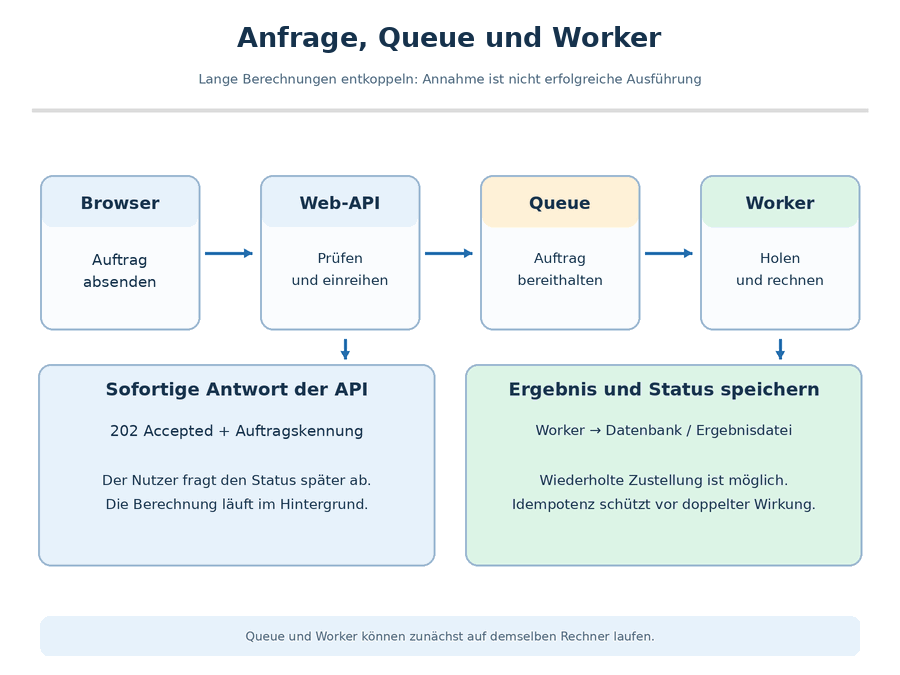

# M1-L4 – Softwaretechnik und Systementwurf {#L4}

**Kursbereich:** M1 – Bachelor: Informatik-Grundlagen

**Niveau:** Bachelor

**Vorwissen:** [M1-L1](M1-L1.md) · [M1-L2](M1-L2.md) · [M1-L3](M1-L3.md)

**Weiterführend:** [M1-L5 – Daten und Datenbanken](M1-L5.md)

## Überblick – Wenn aus einem Programm ein dauerhaftes System wird {#S1}

Ein kleines Programm kann aus wenigen überschaubaren Funktionen bestehen. Es liest eine Datei, verarbeitet Daten und zeigt ein Ergebnis an. Später soll es aber vielleicht Benutzer verwalten, mit einer Datenbank sprechen, Aktualisierungen erhalten und im Internet erreichbar sein. Die entscheidende Schwierigkeit ist dann nicht mehr allein, einen bestimmten Algorithmus zu schreiben: **Das gesamte System muss auch nach vielen Änderungen verständlich, prüfbar und zuverlässig bleiben.**

**Softwaretechnik** (Software Engineering) beschäftigt sich mit Methoden und Werkzeugen, um Software planbar zu entwickeln und langfristig zu pflegen. **Systementwurf** (Software Design beziehungsweise Architektur) bestimmt die wichtigen Bausteine, ihre Zuständigkeiten und ihre Zusammenarbeit. Eine Architektur muss nicht groß sein: Auch ein kleines PHP-Projekt hat eine Architektur, selbst wenn sie nie ausdrücklich dokumentiert wurde.

### Ausgangsproblem und Mini-Architektur

``` text
Benutzeroberfläche
      │
      ▼
Anwendungslogik ──► Datei- oder Datenbankzugriff
      │
      ▼
Rückmeldung an Nutzer
```

Solange diese Aufgaben nachvollziehbar getrennt sind, lassen sie sich oft unabhängig anpassen. Wenn dagegen alle Eingaben, Datenbankzugriffe, Berechnungen und Darstellungen in einem einzigen großen Programmblock vermischt werden, erzeugt jede kleine Änderung ein größeres Risiko. Softwarearchitektur löst deshalb zunächst ein **Wartbarkeitsproblem**, nicht zwingend ein Geschwindigkeitsproblem.

## Module, Schnittstellen und Abstraktion {#S2}

### Modularität: Ein System in Verantwortlichkeiten gliedern {#11-modularität-ein-system-in-verantwortlichkeiten-gliedern}

Ein **Modul** ist ein zusammengehörender Softwarebaustein mit einer möglichst klaren Aufgabe. In einem Medienkatalog könnte es Module für Import, Metadaten, Suche und Export geben. Sie müssen weder eigenständige Programme noch eigene Server sein. Ein Modul kann schlicht eine Datei, ein Package oder ein sauber abgegrenzter Teil derselben Anwendung sein.

``` text
Medienkatalog (eine Anwendung)
  ├─ Import: Dateien erkennen und einlesen
  ├─ Katalog: Einträge verwalten
  ├─ Suche: Treffer bestimmen
  └─ Export: ausgewählte Daten ausgeben
```

Die Struktur hilft vor allem beim Ändern: Wenn ein neues Importformat hinzukommt, sollte möglichst nicht die Suchlogik geändert werden müssen. Ein häufiges Entwurfsziel heißt **hohe Kohäsion** (zusammengehörige Aufgaben bleiben beieinander) bei **geringer Kopplung** (wenige unnötige Abhängigkeiten zwischen Modulen).

**Wann übertrieben?** Ein Programm mit zehn klaren Anweisungen braucht meist keine Architektur aus zwölf Schichten. Zu viele winzige Module können die Orientierung ebenso verschlechtern wie ein einziger riesiger Block.

### Schnittstellen: Verabredungen zwischen Bausteinen {#12-schnittstellen-verabredungen-zwischen-bausteinen}

Eine **Schnittstelle** beschreibt, wie ein Baustein angesprochen werden kann und was er zurückgibt. Sie kann als Funktionsaufruf innerhalb eines Programms auftreten oder als Netzwerkverbindung zwischen verschiedenen Programmen.

Beispiel: Das Suchmodul erhält einen Suchbegriff und liefert eine Ergebnisliste. Der Rest der Anwendung muss dafür nicht wissen, ob intern eine einfache Schleife oder ein Datenbankindex verwendet wird.

``` text
Oberfläche ──► Suche("winterjacke")
                      │
                Suchmodul
                      │
                Trefferliste
                      │
Oberfläche ◄───────────┘
```

Eine gute Schnittstelle legt verständlich fest, **welche Eingaben zulässig sind, was das Ergebnis bedeutet und welche Fehler auftreten können**. Sie ermöglicht es, die interne Umsetzung zu ändern, ohne alle Aufrufer anzufassen. Die Kehrseite: Eine schlecht gewählte, früh veröffentlichte Schnittstelle kann spätere Anpassungen erschweren.

### Abstraktion und Kapselung unterscheiden {#13-abstraktion-und-kapselung-unterscheiden}

**Abstraktion** lässt Details weg, die für eine bestimmte Betrachtung nicht wichtig sind. Für den Aufrufer zählt etwa „suche Datensatz“, nicht der verwendete Suchalgorithmus.

**Kapselung** begrenzt den direkten Zugriff auf die Interna eines Moduls. Statt von mehreren Stellen dieselben internen Felder zu verändern, wird eine definierte Operation wie „Status ändern“ verwendet. Das ist insbesondere bei gemeinsam genutzten Daten wichtig, weil Regeln dadurch an einer Stelle geprüft werden können.

``` text
Nicht ideal: Oberfläche ──► interne Tabellen + interne Zustände

Besser:      Oberfläche ──► definierte Katalog-Funktionen
                                      │
                              verborgene Umsetzung
```

Kapselung macht Fehler nicht unmöglich. Sie reduziert jedoch die Anzahl von Stellen, an denen fachliche Regeln umgangen werden können.

### Schichtenarchitektur: Gleiche Anwendung, verschiedene Aufgaben {#14-schichtenarchitektur-gleiche-anwendung-verschiedene-aufgaben}

Eine **Schicht** beschreibt eine Art von Verantwortung. Ein verbreitetes, aber nicht verpflichtendes Grundmodell trennt Darstellung, Fachlogik und Datenzugriff.

``` text
Darstellung (HTML / Desktop-Oberfläche)
                │
                ▼
Fachlogik (Regeln, Validierung, Berechnung)
                │
                ▼
Datenzugriff (Datei, SQLite, externer Dienst)
```

Wenn ein lokales Tool später als Webanwendung angeboten werden soll, kann die Fachlogik möglicherweise bleiben, während die Oberfläche ausgetauscht wird. In der Praxis gelingt das nicht ohne Weiteres bei jedem Programm: Wer Dateipfade, Fensterdialoge und Datenbankbefehle überall mischt, muss aufwendiger umbauen.

**Wichtig:** Schichten sind kein Naturgesetz. Manche Anwendungen profitieren von einer funktionsorientierten Gliederung, in der alle Teile eines Anwendungsfalls zusammenliegen. Entscheidend sind nachvollziehbare Abhängigkeiten und klare Grenzen.

## APIs und Datenformate – Programme sprechen miteinander {#S3}

Eine **API** (*Application Programming Interface*, Programmierschnittstelle) legt fest, wie Softwarefunktionen verwendet werden können. Innerhalb einer Anwendung kann das ein Funktionsaufruf sein; eine **Web-API** ist dagegen über ein Netzwerk ansprechbar. Das „A“ in API bedeutet also nicht automatisch Internet.

Eine mögliche Web-API für einen Medienkatalog beantwortet beispielsweise die Anfrage: „Liefere die Daten zu Eintrag 4711.“ Häufig geschieht das über **HTTP** (*Hypertext Transfer Protocol*, Web-Übertragungsprotokoll), das wir in M1-L6 näher behandeln.

``` text
Browser / anderes Programm
        │ Anfrage: Eintrag 4711
        ▼
      Web-API
        │
        ▼
    Kataloglogik
        │
        ▼
      Datenbank
        │
        └─► Antwort mit Daten oder Fehlermeldung
```

Für die Antwort braucht man ein vereinbartes **Datenformat**. Beispiele sind **JSON** (*JavaScript Object Notation*, strukturiertes Textformat), **XML** (*Extensible Markup Language*, erweiterbare Auszeichnungssprache) und **CSV** (*Comma-Separated Values*, tabellarische Textdaten). JSON eignet sich oft für verschachtelte Objekte; CSV für einfache Tabellen. Welches Format passt, hängt von Datenform und Teilnehmern ab – nicht von Modewörtern.

Eine API muss mehr regeln als das Format: Welche Felder sind erforderlich? Ist eine Kennung eine Zeichenfolge oder eine Zahl? Was passiert bei fehlenden Datensätzen? Welche Nutzer dürfen Änderungen durchführen? Wie bleiben alte Clients funktionsfähig, wenn sich die API ändert? Diese Vereinbarungen bezeichnet man als **Schnittstellenvertrag** oder *Contract*.

**Wann unnötig?** Für ein isoliertes Desktopprogramm, das seine Daten selbst liest und schreibt, ist eine öffentliche Web-API meist überdimensioniert. Eine klar definierte interne Schnittstelle kann trotzdem nützlich sein.

## Zustandsautomaten und Ereignisse – Verhalten sichtbar machen {#S4}

### Zustandsautomaten statt unübersichtlicher Sonderfälle {#31-zustandsautomaten-statt-unübersichtlicher-sonderfälle}

Ein **Zustandsautomat** beschreibt mögliche Zustände eines Systems und erlaubte Übergänge. Beispiel: Ein Hintergrundauftrag darf „neu“, „in Bearbeitung“, „fertig“ oder „fehlgeschlagen“ sein. Ein fertiger Auftrag darf nicht beliebig wieder auf „neu“ gesetzt werden, nur weil ein Benutzer eine Seite aktualisiert.

``` text
       Auftrag eingegangen
               │
               ▼
             NEU
               │ Worker übernimmt
               ▼
       IN BEARBEITUNG
           /       \
   Erfolg /         \ Fehler
         ▼           ▼
      FERTIG     FEHLGESCHLAGEN
                      │ Wiederholung nach Regel
                      └────────► NEU
```

Der Vorteil: Man kann für jeden Übergang klar festlegen, wer ihn auslösen darf und welche Daten geändert werden. Solche Modelle sind bei Bestellungen, Zahlungen, Uploads oder KI-Verarbeitungsaufträgen besonders hilfreich. Die Grenze: Ein Zustandsautomat bildet nur die ausdrücklich modellierten Fälle ab; reale Systeme können weitere Zustände benötigen, etwa „abgebrochen“ oder „wartet auf Freigabe“.

### Ereignisverarbeitung: „Etwas ist passiert“ {#32-ereignisverarbeitung-etwas-ist-passiert}

Bei **ereignisgesteuerter Verarbeitung** (*Event-Driven Architecture*) reagiert ein Baustein auf ein eingetretenes Ereignis, beispielsweise „Video wurde hochgeladen“. Ein Baustein kann die Datei verarbeiten, ein anderer Vorschaubilder erzeugen und ein weiterer eine Benachrichtigung vorbereiten.

``` text
Upload abgeschlossen
         │
         ▼
Ereignis "Datei eingetroffen"
         │
     ┌───┴──────────┐
     ▼              ▼
Metadaten lesen   Vorschau erzeugen
     │              │
     └──────┬───────┘
            ▼
         Ergebnisse
```

Das kann innerhalb **eines** Programms passieren oder später über eine Warteschlange auf mehreren Rechnern. Ereignisverarbeitung und Microservices sind also nicht dasselbe.

**Grenzen:** Ereignisse können verspätet, mehrfach oder in unerwarteter Reihenfolge eintreffen. Ein System muss dann festlegen, ob doppelte Verarbeitung zulässig ist. Für eine sehr einfache, unmittelbar ausführbare Aktion ist ein direkter Funktionsaufruf meist klarer.

Eine wichtige Schutzidee ist **Idempotenz** (*idempotence*): Wird dieselbe Operation wegen einer wiederholten Nachricht erneut ausgeführt, darf dadurch keine ungewollte zweite fachliche Wirkung entstehen. Beispiel: Ein Upload mit der eindeutigen Auftragskennung `4711` wird zweimal gemeldet. Das Programm prüft die Kennung und erzeugt nicht versehentlich zwei kostenpflichtige Verarbeitungsaufträge. Das kann durch eindeutige Schlüssel, kontrollierte Zustandsübergänge oder eine gesonderte Verarbeitungshistorie umgesetzt werden. Idempotenz bedeutet **nicht**, dass jeder technische Zwischenschritt nur einmal ausgeführt wird; entscheidend ist, dass das fachliche Ergebnis bei Wiederholung korrekt bleibt.

**Nebenläufige Wiederholungen:** Ein einfaches „Ist Auftrag 4711 schon erledigt?“ vor dem Schreiben reicht nicht immer: Zwei Worker könnten gleichzeitig „nein“ lesen und danach beide einen neuen Auftrag anlegen. Wenn der Schutz auf einer Datenbank beruht, kann beispielsweise ein **eindeutiger Schlüssel mit atomarem Einfügeversuch** und anschließender Zustandsprüfung die doppelte *lokale* Änderung unterbinden. Das ist noch keine Garantie für genau eine externe Zahlung, E-Mail oder andere Wirkung; dort sind gegebenenfalls zusätzliche Idempotenzschlüssel des Zielsystems beziehungsweise ein geeigneter verteilten Ablauf erforderlich. Vertiefung: [M4-L1](M4-L1.md) und [M1-L5](M1-L5.md).

## Tests – Anforderungen prüfen, ohne Fehlerfreiheit zu behaupten {#S5}

Software enthält Fehler, selbst wenn sie sorgfältig entwickelt wird. Tests können **konkret beobachtetes Verhalten** mit Anforderungen vergleichen und Risiken senken; sie beweisen aber normalerweise nicht, dass ein komplexes System in jeder erdenklichen Situation fehlerfrei ist. Ein bestandener Test ist Evidenz für die getesteten Fälle, kein allgemeiner Korrektheitsbeweis (siehe [M7-L2](M7-L2.md)).

  Testart                                         Prüft hauptsächlich           Beispiel                                                                Typische Grenze
  ----------------------------------------------- ----------------------------- ----------------------------------------------------------------------- ----------------------------------------------------------
  **Unit-Test** (Komponententest)                 Kleine Funktion/Einheit       Sortiert der Filter die Ergebnisse richtig?                             Erkennt oft keine Fehler im Zusammenspiel
  **Integrationstest**                            Zusammenarbeit realer Teile   Speichert die Anwendung einen Datensatz und liest ihn korrekt zurück?   Erfordert mehr Umgebung und Pflege
  **End-to-End-Test** (E2E, durchgängiger Test)   Einen vollständigen Ablauf    Nutzer meldet sich an und exportiert einen Bericht                      Langsamer, kann anfällig für Umgebungsprobleme sein
  **Vertragstest** (*Contract Test*)              Vereinbarte API-Struktur      Sind Pflichtfelder einer Antwort vorhanden?                             Prüft nicht automatisch die gesamte Fachlogik
  **Sicherheitsprüfung**                          Ausgewählte Schwachstellen    Ist ein unbefugter Zugriff auf fremde Daten blockiert?                  Kein Ersatz für sichere Architektur oder laufende Pflege

Ein **Regressionstest** prüft, ob eine Änderung bereits funktionierendes Verhalten versehentlich beschädigt hat; er kann aus mehreren der genannten Testarten bestehen. Ein realistischer Testbestand umfasst möglichst normale Fälle, Grenzfälle und Fehlerwege: leere Eingaben, ungültige Kennungen, unterbrochene Verbindungen und unerwartete Daten.

### Mini-Ablauf

``` text
Änderung am Programm
         │
         ▼
Kleine Tests ──► Integrationstests ──► wenige wichtige Gesamtabläufe
         │                                │
         └──────── Fehler? ──────────────┘
                     │
                     ▼
                Ursache beheben
```

**Wann überdimensioniert?** Ein kurzlebiges persönliches Hilfsskript braucht möglicherweise keinen vollständig automatisierten E2E-Testapparat. Trotzdem kann bereits ein kleiner reproduzierbarer Testfall verhindern, dass derselbe Fehler wiederkehrt. Bei kostenpflichtigen Angeboten und fremden Nutzerdaten wird systematische Prüfung deutlich wichtiger.

## Versionsverwaltung und Bereitstellung – Änderungen beherrschbar halten {#S6}

### Git und Versionen {#51-git-und-versionen}

**Versionsverwaltung** speichert Änderungen an Dateien nachvollziehbar. **Git** ist ein weit verbreitetes verteiltes Versionsverwaltungssystem. Ein **Commit** hält einen bestimmten Änderungsstand fest. Ein **Branch** (Entwicklungszweig) ermöglicht Arbeiten an einer Variante, ohne die Hauptlinie sofort zu verändern. Eine **Release-Version** ist dagegen ein bewusst veröffentlichter Softwarestand; sie muss nicht mit jedem Commit zusammenfallen.

``` text
Stabiler Stand ────────► neue Veröffentlichung
       │                      ▲
       └─► Entwicklungszweig ─┘
            Änderungen prüfen
```

Das verhindert nicht automatisch schlechte Änderungen, macht sie aber sichtbar und gegebenenfalls rückgängig. Git ersetzt keine externe Datensicherung und speichert auch keine laufenden Datenbanktransaktionen.

### CI: Änderungen automatisch prüfen {#52-ci-änderungen-automatisch-prüfen}

**CI** (*Continuous Integration*, kontinuierliche Integration) beschreibt häufiges Zusammenführen und automatisiertes Prüfen von Codeänderungen. Ein Dienst kann nach einer Änderung beispielsweise die Software bauen, Tests ausführen und vor auffälligen Problemen warnen. Das ist bei mehreren Entwicklern besonders hilfreich, kann aber auch Einzelentwicklern wiederkehrende Prüfungen abnehmen.

``` text
Änderung in Git
      │
      ▼
Automatischer Bau (Build)
      │
      ▼
Tests / Prüfungen
      │
      ├─ Fehler ──► Änderung nacharbeiten
      │
      └─ Erfolg ─► Freigabe möglich
```

**CD** ist mehrdeutig und sollte genauer benannt werden:

- **Continuous Delivery** (kontinuierliche Lieferbereitschaft) bedeutet: Eine geprüfte Fassung kann mit wenig zusätzlichem Aufwand veröffentlicht werden; die eigentliche Freigabe kann bewusst manuell erfolgen.
- **Continuous Deployment** (kontinuierliche automatische Veröffentlichung) bedeutet: Änderungen, die die vorgesehenen Prüfungen bestehen, werden automatisiert produktiv bereitgestellt.

Eine automatisierte Pipeline ist eine Kette solcher Schritte, nicht zwingend ein großes Cloud-System. Die offizielle GitHub-Actions-Dokumentation beschreibt CI-Prüfungen sowie automatisierte Veröffentlichungen und Freigabeschranken. Sie ist ein **Produktbeispiel**, nicht die Definition der allgemeinen Prinzipien.

**Betriebsrisiken:** Eine grüne Testanzeige bedeutet nur, dass die definierten Prüfungen bestanden wurden. Fehlerhafte Prüfungen, kompromittierte Abhängigkeiten oder unzureichende Freigaberechte bleiben möglich. Unkontrollierte automatische Produktionsbereitstellung kann einen Fehler sehr schnell an alle Nutzer verteilen. Für ein kleines lokales Tool reichen oft manuell getestete, versionierte Releases.

## Monolith und Microservices – eine Architekturentscheidung, kein Fortschrittsranking {#S7}

Ein **Monolith** ist eine Anwendung, die als zusammengehörende Einheit gebaut und bereitgestellt wird. Das sagt zunächst nichts darüber aus, wie sauber ihr Inneres gegliedert ist. Ein gut strukturierter Monolith kann aus vielen klar getrennten Modulen bestehen.

**Microservices** sind dagegen mehrere kleinere, fachlich abgegrenzte Dienste, die eigenständig bereitgestellt werden können und üblicherweise über Netzwerk-Schnittstellen zusammenarbeiten.

### Zwei Varianten derselben fachlichen Aufgabe

``` text
VARIANTE A – MODULARER MONOLITH

Browser ──► [Webanwendung: Nutzer | Katalog | Suche]
                                  │
                               Datenbank

VARIANTE B – MICROSERVICES

Browser ──► [API-Eingang]
                │
          ┌─────┼────────┐
          ▼     ▼        ▼
        Nutzer Katalog  Suche
          │     │        │
       eigene Zuständigkeiten / Datenzugriffe
```

  Frage                                  Modularer Monolith                              Microservices
  -------------------------------------- ----------------------------------------------- ----------------------------------------------------------
  Änderungen an mehreren Fachbereichen   Häufig in einem Release möglich                 Unabhängige Releases möglich, Abstimmung kann nötig sein
  Netzkommunikation zwischen Modulen     Oft lokale Funktionsaufrufe                     Zusätzliche Netzfehler und Latenz
  Betrieb                                Weniger getrennte Dienste                       Mehr Deployments, Zugriffsrechte, Überwachung
  Skalierung                             Häufig zunächst gesamte Anwendung               Gegebenenfalls einzelne Dienste gezielt
  Datenkonsistenz                        Häufig leichter in einer Datenbanktransaktion   Über Dienstgrenzen hinweg schwieriger
  Kleine Einzelentwickler-Projekte       Oft sehr angemessen                             Häufig unnötiger Aufwand

**Wann helfen Microservices?** Beispielsweise wenn verschiedene Teams unabhängig arbeiten müssen oder ein Teil dauerhaft deutlich andere Leistungs- und Verfügbarkeitsanforderungen besitzt. **Wann eher nicht?** Wenn ein einzelner Entwickler ein überschaubares Online-Tool mit begrenzter Nutzerzahl anbietet. Hier schafft ein einfacher, sauber modularisierter Monolith oft den größeren Nutzen.

Der Architekturautor Martin Fowler beschreibt sowohl Vorteile wie unabhängige Bereitstellung als auch Kosten durch verteilte Datenhaltung und komplexeren Betrieb. Daraus folgt **keine universelle Regel**, aber eine wichtige Warnung: Viele kleine Dienste sind nicht automatisch besser als ein einziges sorgfältig entwickeltes Programm.

## Wartbarkeit, technische Schulden und Dokumentation {#S8}

**Wartbarkeit** beschreibt, wie gut sich ein System verstehen, korrigieren, testen und erweitern lässt. Dazu gehören sprechende Namen, überschaubare Module, nachvollziehbare Fehlerbehandlung, eine klare Datenstruktur und eine kurze Dokumentation wichtiger Entscheidungen.

**Technische Schulden** sind bewusste oder unbewusste Abkürzungen, die spätere Änderungen verteuern können. Ein Beispiel: Aus Zeitgründen greift jede Programmstelle direkt auf Datenbanktabellen zu. Das funktioniert zunächst, macht eine spätere Änderung der Datenstruktur aber teuer. Nicht jede einfache Lösung ist eine technische Schuld: Einfachheit kann gerade die langlebigere Architektur sein.

``` text
Schneller Sonderweg
       │
       ▼
Kurzfristig weniger Entwicklungsaufwand
       │
       └─► Falls häufig wiederholt:
             Änderungen werden riskanter
             Tests werden aufwendiger
             Umstellung wird teurer
```

Sinnvolle Dokumentation muss keine große Textsammlung sein. Oft reichen eine Architekturübersicht, die wichtigsten Schnittstellen, Datenformate, bekannte Grenzen und der Grund für ungewöhnliche Entscheidungen. Dokumentation hat selbst Wartungskosten: Veraltete Anleitungen können schädlicher sein als kurze, aktuelle Hinweise.

## Sicherheit beginnt im Entwurf {#S9}

Sicherheit ist nicht erst ein Problem, wenn eine Software öffentlich im Internet steht. Schon beim Systementwurf sollte geklärt sein, welche Daten geschützt werden müssen und wer welche Aktionen ausführen darf.

- **Authentifizierung** klärt, wer sich anmeldet.
- **Autorisierung** klärt, welche Aktionen dieser Nutzer ausführen darf. Eine erfolgreiche Anmeldung gibt nicht automatisch Zugriff auf alle Datensätze.
- **Least Privilege** (Prinzip der geringsten Rechte) bedeutet: Module und Nutzer erhalten nur die notwendigen Berechtigungen.
- **Eingabevalidierung** prüft, ob empfangene Daten erwartete Typen, Größen und Werte besitzen; sie ersetzt nicht geeignete Sicherheitsmaßnahmen wie parametrisierte Datenbankabfragen.
- **Geheimnisse** wie Zugangstoken und Passwörter gehören nicht als feste Werte in veröffentlichte Quelltexte oder Logs.
- **Sichere Grundeinstellungen** sorgen dafür, dass unnötige Funktionen und Rechte nicht erst nachträglich abgeschaltet werden müssen.

### Mini-Architektur: Kein direkter Zugriff auf fremde Daten

``` text
Angemeldeter Nutzer
        │ Anfrage zu Datensatz 4711
        ▼
    Webanwendung
        │
        ▼
Prüfung: Darf dieser Nutzer 4711 lesen?
       / \
     ja   nein
     │      │
     ▼      ▼
  Antwort  Zugriff verweigern
```

Diese Prinzipien stehen auch in den OWASP-Leitfäden (*Open Worldwide Application Security Project*, internationales Sicherheitsprojekt). Für einen rein lokalen Datenkonverter sind manche Maßnahmen einfacher, für ein öffentliches Mehrbenutzersystem dagegen unverzichtbar. Ein Sicherheitskonzept muss außerdem Updates, Datensicherung und die Reaktion auf Vorfälle berücksichtigen.

## Drei Praxisbilder – vom Desktopwerkzeug zum Online-Dienst {#S10}

### Beispiel A: Lokaler Medienkatalog

Du hast ein Tool, das Videodateien erkennt, Metadaten importiert und einen Bericht exportiert. Eine vernünftige Architektur könnte aus Importmodul, Kataloglogik, Suche und Export bestehen. Alles läuft in einem Prozess und kann eine lokale Datei oder SQLite-Datenbank verwenden. Weder Web-API noch Container noch Microservices sind nötig.

### Beispiel B: Dasselbe Werkzeug als bezahlter Online-Dienst

Später greifen fremde Nutzer über einen Browser darauf zu. Nun benötigt das System eine Weboberfläche, eine geschützte Anmeldung, Zugriffsregeln, zuverlässige Datenspeicherung und ein Verfahren zur Bereitstellung neuer Versionen. Das ist oft weiterhin als **eine** Anwendung mit einer Datenbank möglich.

``` text
Browser ──► Webanwendung
                 │
           ┌─────┴───────┐
           ▼             ▼
      Benutzerrechte   Kataloglogik
                         │
                      Datenbank
```

Es kommen Betriebskosten hinzu: Hosting, Datensicherung, Sicherheitsupdates, möglicherweise E-Mail-Versand, Support und rechtliche Pflichten. Die Architektur sollte solche Aufgaben ermöglichen, nicht durch unnötige technische Vielfalt erschweren.

### Beispiel C: KI-Aufträge im Hintergrund

Eine Anwendung verarbeitet hochgeladene Bilder mit einem lokalen oder entfernten KI-Modell. Solche Berechnungen dauern gelegentlich länger als eine gewöhnliche Webanfrage. Dann kann ein **Hintergrund-Worker** sinnvoll sein, der Aufträge unabhängig von der Weboberfläche abarbeitet.

``` text
Browser ──► Webanwendung ──► Auftragsliste
                                 │
                                 ▼
                           KI-Worker
                                 │
                                 ▼
                            Ergebnisdatei
```

Dafür braucht man nicht sofort mehrere Server: Webanwendung und Worker können anfangs auf demselben Computer laufen. Erst höhere Last oder unterschiedliche Hardwareanforderungen machen eine räumliche Trennung interessant. Details zu Warteschlangen, Wiederholungen und verteiltem Betrieb folgen in M4-L1 und M6-L6.



*Abbildung: Schematischer Weg eines längeren Auftrags: Die API kann zum Beispiel **202 Accepted** und eine Auftragskennung zurückgeben, bevor die Ausführung abgeschlossen ist. Die Statusabfrage erfolgt später. Ob die Queue dauerhaft speichert und wie sie Aufträge bei Fehlern erneut zustellt, hängt von der konkreten Implementierung ab; Idempotenz muss für wiederholte Wirkungen gesondert hergestellt werden (siehe M4-L1).*

## Entscheidungshilfe – Wie viel Architektur ist angemessen? {#S11}

  Situation                        Oft guter Anfang                        Anlass für Ausbau
  -------------------------------- --------------------------------------- ---------------------------------------------------------------------------------
  Ein kleines Hilfsprogramm        wenige klare Funktionen                 wiederkehrende Erweiterungen und gemeinsame Regeln
  Mittlerer Desktopkatalog         Module mit definierten Schnittstellen   sehr verschiedene Zugriffswege oder Datenquellen
  Eine kleine Webanwendung         modularer Monolith                      getrennte Teams, deutliche Lastunterschiede oder besondere Ausfallanforderungen
  Öffentliche API                  klarer Vertrag, Rechteprüfung, Tests    viele unabhängige Integrationen und Versionen
  Zeitaufwendige KI-Verarbeitung   Hintergrundauftrag und Worker           mehrere Rechner/GPU-Typen, Warteschlangen, Fehlertoleranz

**Leitfrage:** Welches konkrete Problem löst die zusätzliche Schicht, der zusätzliche Dienst oder die zusätzliche Automatisierung? Wenn sich keine glaubhafte Antwort findet, ist die komplexere Technik wahrscheinlich noch nicht nötig.

## Zusammenfassung und Übergang {#S12}

1.  **Modularität, Abstraktion und Kapselung** helfen, die innere Komplexität einer Anwendung zu beherrschen.
2.  **Schnittstellen und Datenformate** machen die Zusammenarbeit zwischen Bausteinen überprüfbar; eine API ist nicht zwingend ein Internetdienst.
3.  **Zustandsautomaten und Ereignisse** beschreiben, wann welche Verarbeitung zulässig oder ausgelöst ist.
4.  **Tests, Versionsverwaltung und CI/CD** helfen, Änderungen nachvollziehbar zu prüfen und bereitzustellen; sie garantieren keine Fehlerfreiheit.
5.  **Monolith und Microservices** sind unterschiedliche organisatorische Lösungen. Für kleine Anwendungen kann ein modularer Monolith langfristig einfacher und wirtschaftlicher sein.
6.  **Wartbarkeit und Sicherheit** gehören bereits in den Entwurf, nicht erst in die Fehlerbehebung nach dem Start.

**Nächste Lektion: [M1-L5 – Daten und Datenbanken](M1-L5.md).** Dort betrachten wir, wie Daten zuverlässig gespeichert, miteinander verknüpft, indiziert und in Transaktionen verändert werden – eine Grundlage für spätere Cluster- und Cloud-Datenbanken.


## Quellen {#S13}

**Letzte Quellenprüfung:** 03.11.2026

**Quellenprüfung:** 03.11.2026; Ergänzungen zu Idempotenz und Testaussage am 05.11.2026. Allgemeine Architekturprinzipien sind zeitstabil; Produktdetails zu GitHub Actions und Sicherheitsleitfäden wurden anhand der aktuellen offiziellen Dokumentationen geprüft. Beispiele und Diagramme sind didaktisch vereinfacht.

- GitHub Docs, *Continuous integration* (CI, Builds, Tests): [https://docs.github.com/en/actions/get-started/continuous-integration](https://docs.github.com/en/actions/get-started/continuous-integration)
- GitHub Docs, *Continuous deployment* (automatisierte Bereitstellung, Freigaben): [https://docs.github.com/en/actions/get-started/continuous-deployment](https://docs.github.com/en/actions/get-started/continuous-deployment)
- GitHub Docs, *Understanding GitHub Actions* (Workflow, Build-/Test-/Deployment-Pipeline): [https://docs.github.com/en/actions/get-started/understand-github-actions](https://docs.github.com/en/actions/get-started/understand-github-actions)
- Martin Fowler, *Microservice Trade-Offs* (Vorteile und Betriebskosten verteilter Dienste, 2015): [https://martinfowler.com/articles/microservice-trade-offs.html](https://martinfowler.com/articles/microservice-trade-offs.html)
- Martin Fowler, *Monolith First* (Vorsicht beim frühen Zerlegen kleiner Anwendungen, 2015): [https://martinfowler.com/bliki/MonolithFirst.html](https://martinfowler.com/bliki/MonolithFirst.html)
- OWASP Cheat Sheet Series, *Secure Product Design* (Sicherheit im Entwurf): [https://cheatsheetseries.owasp.org/cheatsheets/Secure_Product_Design_Cheat_Sheet.html](https://cheatsheetseries.owasp.org/cheatsheets/Secure_Product_Design_Cheat_Sheet.html)
- OWASP Cheat Sheet Series, *Authorization* (Rechteprüfung und Least Privilege): [https://cheatsheetseries.owasp.org/cheatsheets/Authorization_Cheat_Sheet.html](https://cheatsheetseries.owasp.org/cheatsheets/Authorization_Cheat_Sheet.html)
