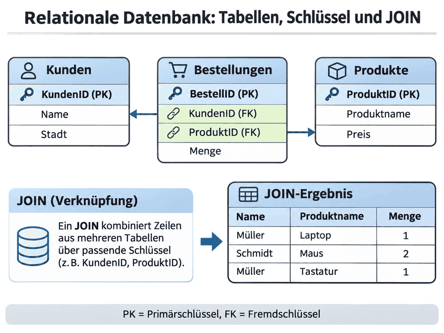
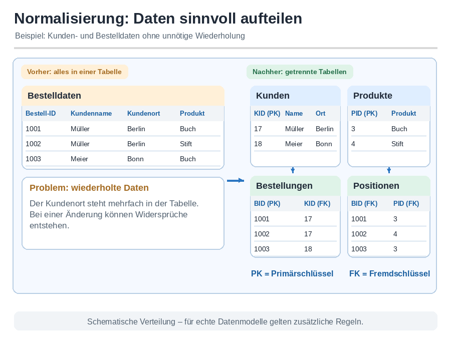

# M1-L5 – Daten und Datenbanken {#L5}

**Kursbereich:** M1 – Bachelor: Informatik-Grundlagen

**Niveau:** Bachelor

**Vorwissen:** Keine festen Voraussetzungen angegeben.

## Überblick: Warum Datenhaltung mehr ist als das Speichern einer Datei {#S1}

Eine Anwendung muss häufig nicht nur etwas *berechnen*, sondern sich etwas *merken*: die Namen von Benutzern, die Eigenschaften eines Videos, den Inhalt einer Bestellung, den Bearbeitungsstand eines KI-Auftrags. Solche Informationen sollen auch dann noch vorhanden sein, wenn das Programm beendet wird. Außerdem müssen sie auffindbar, veränderbar und – bei mehreren Benutzern – möglichst widerspruchsfrei sein.

Man könnte alle Informationen in Textdateien ablegen. Das funktioniert bei kleinen, überschaubaren Programmen. Schwieriger wird es, sobald viele Einträge zusammenhängen, gleichzeitig verändert werden oder eine Anfrage wie „Zeige die zwanzig neuesten Videos dieser Kategorie, aber nur die noch nicht bearbeiteten“ schnell beantwortet werden soll. **Datenbanksysteme lösen nicht einfach das Problem „Speichern“, sondern bündeln Verfahren für strukturierten Zugriff, Integrität und kontrollierte Änderungen.**

Diese Lektion führt durch Dateien, relationale Datenbanken, Datenmodelle, Schlüssel, die Abfragesprache SQL, Indizes, Transaktionen und Alternativen wie Dokumenten- und Schlüssel-Wert-Speicher. Die spätere Verteilung über mehrere Server ist noch *nicht* das Thema: Dafür dienen die ausführlichen Lektionen M3-L1–M3-L6.

## Dateien, Datenbanken und Datenbankmanagementsysteme {#S2}

Eine **Datei** ist zunächst eine Einheit, die ein Dateisystem dauerhaft verwaltet. CSV (*Comma-Separated Values*, ein einfaches textbasiertes Tabellenformat), JSON (*JavaScript Object Notation*, ein strukturiertes Textformat) und Markdown sind mögliche Dateiinhalte. Für Export, Austausch, Konfiguration oder ein archiviertes Dokument sind sie oft ideal.

Eine **Datenbank** ist eine organisierte Sammlung zusammengehöriger Daten. Das **Datenbankmanagementsystem (DBMS)** ist die Software, mit der diese Daten verwaltet werden: Sie nimmt Abfragen entgegen, liest und schreibt Daten, prüft bestimmte Regeln und organisiert Zugriffe. In Alltagssprache wird oft beides zusammen „Datenbank“ genannt.

``` text
Anwendung
    │  "Finde Medien mit Schlagwort X"
    ▼
Datenbankmanagementsystem (DBMS)
    │  Suche, Rechte, Integrität, Schreibvorgänge
    ▼
Persistente Daten (Datei(en), Speicherstrukturen, Indizes)
```

**Wichtig:** Der Unterschied „Datei oder Datenbank“ ist keine physikalische Entweder-oder-Frage. Die SQLite-Datenbank ist beispielsweise häufig selbst eine Datei auf dem Datenträger. Der Unterschied liegt in den Regeln und Funktionen, mit denen diese Datei behandelt wird.

### Wann genügt eine Datei?

Für unseren Lernkurs eignen sich Markdown-Dateien besonders gut: Jede Lektion ist ein eigenständiger Text, lässt sich leicht sichern und bleibt ohne Spezialsoftware lesbar. Eine SQLite-Datenbank für alle Lehrtexte würde nur dann zusätzlich helfen, wenn wir beispielsweise komplexe Verknüpfungen, einen Suchindex oder individuelle Lesestände verwalten möchten. Sie muss deshalb nicht die maßgebliche Inhaltsquelle werden.

Auch ein kleines lokales Programm mit einer selten geänderten Liste kann eine JSON- oder CSV-Datei nutzen. Eine Datenbank wird wertvoll, wenn mehrere Merkmale, Beziehungen, Abfragen und gleichzeitige Änderungen systematisch koordiniert werden sollen.

## Das relationale Modell: Tabellen, Zeilen und Spalten {#S3}

In einem **relationalen Datenbanksystem** werden Daten logisch als Relationen – im Alltag meistens Tabellen genannt – organisiert. Eine Tabelle enthält Zeilen (Datensätze) und Spalten (Eigenschaften). Die Tabellen sind nach einem definierten Schema aufgebaut.

Beispiel für einen Medienkatalog:

**Tabelle `Medien`**

    medien_id titel             jahr status
  ----------- --------------- ------ ---------
          101 Wintervideo       2025 geprüft
          102 Stadtaufnahme     2026 offen
          103 Kurzfilm          2024 geprüft

Die `medien_id` identifiziert den Datensatz. Zwei Medien können durchaus denselben Titel besitzen; die ID sollte trotzdem eindeutig sein.

**Ein Schema** legt fest, welche Tabellen, Spalten, Datentypen und Regeln vorgesehen sind. Beispielsweise kann ein Jahr als Ganzzahl, der Titel als Text und eine ID als eindeutiger Schlüssel definiert sein. Ein Schema ersetzt nicht alle fachlichen Prüfungen: Ein Zahlenfeld verhindert zum Beispiel nicht automatisch einen unsinnigen Jahreswert, solange keine passende Regel eingerichtet wurde.

Der entscheidende Vorteil ist, dass das DBMS strukturierte Fragen beantworten kann, ohne dass die Anwendung selbst jede Datei und jeden Datensatz manuell untersuchen muss.

## Schlüssel, Beziehungen und referenzielle Integrität {#S4}

Ein **Primärschlüssel (Primary Key)** identifiziert eine Zeile innerhalb einer Tabelle eindeutig. Ein **Fremdschlüssel (Foreign Key)** verweist auf einen passenden Schlüssel in einer anderen Tabelle. Mit Fremdschlüsseln lassen sich Beziehungen absichern: Eine Bestellung darf beispielsweise nur auf einen vorhandenen Kunden verweisen.

Angenommen, ein Medienkatalog soll auch Kanäle enthalten:

``` text
Kanäle
  kanal_id = 7, name = "Technik"
  kanal_id = 8, name = "Natur"
          │
          │ Ein Kanal kann mehrere Medien besitzen
          ▼
Medien
  medien_id = 101, kanal_id = 7
  medien_id = 102, kanal_id = 7
  medien_id = 103, kanal_id = 8
```

`kanal_id` ist in der Tabelle `Kanäle` der Primärschlüssel und in der Tabelle `Medien` ein Fremdschlüssel. So muss der Kanalname nicht in jeder Medienzeile erneut gespeichert werden.

Es gibt unterschiedliche Beziehungstypen:

- **Eins zu eins (1:1):** Ein Benutzer hat genau einen zugehörigen Profileintrag – *wenn das fachlich so definiert ist*.
- **Eins zu viele (1:n):** Ein Kanal enthält viele Medien, ein Medium gehört in diesem vereinfachten Modell zu einem Kanal.
- **Viele zu viele (n:m):** Ein Medium kann mehrere Schlagwörter erhalten, und ein Schlagwort kommt bei vielen Medien vor. Üblicherweise stellt man diese Beziehung über eine eigene Zuordnungstabelle `Medien_Tags` dar.

Die **referenzielle Integrität** verhindert – sofern die entsprechenden Regeln aktiviert und korrekt modelliert sind – Verweise auf nicht existierende Datensätze. Welche Folgen das Löschen eines verknüpften Eintrags haben soll, muss ausdrücklich entschieden werden: Löschen verbieten, Verweise auflösen oder abhängige Datensätze ebenfalls löschen sind verschiedene Möglichkeiten mit unterschiedlichen Risiken.

**SQLite-Besonderheit:** SQLite unterstützt Fremdschlüssel, aber ihre Durchsetzung ist in üblichen Konfigurationen nicht automatisch aktiv. Anwendungen sollten die gewünschte Einstellung für ihre Verbindungen ausdrücklich setzen und prüfen. PostgreSQL verwendet hier andere Standardeinstellungen. Solche Details sind ein gutes Beispiel dafür, warum *das relationale Modell* und *ein konkretes Datenbankprodukt* nicht dasselbe sind.

## SQL: Die Sprache ist nicht das Datenbanksystem {#S5}

**SQL** steht für *Structured Query Language*. SQL ist eine Sprache, mit der man insbesondere relationale Daten definieren, abfragen und verändern kann. **SQLite, PostgreSQL, MySQL und Oracle Database sind dagegen konkrete Datenbanksysteme**, die SQL unterstützen – mit unterschiedlichen Erweiterungen, Typregeln, Funktionen und Betriebsmodellen.

Der Produktname **Oracle Database** bezeichnet ein bestimmtes Datenbanksystem; **Oracle** allein kann je nach Zusammenhang auch das Unternehmen oder weitere Oracle-Produkte meinen.

SQL ist überwiegend **deklarativ**: Man beschreibt, *welche* Datensätze gesucht werden, nicht die genaue Reihenfolge aller Zugriffsschritte. Das DBMS wählt dafür einen Ausführungsplan.

Drei kurze Lese-Beispiele (keine Übungsaufgabe):

``` sql
SELECT titel, jahr FROM Medien WHERE status = 'geprüft';
```

Das bedeutet: Gib Titel und Jahr der Datensätze aus, deren Status „geprüft“ ist.

``` sql
INSERT INTO Medien (medien_id, titel, jahr, status)
VALUES (104, 'Archivfilm', 2023, 'offen');
```

Das fügt einen neuen Datensatz ein. Ein echtes Schema kann zusätzliche Spalten und Regeln erfordern; die Beispiele dienen nur dem Lesen der Sprache.

``` sql
UPDATE Medien SET status = 'geprüft' WHERE medien_id = 104;
```

Das ändert den Status des ausgewählten Mediums. Die Bedingung `WHERE` ist besonders wichtig: Ohne geeignete Einschränkung könnte ein Änderungsbefehl sehr viele Zeilen betreffen.

Wichtige SQL-Wörter im Überblick: `SELECT` (abfragen), `INSERT` (einfügen), `UPDATE` (ändern), `DELETE` (löschen), `WHERE` (Bedingung), `JOIN` (Tabellen verknüpfen), `ORDER BY` (sortieren), `GROUP BY` (gruppieren). Auch hier gilt: Der exakte Funktionsumfang hängt vom konkreten System ab.

## Abfragen über Beziehungen: der JOIN {#S6}



*Abbildung: Ein vereinfachtes Beispiel für die Verbindung von Kunden, Bestellungen und Produkten. Die Ergebniszeilen sind illustrative Beispieldaten.*

Eine der großen Stärken relationaler Datenbanken ist die gezielte Verbindung von Informationen aus mehreren Tabellen. Ein **JOIN** kombiniert Zeilen anhand einer angegebenen Beziehung.

Beispiel: In `Medien` liegt die `kanal_id`; der Name steht nur in `Kanäle`. Die Frage „Zu welchem Kanal gehört dieses Medium?“ kann beide Tabellen verbinden.

``` text
Tabelle Medien                    Tabelle Kanäle
medien_id | kanal_id              kanal_id | name
101       | 7                 ───► 7        | Technik
102       | 7                 ───► 7        | Technik
103       | 8                 ───► 8        | Natur
                   │
                   ▼
Ergebnis: Medium 101 – Technik, Medium 102 – Technik, ...
```

Das DBMS kann dadurch eine zusammengesetzte Antwort liefern, ohne dass der Kanalname in jedem Mediumseintrag erneut gespeichert werden muss. Unterschiedliche JOIN-Arten legen fest, ob nur passende Zeilen oder auch Einträge ohne Gegenstück enthalten sein sollen.

**Grenze:** Bei sehr großen Datenmengen oder ungünstigen Abfragen können JOINs teuer werden. Über mehrere *getrennte Datenbankserver* hinweg sind sie besonders anspruchsvoll – ein Thema der späteren Sharding-Lektion M3-L3.

## Datenmodellierung und Normalisierung {#S7}

**Datenmodellierung** bedeutet: Festlegen, welche Objekte eine Anwendung kennt, welche Eigenschaften sie besitzen und wie sie miteinander verbunden sind. Hier entscheidet sich bereits, ob eine Datenbank später verständlich und verlässlich bleibt.



Wiederholte Kundendaten vermeiden: eigenständige Tabellen und Schlüsselbeziehungen erleichtern konsistente Änderungen.

Ein schlechtes Medienmodell könnte sämtliche Schlagwörter als Text in einem Feld ablegen: `technik, video, berlin`. Das erscheint zunächst einfach. Schwieriger wird es, zuverlässig nach einzelnen Schlagwörtern zu suchen, Schreibweisen zu vereinheitlichen oder ein Schlagwort umzubenennen.

Ein stärker strukturiertes Modell trennt `Medien`, `Tags` und `Medien_Tags`. Dadurch wird jedes Schlagwort einmal erfasst und kann über Zuordnungen mehreren Medien zugewiesen werden.

**Normalisierung** ist die systematische Organisation relationaler Daten, um unnötige Wiederholungen und bestimmte Änderungsfehler zu vermeiden. Anschaulich:

- **Einfügeproblem:** Für einen neuen Kanal muss man womöglich einen fiktiven Medieneintrag anlegen, wenn Kanal und Medium untrennbar in einer Tabelle stecken.
- **Änderungsproblem:** Ein Kanalname steht hundertmal in der Tabelle und wird nur in 99 Zeilen geändert.
- **Löschproblem:** Durch das Löschen des letzten Mediums verschwinden versehentlich auch die einzigen Informationen zum Kanal.

Eine verbreitete Modellierungsorientierung sind die **Normalformen**. Die erste Normalform fordert im klassischen relationalen Verständnis eindeutig abgegrenzte, atomare Werte entsprechend dem Datenmodell. Höhere Normalformen behandeln Abhängigkeiten von Schlüsseln und untereinander. Man muss für das Verständnis zunächst keine formale Beweistheorie beherrschen; wichtig ist das zugrundeliegende Problem widersprüchlicher mehrfach gespeicherter Informationen.

**Wann kann weniger Normalisierung sinnvoll sein?** Für häufig benötigte Leseansichten oder Berichte hält man manchmal absichtlich abgeleitete Werte oder Zusammenfassungen vor. Diese **Denormalisierung** kann Abfragen beschleunigen, erzeugt aber zusätzliche Synchronisationspflichten. Nicht jede Verdopplung ist ein Fehler; unkontrollierte Verdopplung ist riskant.

## Indizes: Warum Millionen Datensätze durchsuchbar bleiben {#S8}

Ein **Index** ist eine zusätzliche Datenstruktur, die Zugriffe auf bestimmte Spalten oder Werte beschleunigt. Man kann ihn mit einem Sachregister am Ende eines Fachbuchs vergleichen: Um die Seiten zu einem Begriff zu finden, muss man nicht das ganze Buch von vorne lesen.

Angenommen, die Medien-Tabelle enthält mehrere Millionen Zeilen. Ohne geeigneten Index muss ein System für manche Suchanfragen sehr viele Zeilen untersuchen. Ein Index auf `medien_id`, `kanal_id` oder häufig gesuchten Eigenschaften kann helfen, die passenden Einträge erheblich schneller zu finden.

``` text
Ohne geeigneten Index:             Mit geeignetem Index:
Anfrage                              Anfrage
   │                                    │
   ▼                                    ▼
Viele Tabellenzeilen prüfen       Index nach Suchwert durchsuchen
   │                                    │
   ▼                                    ▼
Treffer                               Verweis auf passende Zeilen
```

Viele Datenbanksysteme verwenden für gewöhnliche Indizes Varianten von **B-Bäumen**, die geordnete Suche unterstützen. Das ist nicht dasselbe wie die einfache binäre Suche in einem Array, beruht aber auf einem ähnlichen Prinzip: Man vermeidet, jeden Eintrag einzeln prüfen zu müssen. Hash-basierte Strukturen sind bei bestimmten Systemen und Anfragen ebenfalls möglich.

Der **Query Planner** (Abfrageplaner) beziehungsweise Optimierer schätzt, auf welchem Weg eine Abfrage günstig ausgeführt werden kann. Er kann Indizes verwenden, muss sie aber nicht bei jeder Abfrage auswählen. Bei wenigen Zeilen oder sehr vielen Treffern kann ein Tabellendurchlauf günstiger sein.

### Der Preis eines Indexes

Indizes verbrauchen zusätzlichen Speicherplatz und müssen beim Einfügen, Ändern oder Löschen betroffener Datensätze mitgepflegt werden. Viele Indizes können Schreiboperationen verlangsamen. Zudem hilft nicht jeder Index jeder Anfrage: Reihenfolge der Spalten, Filter, Datenverteilung und Sortierung beeinflussen die Nutzung.

**Praktische Konsequenz:** Ein Index ist eine gezielte Antwort auf wiederkehrende Zugriffsanforderungen, kein pauschal kostenloser Beschleunigungsschalter. Welche Anfrage tatsächlich langsam ist, kann man mit einem Abfrageplan überprüfen. Die Details folgen in M3-L1.

## Transaktionen: Zusammengehörige Änderungen als Einheit {#S9}

Ein Datenbanksystem muss nicht nur die richtige Zeile finden, sondern zusammenhängende Änderungen zuverlässig behandeln. Dazu dienen **Transaktionen**.

Stell dir eine Buchung vor: Ein Kunde erhält einen kostenpflichtigen Dienst. Im System sollen sowohl eine Zahlungsbuchung als auch die Freischaltung seines Zugangs vermerkt werden. Wenn nur einer der beiden Schritte gespeichert wird, kann ein widersprüchlicher Zustand entstehen.

``` text
                 Transaktion
                      │
          ┌───────────┴───────────┐
          ▼                       ▼
     Buchung erfassen       Zugang freischalten
          │                       │
          └───────────┬───────────┘
                      ▼
            Alles erfolgreich?
                /         \
              ja          nein
              │             │
              ▼             ▼
        COMMIT: behalten  ROLLBACK: zurücknehmen
```

Bei einer Kursbuchung lässt sich die Abkürzung **ACID** anhand von vier Fragen verstehen. Eine Platzreservierung und der zugehörige Reservierungseintrag liegen dabei in derselben Datenbank.

1.  **Was passiert, wenn das Speichern auf halbem Weg scheitert? Atomarität (Atomicity).** Der reservierte Platz und der Reservierungseintrag gehören zu derselben Buchung. Scheitert der Eintrag, wird auch die Platzreservierung zurückgenommen.
2.  **Welche Zustände darf die Buchung hinterlassen? Konsistenz (Consistency).** Für jeden Reservierungseintrag muss ein gültiger Platz existieren. Diese Regel lässt sich mit einem Fremdschlüssel absichern. Die Anwendung muss weitere fachliche Regeln so umsetzen, dass jede erfolgreiche Buchung sie einhält.
3.  **Was passiert bei Konkurrenz um den letzten Platz? Isolation (Isolation).** Zwei gleichzeitig eintreffende Bestellungen sollen den letzten Platz nicht beide bekommen. Welche Zwischenstände die Buchungen sehen dürfen, bestimmt die Isolationsebene. Die eindeutige Vergabe braucht zusätzlich eine geeignete Regel und einen passenden Buchungsablauf.
4.  **Was bleibt nach einem Neustart? Dauerhaftigkeit (Durability).** Nach einem bestätigten Commit muss die Buchung einen Ausfall überstehen, soweit ihn die zugesagte Haltbarkeitsgarantie des Systems abdeckt.

Fachliche Vertiefung: [Theo Härder und Andreas Reuter, Principles of Transaction-Oriented Database Recovery (1983), Abschnitt 1.1](https://doi.org/10.1145/289.291). Die [PostgreSQL-Dokumentation zu Transaktionen](https://www.postgresql.org/docs/current/tutorial-transactions.html) zeigt die Verwendung von `COMMIT` und `ROLLBACK`.

**Grenze einer lokalen Datenbanktransaktion:** Im obigen Lehrbeispiel sind die **Zahlungsbuchung als Datenbankeintrag** und die **interne Freischaltung** zwei Änderungen derselben Datenbank. Dafür kann eine lokale Transaktion passend sein. Eine echte Belastung bei einem externen Zahlungsanbieter, eine versendete E-Mail oder die Änderung in einer zweiten, unabhängigen Datenbank werden dagegen **nicht** schon deshalb rückgängig gemacht, weil die lokale Datenbank `ROLLBACK` ausführt. Solche dienstübergreifenden Abläufe benötigen eigene Fehlermodelle, Idempotenz und gegebenenfalls Muster wie eine **Transactional Outbox** (lokale Änderung plus Versandabsicht gemeinsam speichern) oder eine **Saga** (Folge lokaler Schritte mit definierten Ausgleichsaktionen). Eine Outbox sorgt für einen zuverlässiger nachvollziehbaren Benachrichtigungsweg, nicht automatisch für einmalige Zustellung beim Empfänger. Ausführlich behandeln dies [M3-L5](M3-L5.md) und [M4-L1](M4-L1.md).

**Eine wichtige begriffliche Falle:** Das „C“ in ACID meint nicht, dass Daten immer automatisch *inhaltlich wahr* sind. Wenn eine Anwendung einen falschen Preis schreibt und keine passende Regel existiert, macht die Transaktion ihn nicht korrekt. Konsistenz bezieht sich auf definierte Regeln und Datenbankinvarianten.

Ebenso bedeutet „Dauerhaftigkeit“ nicht, dass Daten gegen jede Katastrophe, vorsätzliches Löschen oder den Verlust sämtlicher Speichermedien geschützt sind. Dafür bleiben Backups und Wiederherstellungsverfahren notwendig.

## Viele Nutzer gleichzeitig: Isolation und Konflikte {#S10}

Im Mehrbenutzerbetrieb kann es vorkommen, dass zwei Vorgänge denselben Datensatz zugleich lesen oder ändern. Ein typischer Fehler ist das **verlorene Update**:

``` text
Bestand: 10 Stück

Nutzer A liest 10           Nutzer B liest 10
A plant: 10 - 2 = 8         B plant: 10 - 3 = 7
A speichert 8               B speichert 7

Ergebnis: 7 – aber eigentlich wurden 5 Stück entnommen.
```

Eine Datenbank kann verschiedene Mechanismen anbieten, um solche Konflikte kontrolliert zu behandeln: Sperren, Versionsprüfungen oder geeignete Isolationsebenen. Doch die konkrete Anwendung muss ebenfalls richtig entworfen werden. Zwei logisch getrennte Lese- und Schreiboperationen sind nicht automatisch eine sichere Bestandsänderung.

Einige Datenbanksysteme verwenden **MVCC** (*Multi-Version Concurrency Control*, Mehrversionen-Nebenläufigkeitskontrolle). Dabei können Leser und Schreiber auf unterschiedliche Versionen eines Datensatzes zugreifen, sodass Leser nicht stets auf jeden Schreiber warten müssen. PostgreSQL ist ein bekanntes Beispiel dafür. Welche Sicht eine Transaktion erhält und welche Konflikte möglich sind, hängt jedoch von der Isolationsebene und konkreten Implementierung ab.

**Nicht überladen:** Ein einzelnes Desktop-Tool, das nur von einem Prozess kontrolliert beschrieben wird, braucht selten dieselben Parallelitätsmechanismen wie ein Online-Buchungssystem mit Tausenden gleichzeitigen Nutzern. Transaktionen bleiben auch lokal nützlich; aufwendige Verteilung und komplizierte Konfliktregelung sind es nicht immer.

## Welche Arten von Datenbanken gibt es? {#S11}

Eine relationale Datenbank ist nicht die einzig mögliche Form der Datenhaltung. Der Sammelbegriff **NoSQL** wird häufig als *Not Only SQL* interpretiert und umfasst verschiedene Modelle, die nicht primär auf klassischen relationalen Tabellen und SQL beruhen. Das ist keine einheitliche technische Architektur und bedeutet nicht automatisch „ohne SQL“, „schneller“ oder „beliebig skalierbar“.

  Modell                 Grundidee                                                                 Häufig passende Aufgaben                                     Typische Nachteile
  ---------------------- ------------------------------------------------------------------------- ------------------------------------------------------------ --------------------------------------------------------------------------------------
  Relational             Tabellen mit Beziehungen, strukturierten Abfragen und Transaktionen       Kunden, Aufträge, Kataloge, Buchungen                        Schema und Beziehungen benötigen Entwurf; große Verteilung kann schwierig werden
  Dokumentenorientiert   Einträge als zusammengehörige Dokumente mit Feldern und Unterstrukturen   Flexible Inhaltsobjekte, variierende Metadaten               Gemeinsame Daten können dupliziert werden; Beziehungen und Updates sorgfältig planen
  Schlüssel–Wert         Ein Schlüssel führt direkt zu einem Wert                                  Cache, Sitzungsdaten, einfache Status- und Zuordnungswerte   Komplexe Abfragen oft eingeschränkt oder nur mit zusätzlichem Aufbau
  Graphorientiert        Beziehungen stehen als Kanten zwischen Knoten im Mittelpunkt              Stark vernetzte Empfehlungen, Abhängigkeitsanalysen          Zusätzlicher Betrieb und anderes Abfragemodell; nicht für jede Liste nötig
  Zeitreihenorientiert   Datenpunkte sind nach Zeit organisiert                                    Sensordaten, Messwerte, Monitoring                           Spezialisiertes Modell, oft Zusatzsystem statt universeller Ersatz

Diese Kategorien sind nicht exklusiv. Moderne Datenbanksysteme unterstützen oft mehrere Datentypen und Zugriffsarten. Beispielsweise kann eine relationale Datenbank auch JSON-Daten aufnehmen; umgekehrt können dokumentenorientierte Systeme komplexe Abfragen bereitstellen.

**Leitfrage:** Welche Datenbeziehungen und Korrektheitsanforderungen bestehen tatsächlich? Nicht: Welche Datenbank klingt besonders modern?

## SQLite, PostgreSQL, MySQL und Oracle richtig unterscheiden {#S12}

Die wichtigsten Unterschiede liegen nicht nur im Abfrageformat, sondern im **Betriebsmodell** und im angebotenen Funktionsumfang:

  System                Typischer Charakter                                                                                           Einordnung
  --------------------- ------------------------------------------------------------------------------------------------------------- -------------------------------------------------------------------------------------------------------------------------------------------------------------------------------
  **SQLite**            In eine Anwendung eingebettete SQL-Datenbank; häufig eine lokale Datenbankdatei                               Sehr gut für lokale Tools, mobile Apps, kleinere Dienste und selbständige Archive; besondere Grenzen bei konkurrierenden Schreibzugriffen und räumlich getrennten Komponenten
  **PostgreSQL**        Eigenständiger relationaler Datenbankserver mit umfangreichen SQL-, Integritäts- und Erweiterungsfunktionen   Besonders für Mehrbenutzer-Anwendungen und serverseitige Systeme geeignet; Serverbetrieb oder Managed Service nötig
  **MySQL**             Weit verbreiteter relationaler Datenbankserver                                                                Häufig bei Webanwendungen; Eigenschaften hängen von Version, Tabellenengine und Konfiguration ab
  **Oracle Database**   Umfangreiches kommerzielles relationales Datenbanksystem                                                      Häufig in anspruchsvollen Unternehmensumgebungen; Lizenz-, Betriebs- und Produktentscheidungen können komplex sein

**SQLite ist nicht automatisch eine „Spielzeugdatenbank“.** Sie unterstützt SQL, Indizes und Transaktionen und kann in ihrem geeigneten Einsatzbereich sehr zuverlässig sein. Ein einzelner Server kann durchaus eine Webanwendung mit lokaler SQLite-Datenbank ausführen. Wenn viele voneinander getrennte Rechner zugleich direkt dieselbe Datenhaltung bearbeiten sollen, wird dagegen oft ein Client-Server-System zweckmäßiger.

**PostgreSQL ist auch nicht automatisch ein Cluster.** Eine einzelne PostgreSQL-Instanz läuft zunächst auf einem Server. Replikation, Hochverfügbarkeit oder Sharding kommen als zusätzliche Konzepte hinzu und werden in Modul M3 getrennt behandelt. Entsprechendes gilt für Oracle Database: Das Grundprodukt ist von herstellerspezifischen Cluster- und Shardingfunktionen zu unterscheiden.

## Was passiert beim Lesen und Schreiben in der Datenbank? {#S13}

Das genaue Innenleben unterscheidet sich zwischen Datenbanksystemen. Ein typischer Ablauf lässt sich so vorstellen:

``` text
                    Webanwendung
                         │
                   SQL-Anfrage
                         ▼
              Datenbankserver / DBMS
                         │
               Prüfen / Optimieren
                         │
                Ausführungsplan
                         │
             ┌───────────┴───────────┐
             ▼                       ▼
          Daten im Cache         Index / Datenträger
             └───────────┬───────────┘
                         ▼
                    Ergebnismenge
                         │
                         ▼
                    Webanwendung
```

Beim Schreiben prüft das System je nach Schema und Konfiguration unter anderem Datentypen, Schlüssel und weitere Regeln. Transaktions- und Protokollmechanismen helfen dabei, bestätigte Änderungen nachvollziehbar und ausfallsicher zu speichern. Manche Systeme schreiben zunächst in ein **Write-Ahead Log (WAL)**, sinngemäß ein Vorabprotokoll, aus dem Änderungen nach einem Absturz wiederhergestellt werden können. Daraus folgt **nicht**, dass ein WAL ein Ersatz für Datensicherungen wäre.

Mehr Arbeitsspeicher kann häufige Lesezugriffe beschleunigen. Die Anzahl gleichzeitiger Schreibvorgänge, die Datenträgerleistung und aufwendige Abfragen können dagegen Grenzen setzen. Dass „mehr Server“ nicht automatisch „mehr schreibbare Kopien derselben Daten“ bedeutet, lernen wir in M3-L1–M3-L5.

## Sicherheit, Backups und laufende Verantwortung {#S14}

Auch die beste Datenbankstruktur ist kein vollständiges Betriebskonzept. Für Daten, die wichtig oder personenbezogen sind, bleiben mindestens diese Fragen:

- **Zugriff:** Welche Anwendung und welche Person dürfen welche Daten sehen und ändern? Die Rechteprüfung der Webanwendung muss bis zum Datenzugriff wirksam sein.
- **Eingaben:** Parameterisierte Abfragen verhindern, dass Nutzereingaben als SQL-Programmtext interpretiert werden. Eine Datenbank allein beseitigt keine unsichere Anwendungslogik.
- **Verlust:** Was geschieht bei Fehlbedienung, beschädigtem Datenträger, Schadsoftware oder fehlerhaftem Update? Eine Datensicherung muss unabhängig und testbar wiederherstellbar sein.
- **Änderungen:** Wie werden Schemaänderungen und Migrationen geprüft, bevor eine neue Softwareversion vorhandene Daten benutzt?
- **Datenschutz:** Welche Daten werden überhaupt benötigt, wie lange gespeichert und wie werden sie bei Bedarf gelöscht oder exportiert? Konkrete rechtliche Anforderungen hängen vom Anwendungsfall ab.
- **Kosten:** Speicher, Datenbankserver, Backups, Überwachung, Wartung und gegebenenfalls ein verwalteter Datenbankdienst verursachen Aufwand.

Besonders wichtig: **Eine Datenbankreplik ist kein Backup.** Wird ein Datensatz irrtümlich gelöscht, kann der Löschvorgang auf weitere Kopien übertragen werden. In M3-L2 und M3-L6 behandeln wir diese Unterschiede ausführlich.

## Drei praktische Szenarien {#S15}

### Szenario A – Lokaler Medienkatalog

Ein lokales PureBasic- oder PHP-Werkzeug erfasst Dateien, Titel, Schlagwörter, Veröffentlichungsdaten und Bearbeitungsstände. Eine einzelne SQLite-Datenbank ist hierfür häufig ein guter Ausgangspunkt. Die Tabellen können Medien, Tags und Beziehungen getrennt speichern. Der Benutzer benötigt keinen Datenbankserver im Internet. Regelmäßige, konsistente Sicherungen der Datenbankdatei bleiben erforderlich.

### Szenario B – Kleiner Online-Dienst

Ein Kunde meldet sich an und verwaltet Datensätze über einen Browser. Die Webanwendung prüft seine Berechtigungen; die Datenbank stellt Abfrage-, Integritäts- und Transaktionsfunktionen bereit.

``` text
Browser → Webanwendung → Rechteprüfung → Datenbank
                                             │
                                      Tabellen und Indizes
```

Solch ein Dienst kann zunächst als eine Anwendung plus eine Datenbank betrieben werden. Ob dafür SQLite genügt oder PostgreSQL geeigneter ist, hängt unter anderem vom Schreibverhalten, von Betrieb und Sicherungsstrategie ab. **Mehrbenutzerfähigkeit allein erzwingt noch keinen Datenbankcluster.**

### Szenario C – KI-Auftragsverwaltung

Ein Online-Dienst nimmt Bilder entgegen, legt Arbeitsaufträge in einer Datenbank an und lässt sie durch einen separaten Worker bearbeiten. Die Datenbank hält Status, Benutzerzuordnung und Verweise auf Ergebnisdateien; große Bild- oder Videodateien können daneben in einem geeigneten Dateispeicher liegen.

``` text
Nutzer → Webanwendung → Auftragsdatenbank
                              │
                              ▼
                          KI-Worker
                              │
                              ▼
                        Ergebnisdatei
                              │
                              ▼
                      Status in Datenbank
```

Wird der Worker unterbrochen, muss die Anwendung definieren, ob ein Auftrag erneut gestartet wird und wie doppelte Bearbeitung vermieden wird. Das ist bereits die Brücke zu Warteschlangen, idempotenten Operationen und verteilten Systemen in M4-L1 sowie M3-L5.

## Entscheidungshilfe: Wann ist was unnötig? {#S16}

  Ausgangslage                              Vernünftiger Start                                               Häufig unnötig
  ----------------------------------------- ---------------------------------------------------------------- -------------------------------------------------------------------------------
  Lesekurs mit versionierten Kapiteln       Markdown als Quelle, optional später Suchindex                   Serverdatenbank für jeden Textabschnitt
  Kleines persönliches Tool                 Datei oder SQLite                                                Netzwerkcluster, Sharding
  Webanwendung mit überschaubarer Nutzung   Ein Anwendungsdienst mit einer Datenbank                         Mehrere unabhängige Datenbankknoten von Beginn an
  Fachlich eng verknüpfte Buchungen         Relationale Datenbank und saubere Transaktionen                  Ersatz durch unstrukturierte Dateien ohne Integritätsregeln
  Große Messwertströme                      Passendes Schema; eventuell spezialisierter Zeitreihenspeicher   Automatisches Übernehmen eines beliebigen „NoSQL“-Systems ohne Bedarfsanalyse

Es gibt kein produktunabhängiges Schema nach dem Motto „ab 1.000 Benutzern muss Datenbank X gewählt werden“. Ausschlaggebend sind Anfrageprofile, parallele Schreibvorgänge, geforderte Korrektheit, Betrieb, Know-how und Kosten.

## Zusammenfassung und Übergang {#S17}

1.  Dateien sind oft ausreichend. Ein DBMS lohnt sich, wenn strukturierte Abfragen, Beziehungen, gleichzeitige Änderungen und Integritätsregeln wichtig werden.
2.  **Tabellen, Primär- und Fremdschlüssel** machen Zusammenhänge überprüfbar. Ein sauberes Datenmodell verhindert viele spätere Fehler.
3.  **SQL ist eine Sprache, kein Datenbanksystem.** SQLite, PostgreSQL, MySQL und Oracle Database setzen sie auf unterschiedliche Weise um.
4.  **Indizes** beschleunigen geeignete Lesezugriffe, benötigen aber Speicher und zusätzliche Arbeit beim Schreiben.
5.  **Transaktionen und ACID** beschreiben Eigenschaften zusammengehöriger Änderungen; sie garantieren weder korrekte Geschäftslogik noch Schutz vor jeder Art von Datenverlust.
6.  **NoSQL** ist kein einzelner Ansatz und kein automatisches Upgrade. Die Datenstruktur sollte sich nach dem tatsächlichen Problem richten.
7.  Für lokale Werkzeuge oder kleine Online-Dienste ist oft **eine** Datenbank ausreichend. Skalierung über mehrere Server erfordert zusätzliche Konzepte und bringt neue Fehlerquellen.

**Nächste Lektion: [M1-L6 – Netze und Sicherheit](M1-L6.md).** Dort klären wir, wie mehrere Computer Daten austauschen, wie Browser einen Server finden und warum sichere Transportverbindungen, Authentifizierung und Autorisierung zusammengehören. Später vertiefen [M3-L1](M3-L1.md)–[M3-L6](M3-L6.md) die Datenbankthemen bis hin zu Replikation, Sharding und verteilten Transaktionen.


## Quellen {#S18}

**Letzte Quellenprüfung:** 03.11.2026

**Quellenprüfung:** 03.11.2026; Einordnung externer Seiteneffekte am 05.11.2026. Technische Grundlagen sind weitgehend zeitstabil; produktspezifische Aussagen sind anhand der Hersteller- und Projektdokumentation geprüft. Die Schema- und Architekturbeispiele sind didaktisch vereinfacht und keine direkt ausführbare Produktivkonfiguration.

- SQLite – *Appropriate Uses For SQLite* (Datei-/Embedded-Datenbank und Client-Server-Abgrenzung): [https://www.sqlite.org/whentouse.html](https://www.sqlite.org/whentouse.html)
- SQLite – *Query Planning* (Indizes, Abfragepläne, Such- und Sortierverhalten): [https://www.sqlite.org/queryplanner.html](https://www.sqlite.org/queryplanner.html)
- SQLite – *Foreign Key Support* (Beziehungen und Aktivierung der Fremdschlüsselprüfung): [https://www.sqlite.org/foreignkeys.html](https://www.sqlite.org/foreignkeys.html)
- SQLite – *Transaction* (Transaktionssteuerung und parallele Zugriffe): [https://www.sqlite.org/lang_transaction.html](https://www.sqlite.org/lang_transaction.html)
- PostgreSQL – *Tutorial: The SQL Language* (SQL, JOIN und Tabellen): [https://www.postgresql.org/docs/current/tutorial-sql.html](https://www.postgresql.org/docs/current/tutorial-sql.html)
- PostgreSQL – *Constraints* (Primär- und Fremdschlüssel, Regeln): [https://www.postgresql.org/docs/current/ddl-constraints.html](https://www.postgresql.org/docs/current/ddl-constraints.html)
- PostgreSQL – *Concurrency Control / MVCC* (parallele Lese- und Schreibvorgänge): [https://www.postgresql.org/docs/current/mvcc-intro.html](https://www.postgresql.org/docs/current/mvcc-intro.html)

**Querverweise im Kurs:** [M1-L3 – Algorithmen und Datenstrukturen](M1-L3.md) · [M1-L4 – Softwaretechnik und Systementwurf](M1-L4.md) · [Kursindex](pages/index.md).
