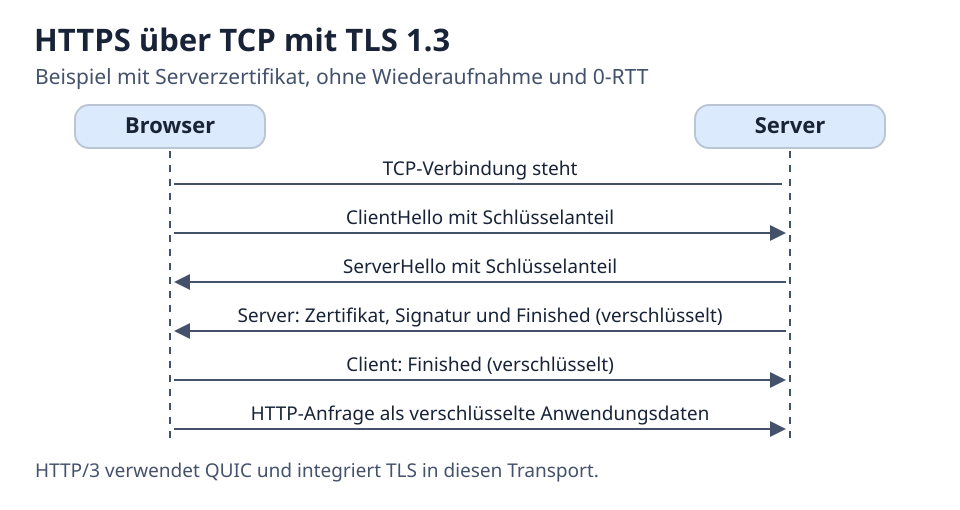

# M1-L6 – Netze und Sicherheit {#L6}

**Kursbereich:** M1 – Bachelor: Informatik-Grundlagen

**Niveau:** Bachelor

**Vorwissen:** Keine festen Voraussetzungen angegeben.

## Überblick: Wie aus einzelnen Computern ein gemeinsames System wird {#S1}

Bis hierhin ging es um Programme, Rechner und Datenbanken. Sobald zwei Programme auf unterschiedlichen Computern zusammenarbeiten, kommt eine weitere Ebene hinzu: das **Netzwerk**. Daten müssen ihr Ziel finden, unterwegs korrekt übertragen und am Ziel von der richtigen Anwendung verarbeitet werden. Zusätzlich muss entschieden werden, wer mit wem kommunizieren darf und welche Informationen geschützt werden müssen.

Ein Browser, der eine Webseite lädt, und eine Serveranwendung, die eine Datenbank abfragt, stehen für zwei Seiten desselben Problems: **verlässliche Kommunikation** und **kontrollierter Zugriff**. Dabei genügt es nicht, dass eine Verbindung technisch funktioniert. Eine öffentliche Anwendung muss auch unerwünschte Anfragen, fremde Benutzerkonten, gestohlene Zugangsdaten, Softwarefehler und Datenverluste berücksichtigen.

In dieser Lektion betrachten wir Netzwerke als Schichten, den Weg einer Anfrage durch das Internet, die Grundlagen der Verschlüsselung und Sicherheitsentscheidungen für kleine eigene Anwendungen. Der konkrete Betrieb eines öffentlich erreichbaren Servers wird erst in M2-L1 ausführlich behandelt.

## Das Internet ist ein Netz aus Netzen {#S2}

Ein **lokales Netzwerk** verbindet Geräte in einem begrenzten Bereich, etwa einen Rechner, ein Notebook und einen Router in einer Wohnung. Das **Internet** entsteht aus sehr vielen miteinander verbundenen Netzen von Zugangsanbietern, Unternehmen, Rechenzentren und weiteren Organisationen. Niemand betreibt das Internet als eine einzige zentrale Maschine.

Die Verbindung zwischen solchen Netzen wird durch **Router** organisiert. Ein Router betrachtet die Zieladresse eines Datenpakets und entscheidet anhand seiner Routinginformationen, an welche nächste Station das Paket weitergegeben wird. Das ist nicht dasselbe wie ein einziger fester Weg: Routen können sich ändern, Datenpakete können verloren gehen oder verzögert eintreffen.

``` text
PC ── Heimnetz ── Router ── Internetzugang
                               │
                          weitere Netze
                               │
                           Rechenzentrum
                               │
                            Webserver
```

**Welches Problem löst das?** Jede Anwendung muss nicht wissen, welche Kabel, Funkstrecken und Router zwischen ihr und dem Ziel liegen. Sie verwendet standardisierte Netzwerkfunktionen. **Wann unnötig?** Wenn ein Werkzeug vollständig lokal arbeitet, ist weder Internetzugang noch eine öffentliche Adresse erforderlich.

Ein **Paket** ist eine begrenzte Dateneinheit mit Steuerinformationen und Nutzdaten. Größere Übertragungen werden auf geeigneten Schichten in mehrere Einheiten zerlegt; nicht jedes Paket ist gleich groß. Deshalb kann ein Video über das Internet transportiert werden, obwohl einzelne Netzpakete relativ klein sind.

## Adressen, Namen und Ports: drei verschiedene Fragen {#S3}

Eine Netzwerkverbindung muss mindestens drei Dinge klären: *Welcher Rechner oder Netzanschluss? Welche Anwendung auf diesem Ziel? Und unter welchem Namen findet ein Mensch das Angebot?*

### IP-Adressen – wohin soll das Paket? {#21-ip-adressen-wohin-soll-das-paket}

**IP** bedeutet *Internet Protocol* (Internetprotokoll). Es beschreibt unter anderem die Adressierung und Weiterleitung von Paketen über mehrere Netze hinweg. Häufig begegnen zwei Adressfamilien:

- **IPv4** (*Internet Protocol Version 4*): Adressen aus 32 Bit; eine typische Schreibweise ist `192.0.2.10`.
- **IPv6** (*Internet Protocol Version 6*): Adressen aus 128 Bit; eine Beispieldarstellung ist `2001:db8::10`.

Diese beiden Adressen sind **Dokumentationsbeispiele** und keine realen Zielserver. Entscheidend ist der Unterschied zwischen **öffentlichen** Adressen, die grundsätzlich im Internet geroutet werden können, und **privaten bzw. lokalen** Adressbereichen, die innerhalb von Netzen verwendet werden. Eine lokale Adresse bedeutet nicht automatisch vollständigen Schutz; die tatsächlichen Zugriffswege hängen von der Netzkonfiguration ab.

Viele Heimrouter verwenden **NAT** (*Network Address Translation*, Netzwerkadressübersetzung). Dabei übersetzen sie Adressen und häufig auch Ports beim Übergang zwischen lokalen und öffentlichen Netzen. Das ermöglicht beispielsweise mehreren Geräten die gemeinsame Nutzung eines IPv4-Internetzugangs. NAT ist allerdings **keine eigenständige Sicherheitsstrategie** und nicht mit einer Firewall gleichzusetzen.

``` text
Notebook: private Adresse ──┐
                            ├── Heimrouter / NAT ── öffentliche Verbindung
Desktop: private Adresse ───┘
```

### DNS – welcher Name gehört zu welcher Adresse? {#22-dns-welcher-name-gehört-zu-welcher-adresse}

**DNS** steht für *Domain Name System* (Domainnamensystem). Es hilft, einen menschenlesbaren Namen wie `example.org` zu geeigneten technischen Adressinformationen aufzulösen. Ein Browser kennt die Zieladresse einer Domain nicht zwingend schon vorab. Er kann zunächst einen lokalen Zwischenspeicher verwenden oder einen DNS-Resolver befragen.

Ein typischer, vereinfachter Ablauf lautet:

``` text
Browser: "example.org"
           │
           ▼
Lokaler DNS-Cache / DNS-Resolver
           │
           ▼
IP-Adresse für das Ziel
           │
           ▼
Verbindungsaufbau mit einem Server
```

Ein **A-Eintrag** verweist auf eine IPv4-Adresse, ein **AAAA-Eintrag** auf eine IPv6-Adresse; weitere DNS-Eintragstypen haben andere Aufgaben. DNS selbst transportiert **nicht die Webseite**. Es ist ein Hilfsdienst zur Namensauflösung. Außerdem kann eine Domain je nach Anfrage unterschiedliche Adressen zurückliefern, etwa für regionale Verteilung oder Lastverteilung.

**Wann unnötig?** Für einen rein lokalen Dienst kann eine direkte lokale Adresse genügen. Für öffentliche Angebote erleichtert ein Domainname den Zugang und kann geänderte Serveradressen von Nutzern fernhalten. Ein Domainname beweist jedoch nicht, dass der dahinterstehende Dienst vertrauenswürdig ist.

### Ports – welches Programm soll die Daten erhalten? {#23-ports-welches-programm-soll-die-daten-erhalten}

Ein Rechner kann gleichzeitig einen Webserver, einen Datenbankdienst und weitere Anwendungen ausführen. **Ports** sind logische Nummern, mit denen Netzwerkverbindungen einem bestimmten Dienst beziehungsweise Kommunikationsendpunkt zugeordnet werden. Ein Port ist keine physische Buchse.

Häufige Zuordnungen sind **80** für unverschlüsseltes HTTP und **443** für HTTPS. Das sind Konventionen, keine unveränderlichen Naturgesetze. Nicht jede Anwendung auf einem Port ist automatisch ein bestimmter Dienst; Ports müssen zusammen mit der verwendeten Transporttechnik betrachtet werden.

``` text
Gleiche Serveradresse
   ├── Port 443  → HTTPS-Webdienst
   ├── Port 22   → ggf. SSH-Verwaltung (nur berechtigte Zugriffe)
   └── interner Datenbankport → möglichst nicht öffentlich freigegeben
```

**SSH** heißt *Secure Shell*, ein Protokoll für gesicherten Fernzugriff. Dass ein Dienst technisch erreichbar wäre, bedeutet nicht, dass er öffentlich erreichbar sein *sollte*. Für einen kleinen Webdienst ist meist nur der tatsächlich benötigte öffentliche Einstiegspunkt vorgesehen.

## Die Schichten der Netzwerkkommunikation {#S4}

Warum gibt es so viele Abkürzungen? Weil verschiedene Probleme voneinander getrennt gelöst werden. Physische Übertragung, Weiterleitung von Paketen, Transport zwischen Programmen und das eigentliche Anwendungsprotokoll sind unterschiedliche Aufgaben.

Das klassische **OSI-Modell** (*Open Systems Interconnection*) unterscheidet sieben konzeptionelle Schichten. Für unsere Zwecke genügt zunächst eine praxisnahe, gröbere Gliederung:

  Ebene                  Leitfrage                                Beispiele
  ---------------------- ---------------------------------------- ----------------------------------
  Anwendung              Was soll ausgetauscht werden?            HTTP, DNS, Anwendungs-API
  Transport              Wie kommunizieren Programme?             TCP, UDP, QUIC
  Internet/Vermittlung   Wie finden Pakete andere Netze?          IPv4, IPv6
  Lokale Übertragung     Wie gelangen Daten zum nächsten Gerät?   Ethernet, WLAN, Glasfaserstrecke

Die Grenzen dieser vereinfachten Darstellung sind wichtig: **QUIC** ist ein modernes Transportprotokoll auf Basis von UDP und integriert auch Funktionen zur Absicherung von Verbindungen; **TLS** gehört nicht schlicht zu einer immer festen OSI-Schicht. Modelle dienen zum Verstehen, nicht als exakter Bauplan jeder heutigen Technologie.

Das Schichtenprinzip erlaubt es beispielsweise, dieselbe Webanwendung über ein lokales WLAN, einen Mobilfunkanschluss oder eine Glasfaserverbindung zu erreichen, ohne dass die Anwendung für jede Leitung neu erfunden werden muss.

## TCP, UDP und QUIC: Transport mit unterschiedlichen Zielen {#S5}

### TCP – geordnete und zuverlässige Übertragung {#41-tcp-geordnete-und-zuverlässige-übertragung}

**TCP** bedeutet *Transmission Control Protocol* (Übertragungssteuerungsprotokoll). Es stellt Anwendungen einen **geordneten Byte-Strom** zur Verfügung. TCP sorgt im normalen Betrieb dafür, dass verlorene Segmente erneut übertragen werden und die Anwendung die Bytes in korrekter Reihenfolge erhält. Verbindungen können natürlich trotzdem abbrechen; TCP garantiert nicht, dass ein entfernter Server niemals ausfällt.

``` text
Anwendung A ── Datenstrom über TCP ── Anwendung B
    │                                    │
    └──── Übertragungsfehler werden ─────┘
          soweit möglich ausgeglichen
```

TCP ist sinnvoll, wenn eine Anwendung einen geordneten Datenstrom benötigt. Auch bei gutem TCP können jedoch Wartezeiten entstehen, und die Anwendung muss weiterhin mit Verbindungsabbrüchen umgehen.

### UDP – wenig Vorgaben, keine eingebaute Zustellgarantie {#42-udp-wenig-vorgaben-keine-eingebaute-zustellgarantie}

**UDP** steht für *User Datagram Protocol* (Benutzerdatagrammprotokoll). Es überträgt voneinander getrennte Datagramme, stellt selbst aber keine zuverlässige Zustellung, Reihenfolge oder Wiederholung verlorener Pakete bereit. Anwendungen und darauf aufbauende Protokolle können solche Funktionen bei Bedarf ergänzen.

Es ist nützlich, wenn geringer Protokollaufwand oder eigene Steuerung besonders wichtig ist, etwa in bestimmten Echtzeitübertragungen. **UDP bedeutet nicht automatisch schneller oder unsicherer:** Entscheidend ist das vollständige Anwendungs- und Transportdesign.

### QUIC und HTTP/3 {#43-quic-und-http3}

**QUIC** ist ein modernes Transportprotokoll, das auf UDP aufsetzt und zuverlässige Datenströme, Verbindungssteuerung sowie kryptografische Absicherung kombiniert. **HTTP/3** nutzt QUIC. Deshalb wäre die Aussage „HTTP läuft immer über TCP“ heute falsch. HTTP/1.1 und HTTP/2 verwenden üblicherweise TCP; HTTP/3 verwendet QUIC über UDP.

Für die Kursziele ist nicht erforderlich, das Protokoll selbst zu implementieren. Wichtig ist der Gedanke: **Das Webprotokoll und die Technik darunter sind unterscheidbare Ebenen**, und neue Protokolle können die Transporttechnik verändern, ohne dass alle Webseiten neu entwickelt werden müssen.

**Sicherheitsgrenze bei beschleunigten Verbindungen:** QUIC kann bei einer erneuten Verbindung unter Voraussetzungen schon mit **0-RTT** (*Zero Round Trip Time*, frühe Anwendungsdaten vor Abschluss des neuen Handshakes) Daten übertragen. Solche frühen Daten können unter bestimmten Bedingungen **wiederholt abgespielt** werden (*Replay*). Deshalb eignen sich 0-RTT-Anfragen nicht ohne zusätzliche Schutzregeln für fachlich wirksame Aktionen wie „Geld abbuchen“ oder „Auftrag kostenpflichtig starten“. Ein geschützter Transportkanal macht eine unsichere Fachoperation nicht automatisch wiederholungsfest. **Die Funktion ist optional:** Anwendungen können 0-RTT beschränken oder deaktivieren; es ist kein Merkmal jeder HTTPS-Verbindung. Grundlage: IETF [RFC 9001](https://www.rfc-editor.org/rfc/rfc9001.html), insbesondere zum Replay-Risiko. Der TLS-1.3-Grundstandard ist [RFC 9846](https://www.rfc-editor.org/rfc/rfc9846.html).

## HTTP und HTTPS: die Sprache des Webs {#S6}

**HTTP** bedeutet *Hypertext Transfer Protocol* (Hypertext-Übertragungsprotokoll). Es beschreibt, wie ein Client eine Anfrage stellt und ein Server darauf antwortet. Ein Browser ist ein typischer Client; ein eigenes Programm oder ein KI-Agent kann ebenfalls HTTP-Anfragen senden.

``` text
Browser                          Webserver
   │                                │
   ├── Anfrage: GET /artikel ──────►│
   │                                │
   ◄──────── Status + Inhalt ───────┤
   │                                │
```

`GET` bezeichnet eine Methode zum Abrufen von Informationen. `POST` wird typischerweise zum Übermitteln beziehungsweise zur Verarbeitung von Daten verwendet. Antwortcodes geben das Ergebnis an, zum Beispiel `200` (erfolgreich), `404` (Ressource nicht gefunden) oder `500` (allgemeiner interner Serverfehler). Der Code allein erklärt nicht jede Ursache.

Eine **API** (*Application Programming Interface*, Programmierschnittstelle) legt fest, welche Funktionen eine Anwendung anderen Programmen anbietet. Eine **Web-API** nutzt häufig HTTP. Eine API ist aber nicht automatisch öffentlich; sie kann intern, geschützt, kostenpflichtig oder nur für bestimmte Clients zugänglich sein.

**HTTPS** bedeutet in der Praxis *HTTP over TLS*, also HTTP über eine durch **TLS** geschützte Verbindung. TLS heißt *Transport Layer Security* (Transportschichtsicherheit). HTTPS soll die Kommunikation auf dem Übertragungsweg vor Mitlesen und unerkanntem Verändern schützen und hilft, die Identität des angesprochenen Servers zu überprüfen.

``` text
Browser ── HTTP-Anfragen innerhalb einer geschützten TLS-Verbindung ── Server
```

**Grenze:** HTTPS macht nicht automatisch die Webseite vertrauenswürdig, die Datenbank sicher oder eine Anwendung frei von Programmierfehlern. Es schützt primär die Verbindung zwischen den jeweiligen TLS-Endpunkten. Wenn TLS beispielsweise bei einem vorgeschalteten Proxy endet, müssen weitere interne Übertragungswege gesondert betrachtet werden.

## Kryptografie: Hash, Verschlüsselung, Schlüssel und Zertifikat {#S7}

Der Ausdruck **Kryptografie** beschreibt mathematische Verfahren, mit denen Informationen beispielsweise vertraulich gehalten, auf Veränderungen geprüft oder einem Absender zugeordnet werden können. Verschiedene Verfahren erfüllen verschiedene Aufgaben. Besonders häufig werden vier Begriffe verwechselt.

### Hashfunktionen: eine Art Prüffingerabdruck {#61-hashfunktionen-eine-art-prüffingerabdruck}

Eine **kryptografische Hashfunktion** verwandelt Daten beliebiger Länge in einen Wert fester Länge. Ändern sich die Eingabedaten, ändert sich mit sehr hoher Wahrscheinlichkeit auch der Hashwert. Solche Verfahren werden unter anderem verwendet, um die Integrität einer Datei zu prüfen.

``` text
Datei "lektion.md" ── Hashfunktion ──► Prüfsumme A
Veränderte Datei  ── Hashfunktion ──► Prüfsumme B
                                           A ≠ B
```

Wichtig: Ein Hashwert ist **keine Verschlüsselung**, die man anschließend einfach entschlüsseln könnte. Er ist auch kein Beweis dafür, *wer* die Datei erstellt hat. Wenn ein Angreifer Datei und veröffentlichte Prüfsumme gleichzeitig ersetzen kann, genügt die Hashprüfung nicht als Authentizitätsnachweis.

Passwörter sollten nicht im Klartext gespeichert werden. Dafür verwendet man spezielle **passwortgeeignete, bewusst aufwendige Hash-/Schlüsselableitungsverfahren**, beispielsweise Argon2id, jeweils mit individuellem **Salt** (zusätzlichem zufälligem Wert). Ein schneller Standard-Hash wie SHA-256 allein ist dafür ungeeignet, weil automatisches Durchprobieren von Passwortkandidaten zu schnell wäre. Die OWASP-Sicherheitshilfen behandeln diese Unterschiede ausführlich.

### Symmetrische Verschlüsselung: derselbe geheime Schlüssel {#62-symmetrische-verschlüsselung-derselbe-geheime-schlüssel}

Bei **symmetrischer Verschlüsselung** verwenden beide Seiten denselben geheimen Schlüssel zum Ver- und Entschlüsseln. Das ist für große Datenmengen effizient. Wer den Schlüssel erhält, kann in diesem Modell grundsätzlich auch die damit geschützten Daten entschlüsseln.

``` text
Klartext + geheimer Schlüssel ──► Chiffretext
Chiffretext + gleicher Schlüssel ──► Klartext
```

Ein praktisches Problem besteht darin, dass die beiden Kommunikationspartner zunächst sicher zu einem gemeinsamen geheimen Schlüssel gelangen müssen. Ein anderes Risiko ist die Aufbewahrung: Verliert man den einzigen Schlüssel, können eigene verschlüsselte Daten unlesbar werden; wird er gestohlen, kann der Schutz verloren gehen.

### Asymmetrische Kryptografie: öffentliches und privates Schlüsselpaar {#63-asymmetrische-kryptografie-öffentliches-und-privates-schlüsselpaar}

Bei **asymmetrischer Kryptografie** gibt es einen **öffentlichen Schlüssel** und einen dazugehörigen **privaten Schlüssel**. Je nach Verfahren können damit Daten verschlüsselt, Schlüsselmaterial vereinbart oder digitale Signaturen erstellt und überprüft werden. Nicht jedes asymmetrische Verfahren unterstützt alle diese Funktionen.

Eine **digitale Signatur** hilft zu prüfen, ob Daten mit dem passenden privaten Schlüssel signiert wurden und nach dem Signieren unverändert sind. Die Signatur belegt jedoch nicht von selbst die reale Identität eines Menschen: Dafür muss der öffentliche Schlüssel zuverlässig einer Identität zugeordnet werden.

### Zertifikate und TLS {#64-zertifikate-und-tls}

Ein digitales **Zertifikat** verknüpft einen öffentlichen Schlüssel mit bestimmten Identitätsinformationen, beispielsweise einem Domainnamen, und ist typischerweise durch eine vertrauenswürdige **Zertifizierungsstelle** (*Certificate Authority*, CA) bestätigt. Bei HTTPS prüft der Client unter anderem, ob das Zertifikat für den angesprochenen Namen gilt und ob die Vertrauenskette und Gültigkeitsbedingungen passen.

TLS kombiniert mehrere kryptografische Mechanismen: Im **Handshake** (anfängliche Aushandlung) werden Parameter vereinbart, die Gegenstelle authentifiziert und gemeinsame Sitzungsschlüssel abgeleitet. Anschließend schützen symmetrische Verfahren die übertragene Nutzlast effizient. Es ist also verkürzt zu behaupten, bei HTTPS werde die gesamte Übertragung permanent „mit dem öffentlichen Schlüssel“ verschlüsselt.

``` text
1. Browser verbindet sich mit Server
2. TLS-Handshake: Parameter, Schlüsselaushandlung, Identitätsprüfung
3. Geschützter Kommunikationskanal entsteht
4. HTTP-Nachrichten werden darüber übertragen
```

**Aktualitätsnotiz (Prüfstand 03.11.2026):** Der maßgebliche veröffentlichte Text zur TLS-Version 1.3 ist **RFC 9846 (2026)**. Er ersetzt die frühere Spezifikation RFC 8446 (2018), ohne die hier erklärte Grundidee von TLS 1.3 zu verändern. RFC steht für *Request for Comments*, eine Dokumentenreihe für technische Internet-Spezifikationen.

## Authentifizierung und Autorisierung – zwei unterschiedliche Entscheidungen {#S8}

Eine Anwendung mit Benutzerkonten muss zwischen zwei Fragen unterscheiden:

- **Authentifizierung** (*Authentication*): *Wer behauptest du zu sein, und wie prüfen wir das?*
- **Autorisierung** (*Authorization*): *Was darf dieses identifizierte Konto tun?*

Ein Benutzer kann korrekt angemeldet sein und trotzdem keinen Zugriff auf einen bestimmten Datensatz haben. Diese zweite Prüfung wird häufig übersehen, etwa wenn eine Anwendung nur kontrolliert, ob überhaupt eine Anmeldung besteht, aber nicht, wem ein angefragtes Dokument gehört.

``` text
Anfrage an /api/dokument/4711
             │
             ▼
Authentifizierung: gültiges Konto?
             │
             ▼
Autorisierung: gehört Dokument 4711 diesem Konto?
             │
       ┌─────┴─────┐
       │           │
      Ja          Nein
       │           │
   Ergebnis    Zugriff verweigern
```

Eine **Sitzung** (*Session*) ordnet mehrere Anfragen einem angemeldeten Nutzer zu. Hierfür verwendet man häufig ein Sitzungs-Cookie oder einen Zugriffstoken. Solche Werte sind sicherheitsrelevant: Wer sie missbräuchlich erhält, kann sich unter Umständen als der Benutzer ausgeben. Deshalb gehören sichere Speicherung, begrenzte Gültigkeit und eine passende Abmeldung oder Sperrmöglichkeit zum Entwurf.

**MFA** (*Multi-Factor Authentication*, Mehrfaktor-Authentifizierung) kombiniert mindestens zwei *unterschiedliche* Faktoren, zum Beispiel ein Passwort und einen Hardware-Sicherheitsschlüssel. Ein zweites Passwort ist dagegen nicht automatisch ein zweiter Faktor. MFA erschwert bestimmte Formen der Kontoübernahme, verhindert aber nicht sämtliche Angriffe.

**Welches Problem lösen Konten und Rechte?** Sie erlauben, Daten und Funktionen bestimmten Personen zuzuordnen. **Wann unnötig?** Ein vollständig lokales Offline-Werkzeug ohne getrennte Nutzer benötigt meist kein webbasiertes Benutzerkonto. Konten erzeugen zusätzliche Verantwortung: Passwortschutz, Wiederherstellung, Sperrung, Datenschutz und Support.

## Bedrohungsmodell: Sicherheit beginnt mit der richtigen Frage {#S9}

Ein **Bedrohungsmodell** ist eine strukturierte Überlegung, *was geschützt werden soll, wer es angreifen könnte, über welche Wege und mit welchen Folgen*. Das ist meist hilfreicher, als wahllos möglichst viele Sicherheitsprodukte einzubauen.

Nehmen wir ein Online-Analysewerkzeug, bei dem Nutzer Dateien hochladen. Was wäre dort kritisch?

  Schutzgut       Mögliche Gefahr                             Geeignete Grundmaßnahme
  --------------- ------------------------------------------- ---------------------------------------------------------
  Nutzerdateien   Ein anderer Nutzer liest sie                Autorisierung pro Datei, getrennte Speicherung
  Benutzerkonto   Übernahme durch gestohlene Anmeldung        Sichere Sitzung, MFA wo sinnvoll, Missbrauchsbegrenzung
  Server          Angreifer nutzt ungepatchte Software aus    Updates, möglichst wenige exponierte Dienste
  Anwendung       Bösartige Eingaben führen zu Fehlern        Eingabeprüfung, sichere Bibliotheken, Tests
  Verfügbarkeit   Sehr viele Anfragen überlasten den Dienst   Ratenbegrenzung, Kapazitätsplanung, Monitoring
  Datenbestand    Fehler oder Löschung zerstören Daten        Getrennte Backups und Wiederherstellungsprüfung

Aus diesem Modell folgt nicht, dass eine einzelne Maßnahme alles absichert. Eine Firewall verhindert beispielsweise nicht automatisch einen Fehler in einer öffentlich erreichbaren Webanwendung. HTTPS hilft gegen Mitlesen unterwegs, nicht gegen fehlerhafte Berechtigungsprüfungen im Backend.

### Least Privilege – so wenig Rechte wie nötig {#81-least-privilege-so-wenig-rechte-wie-nötig}

**Least Privilege** bedeutet *Prinzip der geringsten Rechte*. Jede Person und jeder technische Dienst soll nur diejenigen Berechtigungen besitzen, die für seine Aufgabe erforderlich sind.

Beispielsweise benötigt ein öffentlicher Webprozess normalerweise keinen administrativen Vollzugriff auf das Betriebssystem und nicht auf sämtliche Datensicherungen. Ein Analyse-Worker braucht vielleicht Zugriff auf einen einzelnen Auftrag, aber nicht auf die gesamten Kontodaten aller Nutzer.

Eng verwandt ist **Deny by Default**: Wenn eine Berechtigung nicht ausdrücklich vorgesehen ist, wird der Zugriff verweigert. Das ist sicherer, als zunächst alle Zugriffe zu erlauben und nur einige zu verbieten.

``` text
Internet
   │
   ▼
Öffentlicher HTTPS-Einstiegspunkt
   │
   ▼
Anwendung mit begrenzten Rechten
   │
   ├── Zugriff nur auf zugewiesene Aufträge
   └── Datenbankkonto ohne Administrationsrechte
```

**Wann überdimensioniert?** Eine komplexe Rollenverwaltung mit mehreren Mandanten ist für ein kleines Offline-Hilfsprogramm unnötig. Das grundlegende Prinzip, unnötige Rechte zu vermeiden, bleibt aber auch dort sinnvoll.

### Firewall, Updates und Sicherheitsgrenzen {#82-firewall-updates-und-sicherheitsgrenzen}

Eine **Firewall** lässt Netzwerkverkehr anhand von Regeln zu oder blockiert ihn. Für einen öffentlichen Dienst ist es gewöhnlich sinnvoll, nur notwendige Eingänge freizugeben. Das ersetzt jedoch weder Programmprüfungen noch eine sichere Konfiguration.

**Sicherheitsupdates** schließen bekannte Schwachstellen. Nicht nur das Betriebssystem, sondern auch Webserver, Datenbanksystem, Programmbibliotheken und die eigene Anwendung können betroffen sein. Updates verursachen Arbeit und können Kompatibilitätsprobleme hervorrufen. Sie müssen deshalb geplant und bei kritischen Systemen überprüfbar ausgerollt werden.

**Backups** schützen vor Datenverlust, etwa durch Hardwarefehler, Fehlbedienung oder bestimmte Schadsoftware. Sie sind nur dann belastbar, wenn die Kopien getrennt aufbewahrt, gegen unberechtigte Veränderungen geschützt und die Wiederherstellung gelegentlich ausprobiert wird. Eine ständig synchronisierte Kopie ist nicht automatisch ein geeignetes Backup: Löschungen und beschädigte Daten können mit synchronisiert werden.

Daraus ergibt sich ein nüchterner Grundsatz: Je mehr Dienste und Nutzer ein System besitzt, desto mehr laufende Wartungs- und Sicherheitsverantwortung entsteht – auch wenn der ursprüngliche Programmcode klein ist.

## Ein vollständiger Besuch einer sicheren Webseite {#S10}



*Abbildung: Vereinfachter TLS-1.3-Handshake mit Serverzertifikat über TCP. Die Grafik fasst die Serverauthentisierung und mehrere Handshake-Nachrichten zusammen. HTTP/3 nutzt QUIC.*

Wir setzen die Begriffe zu einem vereinfachten Ablauf zusammen. Es ist bewusst kein verbindlicher Ablauf aller Browserprotokolle, sondern ein typisches Architekturmodell.

``` text
Nutzer tippt: https://example.org/werkzeug
                       │
                       ▼
                  DNS-Auflösung
                       │
                       ▼
             IP-Adresse des Ziels
                       │
                       ▼
        Verbindungsaufbau (z. B. TCP)
                       │
                       ▼
        TLS-Handshake / Zertifikatsprüfung
                       │
                       ▼
               HTTPS-Anfrage
                       │
                       ▼
               Webserver / API
                       │
                       ▼
         Anwendungslogik / Berechtigungen
                       │
                       ▼
                 Datenbank
                       │
                       ▼
          HTTPS-Antwort an den Nutzer
```

Bei **HTTP/3** würde der Transport über QUIC statt über eine klassische TCP-Verbindung laufen; die Architekturidee bleibt vergleichbar. Außerdem können vorgeschaltete Komponenten wie ein Reverse Proxy, Caches oder ein Netzwerk zur Inhaltsauslieferung beteiligt sein. Das behandeln wir später in Modul M2.

An jeder Stelle beantwortet eine andere Technik eine andere Frage: DNS sucht technische Adressen; IP transportiert Pakete zwischen Netzen; die Transportebene organisiert Kommunikation; TLS schützt den Kanal; HTTP beschreibt Anfragen und Antworten; die Anwendung entscheidet über Berechtigungen und Inhalte; die Datenbank verwaltet ihre Daten.

**Warum diese Trennung wichtig ist:** Bei einer Fehlersuche kann „die Webseite funktioniert nicht“ ganz unterschiedliche Gründe haben – vom falschen DNS-Eintrag über einen abgelaufenen Zertifikatszustand bis zur fehlerhaften Datenbankabfrage. Wer die Ebenen versteht, sucht nicht wahllos nach einer Ursache.

## Drei Bezugspunkte für eigene Softwareideen {#S11}

### Lokales Programm mit SQLite {#101-lokales-programm-mit-sqlite}

Ein PureBasic-Werkzeug, das lokale Dateien liest und eine SQLite-Datenbank nutzt, braucht für seine Kernfunktion **keine öffentliche Netzwerkarchitektur**. Wenn keine Daten das Gerät verlassen, entfallen damit viele Probleme öffentlicher Endpunkte. Lokale Sicherheit, Zugriffsschutz auf Dateien und Backups bleiben dennoch relevant.

### Kleine öffentliche Webanwendung {#102-kleine-öffentliche-webanwendung}

Ein einfaches PHP- oder JavaScript-Backend könnte bereits auf einem einzelnen gemieteten Server laufen. Es benötigt typischerweise einen DNS-Eintrag, einen HTTPS-Einstiegspunkt, eine Anwendungslogik und gegebenenfalls eine Datenbank. Für Benutzerkonten kommen sichere Anmeldung und Berechtigungsprüfungen hinzu.

Die einmaligen Entwicklungsschritte reichen nicht: Laufende Kosten und Aufgaben umfassen Hosting, Domain und je nach Anbieter Zusatzleistungen, Sicherheitsupdates, Zertifikatsverwaltung, Überwachung, Sicherungen und Hilfe bei Nutzerproblemen. Für einige dieser Aufgaben existieren verwaltete Dienste, die Arbeit abnehmen, aber nicht die Verantwortung des Betreibers für seine Anwendung vollständig beseitigen.

### KI-Verarbeitungsdienst mit Hintergrundaufträgen {#103-ki-verarbeitungsdienst-mit-hintergrundaufträgen}

Bei einem Dienst, der hochgeladene Bilder durch ein KI-Modell verarbeitet, liegen zusätzliche sensible Schnittstellen vor: Dateien werden hochgeladen, Aufträge weitergegeben, Zwischenergebnisse gespeichert und später wieder ausgeliefert. Berechtigungen müssen **über den gesamten Ablauf** stimmen – nicht nur am ersten Webformular.

``` text
Kunde
  │ HTTPS
  ▼
API / Konto- und Zugriffsprüfung
  │
  ▼
Auftragswarteschlange ──► KI-Worker
                             │
                             ▼
                      Ergebnis-Speicher
                             │
                             ▼
                    geschützte Auslieferung
```

Das zeigt zugleich, warum ein größerer Systemverbund nicht automatisch besser ist: Für wenige gelegentliche Aufträge kann ein einzelner Rechner mit Warteschlange einfacher sein. Viele parallel laufende Worker sind erst dann sinnvoll, wenn Last, Ausfallsicherheit oder besondere technische Anforderungen den Aufwand rechtfertigen.

## Typische Missverständnisse und kurze Antworten {#S12}

  Häufige Aussage                                                   Genauere Einordnung
  ----------------------------------------------------------------- ---------------------------------------------------------------------------------------------------------------------
  „Eine Domain ist eine IP-Adresse.“                                Eine Domain ist ein Name, dessen DNS-Einträge unter anderem auf Adressen verweisen können.
  „HTTPS schützt die ganze Anwendung.“                              HTTPS schützt den Transportkanal; Anwendungsfehler und falsch vergebene Rechte bleiben möglich.
  „Wer angemeldet ist, darf alles sehen.“                           Anmeldung und Zugriffserlaubnis müssen getrennt geprüft werden.
  „Ein Hash ist verschlüsselter Text.“                              Hashing ist grundsätzlich keine umkehrbare Verschlüsselung.
  „NAT ersetzt eine Firewall.“                                      NAT ist Adressübersetzung und kein vollständiges Sicherheitskonzept.
  „TCP garantiert, dass jeder Vorgang gelingt.“                     TCP schützt den Datenstrom während einer funktionierenden Verbindung; Anwendungen müssen Ausfälle selbst behandeln.
  „Replikation ist ein Backup.“                                     Kopien können dieselben Löschungen oder Fehler übernehmen; Wiederherstellbarkeit muss gesondert geplant werden.
  „Für jede kleine Anwendung braucht man eine Cloud-Architektur.“   Ein lokales Programm oder ein einzelner Server kann die angemessenere Lösung sein.

## Zusammenfassung und Übergang zu M1-L7 {#S13}

Der Weg durch ein Netzwerk besteht aus mehreren getrennten Aufgaben: **Namen auflösen, Adressen finden, Pakete weiterleiten, Daten transportieren, Nachrichten interpretieren und Zugriffe schützen**. Das Internet ist ein Zusammenschluss vieler Netze; IP, DNS, TCP oder UDP, HTTP sowie TLS übernehmen jeweils unterschiedliche Aufgaben. Sicherheit entsteht nicht allein durch Verschlüsselung, sondern auch durch verlässliche Identitätsprüfung, korrekt gesetzte Zugriffsrechte, aktuelle Software, begrenzte Angriffsflächen und wiederherstellbare Daten.

Für einen kleinen lokalen Rechner ist vieles davon nicht notwendig. Sobald aber fremde Menschen online auf eine Anwendung zugreifen, werden diese Fragen zu einem Teil des dauerhaften Betriebs. **M2-L1** zeigt später, wie man aus einem lokalen Programm einen öffentlich erreichbaren Dienst machen kann; **M4-L3** vertieft die organisatorische und datenschutzbezogene Verantwortung.

Die **nächste Lektion M1-L7** schließt den Überblick der Informatikgrundlagen ab: Nebenläufigkeit, formale Sprachen, verteilte Systeme, Mensch-Computer-Interaktion sowie KI als Überblick vor den Modulen M5 und M6.


## Quellen {#S14}

**Letzte Quellenprüfung:** 03.11.2026

**Recherche-/Prüfstand: 03.11.2026; 0-RTT-Präzisierung am 05.11.2026.** Die Links dienen der Nachvollziehbarkeit einzelner technischer Grundlagen und Sicherheitsprinzipien. Es werden keine aktuellen Anbieterpreise oder verbindlichen Rechtsauskünfte behauptet.

1.  **MDN Web Docs – Überblick über HTTP** (Anfrage-Antwort-Prinzip, Client-Server): [https://developer.mozilla.org/de/docs/Web/HTTP/Guides/Overview](https://developer.mozilla.org/de/docs/Web/HTTP/Guides/Overview)
2.  **MDN Web Docs – What is a Domain Name?** (DNS, Domains und Adressauflösung): [https://developer.mozilla.org/en-US/docs/Learn_web_development/Howto/Web_mechanics/What_is_a_domain_name](https://developer.mozilla.org/en-US/docs/Learn_web_development/Howto/Web_mechanics/What_is_a_domain_name)
3.  **IETF / RFC Editor – RFC 9846: TLS 1.3** (gültige Nachfolgespezifikation der RFC 8446): [https://www.rfc-editor.org/info/rfc9846/](https://www.rfc-editor.org/info/rfc9846/)
4.  **IETF / RFC Editor – RFC 9001: Using TLS to Secure QUIC** (0-RTT-Anwendungsdaten und Replay-Risiko): [https://www.rfc-editor.org/info/rfc9001/](https://www.rfc-editor.org/info/rfc9001/)
5.  **OWASP Cheat Sheet Series – Authorization** (geringste Rechte, standardmäßig verweigern): [https://cheatsheetseries.owasp.org/cheatsheets/Authorization_Cheat_Sheet.html](https://cheatsheetseries.owasp.org/cheatsheets/Authorization_Cheat_Sheet.html)
6.  **OWASP Cheat Sheet Series – Password Storage** (passwortgeeignete Hashverfahren und Salt): [https://cheatsheetseries.owasp.org/cheatsheets/Password_Storage_Cheat_Sheet.html](https://cheatsheetseries.owasp.org/cheatsheets/Password_Storage_Cheat_Sheet.html)
7.  **OWASP Cheat Sheet Series – Multifactor Authentication** (unabhängige Authentifizierungsfaktoren): [https://cheatsheetseries.owasp.org/cheatsheets/Multifactor_Authentication_Cheat_Sheet.html](https://cheatsheetseries.owasp.org/cheatsheets/Multifactor_Authentication_Cheat_Sheet.html)
8.  **Cloudflare Learning Center – OSI-Modell** (Schichten als konzeptionelle Abstraktion): [https://www.cloudflare.com/de-de/learning/ddos/glossary/open-systems-interconnection-model-osi/](https://www.cloudflare.com/de-de/learning/ddos/glossary/open-systems-interconnection-model-osi/)

**Einordnung:** Netzwerkstandards und Sicherheitsrichtlinien können weiterentwickelt werden. Diese Lektion erklärt langlebige Konzepte; konkrete Implementierungsentscheidungen sollten bei tatsächlichem Betrieb erneut anhand aktueller Dokumentationen geprüft werden.
