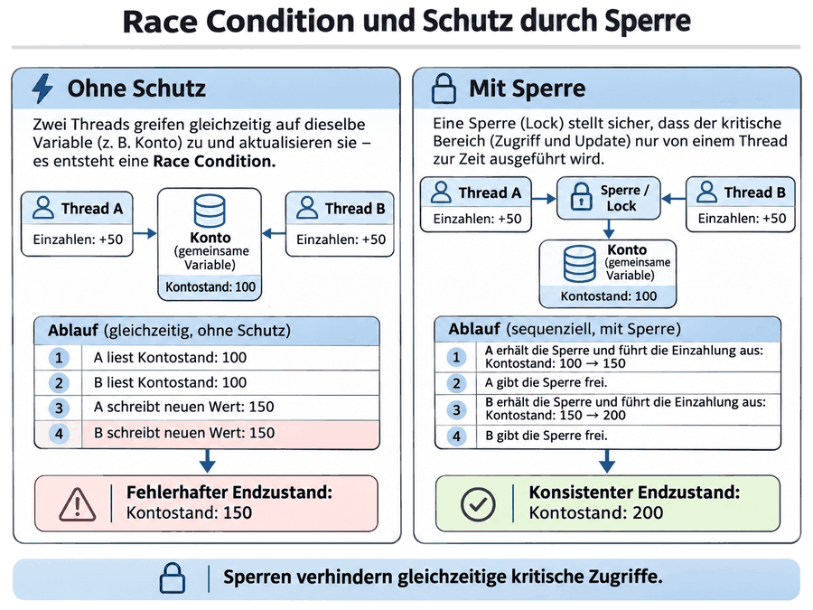

# M1-L7 – Weitere Bachelor-typische Gebiete im Überblick {#L7}

**Kursbereich:** M1 – Bachelor: Informatik-Grundlagen

**Niveau:** Bachelor

**Vorwissen:** Keine festen Voraussetzungen angegeben.

## Überblick: Was gehört noch zu einem Informatikstudium? {#S1}

In M1-L1 bis M1-L6 haben wir bereits die Grundlagen für Programmierung, Rechner, Algorithmen, Softwarearchitektur, Datenbanken und Netze kennengelernt. Ein Informatikstudium betrachtet darüber hinaus mehrere Fragestellungen, die zunächst weit auseinanderzuliegen scheinen: Wie vermeiden wir Fehler, wenn zwei Aufgaben gleichzeitig dieselben Daten bearbeiten? Wie kann ein Computer eine Programmiersprache verstehen? Wie funktionieren Programme, die auf mehreren Rechnern laufen? Warum gehört die Gestaltung einer Bedienoberfläche ebenso zur Informatik wie ein Algorithmus? Und worin unterscheidet sich maschinelles Lernen von gewöhnlicher Programmierung?

Diese Lektion verbindet fünf solche Gebiete. Sie soll keine späteren Spezialkurse ersetzen, sondern eine **Landkarte** geben. Die Übersicht orientiert sich an den Wissensgebieten der *CS2023 Computer Science Curricula* von ACM, IEEE Computer Society und AAAI: Parallel and Distributed Computing, Foundations of Programming Languages, Human-Computer Interaction, Artificial Intelligence sowie Society, Ethics, and the Profession gehören ausdrücklich zum Fachgebiet. Die einzelne Hochschule kann die Inhalte anders ordnen.

Ein durchgehender Gedanke ist dabei wichtiger als alle Fachbegriffe: **Sobald Daten, Zeit, mehrere Akteure oder Menschen beteiligt sind, genügt es oft nicht mehr, nur den „normalen“ Programmablauf zu betrachten.**

## Nebenläufigkeit: Wenn mehrere Dinge gleichzeitig passieren {#S2}

### Begriff und Ausgangsproblem

**Nebenläufigkeit (Concurrency)** bedeutet, dass mehrere Aufgaben in überlappenden Zeiträumen Fortschritte machen können. **Parallelität (Parallelism)** bezeichnet die tatsächliche gleichzeitige Ausführung auf mehreren Recheneinheiten. Ein einzelner Prozessorkern kann nebenläufige Aufgaben abwechselnd bearbeiten; mehrere Kerne können sie gleichzeitig ausführen. Nebenläufigkeit ist daher nicht automatisch gleichbedeutend mit schnellerer Berechnung.

Warum gibt es sie? Ein Desktopprogramm soll beispielsweise weiter auf Mausbewegungen reagieren, während es eine Datei lädt. Ein Webserver muss mehrere eingehende Anfragen bedienen können. Ein KI-Dienst möchte den nächsten Auftrag vorbereiten, während eine Grafikkarte bereits rechnet. Würde jede Tätigkeit alle anderen blockieren, erschiene die Anwendung unbenutzbar oder ihre Ressourcen würden schlecht ausgelastet.

### Prozesse, Threads und asynchrone Abläufe

Ein **Prozess** ist eine laufende Programminstanz mit einem gewöhnlich getrennten virtuellen Adressraum. Ein **Thread** ist ein Ausführungsstrang innerhalb eines Prozesses; Threads desselben Prozesses können gemeinsame Speicherbereiche verwenden. Bei einer **asynchronen** Vorgehensweise muss ein Programm auf eine langwierige Operation nicht zwingend untätig warten: Es kann andere Arbeit ausführen und das Ergebnis später verarbeiten. Asynchronität bedeutet dabei nicht automatisch, dass ein eigener Thread gestartet wird oder dass eine CPU-Berechnung parallel stattfindet.

``` text
Anwendung
   │
   ├─ Bedienung entgegennehmen ──────────────┐
   ├─ Datei laden ──────── [Wartezeit] ───────┤
   └─ Daten aufbereiten ─────────────────────┤
                                            ▼
                                      Ergebnis anzeigen
```

Die Skizze zeigt logische Tätigkeiten; ihre tatsächliche Zuordnung zu Threads oder Prozessorkernen hängt von der verwendeten Laufzeitumgebung ab.

### Die Race Condition: Zwei richtige Abläufe ergeben ein falsches Resultat

Eine **Race Condition** (Wettlaufsituation) entsteht, wenn das Ergebnis davon abhängt, in welcher Reihenfolge Zugriffe zufällig stattfinden. Angenommen, ein Zähler steht auf 10. Zwei Aufgaben sollen jeweils 1 addieren:

``` text
Ausgangswert: 10

Aufgabe A: liest 10 ─────────────────┐
Aufgabe B:          liest 10 ────────┤
Aufgabe A: schreibt 11 ──────────────┤
Aufgabe B:                schreibt 11┘

Erwartet: 12     Tatsächlich möglich: 11
```

Beide Aufgaben haben für sich genommen scheinbar korrekt gerechnet. Das Problem ist der gemeinsame Zustand. Das Beispiel ist auch deshalb relevant, weil ein einzelner Programmierausdruck wie „Zähler um eins erhöhen“ nicht in jedem Kontext garantiert eine unteilbare Operation darstellt.

### Synchronisation, Sperren und atomare Schritte



*Abbildung: Beispiel für ein verlorenes Update: Beide Threads lesen 100 und schreiben ohne Synchronisierung 150. Eine korrekt gemeinsam verwendete Sperre serialisiert die Änderungen auf 200; sie schützt hier nur die betroffenen Prozesse im jeweiligen gemeinsamen Sperrbereich.*

**Synchronisation** koordiniert den Zugriff mehrerer Aufgaben auf gemeinsame Daten. Ein **Mutex** (*mutual exclusion*, gegenseitiger Ausschluss) erlaubt zu einer Zeit nur einem Ausführungsstrang den Eintritt in einen geschützten Abschnitt. Eine **atomare Operation** wird gegenüber konkurrierenden Zugriffen als unteilbarer Schritt wirksam. Datenbanktransaktionen können ähnliche Schutzanforderungen auf Datenbankebene behandeln, sind aber keine pauschale Lösung für jede Nebenläufigkeit im Programm.

``` text
Aufgabe A ──► Sperre erwerben ──► Zähler ändern ──► Sperre freigeben
                                  ▲
Aufgabe B ────────── wartet ──────┘ ────────────► Zähler ändern
```

Sperren können Fehler verhindern, kosten aber auch Zeit. Zu große Sperrbereiche reduzieren Parallelität; falsch gewählte Sperrregeln können neue Fehler erzeugen. Noch einfacher ist manchmal, **gemeinsamen veränderlichen Zustand zu vermeiden**: Jede Aufgabe arbeitet auf einer eigenen Datenkopie und übergibt erst am Ende ein Ergebnis.

**Abgrenzung zum verteilten System:** Eine Sperre im Arbeitsspeicher eines Prozesses schützt zunächst nur die beteiligten Ausführungsstränge in genau diesem Koordinationsbereich. Zwei getrennte Server mit eigenen Sperren können trotzdem dieselbe externe Aktion beginnen. Dann muss der gemeinsame Datenbestand oder der angesprochene externe Dienst die Eindeutigkeit der fachlichen Wirkung sichern; ein lokaler Mutex allein genügt nicht. Die spätere Lektion [M4-L1](M4-L1.md) vertieft die Fehlermodelle bei Warteschlangen und Workern.

### Deadlock, Starvation und Livelock

Ein **Deadlock** (Verklemmung) liegt vor, wenn mehrere Aufgaben aufeinander warten und deshalb nicht mehr weiterkommen. Beispiel: Aufgabe A hält Ressource 1 und wartet auf Ressource 2; Aufgabe B hält Ressource 2 und wartet auf Ressource 1.

``` text
Aufgabe A ── hält Datei X ── wartet auf Datenbank Y
    ▲                                     │
    │                                     ▼
Aufgabe B ◄─ wartet auf Datei X ◄─ hält Datenbank Y
```

Die Beschriftung beschreibt den klassischen zyklischen Wartefall; Datei und Datenbank sind hier nur anschauliche Ressourcen. Gegenmaßnahmen sind etwa eine einheitliche Reihenfolge beim Anfordern von Sperren, kurze kritische Abschnitte und gezielte Zeitüberschreitungen. **Starvation** bedeutet, dass eine Aufgabe über lange Zeit keine faire Chance auf eine benötigte Ressource bekommt. Bei **Livelock** reagieren Aufgaben zwar weiterhin aktiv aufeinander, machen aber keinen brauchbaren Fortschritt.

**Wann sinnvoll?** Nebenläufigkeit hilft bei vielen Nutzern, Hintergrundverarbeitung und reaktionsfähiger Bedienung. **Wann unnötig?** Für ein kleines Hilfsprogramm, das nacheinander wenige Dateien verarbeitet, erzeugen zusätzliche Threads oft nur mehr Fehlermöglichkeiten. Mehr Threads sind kein kostenloser Geschwindigkeitsgewinn.

## Formale Sprachen, Automaten und Compiler {#S3}

### Weshalb Computer Regeln für Sprache benötigen

Menschen erkennen aus Kontext oft, was gemeint ist. Ein Computer braucht für Programmcode und strukturierte Daten präzise Regeln: Welche Zeichenfolgen sind zulässig? Welche Bedeutung besitzt ein Ausdruck? Welche Reihenfolge von Befehlen ist möglich?

Eine **formale Sprache** ist eine Menge von Zeichenfolgen, die nach festgelegten Regeln gebildet werden dürfen. Eine **Grammatik** beschreibt solche Regeln. Beispielsweise kann man definieren, dass ein Ausdruck aus einer Zahl, einem Pluszeichen und einer weiteren Zahl besteht. Das beschreibt zunächst nur die **Syntax** (Form) – noch nicht vollständig die **Semantik** (Bedeutung).

Ein **Automat** ist ein mathematisches Modell, das Zeichen oder Ereignisse verarbeitet und dabei Zustände wechselt. Ein **endlicher Automat** besitzt nur endlich viele mögliche Zustände. Er eignet sich beispielsweise zur Erkennung einfacher Textmuster oder zur Modellierung eines Anmeldeablaufs. Ein Compiler verwendet typischerweise mehrere aufeinander aufbauende Verarbeitungsschritte; einfache Zeichenmuster und verschachtelte Sprachstrukturen benötigen dabei unterschiedliche Verfahren.

### Beispiel: Benutzeranmeldung als Zustandsautomat

``` text
[Abgemeldet] ── gültige Anmeldung ──► [Angemeldet]
      ▲                                  │
      └──────────── Abmelden ────────────┘

[Abgemeldet] ── falsche Angaben ─────► [Abgemeldet]
```

Dieses einfache Modell zwingt zu der Frage, welche Übergänge erlaubt sind. Ein reales Anmeldesystem benötigt selbstverständlich mehr Regeln: etwa für abgelaufene Sitzungen, Mehrfaktor-Anmeldung, gesperrte Konten und Fehlerfälle. Ein Zustandsautomat ersetzt weder Passwortprüfung noch Sicherheitsarchitektur; er macht bestimmte Abläufe überprüfbarer.

### Vom Quelltext zum Programm

Ein typischer Compiler kann konzeptionell in folgende Schritte zerlegt werden:

``` text
Quelltext
   │
   ▼
Lexikalische Analyse (Zeichen → Token)
   │
   ▼
Syntaxanalyse / Parsing (Token → Struktur)
   │
   ▼
Semantische Prüfung (Bedeutung, Typen, Namen)
   │
   ▼
Zwischendarstellung und Optimierung (optional)
   │
   ▼
Codeerzeugung (z. B. Maschinencode)
```

Ein **Token** ist hierbei eine erkannte sprachliche Einheit, etwa ein Zahlenliteral, ein Bezeichner oder ein Operator. **Parsing** ist das Prüfen und Strukturieren nach Grammatikregeln. Eine semantische Prüfung kann beispielsweise feststellen, dass ein nicht definierter Bezeichner verwendet wird. Nicht jede Programmiersprache und nicht jede Laufzeitumgebung verwendet genau dieselbe Pipeline: Interpretation, Bytecode und Just-in-Time-Kompilierung können andere Wege nehmen.

### Reguläre Ausdrücke sind keine universellen Parser

**Reguläre Ausdrücke** (Regular Expressions, kurz **Regex**) eignen sich besonders zum Erkennen und Zerlegen vieler klar umrissener Zeichenmuster. Sie sind nicht für alle beliebig verschachtelten syntaktischen Strukturen ein geeigneter Ersatz für einen Parser. In gängigen Regex-Implementierungen gibt es zudem Erweiterungen, die über klassische reguläre Sprachen hinausgehen; der konkrete Sprachumfang hängt vom verwendeten System ab.

Für einen einfachen Dateinamenprüfer oder eine Logsuche genügen häufig wenige Muster. Für eine vollständige Programmiersprache, eine komplexe Dokumentgrammatik oder streng verschachtelte Datenformate ist eine richtige Syntaxanalyse sinnvoller.

**Wann sinnvoll?** Parser, Datenformate, Programmiersprachen und überprüfbare Geschäftsabläufe profitieren von formalen Regeln. **Wann überdimensioniert?** Für ein sehr kleines Werkzeug reichen oft einfache, klar dokumentierte Bedingungen. Ein eigens entwickelter Compiler wäre dafür kein Fortschritt.

## Verteilte Systeme: Ein Programm läuft nicht mehr an einem Ort {#S4}

### Begriff und Ausgangsproblem {#begriff-und-ausgangsproblem-2}

Ein **verteiltes System** besteht aus mehreren voneinander unabhängigen Rechnern oder Prozessen, die über Nachrichten zusammenarbeiten, um einen gemeinsamen Dienst anzubieten. Sie teilen sich normalerweise keinen direkt gemeinsamen Hauptspeicher. Jeder Beteiligte sieht nur seine eigenen Zustände sowie Nachrichten, die er empfangen hat.

Warum verteilt man Software? Mögliche Gründe sind geografische Entfernung, höhere Ausfallsicherheit, unterschiedliche Spezialhardware oder mehr Rechenkapazität. Das Problem ist: Mit jedem zusätzlichen Rechner kommen Netzwerklatenz, Übertragungsfehler, unabhängige Ausfälle und widersprüchliche Beobachtungen hinzu.

``` text
Nutzer ──► Webserver ──► Auftragswarteschlange
                           │
                           ├─► Worker A ──► Ergebnisablage
                           └─► Worker B ──► Ergebnisablage
                                   │
                              Statusdatenbank
```

**Worker** sind ausführende Hintergrundprozesse. Eine **Warteschlange** sammelt Aufträge, die nicht sofort verarbeitet werden. Dieses Muster löst das Problem langwieriger Arbeiten – etwa Bildberechnung oder Dokumentenanalyse –, während der Webserver kurzfristig auf Nutzeranfragen reagieren kann.

### Eine Nachricht ist noch keine garantierte Wirkung

Angenommen, Worker A erhält den Auftrag, ein Bild zu verarbeiten, speichert das Ergebnis, aber die Bestätigung an den Auftragsdienst geht verloren. Von außen sieht es zunächst so aus, als wäre der Auftrag fehlgeschlagen. Bei einer Wiederholung könnte dieselbe Verarbeitung ein zweites Mal beginnen.

Darum müssen verteilte Anwendungen unterscheiden zwischen **Nachricht zugestellt**, **Auftrag begonnen**, **Ergebnis gespeichert** und **Wirkung abgeschlossen**. Ein verbreitetes Entwurfsmittel ist **Idempotenz**: Derselbe eindeutig identifizierte Auftrag darf bei wiederholter Zustellung nicht zu einer unerwünschten zusätzlichen Wirkung führen. Der Wiederholungsmechanismus selbst ist damit noch nicht fehlerfrei; er wird durch die fachlichen Regeln beherrschbarer.

### Warum Zeit und Reihenfolge schwierig werden

Auf einem Rechner kann eine zentrale Uhr hilfreich sein. In einem Netzverbund besitzen die Rechner eigene Uhren; Nachrichten können unterschiedlich lange unterwegs sein. Zwei Ereignisse auf unterschiedlichen Rechnern lassen sich daher nicht immer aufgrund einer einfachen Uhrzeit zuverlässig als „zuerst“ und „danach“ ordnen. Die Informatik verwendet dafür unter anderem **logische Uhren** und explizite Ordnungsbeziehungen. Leslie Lamports klassische Arbeit von 1978 beschreibt einen solchen Ansatz.

Bei einer Bestellung ist die Reihenfolge beispielsweise entscheidend: Eine Zahlung darf nicht als verbucht gelten, wenn der notwendige Vorgang nie korrekt abgeschlossen wurde. Bei einer öffentlichen Bildgalerie dagegen kann es oft tolerierbar sein, wenn ein neues Bild auf einem zweiten Server erst etwas später sichtbar wird.

### Konsistenz, Verfügbarkeit und Ausfall

**Konsistenz** beschreibt – je nach verwendetem Modell –, welche Beobachtungen für mehrere Beteiligte zulässig sind. **Starke Konsistenz** kann erfordern, dass bestimmte bestätigte Änderungen für nachfolgende Zugriffe in einer wohldefinierten Reihenfolge sichtbar werden. **Eventual Consistency** (letztendliche Konsistenz) bedeutet vereinfacht, dass Kopien bei ausbleibenden neuen Änderungen und unter den Voraussetzungen des jeweiligen Systems irgendwann wieder übereinstimmen können. Letztendliche Konsistenz ist keine pauschale Zusage einer festen Verzögerung.

**Verfügbarkeit** bedeutet, dass ein Dienst unter bestimmten Annahmen auf Anfragen reagieren kann. Ein zusätzlicher Server verbessert sie nicht automatisch: Gemeinsame Datenbanken, Netze, Konfigurationen oder fehlerhafte Aktualisierungen können weiterhin alle Instanzen betreffen. Zudem muss man bei einem Netzwerkfehler unterscheiden, ob ein anderer Rechner wirklich ausgefallen oder nur vorübergehend nicht erreichbar ist.

Ein **Konsensverfahren** hilft mehreren Knoten, sich trotz bestimmter Fehler auf eine gemeinsame Entscheidung oder Reihenfolge zu verständigen. Solche Verfahren verlangen klare Annahmen über Fehlerarten und verfügbare Teilnehmer. Die genaue Auslegung von Konsistenz, das **CAP-Theorem** und dessen begrenzte Aussage sowie Replikation und Sharding behandeln wir erst im Datenbank-Schwerpunkt C ausführlich.

**Wann sinnvoll?** Wenn ein einzelner Rechner nachweislich nicht mehr genügt oder wenn eine fachliche Anforderung mehrere Standorte verlangt. **Wann unnötig?** Für einen kleinen Dienst mit wenigen Nutzern kann ein einzelner Server mit zuverlässigen Backups, Überwachung und klaren Wiederherstellungsregeln insgesamt robuster und preiswerter sein als ein unzureichend verstandener Cluster.

## Mensch-Computer-Interaktion: Gute Software ist auch benutzbare Software {#S5}

### Was untersucht dieses Fachgebiet?

**Mensch-Computer-Interaktion**, im Englischen **Human-Computer Interaction (HCI)**, untersucht, wie Menschen digitale Systeme wahrnehmen und bedienen und wie man deren Gestaltung beurteilen und verbessern kann. Dabei geht es nicht nur um die optische Gestaltung eines Fensters. Wichtig sind auch Verständlichkeit, Fehlervermeidung, Bediengeschwindigkeit, Zugänglichkeit und die Erwartungen der jeweiligen Zielgruppe.

Eine Software kann technisch einwandfrei rechnen und trotzdem im Alltag scheitern, wenn Nutzer die Funktion nicht finden, wichtige Unterschiede nicht erkennen oder eine falsche Eingabe unbemerkt bleibt.

### Drei einfache Gestaltungsregeln

**Rückmeldung:** Nach einer Handlung muss erkennbar sein, was geschehen ist. Ein Upload benötigt einen verständlichen Status, statt minutenlang ohne Anzeige zu warten.

**Konsistenz:** Gleiche Begriffe und Bedienelemente sollten gleich funktionieren. Wer auf einer Seite „Speichern“ und auf einer anderen „Übernehmen“ sieht, muss nicht erst erraten, ob beide dasselbe meinen.

**Fehlerfreundlichkeit:** Ein System sollte Fehler möglichst verhindern und Wiederherstellung ermöglichen, wo sie sinnvoll ist. Ein versehentlich gelöschter Entwurf kann beispielsweise zunächst im Papierkorb landen – sofern Datenschutz und Aufbewahrungspflichten dem nicht entgegenstehen.

``` text
Nutzerabsicht
    │
    ▼
Oberfläche mit verständlicher Handlung
    │
    ▼
Anwendung prüft Eingabe
    │
    ├─ plausibel ──► Aktion ──► sichtbare Bestätigung
    └─ fehlerhaft ─► verständliche Meldung + Korrekturmöglichkeit
```

### Barrierefreiheit betrifft mehr als eine kleine Nutzergruppe

**Barrierefreiheit** bedeutet, digitale Inhalte und Funktionen möglichst auch für Menschen mit unterschiedlichen körperlichen, sensorischen oder kognitiven Voraussetzungen zugänglich zu gestalten. Für Webangebote geben die **Web Content Accessibility Guidelines (WCAG)** des **World Wide Web Consortium (W3C)** eine wichtige technische Orientierung. Die vier Grundprinzipien lauten: wahrnehmbar, bedienbar, verständlich und robust.

Beispiele sind die Bedienbarkeit per Tastatur, genügend Kontrast, klare Überschriften, alternative Texte für bedeutungsvolle Bilder, nachvollziehbare Fehlermeldungen und eine Oberfläche, die auch bei vergrößerter Darstellung funktioniert. Nicht jedes visuelle Detail muss gleich gestaltet sein; entscheidend ist, ob die Funktion zugänglich bleibt.

Solche Maßnahmen helfen häufig auch anderen Menschen: Wer unterwegs nur eine Hand frei hat, profitiert von gut erreichbaren Bedienelementen; wer wenig Erfahrung mit einer Anwendung hat, von klarer Sprache.

### Wann wird eine Benutzeroberfläche zum Kostenfaktor?

Eine eigens entwickelte Oberfläche kostet Zeit für Gestaltung, Fehlerbehandlung, Tests auf mehreren Geräten, Barrierefreiheit und spätere Änderungen. Für ein persönliches Hilfsprogramm kann eine schlichte Tabellenansicht völlig ausreichen. Für ein öffentliches Angebot mit vielen fremden Nutzern gehören Dokumentation, verständliche Fehlertexte und Supportfreundlichkeit dagegen zur Produktqualität und zu den laufenden Betriebskosten.

## Datenschutz, Sicherheit und Informatikethik {#S6}

### Schutz durch Gestaltung statt als nachträglicher Aufkleber

In M1-L6 haben wir technische Sicherheit besprochen. **Datenschutz** stellt eine andere Frage: *Dürfen die Daten überhaupt für diesen Zweck verarbeitet werden, und welche Menge davon ist erforderlich?* Eine verschlüsselte Datenbank kann personenbezogene Daten technisch schützen und trotzdem mehr Informationen enthalten, als für die Anwendung nötig sind.

Die **Datenschutz-Grundverordnung (DSGVO)** enthält für einschlägige Verarbeitungen unter anderem die Prinzipien Zweckbindung, Datenminimierung, Speicherbegrenzung, Transparenz und Integrität/Vertraulichkeit. Der **Europäische Datenschutzausschuss (EDSA)** erläutert außerdem **Datenschutz durch Technikgestaltung** (*Privacy by Design*) und **datenschutzfreundliche Voreinstellungen** (*Privacy by Default*). Welche Pflichten im Einzelfall gelten, hängt vom konkreten Dienst, den Beteiligten und den Daten ab. Diese Lektion ist keine Rechtsberatung.

``` text
Neue Funktion planen
       │
       ▼
Welche Daten sind wirklich nötig?
       │
       ├─ nicht nötig ─► gar nicht erst erheben
       │
       └─ nötig ──────► Zweck + Zugriffsrechte + Löschregel definieren
                                │
                                ▼
                         technisch umsetzen
```

### Ethik ist nicht einfach dasselbe wie Gesetzestreue

Informatikethik beschäftigt sich zusätzlich mit Fragen wie: Erzeugt ein System vermeidbare Nachteile? Können Nutzer seine Entscheidungen nachvollziehen? Werden Menschen durch automatische Bewertungen unfair behandelt? Wer trägt Verantwortung, wenn ein KI-System irrt?

Eine automatisierte Entscheidung kann formal korrekt programmiert sein und dennoch auf verzerrten Daten beruhen. Deshalb genügt bei einem Modell, das Menschen bewertet, nicht nur die Messung der Durchschnittsgenauigkeit. Es müssen auch mögliche Fehlerfolgen, Verteilung der Fehler, Einspruchsmöglichkeiten und die Angemessenheit der Automatisierung betrachtet werden.

**Wann wesentlich?** Besonders bei Gesundheitsdaten, Beschäftigungsentscheidungen, personenbezogenen Profilen und allgemein bei Anwendungen mit spürbaren Folgen für Dritte. **Wann einfacher?** Ein rein lokaler, persönlicher Dateinamen-Konverter ohne personenbezogene Fremddaten verlangt wesentlich weniger organisatorischen Aufwand – aber nicht null technische Sorgfalt.

## Datenverarbeitung und maschinelles Lernen {#S7}

### Klassische Datenanalyse: Muster sichtbar machen

Datenwissenschaft verbindet Informatik mit Statistik und Fachwissen. Ein einfaches Analyseprogramm kann aus Verkäufen Mittelwerte, Häufigkeiten oder zeitliche Entwicklungen berechnen. Solche Werte sind zunächst **beschreibend**: Sie sagen, was in den erfassten Daten beobachtet wurde. Ob ein Zusammenhang eine Ursache darstellt, ist damit nicht bewiesen.

Wichtige Probleme entstehen schon vor der Berechnung: Fehlende Daten, ungleiche Messmethoden, doppelte Einträge, veränderte Kategorien oder eine verzerrte Auswahl können Ergebnisse unbrauchbar machen. Mehr Daten lösen diese Probleme nicht automatisch.

### Was ist maschinelles Lernen?

**Maschinelles Lernen**, englisch **Machine Learning (ML)**, bezeichnet Verfahren, bei denen ein Modell aus Beispieldaten oder Rückmeldungen Parameter anpasst, statt jede Entscheidung vollständig als feste Regel vorzugeben. Bei **überwachtem Lernen** (*supervised learning*) gibt es Beispiele mit Zielwerten – etwa Bilder und ihre Klassen. Bei **unüberwachtem Lernen** (*unsupervised learning*) werden Strukturen in Daten ohne solche Zielzuordnungen untersucht. **Bestärkendes Lernen** (*reinforcement learning*) arbeitet mit Rückmeldungen zu Aktionen und Folgen in einer Umgebung.

Das Lernverfahren muss zum Problem passen. Ein klar definierter Steuersatz oder eine exakt berechenbare Prüfsumme braucht kein trainiertes Modell. Für uneinheitliche Bilder, gesprochene Sprache oder schwer formalisierbare Muster kann maschinelles Lernen dagegen hilfreich sein.

``` text
Trainingsdaten ──► Lernverfahren ──► Modellparameter
                                          │
                                später: Inferenz
                                          │
Neue Eingabe ──────────────────────────────┤
                                          ▼
                                   Vorhersage/Ausgabe
```

**Training** ist die Phase der Modellanpassung. **Inferenz** ist die Anwendung eines trainierten Modells auf neue Eingaben. Bei einem großen Sprachmodell – **Large Language Model (LLM)** – können in der Inferenz Texte anhand gelernter Muster und des aktuellen Kontexts erzeugt werden. Das ist nicht gleichbedeutend damit, dass jede Antwort geprüftes Wissen oder eine echte Datenbankabfrage darstellt. Einzelheiten folgen in M6-L1 bis M6-L4.

### Was sind neuronale Netze und Deep Learning?

Ein **künstliches neuronales Netz** ist ein mathematisches Modell mit veränderbaren Gewichten, das Eingaben durch mehrere Berechnungsschritte verarbeitet. **Deep Learning** (tiefes Lernen) verwendet dabei mehrschichtige Netze. Viele heutige Systeme für Sprach-, Bild- und Tonverarbeitung gehören zu dieser Familie. Der Name ist historisch vom Gehirn inspiriert; daraus folgt keine Gleichheit mit biologischen Nervenzellen.

Bei der Bewertung eines Modells ist zwischen Leistung auf Trainingsdaten und Leistung auf **neuen, unabhängigen Beispielen** zu unterscheiden. Ein Modell kann Trainingsbeispiele auswendig lernen und trotzdem auf neuen Daten schlecht funktionieren. Man spricht dabei unter anderem von **Overfitting** (Überanpassung). Eine faire Prüfung benötigt geeignete, von der Trainingsphase getrennte Bewertungsdaten.

### Grenzen und Betriebskosten

Ein Modell kann Fehler machen, auf veränderte Daten schlechter reagieren oder eine Verzerrung aus den Trainingsdaten übernehmen. Bei großen Modellen kommen Rechenkosten, Strombedarf, Speicheranforderungen, Modellversionen, mögliche Datenabflüsse und rechtliche Fragen zu Trainings- und Nutzungsdaten hinzu. Für eine einfache Statistik über wenige Tabellenzeilen wäre ein großes neuronales Netz sowohl teurer als auch schwerer zu überprüfen als ein gewöhnlicher Algorithmus.

## Drei zusammenhängende Anwendungsszenarien {#S8}

### Szenario A: Lokales Medienarchiv

Ein lokaler Medienkatalog benötigt vielleicht einen Parser für Dateinamen, eine Datenbank für Metadaten und eine übersichtliche Oberfläche zum Suchen. Nebenläufigkeit kann hilfreich sein, wenn eine langwierige Dateianalyse im Hintergrund läuft. Ein Servercluster, ein neuronales Netz oder mehrere synchronisierte Datenbanken wären ohne konkreten Bedarf überdimensioniert.

``` text
Dateien ─► Parser ─► lokale Datenbank ─► Suchoberfläche
                 └─ Hintergrundanalyse (optional)
```

**Betriebsfolge:** überschaubarer Aufwand, aber weiterhin Sicherungskopien und sorgfältiger Umgang mit fehlerhaften Dateien.

### Szenario B: Bezahltes Online-Werkzeug

Hier werden Benutzbarkeit, Eingabekontrolle, Zugriffsschutz und nachvollziehbare Zustände wichtig. Mehrere gleichzeitige Nutzer können denselben Datenbestand bearbeiten. Wenn Geld, Kontingente oder Bestellungen betroffen sind, müssen die Regeln für konkurrierende Änderungen besonders klar sein. Ein einzelner Host kann weiterhin ausreichen.

``` text
Nutzer ─► Weboberfläche ─► Anwendung ─► Datenbank
             │                  │
       Fehlerrückmeldung    Berechtigungsprüfung
```

**Betriebsfolge:** Support, Sicherheitsupdates, Backups, Datenschutzziele und verfügbare Ressourcen müssen geplant werden. Nicht jedes Problem wird durch mehr Server gelöst.

### Szenario C: KI-Auftragsdienst mit mehreren Workern

Eine Warteschlange trennt den schnellen Empfang eines Auftrags von seiner langen Verarbeitung. Mehrere Worker können unterschiedliche Aufträge bearbeiten. Ein identifizierbarer Auftragsstatus und idempotente Ergebnisübergabe helfen, Wiederholungen nach Ausfällen zu beherrschen. Falls der Dienst später Geräte steuert, müssen sicherheitskritische Reaktionen lokal und unabhängig von einer dauerhaften Cloudverbindung entworfen werden.

``` text
Kunde ─► API ─► Auftragswarteschlange ─► KI-Worker
                       │                   │
                       ▼                   ▼
                 Statusverwaltung ◄── Ergebnisablage
```

**Betriebsfolge:** mögliche doppelte Aufträge, Speicherbedarf, Datenschutz für hochgeladene Inhalte, GPU-Kosten und Ausfallbehandlung. Ein verteilter Aufbau ist nur dann sinnvoll, wenn der Nutzen die Mehrkomplexität rechtfertigt.

## Überblick: Welches Gebiet löst welches Problem? {#S9}

  Gebiet                           Typisches Problem                                                      Häufig unnötig, wenn …                                                                                           Spätere Vertiefung
  -------------------------------- ---------------------------------------------------------------------- ---------------------------------------------------------------------------------------------------------------- --------------------
  Nebenläufigkeit                  Ein Programm muss mehrere Aktivitäten koordinieren                     es nur einen kurzen linearen Arbeitsablauf gibt                                                                  M2-L2, M3-L5, M4-L1
  Formale Sprachen und Automaten   Eingaben und Abläufe müssen nach klaren Regeln verarbeitet werden      einfache feste Prüfungen genügen                                                                                 M2-L2, M6-L1
  Verteilte Systeme                Mehrere Rechner müssen gemeinsam korrekt arbeiten                      ein einzelner Rechner die Anforderungen erfüllt                                                                  M2-L5, M3-L1–M3-L6, M4-L1–M4-L2
  Mensch-Computer-Interaktion      Nutzer verstehen und bedienen Funktionen nicht zuverlässig             die Anwendung nur ein kleines internes Werkzeug ist; Grundverständlichkeit bleibt nötig                          M2-L2, M4-L5
  Datenschutz und Ethik            Datenverarbeitung oder Automatisierung kann Menschen beeinträchtigen   der Sachverhalt tatsächlich keine relevanten Fremddaten oder Folgen betrifft; sorgfältige Prüfung bleibt nötig   M4-L3, M6-L3–M6-L7
  Maschinelles Lernen              Muster sind schwer vollständig als feste Regeln zu formulieren         eine einfache deterministische Berechnung genügt                                                                 M5-L1–M6-L6

## Zusammenfassung: Der Abschluss des Grundlagenblocks {#S10}

Die Informatik untersucht nicht nur einzelne Programme, sondern **korrekte Zusammenarbeit, präzise Beschreibungen, verteilte Zustände, gute Bedienbarkeit und lernende Verfahren**. Nebenläufigkeit schafft Reaktionsfähigkeit, aber auch Wettlaufsituationen und Deadlocks. Formale Sprachen und Automaten machen Eingaben und Zustände überprüfbar. Verteilte Systeme ermöglichen größere oder räumlich getrennte Dienste, bringen aber Nachrichtenausfälle und Konsistenzfragen mit sich. Mensch-Computer-Interaktion und Datenschutz entscheiden mit darüber, ob eine technische Lösung praktisch und verantwortbar ist. Maschinelles Lernen erweitert die Möglichkeiten, wenn klassische Regeln nicht ausreichen; es ersetzt diese Regeln keineswegs überall.


## Quellen {#S11}

**Letzte Quellenprüfung:** 03.11.2026

**Recherche-/Prüfstand: 03.11.2026.** Die Grundlagen der formalen Sprachen, Synchronisation und Rechnerzusammenarbeit sind langfristig gültige Konzepte. Links dienen zur fachlichen Orientierung und belegen keine Aussage über aktuelle Anbieterpreise. Bei Datenschutz und konkreten Rechtsfolgen ist eine zusätzliche Einzelfallprüfung notwendig.

1.  **ACM / IEEE Computer Society / AAAI – CS2023 Knowledge Areas:** Übersicht typischer Informatik-Wissensgebiete (Parallel/Distributed Computing, HCI, AI, Programming Languages, Ethics). [https://csed.acm.org/knowledge-areas/](https://csed.acm.org/knowledge-areas/)
2.  **Oracle Java Tutorials – Synchronization:** Shared State, Thread Interference und Synchronisation. Die Tutorials beziehen sich ausdrücklich auf Java 8 und dienen hier nur der konzeptionellen Erklärung. [https://docs.oracle.com/javase/tutorial/essential/concurrency/sync.html](https://docs.oracle.com/javase/tutorial/essential/concurrency/sync.html)
3.  **Oracle Java Tutorials – Deadlock:** Lehrbeispiel gegenseitigen Wartens, ebenfalls älterer Java-8-Lehrtext. [https://docs.oracle.com/javase/tutorial/essential/concurrency/deadlock.html](https://docs.oracle.com/javase/tutorial/essential/concurrency/deadlock.html)
4.  **Leslie Lamport (1978) – Time, Clocks, and the Ordering of Events in a Distributed System:** Grundlagen logischer Ereignisordnung. [https://lamport.azurewebsites.net/pubs/time-clocks.pdf](https://lamport.azurewebsites.net/pubs/time-clocks.pdf)
5.  **W3C Web Accessibility Initiative – WCAG 2 at a Glance:** Prinzipien wahrnehmbar, bedienbar, verständlich, robust. [https://www.w3.org/WAI/standards-guidelines/wcag/glance/](https://www.w3.org/WAI/standards-guidelines/wcag/glance/)
6.  **Europäischer Datenschutzausschuss – Grundsätze für die Verarbeitung:** Transparenz, Zweckbindung, Datenminimierung und weitere DSGVO-Grundprinzipien. [https://www.edpb.europa.eu/topics/key-gdpr-concepts/basic-principles_de](https://www.edpb.europa.eu/topics/key-gdpr-concepts/basic-principles_de)
7.  **Europäischer Datenschutzausschuss – Datenschutz durch Technikgestaltung und datenschutzfreundliche Voreinstellungen:** Grundsatz und fortlaufende Berücksichtigung. [https://www.edpb.europa.eu/topics/ai-and-technology/privacy-by-design-and-by-default_de](https://www.edpb.europa.eu/topics/ai-and-technology/privacy-by-design-and-by-default_de)
8.  **Google for Developers – Machine Learning Crash Course:** Einführung in Lernverfahren, Daten, Modelltraining und moderne KI; die Seite bietet optionale Übungen, die für diesen Lesekurs nicht erforderlich sind. [https://developers.google.com/machine-learning/crash-course](https://developers.google.com/machine-learning/crash-course)

**Ausblick:** Die präzisen Garantien verteilter Datenbanksysteme folgen in Modul M3, die technische Entwicklung neuronaler Netze und Sprachmodelle sowie der Weg zur Robotik in den Modulen M5 und M6. Diese Lektion ist eine Einordnung, kein Ersatz dieser Vertiefungen.
