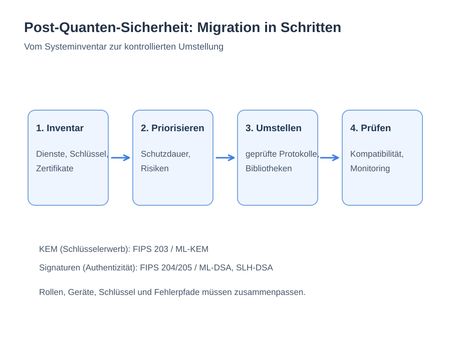

# M11-L1 – Post-Quanten-Kryptografie und kryptografische Migration {#L1}

**Kursbereich:** M11 – Wahlthemen: Kryptografie und Software-Agenten

**Niveau:** Nicht angegeben

**Vorwissen:** Keine festen Voraussetzungen angegeben.

**Einordnung:** Wahl- und Zukunftsthema zwischen Bachelor-IT-Sicherheit und vertiefender Kryptografie. Es ist keine Pflichtmodulzuordnung und keine Anleitung, produktive Kryptografie ohne Fachprüfung selbst zu implementieren.

**Leitfrage:** Wenn sich bestimmte mathematische Probleme mit leistungsfähigen Quantencomputern anders lösen lassen, wie bleiben heute geschützte Informationen langfristig sicher?

## Kryptografie schützt unterschiedliche Dinge {#S1}

Ein verschlüsseltes Nachrichtenpaket und ein digital signiertes Softwareupdate erfüllen nicht dieselbe Aufgabe. Verschlüsselung soll Inhalte vor unbefugtem Lesen schützen. Eine digitale Signatur soll eine Nachricht oder Software einem Schlüssel zuordnen und Veränderungen erkennbar machen. Ein Verfahren zum **Schlüsselaustausch** sorgt dagegen dafür, dass beide Seiten an das für die Verschlüsselung benötigte gemeinsame Geheimnis gelangen.

Diese Trennung ist wichtig, weil ein Austausch einer einzigen Kryptobibliothek nicht automatisch alle Schutzfunktionen eines großen Systems modernisiert.

  Schutzziel                         Typischer Mechanismus                                   Beispiel
  ---------------------------------- ------------------------------------------------------- -------------------------------------
  Vertraulichkeit                    Symmetrische Verschlüsselung mit geeignetem Schlüssel   Verschlüsselte gespeicherte Datei
  Sicherer Schlüsselerwerb           KEM bzw. Schlüsselaustausch                             Aufbau einer geschützten Verbindung
  Authentizität und Integrität       Digitale Signatur                                       Signiertes Softwarepaket
  Schlüssel- und Identitätsbindung   Zertifikate, Schlüsselverwaltung, Vertrauensmodell      Prüfung eines Serverzertifikats

**KEM** steht für *Key Encapsulation Mechanism*. Es handelt sich um einen Mechanismus, mit dessen Hilfe zwei Parteien ein gemeinsames Geheimnis vereinbaren können, ohne es zuvor geteilt zu haben. Der KEM selbst ist nicht gleichbedeutend mit der gesamten späteren Datenverschlüsselung.

## Weshalb „post-quanten“? {#S2}

Viele verbreitete Public-Key-Verfahren beruhen auf mathematischen Problemen, die für klassische Computer praktisch schwer zu lösen sind. Ein hinreichend leistungsfähiger, fehlertoleranter Quantencomputer könnte bestimmte dieser Probleme mit anderen Algorithmen deutlich leichter bearbeiten. Die Gefahr betrifft insbesondere etablierte Verfahren aus der klassischen Public-Key-Kryptografie; sie bedeutet **nicht**, dass sämtliche heute eingesetzte Verschlüsselung auf einen Schlag wirkungslos würde.

Die genaue Leistungsfähigkeit, Verfügbarkeit und zeitliche Entwicklung großer Quantencomputer ist unsicher. Sicherheitsplanung betrachtet aber nicht nur das wahrscheinlichste Jahr eines Angriffs, sondern auch die erforderliche Geheimhaltungsdauer. Eine heute aufgezeichnete verschlüsselte Verbindung kann für einen Angreifer interessant bleiben, falls sie später entschlüsselt werden könnte. Diese Risikobetrachtung wird häufig unter **„harvest now, decrypt later“** diskutiert.

## Drei standardisierte Bausteine {#S3}

Das US-amerikanische **National Institute of Standards and Technology (NIST)** hat 2024 drei wichtige Post-Quanten-Standards veröffentlicht:

  Standard       Verfahren     Hauptaufgabe
  -------------- ------------- ---------------------------------------------------------
  **FIPS 203**   **ML-KEM**    Gemeinsames Geheimnis für sichere Schlüsselvereinbarung
  **FIPS 204**   **ML-DSA**    Digitale Signaturen
  **FIPS 205**   **SLH-DSA**   Digitale Signaturen auf Basis von Hashverfahren

Namen und Einsatzbereiche werden häufig verwechselt. Wer eine bestehende digitale Signatur austauschen muss, ersetzt sie nicht dadurch, dass er ausschließlich ein KEM aktiviert. Umgekehrt erzeugt eine Signatur allein keinen geheimen Sitzungsschlüssel.

Für neue Systeme sind vorhandene, überprüfte Implementierungen und aktuelle Sicherheitsrichtlinien maßgeblich. Ein Beispielprogramm, das sich „Quanten-Krypto“ nennt, ist kein Beweis für korrekt implementierte Kryptografie.

## Sicherheitsmigration beginnt mit einem Inventar {#S4}

Stellen wir uns eine Organisation mit einer Website, internen APIs, einem Update-Dienst und einem Langzeitarchiv vor. Bevor Technologien ausgetauscht werden, müssen die verantwortlichen Personen wissen, **wo überhaupt welche kryptografische Funktion benutzt wird**.

Das Inventar könnte in einer Tabelle wie folgt beginnen:

  System             Kryptografische Funktion         Warum kritisch?                   Prüffrage
  ------------------ -------------------------------- --------------------------------- ----------------------------------------------------------------------
  Webserver          Verbindungsaufbau                Daten während der Übertragung     Welche Protokollversionen und Algorithmen handeln die Endpunkte aus?
  Softwareupdates    Signaturprüfung                  Manipulierte Updates verhindern   Wer verwaltet die Signierschlüssel?
  Dokumentenarchiv   Verschlüsselung ruhender Daten   Lange Schutzdauer                 Welche Daten müssen in 15 Jahren noch geheim sein?
  Geräteflotte       Zertifikatsprüfung               Geräteidentität                   Können alle Geräte neue Algorithmen prüfen?

Die Tabelle ist ein eigenes **fiktives Lehrbeispiel**. Sie zeigt einen organisatorischen Punkt: Einige Risiken liegen in Protokollen, andere in Geräten, Schlüsselprozessen oder der gesamten Vertrauenskette.

*Eigene schematische Lehrgrafik; keine vollständige Implementierungsanweisung.*

## Was ist „Crypto-Agility“? {#S5}

**Krypto-Agilität** bedeutet, dass ein System Algorithmen und Schlüsselverfahren unter kontrollierten Bedingungen austauschen kann, ohne das gesamte Produkt neu aufzubauen. Das ist keine Aufforderung, ständig nach Belieben Algorithmen zu wechseln. Vielmehr braucht man definierte Schnittstellen, versionierte Einstellungen, Kompatibilitätstests, Sicherheitsrichtlinien und eine dokumentierte Möglichkeit zum Rückbau bei Problemen.

Ein allzu eng gekoppeltes System könnte an vielen Stellen denselben Algorithmus fest verdrahtet haben. Bei einem Austausch müssten dann Datenformate, Dienste, Zertifikatsprüfungen und Geräte gleichzeitig geändert werden. Ein modular aufgebautes System kann diese Änderungen besser isolieren.

## Hybride Verfahren – Übergang statt plötzlicher Austausch {#S6}

Eine Migrationsstrategie kann eine klassische und eine quantenresistente Komponente kombinieren. Das wird oft als **hybrider Schlüsselaustausch** bezeichnet. Solche Konstruktionen dürfen aber nicht beliebig selbst ausgedacht werden: Wie die Geheimnisse verbunden, wie sie authentisiert und wie Fehler behandelt werden, ist sicherheitsentscheidend.

Das zentrale Lernziel ist daher **Architekturdenken**, nicht die Programmierung einer eigenen Hybrid-Kryptografie. Man muss die beteiligten Protokolle, geprüften Bibliotheken und aktuellen Spezifikationen kennen, bevor man sie produktiv einsetzt.

## Die Messgrößen einer Migration {#S7}

Ein neuer Algorithmus kann andere Speicher-, Zeit- und Übertragungsanforderungen haben. Bei einer Migration sollten mindestens folgende Größen gemessen werden:

- Laufzeit des Verbindungsaufbaus und der Signaturprüfung.
- Größe öffentlicher Schlüssel, Zertifikate und Signaturen.
- Verhalten bei Paketverlust oder langsamen Verbindungen.
- Unterstützung in Clients, Servern, Geräten und Sicherheitsmodulen.
- Fehlerraten, Protokollkompatibilität und Rollbackmöglichkeiten.

Ein System ist nicht allein deshalb sicher, weil der Benchmark besonders schnell ist. Zur Qualität gehören zusätzlich korrekte Implementierung, Schlüsselverwaltung, Aktualisierbarkeit und verständliche Betriebsprozesse.

## Praxisfall: ein langfristig verwendeter Sensor {#S8}

Ein fiktives Messgerät soll zwölf Jahre lang eingesetzt werden. Es sendet Daten an eine Zentrale und prüft regelmäßig signierte Updates. Wir stellen uns drei Fragen:

1.  **Welche Fähigkeit muss erhalten bleiben?** Das Gerät muss weiterhin vertrauenswürdige Updates erkennen und Verbindungen schützen können.
2.  **Wo liegt das technische Risiko?** Begrenzter Flash-Speicher, schwache CPU, alte Protokollbibliotheken und ein nur selten erreichbarer Wartungskanal.
3.  **Was würde man zuerst testen?** Die reale Unterstützung des gewählten Standards, Speicherbedarf, Rollback, sicheres Updateverfahren und Schlüsselwechsel.

Wichtig ist eine zusätzliche Besonderheit: Man muss manchmal nicht nur einen Algorithmus, sondern auch die **Wurzel des Vertrauens** und die Geräteidentität über viele Jahre planen. Ein großer Kryptostandard nützt wenig, wenn das Gerät ihn wegen fehlender Aktualisierungsmöglichkeiten nie erhält.

## Selbstkontrolle {#S9}

1.  Was ist der Unterschied zwischen **KEM** und **digitaler Signatur**? Ein KEM hilft beim Erlangen eines gemeinsamen Geheimnisses; eine Signatur belegt die Zuordnung und Unverändertheit einer signierten Nachricht unter den jeweiligen Annahmen.
2.  Warum ist ein Archiv mit langer Geheimhaltungsdauer wichtig? Weil heute verschlüsselte Daten auch in Zukunft vertraulich bleiben müssen.
3.  Weshalb ersetzt der Nachweis „FIPS-Algorithmus implementiert“ nicht eine Sicherheitsbewertung des Gesamtsystems? Weil Fehler in Protokollen, Schlüsselverwaltung oder Betrieb die Sicherheit unabhängig vom Algorithmus beschädigen können.

## Grenzen und weiterführender Lernweg {#S10}

Dieses Kapitel behandelt keine mathematischen Sicherheitsbeweise der einzelnen Verfahren und keine eigenständige Implementierung kryptografischer Primitive. Mathematisch führen die Vertiefungen zu Gittern, algebraischen Strukturen, Wahrscheinlichkeit und algorithmischer Komplexität. Im bestehenden Kurs bieten **Informatik M10-L1** und **Universität Mathematik M4-L5** passende Anschlüsse.

## Quellen {#S11}

**Dokumentierter Quellenstand:** 10.11.2026

- [NIST – Freigabe der drei Post-Quanten-Standards FIPS 203/204/205](https://www.nist.gov/news-events/news/2024/08/announcing-approval-three-federal-information-processing-standards-fips): Standardbezeichnungen und jeweilige Aufgaben.
- [NIST NCCoE – Migration to Post-Quantum Cryptography](https://pages.nist.gov/nccoe-migration-post-quantum-cryptography/): Migrationsfragen und praktische Einordnung.
- [NIST – Post-Quantum Cryptography Standardization](https://csrc.nist.gov/projects/post-quantum-cryptography): übergreifende Projekt- und Standardinformationen.

*Eigenständige Unterrichtsgliederung und fiktive Systembeispiele. Keine Übernahme von Normtexten, Implementierungen oder fremden Tabellen.*
