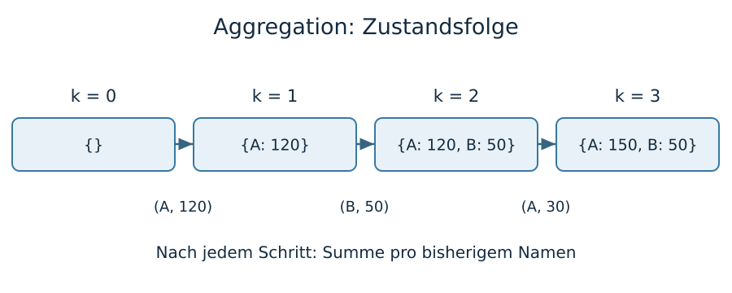

# M12-L1 – Imperative Programmierung und strukturierte Daten {#L1}

**Kursbereich:** M12 – Programmierung und Softwarequalität

**Niveau:** Bachelor · Kern/Grundlagen

**Vorwissen:** [M1-L1](M1-L1.md)

## Lernziele {#S1}

Du entwirfst eine imperative Datenverarbeitung aus einem Vertrag, formulierst eine Schleifeninvariante, unterscheidest Referenz und Kopie und prüfst Normal- sowie Fehlerfälle.

## Zustand, Kontrollfluss und Datenvertrag {#S2}

Ein imperatives Programm beschreibt, wie sich ein Zustand durch Anweisungen verändert. Eine Zuweisung bindet in Python einen Namen an ein Objekt; sie ist keine mathematische Gleichheitsbehauptung. Sequenz, Verzweigung und Wiederholung kombinieren Schritte. Ein Funktionsvertrag gibt an, welche Eingaben akzeptiert werden und welches Ergebnis erwartet wird. Die Implementierung ist davon zu unterscheiden: Derselbe Vertrag kann durch unterschiedliche Verfahren erfüllt werden.

Wir modellieren Buchungen als Paare `(name, cents)`, wobei `name` eine nichtleere Zeichenkette und `cents` eine nichtnegative ganze Zahl (kein boolescher Wert) ist. Die Eingabe ist eine endliche Folge solcher Paare. Für jeden auftretenden Namen soll die Summe der Centbeträge zurückgegeben werden, auch wenn die Summe null ist. Bei ungültigem Namen oder Betrag wird `ValueError` ausgelöst. Fehlerhafte Paarstruktur liegt außerhalb des Vertrags; das Entpacken kann dann eine andere Ausnahme auslösen. Centbeträge sind hier exakt; Gleitkommazahlen wären für dieses Modell unnötig.

## Schleifeninvariante und Algorithmus {#S3}

Nach Verarbeitung der ersten $k$ Paare enthält `result` genau die bisher aufgetretenen Namen und zu jedem Namen die Summe seiner Beträge unter den ersten $k$ Paaren. Anfang: $k=0$, das leere Dictionary erfüllt die Aussage. Erhaltung: Der nächste gültige Eintrag $(a,c)$ ändert ausschließlich die Summe für $a$ um $c$; bei erstmaligem Auftreten ist die vorherige Summe null. Damit gilt die Aussage auch für $k+1$. Ende: Bei $k=n$ entspricht das Dictionary dem Vertrag. Die endliche Eingabefolge gewährleistet Terminierung. Bei ungültigem Eintrag bricht die Funktion ohne Rückgabe eines Teilergebnisses ab.

```python
def totals(rows):
    result = {}
    for name, cents in rows:
        if not isinstance(name, str) or not name:
            raise ValueError("name")
        if type(cents) is not int or cents < 0:
            raise ValueError("cents")
        result[name] = result.get(name, 0) + cents
    return result

rows = [("A", 120), ("B", 50), ("A", 30)]
assert totals(rows) == {"A": 150, "B": 50}
assert totals([]) == {}
assert rows == [("A", 120), ("B", 50), ("A", 30)]
```

Die Grafik zeigt die drei Zustandsübergänge. Bei den üblichen durchschnittlich konstanten Dictionary-Operationen benötigt die Verarbeitung $O(n)$ solcher Operationen und $O(u)$ Einträge für $u$ unterschiedliche Namen. Das ist keine Worst-Case-Garantie für beliebige Hash-Kollisionen, Namenslängen oder beliebig große Integer.

{alt="Zustandsfolge der Aggregation"}

## Strukturierte Daten und Aliasing {#S4}

Eine Liste hält eine geordnete Sequenz; ein Tupel lässt sich nach Erzeugung nicht an seinen Positionen verändern; ein Dictionary ordnet hashbaren Schlüsseln Werte zu. Tupel können dennoch veränderliche Objekte enthalten. Wähle eine Struktur nach den benötigten Operationen, nicht bloß nach ihrer Schreibweise. Die Eingabe bleibt in `totals` unverändert, weil ausschließlich ein neues Dictionary verändert wird. Bei Aliasbildung dagegen können mehrere Namen auf dieselbe veränderliche Liste zeigen.

```python
original = [[1], [2]]
alias = original
shallow = original.copy()
shallow[0].append(9)
assert alias is original
assert original == [[1, 9], [2]]
assert shallow is not original
```

Eine flache Kopie trennt nur den äußeren Container. Tiefe Kopien können sinnvoll sein, aber auch beabsichtigte Objektidentitäten verändern. Besser ist ein klarer Vertrag über Besitz und erlaubte Änderungen. Auch ein veränderliches Standardargument (`def f(xs=[]): ...`) kann unbeabsichtigt Zustand zwischen Aufrufen teilen; ein `None`-Standardwert und eine pro Aufruf erzeugte Liste vermeiden dies.

## Fehlerfälle und unabhängige Kontrolle {#S5}

Ein Test mit wiederholtem Namen prüft die Akkumulation; eine leere Eingabe prüft die Initialisierung; null prüft, dass ein vorhandener Schlüssel nicht fälschlich entfällt. Negative Beträge, boolesche Beträge und leere Namen sind außerhalb des Fachvertrags. Prüfe die Ausgabe zusätzlich mit einer unabhängigen Spezifikation, etwa indem zu jedem Namen alle passenden Buchungen separat summiert werden. Dieses langsamere Referenzverfahren ist für kleine Testdaten geeignet. Ein Test beweist nicht die allgemeine Invariante, und die Invariante prüft nicht automatisch die tatsächliche Python-Implementierung.

```python
for bad in [("", 1), ("A", -1), ("A", True)]:
    try:
        totals([bad])
    except ValueError:
        pass
    else:
        raise AssertionError(bad)
```

Der zweite Codeblock setzt die Funktion aus S3 voraus. Eine reale Buchhaltung hätte weitere Anforderungen, beispielsweise Währungen, Rückerstattungen und Transaktionsgrenzen; unser Beispiel ist nur eine Aggregation.

## Selbstkontrolle {#S6}

### Aufgaben

1. Verfolge `totals([("B", 0), ("A", 5), ("B", 2)])` schrittweise.
2. Formuliere die Invariante für eine Schleife, die die Zahl gerader Elemente zählt.
3. Warum ist `dict.fromkeys(["A", "B"], [])` für unabhängige Listen problematisch?
4. Gib eine ungültige Buchung mit formal korrekter Paarstruktur an.
5. Was ändert sich am Speicherbedarf, wenn alle $n$ Namen verschieden sind?

::: {.lc-solutions data-lc-section="S6"}
1. `{}`, `{"B": 0}`, `{"B": 0, "A": 5}`, `{"B": 2, "A": 5}`.
2. Nach $k$ Schritten ist der Zähler gleich der Anzahl gerader Werte unter den ersten $k$ Elementen; Anfang null, Erhaltung durch bedingtes Erhöhen.
3. Beide Schlüssel erhalten dieselbe Liste; eine Änderung ist über beide sichtbar. Verwende eine Comprehension mit je einer neuen Liste.
4. Zum Beispiel `("A", -3)`; `ValueError`.
5. $u=n$, also $O(n)$ Einträge statt eines möglicherweise viel kleineren Dictionaries.
:::

## Quellen {#S7}

- [Python 3.12 Tutorial, Control Flow](https://docs.python.org/3.12/tutorial/controlflow.html) · §4.1–4.3, 4.8–4.9: control flow, functions, default arguments · Zuletzt abgerufen: 2026-11-24 · Inhaltlich geprüft: 2026-11-24
- [Python 3.12 Tutorial, Data Structures](https://docs.python.org/3.12/tutorial/datastructures.html) · §5.1, 5.3, 5.5–5.6: mutable lists, tuples, dictionaries · Zuletzt abgerufen: 2026-11-24 · Inhaltlich geprüft: 2026-11-24
