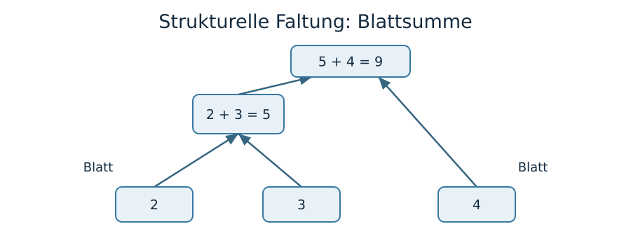

# M12-L2 – Funktionale Programmierung und Rekursion {#L2}

**Kursbereich:** M12 – Programmierung und Softwarequalität

**Niveau:** Bachelor · Kern/Grundlagen

**Vorwissen:** [M12-L1](M12-L1.md); [M8-L1](M8-L1.md)

## Lernziele {#S1}

Du unterscheidest reine und effektbehaftete Funktionen, kombinierst map und fold, definierst rekursive Daten und begründest Terminierung und Korrektheit durch strukturelle Induktion.

## Reine Funktionen und funktionale Abstraktion {#S2}

Eine reine Funktion liefert für dieselben Eingabewerte dasselbe Ergebnis und verursacht keine beobachtbaren Seiteneffekte. Das Schreiben einer Datei, das Ändern einer von außen sichtbaren Liste oder das Abfragen der aktuellen Uhrzeit sind keine reinen Operationen. Die Abwesenheit einer Zuweisung ist weder notwendig noch hinreichend für Reinheit: Ein lokal veränderter, nicht entweichender Akkumulator kann eine nach außen reine Funktion implementieren. Umgekehrt kann ein kurzer Ausdruck versteckten Zustand lesen. Hier betrachten wir terminierende Funktionen auf unveränderlichen Daten mit deterministischen, reinen Argumentfunktionen.

Funktionen höherer Ordnung nehmen Funktionen als Argument oder liefern Funktionen zurück. So beschreibt `map(f, xs)` eine Transformation jedes Elements, `filter(p, xs)` eine Auswahl. Python liefert bei beiden Iteratoren; `list(...)` materialisiert das Ergebnis. Ein fold reduziert eine Folge mit einer binären Funktion und einem Startwert zu einem einzigen Wert. Die Reihenfolge ist Teil seiner Definition.

## Folds und Auswertungsreihenfolge {#S3}

Für einen linksassoziativen Fold gilt $a_0=z$, $a_{i+1}=f(a_i,x_i)$. Bei leerer Folge ist das Ergebnis $z$. Ein Rechtsfold dagegen entspricht $f(x_1,f(x_2,\ldots,f(x_n,z)))$. Bei Subtraktion und Startwert null liefert der Linksfold für 1,2,3 den Wert -6, der Rechtsfold den Wert 2. Ein anderer Faltungsbaum ist ohne geeignete algebraische Eigenschaften nicht äquivalent. Bei einer assoziativen Operation mit beidseitig neutralem Startwert darf man die Klammerung ändern; eine Umordnung erfordert zusätzlich Kommutativität (oder eine spezifische Begründung). Gleitkommaaddition ist im Allgemeinen nicht exakt assoziativ.

```python
def fold_left(fn, seed, xs):
    acc = seed
    for x in xs:
        acc = fn(acc, x)
    return acc

def tree_fold(leaf, branch, tree):
    if type(tree) is int:
        return leaf(tree)
    if type(tree) is not tuple or len(tree) != 2:
        raise ValueError("expected int or pair")
    left, right = tree
    return branch(tree_fold(leaf, branch, left),
                  tree_fold(leaf, branch, right))

tree = ((2, 3), 4)
assert tree_fold(lambda x: x, lambda a, b: a+b, tree) == 9
assert tree_fold(lambda x: 1, lambda a, b: a+b, tree) == 3
assert fold_left(lambda a, x: a-x, 0, [1, 2, 3]) == -6
assert list(map(lambda x: x*x, [2, 3, 4])) == [4, 9, 16]
```

Der iterative Linksfold arbeitet auf der endlichen Folge mit einem Akkumulator; er ist bei konstantem Aufwand der Argumentfunktion linear in der Anzahl Elemente. Ein Python-Iterator kann einmalig konsumierbar sein. Die Grafik illustriert die Faltung eines Binärbaums.

{alt="Baumfaltung von Blättern zur Wurzel"}

## Rekursive Datentypen und Induktionsbeweis {#S4}

Ein endlicher voller Binärbaum ist in diesem Modell entweder ein ganzzahliges Blatt oder ein Paar zweier solcher Bäume. Zyklen sind ausgeschlossen. Die Funktion `tree_fold` verarbeitet Blätter durch `leaf`, innere Knoten durch `branch`. Terminierung folgt aus der Anzahl der Knoten als natürlichem Maß: Beide rekursiven Argumente sind echte Teilbäume mit weniger Knoten. Korrektheit der Blattsumme folgt durch strukturelle Induktion. Blatt: `leaf(x)=x` ergibt die Summe. Paar: Sind beide rekursiven Ergebnisse die jeweiligen Blattsummen, so ist ihre Addition genau die Summe aller Blätter. Analog erhält man mit `leaf(x)=1` die Blattanzahl. Die Argumentfunktionen können unabhängig vom Traversierungsschema gewählt werden.

Für `((2,3),4)` ergeben sich die Teilsummen 5 und 4, dann 9. Ein voller Binärbaum mit $m$ Blättern hat $m-1$ innere Knoten (Induktion mit demselben Aufbau); bei konstanten Knotenkosten benötigt die Traversierung $O(m)$ Zeit und $O(h)$ Aufrufstack bei Baumhöhe $h$ in Kanten, genauer $O(h+1)$. Ein stark einseitiger Baum kann in Python an der Rekursionsgrenze scheitern, obwohl die mathematische Rekursion terminiert. Eine iterative Nachordnungstraversierung mit explizitem Stack ist dann eine Alternative.

## Praxis: getrennte Berechnung und Effekte {#S5}

Ein funktionaler Kern kann aus einem unveränderlichen Eingabemodell einen neuen Ergebniswert ableiten. Eine äußere imperative Schicht liest Eingaben, ruft den Kern auf und schreibt Resultate. Das vereinfacht Wiederholungstests, garantiert aber keine Fehlerfreiheit. Beispielsweise kann eine als Argument übergebene Funktion einen versteckten Effekt besitzen. Bei `tree_fold` ist der Vertrag: gültiger endlicher Baum, terminierende Blatt- und Verzweigungsfunktionen; für die mathematische Interpretation als reine Faltung müssen diese außerdem rein sein. Ungültige Nicht-Paare werden abgewiesen, und zu tiefe Bäume können `RecursionError` auslösen.

Ein eigener Testgenerator kann alle kleinen Baumformen erzeugen und deren Blätter mit einer expliziten Stack-Traversierung sammeln. Vergleiche die Blattsumme und -anzahl mit dem Fold. Benutze unterschiedliche Knotenoperationen, um versehentlich vertauschte Argumente zu erkennen, beispielsweise die Verkettung von Tupeln in Links-Rechts-Reihenfolge.

## Selbstkontrolle {#S6}

### Aufgaben

1. Berechne den Linksfold mit Multiplikation und Startwert 1 für 2,3,4.
2. Berechne den Rechtsfold mit Subtraktion und Startwert 0 für 1,2,3.
3. Gib die Blattsumme und Blattanzahl von `(1,(2,(3,4)))` an.
4. Warum ist das Lesen der Uhrzeit innerhalb einer Funktion nicht rein?
5. Formuliere einen Tree-Fold für die maximale Blatttiefe in Kanten.

::: {.lc-solutions data-lc-section="S6"}
1. 24.
2. $1-(2-(3-0))=2$.
3. Summe 10, Anzahl 4.
4. Derselbe explizite Eingabewert kann zu unterschiedlichen Resultaten führen; die Uhr ist eine externe Zustandsquelle.
5. `tree_fold(lambda x: 0, lambda a,b: 1+max(a,b), tree)`.
:::

## Quellen {#S7}

- [Composing Programs, Higher-Order Functions](https://www.composingprograms.com/pages/16-higher-order-functions.html) · §1.6.1, 1.6.8: functional abstraction · Zuletzt abgerufen: 2026-11-24 · Inhaltlich geprüft: 2026-11-24
- [Composing Programs, Recursive Functions](https://www.composingprograms.com/pages/17-recursive-functions.html) · §1.7.1, 1.7.4: base cases, recursive decomposition · Zuletzt abgerufen: 2026-11-24 · Inhaltlich geprüft: 2026-11-24
