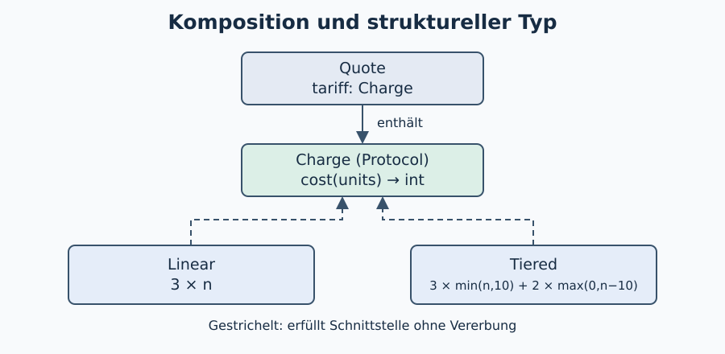

# M12-L3 – Objektorientierung, Typen und Polymorphie {#L3}

**Kursbereich:** M12 – Programmierung und Softwarequalität

**Niveau:** Bachelor · Kern/Grundlagen

**Vorwissen:** [M12-L1](M12-L1.md)

## Lernziele {#S1}

Du erklärst Objektidentität, Zustand und Schnittstellen, implementierst strukturelle Polymorphie und prüfst, ob ein Subtyp einen Verhaltensvertrag erfüllt. Du entscheidest begründet zwischen Vererbung und Komposition.

## Objekte und Typverträge {#S2}

Eine Klasse beschreibt einen Typ und stellt Methoden bereit; ein Objekt ist eine konkrete Instanz mit Identität und gegebenenfalls veränderlichem Zustand. Zwei Variablen können auf dasselbe Objekt verweisen: Bei einer veränderlichen Liste ist eine Änderung über einen Alias auch über den anderen sichtbar. Gleichheit von Werten ist nicht dasselbe wie Identität (`==` gegenüber `is`). Kapselung bedeutet, dass zulässige Zustandsänderungen über eine definierte Schnittstelle erfolgen. In Python ist ein führender Unterstrich eine Konvention, keine Sicherheitsgrenze. Eine eingefrorene Dataclass verhindert gewöhnliche Attributzuweisungen, garantiert aber keine tiefe Unveränderlichkeit eingebetteter Objekte.

Ein Typvertrag beschreibt zulässige Eingaben, Ergebnisse und beobachtbare Effekte. Nominale Subtypisierung beruht auf deklarierten Typbeziehungen; strukturelle Subtypisierung auf der verlangten Schnittstelle. Python erlaubt dynamische Methodenaufrufe; `Protocol` beschreibt strukturelle Typanforderungen für statische Prüfwerkzeuge. Typannotationen erzwingen zur Laufzeit grundsätzlich keine Eingabeprüfung.

## Komposition und Polymorphie {#S3}

Wir modellieren eine Preisberechnung in ganzzahligen Recheneinheiten ohne Rundungsproblem. Der Vertrag von `Charge.cost` verlangt eine nichtnegative ganze Anzahl, gibt einen nichtnegativen ganzzahligen Preis zurück und verändert das Tarifobjekt nicht. Im linearen Tarif kostet jede Einheit 3; im Stufentarif kosten die ersten zehn Einheiten je 3, weitere je 2. Ungültige Mengen führen in beiden Implementierungen zu `ValueError`. `bool` wird ausdrücklich ausgeschlossen, obwohl es in Python von `int` abgeleitet ist. Die Klasse `Quote` delegiert an einen Tarif, ohne den konkreten Typ auszuwerten.

Die folgende Implementierung zeigt Komposition und dynamische Methodenauswahl. Beide Tarifklassen erfüllen die strukturelle Schnittstelle ohne explizite Vererbung von `Charge`.

```python
from dataclasses import dataclass
from typing import Protocol

class Charge(Protocol):
    def cost(self, units: int) -> int: ...

def check_units(units: int) -> None:
    if type(units) is not int or units < 0:
        raise ValueError("nonnegative integer required")

@dataclass(frozen=True)
class Linear:
    def cost(self, units: int) -> int:
        check_units(units)
        return 3 * units

@dataclass(frozen=True)
class Tiered:
    def cost(self, units: int) -> int:
        check_units(units)
        return 3 * min(units, 10) + 2 * max(0, units - 10)

@dataclass(frozen=True)
class Quote:
    tariff: Charge
    def total(self, units: int) -> int:
        return self.tariff.cost(units)

assert Quote(Linear()).total(12) == 36
assert Quote(Tiered()).total(12) == 34
```

{alt="Tarifobjekt delegiert über die Schnittstelle an zwei Implementierungen"}

## Substitution und Invarianten {#S4}

Das Substitutionsprinzip verlangt, dass ein konkreter Typ überall dort eingesetzt werden kann, wo sein Vertrag erwartet wird. Ein Subtyp darf die geforderten Vorbedingungen nicht verschärfen, garantierte Nachbedingungen nicht abschwächen und zugesicherte Invarianten nicht verletzen. Eine Klasse, die nur Mengen bis zehn akzeptiert, erfüllt den hier formulierten Vertrag trotz identischer Methodensignatur nicht. Ein Rückgabewert -1 für eine gültige Eingabe verletzt ebenfalls den Vertrag. Ein statisches Typprüfwerkzeug kann Signaturfehler erkennen, aber nicht allgemein beweisen, dass alle semantischen Zusicherungen gelten.

Für `Tiered` gilt bei $0\leq n\leq10$ der Preis $3n$, für $n>10$ gilt $30+2(n-10)$. Beide Zweige stimmen an der Grenze überein, und jede zusätzliche Einheit erhöht den Preis. Der Vertrag verlangt hier jedoch keine bestimmte Rate. Die konkrete Preisformel ist eine stärkere Eigenschaft des jeweiligen Tarifs, nicht des gemeinsamen Protokolls.

## Entwurfsentscheidung {#S5}

Vererbung eignet sich, wenn eine stabile Ist-ein-Beziehung samt Vertrag vorliegt; sie kann aber Unterklassen an Interna der Basisklasse koppeln. Komposition drückt eine Hat-ein-Beziehung aus: `Quote` enthält einen Tarif, und ein anderer Tarif lässt sich durch Konstruktion eines neuen `Quote`-Objekts einsetzen. Das Beispiel verwendet unveränderliche, zustandslose Tarife, nicht gemeinsam veränderliche Preise. Ein Dekorator für Rabatt könnte einen bestehenden Tarif enthalten, sofern er den Vertrag einschließlich Rundungsregel weiterhin einhält. Für reale Geldberechnung müssten Währung, Rundung und Gültigkeitszeitraum separat spezifiziert werden.

Prüfe jeden Tarif mit denselben Vertragstests (0, 1, 10, 11, negative Eingabe). Prüfe zusätzlich den konkreten Preis unabhängig. Signatur, Vertragstest und fachliche Spezifikation ergänzen einander.

## Selbstkontrolle {#S6}

### Aufgaben

1. Was unterscheidet Objektidentität von Wertgleichheit?
2. Berechne beide Tarife für 10 und 13 Einheiten.
3. Warum verletzt ein Tarif mit maximal 10 Einheiten den gemeinsamen Vertrag?
4. Warum erzwingt `Protocol` hier keine Laufzeitvalidierung?
5. Entwirf einen konstanten Zuschlag von 5 als Komposition; welche Eigenschaft bleibt erhalten?

::: {.lc-solutions data-lc-section="S6"}
1. Identität betrifft dasselbe Objekt, Wertgleichheit die definierte Gleichheitsrelation.
2. 10: beide 30; 13: linear 39, gestuft 36.
3. Er verschärft die Vorbedingung; die Schnittstelle akzeptiert jede nichtnegative ganze Menge.
4. Typannotationen dienen der statischen Analyse; `check_units` ist die explizite Laufzeitprüfung.
5. Ein Wrapper speichert einen `Charge` und gibt nach dessen Aufruf `cost(units)+5` zurück. Nichtnegative ganzzahlige Ergebnisse und die Fehlerbehandlung bleiben erhalten, sofern der eingewickelte Tarif den Vertrag erfüllt.
:::

## Quellen {#S7}

- [Python 3.12, Classes](https://docs.python.org/3.12/tutorial/classes.html) · 9.1, 9.3, 9.5: objects, methods, inheritance · Zuletzt abgerufen: 2026-11-24 · Inhaltlich geprüft: 2026-11-24
- [Python 3.12, typing](https://docs.python.org/3.12/library/typing.html) · type annotations; Protocol and structural subtyping · Zuletzt abgerufen: 2026-11-24 · Inhaltlich geprüft: 2026-11-24
