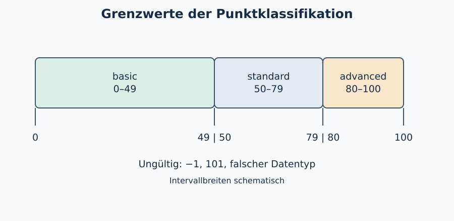

# M12-L4 – Testentwurf und systematische Softwarequalität {#L4}

**Kursbereich:** M12 – Programmierung und Softwarequalität

**Niveau:** Bachelor · Kern/Grundlagen

**Vorwissen:** [M12-L1](M12-L1.md); [M1-L4](M1-L4.md)

## Lernziele {#S1}

Leite Tests aus einer Spezifikation ab, wähle Äquivalenzklassen und Grenzwerte, formuliere Eigenschaften und bewerte die Aussagekraft von Überdeckung und Mutationstests.

## Spezifikation und Testorakel {#S2}

Ein Test braucht einen beobachtbaren Erwartungswert oder ein anderes Testorakel. Ein Unit-Test untersucht eine kleine Einheit isoliert; ein Integrationstest untersucht das Zusammenwirken mehrerer Einheiten. Systemtests prüfen das Gesamtsystem gegen Anforderungen. Ein Regressionstest schützt gegen die Wiederkehr eines bekannten Fehlers. Die Kategorien können sich überschneiden. Testdaten und Sollwerte sollten nicht einfach dieselbe Implementierungslogik kopieren, sonst können gemeinsame Fehler unentdeckt bleiben.

Unsere Spezifikation klassifiziert ganzzahlige Punktwerte von 0 bis 100: 0–49 ergeben `basic`, 50–79 `standard`, 80–100 `advanced`. Alle anderen Eingaben einschließlich boolescher Werte und Gleitkommazahlen sind ungültig. Die drei gültigen Intervalle und die ungültigen Eingabeklassen sind Grundlage der Testauswahl.

## Äquivalenzklassen und Grenzwerte {#S3}

Äquivalenzklassen fassen Eingaben zusammen, für die aufgrund der Spezifikation gleichartiges Verhalten erwartet wird. Ein Vertreter beweist nicht die gesamte Klasse. Bei diskreten Intervallen sind Grenzwerte und ihre direkten Nachbarn besonders nützlich: -1, 0, 1, 48, 49, 50, 51, 78, 79, 80, 81, 99, 100, 101. Ergänze Typfehler, etwa `True` und `50.0`. Die Grafik zeigt die Kernübergänge.

Die Implementierung und die kleine Testsuite sind absichtlich getrennt. Der Test erwartet fest spezifizierte Werte und behandelt erwartete Ausnahmen explizit.

```python
def band(x: int) -> str:
    if type(x) is not int or not 0 <= x <= 100:
        raise ValueError("integer in 0..100 required")
    if x < 50:
        return "basic"
    if x < 80:
        return "standard"
    return "advanced"

def check_cases(fn):
    cases = [(0, "basic"), (49, "basic"), (50, "standard"),
             (79, "standard"), (80, "advanced"), (100, "advanced")]
    for x, expected in cases:
        assert fn(x) == expected
    for x in (-1, 101, True, 50.0):
        try:
            fn(x)
        except ValueError:
            continue
        raise AssertionError("invalid input accepted")

check_cases(band)
rank = {"basic": 0, "standard": 1, "advanced": 2}
assert all(rank[band(x)] <= rank[band(x+1)] for x in range(100))
```

{alt="Drei Punktintervalle mit Grenzwerten 49, 50, 79 und 80"}

## Eigenschaften und Überdeckung {#S4}

Eigenschaftsbasierte Tests prüfen Aussagen über viele Eingaben. Für gültige Werte gilt, dass die Rangfolge der Kategorien mit steigender Punktzahl nicht sinkt. Der Code prüft alle 100 benachbarten gültigen Paare, womit Monotonie für diesen endlichen Bereich folgt. Monotonie allein reicht nicht: Eine Funktion, die für alle gültigen Werte `basic` liefert, erfüllt sie ebenfalls. Die Grenztests widerlegen diese falsche Funktion. Da der gültige Wertebereich klein ist, kann man alle 101 Werte gegen eine unabhängig aufgebaute Tabelle prüfen. Für unbeschränkte Eingaben oder komplexe Zustandsräume bleibt die Auswahl begrenzt.

Anweisungsüberdeckung sagt, welche Anweisungen ausgeführt wurden. Zweigüberdeckung prüft beide Ausgänge einer Entscheidung. Beide sagen allein nichts darüber aus, ob ein Orakel die richtige Ausgabe kontrolliert. Ein Test, der die Funktion nur aufruft, kann Fehler übersehen.

## Mutationstests und Freigabe {#S5}

Ein Mutationstest verändert das Programm absichtlich, beispielsweise `x < 50` zu `x <= 50`. Ein Mutant gilt als getötet, wenn mindestens ein Test ihn von der Spezifikation unterscheidet. Bei diesem Mutanten ist 50 der entscheidende Gegenbeleg. Die Änderung `x < 80` zu `x < 79` wird bei 79 entdeckt. Ersetzt man die obere Eingabegrenze durch 101, entdeckt die Probe mit 101 den Fehler. Ein äquivalenter Mutant wie `x < 50` zu `x <= 49` für bereits validierte ganze Zahlen ist nicht durch Verhalten unterscheidbar.

Ein Mutationswert von $k/m$ bezieht sich auf die gewählte Menge nichtäquivalenter Mutanten; unbekannte Äquivalenz macht die Auswertung unsicher. Eine hohe Quote beweist keine Fehlerfreiheit. Ergänze Tests mit Review, statischer Analyse und Integrationstests. In einer CI-Pipeline laufen die kleinen Tests bei Änderungen; fehlschlagende Tests blockieren die Freigabe, bis die Ursache behoben oder die Spezifikation nachvollziehbar korrigiert ist.

## Selbstkontrolle {#S6}

### Aufgaben

1. Nenne die drei gültigen Äquivalenzklassen.
2. Welche Werte sind am Übergang zu `advanced` besonders wichtig?
3. Welcher Test tötet die Mutation `x < 50` zu `x <= 50`?
4. Warum reicht Monotonie als alleinige Eigenschaft nicht?
5. Von fünf Mutanten sind vier nichtäquivalent und drei davon getötet. Berechne den Mutationswert.

::: {.lc-solutions data-lc-section="S6"}
1. 0–49, 50–79, 80–100.
2. 79 und 80; ergänzend 78 und 81.
3. `band(50)` muss `standard` ergeben.
4. Die konstante Ausgabe `basic` ist ebenfalls monoton, aber fachlich falsch.
5. 3/4 = 75 %. Der äquivalente Mutant zählt nicht zum Nenner.
:::

## Quellen {#S7}

- [The Fuzzing Book, Introduction to Software Testing](https://www.fuzzingbook.org/html/Intro_Testing.html) · Simple Testing; Generating Tests; Limits of Testing · Zuletzt abgerufen: 2026-11-24 · Inhaltlich geprüft: 2026-11-24
- [The Fuzzing Book, Mutation Analysis](https://www.fuzzingbook.org/html/MutationAnalysis.html) · Why Structural Coverage is Not Enough; Evaluating Mutations; Equivalent Mutants · Zuletzt abgerufen: 2026-11-24 · Inhaltlich geprüft: 2026-11-24
