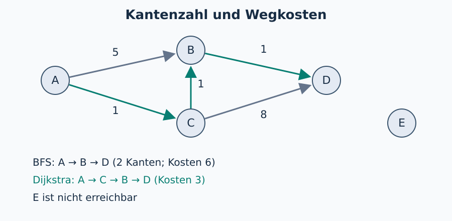

# M13-L1 – Graphensuche und kürzeste Wege {#L1}

**Kursbereich:** M13 – Algorithmische Entwurfsverfahren

**Niveau:** Bachelor · Kern/Grundlagen

**Vorwissen:** [M8-L1](M8-L1.md); [M12-L1](M12-L1.md)

## Lernziele {#S1}

Unterscheide Erreichbarkeit, minimale Kantenzahl und minimales Kantengewicht. Begründe die Invarianten von Breitensuche und Dijkstra, rekonstruiere Wege und bestimme die Laufzeit der Implementierungen.

## Graphmodell und Suchziele {#S2}

Ein endlicher gerichteter Graph $G=(V,E)$ besteht aus Knoten und gerichteten Kanten. Eine Adjazenzliste speichert für jeden Knoten seine ausgehenden Nachbarn und Gewichte. In dieser Lektion sind alle Knoten durch vergleichbare Zeichenketten benannt, alle Kantenziele sind im Graphen enthalten, der Startknoten existiert. Ein Gewicht ist bei Dijkstra eine nichtnegative ganze Zahl. Eine fehlende Verbindung hat Distanz $\infty$, nicht null. Ein Weg kann wenige Kanten und dennoch hohe Kosten haben.

Betrachte A→B (5), A→C (1), C→B (1), C→D (8), B→D (1) sowie den isolierten Knoten E. Die Breitensuche findet nach D einen Weg mit zwei Kanten; A→B→D kostet 6. Der kostenminimale Weg A→C→B→D besitzt drei Kanten, kostet aber nur 3. Die Grafik stellt beide Ziele gegenüber.

{alt="Gerichteter Graph: zwei Kanten über B, minimale Kosten über C und B; E isoliert"}

## Breiten- und Tiefensuche {#S3}

Breitensuche (BFS) verwendet eine FIFO-Warteschlange. Markiere Knoten beim Einfügen, damit jeder Knoten höchstens einmal in der Warteschlange steht. Die Markierung enthält die Distanz in Kanten und einen Vorgänger. Die Warteschlange enthält die noch nicht bearbeiteten Knoten in nicht fallender Distanzreihenfolge. Induktion über die Entfernungsschichten: Der Start hat Distanz 0. Ist die Schicht $k$ korrekt, erreicht ihre Expansion alle noch unbekannten Knoten mit minimaler Entfernung $k+1$. Ein kürzerer Weg hätte sie in einer früheren Schicht entdeckt. Somit sind die ersten Distanzen optimal.

Tiefensuche (DFS) nutzt einen Stapel. Für reine Erreichbarkeit genügt eine Markierung beim Einfügen: Jeder entdeckte Knoten hat einen Weg vom Start, und jeder erreichbare Knoten wird entdeckt, denn andernfalls gäbe es entlang eines Wegs eine Kante vom entdeckten zum unentdeckten Teil. Die konkrete iterative Variante liefert eine Besuchsmenge, nicht zwingend die Reihenfolge oder den DFS-Baum einer rekursiven Implementierung. Beide Verfahren benötigen mit Adjazenzlisten $O(|V|+|E|)$ Zeit und $O(|V|)$ zusätzlichen Speicher.

## Dijkstra: Relaxation und Beweis {#S4}

Initialisiere $d(s)=0$ und alle anderen Distanzen mit $\infty$. Relaxation der Kante $(u,v)$ mit Gewicht $w$ ersetzt $d(v)$ durch $d(u)+w$, falls dieser Wert kleiner ist. Entnimm jeweils den Knoten mit minimalem aktuellen Schlüssel aus einer Prioritätswarteschlange. Veraltete Einträge werden übersprungen.

**Korrektheitsargument:** Jede endliche vorläufige Distanz ist die Länge eines tatsächlich gefundenen Weges und damit eine obere Schranke der optimalen Distanz. Angenommen, der als Nächstes gültig entnommene Knoten $u$ hätte einen kürzeren Weg als seinen Schlüssel. Auf einem solchen kürzesten Weg sei $y$ der erste noch nicht endgültig bearbeitete Knoten, mit bereits bearbeitetem Vorgänger $x$ (der Startfall ist trivial). Die Relaxation von $x$ liefert $d(y)$ höchstens so groß wie die Länge des Wegpräfixes bis $y$. Wegen nichtnegativer Gewichte ist diese höchstens die Länge des gesamten kürzeren Weges nach $u$. Also wäre $d(y)<d(u)$, im Widerspruch zur minimalen Entnahme. Induktiv ist jede gültig entnommene Distanz endgültig. Strikte Verbesserungen vermeiden erneutes Einfügen bei Gleichstand.

Im Beispiel werden A:0, C:1, B:2, D:3 gültig entnommen; die älteren Schlüssel B:5 und D:9 werden verworfen. Negative Gewichte verletzen die Beweisvoraussetzung: S→U (2), S→V (5), V→U (-4) liefert für U zunächst 2, tatsächlich aber 1. Eine endgültige Festlegung wäre falsch. Für negative Kanten ist etwa Bellman–Ford geeignet; erreichbare negative Zyklen können endliche optimale Distanzen ausschließen.

## Ausführbare Implementierung und Grenzen {#S5}

Die Funktion `path` folgt den Vorgängern rückwärts. Für einen nicht erreichten Zielknoten liefert sie `None`. Die Beispiele verwenden bewusst ganze Gewichte, um Rundungsfragen zu vermeiden.

```python
from collections import deque
from heapq import heappop, heappush
from math import inf

def bfs(g, s):
    d, parent = {s: 0}, {s: None}
    q = deque([s])
    while q:
        u = q.popleft()
        for v, w in g[u]:
            if v not in d:
                d[v], parent[v] = d[u] + 1, u
                q.append(v)
    return d, parent

def dfs(g, s):
    seen, stack = {s}, [s]
    while stack:
        u = stack.pop()
        for v, w in g[u]:
            if v not in seen:
                seen.add(v)
                stack.append(v)
    return seen

def dijkstra(g, s):
    if any(type(w) is not int or w < 0
           for edges in g.values() for v, w in edges):
        raise ValueError("nonnegative integer weights required")
    d = dict.fromkeys(g, inf)
    parent = {s: None}
    d[s], heap = 0, [(0, s)]
    while heap:
        du, u = heappop(heap)
        if du != d[u]:
            continue
        for v, w in g[u]:
            candidate = du + w
            if candidate < d[v]:
                d[v], parent[v] = candidate, u
                heappush(heap, (candidate, v))
    return d, parent

def path(parent, t):
    if t not in parent:
        return None
    result = []
    while t is not None:
        result.append(t)
        t = parent[t]
    return result[::-1]

g = {"A": [("B", 5), ("C", 1)], "B": [("D", 1)],
     "C": [("B", 1), ("D", 8)], "D": [], "E": []}
assert bfs(g, "A")[0]["D"] == 2
assert dfs(g, "A") == {"A", "B", "C", "D"}
d, pred = dijkstra(g, "A")
assert d["D"] == 3 and path(pred, "D") == ["A", "C", "B", "D"]
assert d["E"] == inf and path(pred, "E") is None
```

Die Heap-Variante legt pro erfolgreicher Relaxation einen neuen Eintrag ab. Bei $V=|V|$ und $E=|E|$ betragen Laufzeit $O(V+E+(E+1)\log(E+2))$ und zusätzlicher Speicher $O(V+E)$ einschließlich der Heap-Einträge. Für einfache Graphen ergibt sich die bekannte Schranke $O(V+E\log(V+1))$. Eine indizierte Prioritätswarteschlange mit Decrease-Key kann den Heap auf $O(V)$ Einträge begrenzen. Die Eingabeprüfung im Beispiel umfasst Gewichte, nicht sämtliche Modellannahmen.

## Selbstkontrolle {#S6}

### Aufgaben

1. Welche minimale Kantenzahl hat ein Weg A→D?
2. Welche Gewichts-Distanz besitzt B ab A?
3. Warum markiert BFS beim Einfügen in die Warteschlange?
4. Warum ist das Gegenbeispiel mit V→U (-4) keine zulässige Dijkstra-Eingabe?
5. Füge D→E mit Gewicht 0 hinzu. Welche Distanz und welchen rekonstruierten Weg erhält E?

::: {.lc-solutions data-lc-section="S6"}
1. Zwei, beispielsweise A→B→D.
2. 2 über A→C→B.
3. Damit ein bereits entdeckter Knoten nicht mehrfach eingereiht wird; die erste BFS-Distanz ist optimal.
4. Die negative Kante kann die Kosten eines schon endgültig entnommenen Knotens nachträglich unterschreiten. Die Implementierung lehnt sie ab.
5. Distanz 3; A→C→B→D→E.
:::

## Quellen {#S7}

- [Sedgewick & Wayne, Directed Graphs](https://algs4.cs.princeton.edu/42digraph/index.php) · Reachability in digraphs; graph representation · Zuletzt abgerufen: 2026-11-24 · Inhaltlich geprüft: 2026-11-24
- [Sedgewick & Wayne, Shortest Paths](https://algs4.cs.princeton.edu/44sp/) · Dijkstra’s algorithm; negative weights; lazy implementation · Zuletzt abgerufen: 2026-11-24 · Inhaltlich geprüft: 2026-11-24
