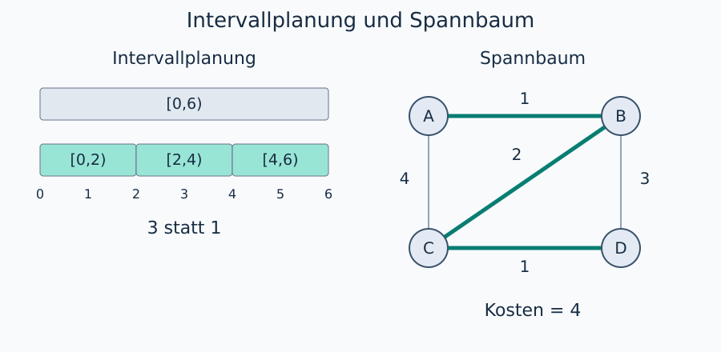

# M13-L2 – Greedy-Algorithmen und Austauschargumente {#L2}

**Kursbereich:** M13 – Algorithmische Entwurfsverfahren

**Niveau:** Bachelor · Kern/Grundlagen

**Vorwissen:** [M13-L1](M13-L1.md)

## Lernziele {#S1}

Begründe eine sichere lokale Wahl mittels Austauschargument, berechne einen minimalen Spannbaum und erkenne Fälle, in denen eine Greedy-Regel versagt.

## Intervallplanung {#S2}

Gegeben sind endlich viele halboffene Intervalle $[a,b)$ mit $a<b$. Gesucht ist eine maximale Anzahl paarweise disjunkter Intervalle; Berührung an Endpunkten ist erlaubt. Sortiere nach Endzeit, wähle das erste Intervall und wiederhole mit den kompatiblen Intervallen. Im Beispiel konkurriert [0,6) mit [0,2), [2,4), [4,6). Die drei kurzen Intervalle sind gemeinsam optimal. Die Endzeit, nicht die Länge oder der Start, bestimmt die Wahl.

## Austauschargument {#S3}

Sei $g$ ein Intervall mit frühestem Ende und $o$ das erste Intervall einer optimalen Lösung. Wegen $b_g\le b_o$ beginnen alle nachfolgenden Intervalle frühestens nach dem Ende von $g$. Ersetze $o$ durch $g$: Die Anzahl bleibt gleich und die Lösung zulässig. Es existiert also eine optimale Lösung, die $g$ enthält. Auf dem verbleibenden Problem gilt das gleiche Argument; Induktion über die Anzahl der Intervalle liefert Optimalität. Leere Eingaben liefern die leere Lösung. Bei Gewichten gilt der Austausch nicht: [0,2) und [2,4) mit Wert je 1 verlieren gegen [0,4) mit Wert 5. Das Ziel muss vor der Regel feststehen.

## Minimale Spannbäume {#S4}

Ein zusammenhängender ungerichteter Graph mit $n$ Knoten besitzt einen Spannbaum mit $n-1$ Kanten. Minimiert wird die Summe seiner Kantengewichte, nicht die Distanz von einer Wurzel. Kruskal betrachtet Kanten in aufsteigender Gewichtsreihenfolge und übernimmt genau die Kanten, die zwei bisher getrennte Komponenten verbinden. In der Grafik sind AB=1, BC=2, CD=1, AC=4, BD=3; die Lösung AB, CD, BC kostet 4. Gleichstände dürfen beliebig aufgelöst werden; auch negative Gewichte sind zulässig.

Beweis: Der aktuelle Wald $F$ ist Teil eines minimalen Spannbaums $T$. Für eine neue Kante $e$ zwischen Komponenten gilt entweder $e\in T$ oder $T+e$ enthält einen eindeutigen Kreis. Der Kreis enthält eine andere Kante $f$, die den Schnitt um die eine Komponente von $F$ kreuzt. Sie gehört nicht zu $F$. Da Kruskal keine frühere kreuzende Kante ausgelassen haben kann (sie wäre damals ebenfalls komponentenübergreifend gewesen), gilt $w(e)\le w(f)$. Entferne $f$: Der Baum enthält nun $F+e$ und ist nicht teurer. Die Invariante bleibt erhalten; bei $n-1$ Kanten ist der Baum optimal. Für unzusammenhängende Graphen liefert das Verfahren analog einen minimalen Spannwald der Komponenten.

{alt="Intervallplan und minimaler Spannbaum"}

## Implementierung und Aufwand {#S5}

Union-Find speichert Komponenten durch Elternzeiger. Pfadhalbierung und Vereinigung nach Größe beschleunigen wiederholte Abfragen. Die Intervallplanung benötigt $O(k\log(k+1))$ Zeit für $k$ Intervalle. Kruskal benötigt $O(n+m\log(m+1)+m\alpha(n))$ für $m$ Kanten, wobei $\alpha$ die inverse Ackermann-Funktion bezeichnet (amortisierte Union-Find-Schranke). Speicher: $O(n+m)$ einschließlich sortierter Kanten. Vorausgesetzt sind gültige Knotenindizes, positive Intervalllängen und endliche vergleichbare Gewichte. Die Beispiele prüfen diese Verträge nicht erneut.

```python
def schedule(intervals):
    chosen = []
    for a, b in sorted(intervals, key=lambda t: (t[1], t[0])):
        if not chosen or a >= chosen[-1][1]:
            chosen.append((a, b))
    return chosen

def kruskal(n, edges):
    parent = list(range(n))
    size = [1] * n
    def find(x):
        while x != parent[x]:
            parent[x] = parent[parent[x]]
            x = parent[x]
        return x
    result = []
    for u, v, w in sorted(edges, key=lambda e: e[2]):
        a, b = find(u), find(v)
        if a == b:
            continue
        if size[a] < size[b]:
            a, b = b, a
        parent[b] = a
        size[a] += size[b]
        result.append((u, v, w))
    return result

assert schedule([(0, 6), (0, 2), (2, 4), (4, 6)]) == [(0, 2), (2, 4), (4, 6)]
edges = [(0, 1, 1), (1, 2, 2), (2, 3, 1), (0, 2, 4), (1, 3, 3)]
assert sum(w for u, v, w in kruskal(4, edges)) == 4
```

## Selbstkontrolle {#S6}

### Aufgaben

1. Welche Intervalle wählt das Verfahren im Beispiel?
2. Warum ist der Austausch zulässig?
3. Gib ein Gegenbeispiel zur Wahl des frühesten Starts.
4. Welche Kanten und Kosten hat der Spannbaum in der Grafik?
5. Was liefert Kruskal bei zwei getrennten Komponenten?

::: {.lc-solutions data-lc-section="S6"}
1. [0,2), [2,4), [4,6).
2. Das neue erste Intervall endet nicht später; alle folgenden bleiben kompatibel.
3. [0,9), [1,3), [3,5), [5,7): frühester Start liefert eins statt drei.
4. AB, CD, BC; Gesamtkosten 4.
5. Einen minimalen Spannwald mit einem minimalen Baum pro Komponente.
:::

## Quellen {#S7}

- [Kleinberg & Tardos, Greedy Algorithms I](https://www.cs.princeton.edu/courses/archive/spring18/cos423/lectures/04GreedyAlgorithmsI-2x2.pdf) · Interval scheduling, exchange argument; PDF text (Prüfumfang: text only) · Zuletzt abgerufen: 2026-11-24 · Inhaltlich geprüft: 2026-11-24
- [Sedgewick & Wayne, Minimum Spanning Trees](https://algs4.cs.princeton.edu/43mst/index.php) · Cut property, Kruskal, spanning forest · Zuletzt abgerufen: 2026-11-24 · Inhaltlich geprüft: 2026-11-24
