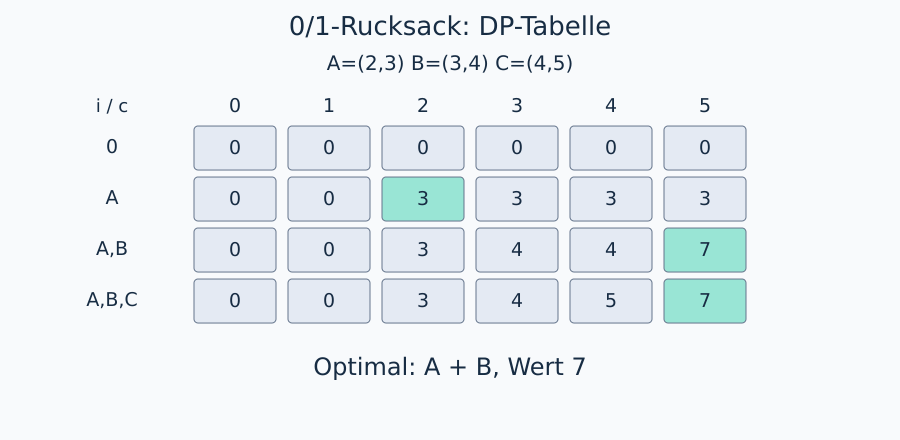

# M13-L3 – Dynamische Programmierung und Rekurrenzen {#L3}

**Kursbereich:** M13 – Algorithmische Entwurfsverfahren

**Niveau:** Bachelor · Kern/Grundlagen

**Vorwissen:** [M12-L1](M12-L1.md); [M7-L2](M7-L2.md)

## Lernziele {#S1}

Definiere Zustände, Basisfälle und Rekurrenzen, berechne eine DP-Tabelle, rekonstruiere eine optimale Auswahl und unterscheide polynomielle von pseudopolynomieller Laufzeit.

## Vom Suchbaum zur Zustandstabelle {#S2}

Dynamische Programmierung speichert Ergebnisse wiederkehrender Teilprobleme. Eine brauchbare Zustandsbeschreibung enthält alle Informationen, die für künftige Entscheidungen nötig sind. Memoisierung wertet Zustände bedarfsgesteuert aus; Tabellierung folgt einer Abhängigkeitsreihenfolge. Beides setzt bei den hier betrachteten Problemen azyklische Zustandsabhängigkeiten voraus. Die bloße Speicherung macht ein exponentiell großes Zustandsmodell nicht effizient.

## 0/1-Rucksack: Rekurrenz und Beweis {#S3}

Für $n$ Gegenstände mit positiven ganzzahligen Gewichten $w_i$, nichtnegativen ganzzahligen Werten $v_i$ und Kapazität $W\ge 0$ wird jeder Gegenstand höchstens einmal gewählt. Definiere $D(i,c)$ als optimalen Wert aus den ersten $i$ Gegenständen bei Restbudget $c$. Es gilt $D(0,c)=0$ und $D(i,0)=0$. Für $c<w_i$ gilt $D(i,c)=D(i-1,c)$; sonst gilt

$$D(i,c)=\max\{D(i-1,c),v_i+D(i-1,c-w_i)\}.$$

Beweis durch Induktion über $i$: Jede zulässige Auswahl enthält Gegenstand $i$ oder nicht. Im ersten Fall verbleibt Kapazität $c-w_i$ und die übrigen Gegenstände stammen aus dem kleineren Teilproblem; im zweiten bleibt $c$. Beide Kandidaten sind erreichbar, und jede Lösung wird durch einen Kandidaten nach oben beschränkt. Der größere Wert ist somit optimal. Die Basis ist die leere Auswahl.

## Beispiel und Rekonstruktion {#S4}

Die Gegenstände A=(2,3), B=(3,4), C=(4,5) haben jeweils Gewicht und Wert; $W=5$. Die Grafik enthält die vollständige Tabelle. Die Zelle $D(3,5)=7$ übernimmt $D(2,5)$, also wird C nicht benötigt. $D(2,5)=7>D(1,5)=3$: B wird gewählt, Restkapazität 2. A liefert dort den Wert 3. Bei Gleichstand darf der spätere Gegenstand weggelassen werden.

Eine greedy Wahl nach Wert/Gewicht ist für 0/1 nicht allgemein optimal: bei Kapazität 5 und Gegenständen (3,5), (5,8) wählt sie zuerst den ersten (Verhältnis 5/3 > 8/5), erzielt aber 5 statt 8. Teilbarkeit von Gegenständen wäre ein anderes Problem.

{alt="Rucksack-DP-Tabelle mit optimaler Auswahl"}

## Implementierung und Komplexität {#S5}

Die Tabelle enthält $(n+1)(W+1)$ Zellen; Zeit und Speicher sind $O((n+1)(W+1))$, unter Einheitskostenannahme für Wertarithmetik. Da $W$ binär mit etwa $\log_2(W+1)$ Bits dargestellt wird, ist die Schranke pseudopolynomiell. Für nur den Optimalwert genügt eine Zeile, wenn Kapazitäten pro Gegenstand absteigend durchlaufen werden; aufsteigende Reihenfolge würde denselben Gegenstand mehrfach verfügbar machen. Die vollständige Tabelle erlaubt einfache Rekonstruktion. Das Modell schließt Nullgewichte bewusst aus und überprüft seine Eingaben.

```python
def knapsack(items, capacity):
    if type(capacity) is not int or capacity < 0:
        raise ValueError("nonnegative integer capacity required")
    if any(type(w) is not int or w <= 0 or type(v) is not int
           or v < 0 for w, v in items):
        raise ValueError("positive integer weights, nonnegative integer values")
    n = len(items)
    table = [[0] * (capacity + 1) for _ in range(n + 1)]
    for i, (w, v) in enumerate(items, 1):
        for c in range(capacity + 1):
            best = table[i - 1][c]
            if w <= c:
                best = max(best, v + table[i - 1][c - w])
            table[i][c] = best
    selected = []
    c = capacity
    for i in range(n, 0, -1):
        if table[i][c] > table[i - 1][c]:
            selected.append(i - 1)
            c -= items[i - 1][0]
    return table[n][capacity], selected[::-1], table

assert knapsack([(2, 3), (3, 4), (4, 5)], 5)[:2] == (7, [0, 1])
assert knapsack([], 0)[:2] == (0, [])
```

## Selbstkontrolle {#S6}

### Aufgaben

1. Berechne $D(2,4)$ im Beispiel.
2. Warum wird aus Zeile $i-1$ gelesen?
3. Welche Auswahl ergibt sich bei Kapazität 4?
4. Warum ist $O(nW)$ nicht automatisch polynomiell in der Eingabelänge?
5. Welches Problem entsteht bei aufsteigender Kapazitätsiteration in einer einzigen Zeile?

::: {.lc-solutions data-lc-section="S6"}
1. 4, nur B.
2. Damit jeder Gegenstand höchstens einmal genutzt wird.
3. Nur C, Wert 5.
4. Die Binärdarstellung von W ist logarithmisch in W; W kann exponentiell in der Bitlänge wachsen.
5. Ein bereits in derselben Zeile erhöhter Wert kann denselben Gegenstand erneut einbeziehen.
:::

## Quellen {#S7}

- [Sedgewick & Wayne, Knapsack.java](https://introcs.cs.princeton.edu/java/23recursion/Knapsack.java.html) · 0/1 recurrence, reconstruction; independent Python implementation · Zuletzt abgerufen: 2026-11-24 · Inhaltlich geprüft: 2026-11-24
- [MIT OCW, Recitation 21](https://ocw.mit.edu/courses/6-006-introduction-to-algorithms-fall-2011/resources/recitation-21-dynamic-programming-knapsack-problem/) · Resource description: knapsack, pseudopolynomial time; video not reviewed (nur Ressourcenbeschreibung geprüft; Video nicht geprüft) · Zuletzt abgerufen: 2026-11-24
