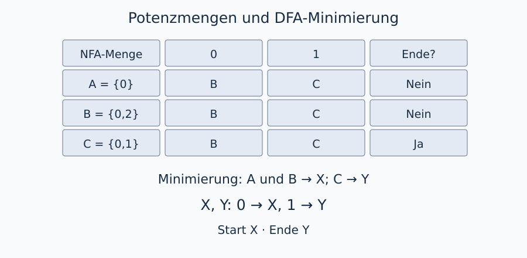

# M14-L1 – Endliche Automaten, Potenzmengenkonstruktion und Minimierung {#L1}

**Kursbereich:** M14 – Formale Sprachen und Komplexität

**Niveau:** Bachelor · Kern/Grundlagen

**Vorwissen:** [M8-L2](M8-L2.md)

## Lernziele {#S1}

Konstruiere aus einem nichtdeterministischen endlichen Automaten einen deterministischen Automaten, beweise die Spracherhaltung und bestimme den kleinsten vollständigen DFA über einem festen Alphabet.

## Endliche Automaten {#S2}

Ein DFA $(Q,\Sigma,\delta,q_0,F)$ besitzt eine totale Übergangsfunktion $\delta:Q\times\Sigma\to Q$. Beim NFA ist das Ergebnis eine Zustandsmenge; ein Wort wird akzeptiert, wenn mindestens ein vollständiger Lauf in einem Endzustand endet. Die leere Zustandsmenge steht für das Fehlen eines möglichen Laufs. Bei erlaubten $\varepsilon$-Kanten ist der Abschluss $E(S)$ die Menge aller von $S$ über null oder mehr solcher Kanten erreichbaren Zustände.

## Potenzmengenkonstruktion und Beweis {#S3}

Der DFA beginnt in $E(\{q_0\})$. Für jedes Zeichen $a$ führt er von einer Menge $S$ nach $E(\bigcup_{q\in S}\delta(q,a))$. Eine Menge ist akzeptierend genau dann, wenn sie $F$ schneidet. Induktion über die Wortlänge: Die Startmenge enthält genau alle ohne Eingabeverbrauch erreichbaren Zustände. Aus der Induktionsannahme ergeben ein Zeichenübergang und der anschließende Abschluss genau die möglichen Zustände nach dem nächsten Zeichen. Daher akzeptieren beide Automaten dieselben Wörter. Bei $n$ NFA-Zuständen sind höchstens $2^n$ DFA-Zustände möglich; konstruiert werden nur erreichbare Mengen.

## Minimierung und Beispiel {#S4}

Zwei erreichbare DFA-Zustände sind äquivalent, wenn jedes Fortsetzungswort von beiden entweder akzeptiert oder verworfen wird. Beginne mit den End- und Nichtendzuständen als getrennten Blöcken (leere Blöcke entfallen). Teile jeden Block nach den Zielblöcken seiner Übergänge auf, bis keine Teilung mehr erfolgt. Nach $k$ Verfeinerungen stimmen Zustände im selben Block genau hinsichtlich aller Fortsetzungen der Länge höchstens $k$ überein: Die Basis ist die leere Fortsetzung, der Induktionsschritt prüft zuerst ein Zeichen und dann eine kürzere Fortsetzung. Die stabile Partition bleibt unter jedem Übergang erhalten und beschreibt damit echte Sprachäquivalenz. Jeder Block muss in jedem äquivalenten DFA durch einen eigenen Zustand repräsentiert werden: Erreichbare Präfixe verschiedener Blöcke haben eine unterscheidende Fortsetzung. Der Quotientenautomat ist somit minimal, bis auf Umbenennung eindeutig.

Beispiel: Zustand 0 besitzt Schleifen auf beiden Zeichen, zusätzlich auf 0 eine Kante nach 2 und auf 1 eine Kante nach 1. Nur 1 ist Endzustand, 1 und 2 haben keine ausgehenden Kanten. Die erreichbaren Mengen A={0}, B={0,2}, C={0,1} stehen in der Grafik. A und B verschmelzen; C bleibt separat. Die Sprache besteht aus den Binärwörtern mit letzter Ziffer 1.

{alt="Potenzmengen und DFA-Minimierung"}

## Implementierung und Grenzen {#S5}

Die Implementierung setzt einen epsilonfreien NFA, ein festes wiederverwendbares Alphabet und gültige Übergangsziele voraus. Ein fehlender Übergang bedeutet die leere Menge. Die Warteschlange enumeriert erreichbare Mengen; die Partition wird in jeder nicht stabilen Runde echt feiner. Bei $m$ erreichbaren DFA-Zuständen gibt es höchstens $m-1$ echte Verfeinerungen; die Kosten pro Runde hängen von Alphabetgröße und verwendeten Datenstrukturen ab. Bei $\varepsilon$-Kanten muss zusätzlich der Abschluss berechnet werden. Die Implementierung ist ein Lehrmodell, kein optimierter Lexer.

```python
from collections import deque

def determinize(start, finals, edges, alphabet):
    # epsilon-free NFA; missing transitions are empty sets
    start = frozenset({start})
    todo = deque([start])
    trans = {start: {}}
    while todo:
        s = todo.popleft()
        for a in alphabet:
            t = frozenset(r for q in s for r in edges.get((q, a), ()))
            trans[s][a] = t
            if t not in trans:
                trans[t] = {}
                todo.append(t)
    return start, {s for s in trans if s & finals}, trans

def minimize(start, finals, trans, alphabet):
    # trans contains only reachable states and is complete
    blocks = [b for b in (set(trans) & finals, set(trans) - finals) if b]
    while True:
        owner = {q: i for i, b in enumerate(blocks) for q in b}
        refined = []
        for b in blocks:
            buckets = {}
            for q in b:
                key = tuple(owner[trans[q][a]] for a in alphabet)
                buckets.setdefault(key, set()).add(q)
            refined.extend(buckets.values())
        if len(refined) == len(blocks):
            break
        blocks = refined
    out = {i: {a: owner[trans[next(iter(b))][a]] for a in alphabet}
           for i, b in enumerate(blocks)}
    return owner[start], {owner[q] for q in finals}, out

def accepts(start, finals, trans, word):
    for a in word:
        start = trans[start][a]
    return start in finals

edges = {(0, '0'): {0, 2}, (0, '1'): {0, 1}}
s, f, t = determinize(0, {1}, edges, '01')
assert len(t) == 3
s, f, t = minimize(s, f, t, '01')
assert len(t) == 2
assert accepts(s, f, t, '101') and not accepts(s, f, t, '10')
```

## Selbstkontrolle {#S6}

### Aufgaben

1. Ist die leere Menge immer erreichbar?
2. Welche Menge folgt im Beispiel nach 010?
3. Welche Fortsetzung unterscheidet B und C?
4. Wie viele Teilmengen sind bei fünf NFA-Zuständen höchstens möglich?
5. Warum darf ein unerreichbarer Zustand vor der Minimierung entfallen?

::: {.lc-solutions data-lc-section="S6"}
1. Nein, im Beispiel bleibt Zustand 0 stets erreichbar.
2. B={0,2}.
3. Das leere Wort, da nur C akzeptierend ist.
4. 32.
5. Kein Eingabewort kann ihn erreichen; er beeinflusst die Sprache nicht.
:::

## Quellen {#S7}

- [Cornell CS 4120 – Lexical implementation](https://www.cs.cornell.edu/courses/cs4120/2023sp/notes/leximpl/) · Subset construction, epsilon closure, minimality (Prüfumfang: text only) · Zuletzt abgerufen: 2026-11-24 · Inhaltlich geprüft: 2026-11-24
- [Virginia Tech OpenDSA – DFA minimization](https://opendsa.cs.vt.edu/ODSA/Books/PIFLA/html/DFAMinimization.html) · Partition refinement; text only, interactive examples not checked (Prüfumfang: text only) · Zuletzt abgerufen: 2026-11-24 · Inhaltlich geprüft: 2026-11-24
