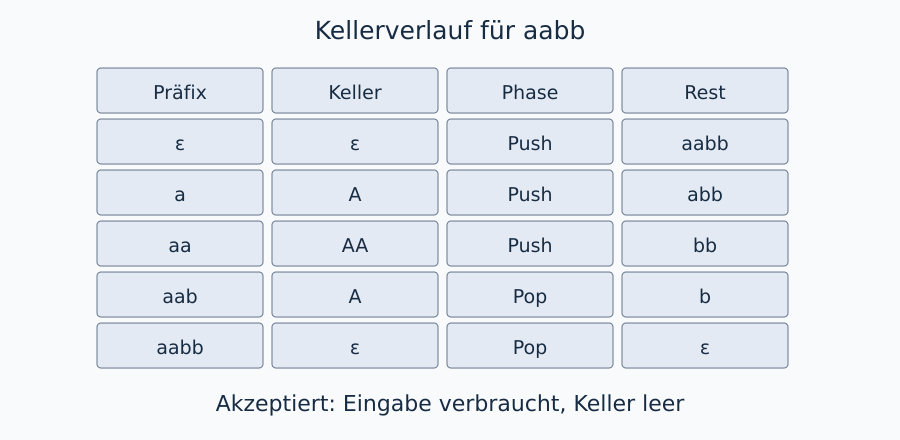

# M14-L2 – Reguläre und kontextfreie Sprachen: Beweise und Kellerautomaten {#L2}

**Kursbereich:** M14 – Formale Sprachen und Komplexität

**Niveau:** Bachelor · Kern/Grundlagen

**Vorwissen:** [M14-L1](M14-L1.md)

## Lernziele {#S1}

Unterscheide reguläre und kontextfreie Sprachen, formuliere die beiden Pumping-Lemmata mit korrekter Quantorenreihenfolge und konstruiere eine Grammatik und einen Kellerautomaten.

## Grammatik und Ableitung {#S2}

Eine kontextfreie Grammatik besteht aus Nichtterminalen, Terminalen, einem Startsymbol und Produktionen, deren linke Seite genau ein Nichtterminal ist. Das Modell $S\to aSb\mid\varepsilon$ erzeugt $L=\{a^nb^n:n\ge0\}$. Jede Anwendung der ersten Regel fügt links ein a und rechts ein b hinzu; die zweite Regel beendet die Ableitung. Induktion über die Anzahl der Anwendungen zeigt, dass genau die Wörter aus L entstehen. Beispiel: $S\Rightarrow aSb\Rightarrow aaSbb\Rightarrow aabb$. Der Ableitungsbaum hält die Struktur fest, während die Ableitung eine Folge von Ersetzungen darstellt.

## Pumping-Lemmata und Grenzen {#S3}

Für jede reguläre Sprache existiert $p\ge1$, sodass jedes Wort $w$ der Sprache mit $|w|\ge p$ eine Zerlegung $w=xyz$ besitzt, für die $|xy|\le p$, $|y|>0$ und $xy^iz$ für alle $i\ge0$ in der Sprache liegt. Beweis: Unter den ersten $p+1$ besuchten Zuständen eines DFA mit $p$ Zuständen wiederholt sich einer; der nichtleere Schleifenabschnitt kann entfallen oder beliebig oft durchlaufen werden.

Wäre L regulär, wähle $w=a^pb^p$. In jeder zulässigen Zerlegung enthält y nur a. Für $i=0$ fehlen a, während die Zahl der b unverändert bleibt. Widerspruch.

Für kontextfreie Sprachen lautet die notwendige Bedingung: Es existiert $p\ge1$, sodass jedes hinreichend lange Wort $w=uvxyz$ mit $|w|\ge p$ eine Zerlegung mit $|vxy|\le p$, $|vy|>0$ und $uv^ixy^iz$ in der Sprache für jedes $i\ge0$ besitzt. Beweisidee: In einem ausreichend hohen Ableitungsbaum in Chomsky-Normalform wiederholt sich auf einem Pfad ein Nichtterminal; der dazwischenliegende Teilbaum wird entfernt oder wiederholt. Die Wahl nahe den Blättern begrenzt die Länge von vxy.

Für $K=\{a^nb^nc^n:n\ge0\}$ wähle $a^pb^pc^p$. Der Abschnitt vxy mit Länge höchstens p kann nicht alle drei Zeichenarten umfassen. Beim Pumpen mit $i=0$ wird mindestens eine Zeichenanzahl vermindert, eine andere bleibt p. Daher ist K nicht kontextfrei. Beide Lemmata liefern notwendige, nicht hinreichende Bedingungen; ein Nichtzugehörigkeitsbeweis muss alle erlaubten Zerlegungen abdecken.

## Kellerautomat und Invariante {#S4}

Ein Kellerautomat ergänzt einen endlichen Kontrollzustand um einen Stack mit Zugriff auf die Spitze. Für L gibt es eine Push-Phase, in der pro a ein A abgelegt wird, und eine Pop-Phase, in der pro b ein A entfernt wird. Ein a nach dem ersten b oder ein b bei leerem Keller wird verworfen. Akzeptanz gilt erst am Eingabeende bei leerem Keller. Das leere Wort wird akzeptiert. Formal kann der Kellerboden durch ein eigenes Symbol markiert und die Endprüfung per Eingabeendmarkierung modelliert werden.

Invariante: Solange kein Fehler erkannt ist, besitzt das gelesene Präfix die Form $a^rb^s$ mit $0\le s\le r$, und der Keller enthält $r-s$ Symbole. Das gilt zunächst und bleibt durch beide erlaubten Übergänge erhalten. Ein leerer Keller am Ende bedeutet also $r=s$; umgekehrt wird jedes Wort aus L ohne Fehler verarbeitet. Nichtdeterministische Kellerautomaten erkennen genau die kontextfreien Sprachen; deterministische Kellerautomaten sind im Allgemeinen weniger mächtig.

{alt="Kellerverlauf für aabb"}

## Implementierung und Grenzen {#S5}

Der Code simuliert nur den beschriebenen deterministischen Kellerautomaten, keinen allgemeinen PDA. Er benötigt bei Wortlänge n lineare Zeit und im schlechtesten Fall linearen Speicher. Der Stack enthält nur ein Symbol, daher genügte hier alternativ ein Zähler; für andere Grammatiken, etwa mehrere Klammerarten, ist der Inhalt des Stacks entscheidend.

```python
def balanced_blocks(word):
    stack = []
    closing = False
    for a in word:
        if a == 'a' and not closing:
            stack.append('A')
        elif a == 'b':
            closing = True
            if not stack:
                return False
            stack.pop()
        else:
            return False
    return not stack

assert balanced_blocks('') and balanced_blocks('aaabbb')
assert not balanced_blocks('abab') and not balanced_blocks('abb')
```

## Selbstkontrolle {#S6}

### Aufgaben

1. Leite aaabbb aus S ab.
2. Warum ist abba nicht in L?
3. Warum muss beim regulären Pumping-Lemma jede zulässige Zerlegung betrachtet werden?
4. Welcher Kellerinhalt bleibt nach aaab?
5. Welche Sprache des Beispiels ist nicht kontextfrei?

::: {.lc-solutions data-lc-section="S6"}
1. S ⇒ aSb ⇒ aaSbb ⇒ aaaSbbb ⇒ aaabbb.
2. Nach Beginn der Pop-Phase kommt ein a; zudem ist die Blockform verletzt.
3. Das Lemma garantiert die Existenz einer geeigneten Zerlegung; eine einzige ungeeignete widerlegt sie nicht.
4. Zwei A.
5. K={a^n b^n c^n : n≥0}.
:::

## Quellen {#S7}

- [Cornell CS 2800 – Pumping lemma](https://www.cs.cornell.edu/courses/cs2800/2017sp/lectures/lec24-pumping.html) · Regular pumping lemma and proof (Prüfumfang: text only) · Zuletzt abgerufen: 2026-11-24 · Inhaltlich geprüft: 2026-11-24
- [Old Dominion University – Context-free grammar](https://www.cs.odu.edu/~toida/nerzic/390teched/cfl/cfg.html) · CFG, PDA, language equivalence (Prüfumfang: text only) · Zuletzt abgerufen: 2026-11-24 · Inhaltlich geprüft: 2026-11-24
- [San José State University – CS154](https://www.cs.sjsu.edu/faculty/pollett/154.1.11s/Lec14032011.html) · CFL pumping lemma and proof idea (Prüfumfang: text only) · Zuletzt abgerufen: 2026-11-24 · Inhaltlich geprüft: 2026-11-24
