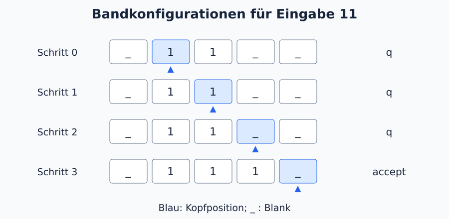

# M14-L3 – Turingmaschinen und Entscheidbarkeitsbeweise {#L3}

**Kursbereich:** M14 – Formale Sprachen und Komplexität

**Niveau:** Bachelor · Kern/Grundlagen

**Vorwissen:** [M14-L2](M14-L2.md)

## Lernziele {#S1}

Eine Maschinenkonfiguration verfolgen, Erkennbarkeit und Entscheidbarkeit unterscheiden, das Halteproblem per Diagonalisierung beweisen und eine Reduktion auf ein weiteres Problem konstruieren.

## Maschinenmodell und Konfiguration {#S2}

Eine deterministische Einband-Turingmaschine besitzt eine endliche Zustandsmenge $Q$, ein Eingabealphabet $\Sigma$, ein Bandalphabet $\Gamma\supseteq\Sigma$ mit Blanksymbol, einen Startzustand und zwei Haltezustände. Hier verwenden wir ein beidseitig unbeschränktes Band, indiziert durch ganze Zahlen. Die Übergangsfunktion ordnet jedem Paar aus nicht haltendem Zustand und gelesenem Bandsymbol einen Folgezustand, ein Schreibsymbol und eine Kopfbewegung $d\in\{-1,1\}$ zu. Eine Konfiguration umfasst Zustand, Kopfposition und gesamten Bandinhalt (zu jedem endlichen Zeitpunkt nur endlich viele Nichtblankzellen). Anfangs steht der Kopf bei Index 0.

Beispiel: Die Maschine A ergänzt die unäre Eingabe $1^n$ um eine Eins. Im Zustand q bewegt sie sich über jede Eins nach rechts. Beim ersten Blank schreibt sie eine Eins, bewegt den Kopf nach rechts und akzeptiert. Nach $j\le n$ Übergängen gilt: Kopfposition j, unveränderte Eingabe, Zustand q. Der nächste Übergang nach j=n terminiert. Damit hält A nach genau n+1 Schritten, auch bei leerer Eingabe.

## Entscheiden, erkennen und diagonalisieren {#S3}

Ein Entscheider für eine Sprache hält auf jeder Eingabe und liefert genau dann Akzeptanz, wenn das Wort zur Sprache gehört. Ein Erkenner akzeptiert jedes Wort der Sprache irgendwann; außerhalb der Sprache darf er verwerfen oder endlos laufen. Jede entscheidbare Sprache ist erkennbar. Wenn sowohl L als auch ihr Komplement erkennbar sind, simuliert man beide Erkenner abwechselnd jeweils einen Schritt: Einer muss schließlich akzeptieren, und sein Ergebnis entscheidet L.

Maschinen besitzen endliche Beschreibungen und können durch eine universelle Maschine simuliert werden. Angenommen, ein totaler Algorithmus H entscheide, ob eine Maschine M auf w hält. Konstruiere D(x): Bei gültiger Maschinenbeschreibung x fragt D den Algorithmus H(x,x). Falls H ja antwortet, läuft D endlos; sonst hält D. Ungültige Beschreibungen werden verworfen. Setze $x=\langle D\rangle$. Sagt H voraus, dass D auf seiner eigenen Beschreibung hält, läuft D gerade dann endlos. Sagt H nein, hält D. Beide Möglichkeiten widersprechen der Annahme. Also ist HALT unentscheidbar. HALT ist dennoch erkennbar: simuliere M und akzeptiere, sobald M anhält (auch bei Verwerfung durch M).

## Reduktion und Simulationsgrenzen {#S4}

Betrachte das Problem EMPTY-ACCEPT: Akzeptiert die gegebene Maschine die leere Eingabe? Zu einem HALT-Paar (M,w) erzeuge effektiv eine Maschine N, die ihre Eingabe ignoriert, M auf w simuliert und akzeptiert, sobald diese Simulation hält. Dann gilt $\langle M,w\rangle\in HALT\iff\langle N\rangle\in EMPTY\text{-}ACCEPT$. Ein Entscheider für EMPTY-ACCEPT würde also HALT entscheiden. Die Reduktionsrichtung ist wesentlich: vom bekannten unentscheidbaren Problem zum untersuchten Problem.

Eine Schrittgrenze B macht nur die Frage entscheidbar, ob innerhalb von B Schritten ein Halt beobachtet wird. Sie löst nicht HALT. Das Ergebnis unknown ist weder Verwerfung noch ein Beweis für Nichtterminierung. Die Grafik zeigt die ersten Konfigurationen der unären Maschine.

{alt="Bandkonfigurationen für Eingabe 11"}

## Band-Simulation in Python {#S5}

Die Implementierung setzt eine wohldefinierte vollständige Übergangstabelle auf erreichbaren Nicht-Haltezuständen voraus. Sie simuliert das gewählte Bandmodell, speichert nur Nichtblankzellen und prüft den Haltezustand auch am exakten Budgetende. Sie ist kein universeller Halteentscheider. Die Bandgröße wächst um höchstens eine Nichtblankzelle pro Schritt.

```python
def simulate(delta, word, limit):
    if limit < 0 or any(c != '1' for c in word):
        raise ValueError('invalid input')
    tape = dict(enumerate(word))
    state, head = 'q', 0
    for steps in range(limit + 1):
        if state in ('accept', 'reject'):
            return state, steps, tape, head
        if steps == limit:
            return 'unknown', steps, tape, head
        state, symbol, move = delta[state, tape.get(head, '_')]
        if symbol == '_':
            tape.pop(head, None)
        else:
            tape[head] = symbol
        head += move

append_one = {('q', '1'): ('q', '1', 1),
              ('q', '_'): ('accept', '1', 1)}
assert simulate(append_one, '111', 4)[0] == 'accept'
assert simulate(append_one, '111', 3)[0] == 'unknown' 
```

## Selbstkontrolle {#S6}

### Aufgaben

1. Welche Konfiguration erreicht A bei Eingabe 11 nach zwei Schritten?
2. Wie viele Übergänge benötigt A bei leerer Eingabe?
3. Warum ist HALT erkennbar, aber nicht entscheidbar?
4. Welche Antwort von H führt bei D auf seiner eigenen Beschreibung zum Widerspruch?
5. Warum darf ein Simulator nach zehn Schritten ohne Halt nicht „läuft ewig“ melden?

::: {.lc-solutions data-lc-section="S6"}
1. Zustand q, Kopf bei 2, Band 11 mit Blank bei 2.
2. Einen Übergang.
3. Simulation erkennt jeden tatsächlichen Halt; die Diagonalisierung widerlegt einen totalen Entscheider.
4. Beide: Ja erzwingt Nichtterminierung, Nein erzwingt Halt.
5. Ein tatsächlicher Halt kann erst nach dem Limit eintreten.
:::

## Quellen {#S7}

- [Old Dominion University – Turing machines](https://www.cs.odu.edu/~zeil/cs390/s24/Public/turing/index.html) · Machine model and transition function (Prüfumfang: Text) · Zuletzt abgerufen: 2026-11-24 · Inhaltlich geprüft: 2026-11-24
- [Cornell CS 4820 – Notes on Turing Machines](https://www.cs.cornell.edu/courses/cs4820/2024sp/notes/turingm.pdf) · Universal simulation, diagonalization and reduction, sections 4–5 (Prüfumfang: PDF text; page image unavailable) · Zuletzt abgerufen: 2026-11-24 · Inhaltlich geprüft: 2026-11-24
