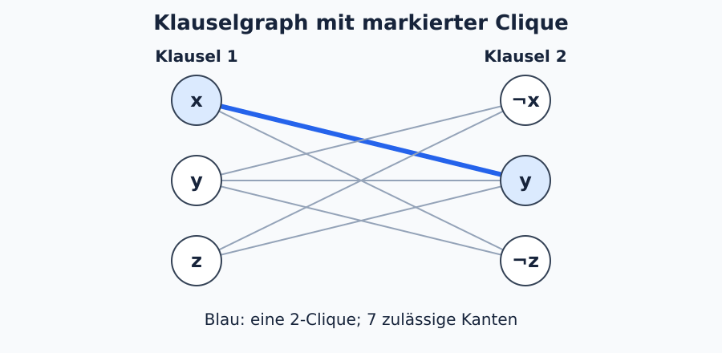

# M14-L4 – NP-Vollständigkeit und polynomielle Reduktionen {#L4}

**Kursbereich:** M14 – Formale Sprachen und Komplexität

**Niveau:** Bachelor · Kern/Vertiefung

**Vorwissen:** [M14-L3](M14-L3.md); [M13-L1](M13-L1.md)

## Lernziele {#S1}

P, NP und NP-Schwere unterscheiden, eine polynomielle Many-one-Reduktion formulieren, 3-SAT auf CLIQUE reduzieren und Zertifikate prüfen.

## Entscheidungsprobleme und Zertifikate {#S2}

P enthält Entscheidungsprobleme, die deterministisch in Polynomialzeit in der Bitlänge der Eingabe lösbar sind. NP enthält Probleme, deren Ja-Instanzen ein polynomial langes Zertifikat mit polynomialem Verifikationsaufwand besitzen; für Nein-Instanzen darf kein Zertifikat akzeptiert werden. Es gilt $P\subseteq NP$ (ein Entscheider kann das leere Zertifikat ignorieren). NP bedeutet nicht „nicht polynomial“. Ob $P=NP$ gilt, ist offen.

Eine polynomielle Many-one-Reduktion $A\le_p B$ ist eine in Polynomialzeit berechenbare Abbildung f mit $x\in A\iff f(x)\in B$. Sie ist transitiv. Ein Problem B ist NP-schwer, wenn jedes A aus NP darauf reduzierbar ist; zusätzlich $B\in NP$ macht es NP-vollständig. Die NP-Vollständigkeit von 3-SAT wird hier als bekanntes Resultat verwendet (Cook–Levin und die Reduktion von SAT auf 3-SAT).

## Konstruktion von 3-SAT zu CLIQUE {#S3}

Eine 3-CNF-Formel besteht aus m durch UND verbundenen Klauseln mit je drei Literalen (Wiederholungen zulässig). Für jedes Literalvorkommen in Klausel i erzeuge einen Knoten (i,j), wobei j die Position markiert. Zwischen zwei Knoten liegt genau dann eine ungerichtete Kante, wenn sie verschiedenen Klauseln angehören und ihre Literale nicht komplementär sind. Setze k=m. Die Größe des Graphen beträgt 3m Knoten und höchstens $\binom{3m}{2}$ Kanten. Mit einer üblichen expliziten Kodierung benötigt die Konstruktion polynomiell viele Bitoperationen; der paarweise Vergleich der Literalnamen ist ebenfalls polynomial.

Beispiel: $(x\lor y\lor z)\land(\neg x\lor y\lor\neg z)$. Die Belegung x=y=wahr erfüllt beide Klauseln, unabhängig von z. Die Vorkommen x aus Klausel 1 und y aus Klausel 2 bilden eine 2-Clique. Innerhalb einer Klausel existieren keine Kanten. Die Grafik hebt eine mögliche Zertifikatskante hervor.

## Beide Beweisrichtungen {#S4}

**Hinrichtung:** Eine erfüllende Belegung liefert in jeder Klausel mindestens ein wahres Literal. Wähle jeweils eines. Zwei gewählte Vorkommen liegen in verschiedenen Klauseln und können nicht komplementär sein, da beide wahr sind. Sie sind also benachbart. Die m gewählten Knoten bilden eine Clique.

**Rückrichtung:** Eine Clique aus m Knoten kann wegen der fehlenden Kanten innerhalb einer Klausel höchstens einen Knoten je Klausel enthalten. Folglich enthält sie genau einen je Klausel. Die ausgewählten Literale enthalten kein komplementäres Paar. Weise jeder ausgewählten Variablen den entsprechenden Wahrheitswert zu und ergänze beliebige Werte für die übrigen Variablen. Jede Klausel hat ein wahres Literal. Damit ist die Formel erfüllbar. Bei m=0 gelten die leere Konjunktion und die leere Clique als zulässig.

CLIQUE liegt in NP: Ein Zertifikat aus k verschiedenen Knoten wird auf Zugehörigkeit zum Graphen und auf alle $\binom{k}{2}$ Kanten geprüft; k größer als die Knotenzahl wird sofort verworfen. Zusammen mit der Reduktion und der bekannten NP-Vollständigkeit von 3-SAT folgt die NP-Vollständigkeit von CLIQUE. Dies beweist keine exponentielle untere Schranke und keine Gleichheit oder Ungleichheit von P und NP.

{alt="Klauselgraph mit markierter Clique"}

## Konstruktion und Zertifikatsprüfung in Python {#S5}

Ganzzahlige Literale i und -i kodieren eine Variable und ihre Negation. Die Knoten speichern zusätzlich Klausel- und Positionsindex, damit wiederholte Vorkommen unterscheidbar bleiben. Der Code konstruiert den Graphen und prüft eine vorgegebene Clique; er sucht keine optimale Clique. Paarweise Konstruktion und Prüfung benötigen quadratisch viele Paarvergleiche in der jeweiligen Knotenzahl; die Bitkosten der Literalvergleiche kommen hinzu.

```python
from itertools import combinations

def clause_graph(clauses):
    if any(len(c) != 3 or any(x == 0 for x in c) for c in clauses):
        raise ValueError('expected triples of nonzero literals')
    vertices = [(i, j, x) for i, c in enumerate(clauses)
                for j, x in enumerate(c)]
    edges = {frozenset((u, v)) for u, v in combinations(vertices, 2)
             if u[0] != v[0] and u[2] != -v[2]}
    return vertices, edges, len(clauses)

def clique_certificate(vertices, edges, k, chosen):
    return (len(chosen) == k and len(set(chosen)) == k
            and set(chosen) <= set(vertices)
            and all(frozenset(pair) in edges
                    for pair in combinations(chosen, 2)))

G = clause_graph([(1, 2, 3), (-1, 2, -3)])
assert clique_certificate(*G, [(0, 0, 1), (1, 1, 2)])
```

## Selbstkontrolle {#S6}

### Aufgaben

1. Was unterscheidet NP-schwer und NP-vollständig?
2. Warum dürfen zwei Vorkommen aus derselben Klausel keine Kante haben?
3. Wie viele Knoten hat der Graph bei vier Klauseln?
4. Ist die Formel (x oder x oder x) UND (nicht x oder nicht x oder nicht x) erfüllbar? Welche Clique fehlt?
5. Welche Richtung muss eine Reduktion zum Nachweis der NP-Schwere eines neuen Problems B haben?

::: {.lc-solutions data-lc-section="S6"}
1. NP-vollständig bedeutet zusätzlich Zugehörigkeit zu NP.
2. Sonst könnte eine m-Clique mehrere Literale derselben Klausel wählen und eine Klausel auslassen.
3. Zwölf.
4. Nein; alle Kanten zwischen den zwei Klauseln fehlen, also keine 2-Clique.
5. Von einem bekannten NP-schweren Problem zu B.
:::

## Quellen {#S7}

- [Princeton – Intractability](https://algs4.cs.princeton.edu/66intractability/) · P, NP, NP-completeness (Prüfumfang: Text) · Zuletzt abgerufen: 2026-11-24 · Inhaltlich geprüft: 2026-11-24
- [Stanford CS 154 – NP reductions](https://theory.stanford.edu/~trevisan/cs154-12/np-reductions.pdf) · 3-SAT to CLIQUE, page 2 (Prüfumfang: PDF text and page 2) · Zuletzt abgerufen: 2026-11-24 · Inhaltlich geprüft: 2026-11-24
