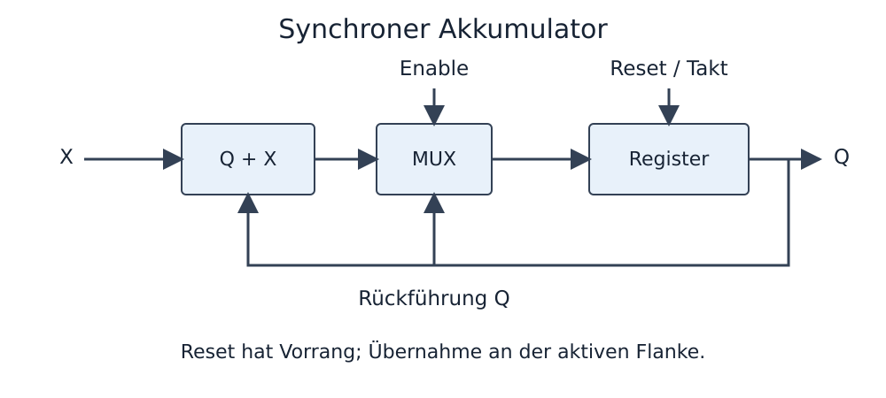

# M15-L1 – Digitale Schaltungen und Registertransfer {#L1}

**Kursbereich:** M15 – Rechnerarchitektur und Betriebssysteme

**Niveau:** Bachelor · Kern

**Vorwissen:** [M1-L2](M1-L2.md)

## Lernziele {#S1}

Kombinatorische und sequenzielle Logik unterscheiden, einen Volladdierer herleiten, eine n-Bit-Addition modellieren und synchrone Zustandsübergänge samt Zeitbedingungen analysieren.

## Kombinatorische Logik und Volladdierer {#S2}

Eine kombinatorische Schaltung berechnet aus den aktuellen Eingängen einen Ausgang ohne gespeicherten Zustand. Für drei Eingangsbits a, b und c (eingehender Übertrag) definiert der Volladdierer $p=a\oplus b$, $s=p\oplus c$ und $c_{out}=(a\land b)\lor(p\land c)$. XOR ist genau dann eins, wenn seine beiden Eingänge verschieden sind. Der zweite Ausdruck liefert eins, wenn mindestens zwei der drei Bits eins sind.

| a | b | c | s | Übertrag |
|---|---|---|---|---|
|0|0|0|0|0|
|0|0|1|1|0|
|0|1|0|1|0|
|0|1|1|0|1|
|1|0|0|1|0|
|1|0|1|0|1|
|1|1|0|0|1|
|1|1|1|1|1|

Damit gilt für jede Zeile $a+b+c=s+2c_{out}$; links steht die gewöhnliche ganzzahlige Summe.

## Ripple-Carry und Übertrag {#S3}

Bei n Volladdierern wandert der Übertrag von Bit i zu Bit i+1, beginnend beim niederwertigsten Bit. Multipliziert man die Einzelgleichungen mit $2^i$ und addiert sie, kürzen sich alle inneren Überträge. Es bleibt $A+B+c_0=S+2^n c_n$. Somit ist S die Summe modulo $2^n$. Beispiel: $1101_2+0110_2=10011_2$; vier Bits speichern 0011, der Übertrag ist 1. Dieser ist nicht gleichbedeutend mit vorzeichenbehaftetem Überlauf. Die längste Übertragskette wächst im einfachen Ripple-Modell linear mit n; schnellere Addierer berechnen Überträge mit zusätzlicher Logik.

## Register und synchrone Zustandsänderung {#S4}

Ein flankengesteuertes Register übernimmt das Eingangswort an der aktiven Taktflanke. Ein Multiplexer wählt zwischen Rückführung des alten Wertes und neuer Summe. Im Modell gilt bei synchronem Reset $Q_{t+1}=0$; ohne Reset bei Enable $Q_{t+1}=(Q_t+X_t)\bmod 2^n$; sonst $Q_{t+1}=Q_t$. Alle rechten Seiten verwenden den alten Zustand. Zwei parallele Transfers A←B und B←A tauschen die Wörter; zwei nacheinander ausgeführte Softwarezuweisungen ohne Zwischenspeicher tun das nicht.

Beispiel mit vier Bits: Q=13, X=6, Enable=1, Reset=0 ergibt Q'=3; bei Enable=0 bleibt Q=13. Reset hat Vorrang.

Bei einem idealen gemeinsamen Takt ohne Skew gilt für den längsten Register-zu-Register-Pfad $T\ge t_{CQ,max}+t_{logic,max}+t_{setup}$ und für den kürzesten $t_{CQ,min}+t_{logic,min}\ge t_{hold}$. Mit 0,8 ns, 3 ns und 0,2 ns folgt T≥4 ns bzw. höchstens 250 MHz. Ein längerer Takt heilt keine Hold-Verletzung. Reale Entwürfe berücksichtigen zusätzlich Skew, Jitter, Prozessschwankungen und Metastabilität.

{alt="Synchroner Akkumulator mit Register und Rückführung"}

## Bitgenaue Simulation {#S5}

Das Programm modelliert stabile Logikwerte und einen Zustandsübergang, nicht elektrische Signalverläufe. Die Additionsinvariante kann mit ganzzahliger Division unabhängig überprüft werden.

```python
def full_adder(a, b, c):
    p = a ^ b
    return p ^ c, (a & b) | (p & c)

def ripple(a, b, n, c=0):
    assert n > 0 and 0 <= a < 2**n and 0 <= b < 2**n
    assert c in (0, 1)
    result = 0
    for i in range(n):
        s, c = full_adder((a >> i) & 1, (b >> i) & 1, c)
        result |= s << i
    return result, c

def tick(q, x, enable, reset, n):
    if reset:
        return 0
    return ripple(q, x, n)[0] if enable else q

assert ripple(13, 6, 4) == (3, 1)
assert tick(13, 6, True, False, 4) == 3
```

## Selbstkontrolle {#S6}

### Aufgaben

1. Wie lautet (s, Übertrag) für a=1, b=0, c=1?
2. Berechne 15+2 mit vier Bits und Übertrag.
3. Wie viele Zustände hat ein n-Bit-Register?
4. Was geschieht bei Reset=1 und Enable=1?
5. Wie groß ist die maximale Taktfrequenz bei 1 ns, 5 ns und 0,25 ns für die drei maximalen Zeitanteile?

::: {.lc-solutions data-lc-section="S6"}
1. (0,1).
2. S=1, Übertrag=1.
3. 2^n.
4. Reset gewinnt, der neue Wert ist null.
5. T≥6,25 ns; höchstens 160 MHz.
:::

## Quellen {#S7}

- [MIT Computation Structures – Combinational Logic](https://computationstructures.org/notes/combinational_logic/notes.html) · §7.8.2–7.8.3; full adder (Prüfumfang: Text) · Zuletzt abgerufen: 2026-11-24 · Inhaltlich geprüft: 2026-11-24
- [MIT Computation Structures – Sequential Logic](https://computationstructures.org/notes/sequential_logic/notes.html) · §8.3.1–8.3.3; register timing (Prüfumfang: Text) · Zuletzt abgerufen: 2026-11-24 · Inhaltlich geprüft: 2026-11-24
