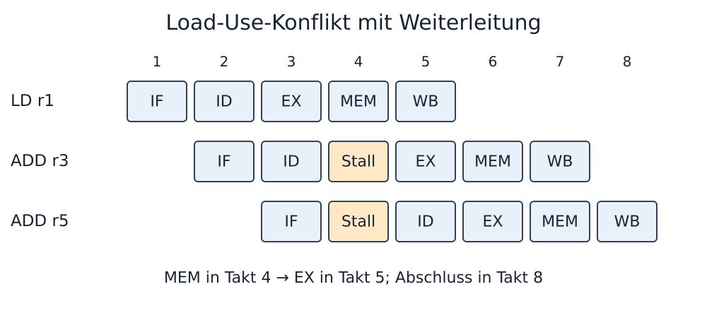

# M15-L2 – Befehlssatz, Adressierung und Pipeline {#L2}

**Kursbereich:** M15 – Rechnerarchitektur und Betriebssysteme

**Niveau:** Bachelor · Kern

**Vorwissen:** [M15-L1](M15-L1.md)

## Lernziele {#S1}

Befehlssatz von Mikroarchitektur unterscheiden, effektive Adressen und Registerzustände berechnen, Datenkonflikte erkennen und die Ausführungszeit einer einfachen Pipeline bestimmen.

## Befehlssatz und Adressierungsarten {#S2}

Die Instruction Set Architecture (ISA) definiert die programmierbare Schnittstelle: Register, Befehlssemantik, Speicheradressierung und sichtbare Zustandsänderungen. Die Mikroarchitektur beschreibt ihre Umsetzung. Zwei Prozessoren können dieselbe ISA mit unterschiedlichen Pipelines ausführen.

Wir verwenden eine fiktive Load/Store-ISA mit 32-Bit-Registern, byteadressiertem Speicher und vier Byte langen, ausgerichteten Befehlen. ADD rd,ra,rb addiert zwei Register modulo $2^{32}$; ADDI rd,ra,k addiert eine unmittelbare vorzeichenbehaftete Konstante. LD rd,k(ra) liest ein 32-Bit-Wort an der effektiven Adresse $R[ra]+k$ (modulo $2^{32}$); ST rs,k(ra) schreibt es. Die effektive Adresse muss durch vier teilbar sein. Für eine Folge ohne Sprung wächst der Programmzähler je Befehl um vier. Byte-Reihenfolge, Exceptions und Sprungkodierung sind hier nicht spezifiziert.

Beispiel: R[r2]=100, Speicherwort an Adresse 108 ist 21. LD r1,8(r2) setzt r1=21; ADDI r3,r1,-4 setzt r3=17; ST r3,12(r2) speichert 17 an Adresse 112. Registeradressierung, unmittelbare Adressierung und Basis-plus-Offset sind unterschiedliche Operandenformen.

## Fünf Stufen und Leistungsmodell {#S3}

Die Pipeline unterteilt die Verarbeitung in IF (Befehl holen), ID (dekodieren/Register lesen), EX (ALU/Adresse), MEM (Datenspeicher) und WB (Register zurückschreiben). Ein Befehl benötigt im idealen Modell fünf Stufen; mehrere Befehle sind gleichzeitig in verschiedenen Stufen. Bei n>0 Befehlen ohne Konflikte dauert die Folge n+4 Takte. Mit s verlorenen Takten dauert sie n+4+s Takte. Die durchschnittlichen Takte pro Befehl sind $(n+4+s)/n$. Das Zeitmaß ist die Taktzahl multipliziert mit der Taktperiode, nicht nur die Taktzahl.

Bei Stufenverzögerungen 120, 100, 180, 150, 80 ps und 20 ps Registeraufwand ist die Periode 200 ps. Zehn konfliktfreie Befehle benötigen 14 Takte = 2,8 ns, die erste Latenz beträgt 1 ns. Eine idealisierte Einzelzyklusmaschine ohne zusätzlichen Registeraufwand benötigt 630 ps pro Befehl bzw. 6,3 ns für zehn. Die Pipeline erhöht vor allem den Durchsatz.

## Konflikte und Weiterleitung {#S4}

Strukturkonflikte entstehen bei gemeinsam benötigten Ressourcen, Datenkonflikte bei noch nicht verfügbaren Operanden, Steuerkonflikte bei unbekanntem nächsten PC. Im folgenden Modell: In-order, eine Ausgabe pro Takt, getrennte Befehls-/Datenspeicher, je eine Taktstufe, keine Cache-Fehler. ALU-Ergebnisse sind nach EX, Load-Ergebnisse erst nach MEM verfügbar. Vollständige Weiterleitung an EX vermeidet bei unmittelbaren ALU-RAW-Abhängigkeiten in diesem Modell einen Stillstand. Ein direkt nachfolgender Verbraucher eines Load-Ergebnisses benötigt einen zusätzlichen Takt, weil er den Wert erst in EX des übernächsten Takts nutzen kann.

| Befehl | 1 | 2 | 3 | 4 | 5 | 6 | 7 | 8 |
|---|---|---|---|---|---|---|---|---|
| LD r1,0(r2) | IF | ID | EX | MEM | WB | | | |
| ADD r3,r1,r4 | | IF | ID | Stall | EX | MEM | WB | |
| ADD r5,r3,r6 | | | IF | Stall | ID | EX | MEM | WB |

Ein Stall hält die jüngeren Stufen an und lässt eine Blase in EX entstehen. Bei Verzweigungen müssen eventuell falsch geholte Befehle verworfen werden; die Strafe hängt vom Auflösungszeitpunkt und der Vorhersage ab. Ohne Weiterleitung gelten andere Wartebedingungen.

{alt="Fünfstufige Pipeline mit Load-Use-Stall"}

## Planung der EX-Zeitpunkte {#S5}

Der folgende Simulator betrachtet ausschließlich ADD, ADDI und LD mit EX-Quelloperanden. Er verfolgt pro Register den frühesten nutzbaren Takt des jüngsten Schreibers. Alle Befehle haben ein Zielregister; Stores und Sprünge sind ausgeschlossen. Dies ist ein Zeitplanmodell, keine vollständige CPU-Emulation.

```python
def schedule(program):
    # (operation, destination, tuple of EX source registers)
    # Only ADD, ADDI, LD; all destinations are writable.
    ready = {}
    previous = 0
    rows = []
    for op, dst, src in program:
        if op not in ('ADD', 'ADDI', 'LD'):
            raise ValueError('unsupported instruction')
        ex = max([previous + 1, 3] + [ready.get(r, 0) for r in src])
        rows.append(ex)
        ready[dst] = ex + (2 if op == 'LD' else 1)
        previous = ex
    return rows, rows[-1] + 2 if rows else 0

p = [('LD', 'r1', ('r2',)),
     ('ADD', 'r3', ('r1', 'r4')),
     ('ADD', 'r5', ('r3', 'r6'))]
assert schedule(p) == ([3, 5, 6], 8)
```

## Selbstkontrolle {#S6}

### Aufgaben

1. Was unterscheidet ISA und Mikroarchitektur?
2. Welche Adresse nutzt LD r4,-8(r2) bei R[r2]=100?
3. Wie viele Takte brauchen 20 konfliktfreie Befehle?
4. Wie viele Takte benötigt die gezeigte Dreierfolge?
5. Warum lässt sich die Load-Use-Wartezeit nicht durch ALU-Weiterleitung allein entfernen?

::: {.lc-solutions data-lc-section="S6"}
1. ISA ist die sichtbare Schnittstelle, Mikroarchitektur ihre Umsetzung.
2. 92.
3. 24.
4. 8.
5. Der Load-Wert entsteht erst am Ende von MEM, zu spät für EX des direkt folgenden Befehls.
:::

## Quellen {#S7}

- [MIT Computation Structures – Instruction Set Architectures](https://computationstructures.org/notes/isas/notes.html) · ISA; load/store (Prüfumfang: Text) · Zuletzt abgerufen: 2026-11-24 · Inhaltlich geprüft: 2026-11-24
- [Cornell CS 3410 – Pipelining & Performance](https://courses.cs.cornell.edu/cs3410/2026sp/notes/pipelining.html) · Performance; hazards (Prüfumfang: Text) · Zuletzt abgerufen: 2026-11-24 · Inhaltlich geprüft: 2026-11-24
- [Cornell CS 6120 – Efficient Instruction Scheduling](https://www.cs.cornell.edu/courses/cs6120/2019fa/blog/instruction-scheduling/) · Pipeline hazards; load-use (Prüfumfang: Text) · Zuletzt abgerufen: 2026-11-24 · Inhaltlich geprüft: 2026-11-24
