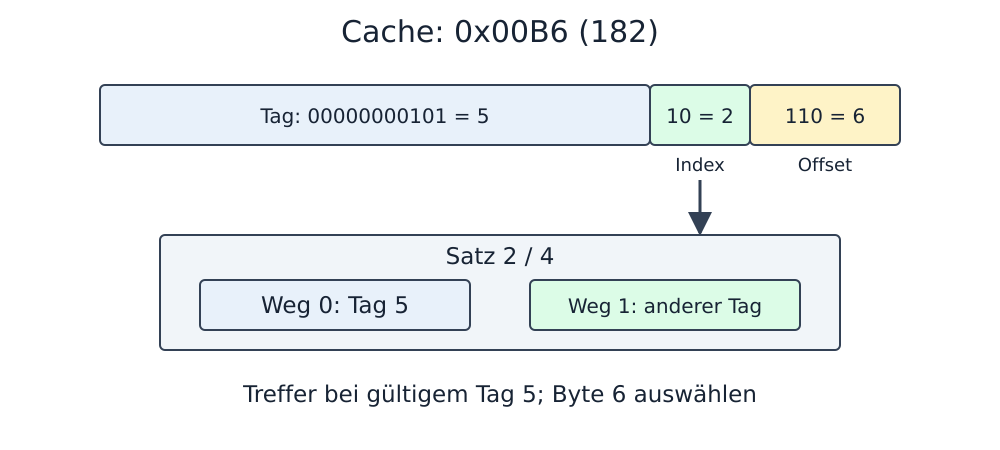

# M15-L3 – Cache-Organisation und Speicherlokalität {#L3}

**Kursbereich:** M15 – Rechnerarchitektur und Betriebssysteme

**Niveau:** Bachelor · Kern

**Vorwissen:** [M15-L2](M15-L2.md)

## Lernziele {#S1}

Tag, Index und Offset berechnen; räumliche und zeitliche Lokalität unterscheiden; Fehlzugriffe klassifizieren und Cache-Geometrien anhand einer Zugriffsspur vergleichen.

## Adresszerlegung und Lokalität {#S2}

Eine Speicherhierarchie kombiniert kleine schnelle und größere langsamere Speicher. Ein Cache kopiert ganze Blöcke aus der nächsttieferen Ebene. Zeitliche Lokalität bedeutet wiederholten Zugriff auf dieselben Daten, räumliche Lokalität Zugriff auf benachbarte Adressen. Beide sind Eigenschaften einer Zugriffsspur, keine Garantie für Treffer. Beispielsweise nutzt eine zeilenweise Iteration über ein dicht gespeichertes Array räumliche Lokalität besser als ein großer Schritt zwischen Elementen.

Für eine Datenkapazität $C$, Blockgröße $B$ und Assoziativität $W$ gibt es $S=C/(BW)$ Sätze. Bei Zweierpotenzen und $m$ Adressbits sind $b=\log_2 B$ Offsetbits, $s=\log_2 S$ Indexbits und $m-b-s$ Tagbits erforderlich. Der Block einer Byteadresse $a$ ist $q=\lfloor a/B\rfloor$, sein Satz $q\bmod S$, sein Tag $\lfloor q/S\rfloor$. Ein Treffer setzt einen gültigen Eintrag mit passendem Tag voraus; Offset wählt das Byte im Block. Metadaten zählen nicht zur angegebenen Datenkapazität.

Beispiel: 16-Bit-Adressen, 64 Byte Daten, 8 Byte je Block, zwei Wege: vier Sätze, 3 Offset-, 2 Index- und 11 Tagbits. Für 0x00B6 gilt $q=22$, Satz 2, Tag 5, Offset 6. Die Adresse rekonstruiert sich als $(5\cdot4+2)\cdot8+6=182$.

{alt="Adressfelder und Cache-Satz"}

## Abbildung, Fehlerklassen und Latenz {#S3}

Bei direkter Abbildung ($W=1$) konkurrieren alle Blöcke desselben Satzes um einen Platz. Ein vollassoziativer Cache ($S=1$) erlaubt jeden Block an jedem Platz. Bei mehreren Wegen muss eine Ersetzungsregel gewählt werden. LRU (Least Recently Used) ersetzt den am längsten nicht benutzten Eintrag; reale Hardware kann LRU approximieren.

Vergleiche bei 16 Byte Daten und 8 Byte Block die Spur 0, 4, 16, 0. Direkt abgebildet: Miss, Hit, Miss, Miss. Vollassoziativ mit zwei Wegen: Miss, Hit, Miss, Hit. Die ersten Zugriffe auf einen Block sind Kaltstartfehler. Im üblichen 3C-Modell mit leerem Start und gleich großem vollassoziativem LRU-Referenzcache gilt für weitere Misses: Referenzcache trifft → Konfliktmiss; Referenzcache verfehlt → Kapazitätsmiss. Diese Klassifikation hängt vom Referenzmodell ab und erfasst keine zusätzlichen Kohärenzfehler.

Einfaches Latenzmodell: $AMAT=t_h+p_m t_p$, wobei $t_p$ die zusätzliche Miss-Strafe ist. Bei 2 ns Trefferzeit, 5 % Missrate und 60 ns Zusatzstrafe beträgt AMAT 5 ns. Überlappende Speicherzugriffe oder mehrere Cacheebenen erfordern ein erweitertes Modell.

## Schreibstrategien und Zugriffsexperiment {#S4}

Bei Schreibzugriffen aktualisiert Write-through die tiefere Ebene sofort (gegebenenfalls über einen Puffer); Write-back hält geänderte Blöcke bis zur Rückschreibung und kennzeichnet sie mit einem Dirty-Bit. Write-allocate beziehungsweise No-write-allocate beschreibt unabhängig davon, ob bei einem Schreibmiss ein Block geladen wird. Mehr Kapazität oder größere Blöcke sind nicht automatisch schneller: Blocktransfer, Trefferzeit, Konflikte und Zugriffsmuster zählen.

Der Simulator behandelt nur Lesezugriffe auf einzelne Byteadressen und exaktes LRU pro Satz. Jeder Satz enthält Tags vom ältesten zum jüngsten Zugriff. Experiment: vergleiche `range(0, 64, 1)` mit `range(0, 64, 8)` bei gleicher Geometrie; die erste Spur nutzt jedes geladene Byte, die zweite nur eines pro Block. Beide haben acht erstmalig angeforderte Blöcke. Missraten unterscheiden sich (8/64 gegenüber 8/8).

## Ausführbares Modell {#S5}

```python
def cache_trace(addresses, block_size, sets, ways):
    if min(block_size, sets, ways) < 1:
        raise ValueError("invalid geometry")
    state = [[] for _ in range(sets)]
    hits = []
    for a in addresses:
        if a < 0:
            raise ValueError("negative address")
        block = a // block_size
        tag, index = divmod(block, sets)
        line = state[index]
        hit = tag in line
        if hit:
            line.remove(tag)
        elif len(line) == ways:
            line.pop(0)
        line.append(tag)
        hits.append(hit)
    return hits

assert cache_trace([0, 4, 16, 0], 8, 2, 1) == [False, True, False, False]
assert cache_trace([0, 4, 16, 0], 8, 1, 2) == [False, True, False, True]
```

## Selbstkontrolle {#S6}

### Aufgaben

1. Bestimme Satzanzahl und Adressfelder bei 32 Bit, 4 KiB Daten, 64 Byte Blöcken, vier Wegen.
2. Zerlege 0x00B6 im oben beschriebenen 16-Bit-Modell.
3. Klassifiziere den letzten Miss der Spur 0, 4, 16, 0 im direkt abgebildeten 16-Byte-Cache.
4. Berechne AMAT bei 1 ns Trefferzeit, 2 % Missrate und 100 ns Zusatzstrafe.
5. Was bedeutet ein gesetztes Dirty-Bit? Warum ist es kein Valid-Bit?

::: {.lc-solutions data-lc-section="S6"}
1. 16 Sätze, 6 Offset-, 4 Index-, 22 Tagbits.
2. Tag 5, Satz 2, Offset 6.
3. Konfliktmiss; der gleich große vollassoziative LRU-Cache trifft.
4. 3 ns.
5. Der gültige Block wurde geändert und muss vor Verdrängung gegebenenfalls zurückgeschrieben werden; Valid kennzeichnet, ob ein Eintrag überhaupt verwendbar ist.
:::

## Quellen {#S7}

- [MIT Computation Structures – The Memory Hierarchy](https://computationstructures.org/lectures/caches/caches.html) · locality, direct mapping, associativity, AMAT, write policy (Prüfumfang: Text) · Zuletzt abgerufen: 2026-11-24 · Inhaltlich geprüft: 2026-11-24
