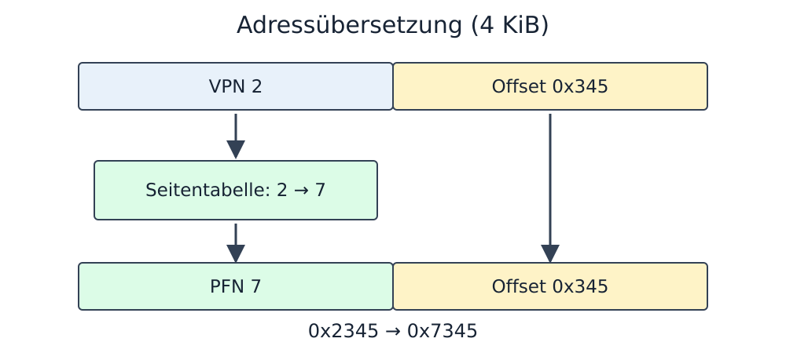

# M15-L4 – Virtueller Speicher und Seitenersetzung {#L4}

**Kursbereich:** M15 – Rechnerarchitektur und Betriebssysteme

**Niveau:** Bachelor · Kern/Wahlpflicht

**Vorwissen:** [M15-L3](M15-L3.md); [M8-L3](M8-L3.md)

## Lernziele {#S1}

Virtuelle Adressen übersetzen; Seitentabelle und TLB unterscheiden; FIFO und LRU simulieren und ihre Grenzen erläutern.

## Virtuelle Adressen und Seitentabellen {#S2}

Jeder Prozess besitzt einen virtuellen Adressraum. Paging zerlegt ihn in gleich große Seiten, den physischen Speicher in gleich große Rahmen. Für Seitengröße $P=2^p$ gilt $VPN=\lfloor a/P\rfloor$ und $o=a\bmod P$. Die Seitentabelle ordnet einer gültigen virtuellen Seite einen Rahmen PFN zu; die physische Adresse lautet $PFN\cdot P+o$. Die unteren $p$ Bits bleiben unverändert. Eine Seitentabelle enthält außerdem Zustands- und Schutzinformationen. Zwei Prozesse können gleiche virtuelle Adressen auf verschiedene Rahmen abbilden oder absichtlich Rahmen teilen.

Beispiel: $P=4096$ Byte, virtuelle Adresse 0x2345, VPN 2 und Offset 0x345. Ist Rahmen 7 zugeordnet und der Zugriff erlaubt, entsteht 0x7345. Bei 32-Bit-Adressen und 4 KiB Seiten bleiben 20 VPN-Bits. Eine flache Tabelle mit 4 Byte pro Eintrag würde 4 MiB belegen; mehrstufige Tabellen können ungenutzte Bereiche aussparen. Die letzte belegte Seite kann teilweise ungenutzt sein (interne Fragmentierung).

{alt="Virtuelle und physische Adresse"}

## TLB und Seitenfehler {#S3}

Ein TLB speichert kürzlich benutzte Übersetzungen, nicht die Nutzdaten. Ein TLB-Miss kann bei residenter Seite durch einen Seitentabellenzugriff behoben werden. Ist die Seite zulässig, aber nicht resident, kann das Betriebssystem sie bei einem Seitenfehler bereitstellen (z. B. aus einer Datei oder per Nullinitialisierung). Eine unzulässige Adresse oder fehlende Zugriffsberechtigung darf nicht durch bloßes Nachladen legitimiert werden. Die genaue Exception-Klassifikation ist architekturabhängig. Nach Änderungen an Seitentabellen müssen veraltete Übersetzungen ungültig werden.

Vereinfachtes serielles Zeitmodell ohne Seitenfehler: TLB-Suche 1 ns, ein Speicherzugriff 50 ns, TLB-Trefferrate 98 %. Treffer kostet 51 ns, Miss mit einem zusätzlichen Tabellenzugriff 101 ns. Erwartungswert 52 ns. Mehrstufige Tabellen, Parallelität und Page-Walk-Caches ändern dieses Modell.

## Seitenersetzung und Belady-Anomalie {#S4}

Bei Demand Paging werden Seiten bei Bedarf resident. Ist kein Rahmen frei, muss ein Opfer gewählt werden. FIFO ersetzt die zuerst geladene Seite; Treffer ändern die Reihenfolge nicht. LRU ersetzt die am längsten nicht referenzierte Seite; Treffer aktualisieren die Reihenfolge. Modifizierte Seiten benötigen unter Umständen Rückschreibung. OPT ersetzt eine Seite mit spätestem nächsten Zugriff (oder ohne weiteren Zugriff); dazu wäre Zukunftswissen nötig.

Für die Spur 1,2,3,4,1,2,5,1,2,3,4,5 ergibt FIFO mit drei Rahmen 9 und mit vier Rahmen 10 Fehler (Belady-Anomalie). LRU liefert 10 bzw. 8 Fehler. Bei LRU ist die Menge der $k$ zuletzt verschiedenen Seiten immer Teil der $k+1$ zuletzt verschiedenen Seiten. Daher können unter identischer Spur und leerem Start zusätzliche Rahmen die LRU-Fehlerzahl nicht erhöhen. Das gilt nicht allgemein für FIFO.

Der Simulator trennt Adressübersetzung (statische Tabelle, explizite Fehler) von Seitenersetzung (nur Seitennummern, leerer Start, alle Referenzen erlaubt). Er modelliert weder echte I/O-Kosten noch TLB-Kohärenz. Bei zu kleinem residentem Arbeitssatz können viele Fehler entstehen; Thrashing bezeichnet übermäßige Paging-Aktivität zulasten produktiver Arbeit.

## Ausführbare Modelle {#S5}

```python
def translate(address, page_size, table, write=False):
    if address < 0 or page_size < 1:
        raise ValueError("invalid address or size")
    vpn, offset = divmod(address, page_size)
    if vpn not in table:
        raise KeyError("unmapped page")
    frame, writable = table[vpn]
    if write and not writable:
        raise PermissionError("read only")
    if frame is None:
        raise LookupError("not resident")
    return frame * page_size + offset


def faults(pages, frames, policy):
    if frames < 1 or policy not in ("FIFO", "LRU"):
        raise ValueError("invalid policy or capacity")
    resident = []
    misses = 0
    for page in pages:
        if page in resident:
            if policy == "LRU":
                resident.remove(page)
                resident.append(page)
        else:
            misses += 1
            if len(resident) == frames:
                resident.pop(0)
            resident.append(page)
    return misses

assert translate(0x2345, 4096, {2: (7, True)}) == 0x7345
trace = [1,2,3,4,1,2,5,1,2,3,4,5]
assert faults(trace, 3, "FIFO") == 9
assert faults(trace, 4, "FIFO") == 10
assert faults(trace, 3, "LRU") == 10
assert faults(trace, 4, "LRU") == 8
```

## Selbstkontrolle {#S6}

### Aufgaben

1. Wie viele VPN- und Offsetbits hat eine 48-Bit-Adresse mit 4 KiB Seiten?
2. Übersetze 0x2345 auf Rahmen 7 bei 4096 Byte Seitengröße.
3. Bedeutet ein TLB-Miss zwangsläufig einen Seitenfehler?
4. Vergleiche FIFO und LRU für die gegebene Zwölferspur bei drei und vier Rahmen.
5. Warum kann LRU bei gleicher Spur durch mehr Rahmen nicht mehr Fehler erzeugen?

::: {.lc-solutions data-lc-section="S6"}
1. 36 VPN-, 12 Offsetbits.
2. 0x7345.
3. Nein; die Seite kann resident und die Übersetzung nur nicht im TLB sein.
4. FIFO 9/10; LRU 10/8.
5. Die Menge der zuletzt benutzten $k$ verschiedenen Seiten ist in der entsprechenden Menge für $k+1$ enthalten; jeder Treffer mit $k$ bleibt Treffer mit $k+1$.
:::

## Quellen {#S7}

- [UW–Madison CS 537 – Paging](https://pages.cs.wisc.edu/~bart/537/lecturenotes/s16.html) · page table, protection, fragmentation (Prüfumfang: Text) · Zuletzt abgerufen: 2026-11-24 · Inhaltlich geprüft: 2026-11-24
- [UW–Madison CS 537 – Translation Buffers](https://pages.cs.wisc.edu/~bart/537/lecturenotes/s17.html) · TLB, translation overhead (Prüfumfang: Text) · Zuletzt abgerufen: 2026-11-24 · Inhaltlich geprüft: 2026-11-24
- [UW–Madison CS 537 – Page Selection and Replacement](https://pages.cs.wisc.edu/~bart/537/lecturenotes/s19.html) · demand paging, FIFO, LRU (Prüfumfang: Text) · Zuletzt abgerufen: 2026-11-24 · Inhaltlich geprüft: 2026-11-24
