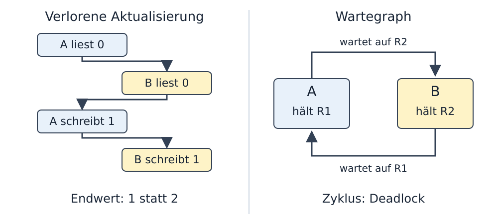

# M15-L5 – Nebenläufige Programme: Synchronisation und Deadlockanalyse {#L5}

**Kursbereich:** M15 – Rechnerarchitektur und Betriebssysteme

**Niveau:** Bachelor · Kern

**Vorwissen:** [M12-L1](M12-L1.md); [M8-L3](M8-L3.md)

## Lernziele {#S1}

Interleavings aufzählen; verlorene Aktualisierungen erklären; Semaphore und Mutex unterscheiden; einen begrenzten Puffer analysieren; Deadlocks durch Wartegraphen und Ressourcenordnung erkennen bzw. verhindern.

## Interleavings und kritische Abschnitte {#S2}

Nebenläufigkeit bedeutet, dass mehrere Aufgaben zeitlich überlappend Fortschritt machen können; Parallelität erfordert tatsächliche gleichzeitige Ausführung. In unserem Modell werden atomare Schritte zweier Threads in einer gemeinsamen Reihenfolge ausgeführt. Jeder Thread behält seine eigene Programmreihenfolge (sequentielle Konsistenz). Ein Ausdruck wie `x = x + 1` ist im abstrakten Modell in Lesen, Addieren und Schreiben zerlegt. Ausgehend von x = 0 können A und B beide 0 lesen, lokal 1 bilden und anschließend beide 1 schreiben. Eine Aktualisierung geht verloren. Bei serieller Ausführung entsteht 2. Es gibt genau $\binom{6}{3}=20$ zulässige Schrittfolgen; nur die zwei vollständig seriellen Folgen liefern 2. Eine Race Condition beschreibt die Abhängigkeit der Korrektheit vom Ablauf. Eine Data Race ist enger: nicht geordnete konfliktbehaftete Speicherzugriffe, mindestens einer schreibend (genaue Definition je nach Sprachspeichermodell).

Ein Mutex schützt einen kritischen Abschnitt, wenn alle beteiligten Zugriffe denselben Mutex verwenden. Die beiden Inkremente werden dadurch serialisiert, ohne dass andere unabhängige Aufgaben blockiert werden müssen. Ein Mutex hat normalerweise Besitzsemantik; ein zählender Semaphor verwaltet dagegen verfügbare Erlaubnisse. `wait` erwirbt atomar eine Erlaubnis oder blockiert, `signal` gibt eine zurück. Weder das bloße Verwenden von Locks noch ein bestandener Test garantiert allgemeine Thread-Sicherheit.

## Semaphore und begrenzter Puffer {#S3}

Ein Puffer mit Kapazität C beginnt mit `empty=C`, `full=0`, `mutex=1`. Der Produzent reserviert zuerst einen freien Platz (`wait(empty)`), erwirbt dann den Mutex, legt ein Element ein, löst den Mutex und meldet ein verfügbares Element (`signal(full)`). Der Konsument reserviert ein vorhandenes Element (`wait(full)`), erwirbt den Mutex, entnimmt das Element, löst den Mutex und meldet einen freien Platz (`signal(empty)`). Die Zähler zählen nicht notwendigerweise zu jedem Zeitpunkt die tatsächliche Belegung: reservierte oder noch nicht gemeldete Plätze und Elemente müssen berücksichtigt werden. Es gilt stets $0\le q\le C$ für die physische Belegung q. Jeder Platz folgt dem Zyklus frei → reserviert → belegt → zur Entnahme reserviert → frei (Meldungen können zeitversetzt erfolgen). Der Mutex verhindert gleichzeitige Änderungen der Puffermetadaten.

Bei Kapazität 1 kann ein Konsument am leeren Puffer warten. Hält er dabei schon den Mutex, kann der Produzent nichts einfügen: beide blockieren. Deshalb erfolgt die Ressourcenreservierung vor dem Mutex. Das Modell unten enthält einen Produzenten und einen Konsumenten, je n Operationen, atomare Semaphore und keine Ausnahmen. Es prüft alle erreichbaren Zustände, nicht nur einen zufälligen Thread-Ablauf. In realem Code sind Fehlerbehandlung, Abbruch und Freigabe mit `finally` bzw. RAII zusätzlich nötig. Bei Bedingungsvariablen muss die Bedingung nach dem Aufwachen unter dem Mutex erneut geprüft werden (Schleife, nicht bloß `if`).

## Wartegraph, Deadlock und Prävention {#S4}

Ein Deadlock liegt vor, wenn eine Menge von Aufgaben dauerhaft gegenseitig auf Freigaben wartet. Bei exklusiven, nicht entziehbaren Ressourcen sind die klassischen notwendigen Bedingungen: exklusiver Zugriff, Halten und Warten, fehlende Entziehbarkeit und zyklische Warteabhängigkeit. Ein konkreter Wartegraph für Einzelinstanz-Locks besitzt die Kante A→B genau dann, wenn A auf einen von B gehaltenen Lock blockiert. Ein gerichteter Zyklus bedeutet in diesem Modell Deadlock (blockierte Threads können ihre gehaltenen Locks nicht freigeben). Bei Ressourcen mit mehreren Instanzen genügt ein Zyklus im allgemeinen Ressourcenbelegungsgraphen nicht als Nachweis.

Beispiel: A hält R1 und wartet auf R2; B hält R2 und wartet auf R1. Wird jede Ressource in strikt aufsteigender globaler Ordnung erworben, müsste ein Wartezyklus eine streng wachsende Folge von Lock-Rängen enthalten, die zu ihrem Anfang zurückkehrt – ein Widerspruch. Die Prävention gilt für diese Lock-Abhängigkeiten, sofern alle beteiligten Threads die Ordnung einhalten. Sie verhindert nicht jede denkbare Blockierung (etwa durch Nachrichten oder Bedingungen). Starvation bedeutet, dass eine Aufgabe trotz Fortschritt anderer dauerhaft nicht zum Zug kommt. Livelock bedeutet fortgesetzte Aktivität ohne nützlichen Fortschritt. Deadlockfreiheit impliziert keine Fairness.

{alt="Verlorene Aktualisierung und zyklisches Warten"}

## Ausführbare Zustandsmodelle {#S5}

```python
from itertools import combinations


def increment_results(start, locked=False):
    # Each thread has read, add, write; preserve its local order.
    results = []
    for positions in combinations(range(6), 3):
        if locked and positions not in ((0, 1, 2), (3, 4, 5)):
            continue
        x = start
        pc, local = [0, 0], [0, 0]
        for k in range(6):
            t = 0 if k in positions else 1
            if pc[t] == 0:
                local[t] = x
            elif pc[t] == 1:
                local[t] += 1
            else:
                x = local[t]
            pc[t] += 1
        results.append(x)
    return results


def has_cycle(edges):
    nodes = set(edges) | {v for vs in edges.values() for v in vs}
    visiting, done = set(), set()
    def visit(u):
        if u in visiting:
            return True
        if u in done:
            return False
        visiting.add(u)
        for v in edges.get(u, ()):
            if visit(v):
                return True
        visiting.remove(u)
        done.add(u)
        return False
    return any(visit(u) for u in nodes)

assert sorted(set(increment_results(0))) == [1, 2]
assert increment_results(0, locked=True) == [2, 2]
assert has_cycle({"A": ["B"], "B": ["A"]})
assert not has_cycle({"A": ["B"], "B": ["C"]})
```

```python
def buffer_states(capacity, count, bad_order=False):
    if capacity < 1 or count < 0:
        raise ValueError("invalid bounds")
    # (producer PC, consumer PC, empty, full, mutex, occupancy)
    initial = (0, 0, capacity, 0, 1, 0)
    seen, todo, blocked = {initial}, [initial], []
    producer = ["empty-", "mutex-", "put", "mutex+", "full+"]
    consumer = ["full-", "mutex-", "get", "mutex+", "empty+"]
    if bad_order:
        producer[:2] = reversed(producer[:2])
        consumer[:2] = reversed(consumer[:2])
    while todo:
        state = todo.pop()
        assert 0 <= state[5] <= capacity
        assert all(x >= 0 for x in state[2:5])
        assert state[4] <= 1
        moves = []
        for t, program in enumerate((producer, consumer)):
            if state[t] == 5 * count:
                continue
            op = program[state[t] % 5]
            nxt = list(state)
            if op in ("put", "get"):
                assert state[4] == 0
                nxt[5] += 1 if op == "put" else -1
            else:
                i = {"empty": 2, "full": 3, "mutex": 4}[op[:-1]]
                if op[-1] == "-" and state[i] == 0:
                    continue
                nxt[i] += 1 if op[-1] == "+" else -1
            nxt[t] += 1
            moves.append(tuple(nxt))
        if not moves and state[:2] != (5 * count, 5 * count):
            blocked.append(state)
        for nxt in moves:
            if nxt not in seen:
                seen.add(nxt)
                todo.append(nxt)
    return seen, blocked

assert not buffer_states(2, 3)[1]
assert buffer_states(1, 1, bad_order=True)[1]
```

Die Graphensuche verwendet Rekursion; für große Graphen ist eine iterative Variante vorzuziehen. Das endliche Puffermodell prüft Sicherheitsbedingungen und blockierte Endzustände, aber keine unbeschränkte Fairness oder schwächere Hardware-Speichermodelle.

## Selbstkontrolle {#S6}

### Aufgaben

1. Wie viele Interleavings gibt es für zwei Inkremente mit je drei atomaren Schritten? Welche Endwerte sind möglich?
2. Erkläre, warum ein Mutex nur dann den gemeinsamen Zähler schützt, wenn alle beteiligten Zugriffe dieselbe Synchronisation nutzen.
3. Gib die Startwerte der drei Semaphore für einen Puffer mit Kapazität 4 an. Warum wird zuerst `empty` bzw. `full` reserviert?
4. Der Wartegraph enthält A→B, B→C und C→A. Was folgt im Einzelinstanz-Lockmodell? Was ändert sich nach Entfernen von C→A?
5. Begründe, warum eine strikte globale Lock-Ordnung zyklisches Warten ausschließt. Garantiert sie Fairness?

::: {.lc-solutions data-lc-section="S6"}
1. 20; Endwerte 1 und 2. Nur die beiden seriellen Folgen liefern 2.
2. Sonst kann ein ungeschützter Zugriff zwischen Lesen und Schreiben stattfinden; der Lock schließt nur kooperierende Teilnehmer aus.
3. `empty=4`, `full=0`, `mutex=1`; ein blockierter Reservierungsversuch darf den Mutex nicht halten, den die andere Seite zum Erzeugen der Ressource benötigt.
4. Der Zyklus zeigt einen Deadlock. Ohne C→A ist dieser Graph azyklisch; andere nicht modellierte Abhängigkeiten sind damit nicht ausgeschlossen.
5. Ein Zyklus würde strikt steigende Ränge bis zum Ausgangsrang verlangen. Nein, Wartezeit und Scheduling-Fairness sind nicht garantiert.
:::

## Quellen {#S7}

- [UW–Madison CS 537 – Semaphores and Producer/Consumer Problem](https://pages.cs.wisc.edu/~bart/537/lecturenotes/s6.html) · atomic semaphore operations, bounded buffer, acquisition order (Prüfumfang: Text) · Zuletzt abgerufen: 2026-11-24 · Inhaltlich geprüft: 2026-11-24
- [UW–Madison CS 537 – Deadlock](https://pages.cs.wisc.edu/~bart/537/lecturenotes/s12.html) · resource dependencies, deadlock prevention, resource ordering (Prüfumfang: Text) · Zuletzt abgerufen: 2026-11-24 · Inhaltlich geprüft: 2026-11-24
- [Cornell – Harmony book](https://harmony.cs.cornell.edu/book/) · condition variables, Chapter 15 deadlock, glossary (Prüfumfang: Text) · Zuletzt abgerufen: 2026-11-24 · Inhaltlich geprüft: 2026-11-24
