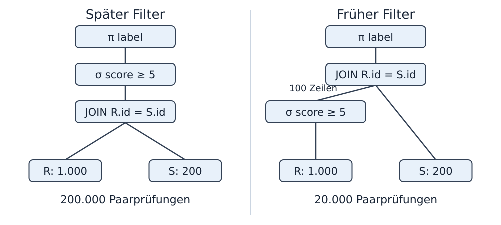

# M16-L1 – Relationale Algebra und Anfrageoptimierung {#L1}

**Kursbereich:** M16 – Datenbanken und mathematische Informatik

**Niveau:** Bachelor · Kern/Wahlpflicht

**Vorwissen:** [M10-L2](M10-L2.md)

## Lernziele {#S1}

Relationen als Mengen modellieren; Selektion, Projektion und Verbund kombinieren; SQL-Multimengen und NULL-Werte von klassischer Algebra unterscheiden; Selektionsverschiebungen beweisen; Kosten zweier Pläne abschätzen und ungültige Umformungen erkennen.

## Relationen, Operatoren und SQL {#S2}

Eine Relation über einem Schema ist in der klassischen relationalen Algebra eine endliche Menge von Tupeln. Die Selektion $\sigma_p(R)$ lässt genau diejenigen Tupel passieren, die das Prädikat $p$ erfüllen. Die Projektion $\pi_A(R)$ beschränkt jedes Tupel auf die Attribute in $A$ und entfernt Dubletten. Das kartesische Produkt kombiniert alle Tupelpaare; ein Theta-Verbund $R\bowtie_q S=\sigma_q(R\times S)$ filtert diese Paare. Bei gleichnamigen Attributen werden die Spalten durch Relationsnamen oder Umbenennung unterschieden. Vereinigung und Differenz setzen kompatible Schemata voraus.

SQL verwendet standardmäßig Multimengen: `SELECT label` kann denselben Wert mehrmals liefern, `SELECT DISTINCT label` beseitigt diese Wiederholungen. SQL-NULL ist kein gewöhnlicher Wert der klassischen Algebra. Der Vergleich `NULL = NULL` ergibt UNKNOWN; sowohl im WHERE-Filter als auch bei einem inneren JOIN mit ON werden nur TRUE-Ergebnisse berücksichtigt. Für die Suche nach fehlenden Werten dient `IS NULL`. Ohne ORDER BY ist keine Zeilenreihenfolge garantiert.

Beispiel: R(id,score) enthält (1,8), (2,3), (3,7); S(id,label) enthält (1,A), (3,B). Gesucht sind die Labels der Datensätze mit score ≥ 5. Die Algebra lautet $\pi_{label}(\sigma_{score\geq5}(R\bowtie_{R.id=S.id}S))$. Das Ergebnis ist {A,B}. In der späteren Simulation enthält R zusätzlich ein Duplikat von (3,7) und eine Zeile mit NULL-Schlüssel. SQL liefert dann A einmal und B zweimal; DISTINCT liefert wieder A und B.

## Äquivalente Anfragepläne {#S3}

Für einen inneren Verbund und ein deterministisches, nebenwirkungsfreies Prädikat p, das ausschließlich Attribute von R verwendet, gilt:

$$\sigma_p(R\bowtie_q S)=\sigma_p(R)\bowtie_q S.$$

Beweis: Ein Paar (r,s) erfüllt die linke Seite genau dann, wenn r aus R und s aus S stammen, q(r,s) wahr ist und p(r) wahr ist. Dieselben Bedingungen definieren die rechte Seite. In SQL-Multimengen bleibt zusätzlich die Anzahl jedes passenden Paares gleich, solange keine Duplikate entfernt werden. Auch die TRUE-Bedingung für NULL-fähige, nebenwirkungsfreie Prädikate bleibt beim inneren Verbund erhalten. Eine frühe Projektion muss alle später benötigten Verbund-, Filter- und Ausgabeattribute behalten; SQL-DISTINCT darf nicht stillschweigend eingeführt werden.

Bei äußeren Verbunden gilt die Regel nicht allgemein. R enthält id=1, S enthält (id=1, score=3). Die Anfrage `R LEFT JOIN S ON R.id=S.id WHERE S.score>=5` liefert keine Zeile. Wird dagegen S vor dem LEFT JOIN nach score gefiltert und der äußere WHERE-Filter entfernt, entsteht (1,NULL,NULL), denn R bleibt erhalten. Das ist eine andere Anfrage. Nicht jede syntaktisch mögliche Verschiebung bewahrt Semantik.

## Kostenmodell und Grenzen {#S4}

Betrachte 1.000 R-Zeilen und 200 S-Zeilen. Ein Filter lässt 100 R-Zeilen übrig (Selektivität 0,1). Ein einfacher Nested-Loop-Join ohne Index prüft im ersten Plan 200.000 Paare, nach frühem Filtern nur 20.000. Dazu kommen in beiden Varianten die Kosten des Scans und der Prädikatsauswertung; die zehnfache Verringerung der Paarprüfungen ist keine gemessene Laufzeitbeschleunigung. Ein Hash-Join für Gleichheit kann unter geeigneten Hash- und Speicherannahmen im Erwartungswert mit etwa linearer Arbeit in den Eingabegrößen plus Ausgabe auskommen. Bei großen Ausgaben, Speicherknappheit oder Schieflage können die Kosten stark steigen.

Eine grobe Kardinalitätsschätzung für einen Gleichheitsverbund ist $|R||S|/\max(V_R,V_S)$, mit $V$ als Anzahl verschiedener Schlüsselwerte (positive Anzahlen). Sie setzt hier insbesondere uniforme Verteilungen, geeignete Überdeckung der Schlüsselbereiche und keine NULL-Werte voraus. Sind Schlüssel disjunkt, ist das Ergebnis tatsächlich leer; häufige Schlüssel können große Abweichungen erzeugen. Reale Optimierer kombinieren Statistiken, physische Zugriffspfade, Join-Reihenfolgen und Kostenmodelle. EXPLAIN zeigt einen gewählten Plan, nicht automatisch seine Optimalität.

{alt="Zwei äquivalente Anfragebäume mit frühem und spätem Filter"}

## Ausführbares Modell {#S5}

Die folgende Python-Simulation vergleicht eine explizite Multimengen-Auswertung mit SQLite. Beide Varianten verwenden dieselben Eingaben; Counter vergleicht Zeilenhäufigkeiten unabhängig von der Ausgabeordnung. Das Modell betrachtet ausschließlich deterministische Gleichheitsverbunde und einen numerischen Filter. SQLite dient als ausführbare Referenz, nicht als Nachweis für PostgreSQL-Ausführungspläne.

```python
from collections import Counter
import sqlite3


def evaluate(r, s, push=False):
    # r: (id, score), s: (id, label); None models SQL NULL.
    selected = [a for a in r if a[1] is not None and a[1] >= 5]
    left = selected if push else r
    result = Counter()
    for key, score in left:
        for other, label in s:
            if key is not None and other is not None and key == other:
                if score is not None and score >= 5:
                    result[label] += 1
    return result


def sql_result(r, s, push=False, distinct=False):
    with sqlite3.connect(":memory:") as db:
        db.execute("CREATE TABLE r (id INTEGER, score INTEGER)")
        db.execute("CREATE TABLE s (id INTEGER, label TEXT)")
        db.executemany("INSERT INTO r VALUES (?, ?)", r)
        db.executemany("INSERT INTO s VALUES (?, ?)", s)
        q = ("SELECT " + ("DISTINCT " if distinct else "") + "s.label ")
        if push:
            q += "FROM (SELECT * FROM r WHERE score >= 5) AS r "
            q += "JOIN s ON r.id = s.id"
        else:
            q += "FROM r JOIN s ON r.id = s.id WHERE r.score >= 5"
        return Counter(row[0] for row in db.execute(q))

r = [(1, 8), (2, 3), (3, 7), (3, 7), (None, 9)]
s = [(1, "A"), (3, "B"), (None, "C")]
assert evaluate(r, s) == evaluate(r, s, True) == Counter(A=1, B=2)
assert sql_result(r, s) == evaluate(r, s)
assert sql_result(r, s, True, True) == Counter(A=1, B=1)
```

## Selbstkontrolle {#S6}

### Aufgaben

1. R enthält (1,8), (2,3), (3,7). Gib die Selektion für score ≥ 5 an. S enthält (1,A), (3,B). Welche Labels liefert der Verbund?
2. R enthält zusätzlich (3,7). Wie unterscheiden sich `SELECT label` und `SELECT DISTINCT label`?
3. Beweise die Selektionsverschiebung für ein Prädikat, das nur R-Attribute verwendet. Warum ist eine frühe Projektion auf score allein problematisch?
4. Ein Nested-Loop-Join hat 2.400 und 500 Zeilen. Ein Filter reduziert R auf ein Viertel. Wie viele Paarprüfungen fallen vorher und nachher an?
5. Erkläre das LEFT-JOIN-Gegenbeispiel und warum ein Gleichheitsverbund zweier NULL-Schlüssel im inneren SQL-Join kein Paar liefert.

::: {.lc-solutions data-lc-section="S6"}
1. {(1,8),(3,7)}; Labels {A,B}.
2. Ohne DISTINCT A einmal und B zweimal, mit DISTINCT je einmal. Keine garantierte Reihenfolge.
3. Beide Seiten verlangen q(r,s) und p(r) für dasselbe Tupelpaar. Die Projektion darf id nicht entfernen, weil der Verbund id benötigt.
4. 1.200.000 vorher; 600 × 500 = 300.000 nachher. Andere Kosten sind nicht eingerechnet.
5. Beim vorgefilterten S bleibt die R-Zeile durch NULL-Ergänzung erhalten. Im ursprünglichen Plan verwirft WHERE den Wert 3. NULL = NULL ist UNKNOWN, nicht TRUE.
:::

## Quellen {#S7}

- [UC Berkeley CS 186 – Query Optimization](https://cs186berkeley.net/notes/note10/) · operator trees; selectivity estimation; pushdown heuristics (Prüfumfang: Text) · Zuletzt abgerufen: 2026-11-24 · Inhaltlich geprüft: 2026-11-24
- [PostgreSQL 17 – SELECT](https://www.postgresql.org/docs/17/sql-select.html) · SELECT ALL/DISTINCT; ordering; logical processing (Prüfumfang: Text) · Zuletzt abgerufen: 2026-11-24 · Inhaltlich geprüft: 2026-11-24
- [PostgreSQL 17 – Table Expressions](https://www.postgresql.org/docs/17/queries-table-expressions.html) · inner and outer joins; WHERE and ON (Prüfumfang: Text) · Zuletzt abgerufen: 2026-11-24 · Inhaltlich geprüft: 2026-11-24
