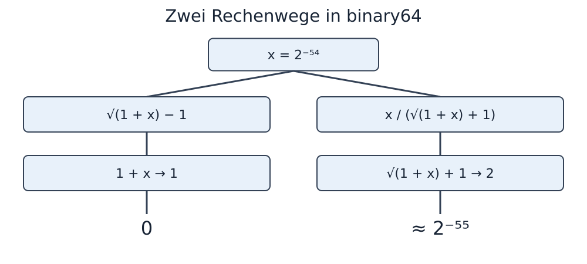

# M16-L2 – Numerisches Rechnen: Gleitkomma, Fehler und Kondition {#L2}

**Kursbereich:** M16 – Datenbanken und mathematische Informatik

**Niveau:** Bachelor · Kern/Brücke

**Vorwissen:** [M12-L1](M12-L1.md)

## Lernziele {#S1}

Binäre Gleitkommazahlen interpretieren, absolute und relative Fehler berechnen, Auslöschung erkennen, Kondition eines Problems von der Stabilität seiner Implementierung unterscheiden und eine numerisch günstigere Formel gegen eine unabhängige Referenz prüfen.

## Darstellung und Rundung {#S2}

IEEE-754 binary64 besitzt ein Vorzeichenbit, elf Exponentenbits und 52 gespeicherte Bruchbits. Bei normalen Zahlen kommt eine implizite führende Eins hinzu: 53 signifikante Binärstellen. Die Zahl $0{,}625=5/8$ ist exakt binär darstellbar, $1/10$ dagegen nicht: Eine vollständig gekürzte rationale Zahl hat genau dann eine endliche Binärdarstellung, wenn ihr Nenner eine Zweierpotenz ist. Beweis: Jede endliche Binärbruchzahl ist eine ganze Zahl geteilt durch eine Zweierpotenz; umgekehrt kann ein solcher Bruch in Basis zwei geschrieben werden. Der endliche Exponenten- und Präzisionsbereich schränkt die tatsächliche Darstellbarkeit zusätzlich ein.

Bei Rundung zur nächsten Zahl (bei Gleichstand zur geraden letzten Stelle) beträgt der Abstand von 1 zur nächstgrößeren binary64-Zahl $2^{-52}$. Die Rundungseinheit ist $u=2^{-53}$. Für eine korrekt gerundete elementare Operation mit normalem endlichem Ergebnis gilt im üblichen Modell $\operatorname{fl}(z)=z(1+\delta)$ mit $|\delta|\le u$. Bei Unterlauf in den subnormalen Bereich ist diese relative Schranke nicht allgemein gültig; Überlauf, Unendlich und NaN benötigen gesonderte Behandlung. Rundung ist nicht dasselbe wie Dezimalformatierung. Python verwendet auf üblichen Plattformen binary64; das folgende Experiment setzt dieses Format voraus.

## Fehler und Kondition {#S3}

Für einen exakten Wert y und eine Näherung $\hat y$ sind $|\hat y-y|$ und, bei $y\ne0$, $|\hat y-y|/|y|$ der absolute und relative Vorwärtsfehler. Der Rückwärtsfehler fragt dagegen nach einer kleinen Änderung der Eingabedaten, für die das berechnete Ergebnis exakt wäre. Bei $f(x)=x^2$, $x=3$ und $\hat y=9{,}06$ beträgt der relative Vorwärtsfehler $0{,}06/9=1/150$. Eine passende gestörte Eingabe ist $\sqrt{9{,}06}$; ihr relativer Abstand zu 3 ist ungefähr 0,00333.

Für eine differenzierbare skalare Funktion mit $x\ne0$ und $f(x)\ne0$ ist die lokale relative Konditionszahl $\kappa_f(x)=|xf'(x)/f(x)|$. Aus $f(x+\Delta x)-f(x)=f'(x)\Delta x+o(\Delta x)$ folgt durch Division durch $f(x)$ und $\Delta x/x$ die Formel im Grenzwert. Bei $f(x)=x-1$ und $x=1{,}001$ ist $\kappa=1001$: Kleine relative Eingabefehler können stark verstärkt werden. Das ist eine Eigenschaft des Problems, nicht der Programmiersprache. Rückwärtsstabilität bedeutet, dass das Verfahren ein exaktes Ergebnis für hinreichend nahe Daten liefert; sie garantiert bei schlechter Kondition keinen kleinen Vorwärtsfehler.

## Auslöschung und stabilere Umformung {#S4}

Für $x>0$ untersuchen wir $f(x)=\sqrt{1+x}-1$. Multiplikation mit dem konjugierten Ausdruck liefert exakt $f(x)=x/(\sqrt{1+x}+1)$. Die lokale Konditionszahl ist $(\sqrt{1+x}+1)/(2\sqrt{1+x})$, also zwischen 1/2 und 1. Herleitung: $f'(x)=1/(2\sqrt{1+x})$; Einsetzen der rationalisierten Form ergibt die Behauptung. Das Problem ist in diesem Bereich gut konditioniert, obwohl die direkte Auswertung bei kleinen x ungenau wird.

Bei $x=2^{-54}$ rundet die Summe $1+x$ auf 1, sodass die direkte Rechnung null ergibt. Die umgeformte Variante liefert ungefähr $2^{-55}$; der tatsächliche Wert ist positiv und etwas kleiner. Die Subtraktion selbst kann exakt sein, während die vorherigen Rundungsfehler durch die Bildung der kleinen Differenz sichtbar werden. Der alternative Ausdruck vermeidet hier diese Auslöschung, ist aber kein universeller Stabilitätsnachweis für alle Eingabebereiche.

{alt="Zwei Rechenwege für x gleich zwei hoch minus 54; direkt null, rationalisiert ungefähr zwei hoch minus 55"}

## Ausführbarer Vergleich {#S5}

Der Dezimalwert wird aus der tatsächlich gespeicherten Float-Eingabe erzeugt, nicht aus ihrer gerundeten Anzeige. Die Referenz arbeitet mit 100 Dezimalstellen und verwendet ebenfalls die rationalisierte Identität. Für den getesteten Bereich ist die Referenz deutlich genauer als binary64, aber keine symbolisch exakte Quadratwurzel.

```python
import math
from decimal import Decimal, localcontext


def direct(x):
    return math.sqrt(1.0 + x) - 1.0


def rationalized(x):
    return x / (math.sqrt(1.0 + x) + 1.0)


def reference(x):
    with localcontext() as ctx:
        ctx.prec = 100
        d = Decimal.from_float(x)
        return d / ((1 + d).sqrt() + 1)


def relative_error(y, ref):
    return abs((Decimal.from_float(y) - ref) / ref)

x = 2.0 ** -54
assert direct(x) == 0.0
assert rationalized(x) == 2.0 ** -55
assert relative_error(rationalized(x), reference(x)) < Decimal('1e-15')
for k in (10, 30, 54, 70):
    x = 2.0 ** -k
    ref = reference(x)
    print(k, relative_error(direct(x), ref),
          relative_error(rationalized(x), ref))
```

Prüfe bei numerischen Programmen Eingabebereich, Referenzgenauigkeit, Fehlermaß und Grenzfälle getrennt. Ein exakt verschwindender Referenzwert erfordert ein absolutes statt relatives Fehlermaß. Für allgemeine Vergleiche sind fachlich begründete absolute und relative Toleranzen sinnvoller als eine pauschale Gleichheitsprüfung.

## Selbstkontrolle {#S6}

### Aufgaben

1. Welche der Brüche 3/16 und 3/20 besitzen eine endliche Binärdarstellung? Begründe.
2. Ein exaktes Ergebnis beträgt 200, die Näherung 199,8. Bestimme absoluten und relativen Fehler.
3. Berechne die relative Konditionszahl von $f(x)=x^3$ bei $x\ne0$.
4. Leite die rationalisierte Formel für $\sqrt{1+x}-1$ her und erkläre die Nullausgabe für $x=2^{-54}$.
5. Kann ein rückwärtsstabiles Verfahren bei einem schlecht konditionierten Problem große Vorwärtsfehler liefern? Erkläre und nenne eine Grenze der Rundungsschranke.

::: {.lc-solutions data-lc-section="S6"}
1. 3/16 ja; 3/20 nein, da der gekürzte Nenner einen Faktor 5 enthält.
2. 0,2 bzw. 0,001 = 0,1 %.
3. $|x\cdot3x^2/x^3|=3$.
4. Zähler und Nenner mit $\sqrt{1+x}+1$ multiplizieren; der Zähler wird x. Bei binary64 ist $2^{-54}$ kleiner als der halbe Abstand zur nächstgrößeren Zahl bei 1, weshalb $1+x$ auf 1 gerundet wird.
5. Ja: Kleine Datenänderungen können bei großer Konditionszahl große Ergebnisänderungen verursachen. Beispielsweise gilt die relative Rundungsschranke bei subnormalen Ergebnissen nicht allgemein.
:::

## Quellen {#S7}

- [Python 3.12 – Floating-Point Arithmetic](https://docs.python.org/3.12/tutorial/floatingpoint.html) · binary representation; rounding; representation error (Prüfumfang: Text) · Zuletzt abgerufen: 2026-11-24 · Inhaltlich geprüft: 2026-11-24
- [Driscoll & Braun – Fundamentals of Numerical Computation: Problems and conditioning](https://tobydriscoll.net/fnc-julia/intro/conditioning.html) · relative condition number; error amplification (Prüfumfang: Text) · Zuletzt abgerufen: 2026-11-24 · Inhaltlich geprüft: 2026-11-24
- [Driscoll & Braun – Fundamentals of Numerical Computation: Stability](https://tobydriscoll.net/fnc-julia/intro/stability.html) · cancellation; forward and backward error (Prüfumfang: Text) · Zuletzt abgerufen: 2026-11-24 · Inhaltlich geprüft: 2026-11-24
