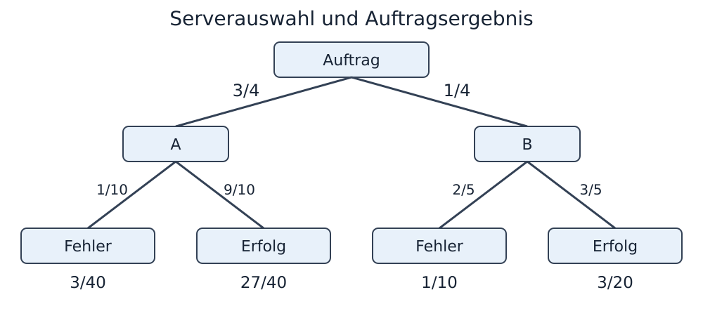

# M16-L3 – Diskrete Wahrscheinlichkeit für Algorithmen und Systeme {#L3}

**Kursbereich:** M16 – Datenbanken und mathematische Informatik

**Niveau:** Bachelor · Kern/Brücke

**Vorwissen:** [M8-L1](M8-L1.md), [M9-L2](M9-L2.md)

## Lernziele {#S1}

Endliche Wahrscheinlichkeitsräume modellieren, bedingte Wahrscheinlichkeit und Erwartungswert berechnen, Unabhängigkeit von paarweiser Unabhängigkeit unterscheiden und erwartete Kosten zufälliger Algorithmen mit Indikatorvariablen herleiten.

## Ereignisse und bedingte Wahrscheinlichkeit {#S2}

Ein endlicher Wahrscheinlichkeitsraum besteht aus einer Ergebnismenge $\Omega$ mit Gewichten $p(\omega)\ge0$, deren Summe 1 ist. Ein Ereignis A ist eine Teilmenge; $P(A)=\sum_{\omega\in A}p(\omega)$. Gleichwahrscheinlichkeit ist eine zusätzliche Annahme, keine allgemeine Eigenschaft. Für $P(B)>0$ gilt $P(A\mid B)=P(A\cap B)/P(B)$. Unabhängigkeit bedeutet $P(A\cap B)=P(A)P(B)$; zwei sich ausschließende Ereignisse positiver Wahrscheinlichkeit sind folglich nicht unabhängig.

Ein Dienst wählt mit Wahrscheinlichkeit 3/4 Server A, sonst B. Auf A scheitert ein Auftrag mit Wahrscheinlichkeit 1/10, auf B mit 2/5. Nach dem Satz der totalen Wahrscheinlichkeit ist die Fehlerwahrscheinlichkeit $3/4\cdot1/10+1/4\cdot2/5=7/40$. Ist ein Fehler beobachtet worden, ergibt Bayes $P(B\mid Fehler)=(1/10)/(7/40)=4/7$. Das Ergebnis ist keine Aussage über einen realen Dienst; die Parameter sind Modellannahmen.

{alt="Server A mit 3/4, B mit 1/4; Fehlerpfade mit Gewichten 3/40 und 1/10"}

## Erwartungswert und Indikatoren {#S3}

Für eine Zufallsvariable X auf einem endlichen Raum gilt $E[X]=\sum_\omega X(\omega)p(\omega)$. Die Linearität $E[X+Y]=E[X]+E[Y]$ folgt aus der Distributivität in dieser Summe; Unabhängigkeit ist nicht erforderlich. Die Indikatorvariable $I_A$ nimmt auf A den Wert 1 an, sonst 0. Damit ist $E[I_A]=P(A)$. Für die Varianz gilt dagegen $\operatorname{Var}(X+Y)=\operatorname{Var}(X)+\operatorname{Var}(Y)+2\operatorname{Cov}(X,Y)$, wobei $\operatorname{Cov}(X,Y)=E[XY]-E[X]E[Y]$. Unabhängigkeit ist hinreichend für verschwindende Kovarianz.

Paarweise Unabhängigkeit impliziert keine gemeinsame Unabhängigkeit: Für unabhängige faire Bits U und V setze $W=U\mathbin{\mathrm{XOR}}V$. Jedes Paar ist gleichverteilt auf vier Bitpaaren. Trotzdem gilt $P(U=0,V=0,W=0)=1/4$ statt $1/8$.

## Zufällige Zuordnung und Kosten {#S4}

Ein vereinfachtes Hashing-Modell ordnet n verschiedene Schlüssel unabhängig und gleichverteilt m Behältern zu ($m\ge1$). Für jedes ungeordnete Schlüsselpaar i,j sei $I_{ij}=1$, falls beide denselben Behälter erhalten. Es gilt $P(I_{ij}=1)=1/m$: Von den $m^2$ möglichen Zuordnungen der beiden Schlüssel sind m gleich. Die Gesamtzahl kollidierender Paare ist $C=\sum_{i<j}I_{ij}$. Damit folgt ohne Unabhängigkeit der Indikatoren untereinander:

$$E[C]=\frac{n(n-1)}{2m}.$$

Bei n=4 und m=3 ist der Erwartungswert 2, obwohl einzelne Zuordnungen 1 bis 6 kollidierende Paare haben können. Eine Belegung (3,1,0) erzeugt drei kollidierende Paare. Ein Verfahren, das jedes kollidierende Paar einmal vergleicht, hat folglich erwartete Vergleichskosten $E[C]$; die gesamte Laufzeit enthält weitere Arbeit. Bei realen Hashfunktionen muss das Zufallsmodell begründet werden. Erwartete Kosten sind keine Worst-Case-Garantie: Alle n Schlüssel können im selben Behälter landen.

## Ausführbare exakte Kontrolle {#S5}

Die Simulation zählt alle $m^n$ Zuordnungen auf und verwendet Bruchrechnung. Sie ist absichtlich nur für kleine Fälle geeignet. Die Formel benötigt dagegen eine konstante Zahl arithmetischer Operationen (nicht notwendigerweise konstante Bitkomplexität).

```python
from itertools import product
from collections import Counter
from fractions import Fraction


def expected_pairs(n, m):
    if n < 0 or m < 1:
        raise ValueError('invalid dimensions')
    return Fraction(n * (n - 1), 2 * m)


def exact_pairs(n, m):
    if n < 0 or m < 1:
        raise ValueError('invalid dimensions')
    total = 0
    for assignment in product(range(m), repeat=n):
        counts = Counter(assignment)
        total += sum(k * (k - 1) // 2 for k in counts.values())
    return Fraction(total, m ** n)

assert exact_pairs(4, 3) == expected_pairs(4, 3) == 2
assert exact_pairs(0, 3) == 0
assert exact_pairs(4, 1) == 6
```

Ein weiteres Kostenmodell: Unabhängige Wiederholungen eines Versuchs mit konstanter Erfolgswahrscheinlichkeit $0<p\le1$ benötigen bis zum ersten Erfolg geometrisch verteilte Versuche T. Weil $P(T>k)=(1-p)^k$, ergibt die Summierung der Überlebenswahrscheinlichkeiten $E[T]=\sum_{k\ge0}P(T>k)=1/p$. Die Summenidentität folgt aus $t=\sum_{k=0}^{t-1}1$ und dem Vertauschen nichtnegativer Summen. Bei p=1/4 sind es im Mittel vier Versuche, aber nach vier Versuchen beträgt die Misserfolgswahrscheinlichkeit noch $(3/4)^4=81/256$. Abhängige Wiederholungen oder veränderliches p erfordern ein anderes Modell.

## Selbstkontrolle {#S6}

### Aufgaben

1. Berechne im Servermodell die Wahrscheinlichkeit für einen erfolgreichen Auftrag und für Server A unter der Bedingung eines Fehlers.
2. Beweise die Linearität des Erwartungswerts für zwei Zufallsvariablen auf einem endlichen Raum.
3. Warum sind U,V,W aus dem XOR-Beispiel nicht gemeinsam unabhängig?
4. Berechne die erwartete Zahl kollidierender Paare bei 10 Schlüsseln und 5 Behältern. Wie groß kann C maximal werden?
5. Ein Versuch ist unabhängig mit p=1/5 erfolgreich. Bestimme die erwartete Versuchszahl und die Wahrscheinlichkeit, nach drei Versuchen noch keinen Erfolg erzielt zu haben.

::: {.lc-solutions data-lc-section="S6"}
1. $33/40$ und $(3/40)/(7/40)=3/7$.
2. In der endlichen gewichteten Summe kann $(X(\omega)+Y(\omega))p(\omega)$ distributiv zerlegt werden.
3. Das Tripel (0,0,0) hat Wahrscheinlichkeit 1/4, nicht das Produkt 1/8 der Randwahrscheinlichkeiten.
4. $45/5=9$; maximal 45, wenn alle Schlüssel im selben Behälter liegen.
5. 5 Versuche; $(4/5)^3=64/125$.
:::

## Quellen {#S7}

- [Introduction to Probability – Conditioning and Independence](https://www.probabilitycourse.com/chapter5/5_1_3_conditioning_independence.php) · conditional distributions; independence; total probability and expectation (Prüfumfang: Text) · Zuletzt abgerufen: 2026-11-24 · Inhaltlich geprüft: 2026-11-24
- [Cornell CS 2800 – Probabilistic counting](https://www.cs.cornell.edu/courses/cs2800/2017sp/lectures/lec19-counting.html) · indicator variables and linearity of expectation (Prüfumfang: Text) · Zuletzt abgerufen: 2026-11-24 · Inhaltlich geprüft: 2026-11-24
