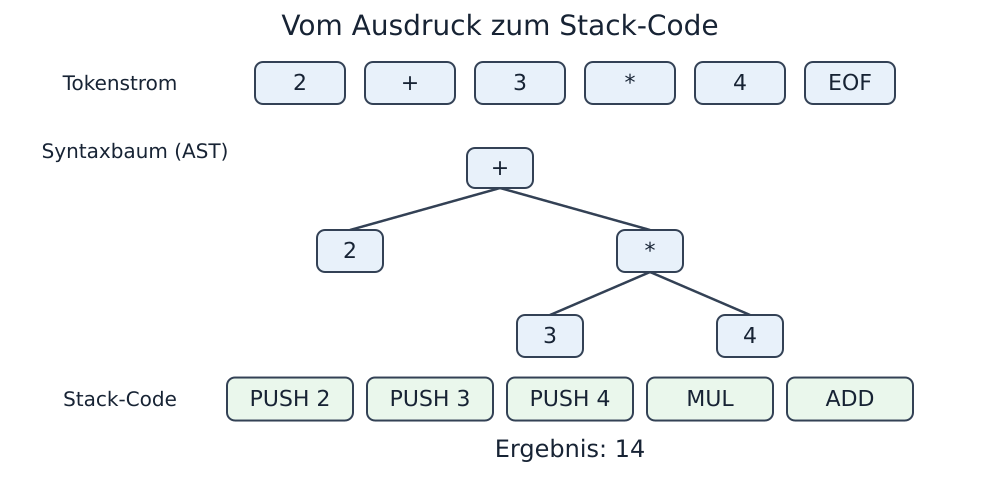

# M17-L1 – Lexer und rekursiver Abstieg: ein kleiner Compiler {#L1}

**Kursbereich:** M17 – Compiler und formale Methoden

**Niveau:** Bachelor · Wahlpflicht

**Vorwissen:** [M12-L1](M12-L1.md), [M14-L2](M14-L2.md)

## Lernziele {#S1}

Einen Zeichenstrom vollständig in positionierte Tokens umwandeln, eine eindeutige Ausdrucksgrammatik in einen rekursiven Parser übertragen, einen abstrakten Syntaxbaum (AST) aufbauen und daraus einen kleinen Stack-Befehlscode erzeugen. Lexikalische, syntaktische und spätere semantische Fehler unterscheiden.

## Vom Quelltext zur lexikalischen Analyse {#S2}

Ein Compiler übersetzt ein Programm in eine andere Repräsentation. Sein Frontend analysiert die Eingabe; ein Backend erzeugt beispielsweise Maschinencode. Unser Lehrcompiler erzeugt stattdessen Stack-Befehle für eine kleine virtuelle Maschine. Er verarbeitet nur nichtnegative dezimale Ganzzahlliterale, binäre Operatoren +, −, * und Klammern; negative Zwischenergebnisse sind möglich. Es gibt keine Variablen, Division oder unären Operatoren. Leerraum wird ignoriert, aber trennt Lexeme. Die Zahlenfolge `123` ist ein einziges Lexem. Ein Token enthält Typ, ursprünglichen Text und nullbasierten Zeichenoffset. Ein EOF-Token markiert das Eingabeende. Ein unbekanntes Zeichen darf nicht stillschweigend übersprungen werden: `2@3` muss bei Offset 1 scheitern. `2 3` ist dagegen lexikalisch gültig, aber syntaktisch falsch.

Die Lexerspezifikation verwendet reguläre Ausdrücke. Die Klammerstruktur erfordert zusätzlich einen Parser. In einer vollständigen Sprache prüft eine spätere semantische Phase etwa deklarierte Namen und Typverträglichkeit; syntaktische Gültigkeit garantiert diese Eigenschaften nicht.

## Grammatik, Vorrang und Assoziativität {#S3}

Die erweiterte BNF (EBNF) dieser Sprache lautet:

```text
expr = term { ("+" | "-") term } ;
term = atom { "*" atom } ;
atom = NUM | "(" expr ")" ;
start = expr EOF ;
```

Geschweifte Klammern bedeuten hier null oder mehr Wiederholungen, nicht Quelltextzeichen. NUM ist ein Terminaltyp; expr, term und atom sind Nichtterminale. `term` bindet Multiplikationen vor Additionen. Die Schleifen bauen gleichrangige Operatoren von links nach rechts auf: `9-4-2` ergibt `(9-4)-2=3`, nicht `9-(4-2)=7`. Ein direkt linksrekursives `expr = expr "+" term | term` würde bei naiver Umsetzung ohne Tokenverbrauch immer wieder expr aufrufen. Die Schleifenform vermeidet diese Rekursion. Klammern rufen expr erst nach Verbrauch von `(` auf.

Die Vorhersage benötigt hier nur das nächste Token: NUM und `(` unterscheiden die atom-Alternativen; die Schleifen starten nur bei ihren jeweiligen Operatoren. Nach einem vollständigen Ausdruck muss EOF folgen, damit kein ungültiger Rest akzeptiert wird. Das Lehrprogramm beendet sich beim ersten Fehler; professionelle Parser können zusätzlich Fehlererholung implementieren.

## Syntaxbaum und Stack-Code {#S4}

Bei `2+3*4` ist der AST `('+', ('num', 2), ('*', ('num', 3), ('num', 4)))`. Er enthält die semantisch relevante Struktur, aber keine Klammer- oder Leerraumtokens. Der Codegenerator besucht zuerst den linken, dann den rechten Teilbaum und emittiert anschließend den Operator. `PUSH 2; PUSH 3; PUSH 4; MUL; ADD` hinterlässt 14. SUB entnimmt zuerst den rechten Operanden b, dann den linken a und legt a−b ab. Vertauschen wäre ein Übersetzungsfehler.

{alt="2+3*4 wird zu fünf Tokens, einem Plusknoten mit Produkt als rechtem Kind und fünf Stack-Befehlen"}

Korrektheitsargument durch strukturelle Induktion: Für ein Zahlenblatt legt PUSH genau dessen Wert auf einen beliebigen Ausgangsstack. Angenommen, beide Teilbäume legen jeweils genau ihren Wert ab und erhalten den darunterliegenden Stack. Nach beiden Übersetzungen liegen a und b oben; der Operator ersetzt sie durch a op b. Damit gilt die Behauptung für den gesamten AST. Der Beweis bezieht sich nur auf gültige Bäume und die festgelegte Ganzzahlsemantik. Lexer und Parser laufen bei konstanten Tokenkosten linear in Zeichen- bzw. Tokenzahl; Codeerzeugung besucht jeden AST-Knoten einmal. Die Laufzeit der Ganzzahlarithmetik hängt zusätzlich von der Bitlänge ab. Rekursionstiefe und Speicher sind endlich; tief verschachtelte Eingaben können die Python-Grenze erreichen.

## Ausführbares Lehrmodell {#S5}

Der folgende Python-Code hält Lexer, Parser, Übersetzung und Ausführung getrennt. Der Stack-Interpreter erwartet ausschließlich vom Generator erzeugten Code; er ist kein Prüfer beliebiger Bytecode-Eingaben. Die Offsetdiagnosen betreffen Zeichen, nicht UTF-8-Bytes. Es wird kein Python-eval verwendet.

```python
import re


def lex(text):
    tokens = []
    pos = 0
    pattern = re.compile(r"[0-9]+|[()+*\-]|\s+")
    while pos < len(text):
        match = pattern.match(text, pos)
        if match is None:
            raise SyntaxError(f"unexpected character at {pos}")
        word = match.group()
        if not word.isspace():
            tokens.append(("NUM" if word[0].isdigit() else word,
                           word, pos))
        pos = match.end()
    return tokens + [("EOF", "", pos)]


def parse(text):
    tokens = lex(text)
    i = 0

    def take(kind):
        nonlocal i
        actual, word, pos = tokens[i]
        if actual != kind:
            raise SyntaxError(f"expected {kind} at {pos}, got {actual}")
        i += 1
        return word

    def atom():
        if tokens[i][0] == "NUM":
            return ("num", int(take("NUM")))
        take("(")
        node = expr()
        take(")")
        return node

    def term():
        node = atom()
        while tokens[i][0] == "*":
            take("*")
            node = ("*", node, atom())
        return node

    def expr():
        node = term()
        while tokens[i][0] in ("+", "-"):
            op = tokens[i][0]
            take(op)
            node = (op, node, term())
        return node

    result = expr()
    take("EOF")
    return result


def emit(node):
    out = []

    def visit(n):
        if n[0] == "num":
            out.append(("PUSH", n[1]))
        else:
            visit(n[1])
            visit(n[2])
            out.append(({"+": "ADD", "-": "SUB", "*": "MUL"}[n[0]],))
    visit(node)
    return out


def run(program):
    stack = []
    for instruction in program:
        op = instruction[0]
        if op == "PUSH":
            stack.append(instruction[1])
        else:
            b = stack.pop()
            a = stack.pop()
            if op == "ADD":
                stack.append(a + b)
            elif op == "SUB":
                stack.append(a - b)
            elif op == "MUL":
                stack.append(a * b)
            else:
                raise ValueError(op)
    if len(stack) != 1:
        raise ValueError("invalid stack")
    return stack[0]


assert run(emit(parse("2+3*4"))) == 14
assert run(emit(parse("(2+3)*4"))) == 20
assert run(emit(parse("9-4-2"))) == 3
```

## Selbstkontrolle {#S6}

### Aufgaben

1. Gib Tokens und Offsets für `12 + 3` einschließlich EOF an.
2. Zeichne den AST für `8-2*3-1` und berechne den Wert.
3. Erzeuge den Stack-Code für `(5-2)*4` und notiere den Stack nach jedem Befehl.
4. Ordne `2@3`, `2 3`, `(2+3` und `2+` den Fehlerphasen zu. Warum genügt es nicht, nur den ersten Ausdruck zu akzeptieren?
5. Beweise die Stack-Erhaltung für den Knoten SUB und erkläre, weshalb die rechte Seite zuerst entnommen wird.

::: {.lc-solutions data-lc-section="S6"}
1. NUM(12,0), +(+,3), NUM(3,5), EOF('',6).
2. `('-', ('-', ('num',8), ('*', ('num',2), ('num',3))), ('num',1))`; Ergebnis 1.
3. PUSH 5, PUSH 2, SUB, PUSH 4, MUL; Stacks [5], [5,2], [3], [3,4], [12].
4. `2@3` ist lexikalisch ungültig. Die drei anderen Eingaben sind syntaktisch ungültig (zusätzliche Zahl, fehlende Klammer, fehlender Operand). EOF verhindert die Annahme eines gültigen Präfixes mit ungültigem Rest.
5. Nach der Übersetzung der Kinder liegt S·a·b vor. SUB entnimmt b und a und ersetzt beide durch a−b; der ursprüngliche Stack S bleibt unverändert. Umgekehrte Entnahme ergäbe bei ungleichen Operanden das falsche Vorzeichen.
:::

## Quellen {#S7}

- [Crafting Interpreters – Scanning (mirror)](https://cndoit18.github.io/craftinginterpreters/scanning.html) · 4.2–4.5: token attributes, lexical grammar, scanning and error positions (Prüfumfang: Text) · Zuletzt abgerufen: 2026-11-24 · Inhaltlich geprüft: 2026-11-24
- [Cornell CS 211 – Grammars and Parsing](https://www.cs.cornell.edu/courses/cs211/2006fa/Sections/S3/grammars.html) · Recursive descent parsing and exceptions; left recursion and ambiguity (Prüfumfang: Text) · Zuletzt abgerufen: 2026-11-24 · Inhaltlich geprüft: 2026-11-24
