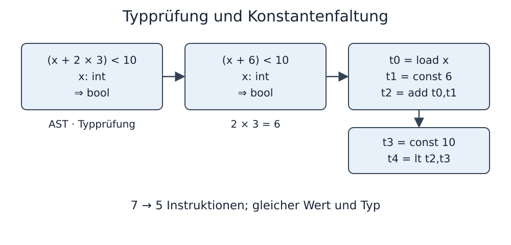

# M17-L2 – Typprüfung, Zwischenrepräsentation und Compileroptimierung {#L2}

**Kursbereich:** M17 – Compiler und formale Methoden

**Niveau:** Master · Vertiefung

**Vorwissen:** [M17-L1](M17-L1.md); [M12-L3](M12-L3.md)

## Lernziele {#S1}

Typurteile aus Syntax und Typumgebung ableiten, ungültige Ausdrücke vor der Ausführung zurückweisen, einen AST in lineare Zwischenbefehle überführen und die Werterhaltung durch Konstantenfaltung begründen. Die Grenzen einer Optimierung anhand ihrer Semantik erklären.

## Statische Typprüfung {#S2}

Der Parser aus M17-L1 entscheidet über die Struktur, nicht über die zulässigen Typen. Wir erweitern das Modell auf bereits konstruierte, endliche Ausdrucksbäume mit Ganzzahlen, booleschen Werten und Variablen. Die Typumgebung $\Gamma$ ordnet jedem zugelassenen Namen genau einen Typ zu. Das Urteil $\Gamma\vdash e:t$ bedeutet, dass der Ausdruck $e$ den Typ $t$ besitzt. Die Wertumgebung zur Laufzeit muss vollständig sein und mit $\Gamma$ übereinstimmen.

| Ausdruck | Voraussetzung | Ergebnistyp |
|---|---|---|
| Ganzzahlliteral | keine | int |
| Boolesches Literal | keine | bool |
| Variable x | x in $\Gamma$ | $\Gamma(x)$ |
| a+b, a*b | beide int | int |
| `a<b` | beide int | bool |
| a and b | beide bool | bool |

Es gibt keine implizite Typumwandlung. In Python ist bool eine Unterklasse von int; unser Modell unterscheidet die Typen trotzdem mit `type(v) is int` beziehungsweise `is bool`. Für x:int ist `(x+2*3)<10` typkorrekt, `x+true` nicht. Eine unbekannte Variable ist ebenfalls ein Typfehler. Der Typprüfer folgt rekursiv den Regeln, ohne Werte der Variablen zu benötigen.

## Zwischenrepräsentation {#S3}

Eine Intermediate Representation (IR) entkoppelt die Quellsprache von späteren Übersetzungsschritten. Ein lineares Modell nutzt temporäre Werte: `t0 = load x; t1 = const 2; t2 = const 3; t3 = mul t1,t2; t4 = add t0,t3; t5 = const 10; t6 = lt t4,t5`. Die Zahlen in den temporären Namen entsprechen Befehlsindizes. Jeder Operand eines binären Befehls verweist auf einen bereits definierten Wert. Dies ist eine einfache geradlinige Single-Assignment-Darstellung, keine vollständige SSA-IR mit Kontrollfluss und Phi-Knoten.

{alt="Der Ausdruck x plus zwei mal drei kleiner zehn wird typgeprüft, zu x plus sechs kleiner zehn gefaltet und als fünf temporäre Befehle ausgeführt."}

Die Übersetzung besucht beide Kinder vor dem Elternknoten. Induktiv gilt: Für ein Blatt liefert const oder load den richtigen Wert. Liefern beide Kinder den richtigen Wert, verwendet die Elterninstruktion genau diese beiden temporären Werte mit der ursprünglichen Operation. Deshalb liefert die letzte Instruktion den Ausdruckswert. Jede AST-Kante wird einmal traversiert; bei konstanten Kosten pro Knoten benötigt die Übersetzung lineare Zeit und Speicher in der Baumgröße.

## Konstantenfaltung und Semantikerhaltung {#S4}

Nach der Typprüfung dürfen reine konstante Teilbäume ausgewertet werden. Im Beispiel wird `2*3` durch `6` ersetzt. Der optimierte Code benötigt fünf statt sieben Instruktionen, nicht zwingend eine entsprechend kürzere reale Laufzeit. Die Funktion fold arbeitet von unten nach oben. Ein Literal oder Variablenblatt bleibt unverändert. Wenn die transformierten Kinder nach Induktionsannahme gleiche Werte und Typen haben, ist auch die Anwendung desselben Operators äquivalent. Sind beide Kinder Literale, kann der Operator mit exakt derselben Semantik vorab berechnet werden; der Ersatz ist ein Literal des Ergebnistyps. Damit bleiben Typ und Wert des gesamten Ausdrucks erhalten.

Die Semantik des Lehrmodells umfasst unbeschränkte Ganzzahlen und eager (nicht kurzschließendes) boolesches and, keine Seiteneffekte oder Division. In einer anderen Sprache kann `0*f()` eine Ausnahme oder Ausgabe von f unterdrücken, und Gleitkommaumformungen können Rundungen ändern. Auch Überlaufregeln begrenzter Ganzzahltypen müssen übereinstimmen. Typprüfung muss vor fold erfolgen: Ein ungültiger Teilbaum darf nicht durch Optimierung verborgen werden. Konstantenpropagation über Variablendefinitionen und globale Datenflussanalysen gehen über dieses Modell hinaus.

## Ausführbares Lehrmodell {#S5}

Der Code erwartet wohlgeformte AST-Tupel und eine passende Typ- und Wertumgebung; es handelt sich nicht um eine Prüfung beliebiger Eingabedaten oder IR. Die Typprüfung ist Teil der Compile-Funktion. Operatorfunktionen aus Python implementieren die definierte Semantik; die tatsächlichen Kosten großer Ganzzahlen hängen von ihrer Bitlänge ab.

```python
import operator

OPS = {'+': (int, int, operator.add),
       '*': (int, int, operator.mul),
       '<': (int, bool, operator.lt),
       'and': (bool, bool, operator.and_)}


def infer(e, gamma):
    tag = e[0]
    if tag == 'lit':
        if type(e[1]) not in (int, bool):
            raise TypeError('literal')
        return type(e[1])
    if tag == 'var':
        if e[1] not in gamma:
            raise TypeError('unknown variable')
        return gamma[e[1]]
    arg, result, _ = OPS[tag]
    if infer(e[1], gamma) is not arg or infer(e[2], gamma) is not arg:
        raise TypeError('operand type')
    return result


def fold(e):
    if e[0] in ('lit', 'var'):
        return e
    op, a, b = e[0], fold(e[1]), fold(e[2])
    if a[0] == b[0] == 'lit':
        return ('lit', OPS[op][2](a[1], b[1]))
    return (op, a, b)


def lower(e):
    ir = []
    def visit(n):
        tag = n[0]
        if tag in ('lit', 'var'):
            instruction = n
        else:
            a, b = visit(n[1]), visit(n[2])
            instruction = (tag, a, b)
        index = len(ir)
        ir.append(instruction)
        return index
    result = visit(e)
    return ir, result


def run(ir, result, env):
    values = []
    for n in ir:
        if n[0] == 'lit':
            value = n[1]
        elif n[0] == 'var':
            value = env[n[1]]
        else:
            value = OPS[n[0]][2](values[n[1]], values[n[2]])
        values.append(value)
    return values[result]


def compile_expr(e, gamma):
    infer(e, gamma)
    return lower(fold(e))


expr = ('<', ('+', ('var', 'x'), ('*', ('lit', 2), ('lit', 3))), ('lit', 10))
assert infer(expr, {'x': int}) is bool
assert run(*compile_expr(expr, {'x': int}), {'x': 3}) is True
```

## Selbstkontrolle {#S6}

### Aufgaben

1. Bestimme unter x:int und b:bool den Typ von `((x+2)<7) and b` und begründe jeden Schritt.
2. Erkläre, warum `true*2` nicht zugelassen werden darf, obwohl Python die Operation ausführen kann.
3. Gib die temporären Befehle vor und nach der Faltung von `(2+3)*x` an.
4. Beweise für einen konstanten Multiplikationsknoten, dass die Faltung Wert und Typ erhält.
5. Warum ist `0*f()` → `0` in einer Sprache mit Seiteneffekten nicht allgemein korrekt? Gib ein Gegenbeispiel.

::: {.lc-solutions data-lc-section="S6"}
1. x+2:int; Vergleich mit 7 ergibt bool; b:bool; and akzeptiert beide bool und liefert bool.
2. Die Typregel verlangt zwei int-Operanden; true ist im Modell bool, unabhängig von Pythons Vererbung und impliziter Arithmetik.
3. Vorher: t0=const 2, t1=const 3, t2=add t0,t1, t3=load x, t4=mul t2,t3. Nachher: t0=const 5, t1=load x, t2=mul t0,t1.
4. Beide Literale haben nach Typprüfung Typ int. Die Induktionsannahme garantiert ihre Werte. Das Produkt ist eine Ganzzahl; das neue Literal enthält exakt dieses Produkt und damit denselben Typ und Wert wie der alte Knoten.
5. Falls f eine Nachricht ausgibt und 7 zurückgibt, ergibt der ursprüngliche Ausdruck 0 mit Ausgabe, der Ersatz 0 ohne Ausgabe. Beobachtbares Verhalten unterscheidet sich.
:::

## Quellen {#S7}

- [Cornell – Eta Type System Specification](https://www.cs.cornell.edu/courses/cs4120/2026sp/project/types.pdf) · §2: expression typing judgments (Prüfumfang: Text; Seitenbild nicht abrufbar) · Zuletzt abgerufen: 2026-11-24 · Inhaltlich geprüft: 2026-11-24
- [CMU – Intermediate Representation](https://www.cs.cmu.edu/~411/lectures/06-irtrees.pdf) · §1–2: IR levels and pure/effectful operations (Prüfumfang: Text; Seitenbild nicht abrufbar) · Zuletzt abgerufen: 2026-11-24 · Inhaltlich geprüft: 2026-11-24
- [Cornell CS 212 – Compiler](https://www.cs.cornell.edu/courses/cs212/1998sp/lectures/lec_4_14-16.html) · Linearization and constant folding (Prüfumfang: Text) · Zuletzt abgerufen: 2026-11-24 · Inhaltlich geprüft: 2026-11-24
