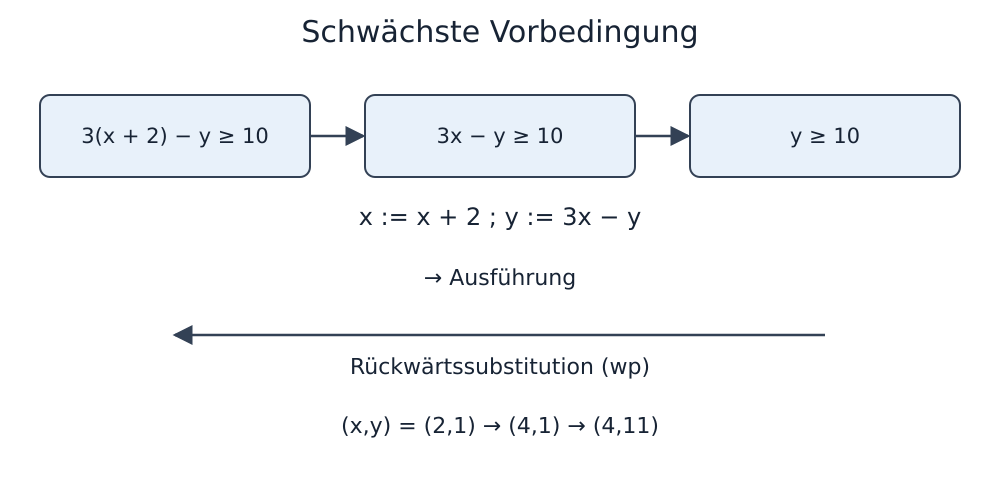

# M17-L3 – Hoare-Logik und schwächste Vorbedingungen {#L3}

**Kursbereich:** M17 – Compiler und formale Methoden

**Niveau:** Master · Vertiefung

**Vorwissen:** [M12-L1](M12-L1.md); [M7-L2](M7-L2.md)

## Lernziele {#S1}

Hoare-Tripel interpretieren, schwächste Vorbedingungen für Zuweisungen und Komposition berechnen, eine Schleifeninvariante beweisen und totale Korrektheit mittels einer natürlichen Variante nachweisen.

## Spezifikation und Korrektheitsbegriffe {#S2}

Ein Zustand $\sigma$ ordnet Variablen mathematische Ganzzahlen zu. Eine Assertion ist ein Prädikat über Zustände. Das Tripel $\{P\}\ C\ \{Q\}$ ist partiell korrekt, wenn jede normal terminierende Ausführung des Programms C aus einem Zustand mit P in einem Zustand mit Q endet. Es setzt die hier verwendete fehlerfreie, deterministische Semantik voraus. Totale Korrektheit fordert zusätzlich Terminierung für alle Startzustände mit P. `while true: skip` erfüllt jedes partielle Tripel, aber kein totales Tripel mit erfüllbarer Vorbedingung.

Die Konsequenzregel erlaubt, eine Vorbedingung zu verstärken oder eine Nachbedingung abzuschwächen: Aus $P'\Rightarrow P$, einem gültigen Tripel mit P und Q sowie $Q\Rightarrow Q'$ folgt das Tripel mit P' und Q'. Eine Spezifikation muss den gewünschten Sachverhalt tatsächlich ausdrücken; Q=true ist meist zu schwach.

## Schwächste Vorbedingungen {#S3}

Für stets terminierende Zuweisungen gilt $wp(x:=E,Q)=Q[x\leftarrow E]$. Die Substitution ersetzt freie Vorkommen von x durch E; E wird im alten Zustand ausgewertet (gebundene Variablen gegebenenfalls umbenennen). Für Komposition wird rückwärts gerechnet: $wp(C_1;C_2,Q)=wp(C_1,wp(C_2,Q))$. Für eine deterministische Verzweigung mit totalem Guard B gilt $(B\land wp(C_1,Q))\lor(\neg B\land wp(C_2,Q))$. Die schwächste Vorbedingung ist die größte Menge der Zustände, aus denen das Programm terminiert und Q erreicht. Die schwächste liberale Vorbedingung (wlp) lässt Nichtterminierung zu; für unsere schleifenfreien, totalen Befehle stimmen beide überein.

Beispiel: `x:=x+2; y:=3*x-y` mit Q: $y\ge10$. Rückwärtssubstitution ergibt zuerst $3x-y\ge10$, dann $3(x+2)-y\ge10$. Bei x=2,y=1 gilt die Vorbedingung, der Endzustand (4,11) erfüllt Q. Bei x=0,y=0 ist sie falsch, der Endwert 6 verletzt Q. Die Berechnung ist keine bloße Schätzung, sondern eine Äquivalenz zur Nachbedingung im Endzustand.

{alt="Drei Assertionen stehen über zwei Zuweisungsschritten; die Ausführung geht vorwärts, die Berechnung der schwächsten Vorbedingung rückwärts."}

## Schleifen: Invariante und Terminierungsmaß {#S4}

Gegeben sei $n\in\mathbb N_0$. Das Programm setzt i=0,s=0 und führt solange `i<n` die beiden Zuweisungen i:=i+1; s:=s+i aus. Gesucht ist $s=n(n+1)/2$. Die Invariante lautet $I:0\le i\le n\land 2s=i(i+1)$; n bleibt unverändert.

Initialisierung: i=s=0 erfüllt I. Erhaltung: Für alte Werte i,s mit I und `i<n` ist das neue i'=i+1 höchstens n und das neue s'=s+i+1. Daher $2s'=i(i+1)+2(i+1)=(i+1)(i+2)=i'(i'+1)$. Austritt: I und die negierte Bedingung i≥n ergeben i=n und damit Q. So ist die partielle Korrektheit bewiesen.

Terminierung: Die ganzzahlige Variante $V=n-i$ ist unter I nichtnegativ, unter dem Guard positiv und sinkt nach jedem Schleifendurchlauf exakt um eins. Der Schleifenrumpf terminiert, und es gibt keine unendlich absteigende Folge natürlicher Zahlen. Somit terminiert das Programm nach n Durchläufen; zusammen mit der Invariante folgt totale Korrektheit. In realen Festbreiten-Ganzzahltypen müsste zusätzlich Überlauffreiheit gezeigt werden. Eine Schleifeninvariante allein beweist keine Terminierung.

## Ausführbares Modell und Prüfgrenzen {#S5}

Python-Ganzzahlen entsprechen der mathematischen Ganzzahlsemantik im Rahmen verfügbarer Ressourcen. Die Assertions veranschaulichen die Invariante und Variante; sie sind keine automatische Beweisführung und können durch den Interpreter deaktiviert werden. Die Funktion wp ist die direkte Implementierung der analytisch berechneten Vorbedingung, kein allgemeiner WP-Generator.

```python
def sum_to(n):
    if type(n) is not int or n < 0:
        raise ValueError('nonnegative integer required')
    i, s = 0, 0
    while i < n:
        assert 0 <= i <= n and 2*s == i*(i+1)
        old_variant = n-i
        i = i+1
        s = s+i
        assert 0 <= n-i < old_variant
    assert i == n and 2*s == n*(n+1)
    return s


def program(x, y):
    x = x+2
    y = 3*x-y
    return x, y


def wp(x, y):
    return 3*(x+2)-y >= 10


assert sum_to(5) == 15
assert wp(2, 1) == (program(2, 1)[1] >= 10)
```

## Selbstkontrolle {#S6}

### Aufgaben

1. Berechne wp für `x:=2*x+1` und Q: x≥9 über ganzzahligen Zuständen.
2. Berechne wp für `x:=x+1; y:=x+y` und Q: y=8.
3. Welche drei Beweisverpflichtungen entstehen für die partielle Korrektheit einer while-Schleife mit Invariante I?
4. Beweise für n≥0 die totale Korrektheit von `i:=n; while i>0: i:=i-1` bezüglich Q: i=0.
5. Ist das Tripel mit P=true, `while true: skip` und Q=false partiell oder total korrekt? Begründe.

::: {.lc-solutions data-lc-section="S6"}
1. 2x+1≥9, also x≥4.
2. Zuerst x+y=8, dann x+1+y=8, äquivalent x+y=7.
3. P muss I vor Schleifenbeginn implizieren, I und Guard müssen nach dem Rumpf wieder I garantieren, und I mit negiertem Guard muss Q implizieren.
4. Initial gilt I: 0≤i≤n. Bei i>0 bleibt i-1 in diesem Intervall. Beim Austritt gilt i≤0, also i=0. Die natürliche Variante i sinkt in jedem Durchlauf um eins; der Rumpf terminiert. Damit gelten Terminierung und Q.
5. Partiell korrekt, da keine normal terminierende Ausführung existiert, die Q verletzen könnte. Nicht total korrekt, da das Programm für jeden Zustand divergiert.
:::

## Quellen {#S7}

- [Software Foundations – Hoare Logic I (Princeton)](https://www.cs.princeton.edu/courses/archive/spring23/cos510/sf/plf/Hoare.html) · Assignment, sequencing, while rule and partial correctness (Prüfumfang: Text) · Zuletzt abgerufen: 2026-11-24 · Inhaltlich geprüft: 2026-11-24
