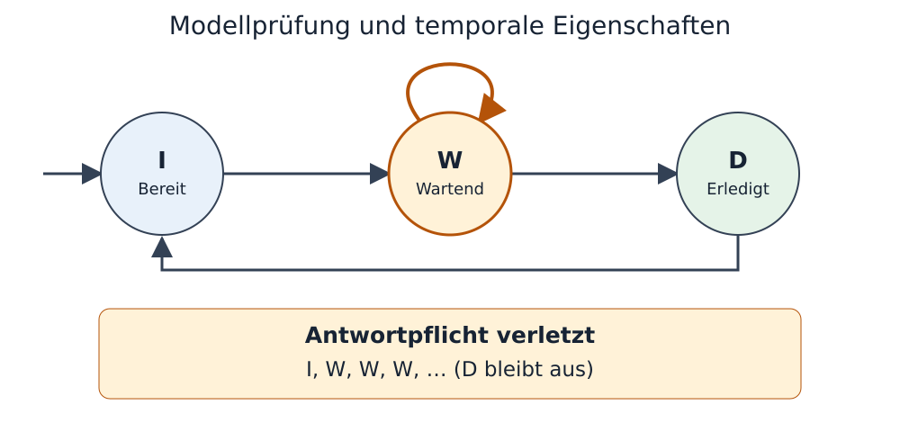

# M17-L4 – Modellprüfung und temporale Eigenschaften {#L4}

**Kursbereich:** M17 – Compiler und formale Methoden

**Niveau:** Master · Vertiefung

**Vorwissen:** [M15-L5](M15-L5.md); [M17-L3](M17-L3.md)

## Lernziele {#S1}

Endliche Transitionssysteme modellieren, die temporalen Operatoren X, F, G und U interpretieren, Safety von Liveness unterscheiden, Invarianten mittels Erreichbarkeit prüfen und ein unendliches Gegenbeispiel als endliche Präfix-Zyklus-Darstellung konstruieren.

## Zustandsmodell und temporale Logik {#S2}

Ein endliches Modell besteht aus einer Zustandsmenge S, einem Anfangszustand s0, einer Relation R ⊆ S × S und einer Beschriftung L, die jedem Zustand die dort gültigen atomaren Aussagen zuordnet. Wir verlangen mindestens einen Nachfolger pro Zustand; ein gewollter Stillstand kann durch eine Selbstschleife dargestellt werden. Das ist eine Modellierungsentscheidung, kein Beweis dafür, dass das reale System weiterarbeitet. Ein Lauf ist eine unendliche Folge $s_0,s_1,\ldots$ mit $(s_i,s_{i+1})\in R$.

Lineare temporale Logik (LTL) interpretiert Aussagen an Positionen eines Laufes. X p verlangt p im nächsten Zustand, F p irgendwann ab jetzt (einschließlich jetzt), G p an allen Positionen ab jetzt. $p\ U\ q$ verlangt eine spätere oder aktuelle Position mit q und p an sämtlichen strikt davor liegenden Positionen ab jetzt. Ohne jemals eintretendes q ist dieses starke Until falsch. Das Modell erfüllt eine LTL-Formel genau dann, wenn alle Läufe vom Start sie erfüllen. Ein einziger gültiger Lauf genügt nicht.

Safety: Ein Verstoß lässt sich durch ein endliches schlechtes Präfix bezeugen, das keine Fortsetzung reparieren kann. Ein Beispiel ist $G\neg bad$. Liveness: Jede endliche Wortfolge besitzt eine unendliche Fortsetzung, welche die Eigenschaft erfüllt (über dem festgelegten Aussagenalphabet). Beispielsweise verlangt $G(request\Rightarrow F\ done)$ auf jede Anfrage irgendwann eine Erledigung. Ein endliches Warten allein widerlegt diese Formel nicht. Nicht jede temporale Formel gehört ausschließlich einer dieser Klassen; auch Mischungen sind möglich.

## Beispiel und Gegenbeispiel {#S3}

Ein Dienst besitzt I (bereit), W (wartend, request) und D (erledigt, done). Die Kanten sind I→W, W→W, W→D und D→I. Kein Zustand ist als bad beschriftet. Die Safety-Invariante gilt, doch die Antwortpflicht ist falsch: Der Lauf I,W,W,… vermeidet D nach der Anfrage dauerhaft. Die Alternative W→D ist möglich, aber nicht erzwungen. Entfernt man die Selbstschleife, gilt die Antwortpflicht für dieses Modell. Alternativ könnte eine explizite Fairnessannahme den unendlichen Wartepfad ausschließen; ohne eine solche Annahme darf er nicht ignoriert werden. Schwache Fairness eines dauerhaft aktivierten Bedienübergangs ist eine zusätzliche Semantik, die der folgende Algorithmus nicht implementiert.

{alt="I führt zu W, W zu D oder zurück zu W, D zu I. Die Selbstschleife W erlaubt einen unendlichen Lauf ohne Erledigung."}

Würde zusätzlich ein erreichbarer Fehlerzustand B mit Selbstschleife und Beschriftung bad eingeführt, wäre ein endlicher Pfad zu B ein Safety-Gegenbeispiel. Die Pfadsuche muss alle möglichen Kanten berücksichtigen, nicht nur einen simulierten Ablauf.

## Algorithmus und Korrektheitsargument {#S4}

Breitensuche ab s0 berechnet die erreichbaren Zustände und speichert je Zustand einen Vorgänger. Jeder erreichbare Zustand besitzt einen endlichen Pfad; durch Induktion über dessen Länge wird er entdeckt. Jeder entdeckte Zustand ist erreichbar, weil er Start oder Nachfolger eines bereits entdeckten Zustands ist. Daher gilt $G\neg bad$ genau dann, wenn kein erreichbarer Zustand bad trägt; eine Vorgängerkette liefert einen kürzesten Fehlerpfad in Kantenzahl. Aufwand O(|S|+|R|).

Für die universelle Erreichbarkeit von done (CTL: AF done) beginne mit $A_0=\{s:done\in L(s)\}$ und iteriere $A_{k+1}=A_k\cup\{s:\forall t\ ((s,t)\in R\Rightarrow t\in A_k)\}$. Durch Induktion ist A_k die Menge der Zustände, aus denen alle Läufe done innerhalb von höchstens k Schritten erreichen. Die Folge wächst monoton und stabilisiert sich nach höchstens |S| echten Erweiterungen. Im Komplement des Fixpunkts liegt kein done-Zustand und jeder Zustand hat mindestens einen Nachfolger im Komplement. Durch wiederholte Wahl eines solchen Nachfolgers entsteht wegen der Endlichkeit ein Zyklus, also ein unendlicher Lauf ohne done. Damit ist der Fixpunkt exakt die Menge der Zustände, von denen jeder Lauf irgendwann done erreicht. Die Antwortpflicht gilt genau dann, wenn jeder erreichbare request-Zustand im Fixpunkt liegt. Andernfalls verbindet man einen Pfad zum verletzenden request mit einem Präfix und einem Zyklus im Komplement. Die naive Iteration benötigt O(|S|(|S|+|R|)); der Zustandsraum kann bei n booleschen Variablen bis zu 2^n Zustände umfassen. Allgemeine LTL-Modellprüfung verwendet unter anderem Büchi-Automaten und Produktgraphen; der hier bewiesene Algorithmus prüft nur diese zwei Formelmuster.

## Ausführbares Modell {#S5}

Die Zustandsnamen sind Zeichenketten (nicht None). Die Labels werden als Mengen übergeben. Die Rückgabe enthält einen Fehlerpfad oder None sowie ein Lasso (Präfix, nichtleerer wiederholter Zyklus) oder None. Das Präfix endet unmittelbar vor dem Zyklus; bei Start im Zyklus kann es leer sein. Alle zulässigen unendlichen Pfade werden ohne Fairnessfilter betrachtet. Keine allgemeine LTL-Syntaxanalyse, kein verteiltes Laufzeitmodell.

```python
from collections import deque


def reachable(graph, start):
    if start not in graph or any(not ns or any(t not in graph for t in ns)
                                 for ns in graph.values()):
        raise ValueError('finite total graph required')
    parent = {start: None}
    queue = deque([start])
    while queue:
        s = queue.popleft()
        for t in graph[s]:
            if t not in parent:
                parent[t] = s
                queue.append(t)
    return parent


def trace(parent, end):
    path = []
    while end is not None:
        path.append(end)
        end = parent[end]
    return path[::-1]


def check(graph, start, bad, request, done):
    parent = reachable(graph, start)
    if not (bad | request | done) <= graph.keys():
        raise ValueError('unknown labelled state')
    unsafe = next((s for s in parent if s in bad), None)
    # Least fixed point for AF done.
    good = set(done)
    while True:
        nxt = good | {s for s, ns in graph.items() if set(ns) <= good}
        if nxt == good:
            break
        good = nxt
    failing = next((s for s in parent if s in request and s not in good), None)
    lasso = None
    if failing is not None:
        path, seen = [], {}
        s = failing
        while s not in seen:
            seen[s] = len(path)
            path.append(s)
            s = next(t for t in graph[s] if t not in good)
        k = seen[s]
        lasso = (trace(parent, failing)[:-1] + path[:k], path[k:])
    return (None if unsafe is None else trace(parent, unsafe), lasso)


g = {'I': ('W',), 'W': ('W', 'D'), 'D': ('I',)}
assert check(g, 'I', set(), {'W'}, {'D'}) == (None, (['I'], ['W']))
g['W'] = ('D',)
assert check(g, 'I', set(), {'W'}, {'D'}) == (None, None)
```

## Selbstkontrolle {#S6}

### Aufgaben

1. Erfüllt der Lauf I,W,D,I,W,D,… die Antwortpflicht? Gilt sie deshalb im ursprünglichen Modell?
2. Ergänze W→B und B→B mit bad in B. Gib einen kürzesten Safety-Gegenbeispielpfad an.
3. Berechne A0 und den Fixpunkt für den ursprünglichen Graphen; wiederhole ohne W→W.
4. Erkläre, weshalb F done im Zustand D sofort erfüllt ist. Ist X done dort wahr?
5. Warum genügt das Vorhandensein eines erreichbaren Zyklus nicht, um die Antwortpflicht zu widerlegen? Gib die zusätzliche Bedingung an.

::: {.lc-solutions data-lc-section="S6"}
1. Ja, jede W-Position hat eine spätere D-Position. Nein, der Lauf I,W,W,… widerlegt die universelle Eigenschaft.
2. I,W,B; zwei Kanten. Die Beschriftung bad in B verletzt G ¬bad.
3. Mit Schleife A0={D}, bereits Fixpunkt: W hat sich selbst als Nachfolger, I hat W. Ohne Schleife A1={D,W}, A2={D,W,I}; damit gilt die Antwortpflicht.
4. F umfasst die aktuelle Position. X done ist falsch, da der nächste Zustand I ist.
5. Der Zyklus muss nach einer erreichbaren request-Position über einen Pfad ohne done erreichbar sein, und auf dem Zyklus darf kein done vorkommen. Andernfalls bezeugt er kein dauerhaft unerfülltes request.
:::

## Quellen {#S7}

- [University of Edinburgh – Modelling Concurrent Systems](https://homepages.inf.ed.ac.uk/rvangla/MCS/notes.html) · Lecture 14: safety, liveness, fairness (Prüfumfang: Text) · Zuletzt abgerufen: 2026-11-24 · Inhaltlich geprüft: 2026-11-24
- [UNSW – Modelling Concurrent Systems](https://cgi.cse.unsw.edu.au/~rvg/MCS/notes.html) · Lecture 10A/B: CTL and LTL semantics (parallel version of Edinburgh notes) (Prüfumfang: Text) · Zuletzt abgerufen: 2026-11-24 · Inhaltlich geprüft: 2026-11-24
- [Carnegie Mellon – LTL Model Checking & Büchi Automata](https://www.cs.cmu.edu/~15414/s20/f17/lectures/17-buchi.pdf) · Sections 1–3: finite total transition systems and LTL model checking (Prüfumfang: Text; PDF-Seitenbild nicht abrufbar) · Zuletzt abgerufen: 2026-11-24 · Inhaltlich geprüft: 2026-11-24
