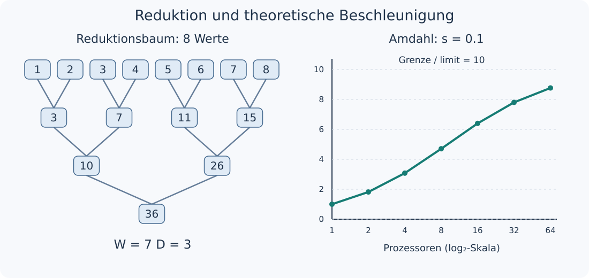

# M18-L1 – Parallele Algorithmen und wissenschaftliches Rechnen {#L1}

**Kursbereich:** M18 – Paralleles und wissenschaftliches Rechnen

**Niveau:** Master · Vertiefung

**Vorwissen:** [M13-L3](M13-L3.md); [M15-L5](M15-L5.md)

## Lernziele {#S1}

Work und Span eines Abhängigkeitsgraphen bestimmen, theoretische Beschleunigungsgrenzen herleiten, eine baumförmige Reduktion mit ungerader Eingabelänge entwerfen, Rundungsabhängigkeit erklären und einen reproduzierbaren Skalierungsversuch planen.

## Arbeit, kritischer Pfad und Prozessormodell {#S2}

Wir modellieren eine Berechnung als gerichteten azyklischen Graphen (DAG). Jeder Knoten steht für eine Operation der Dauer eins; eine Kante bedeutet, dass die Zieloperation auf das Ergebnis der Quelloperation warten muss. Eingabewerte gelten als bereits verfügbar. Die Arbeit W zählt alle Operationsknoten, die Spanne D zählt die Operationsknoten des längsten Abhängigkeitspfads. Auf einem idealen Prozessor gilt T₁=W, bei beliebig vielen idealen Prozessoren T∞=D. Für p Prozessoren gilt

$$T_p\geq\max(\lceil W/p\rceil,D).$$

Die erste Schranke folgt aus der maximalen Kapazität p je Zeiteinheit, die zweite aus der seriellen Ausführung entlang des kritischen Pfades. Ein gieriger Scheduler führt in jeder Runde so viele bereite Operationen wie möglich aus. Volle Runden verbrauchen p Operationen und können höchstens W/p mal auftreten. In einer nicht vollen Runde werden alle bereiten Operationen ausgeführt; jeder längste verbleibende Pfad beginnt mit einer bereiten Operation, daher sinkt die verbleibende Spanne mindestens um eins. Solche Runden gibt es höchstens D. Folglich gilt für diesen Scheduler Tₚ ≤ W/p + D. Dies ist ein Modell ohne Kosten für Kommunikation, Speicher oder Aufgabenverwaltung, keine gemessene Laufzeitgarantie.

## Reduktion und Skalierung {#S3}

Eine Reduktion kombiniert Elemente mit einer assoziativen Operation. Die Summe mathematischer Ganzzahlen eignet sich dafür. In jeder Runde werden benachbarte Paare addiert, ein unverpaartes Element wird unverändert weitergegeben. Die Invariante lautet: Jedes Zwischenergebnis summiert einen disjunkten zusammenhängenden Teil der Eingabe, und alle Teile decken die Eingabe genau ab. Sie gilt anfänglich für Einzelwerte und bleibt beim Zusammenfassen benachbarter Teile erhalten. Am Ende existiert genau ein Teil, also die Gesamtsumme. Für n≥1 gibt es exakt n−1 Additionen, weil jede Addition die Anzahl der Teile um eins senkt. Die Teilezahl nach k Runden ist ⌈n/2ᵏ⌉, daher D=⌈log₂ n⌉. Für n=0 definieren wir das neutrale Element 0 und W=D=0. Für acht Werte sind sieben Additionen in drei Ebenen nötig; mit zwei Prozessoren dauern die Ebenen 2+1+1=4 Zeiteinheiten. Die Implementierung simuliert Ebenenbarrieren und führt keine parallelen Threads aus.

{alt="Acht Eingaben werden in drei Ebenen zu einer Summe reduziert; daneben steigt die theoretische Beschleunigung bei zehn Prozent serieller Arbeit gegen zehn."}

Sei s der nicht parallelisierbare Anteil der ursprünglichen Laufzeit einer festen Aufgabe. Bei perfekter Parallelisierung des Rests ohne Zusatzkosten ergibt sich Tₚ/T₁=s+(1−s)/p und Sₚ=1/(s+(1−s)/p). Bei s=0,1 und p=8 beträgt der Speedup 80/17≈4,706, die Effizienz Sₚ/p=10/17≈0,588. Für p→∞ ist die Grenze 10. Für s=0 entfällt diese spezielle Schranke; die DAG-Spanne kann trotzdem begrenzen. Amdahls Modell setzt eine feste Arbeitsmenge voraus. Bei Strong Scaling bleibt n fest, bei Weak Scaling wird die Arbeit pro Prozessor ungefähr konstant gehalten. Eine steigende Gesamtarbeitsmenge ist kein Beleg für beschleunigte Lösung derselben Aufgabe.

## Wissenschaftliches Rechnen und Messplanung {#S4}

Gleitkommaaddition ist nicht allgemein assoziativ. Bei binary64 und Rundung zum nächsten Wert liefern (10¹⁶−10¹⁶)+1 und 10¹⁶+(−10¹⁶+1) die Ergebnisse 1 bzw. 0. Die exakte mathematische Summe ist 1. Ein fester Reduktionsbaum kann bei festgehaltener Arithmetik und Eingabe deterministisch sein, garantiert aber weder exakte Ergebnisse noch Übereinstimmung über andere Baumformen oder Hardware. Eine höhergenaue oder reproduzierbare Akkumulation (etwa ReproBLAS unter dessen Voraussetzungen) kann nötig sein. Validierung der Ergebnisgenauigkeit und bitweise Reproduzierbarkeit sind unterschiedliche Anforderungen.

Plane einen Versuch mit identischen Eingaben für p=1,2,4,8 und einer gut optimierten seriellen Vergleichsimplementierung. Dokumentiere CPU, Speicher, Softwareversionen, Threadzahl, Compileroptionen, Eingabegröße und Zufallsstartwert. Lege vorab fest, ob Initialisierung, Transfer und Synchronisation in die Laufzeit eingehen. Führe Aufwärmläufe und mindestens fünf unabhängige Wiederholungen durch; protokolliere Einzelzeiten, Median und Streuung. Prüfe für jede Konfiguration das Ergebnis gegen eine exakte Ganzzahlreferenz oder eine vorab begründete numerische Toleranz. Bei abweichender Summenordnung darf man nicht stillschweigend exakte Gleichheit voraussetzen. Vergleiche sowohl Zeit als auch Genauigkeit; berichte Speicherbandbreite und Kommunikationskosten als mögliche Ursachen, nicht als ohne Messung bewiesene Diagnose. Die folgende Simulation prüft nur die algorithmische Struktur.

## Ausführbares Modell {#S5}

Die Funktionen zählen Additionen und Ebenen; Datenbewegung, Eingabelesen und Python-Listenoperationen zählen im vereinfachten Modell nicht als Arbeit. Die Addition setzt für den Korrektheitsbeweis mathematische Ganzzahlen voraus. Der Scheduler gibt die ideale Zeit mit einer Barriere pro Ebene an, nicht die Laufzeit der Python-Funktion.

```python
def reduce_tree(values):
    row = list(values)
    work = span = 0
    if not row:
        return 0, work, span
    while len(row) > 1:
        nxt = [row[i] + row[i+1] for i in range(0, len(row)-1, 2)]
        work += len(nxt)
        if len(row) % 2:
            nxt.append(row[-1])
        row = nxt
        span += 1
    return row[0], work, span


def level_schedule(n, p):
    if n < 0 or p < 1:
        raise ValueError('n >= 0 and p >= 1 required')
    time = 0
    while n > 1:
        jobs = n // 2
        time += (jobs + p - 1) // p
        n -= jobs
    return time


assert reduce_tree([2, 5, -1, 4, 3]) == (13, 4, 3)
assert level_schedule(8, 2) == 4
assert (1e16 + -1e16) + 1.0 == 1.0
assert 1e16 + (-1e16 + 1.0) == 0.0
```

## Selbstkontrolle {#S6}

### Aufgaben

1. Bestimme Arbeit und Spanne für 17 Eingaben; gib die Teilezahlen nach jeder Runde an.
2. Berechne die Ebenenzeit für 17 Eingaben mit drei Prozessoren und vergleiche sie mit den unteren Schranken.
3. Wie groß sind Speedup und Effizienz bei 20 Prozent serieller Arbeit und vier Prozessoren? Wie groß ist die asymptotische Grenze?
4. Erkläre anhand der drei Zahlen 10¹⁶, −10¹⁶ und 1, warum eine korrekte Ganzzahlreduktion keine beliebige Gleitkommareduktion rechtfertigt.
5. Entwirf ein Strong-Scaling-Experiment mit einer Million Werten und erläutere, wann ein vermeintlicher Speedup wegen ungleicher Messgrenzen nicht aussagekräftig ist.

::: {.lc-solutions data-lc-section="S6"}
1. W=16, D=5; 17→9→5→3→2→1.
2. Additionen je Ebene: 8,4,2,1,1. Zeit=3+2+1+1+1=8. Untere Schranke max(⌈16/3⌉,5)=6. Die Ebenenbarrieren können Zeit kosten; die Schranke behauptet keine Erreichbarkeit.
3. S=1/(0,2+0,8/4)=2,5; Effizienz=0,625; Grenze 5.
4. In exakter Arithmetik sind beide Klammerungen 1. In binary64 wird bei −10¹⁶+1 die Eins weggerundet, sodass das zweite Ergebnis 0 ist. Reihenfolge, Genauigkeit und Reproduzierbarkeit müssen separat geprüft werden.
5. Dieselben Werte und dieselbe Aufgabe bei p=1,2,4,8; optimierte serielle Referenz, feste Messgrenzen, Aufwärmen, Wiederholungen, Median/Streuung, Ergebnisprüfung. Wenn die serielle Zeit den Datentransfer enthält, die parallele aber nicht, misst der Quotient verschiedene Arbeitsumfänge.
:::

## Quellen {#S7}

- [University of Utrecht – Work & Span](https://ics-websites.science.uu.nl/docs/vakken/b3cc/resources/tutorials/08-work_span.pdf) · Introduction; questions 1, 5 (PDF text; page image unavailable) (Prüfumfang: Text) · Zuletzt abgerufen: 2026-11-24 · Inhaltlich geprüft: 2026-11-24
- [Cornell University – Performance basics](https://www.cs.cornell.edu/courses/cs5220/2020fa/lec/2020-09-08-perf-basics.html) · Quantifying Parallel Performance; Amdahl’s Law; Strong and weak scaling (Prüfumfang: Text) · Zuletzt abgerufen: 2026-11-24 · Inhaltlich geprüft: 2026-11-24
- [UC Berkeley – ReproBLAS](https://bebop.cs.berkeley.edu/reproblas/) · What are ReproBLAS; Main Goals; Usage (Prüfumfang: Text) · Zuletzt abgerufen: 2026-11-24 · Inhaltlich geprüft: 2026-11-24
