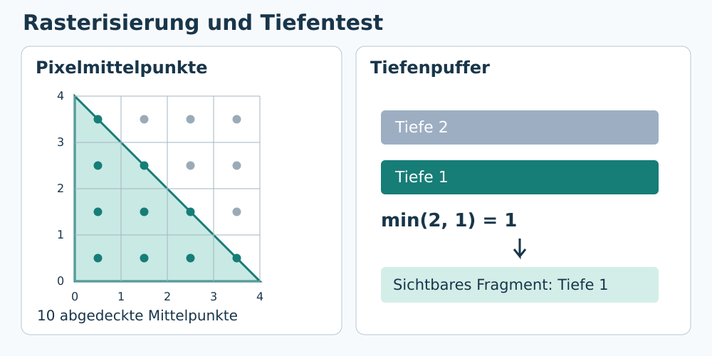

# M19-L1 – Computergrafik: Transformation und Rasterisierung {#L1}

**Kursbereich:** M19 – Computergrafik und Computer Vision

**Niveau:** Bachelor · Wahlpflichtvertiefung

**Vorwissen:** [M15-L2](M15-L2.md); Lineare Algebra (Vektoren und Matrizen).

## Lernziele {#S1}

Homogene Koordinaten und Transformationsreihenfolgen anwenden, baryzentrische Koordinaten herleiten, Dreiecke punktweise rasterisieren und den Tiefentest mit einer Schleifeninvariante begründen.

## Homogene Koordinaten und Pipeline {#S2}

Ein Modellpunkt wird als Spaltenvektor $p=(x,y,z,1)^T$ dargestellt. Eine Richtung hat dagegen die letzte Koordinate null; eine affine Translation verändert sie nicht. Für eine Translation um $(3,-2,0)$ gilt

$$T=\begin{pmatrix}1&0&0&3\\0&1&0&-2\\0&0&1&0\\0&0&0&1\end{pmatrix}.$$

Damit wird $(2,4,1,1)^T$ zu $(5,2,1,1)^T$. Die Reihenfolge ist wesentlich: Skalieren um zwei und danach Verschieben um drei in x-Richtung ergibt $2x+3$, die umgekehrte Reihenfolge $2x+6$. In einer 3D-Pipeline sind Modell-, Kamera- und Projektionsmatrix getrennte Abbildungen: $p_c=PVMp$. Vor der perspektivischen Division werden Primitive gegen das Sichtvolumen beschnitten. Für $w_c\ne0$ entstehen normierte Koordinaten durch Division durch $w_c$; anschließend bildet der Viewport sie auf Rasterkoordinaten ab. Bei $w_c=0$ ist die Division nicht definiert. Clipping und perspektivische Projektion werden im Programm nicht implementiert; es erwartet bereits transformierte orthografische Bildschirmkoordinaten.

## Baryzentrische Koordinaten und Abdeckung {#S3}

Für Dreiecksecken $a,b,c$ in der Ebene sei $E(a,b,p)=(b_x-a_x)(p_y-a_y)-(b_y-a_y)(p_x-a_x)$ und $D=E(a,b,c)$. Bei $D=0$ ist das Dreieck degeneriert. Andernfalls sind

$$\lambda_a=E(b,c,p)/D,\quad\lambda_b=E(c,a,p)/D,\quad\lambda_c=E(a,b,p)/D.$$

Durch Ausmultiplizieren erhält man die Summe eins; die drei Ausdrücke sind affine Funktionen von $p$ und nehmen an den drei Ecken die Werte der jeweiligen Einheitsvektoren an. Daher gilt $p=\lambda_a a+\lambda_b b+\lambda_c c$ für die ebenen Koordinaten: Beide Seiten sind affine Funktionen und stimmen an drei nicht kollinearen Punkten überein. Der Punkt liegt genau dann im abgeschlossenen Dreieck, wenn alle Gewichte nichtnegativ sind (konvexe Kombination). Die Division durch das vorzeichenbehaftete $D$ macht den Test unabhängig von der Umlaufrichtung.

Beispiel: $a=(0,0),b=(4,0),c=(0,4)$ und $p=(1,1)$ ergeben $(1/2,1/4,1/4)$. Pixel $(i,j)$ werden im Mittelpunkt $(i+1/2,j+1/2)$ abgetastet. Für ein zusammenhängendes Netz benötigt man eine konsistente gemeinsame Kantenregel (etwa top-left); unser abgeschlossenes Dreieck kann Randpunkte doppelt erfassen. Subpixel-Abtastung verringert Treppeneffekte, beseitigt Aliasing aber nicht grundsätzlich.

{alt="Dreieck auf Pixelraster mit markierten abgedeckten Mittelpunkten; rechts Tiefenvergleich 1 und 2."}

## Tiefentest und Perspektive {#S4}

Im orthografischen Lehrmodell ist die Tiefe $z$ affin über dem projizierten, nicht degenerierten Dreieck: $z_p=\sum_i\lambda_i z_i$. Kleinere Werte liegen näher an der Kamera. Der Tiefenpuffer speichert pro Pixel das Minimum aller bisher abgedeckten Tiefen, der Farbpuffer die zugehörige Kennung. Induktionsbeweis: Anfangs existiert kein Fragment. Bei einem neuen Fragment wird genau dann ersetzt, wenn seine Tiefe kleiner ist. Damit bleibt das Minimum erhalten. Bei gleicher Tiefe gewinnt hier das zuerst verarbeitete Fragment. Für undurchsichtige Fragmente mit eindeutiger minimaler Tiefe ist das Resultat unabhängig von der Reihenfolge. Transparenz erfordert andere Verfahren.

Perspektivisch projizierte Attribute benötigen im Allgemeinen eine Korrektur. Für Bildschirmgewichte $\lambda_i$, Clip-Koordinaten $w_i$ und ein am Objekt affin interpoliertes Attribut $u_i$ gilt $u=(\sum_i\lambda_i u_i/w_i)/(\sum_i\lambda_i/w_i)$, sofern die Nenner definiert sind. Dies folgt aus der Normalisierung der objektseitigen Gewichte proportional zu $\lambda_i/w_i$. Beispiel: gleiche Bildschirmgewichte für zwei Endpunkte mit $w_0=1,w_1=2$, $u_0=0,u_1=1$ liefern $u=1/3$ statt $1/2$. Die bereits dividierte normierte Tiefe $z_c/w_c$ wird dagegen im Bildschirmraum linear interpoliert. Nicht mit der Kameraraumtiefe verwechseln.

## Ausführbares Modell {#S5}

Die Implementierung nutzt exakte rationale Arithmetik, prüft jedes Pixel und ignoriert degenerierte Dreiecke. Die Laufzeit beträgt bei $N$ Dreiecken und einem Raster $W\times H$ im Einheitskostenmodell $O(NWH)$; der Puffer benötigt $O(WH)$ Einträge. Reale Rasterizer begrenzen die Kandidaten auf Bounding Boxes und arbeiten mit endlicher Genauigkeit. Die Funktion erwartet ganzzahlige oder rationale Eingaben, nicht beliebige Float-Werte.

```python
from fractions import Fraction as F

def transform(matrix, point):
    q = [sum(a*b for a,b in zip(row, point)) for row in matrix]
    if q[3] == 0:
        raise ValueError('point at infinity')
    return tuple(F(v, q[3]) for v in q[:3])

def edge(a,b,p):
    return (b[0]-a[0])*(p[1]-a[1])-(b[1]-a[1])*(p[0]-a[0])

def weights(a,b,c,p):
    d = edge(a,b,c)
    if d == 0:
        return None
    return tuple(F(v,d) for v in (edge(b,c,p),edge(c,a,p),edge(a,b,p)))

def raster(triangles,width,height):
    depth, color = {}, {}
    for vertices, label in triangles:
        a,b,c = vertices
        for y in range(height):
            for x in range(width):
                p = (F(2*x+1,2), F(2*y+1,2))
                w = weights(a,b,c,p)
                if w is None or min(w) < 0:
                    continue
                d = sum(t*v[2] for t,v in zip(w,vertices))
                if (x,y) not in depth or d < depth[x,y]:
                    depth[x,y], color[x,y] = d,label
    return depth,color

T = ((1,0,0,3),(0,1,0,-2),(0,0,1,0),(0,0,0,1))
assert transform(T,(2,4,1,1)) == (5,2,1)
a,b,c=(0,0,2),(4,0,2),(0,4,2)
assert weights(a,b,c,(1,1)) == (F(1,2),F(1,4),F(1,4))
near = [(0,0,1),(4,0,1),(0,4,1)]
assert raster([((a,b,c),'far'),(near,'near')],4,4)[1][0,0] == 'near'
```

## Selbstkontrolle {#S6}

### Aufgaben

1. Berechne $T(2,4,1,1)^T$ und $T(2,4,1,0)^T$; erkläre den Unterschied.
2. Vergleiche Translation um drei nach Skalierung um zwei mit umgekehrter Reihenfolge bei $x=4$.
3. Bestimme die baryzentrischen Gewichte von $(2,1)$ im Beispieldreieck und entscheide über die Abdeckung.
4. Zwei deckende Fragmente haben Tiefen 3 und 1. Welches bleibt bei beiden Reihenfolgen? Was ändert sich bei gleicher Tiefe?
5. Berechne das perspektivisch korrigierte Attribut für zwei gleiche Bildschirmgewichte, $w=(1,3)$ und $u=(0,4)$.

::: {.lc-solutions data-lc-section="S6"}
1. Punkt: $(5,2,1,1)^T$; Richtung: $(2,4,1,0)^T$. Translation wirkt nur auf den Punkt.
2. Zuerst Skalierung: 11; zuerst Translation: 14.
3. $(1/4,1/2,1/4)$, alle nichtnegativ, also abgedeckt.
4. Tiefe 1 gewinnt unabhängig von der Reihenfolge. Bei gleicher Tiefe bleibt das erste Fragment.
5. $(0+4/6)/(1/2+1/6)=1$.
:::

## Quellen {#S7}

- [Stanford CS248A – Winter 2026](https://gfxcourses.stanford.edu/cs248a/winter26/lecture/) · Lecture 1, 3, 7 (course overview only) (Prüfumfang: Übersicht) · Zuletzt abgerufen: 2026-11-24 · Inhaltlich geprüft: 2026-11-24
- [Athens University of Economics and Business – Computer Graphics Primer](https://graphics.cs.aueb.gr/cgcourse/cgh-u4.html) · Rasterization Pipeline; Sampling and Interpolation; Hidden Surface Elimination (Prüfumfang: Text) · Zuletzt abgerufen: 2026-11-24 · Inhaltlich geprüft: 2026-11-24
- [Scratchapixel – Rasterization: a Practical Implementation](https://www.scratchapixel.com/lessons/3d-basic-rendering/rasterization-practical-implementation/rasterization-practical-implementation.html) · Implementation notes; perspective-correct interpolation; depth test (Prüfumfang: Text) · Zuletzt abgerufen: 2026-11-24 · Inhaltlich geprüft: 2026-11-24
