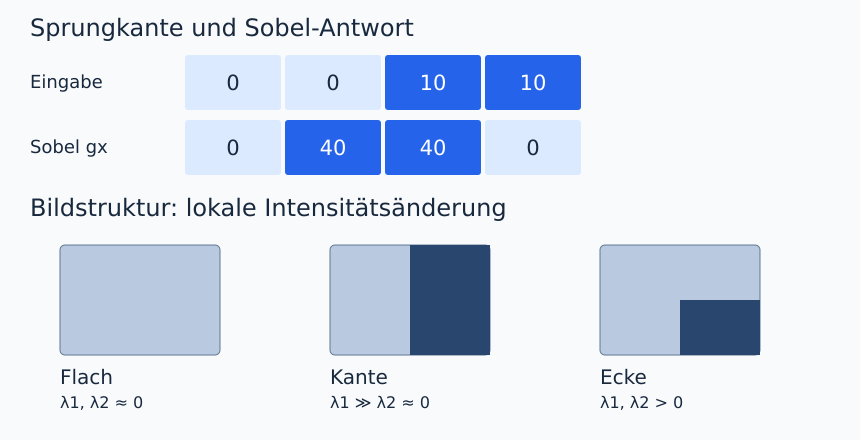

# M19-L2 – Computer Vision: Bildfilter und geometrische Merkmale {#L2}

**Kursbereich:** M19 – Computergrafik und Computer Vision

**Niveau:** Master · Wahlpflichtvertiefung

**Vorwissen:** [M19-L1](M19-L1.md), [M16-L2](M16-L2.md); lineare Algebra.

## Lernziele {#S1}

Diskrete Faltung und Kreuzkorrelation unterscheiden, Randbedingungen und Filterantworten berechnen, die Sobel-Gradienten interpretieren und die Harris-Eckenbewertung aus einer lokalen quadratischen Approximation herleiten. Grenzen durch Rauschen, Beleuchtung und Maßstab erklären.

## Diskrete Bildfilter {#S2}

Ein Grauwertbild $I[y,x]$ besteht aus endlich vielen Abtastwerten; $x$ wächst nach rechts, $y$ nach unten. Für einen reellen Kern $K[j,i]$ mit ungerader Höhe und Breite, zentriert um den Ursprung, definieren wir die Kreuzkorrelation durch

$$C[y,x]=\sum_{j,i}K[j,i]I[y+j,x+i].$$

Bei der Faltung werden beide Verschiebungszeichen umgekehrt: $F[y,x]=\sum_{j,i}K[j,i]I[y-j,x-i]$. Gleichwertig kann man den Kern um 180 Grad drehen und anschließend korrelieren. Nur für punktsymmetrische Kerne sind beide Operationen für alle Bilder identisch. Beide sind linear (bei linearer Randerweiterung), denn die Summe verteilt sich über Addition und skalare Multiplikation. An endlichen Bildrändern gilt die Formel erst nach Wahl einer Erweiterung: Nullauffüllung setzt fehlende Werte auf null, Randreplikation wiederholt den nächstgelegenen Pixel. Ein konstantes Bild mit Wert 9 ergibt bei einem normierten 3×3-Mittelwertfilter im Inneren 9, an der Ecke mit Nullauffüllung jedoch 4. Randreplikation liefert dort 9. Ränder können also künstliche Kanten erzeugen.

Der glättende Kern $G=\frac1{16}(1,2,1)^T(1,2,1)$ ist separierbar. Ausmultiplizieren des äußeren Produkts zeigt, dass horizontale und vertikale 1D-Filterung denselben Wert wie die 2D-Filterung liefert, sofern die Randbehandlung konsistent ist. Für einen separierbaren $k\times k$-Kern sinkt der Aufwand pro Pixel von $O(k^2)$ auf $O(k)$. Glättung mindert hochfrequentes Rauschen, kann aber feine Strukturen und Kanten verschmieren. Ein Medianfilter ist hingegen nicht linear.

## Gradienten und Kanten {#S3}

Mit Kreuzkorrelation und dem unnormierten Sobel-Kern $K_x=\begin{pmatrix}-1&0&1\\-2&0&2\\-1&0&1\end{pmatrix}$ sowie $K_y=K_x^T$ erhalten wir $g_x,g_y$. Die Stärke ist $m=\sqrt{g_x^2+g_y^2}$, die Gradientenrichtung $\theta=\operatorname{atan2}(g_y,g_x)$ (bei nichtverschwindendem Gradienten). Der Gradient steht senkrecht auf einer lokal geraden Helligkeitskante. Auf einer linearen Rampe $I[y,x]=ax+b$ gilt im Inneren $g_x=8a$, $g_y=0$; Division durch acht ergibt die entsprechende Ableitung pro Pixel. Das Vorzeichen würde bei Faltung mit demselben Kern wechseln.

Ein Bild mit wiederholter Zeile $(0,0,10,10)$ liefert bei Randreplikation $g_x=(0,40,40,0)$ und $g_y=0$. Zwei benachbarte Pixel reagieren auf dieselbe Sprungkante. Ein Schwellenwert auf $m$ allein liefert daher nicht zwingend eine dünne Kantenlinie. Nichtmaxima-Unterdrückung entlang der Gradientenrichtung und Hysterese sind zusätzliche Bestandteile eines Canny-Detektors; sie werden hier nicht implementiert. Rauschen kann große Gradienten verursachen. Die Filterantwort bleibt vorzeichenbehaftet und darf nicht vor der Betragsbildung auf einen 8-Bit-Bereich abgeschnitten werden.

{alt="Sprungkante mit zwei Sobel-Antworten und drei lokalen Strukturtypen."}

## Geometrische Merkmale: Strukturmatrix und Harris {#S4}

Für eine kleine Verschiebung $d=(u,v)^T$ approximiert die Taylorentwicklung die Intensitätsdifferenz im lokalen Fenster durch $g_xu+g_yv$. Für nichtnegative Gewichte $w_p$ ist die gewichtete quadratische Abweichung daher näherungsweise

$$E(d)\approx d^TMd,\qquad M=\sum_p w_p\begin{pmatrix}g_x^2&g_xg_y\\g_xg_y&g_y^2\end{pmatrix}.$$

Die Matrix ist positiv semidefinit: Für jedes $d$ ist $d^TMd=\sum_p w_p(g_xu+g_yv)^2\ge0$. Ihre Eigenwerte $\lambda_1,\lambda_2$ sind nichtnegativ. Zwei kleine Eigenwerte sprechen für eine flache Region; ein großer und ein kleiner für eine Kante; zwei große für einen lokal in zwei Richtungen gut bestimmbaren Punkt. Das sind heuristische Aussagen über lokale Bildstruktur, keine Garantie einer geometrischen Objektecke.

Die Harris-Antwort $R=\det M-k(\operatorname{tr}M)^2$ verwendet hier $k=0.04$. Für die Gradienten $(2,0),(0,2)$ mit Einheitsgewichten ist $M=\operatorname{diag}(4,4)$ und $R=13.44$. Für $(2,0),(2,0)$ ist $M=\operatorname{diag}(8,0)$ und $R=-2.56$. In einem vollständigen Detektor folgen eine Schwelle und lokale Maximasuche. Unter $I'=aI+b$ verschwinden konstante Offsets im Sobel-Filter bei Randreplikation; $M'=a^2M$ und $R'=a^4R$. Eine feste Schwelle ist also nicht kontrastinvariant. Änderungen von Beleuchtungsrichtung, Schatten, Maßstab und Perspektive können Merkmale verschieben oder verschwinden lassen. Merkmalsdetektion ist zudem nicht gleich Merkmalszuordnung zwischen Bildern.

## Ausführbares Modell {#S5}

Das Beispiel setzt nichtleere rechteckige Bilder und Kerne voraus, verwendet exakte Ganzzahlen oder rationale Werte und implementiert die beiden Randmodi explizit. `harris` bewertet eine vorgegebene Liste lokaler Gradienten mit Einheitsgewichten; es ist kein vollständiger Bilddetektor. Ein $H\times W$-Bild mit $r\times s$-Kern benötigt $O(HWrs)$ Rechenoperationen im Einheitskostenmodell und $O(HW)$ Ausgabespeicher.

```python
from fractions import Fraction as F

KX = ((-1,0,1),(-2,0,2),(-1,0,1))
KY = tuple(zip(*KX))

def filter2d(image, kernel, *, convolution=False, border='zero'):
    h,w = len(image),len(image[0])
    kh,kw = len(kernel),len(kernel[0])
    if kh%2==0 or kw%2==0 or border not in ('zero','replicate'):
        raise ValueError('odd kernel and known border required')
    if convolution:
        kernel = [row[::-1] for row in kernel[::-1]]
    def pixel(y,x):
        if border=='replicate':
            return image[min(h-1,max(0,y))][min(w-1,max(0,x))]
        return image[y][x] if 0<=y<h and 0<=x<w else 0
    return [[sum(kernel[j][i]*pixel(y+j-kh//2,x+i-kw//2)
                 for j in range(kh) for i in range(kw))
             for x in range(w)] for y in range(h)]

def sobel(image):
    return (filter2d(image,KX,border='replicate'),
            filter2d(image,KY,border='replicate'))

def harris(gradients,k=F(1,25)):
    a=sum(x*x for x,y in gradients)
    b=sum(x*y for x,y in gradients)
    c=sum(y*y for x,y in gradients)
    return a*c-b*b-k*(a+c)**2

image=[[0,0,10,10] for _ in range(3)]
gx,gy=sobel(image)
assert gx[1]==[0,40,40,0] and gy[1]==[0,0,0,0]
assert harris([(2,0),(0,2)])==F(336,25)
assert harris([(2,0),(2,0)])==-F(64,25)
```

## Selbstkontrolle {#S6}

### Aufgaben

1. Berechne Korrelation und Faltung im Mittelpunkt einer 1D-Zeile $(1,3,7)$ mit Kern $(-1,0,1)$.
2. Berechne die Ecke eines konstanten 3×3-Bilds mit Wert 18 nach dem 3×3-Mittelwertfilter für beide Randmodi.
3. Bestimme die Sobel-Antworten einer inneren Stelle der Rampe $I[y,x]=3x+2y$.
4. Bestimme $M$ und $R$ bei $k=0.04$ für Gradienten $(3,0),(0,1)$ mit Einheitsgewichten.
5. Was geschieht mit $R$ bei Verdopplung des Kontrasts? Warum genügt eine feste Schwelle nicht für robuste Merkmalserkennung?

::: {.lc-solutions data-lc-section="S6"}
1. Korrelation $-1+7=6$; Faltung $1-7=-6$.
2. Nullauffüllung $4\cdot18/9=8$; Randreplikation 18.
3. $g_x=24$, $g_y=16$, $m=8\sqrt{13}$.
4. $M=\operatorname{diag}(9,1)$, $R=9-0.04\cdot100=5$.
5. $R'=16R$. Auch bei unveränderter Bildstruktur kann ein Punkt die feste Schwelle über- oder unterschreiten; relative oder adaptive Kriterien können helfen, garantieren aber keine Invarianz gegenüber allen Bildänderungen.
:::

## Quellen {#S7}

- [Foundations of Computer Vision – Linear Image Filtering](https://visionbook.mit.edu/linear_image_filtering.html) · §15.4–15.5.1 (Prüfumfang: Text) · Zuletzt abgerufen: 2026-11-24 · Inhaltlich geprüft: 2026-11-24
- [Foundations of Computer Vision – Stereo Vision](https://visionbook.mit.edu/3d_scene_understanding_stereo.html) · §40.3.2.1 (Prüfumfang: Text) · Zuletzt abgerufen: 2026-11-24 · Inhaltlich geprüft: 2026-11-24
- [Foundations of Computer Vision – Optical Flow Estimation](https://visionbook.mit.edu/optical_flow.html) · Harris response and conditioning (Prüfumfang: Text) · Zuletzt abgerufen: 2026-11-24 · Inhaltlich geprüft: 2026-11-24
- [John Lambert – Image Derivatives and the Harris Corner Detector](https://johnwlambert.github.io/image-derivatives-harris/) · Image Derivatives; Sobel vs. Gaussian (Prüfumfang: Text) · Zuletzt abgerufen: 2026-11-24 · Inhaltlich geprüft: 2026-11-24
