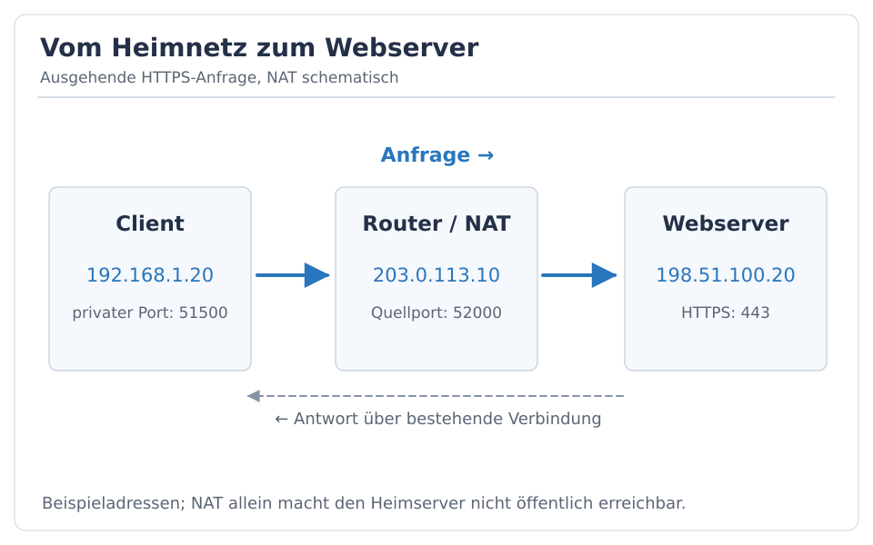

# M2-L1 – Vom eigenen PC zum öffentlich erreichbaren Server {#L1}

**Kursbereich:** M2 – Bachelor: Web, Server und Hosting

**Niveau:** Bachelor

**Vorwissen:** Keine festen Voraussetzungen angegeben.

**Lernziel:** Verstehen, welche technischen und organisatorischen Schritte aus einem lokal laufenden Programm einen dauerhaft erreichbaren Internetdienst machen – ohne selbst einen Server einrichten zu müssen.

## Überblick: Ein Server ist zunächst kein geheimnisvoller Computer {#S1}

Wer bereits ein Programm auf seinem eigenen Computer entwickelt hat, kennt den größten Teil des technischen Grundprinzips eines Servers. Auch ein Server besitzt einen Prozessor, Arbeitsspeicher, Datenträger, ein Betriebssystem und laufende Programme. Der wesentliche Unterschied ist die **Rolle**: Ein Serverprogramm stellt anderen Programmen oder Menschen über ein Netzwerk eine Funktion zur Verfügung. Die Gegenstelle nennt man **Client** (sinngemäß: anfragendes Programm).

Daher kann das Wort *Server* zweierlei bezeichnen:

1.  **Server als Software-Rolle:** Ein Programm wartet auf Anfragen und beantwortet sie. Das kann ein lokaler Webserver auf dem Entwicklungsrechner sein.
2.  **Server als Computer:** Ein Gerät, das hauptsächlich für solche Dienste bereitgestellt wird. Es muss nicht besonders groß oder teuer sein.

Eine Datenbank kann ebenfalls als Serverdienst laufen, ohne dass sie direkt aus dem Internet erreichbar sein muss. Umgekehrt ist ein leistungsstarker Desktop-PC nicht automatisch ein Internetserver, bloß weil er viel Rechenleistung besitzt.

**Welches Problem löst ein Server?** Andere Geräte sollen eine gemeinsame Funktion oder denselben Datenbestand nutzen können, ohne die vollständige Software und alle Daten bei sich zu installieren. **Wann ist er unnötig?** Wenn ein Werkzeug ausschließlich lokal arbeitet und keinen gemeinsamen Datenstand benötigt, kann eine eigenständige Desktop-Anwendung die bessere Lösung sein.

``` text
Lokale Anwendung:
  Benutzer → Desktop-Programm → lokale Datei / SQLite

Client-Server-Anwendung:
  Benutzer → Browser (Client) → Netzwerk → Serverprogramm → Daten
```

Die zweite Zeile zeigt erst das Prinzip. Ob der Server zu Hause, beim Webhoster oder in einem Rechenzentrum steht, ist eine weitere Entscheidung.

## Vom lokalen Programm zur Netzwerkanwendung {#S2}

### Lokal ist nicht dasselbe wie öffentlich {#21-lokal-ist-nicht-dasselbe-wie-öffentlich}

Ein lokal gestartetes Programm kann eine Webseite im Browser anzeigen, obwohl kein fremder Rechner beteiligt ist. Ein Webserver könnte beispielsweise ausschließlich unter der Adresse `127.0.0.1` erreichbar sein. Diese sogenannte **Loopback-Adresse** verweist auf den eigenen Computer. Der Name `localhost` wird häufig dafür verwendet.

Davon zu unterscheiden ist eine Adresse im lokalen Netzwerk, beispielsweise `192.168.1.20`. Über eine solche Adresse können gegebenenfalls andere Geräte im Heimnetz auf einen Dienst zugreifen – vorausgesetzt, das Programm hört dort auf Verbindungen und die Firewall erlaubt den Zugriff. Eine Adresse im lokalen Netz ist deshalb noch lange keine öffentlich erreichbare Internetadresse.

``` text
Nur eigener PC:
Browser ──► 127.0.0.1 ──► lokaler Dienst

Innerhalb der Wohnung:
Laptop ──► Heimnetz / Router ──► PC mit Dienst

Aus dem Internet:
Fremder Browser ──► Internet ──► erreichbarer Netzübergang
                                      │
                                      ▼
                                   Serverdienst
```

Die drei Situationen verwenden teilweise dieselbe Anwendungssoftware, unterscheiden sich aber in Erreichbarkeit, Netzkonfiguration und Sicherheitsverantwortung.

### Ein Dienst muss aktiv bleiben {#22-ein-dienst-muss-aktiv-bleiben}

Bei einem lokalen Werkzeug entscheidet der Benutzer selbst, wann er es startet. Ein Online-Dienst soll dagegen auch dann reagieren, wenn gerade niemand am Server sitzt. Das Betriebssystem startet deshalb häufig **Hintergrunddienste**: Programme, die ohne sichtbares Desktop-Fenster laufen, auf Anfragen warten und bei Bedarf nach einem Neustart automatisch wieder gestartet werden.

Unter Linux werden solche Dienste häufig durch einen *Service-Manager* wie `systemd` verwaltet; unter Windows existiert ein entsprechendes Dienstekonzept. Ein Dienst kann ausfallen, neu starten, Protokolle schreiben und Ressourcen verbrauchen. Er braucht also nicht nur lauffähigen Programmcode, sondern eine betriebliche Hülle: Startverhalten, Konfiguration, Berechtigungen und Fehlerbehandlung.

**Wann überdimensioniert?** Eine einmal pro Woche genutzte Auswertung muss nicht dauerhaft als Internetdienst laufen. Sie kann lokal oder zeitgesteuert ausgeführt werden. Dauerbetrieb ist eine Anforderung, kein Selbstzweck.

## Wo kann ein Server stehen? Fünf praktische Betriebsmodelle {#S3}

Für den Anfang sind fünf Varianten wichtiger als eine lange Liste von Cloud-Markennamen.

  Modell                                                           Was erhält man?                                                                   Typischer Vorteil                                Wer trägt welche Last?
  ---------------------------------------------------------------- --------------------------------------------------------------------------------- ------------------------------------------------ ---------------------------------------------------------------------------------
  **Entwicklungs-PC**                                              Eigener Rechner mit lokal gestarteter Anwendung                                   Keine zusätzliche Plattform, einfache Versuche   Man selbst; normalerweise nicht öffentlich
  **Heimserver**                                                   Eigene Hardware im eigenen Anschlussnetz                                          Kontrolle über Gerät und Daten                   Strom, Netzwerk, Hardwareausfall, Updates, Zugriffsschutz
  **Shared Hosting**                                               Webspace und vordefinierte Serverfunktionen auf gemeinsam betriebener Plattform   Meist wenig Systemadministration                 Anbieter betreibt Plattform; Kunde pflegt Anwendung und Daten
  **VPS** (*Virtual Private Server*, virtueller privater Server)   Virtueller Rechner mit eigenem Betriebssystembereich                              Flexible, klar abgegrenzte Serverumgebung        Anbieter betreibt Host; Kunde meist Gast-OS, Anwendungen, Updates und Backups
  **Dedizierter Server**                                           Physischer Rechner, der einem Kunden zugeordnet ist                               Hohe Kontrolle und planbare Ressourcen           Viel eigene Betriebsverantwortung; Hardwarearbeiten können beim Anbieter liegen

Bei einem **VPS** trennt Virtualisierungssoftware die Ressourcen einer physischen Maschine in mehrere virtuelle Rechner. Das ist kein identisches Konzept wie klassisches Shared Hosting: Beim VPS verwaltet der Kunde häufig sein eigenes Betriebssystem; beim Shared Hosting erhält er eher eine vorkonfigurierte Laufzeit- und Dateiumgebung. Auch „dediziert“ heißt nicht automatisch, dass die Anwendung vom Anbieter betreut wird. Ob Updates, Monitoring und Backups enthalten sind, ergibt sich aus dem jeweiligen Vertrag.

Bei **Managed Hosting** oder einem **Managed Service** übernimmt der Anbieter zusätzliche Betriebsarbeiten. Das ist eine Eigenschaft des Vertrags beziehungsweise Dienstes und nicht zwingend eine sechste Art von Hardware. Auch ein gemieteter virtueller Server kann verwaltet oder selbst administriert sein. Die größeren Cloud-Dienstmodelle behandeln wir in M2-L3.

### Das kleine PHP-Werkzeug als Beispiel

**PHP** (*PHP: Hypertext Preprocessor*) ist eine serverseitige Programmiersprache für Webanwendungen. Angenommen, eine Anwendung besteht aus wenigen PHP-Seiten, einer kleinen Datenbank und einem Verwaltungsbereich. Sie soll von einigen Benutzern über einen Browser geöffnet werden.

- Im **klassischen Webhosting** kann das bereits vollständig möglich sein, sofern passende PHP- und Datenbankfunktionen angeboten werden.
- Auf einem **VPS** wäre dieselbe Anwendung ebenfalls lauffähig, aber jemand müsste zusätzlich das Betriebssystem und die Serverdienste warten.
- Auf einem **Heimserver** kämen Stromversorgung, Internetanschluss, Router und eigene Hardware hinzu.
- Ein **dedizierter Server** wäre für diesen geringen Umfang häufig unnötig.

Die einfachste funktionsfähige Betriebsform ist nicht minderwertig. Sie hat oft die geringste Anzahl von Fehlerquellen und laufenden Verpflichtungen.

## Die Softwareschichten eines einfachen Webservers {#S4}

Ein Server ist nicht „eine Software“, sondern ein Zusammenspiel mehrerer Rollen.

**Betriebssystem:** Es verwaltet Prozesse, Speicher, Dateien, Benutzer, Netzwerkschnittstellen und Berechtigungen. **Webserver:** Er nimmt Webanfragen über **HTTP** (*Hypertext Transfer Protocol*, Übertragungsprotokoll des Webs) an und liefert beispielsweise statische Dateien zurück oder übergibt dynamische Anfragen. Häufige Produkte sind Apache HTTP Server und NGINX. **Anwendung:** Sie enthält die eigentliche Fachlogik: etwa Benutzeranmeldung, Datenanalyse oder Berechnung. **Datenbank:** Sie speichert persistent benötigte Informationen. Eine Datenbank kann auf derselben Maschine oder auf einem getrennten Rechner liegen.

``` text
                 Ein Serverrechner
┌─────────────────────────────────────────────┐
│ Betriebssystem                              │
│  ├─ Webserver                               │
│  │    └─ Anwendung (z. B. PHP oder Node.js) │
│  │         └─ Datenbank                     │
│  ├─ Protokollierung / Überwachung           │
│  └─ Hintergrunddienste                      │
└─────────────────────────────────────────────┘
             ▲
             │ Netzwerkanfragen
             │
         Browser / Client
```

Diese Darstellung bedeutet **nicht**, dass Webserver, Anwendung und Datenbank immer im selben Prozess laufen. Sie können unterschiedliche Prozesse sein, obwohl sie dieselbe Hardware nutzen. Eine spätere Verteilung auf mehrere Rechner ändert die Kommunikationswege, nicht die fachliche Aufgabe.

Ein **statischer Webauftritt** kann weitgehend aus unveränderlichen HTML- (*HyperText Markup Language*, Auszeichnungssprache) und CSS-Dateien (*Cascading Style Sheets*, Stilvorlagen) sowie Bildern bestehen. Eine **dynamische Webanwendung** benötigt zusätzlich Programmlogik, die auf Anfragen reagiert. Das trennen wir in M2-L2 ausführlich.

## Vom Domainnamen zum richtigen Server {#S5}

Wenn jemand `https://example.org/angebot` im Browser öffnet, passieren mehrere voneinander unabhängige Dinge. Die Schreibweise enthält ein Protokoll (`https`), einen Namen (`example.org`) und einen Pfad (`/angebot`). Die Adresse `example.org` ist ein absichtlich reservierter Beispieldomainname, kein eigenes Kursangebot.

**Domain:** Ein menschenlesbarer Name, der registriert und verwaltet werden kann. **Registrar:** Das Unternehmen, über das eine Domain registriert wird. **DNS** (*Domain Name System*, Domainnamensystem): Verweist unter anderem von Namen auf Internetadressen. **IP** (*Internet Protocol*, Internetprotokoll): Dient zur Adressierung und Weiterleitung von Datenpaketen zwischen Netzen.

Wichtig sind die getrennten Aufgaben: Ein Domainregistrar muss nicht dieselbe Firma sein wie der DNS-Anbieter oder der Hoster. Auch der Name allein enthält noch keine vollständige Angabe darüber, welcher Rechner die Webseite ausliefert.

``` text
Domaininhaber → Registrar: Registrierung des Namens
                         │
                         ▼
              zuständige DNS-Konfiguration
                         │
                         ▼
Browser → DNS-Auflösung → Zieladresse → Verbindung zum Server
```

Ein **A-Eintrag** im DNS kann auf eine IPv4-Adresse verweisen, ein **AAAA-Eintrag** auf eine IPv6-Adresse (*Internet Protocol Version 6*). Eine Domain kann mehrere solcher Einträge besitzen. Ein **CNAME-Eintrag** verweist dagegen auf einen anderen DNS-Namen. Welche Variante erforderlich ist, hängt von der Hosting-Architektur ab. Das DNS liefert Informationen zur Zielsuche; es überträgt normalerweise nicht selbst den HTML-Inhalt der Webseite.

**Praktische Konsequenz:** Eine vorhandene Domain kann unter Umständen auf einen neuen Server zeigen, ohne dass Benutzer eine andere Webadresse eintippen müssen. Bei einer Umstellung müssen allerdings DNS-Zwischenspeicher und Übergangszeiten berücksichtigt werden. Die technische und rechtliche Verwaltung des Domainnamens bleibt ein eigener Aufgabenbereich.

## Ports – welcher Dienst erhält die Anfrage? {#S6}

Eine IP-Adresse bestimmt noch nicht eindeutig, welches der vielen Programme auf einem Rechner angesprochen werden soll. Hierfür dienen **Ports**: nummerierte Kommunikationsendpunkte für ein bestimmtes Transportprotokoll, beispielsweise TCP (*Transmission Control Protocol*, verbindungsorientiertes Transportprotokoll) oder UDP (*User Datagram Protocol*, datagrammbasiertes Transportprotokoll).

Typische Konventionen im Web:

  Port   Übliche Verwendung                                  Hinweis
  ------ --------------------------------------------------- ---------------------------------------------------------------------------------
  80     HTTP (*Hypertext Transfer Protocol*)                Unverschlüsselte Webanfragen, oft Weiterleitung auf HTTPS
  443    HTTPS (*HTTP über TLS, Transport Layer Security*)   Verschlüsselter Webzugang; bei HTTP/3 kann UDP statt TCP verwendet werden
  22     SSH (*Secure Shell*)                                Fernadministration; nicht allgemein öffentlich erforderlich
  5432   PostgreSQL (typischer Standardport)                 Datenbankzugriff, sollte normalerweise nicht offen für alle Internetnutzer sein

Die Zahlen sind Konventionen, keine physikalischen Vorschriften. Ein Programm kann unter geeigneten Bedingungen andere Ports verwenden. Entscheidend ist, dass ein Dienst auf einer passenden Netzwerkschnittstelle *lauscht*, das Netzwerk die Verbindung zum Ziel zulässt und eine **Firewall** nicht benötigte Verbindungen sperrt.

``` text
Öffentliche Zieladresse
        │
        ├─ Port 443 → Webserver / HTTPS
        ├─ Port 22  → nur ggf. beschränkter Admin-Zugriff
        └─ Port 5432 → für öffentliche Nutzer NICHT freigegeben
```

**Welches Problem lösen Ports?** Ein Rechner kann mehrere Netzwerkdienste parallel betreiben. **Wann irrelevant?** Wer nur eine lokale Webseite liest, muss normalerweise nichts über konkrete Portfreigaben administrieren.

## HTTP, HTTPS, TLS und Zertifikate – vier Ebenen sauber trennen {#S7}

**HTTP** ist das Anfrage-Antwort-Protokoll des Webs. Ein Browser fragt eine Ressource an; der Server schickt einen Status, Zusatzinformationen und gegebenenfalls einen Inhalt zurück. **HTTPS** schützt diese Webkommunikation durch **TLS** (*Transport Layer Security*, Transportverschlüsselung). Das TLS-Verfahren ermöglicht verschlüsselte und gegen bestimmte Manipulationen geschützte Verbindungen.

Damit der Browser den Server erkennen kann, präsentiert dieser normalerweise ein **digitales Zertifikat**. Es verbindet unter anderem einen Namen mit einem öffentlichen Schlüssel; der Browser prüft dessen Gültigkeit und Vertrauenskette. Die ausstellende Organisation heißt **CA** (*Certificate Authority*, Zertifizierungsstelle).

``` text
Browser
   │ 1. Auflösung des Namens
   ▼
Zieladresse
   │ 2. Aufbau einer Verbindung
   ▼
Webserver mit TLS-Zertifikat
   │ 3. Prüfung / Schlüsselaushandlung
   ▼
Geschützter Kanal für HTTP-Anfragen und -Antworten
```

Ein bekanntes Beispiel für automatisierte Zertifikatsausstellung ist **Let’s Encrypt**. Dafür muss der Betreiber nachweisen, dass er den betreffenden Domainnamen kontrolliert. Bei der Methode **HTTP-01** wird über einen Webpfad eine Kontrollinformation bereitgestellt; **DNS-01** verwendet einen DNS-Texteintrag und ist unter anderem für Wildcard-Zertifikate geeignet. Dies sind nur Konzeptbeispiele – eine konkrete Einrichtung ist für unseren Kurs nicht erforderlich.

Zertifikate laufen ab und müssen deshalb rechtzeitig erneuert werden. Auch die zugehörigen Schlüssel benötigen Schutz. Eine automatische Erneuerung verringert Wartungsaufwand, beseitigt aber nicht die Pflicht, Fehlversuche zu bemerken.

**Wichtig:** Ein HTTPS-Zertifikat beweist nicht, dass eine Website seriös ist oder ihre Datenbank sicher programmiert wurde. HTTPS schützt hauptsächlich die Verbindung zum erreichten Endpunkt. Falsche Zugriffsrechte, kompromittierte Konten oder fehlerhafte Anwendungen bleiben reale Risiken.

## Was macht ein Reverse Proxy? {#S8}

Ein **Proxy** ist ein vermittelnder Netzwerkdienst. Ein *Reverse Proxy* sitzt auf der Serverseite vor einem oder mehreren Anwendungsdiensten. Er nimmt Anfragen entgegen und leitet sie passend weiter. So muss eine interne Anwendung nicht unmittelbar an der öffentlichen Schnittstelle erreichbar sein.

Stell dir ein Bürogebäude vor: Die Besucher gehen zuerst zum Empfang. Dort wird geklärt, welcher Raum beziehungsweise welcher Mitarbeiter zuständig ist. Der Empfang löst die eigentliche Fachaufgabe nicht, organisiert aber den Zugang.

``` text
                         Internet
                             │
                             ▼
                 Reverse Proxy (HTTPS)
                        │          │
              /bilder   │          │ /api
                        ▼          ▼
                  Bilddienst   Anwendungsdienst
                                   │
                                   ▼
                                Datenbank
```

NGINX kann beispielsweise als Reverse Proxy Anfragen an interne HTTP-Anwendungsserver übergeben. Je nach Ausgestaltung übernimmt ein Reverse Proxy auch TLS-Terminierung, Weiterleitung anhand des Domainnamens oder Pfades, Lastverteilung, Begrenzung von Anfragen und Protokollierung.

Ein **Webserver** und ein **Reverse Proxy** sind keine strikt getrennten Hardwaretypen: Dasselbe Programm kann statische Inhalte ausliefern und andere Anfragen weiterleiten. Ebenso kann eine Anwendung selbst HTTP sprechen. Man benötigt also nicht immer einen zusätzlichen Proxy.

**Wann sinnvoll?** Wenn mehrere Anwendungen unter einer Domain erreichbar sein sollen, eine einheitliche HTTPS-Eingangsschicht gebraucht wird oder interne Dienste abgeschirmt werden sollen. **Wann überdimensioniert?** Bei einer sehr einfachen Website, die der Webhoster bereits vollständig über seine Plattform ausliefert. Ein Reverse Proxy ist keine automatische Sicherheitsgarantie; Fehlkonfigurationen können neue Risiken schaffen.

## Heimrouter, NAT und die Frage der öffentlichen Erreichbarkeit {#S9}

Ein Heimrouter verbindet das lokale Netzwerk mit dem Anschluss des Internetproviders. Geräte innerhalb des Heimnetzes besitzen häufig private IPv4-Adressen. Der Router übersetzt bei ausgehenden Verbindungen Adressen und häufig Ports. Dieses Verfahren heißt **NAT** (*Network Address Translation*, Netzwerkadressübersetzung).

{alt="Schematische ausgehende HTTPS-Anfrage vom Heimnetzclient über einen NAT-Router zu einem Webserver mit beispielhaften Dokumentations-IP-Adressen."}

Ausgehende Verbindung über NAT; private Adressen und Ports sind nicht automatisch öffentlich erreichbar.

Beim normalen Surfen funktioniert das unkompliziert: Der private Rechner beginnt die Verbindung nach außen; die zugehörige Antwort kann zurückgeleitet werden. Soll aber ein fremder Computer *von außen* einen Heimserver erreichen, muss der Weg ausdrücklich möglich sein.

``` text
Internet-Nutzer
     │
     ▼
Anschluss beim Provider
     │
     ▼
Heimrouter / Netzgrenze
     │ nur bei passendem eingehenden Zugriffsweg
     ▼
Heimserver im lokalen Netzwerk
     │
     ▼
Anwendung
```

Bei einer eigenen öffentlichen IPv4-Adresse kann eine passende Weiterleitung am Router grundsätzlich möglich sein. Nicht jeder Anschluss besitzt jedoch eine direkt zugewiesene öffentliche IPv4-Adresse. Bei **CGNAT** (*Carrier-Grade Network Address Translation*, großflächige Netzadressübersetzung beim Provider) teilen sich Anschlüsse eine vorgelagerte Adressübersetzung. Eine einfache Portweiterleitung am eigenen Router stellt dann nicht automatisch öffentliche IPv4-Erreichbarkeit her.

**IPv6** (*Internet Protocol Version 6*) ist ein anderes Adressierungsmodell: Ein Gerät kann grundsätzlich eine global routbare IPv6-Adresse erhalten. Trotzdem muss der Internetanschluss entsprechende Verbindungen ermöglichen und die Firewall unerwünschte Zugriffe unterbinden. Öffentliche Adressierbarkeit ist nicht gleichbedeutend mit sicherer oder tatsächlich erlaubter Erreichbarkeit.

Es existieren Alternativen wie über einen externen Server aufgebaute Tunnel oder Vermittlungsdienste. Diese erzeugen aber Abhängigkeiten und teils neue Sicherheits- und Datenschutzfragen. Für eine kleine bezahlte Online-Anwendung ist ein geeigneter Hostinganbieter oft unkomplizierter als die Öffnung des Heimnetzes.

**Entscheidender Unterschied:** *Eine Domain haben*, *eine öffentliche Adresse besitzen* und *einen tatsächlich von außen erreichbaren, abgesicherten Dienst betreiben* sind drei verschiedene Sachverhalte.

## Eine vollständige Webanfrage Schritt für Schritt {#S10}

Nun verbinden wir alle Bausteine. Ein Besucher möchte eine Auswertung in einem kleinen Online-Werkzeug aufrufen. Wir nehmen einen üblichen Webdienst an, der eine Anwendung und eine Datenbank besitzt.

1.  Der Nutzer öffnet im Browser eine Webadresse mit `https://`.
2.  Der Browser bestimmt die Zieladresse; dafür kann er bereits gespeicherte DNS-Informationen nutzen oder DNS abfragen.
3.  Über das Internet wird ein geeigneter Verbindungsweg zum Ziel hergestellt.
4.  Der Server beziehungsweise sein vorgeschalteter Proxy präsentiert ein für den Domainnamen passendes TLS-Zertifikat; die Verbindung wird geschützt aufgebaut.
5.  Der Browser sendet eine HTTP-Anfrage, etwa nach einer Auswertungsseite.
6.  Der Webserver prüft, ob eine statische Datei genügt oder eine Anwendung benötigt wird.
7.  Bei einer dynamischen Anfrage wird sie gegebenenfalls an den Anwendungsprozess übergeben.
8.  Die Anwendung prüft Eingaben, Authentifizierung und erforderliche Berechtigungen.
9.  Soweit nötig, liest oder verändert die Anwendung Daten in ihrer Datenbank. Die Datenbank muss dafür nicht öffentlich erreichbar sein.
10. Die Anwendung erzeugt eine Antwort; der Webserver beziehungsweise Proxy überträgt sie zurück an den Browser.
11. Der Browser zeigt die Seite oder ein Ergebnis an.
12. Im Hintergrund können Protokolle und Kennzahlen entstehen, die für Fehlersuche, Betrieb und Missbrauchserkennung helfen – datensparsam gestaltet.

``` text
Nutzer
  │
  ▼
Browser ──► DNS (Name → Adresse)
  │
  ▼
Internet / öffentliche Netzgrenze
  │
  ▼
HTTPS-Eingang: Webserver / Reverse Proxy
  │
  ▼
Anwendung: Eingaben + Rechte + Fachlogik
  │
  ▼
Datenbank (intern, nicht direkt öffentlich)
  │
  ▼
Antwort zurück über Anwendung und Webserver
  │
  ▼
Browser zeigt Ergebnis
```

**Die wichtigste Erkenntnis:** Das ist *ein* möglicher logischer Weg, keine Vorschrift für einen bestimmten Softwarestapel. Für eine statische Website fallen Anwendungsprozess und Datenbank möglicherweise ganz weg. Bei einer größeren Plattform können mehrere Rechner beteiligt sein. Auch ein Webhoster kann viele der einzelnen Ebenen hinter einer benutzerfreundlichen Oberfläche verbergen.

## Öffentlich erreichbar bedeutet dauerhafte Verantwortung {#S11}

Ein lokales Tool muss nur dann funktionieren, wenn sein Besitzer es nutzt. Ein fremdgenutzter Online-Dienst übernimmt zusätzliche Verpflichtungen.

### Sicherheitsupdates und Rechte {#111-sicherheitsupdates-und-rechte}

Öffentlich erreichbare Software ist regelmäßig automatisierten Anfragen und Angriffsversuchen ausgesetzt. Betriebssystem, Webserver, Bibliotheken und Anwendung benötigen passende Sicherheitsupdates. Dienste sollten nur die notwendigen Rechte besitzen. Eine Datenbank sollte beispielsweise nicht allein deshalb öffentlich zugänglich sein, weil die Webseite öffentlich ist.

Administrative Zugänge, Passwörter und Schlüssel müssen geschützt werden. Ein nicht benötigter Netzwerkport sollte geschlossen bleiben. Ein Betreiber muss außerdem entscheiden, wie er Sicherheitsmeldungen entdeckt und darauf reagieren kann.

### Backups und Wiederherstellung {#112-backups-und-wiederherstellung}

Ein Backup ist eine unabhängig nutzbare Sicherung zur Wiederherstellung. Für einen kleinen Dienst betrifft das mindestens Anwendungsdaten, benötigte Konfiguration und gegebenenfalls hochgeladene Dateien. Ein Snapshot oder die Kopie einer laufenden Datenbank ist nicht ohne Weiteres dasselbe wie eine konsistente, erprobte Datensicherung.

Eine öffentlich erreichbare Anwendung kann auch durch Bedienfehler, fehlerhafte Updates oder defekte Hardware Daten verlieren. Deshalb zählt nicht nur, *ob* eine Sicherung existiert, sondern ob ein Wiederherstellungsvorgang tatsächlich funktioniert. Wir vertiefen das in M3-L6.

### Überwachung und Ausfälle {#113-überwachung-und-ausfälle}

**Monitoring** bezeichnet die Beobachtung von Betriebszuständen. Dazu gehören Erreichbarkeit, Antwortzeiten, Fehlerhäufigkeit, Speicherplatz, Prozesszustände und gegebenenfalls ungewöhnliche Zugriffe. **Logs** sind protokollierte Ereignisse. Sie helfen bei Fehlersuche und Sicherheitsanalysen, können aber personenbezogene Daten enthalten. Umfang und Aufbewahrung müssen deshalb begründet sein.

Ein kleiner Dienst muss nicht zwingend rund um die Uhr von einem Menschen betreut werden. Er braucht aber eine realistische Regelung dafür, was bei Ausfällen geschieht und welche Verfügbarkeit den Nutzern zugesagt wird.

### Datenschutz und Nutzerverwaltung {#114-datenschutz-und-nutzerverwaltung}

Wer fremde Nutzerkonten, Uploads oder personenbezogene Informationen speichert, übernimmt zusätzliche organisatorische und rechtliche Verantwortung. Der Standort des Hosters ist dabei nicht die einzige relevante Frage: Auch Auftragsverarbeitung, Zugriffskontrolle, Löschung und externe Dienste können eine Rolle spielen. Konkrete Rechtsanforderungen gehören in eine gesonderte, aktuell geprüfte Betrachtung (M4-L3), nicht in eine pauschale Hostingregel.

### Kosten – mehr als eine Monatsgebühr {#115-kosten-mehr-als-eine-monatsgebühr}

Ein Hostingangebot kann Speicherplatz, Prozessorzeit oder Datenverkehr bereits enthalten oder getrennt berechnen. Daneben können Domain, zusätzliche Backups, höhere Verfügbarkeit, Support, Überwachung, Datentransfer und insbesondere eigene Arbeitszeit relevant sein.

  Betriebsform         Sichtbare Kostenarten                               Oft unterschätzter Aufwand
  -------------------- --------------------------------------------------- -----------------------------------------------------------------------
  Heimserver           Hardware, Strom, Internetanschluss, Ersatzteile     Ausfälle, Erreichbarkeit, Sicherung, Einbruchsschutz für das Heimnetz
  Shared Hosting       Tarif, Domain, Zusatzoptionen                       Pflege der eigenen Anwendung, Daten, Zugangsdaten
  VPS                  Miete, Speicher, Backups, Datenverkehr je Vertrag   Betriebssystem-Updates, Webserver, Firewall, Sicherheitsüberwachung
  Dedizierter Server   Hardwaremiete, Zusatzdienste, ggf. Traffic          Administratorarbeit und Fehlerbehebung trotz bezahlter Hardware

Dies ist ein **Kostenmodell**, keine aktuelle Preisliste. Ein Heimserver ist nicht automatisch billiger; er kann beispielsweise wegen Stromverbrauch und fehlender Redundanz unwirtschaftlich sein. Eine Cloudlösung ist nicht automatisch teurer, aber auch nicht kostenlos wartbar.

## Drei Anschauungsszenarien aus der Softwarepraxis {#S12}

### Öffentliches Dokumentations- und Downloadangebot {#121-öffentliches-dokumentations--und-downloadangebot}

Eine Technikseite veröffentlicht Anleitungen, Screenshots und frei verfügbare Werkzeuge. Sie enthält zunächst keine aufwendigen Benutzerfunktionen.

**Mögliche einfache Architektur:** vorhandenes klassisches Webhosting oder statisch ausgelieferte Dateien. Für Downloads und Dokumentation braucht es nicht automatisch eine eigene virtuelle Maschine. Der Betreiber muss trotzdem Aktualität der Dateien, Berechtigungen und die Sicherheit des Veröffentlichungsprozesses berücksichtigen.

``` text
Besucher → Domain → Webhosting → HTML / Dateien / Downloads
```

### Kleines kostenpflichtiges Online-Werkzeug {#122-kleines-kostenpflichtiges-online-werkzeug}

Ein Kunde meldet sich an, lädt eine Datei hoch, lässt eine Analyse ausführen und lädt ein Ergebnis herunter. Die Software benötigt Benutzerverwaltung, eine Anwendung und meist persistenten Speicher.

**Mögliche einfache Architektur:** Webserver und eine einzige Anwendung auf einem geeigneten Hostingpaket oder VPS, Datenbank zunächst auf derselben Plattform beziehungsweise als separat angebotener Dienst. Die Aufteilung in mehrere Server ist nicht notwendig, solange die Anforderungen das nicht begründen.

``` text
Kunde → HTTPS → Webanwendung → Datenbank
                   │
                   └────────────► geschützter Dateispeicher
```

Der technische Aufwand entsteht hier weniger durch das Wort „Cloud“ als durch Zugriffsrechte, Datenlöschung, sichere Uploads, Abrechnung und Support.

### Online-Schnittstelle mit lokaler KI-Verarbeitung {#123-online-schnittstelle-mit-lokaler-ki-verarbeitung}

Eine Anwendung bietet Bild- oder Textverarbeitung an. Ein leistungsstarker Rechner mit Grafikprozessor könnte Berechnungen ausführen, während der öffentlich erreichbare Eingang bei einem externen Anbieter liegt.

**Mögliche Architektur:** Die öffentliche Komponente nimmt Aufträge entgegen und legt sie in einer Warteschlange ab. Ein geschützter Verarbeitungsdienst holt Arbeit ab und liefert Ergebnisse zurück. Damit muss ein KI-Rechner im Heimnetz nicht automatisch als offener Webserver auftreten.

``` text
Kunde → öffentliche HTTPS-Anwendung → Auftragsliste
                                           │
                                           ▼
                                  geschützter KI-Worker
                                           │
                                           ▼
                                     Ergebnisablage
                                           │
                                           ▼
                                          Kunde
```

Eine solche Lösung benötigt natürlich klare Regeln für Authentisierung, Datenübertragung, Fehler, Speicherfristen und die Verfügbarkeit des Workers. Die genaue Organisation folgt später in M4-L1 und M6-L6.

## Typische Missverständnisse {#S13}

  Aussage                                                             Korrektur
  ------------------------------------------------------------------- ------------------------------------------------------------------------------------------------------------------------------------
  „Ein Server ist eine besondere teure Maschine.“                     Server bezeichnet zunächst eine Rolle; die Hardware hängt vom Bedarf ab.
  „Ein VPS ist dasselbe wie Shared Hosting.“                          Beim VPS betreibt man üblicherweise eine eigene virtuelle Systemumgebung, bei Shared Hosting eher eine vorkonfigurierte Plattform.
  „Wer eine Domain besitzt, hat schon einen Server.“                  Domainregistrierung, DNS-Betrieb und Hosting sind getrennte Aufgaben.
  „Port 443 bedeutet automatisch Sicherheit.“                         Ein offener Port 443 allein sagt nichts über sichere TLS-Konfiguration und Anwendungsrechte aus.
  „HTTPS macht eine Website vertrauenswürdig.“                        HTTPS schützt den Transport, nicht sämtliche Geschäfts- und Sicherheitsprozesse.
  „Mit einem Reverse Proxy braucht man keine Firewall.“               Reverse Proxy, Firewall und Anwendungsrechte lösen unterschiedliche Probleme.
  „Die Datenbank muss von außen erreichbar sein.“                     Normalerweise spricht nur die Anwendung beziehungsweise ein autorisierter interner Dienst mit ihr.
  „Eine öffentliche IPv6-Adresse öffnet automatisch die Anwendung.“   Dienstbindung, Routing, Firewall und Providerbedingungen müssen ebenfalls passen.
  „Ein Heimserver ist immer die günstigste Option.“                   Strom, Hardware, Ausfälle, Wartung und Sicherheit gehören in den Vergleich.
  „Eine kleine Webanwendung braucht Kubernetes.“                      Ein einzelner geeigneter Webhoster oder Server reicht sehr häufig.

## Zusammenfassung und Übergang zu M2-L2 {#S14}

Ein öffentlich erreichbarer Internetdienst besteht aus **mehreren klar unterscheidbaren Bausteinen**: einem Rechner oder Hostingdienst, einem Betriebssystem, einem laufenden Programm, einem erreichbaren Netzweg, einem gegebenenfalls registrierten Domainnamen, DNS-Informationen und einem gesicherten Webzugang. Häufig ergänzen ein Webserver beziehungsweise Reverse Proxy, eine interne Datenbank und betriebliche Maßnahmen diese Architektur.

Die Frage „Welchen Server brauche ich?“ ist deshalb zu früh gestellt, solange nicht klar ist, *welche Funktion*, *für welche Nutzer*, *mit welchem Datenumfang*, *mit welcher Verfügbarkeit* und *unter welcher Verantwortung* betrieben werden soll. Für ein kleines PHP-Werkzeug kann klassisches Hosting passender sein als ein selbst verwalteter VPS. Eine ausschließlich lokale Anwendung braucht vielleicht überhaupt keinen Internetserver.

**Nächste Lektion [M2-L2 – Website, Webanwendung, API und Backend](M2-L2.md):** Wir schauen uns an, was ein Webserver von einem Backend unterscheidet, wie Frontend und Datenbank zusammenarbeiten und wie aus einzelnen Webanfragen ein nutzbarer Online-Dienst entsteht.


## Quellen {#S15}

**Letzte Quellenprüfung:** 03.11.2026

**Fachlicher Prüfstand: 03.11.2026.** Die folgenden offiziellen beziehungsweise standardnahen Quellen dienen der technischen Einordnung. Anbieterpreise, konkrete Vertragsbedingungen und Rechtsfragen sind nicht Gegenstand einer aktuellen Markt- oder Rechtsprüfung.

1.  **MDN Web Docs – Wie das Web funktioniert:** Client-Server, Domainauflösung, HTTP, Webseiten und grundlegender Anfrageablauf. [https://developer.mozilla.org/de/docs/Learn_web_development/Getting_started/Web_standards/How_the_web_works](https://developer.mozilla.org/de/docs/Learn_web_development/Getting_started/Web_standards/How_the_web_works)
2.  **NGINX – Reverse Proxy (offizielle Dokumentation):** Weitergabe und Verarbeitung von Anfragen an interne Anwendungsserver. [https://docs.nginx.com/nginx/admin-guide/web-server/reverse-proxy/](https://docs.nginx.com/nginx/admin-guide/web-server/reverse-proxy/)
3.  **Let's Encrypt – Challenge Types (Stand 12.02.2026):** Domainkontrolle, HTTP-01 und DNS-01 als Wege der Zertifikatsausstellung. [https://letsencrypt.org/docs/challenge-types/](https://letsencrypt.org/docs/challenge-types/)
4.  **ICANN – Domain Name Industry:** Trennung zwischen Domainregistrierung, DNS-Hosting und Webhosting. [https://www.icann.org/resources/pages/domain-name-industry-2017-06-20-en](https://www.icann.org/resources/pages/domain-name-industry-2017-06-20-en)
5.  **IETF – RFC 6598:** gemeinsam verwendeter IPv4-Adressraum und Carrier-Grade NAT; Einschränkungen öffentlicher IPv4-Erreichbarkeit. [https://datatracker.ietf.org/doc/html/rfc6598](https://datatracker.ietf.org/doc/html/rfc6598)
6.  **NGINX – ngx_http_proxy_module:** Technische Funktionsweise der Anfrageweitergabe. [https://nginx.org/en/docs/http/ngx_http_proxy_module.html](https://nginx.org/en/docs/http/ngx_http_proxy_module.html)

Bei einem tatsächlich geplanten öffentlichen Server müssen konkrete Hosting-, Netzwerk- und Sicherheitsbedingungen erneut aktuell geprüft werden. Die Lektion beschreibt die Architektur, nicht eine vollständige Administrationsanleitung.
