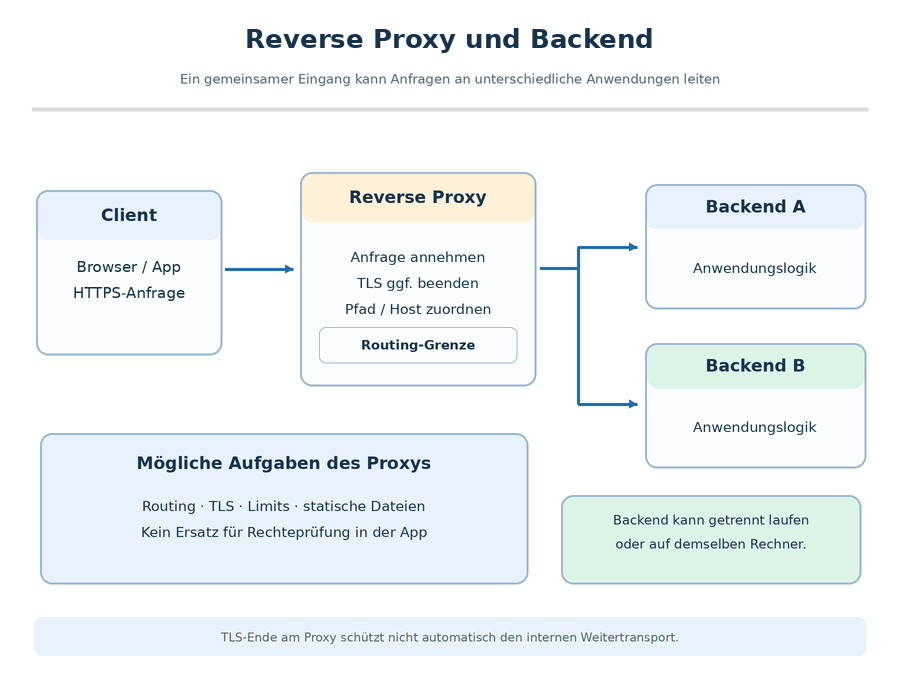

# M2-L2 – Website, Webanwendung, API und Backend {#L2}

**Kursbereich:** M2 – Bachelor: Web, Server und Hosting

**Niveau:** Bachelor

**Vorwissen:** Keine festen Voraussetzungen angegeben.

**Lernziel:** Verstehen, wie aus einer öffentlich erreichbaren Webseite ein interaktiver Online-Dienst wird, welche Rolle Schnittstellen und Hintergrundaufträge spielen und warum Benutzerverwaltung, Zustandsführung und Zugriffsschutz eigene Architekturaufgaben sind.

## Überblick: Eine Webseite ist nicht automatisch eine Webanwendung {#S1}

In [M2-L1 – Vom eigenen PC zum öffentlichen Server](M2-L1.md) haben wir geklärt, wie ein Server erreichbar wird. Jetzt geht es darum, **was auf diesem Server eigentlich geschieht**, nachdem eine Anfrage angekommen ist. Ein Browser kann lediglich eine vorbereitete Informationsseite abrufen. Er kann aber auch eine umfangreiche Anwendung bedienen, die Eingaben verarbeitet, Daten speichert, Berechnungen anstößt oder andere Computer anspricht. Beide Varianten benutzen Webtechnologien, stellen aber sehr unterschiedliche Anforderungen.

Das grundlegende Problem lautet: Menschen möchten eine Funktion über das Internet benutzen, ohne die dazugehörige Software lokal installieren zu müssen. Der Browser zeigt die Bedienoberfläche, die eigentliche Logik kann im Browser, auf einem Server oder verteilt über beide laufen. Auf Serverseite müssen bei Bedarf Daten dauerhaft gespeichert und Zugriffe verschiedener Benutzer voneinander abgegrenzt werden.

``` text
Informationsseite:
  Browser → Webserver → fertige HTML-Datei

Interaktive Anwendung:
  Browser → Benutzeroberfläche → Anwendungslogik → Datenbank / Dienst
```

Eine **Website** ist im weitesten Sinn ein zusammengehöriger Webauftritt. Eine **Webanwendung** stellt Funktionen zur Verfügung, mit denen jemand arbeitet: etwa einen Medienkatalog bearbeitet, Rechnungen erstellt oder Daten analysiert. Die Grenzen sind fließend; eine Website kann dynamische Bereiche enthalten, ohne dass der gesamte Auftritt als umfangreiche Anwendung konzipiert sein muss.

**Wann unnötig?** Eine einfache Projektvorstellung, Dokumentation oder veröffentlichte Artikelsammlung braucht nicht automatisch eine komplexe Benutzerverwaltung, ein eigenes API oder eine Datenbank. Statische Dateien können genügen. **Wann sinnvoll?** Wenn Benutzereingaben verarbeitet, persönliche Daten verwaltet oder Ergebnisse für spätere Zugriffe gespeichert werden sollen.

## Drei Bauformen: statische Seite, dynamische Website und Webanwendung {#S2}

### Statische Seiten {#21-statische-seiten}

Bei einer **statischen Webseite** liegen die auszuliefernden Dateien bereits vor. Typisch sind **HTML** (*HyperText Markup Language*, Auszeichnungssprache zur Strukturierung), **CSS** (*Cascading Style Sheets*, Stilregeln für Darstellung) und **JavaScript** (Programmiersprache im Browser). Ein Webserver sendet die Dateien, der Browser baut daraus die Anzeige auf. JavaScript kann auch auf einer statischen Seite Menüs öffnen, Bilder filtern oder lokal Daten sortieren: *statisch* bedeutet nicht *ohne Interaktivität*, sondern zunächst, dass die ausgelieferten Inhalte nicht für jede Anfrage serverseitig individuell erzeugt werden müssen.

``` text
Browser ── GET /handbuch.html ──► Webserver
Browser ◄──── HTML, CSS, Bilder ── Webserver
                  │
                  ▼
       JavaScript reagiert lokal
```

**Vorteil:** Wenige bewegliche Teile, oft preiswertes Hosting, kleine Angriffsfläche und gute Auslieferbarkeit über Caches. **Nachteil:** Für gemeinsam gespeicherte Benutzeränderungen ist eine zusätzliche Lösung erforderlich. Ein Kommentarbereich braucht beispielsweise einen externen Dienst oder ein eigenes Backend.

### Dynamische Websites {#22-dynamische-websites}

Eine **dynamische Website** erzeugt Inhalte abhängig von Daten und Anfragen. Ein Content-Management-System (CMS, System zur Verwaltung und Veröffentlichung von Inhalten) kann beispielsweise einen Artikel aus einer Datenbank laden und für den Besucher in HTML umwandeln. Die Ausgabe muss dafür nicht jedes Mal vollständig neu berechnet werden; häufig verwendete Ergebnisse lassen sich zwischenspeichern.

``` text
Browser → Webserver → PHP-Anwendung → Datenbank
                            │
                            └──── fertige HTML-Antwort → Browser
```

Ein Blog mit PHP und Datenbank ist damit bereits dynamisch. Es benötigt aber nicht automatisch einen getrennten JavaScript-Frontend-Server, Microservices oder Echtzeitverbindungen. Für einen solchen Zweck ist ein klassischer Webhoster oft vollkommen angemessen.

### Webanwendungen {#23-webanwendungen}

Bei einer Webanwendung steht stärker **eine Handlung** im Mittelpunkt: suchen, bearbeiten, vergleichen, kaufen, hochladen oder Ergebnisse erzeugen. Der Benutzer löst Vorgänge aus; die Anwendung prüft Eingaben, verändert Daten und liefert Rückmeldungen. Ein großer Teil der Oberflächenlogik kann mit JavaScript direkt im Browser laufen, während sensible Operationen und dauerhafte Datenhaltung beim Server bleiben.

Eine **Single-Page Application (SPA, Einzelseitenanwendung)** lädt häufig zuerst eine grundlegende Oberfläche und aktualisiert danach Teilbereiche, ohne für jeden Schritt ein ganzes HTML-Dokument anzufordern. Das ist eine mögliche Ausführung, aber keine Voraussetzung für eine Webanwendung. Eine traditionelle serverseitig gerenderte Anwendung kann ebenso komfortabel und funktional sein.

**Abwägung:** Mehr Logik im Browser kann flüssige Oberflächen ermöglichen, erhöht aber möglicherweise den Aufwand für JavaScript, Datenabgleich, Fehlerbehandlung und Barrierefreiheit. Serverseitig zusammengesetzte Seiten sind für viele Anwendungen einfacher zu entwickeln, zu testen und zu warten. Häufig wird beides kombiniert.

## Frontend und Backend: Wo liegt welche Verantwortung? {#S3}

Das **Frontend** ist der für Benutzer unmittelbar sichtbare und bedienbare Teil einer Anwendung. Dazu zählen Texte, Formulare, Schaltflächen, Tabellen, Fehlermeldungen und grafische Elemente. Das **Backend** verarbeitet im Hintergrund Anfragen, prüft Berechtigungen, führt Geschäftsregeln aus, nutzt eine Datenbank und spricht bei Bedarf andere Dienste an.

Eine sinnvolle gedankliche Trennung lautet:

- **Frontend:** *Was sieht der Benutzer, und welche Aktion möchte er ausführen?*
- **Backend:** *Darf er das, wie wird es korrekt ausgeführt und welche Daten verändern sich dabei?*
- **Datenbank:** *Was muss über einzelne Anfragen und Neustarts hinaus erhalten bleiben?*

``` text
      Browser / Frontend
       HTML · CSS · JavaScript
              │
       HTTPS-Anfrage
              ▼
        Backend / API
    Prüfung · Regeln · Ablauf
       ┌──────┴────────┐
       ▼               ▼
    Datenbank      Externer Dienst
```

Die Trennung muss **keine Trennung in verschiedene Rechner oder Projekte** bedeuten. Eine PHP-Anwendung kann HTML erzeugen, Benutzereingaben auswerten und Datenbankabfragen ausführen – alles innerhalb derselben Anwendung. Erst wenn technische Anforderungen oder Verantwortlichkeiten es nahelegen, müssen Teile getrennt betrieben werden.



*Abbildung: Ein Reverse Proxy kann vor mehreren Webanwendungen stehen und Anfragen nach Host oder Pfad weiterleiten. TLS kann am Proxy beendet werden; die weitere Strecke braucht bei entsprechenden Schutzanforderungen eine eigene Absicherung. Das Bild ist eine mögliche Betriebsarchitektur und keine Voraussetzung für eine Webanwendung.*

### Beispiel: Ein Tabellenwerkzeug im Browser

Der Benutzer lädt eine **CSV-Datei** (*Comma-Separated Values*, tabellarisches Textformat), wählt eine Spalte und möchte eine Statistik sehen. Für eine kleine Datei kann JavaScript im Browser sämtliche Berechnungen lokal durchführen. Kein Server muss die Daten jemals erhalten. Das ist datensparsam, kostengünstig und schnell, solange Speicher und Rechenleistung reichen.

Sollen dagegen mehrere Benutzer dieselben Analysen speichern, sehr große Datenmengen auswerten oder über mehrere Geräte synchron arbeiten, kann ein Backend sinnvoll sein. Es nimmt Aufträge entgegen, speichert Ergebnisse und verwaltet die Zugriffsrechte.

**Entscheidende Frage:** Wo *muss* eine Operation stattfinden? Nicht alles, was über eine Webseite bedienbar ist, muss in einer Cloud berechnet werden.

## Was ist eine API? {#S4}

Eine **API** (*Application Programming Interface*, Programmierschnittstelle) legt fest, wie ein Programm eine Funktion eines anderen Programms verwenden kann. Dazu gehören zulässige Anfragen, benötigte Angaben, zurückgelieferte Daten und Fehlerbedingungen. APIs existieren auch innerhalb eines Computers, etwa zwischen Programmbibliotheken. In dieser Lektion geht es überwiegend um **Web-APIs**, die über ein Netzwerk erreichbar sind.

Stell dir eine Bibliothek vor: Du musst nicht wissen, wie Bücher intern gelagert oder katalogisiert sind. Du benötigst eine verlässliche Auskunft darüber, wie man nach einem Titel sucht. Eine API übernimmt genau diese Rolle für Software.

``` text
Browser oder Desktop-Tool
         │
         │  Anfrage: "Daten zu Auftrag 42"
         ▼
       Web-API
         │  Berechtigung und Validierung
         ▼
      Datenbank
         │
         └──► strukturierte Antwort
```

Eine API ist nicht automatisch öffentlich. Sie kann nur für den eigenen Browser, für interne Dienste oder für zahlende Kunden gedacht sein. **Die eigentliche fachliche Funktion** kann dieselbe bleiben, auch wenn verschiedene Clients sie verwenden: Browseroberfläche, Desktop-Programm, mobile App oder ein automatisierter KI-Agent.

### Endpunkte und Datenformate {#41-endpunkte-und-datenformate}

Eine über das Web bereitgestellte API besitzt meist **Endpunkte**: adressierbare Stellen, an denen definierte Funktionen oder Ressourcen erreichbar sind. Beispieladressen wie `https://example.org/api/auftraege/42` sind schematisch; das ist kein real existierender Dienst.

Sehr häufig werden strukturierte Daten als **JSON** (*JavaScript Object Notation*) übertragen. JSON ist ein Datenformat, keine eigenständige Netzwerkverbindung und keine Datenbank. Beispielsweise könnte die Antwort inhaltlich diese Werte enthalten: Auftragsnummer 42, Status „fertig“, Ergebnisadresse. Ein anderer Dienst könnte stattdessen XML (*Extensible Markup Language*) oder ein binäres Format verwenden.

Entscheidend ist ein **Schnittstellenvertrag**: Welche Felder sind vorhanden? Sind Werte verpflichtend oder optional? Wie wird ein Fehler dargestellt? Was bedeutet eine spätere Änderung des Formats für bestehende Clients? Ohne diese Absprachen wird aus einer vermeintlich einfachen Verbindung schnell ein Wartungsproblem.

### HTTP-Methoden und Statuscodes {#42-http-methoden-und-statuscodes}

Das Web verwendet häufig **HTTP** (*Hypertext Transfer Protocol*, Web-Übertragungsprotokoll). Es unterscheidet den Zweck einer Anfrage unter anderem mit Methoden:

  Methode    Grundidee                                                  Schematisches Beispiel
  ---------- ---------------------------------------------------------- ----------------------------------
  `GET`      Ressource lesen                                            Auftragsstatus abrufen
  `POST`     Eingaben übermitteln, häufig etwas anlegen oder anstoßen   Neuen Auftrag anfordern
  `PUT`      Zielressource vollständig ersetzen                         Komplette Einstellungen ersetzen
  `PATCH`    Teilweise Änderung                                         Nur einen Anzeigenamen ändern
  `DELETE`   Ressource entfernen                                        Eigenen Entwurf löschen

Bei HTTP bedeutet **idempotent**, dass die *beabsichtigte serverseitige Wirkung* derselben Anfrage bei wiederholter Ausführung der einmaligen Wirkung entspricht. `GET`, `PUT` und `DELETE` haben entsprechende Semantik; `POST` garantiert diese Eigenschaft nicht. Ein versehentlich doppelt gesendeter `POST` zum Erstellen eines kostenpflichtigen Rechenauftrags könnte deshalb zwei Aufträge anlegen – wenn die Anwendung nicht eigens gegen Duplikate schützt.

Der Server antwortet mit einem **Statuscode**. Einige häufige Beispiele sind `200` (erfolgreich), `201` (erstellt), `202` (angenommen, Verarbeitung möglicherweise noch offen), `400` (fehlerhafte Anfrage), `401` (Authentifizierung fehlt oder ist ungültig), `403` (Zugriff verweigert), `404` (nicht gefunden) und `500` (interner Serverfehler). Die Antwort kann zusätzlich eine verständliche Fehlermeldung tragen.

**Risiko:** Ein schöner API-Name schützt nicht vor falscher Geschäftslogik. Wenn `GET` heimlich kostenpflichtige Aktionen auslöst oder Berechtigungen nur im Frontend geprüft werden, entsteht eine unsichere und schwer vorhersehbare Schnittstelle.

## REST: Ein verbreiteter Architekturansatz {#S5}

**REST** (*Representational State Transfer*) bezeichnet einen Architekturstil für verteilte Hypermedia-Systeme, der von Roy Fielding beschrieben wurde. Er umfasst unter anderem eine einheitliche Schnittstelle, getrennte Client-Server-Rollen, zustandslose Kommunikation zwischen Anfragen, Hinweise zur Zwischenspeicherung und eine Schichtenstruktur. Die Idee besteht darin, Komponenten mit möglichst gut verständlichen, unabhängig entwickelbaren Schnittstellen zu verbinden.

Ein vereinfachtes REST-nahes Beispiel:

``` text
GET  /api/auftraege/42  → liefert Repräsentation von Auftrag 42
POST /api/auftraege     → legt möglicherweise neuen Auftrag an
```

Die technische Darstellung einer Ressource kann in JSON erfolgen. **Aber:** Nicht jede API, die JSON über HTTP austauscht, erfüllt damit automatisch alle REST-Bedingungen. Besonders das Konzept von Ressourcen und einheitlicher Semantik sollte nicht mit beliebigen Funktionsaufrufen verwechselt werden.

REST ist nicht die einzige Möglichkeit. Ein **Remote Procedure Call (RPC)** ruft konzeptionell eine benannte Funktion in einem anderen System auf; **GraphQL** bietet eine eigene Abfragesprache für die Auswahl angeforderter Daten. Diese Alternativen lösen andere Probleme, verursachen aber ebenfalls Schnittstellen- und Betriebsaufwand.

**Wann sinnvoll?** Für klar beschreibbare Ressourcen, die mehrere Clients abrufen oder verändern. **Wann überdimensioniert?** Wenn eine kleine PHP-Anwendung ausschließlich ihre eigenen Seiten rendert und keine unabhängigen Clients benötigt. Eine saubere interne Modulgrenze kann dann wichtiger sein als eine zusätzlich veröffentlichte API.

## Von der Anfrage zur Antwort: synchroner Ablauf {#S6}

Eine klassische Webanfrage läuft **synchron** im Sinne des Interaktionsmusters ab: Der Client sendet eine Anfrage und wartet auf eine Antwort. Der Server kann intern zwar asynchrone Operationen verwenden, aber aus Benutzersicht ist zunächst ein Antwortzeitpunkt erforderlich.

``` text
Benutzer klickt "Berechnen"
        │
        ▼
Frontend validiert Eingabemaske
        │ HTTPS
        ▼
Backend prüft Identität, Recht und Eingaben
        │
        ▼
Berechnung / Datenbankzugriff
        │
        ▼
HTTP-Antwort mit Ergebnis oder Fehler
        │
        ▼
Frontend zeigt Ergebnis
```

Für kurze Abfragen ist das einfach und gut. Problematisch wird es, wenn eine Aufgabe mehrere Minuten dauert, das Netzwerk abbricht oder viele Benutzer gleichzeitig umfangreiche Berechnungen anfordern. Dann sollte man den Auftrag meist **annehmen, speichern und später verarbeiten** – ohne die gesamte Wartezeit eine offene Anfrage zu benötigen.

## Hintergrundjobs, Warteschlangen und Worker {#S7}

Ein **Hintergrundjob** (*background job*) ist ein Arbeitsauftrag, der unabhängig von einer gerade offenen Browseranfrage ausgeführt wird. Ein **Worker** (Arbeitsprozess) holt solche Aufträge aus einer **Queue** (Warteschlange), bearbeitet sie und speichert ein Ergebnis. Ein **Scheduler** (Zeitplaner) kann Jobs zu einem vorgesehenen Zeitpunkt starten, beispielsweise eine tägliche Sicherung oder den Versand eines Berichts.

``` text
Browser → API: "Analyse starten"
              │
              ▼
      Auftrag dauerhaft erfassen
              │
              ▼
        Warteschlange
              │
              ▼
         Worker-Prozess
              │
              ▼
     Daten / Ergebnis speichern
              │
              ▼
 Browser fragt Status später ab
```

Damit kann die API schnell bestätigen: *Auftrag angenommen* – beispielsweise mit HTTP `202`. Die eigentliche Arbeit läuft danach weiter. Eine lokale Anwendung kann ein ähnliches Muster bereits mit einer Datenbanktabelle und einem separaten Arbeitsprozess umsetzen. Ein spezialisierter Nachrichtenbroker ist **nicht automatisch** erforderlich.

### Was passiert bei Fehlern?

Hier zeigt sich der Unterschied zwischen einem kleinen Skript und einem verlässlich betriebenen Dienst. Ein Worker kann mitten in der Verarbeitung abstürzen. Der Auftrag kann nach einem Neustart erneut zugestellt werden. Das System muss deshalb festlegen, welche Zustände existieren, zum Beispiel `neu`, `in Bearbeitung`, `fertig`, `fehlgeschlagen`, und wie es Wiederholungen behandelt.

**Idempotenz** ist bei solchen Wiederholungen besonders nützlich: Wird derselbe Auftrag zweimal empfangen, darf er nicht ohne weiteres zweimal berechnet, ausgeliefert oder abgerechnet werden. Übliche Gegenmaßnahmen sind stabile Auftragskennungen, Wiederholungsprüfung, Datenbanktransaktionen und eine begrenzte Zahl von Versuchen. Die Einzelheiten vertiefen wir in M3-L5 – Transaktionen und verteilte Korrektheit, und die verteilte Verarbeitung in M4-L1.

**Betriebsfolgen:** Warteschlangen benötigen Speicherplatz, Beobachtung, Fehlerprotokolle und Regeln für überlastete Worker. Bei rechenintensiven KI-Aufträgen können außerdem hohe CPU- (*Central Processing Unit*, Hauptprozessor) oder GPU-Kosten (*Graphics Processing Unit*, Grafikprozessor) entstehen. Eine Queue begrenzt Kosten nicht von selbst; dazu braucht es Auftragslimits, Quoten und kontrollierte Parallelität.

## Webhooks: Ein System meldet ein Ereignis an ein anderes {#S8}

Ein **Webhook** ist eine vereinbarte automatische Benachrichtigung über ein Netzwerk: Wenn in System A ein bestimmtes Ereignis auftritt, sendet es eine HTTP-Anfrage an eine vorher konfigurierte Adresse von System B. Das unterscheidet sich von einer gewöhnlichen API-Abfrage, bei der System B aktiv nachsehen müsste, ob sich etwas geändert hat.

Beispiel: Eine Zahlungsplattform informiert die Anwendung, dass eine Zahlung bestätigt wurde. Die Anwendung kann daraufhin den Status einer Bestellung aktualisieren. Das eigentliche Ereignis wird dabei **nicht** dadurch vertrauenswürdig, dass irgendeine Nachricht die Worte „Zahlung erfolgreich“ enthält.

``` text
Ereignis in System A
      │
      ▼
HTTP-Webhook an System B
      │
      ▼
Signatur / Echtheit / Ereignis-ID prüfen
      │
      ▼
Ereignis speichern → optional Queue → Verarbeitung
```

Wichtige Schutzmaßnahmen sind HTTPS (*HTTP Secure*, HTTP über verschlüsselte Verbindung), Prüfung einer kryptografischen Signatur oder eines gleichwertigen Authentifizierungsmechanismus, Plausibilitätsprüfung der Ereignisart sowie Schutz gegen wiederholte Zustellungen. Da Absender bei ausbleibender Bestätigung erneut senden können, ist dieselbe Meldung unter Umständen mehrfach zu erwarten. Eine eindeutige Ereigniskennung hilft, Doppelverarbeitung zu vermeiden. Manche Anbieter erwarten binnen weniger Sekunden eine Bestätigung; aufwendige Arbeit gehört dann in einen Hintergrundjob.

**Wann unnötig?** Wenn kein zweites System automatisch informiert werden muss. Ein gelegentlich benutztes lokales Hilfsprogramm kann einfach bei Bedarf eine API abfragen.

## WebSockets und andere Arten von Aktualisierungen {#S9}

Normales HTTP ist gut geeignet, wenn der Client eine Anfrage stellt und eine Antwort erhält. Bei einem Chat, einer kollaborativen Oberfläche oder einer Live-Anzeige sollen neue Ereignisse dagegen oft ohne erneutes Klicken erscheinen.

**WebSocket** ist ein Protokoll für eine länger bestehende, bidirektionale Kommunikation zwischen Client und Server. Beide Seiten können während der Verbindung Nachrichten senden. Der standardisierte Grundmechanismus ist in **RFC 6455** (*Request for Comments*, Dokumentenreihe für Internetstandards) beschrieben; die Browser-Schnittstelle wird als WebSocket API angeboten.

``` text
Normales HTTP:
  Browser → Anfrage → Server → Antwort → Browser

WebSocket:
  Browser ◄════ bestehende Verbindung ════► Server
          Nachrichten in beide Richtungen
```

Für manche Anwendungsfälle genügen einfachere Alternativen:

  Muster                           Grundidee                                                                        Typischer Einsatz
  -------------------------------- -------------------------------------------------------------------------------- -----------------------------------------------------
  **Polling**                      Browser fragt regelmäßig nach Neuigkeiten                                        Auftragsstatus alle paar Sekunden
  **SSE** (*Server-Sent Events*)   Server sendet Ereignisse einseitig über eine länger bestehende HTTP-Verbindung   Fortschrittsanzeigen, Nachrichtenstrom
  **WebSocket**                    Beide Seiten können jederzeit Nachrichten senden                                 Chat, gemeinsames Bearbeiten, interaktive Steuerung

Die Verbindungsart ändert nichts daran, dass Benutzerrechte, Datenkonsistenz und Fehlerbehandlung notwendig bleiben. Länger offene Verbindungen müssen bei Serverneustarts und Netzunterbrechungen wiederhergestellt werden. Viele gleichzeitige Verbindungen verbrauchen Ressourcen; bei hohem Nachrichtenaufkommen benötigt die Anwendung ein Konzept zum Umgang mit langsamen Empfängern (*Backpressure*, Rückstaukontrolle). Die klassische Browser-WebSocket-Schnittstelle bietet diese Rückstaukontrolle nicht automatisch.

**Wann unnötig?** Wenn ein Benutzer nur gelegentlich nach dem Fortschritt einer Berechnung sehen möchte, kann einfaches Polling robuster und kostengünstiger sein.

## Benutzerkonten, Rollen und Sitzungen {#S10}

Sobald ein Dienst persönliche Daten verwaltet, muss er unterscheiden, **wer** eine Anfrage stellt und **was** diese Person tun darf. Das sind zwei verschiedene Aufgaben:

- **Authentifizierung:** Feststellen, welcher Identität eine Anfrage zugeordnet werden kann, etwa nach einer Anmeldung.
- **Autorisierung:** Für die konkrete Aktion und den konkreten Datensatz entscheiden, ob diese Identität zugreifen darf.

Ein Benutzer mit dem Recht „eigene Aufträge lesen“ darf nicht automatisch fremde Aufträge abrufen. Selbst ein technisch korrekt angemeldeter Benutzer kann für einen bestimmten Datenbestand unberechtigt sein.

### Sitzungen und Cookies {#101-sitzungen-und-cookies}

HTTP-Anfragen sind zunächst unabhängige Nachrichten. Eine Webanwendung möchte nach der Anmeldung dennoch wissen, dass nachfolgende Anfragen vom selben angemeldeten Browser stammen. Dazu wird häufig eine **Session** (Sitzung) geführt.

``` text
Benutzer meldet sich an
       │
       ▼
Backend prüft Zugangsdaten
       │
       ▼
Session wird angelegt
       │
       ▼
Browser erhält geschütztes Session-Cookie
       │
       ▼
Folgeanfrage enthält Cookie
       │
       ▼
Backend prüft Session UND Zugriffsrecht
```

Ein **Cookie** ist ein kleiner Wert, den der Browser für eine Website speichern und bei passenden Anfragen mitsenden kann. Bei einer häufig verwendeten Konstruktion enthält das Cookie nur eine zufällige Sitzungskennung; Zuordnung und Rechte werden serverseitig gespeichert. Ein anderer Ansatz verwendet signierte Tokens, die Informationen selbst enthalten können. **Token** bedeutet allgemein einen Wert zum Nachweis oder zur Übermittlung einer Berechtigung; nicht jeder Token ist automatisch ein Session-Cookie.

Die Open Worldwide Application Security Project (**OWASP**, gemeinnützige Initiative für Anwendungssicherheit) empfiehlt bei Session-Cookies unter anderem geeignete Eigenschaften wie `Secure`, `HttpOnly` und `SameSite`, serverseitige Ablauf- und Abmeldelogik sowie die Vermeidung sensibler Inhalte in Sitzungskennungen. `HttpOnly` erschwert bestimmten Skripten das Auslesen des Cookies; es macht eine Anwendung nicht automatisch gegen alle Angriffe sicher.

**Wichtig:** Eine Session ist ein zusätzlicher Betriebsgegenstand: Sie kann ablaufen, gestohlen werden, nach einem Neustart verloren gehen oder ungültig werden müssen, wenn sich Berechtigungen ändern. Solche Regeln gehören zur Anwendung – nicht allein zum Webserver.

### Rollen, Rechte und Ressourcen {#102-rollen-rechte-und-ressourcen}

Ein verbreitetes Modell heißt **RBAC** (*Role-Based Access Control*, rollenbasierte Zugriffskontrolle). Statt jedem Benutzer jede Erlaubnis einzeln zuzuordnen, werden Rollen wie `Gast`, `Kunde` und `Administrator` mit Rechten verknüpft. Die Rollen sind nur ein Hilfsmittel; viele Systeme brauchen zusätzliche Prüfungen auf Ebene einzelner Datenobjekte.

  Rolle           Typische erlaubte Aktion         Nicht automatisch erlaubt
  --------------- -------------------------------- ---------------------------------------------------------------
  Gast            Öffentliche Beschreibung lesen   Private Kundendaten sehen
  Kunde           Eigene Analyse abrufen           Auftrag eines anderen Kunden abrufen
  Administrator   Systemeinstellungen verwalten    Unbegrenzte Einsicht ohne fachliche oder rechtliche Grundlage

Angenommen, eine API besitzt den Endpunkt `/api/auftraege/42`. Ein angemeldeter Benutzer ändert in der Adresse `42` zu `43`. **Der Server muss prüfen, ob genau dieser Benutzer auf Auftrag 43 zugreifen darf.** Das bloße Ausblenden fremder Aufträge im Frontend genügt nicht. OWASP bezeichnet fehlende Prüfung einzelner Objekte als *Broken Object Level Authorization* (BOLA, fehlerhafte Berechtigungsprüfung auf Objektebene).

### Mandantenfähigkeit: mehrere Kunden, ein Dienst {#103-mandantenfähigkeit-mehrere-kunden-ein-dienst}

**Multi-Tenancy** (Mandantenfähigkeit) bedeutet, dass ein Dienst mehrere voneinander abgegrenzte Kundenorganisationen oder Kundengruppen bedient. Ein **Mandant** (Tenant) ist nicht zwingend ein Benutzer: Eine Organisation kann mehrere Mitarbeiterkonten besitzen. Die Grundfrage lautet: Wie teilen sich die Mandanten technische Ressourcen, ohne dass Daten und Zuständigkeiten vermischt werden?

Drei vereinfachte Modelle sind:

1.  **Gemeinsame Anwendung und Datenbank:** Datensätze tragen eine Mandantenkennung. Zugriffsprüfungen sind besonders wichtig.
2.  **Gemeinsame Anwendung, getrennte Datenbanken:** Mehr Trennung bei der Datenhaltung, dafür zusätzliche Verwaltung.
3.  **Getrennte Instanzen pro Mandant:** Stärkere Abgrenzung und eigene Anpassbarkeit möglich, aber höhere Betriebs- und Updatekosten.

``` text
Mandant Firma A ─┐
                 ├─► gemeinsame Webanwendung ─► geschützte Datenhaltung
Mandant Firma B ─┘                             (logisch oder physisch getrennt)
```

Geteilte Infrastruktur bedeutet **nicht automatisch fehlende Sicherheit**, getrennte Datenbanken bedeuten **nicht automatisch vollständige Isolation**. Entscheidend sind die tatsächlichen Zugriffspfade und Betriebsprozesse. Wenn ein Dienst nur für eine Person gedacht ist, wäre Mandantenfähigkeit häufig unnötige Komplexität.

## Zustandslos und zustandsbehaftet: Zwei Begriffe, die man trennen muss {#S11}

Ein **zustandsloser Dienst** (*stateless service*) benötigt für die Verarbeitung einer einzelnen Anfrage normalerweise keinen ausschließlich in seinem lokalen Arbeitsspeicher aufbewahrten Kontext früherer Anfragen. Notwendige Angaben kommen mit der Anfrage oder werden aus gemeinsam erreichbarer Speicherung geladen. Eine **zustandsbehaftete Komponente** (*stateful*) verwaltet dagegen Zustand, der für spätere Schritte benötigt wird, etwa eine laufende Transaktion, eine WebSocket-Verbindung oder eine Datenbank mit dauerhaft gespeicherten Änderungen.

**Wichtig: Zustandsloses Backend heißt nicht „Anwendung ohne gespeicherte Daten“.** Die Benutzerdaten können sehr wohl in einer Datenbank stehen; nur die einzelne Backend-Instanz muss sich den Benutzer nicht ausschließlich durch unersetzliche lokale Variablen merken.

``` text
                Anfrage
                   │
          ┌────────┴────────┐
          ▼                 ▼
     Backend 1          Backend 2
          │                 │
          └────────┬────────┘
                   ▼
        gemeinsame Datenbank /
        gemeinsamer Session-Speicher
```

Dieses Muster hilft später bei **horizontaler Skalierung**: Mehrere Backend-Instanzen können ähnliche Anfragen bearbeiten. Aber die gemeinsame Datenhaltung kann zum Engpass werden, und nicht jede Anwendung lässt sich vollständig zustandslos gestalten.

Die **REST-Forderung nach zustandslosen Anfragen** bezieht sich präzise auf die Interaktion zwischen Client und Server: Jede Anfrage soll die für ihre Interpretation notwendigen Informationen enthalten. Eine serverseitig geführte Session im klassischen Webdesign ist damit nicht identisch mit diesem strengen REST-Modell. Gleichzeitig darf ein REST-System selbstverständlich langlebige Ressourcen in einer Datenbank speichern. *Kommunikationszustand* und *Geschäftsdaten* sind verschiedene Dinge.

**Wann ist Statelessness unnötig?** Eine kleine Anwendung mit einer einzigen Instanz darf ohne Weiteres ihre Sitzungstabellen lokal verwalten. Der Vorteil unabhängiger Instanzen zeigt sich stärker bei Lastverteilung, Ausfällen und mehreren Servern.

## Sicherheit und Betrieb: Eine API ist eine öffentliche Angriffsfläche {#S12}

Eine Webanwendung bringt neue Pflichten mit sich, sobald andere Menschen darauf zugreifen können. Die wichtigste Regel lautet: **Der Browser ist kein vertrauenswürdiger Durchsetzungsort für Sicherheitsregeln.** Er darf Eingaben bequem vorprüfen; der Server muss aber Werte, Identität und Berechtigung selbst kontrollieren.

### Typische Risiken

- **Fremdzugriff:** Ein korrekt angemeldeter Benutzer kann andere Objektkennungen ausprobieren. Abhilfe: Prüfung auf der Ebene jeder betroffenen Ressource.
- **Schädliche Eingaben:** Ungeprüfte Daten können Datenbankabfragen, HTML-Ausgabe oder Dateipfade beeinflussen. Abhilfe: geeignete Parameterbindung, kontextabhängige Ausgabekodierung und sichere Dateiverarbeitung.
- **Überlastung und Kostenangriffe:** Ein offener Rechen-Endpunkt kann absichtlich oder versehentlich massenhaft aufgerufen werden. Abhilfe: Quoten, Größenlimits, Ratenbegrenzung, Auftragsbudgets und Beobachtung.
- **Gestohlene Zugangsdaten oder Sessions:** Abhilfe: sichere Passworthandhabung, Mehrfaktor-Authentifizierung (MFA) wo sinnvoll, TLS, angemessene Session-Regeln und nachvollziehbare Sperrmöglichkeiten.
- **Datenverlust:** Fehlerhafte Änderungen, kaputte Deployments und versehentliches Löschen sind mit Zugriffsschutz allein nicht verhindert. Abhilfe: Backups und geprüfte Wiederherstellung.
- **Datenabfluss durch Protokolle:** Zugangstokens, hochgeladene Dateien und personenbezogene Angaben sollten nicht unkontrolliert in Logs landen.

Für veröffentlichte Dienste kommen rechtliche und organisatorische Fragen hinzu: Zweck der Verarbeitung, Aufbewahrung, Löschung, Vertragsverhältnisse zu Dienstleistern und Supportprozesse. Die konkreten Anforderungen hängen von Nutzung und Rechtsraum ab; diese Lektion ersetzt keine aktuelle rechtliche Prüfung.

### Laufende Kosten, auch bei kleiner Software

Oft wird nur die monatliche Serverrechnung betrachtet. Tatsächlich gehören auch Domain, Datenspeicher, gesicherte Kopien, ausgehender Datenverkehr, E-Mail-Zustellung, Überwachung, Aktualisierungen und Kundenbetreuung zum Gesamtaufwand. Besonders Hintergrundberechnungen können verbrauchsabhängige Kosten auslösen. Ein kleines Werkzeug mit wenigen Benutzern lässt sich häufig auf einem klassischen Hostingangebot oder einem kleinen Server betreiben, sofern der Funktionsumfang passt.

**Eine komplexe Architektur ist kein Qualitätsmerkmal an sich.** Auch ein moderner Dienst darf ein gut gepflegter Monolith mit einer Datenbank sein. Microservices, dauerhafte WebSocket-Verbindungen oder mehrere separate Queues sind nur dann sinnvoll, wenn sie ein tatsächlich vorhandenes Problem lösen.

## Drei durchgehende Praxisbilder {#S13}

### Dokumentations- und Projektwebsite {#131-dokumentations--und-projektwebsite}

**Ziel:** Texte, Bilder, Handbücher und Softwarebeschreibungen öffentlich lesbar machen.

``` text
Besucher → Browser → Webhoster → HTML / CMS-Seite
```

Wenn kaum personalisierte Funktionen nötig sind, ist eine statische Ausgabe oder eine einfache CMS-Seite häufig ausreichend. Eine öffentliche API, Nutzerkonten und WebSockets würden zusätzlichen Pflege- und Sicherheitsaufwand schaffen, ohne einen entsprechenden Nutzen zu liefern. Der Betrieb konzentriert sich auf Aktualisierung, Verfügbarkeit, Sicherung und gegebenenfalls Kommentarfunktionen.

### Kleines Online-Analysewerkzeug {#132-kleines-online-analysewerkzeug}

**Ziel:** Ein Benutzer lädt Daten hoch, erhält eine Auswertung und kann sie später wieder abrufen.

``` text
Browser → Formular / Anzeige → API / Backend
                                  │
                                  ├─► Datenbank: Benutzer, Aufträge, Ergebnisse
                                  └─► optional Worker für längere Berechnungen
```

Eine erste Version kann aus einem einzigen Backend mit Datenbank bestehen. Dauern Berechnungen nur Sekunden, braucht es noch keine Queue. Erst bei längeren, parallelen Aufträgen wird die Aufteilung in Webanwendung und Worker interessant. Für Benutzerkonten wird eine sichere Session oder vergleichbare Authentifizierung benötigt; jede Auswertung muss auf ihren Eigentümer geprüft werden.

### KI-Verarbeitungsdienst {#133-ki-verarbeitungsdienst}

**Ziel:** Nutzer senden Texte oder Medien und lassen daraus Ergebnisse erzeugen. Die KI-Berechnung läuft in einer lokalen oder gemieteten Rechenumgebung.

``` text
Browser oder API-Kunde
        │
        ▼
      Backend ──► Benutzer / Tarif / Kostenlimit prüfen
        │
        ▼
    Auftrag anlegen ──► Queue ──► KI-Worker (CPU/GPU)
        │                           │
        └─ Status abrufen ◄─ Ergebnis speichern
```

Hier kann die Entkopplung große Vorteile bieten: Kurze Webanfragen blockieren keine minutenlangen KI-Berechnungen, und Arbeitsprozesse lassen sich unabhängig betreiben. Auftragskennung, Wiederholungslogik, Speicherbegrenzung, Berechtigung auf Ergebnisse und Kostenkontrolle werden zu zentralen Aufgaben. Ein WebSocket ist für die reine Fortschrittsanzeige **optional**; Polling oder SSE können genügen.

Die wesentliche Geschäftsfrage ist nicht, ob eine solche Architektur technisch möglich ist, sondern ob Nachfrage, Preis, Hardwarekosten, Datenschutz und laufender Support zusammenpassen. Auf diese Abwägung kommen wir in M4-L4 und M4-L5 zurück.

## Entscheidungshilfe: klein anfangen, bewusst erweitern {#S14}

  Anforderung                    Naheliegende einfache Lösung              Ausbau nur bei wirklichem Bedarf
  ------------------------------ ----------------------------------------- --------------------------------------------------------
  Texte und Handouts anzeigen    Statische Website                         CMS bei häufiger redaktioneller Pflege
  Formulare und Datenbank        Serverseitige Webanwendung                Getrenntes Frontend/API bei mehreren Clients
  Schnelle Datenberechnung       Direkt in Anfrage oder lokal im Browser   Hintergrundjob bei hoher Laufzeit oder Last
  Auftragsfortschritt anzeigen   Regelmäßige Statusabfrage                 SSE oder WebSocket bei höherem Aktualitätsbedarf
  Benutzeranmeldung              Bewährte Sessionverwaltung                Zentraler Identitätsdienst bei mehreren Anwendungen
  Mehrere Kunden                 Sauberes Benutzer- und Datenmodell        Mandantenarchitektur bei organisatorischer Trennung
  Wenige Online-Nutzer           Ein Server, eine Anwendung                Weitere Instanzen, Queue, Lastverteilung bei Engpässen

Die Tabelle ist kein Dogma. Sie zeigt die Reihenfolge, in der man Probleme sinnvollerweise löst: **Funktion → Daten → Berechtigungen → Zuverlässigkeit → erst dann Skalierung**. Die konkrete Technik sollte zur wirklichen Nutzungsweise passen.

## Zusammenfassung und Übergang zu M2-L3 {#S15}

Eine **Website** stellt Inhalte bereit; eine **Webanwendung** bietet darüber hinaus Arbeitsfunktionen. Das **Frontend** vermittelt die Interaktion, das **Backend** prüft und verarbeitet Vorgänge. Eine **API** definiert einen Vertrag zwischen Programmen. **REST** ist ein Architekturstil, nicht einfach ein anderes Wort für JSON über HTTP. **Webhooks** melden Ereignisse zwischen Systemen, **Hintergrundjobs** entkoppeln lange Arbeiten von Browseranfragen, **WebSockets** erlauben beidseitige Kommunikation über eine bestehende Verbindung. **Sitzungen**, **Rollen**, **Mandanten** und **zustandslose Dienste** lösen jeweils unterschiedliche Probleme der Identität, Berechtigung, Datenabgrenzung und Skalierbarkeit.

Die zentrale Erkenntnis lautet: **Aus einer kleinen Webseite wird nicht dadurch ein professioneller Dienst, dass man möglichst viele Technologien einbaut. Entscheidend sind verständliche Schnittstellen, korrekte Zustände, sichere Berechtigungen und zuverlässig beherrschbarer Betrieb.**

In **M2-L3 – Hosting- und Cloud-Bereitstellungsmodelle** fragen wir anschließend, wer diese Komponenten betreibt und welche Verantwortung beim Anbieter oder beim Softwareentwickler liegt: klassisches Hosting, gemieteter Server, gemanagte Plattform, Serverless und Cloud-Dienstmodelle.


## Quellen {#S16}

**Letzte Quellenprüfung:** 03.11.2026

**Prüfdatum:** 03.11.2026. Die Quellen erläutern Architekturprinzipien und aktuelle Empfehlungen; sie sind keine Preisübersichten und kein Ersatz für Sicherheits- oder Rechtsprüfung eines konkreten Produkts.

- **MDN Web Docs – HTTP-Anfragemethoden:** Bedeutung von GET, POST, PUT, PATCH und DELETE sowie Idempotenz. [https://developer.mozilla.org/de/docs/Web/HTTP/Reference/Methods](https://developer.mozilla.org/de/docs/Web/HTTP/Reference/Methods)
- **Roy T. Fielding – Dissertation, Kapitel 5 „Representational State Transfer (REST)“ (2000):** REST-Bedingungen und architektonische Abwägungen. [https://ics.uci.edu/\~fielding/pubs/dissertation/rest_arch_style.htm](https://ics.uci.edu/~fielding/pubs/dissertation/rest_arch_style.htm)
- **IETF – RFC 6455, The WebSocket Protocol (2011):** standardisierte bidirektionale Verbindung. [https://datatracker.ietf.org/doc/rfc6455/](https://datatracker.ietf.org/doc/rfc6455/)
- **MDN Web Docs – WebSocket API und EventSource:** bidirektionale WebSockets, einseitige Server-Sent Events und Hinweise zur Rückstaukontrolle. [https://developer.mozilla.org/en-US/docs/Web/API/WebSockets_API](https://developer.mozilla.org/en-US/docs/Web/API/WebSockets_API) und [https://developer.mozilla.org/en-US/docs/Web/API/EventSource](https://developer.mozilla.org/en-US/docs/Web/API/EventSource)
- **GitHub Docs – Best practices for using webhooks:** Echtheitsprüfung, zügige Annahme, Warteschlangen, Wiederholungen. [https://docs.github.com/en/webhooks/using-webhooks/best-practices-for-using-webhooks](https://docs.github.com/en/webhooks/using-webhooks/best-practices-for-using-webhooks)
- **OWASP – Session Management Cheat Sheet:** Sitzungskennungen, Cookie-Eigenschaften, Ablauf und Missbrauchsschutz. [https://cheatsheetseries.owasp.org/cheatsheets/Session_Management_Cheat_Sheet](https://cheatsheetseries.owasp.org/cheatsheets/Session_Management_Cheat_Sheet)
- **OWASP API Security Top 10 (Ausgabe 2023):** Fehlerhafte objektspezifische Autorisierung und weitere API-Risiken. [https://api-security.owasp.org/editions/2023/en/0x11-t10/](https://api-security.owasp.org/editions/2023/en/0x11-t10/)
- **Microsoft Learn – Architectural Approaches for a Multitenant Solution:** Abwägungen zwischen gemeinsamer und getrennter Infrastruktur. [https://learn.microsoft.com/en-us/azure/architecture/guide/multitenant/approaches/overview](https://learn.microsoft.com/en-us/azure/architecture/guide/multitenant/approaches/overview)
