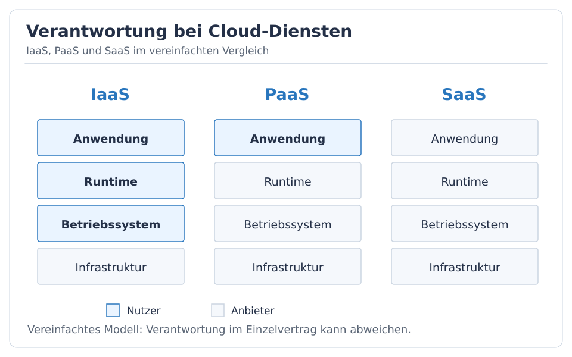

# M2-L3 – Hosting- und Cloud-Bereitstellungsmodelle {#L3}

**Kursbereich:** M2 – Bachelor: Web, Server und Hosting

**Niveau:** Bachelor

**Vorwissen:** Keine festen Voraussetzungen angegeben.

## Überblick: Nicht wo die Software läuft, sondern wer sich um was kümmert {#S1}

In M2-L1 wurde aus einem gewöhnlichen Computer ein öffentlich erreichbarer Server. In M2-L2 haben wir eine Webanwendung in Benutzeroberfläche, Backend, Programmschnittstellen und Datenhaltung zerlegt. Nun stellt sich die nächste Frage: **Wo kann eine solche Anwendung betrieben werden, ohne dass du jede Hardware- und Wartungsaufgabe selbst übernehmen musst?**

Die Antwort ist nicht einfach „in der Cloud“. Zwischen dem eigenen Heimcomputer, einem klassischen Webhosting-Paket, einem gemieteten virtuellen Server und einem vollständig verwalteten Onlinedienst liegen erhebliche Unterschiede. Sie betreffen vor allem **Kontrolle, Betriebsverantwortung, Änderbarkeit, Kosten und Abhängigkeiten**. Dieselbe kleine PHP-Anwendung lässt sich je nach Rahmenbedingungen auf verschiedene Arten bereitstellen; die beste Wahl hängt von ihren Anforderungen ab.

Diese Lektion trennt drei Ebenen, die in Werbetexten oft vermischt werden:

1.  **Betriebsort und Eigentum:** Zuhause, im eigenen Rechenzentrum, in einem fremden Rechenzentrum oder auf gemeinsam genutzter Infrastruktur.
2.  **Dienstmodell:** Miete ich Ressourcen, eine verwaltete Plattform oder eine fertige Anwendung?
3.  **Geschäftsmodell:** Nutze ich einen Dienst selbst oder verkaufe ich über ihn meine eigene Software an Kunden?

Das wichtigste Ergebnis vorweg: **Eine Anwendung online anzubieten bedeutet nicht, selbst einen Cloudanbieter betreiben zu müssen.** Du kannst einen sehr einfachen fremden Hostingdienst nutzen und trotzdem eine eigene kommerzielle Software anbieten.

## Eigenbetrieb: Der eigene Computer als Server {#S2}

**Eigenbetrieb** bedeutet, dass du die wesentlichen technischen Ressourcen selbst bereitstellst und betreibst. Häufig liest man dafür den Ausdruck **on-premises**, also „am eigenen Standort“. Das kann ein Heim-PC sein, ein kleiner Rechner im Büro oder eine ganze Serverinstallation in einem eigenen Rechenzentrum. Die Unterscheidung ist wichtig: Eigenbetrieb sagt zunächst nichts über die Größe des Systems aus.

Ein eigener Rechner kann sinnvoll sein, wenn Daten bewusst lokal bleiben sollen, wenn eine Internetverbindung nicht zuverlässig verfügbar ist oder wenn du spezielle Hardware benötigst. Ein lokaler KI-Rechner mit Grafikkarte ist ein anschauliches Beispiel. Auch eine interne Entwicklungsumgebung, ein privates Medienarchiv oder ein lokaler Testserver passen gut dazu.

``` text
Lokaler Benutzer → Heimnetz → eigener Rechner → Anwendung → lokale Daten
                                  │
                                  └── Wartung, Strom und Hardware selbst
```

**Was löst das?** Maximale Kontrolle über Betriebssystem, Hardware und lokale Daten. **Wann unnötig?** Wenn nur eine kleine öffentliche Website erreichbar sein soll. Dann überwiegen oft die Nachteile: Stromverbrauch, Ausfälle, Internetanbindung, fehlende öffentliche Adresse, Geräusch, Zugangsschutz und die eigene Verantwortung für Wartung und Backups.

Ein Heimserver und eine *Private Cloud* sind übrigens nicht automatisch dasselbe. Der Ausdruck „Cloud“ setzt typischerweise zusätzliche Merkmale wie bedarfsgerechte Bereitstellung und gemeinsame Ressourcenverwaltung voraus. Ein einzelner Computer wird nicht durch Umbenennung zu einer Cloud.

## Colocation: Eigene Hardware im fremden Rechenzentrum {#S3}

Bei **Colocation** – oft auch „Housing“ genannt – bringst du grundsätzlich eigene Hardware in einem professionellen Rechenzentrum unter. Der Betreiber stellt je nach Vertrag zum Beispiel Stellplatz, Strom, Kühlung, Zutrittskontrolle und Netzwerkanschluss bereit. Die Verantwortung für den eigentlichen Server, dessen Komponenten, Betriebssystem und Anwendungen kann weitgehend bei dir bleiben.

``` text
Eigener Server (dein Eigentum)
          │
          ▼
Fremdes Rechenzentrum
   ├── Strom / Kühlung / Raum
   ├── Netzwerkanbindung
   └── physische Zutrittskontrolle
          │
          ▼
Deine Software und Daten
```

Das löst die Standortprobleme eines Heimservers, nicht automatisch die Administrationsprobleme. Wenn eine Festplatte ausfällt, muss geklärt sein, wer sie austauscht; ein Rechenzentrum repariert nicht von sich aus deine Anwendung. Colocation kann bei besonderen Hardwareanforderungen oder bereits vorhandenen Servern sinnvoll sein. Für ein erstes kleines Online-Werkzeug wäre das gewöhnlich ein überdimensionierter Einstieg.

**Abgrenzung:** Bei einem *dedizierten Mietserver* stellt der Anbieter die Hardware; bei Colocation gehört die Hardware normalerweise dem Kunden. Die Verträge können zusätzliche Wartungsleistungen enthalten, deshalb ist die konkrete Zuständigkeit entscheidend.

## Klassisches Webhosting: Ein fertiger Platz für die Website {#S4}

**Shared Hosting** oder gemeinsames Webhosting bedeutet, dass mehrere Kunden auf einer vom Anbieter verwalteten Serverumgebung betrieben werden. Du erhältst beispielsweise Webspeicher, eine Domainanbindung, PHP-Ausführung, eine Datenbank und eine Verwaltungsoberfläche. Der Hoster kümmert sich typischerweise um die physische Infrastruktur und große Teile der Systemadministration.

``` text
Browser → Webserver des Hosters
             ├── Website A
             ├── Website B (deine PHP-Anwendung)
             └── Website C
                    │
                    ▼
           Vom Hoster bereitgestellte Datenbank
```

Du kannst dort oft ohne eigene Linux-Administration ein Content-Management-System, eine Dokumentationsseite oder eine kleinere PHP-Anwendung betreiben. Die Einschränkung besteht darin, dass du nicht beliebige Hintergrundprogramme installieren oder beliebige Servereinstellungen ändern kannst. Auch Prozesslaufzeiten, Speicher, Datenbankverbindungen und Hintergrundaufträge können begrenzt sein.

**Was löst das?** Günstiger, wartungsarmer Betrieb üblicher Webseiten. **Wann reicht es nicht?** Wenn du eigene dauerhafte Prozesse, besondere Laufzeitumgebungen, grafikkartenbeschleunigte Berechnungen, individuelle Netzwerkkonfigurationen oder komplexe Dienste benötigst.

**Wichtig:** „Shared Hosting“ ist weder eine Sicherheitsgarantie noch eine Aussage darüber, welche Verarbeitungskapazität dir exklusiv zusteht. Der Anbieter muss die Kundentrennung richtig umsetzen. Du selbst bleibst typischerweise für deinen Webcode, deine Passwörter, Erweiterungen und die korrekte Konfiguration deiner Anwendung verantwortlich.

## VPS und dedizierter Mietserver: Mehr Freiheit, mehr Eigenverantwortung {#S5}

Ein **VPS** (*Virtual Private Server*, virtueller privater Server) ist ein gemieteter Server, der durch Virtualisierung bereitgestellt wird. Du verwaltest meist ein eigenes Gastbetriebssystem, hast deutlich mehr Konfigurationsmöglichkeiten als beim Shared Hosting und kannst mehrere eigene Dienste betreiben. Der Hoster betreut üblicherweise die physische Hardware und die zugrunde liegende Virtualisierung, nicht automatisch deine Software im virtuellen Server.

``` text
Physischer Host des Anbieters
   ├── VPS Kunde A
   ├── VPS Kunde B → Linux → Webserver → eigene App
   └── VPS Kunde C
```

Ein **dedizierter Server** ist dagegen gewöhnlich ein gemieteter physischer Rechner, der nicht als klassischer gemeinsam genutzter VPS bereitgestellt wird. Er bietet mehr Kontrolle über die gesamte Maschine und möglicherweise besser vorhersehbare Ressourcenzuteilung; die konkreten Eigenschaften hängen vom Angebot ab. Für gewöhnliche Webseiten ist er nicht notwendig, für spezielle Lasten oder besondere Isolation kann er interessant sein.

Bei einem VPS musst du typischerweise selbst planen: Betriebssystem- und Sicherheitsupdates, Firewall, Benutzerrechte, Laufzeitumgebungen, Datenbankbetrieb, Überwachung, Backups und Wiederherstellung. Wie viel tatsächlich übernommen wird, hängt davon ab, ob das Angebot *unmanaged* oder *managed* ist. **„Gemietet“ heißt nicht „administriert“.**

Ein kleiner VPS ist für viele selbstentwickelte Dienste ein vernünftiger Ausgangspunkt, sofern Betriebserfahrung oder eine zuverlässige Betreuung vorhanden ist. Für einen Entwickler, der möglichst wenig Zeit mit Systemadministration verbringen will, kann eine verwaltete Alternative günstiger sein – auch wenn deren monatliche Grundgebühr höher liegt.

## Was unterscheidet Cloud Computing von gewöhnlicher Servermiete? {#S6}

**Cloud Computing** bezeichnet ein Bereitstellungsmodell, bei dem Rechen-, Speicher- und Netzwerkressourcen über ein Netz bedarfsgerecht zugänglich sind und sich typischerweise rasch bereitstellen und wieder freigeben lassen. Das US-amerikanische **NIST** (*National Institute of Standards and Technology*, nationales Institut für Standards und Technologie) hat dafür bereits 2011 eine bis heute grundlegende Definition veröffentlicht. Sie nennt fünf kennzeichnende Eigenschaften:

- **Selbstbedienung bei Bedarf:** Ressourcen können ohne einzelnen manuellen Bestellvorgang bereitgestellt werden.
- **Breiter Netzwerkzugang:** Dienste sind über standardisierte Netzwerkschnittstellen erreichbar.
- **Gemeinsamer Ressourcenpool:** Die Infrastruktur wird für mehrere Nutzer oder Organisationen aufgeteilt.
- **Rasche Elastizität:** Kapazität kann je nach Bedarf erweitert oder reduziert werden.
- **Messbare Nutzung:** Der Ressourcenverbrauch ist erfassbar und kann als Abrechnungsgrundlage dienen.

``` text
Kunde → Cloud-Steuerung → gemeinsamer Ressourcenpool
                             ├── Rechnen
                             ├── Speicher
                             └── Netzwerke
                 Kapazität nach Bedarf zuteilen
```

Nicht jeder angebotene „Cloud-Server“ erfüllt alle Merkmale im gleichen Ausmaß. Ein fester VPS mit einer monatlichen Pauschale kann technisch sehr ähnlich wie eine Cloud-VM funktionieren, aber weniger flexibel bereitstellbar oder skalierbar sein. Umgekehrt verwenden Anbieter Cloud-Technologie für scheinbar einfache Hostingangebote.

**Was löst Cloud Computing?** Infrastruktur und Plattformfunktionen sollen ohne eigene Hardwarebeschaffung verfügbar werden. **Wann unnötig?** Wenn ein kleines System mit konstant geringem Bedarf zuverlässig auf einem einfachen Hostingpaket läuft. „Cloud“ ist kein Qualitätsurteil und keine automatische Garantie für Ausfallsicherheit.

## Public, Private und Hybrid Cloud: Wem steht die Infrastruktur zur Verfügung? {#S7}

Diese Begriffe beschreiben **Bereitstellungsformen**. Sie sind etwas anderes als die später behandelten Dienstmodelle IaaS, PaaS oder SaaS.

### Public Cloud – öffentlich angebotene Cloudinfrastruktur

Eine **Public Cloud** wird von einem Betreiber für eine breite Kundengruppe als Dienst angeboten. Du nutzt ihre Ressourcen, ohne das Rechenzentrum besitzen zu müssen. „Public“ bedeutet **nicht**, dass die darin gespeicherten Daten öffentlich zugänglich sein müssen. Private Netzwerke, Zugangskontrollen und isolierte Benutzerkonten sind gerade für solche Umgebungen wichtig.

### Private Cloud – für eine Organisation vorgesehene Cloud

Eine **Private Cloud** steht einer einzelnen Organisation exklusiv zur Verfügung. Sie kann intern oder durch einen Dienstleister betrieben werden, auf eigenen oder externen Standorten. Entscheidend ist die Bereitstellung als Cloudinfrastruktur für diese Organisation, nicht allein das Eigentum an der Hardware. Eine normale interne Dateiablage ist deshalb nicht automatisch eine Private Cloud.

### Hybrid Cloud – unterschiedliche Cloudumgebungen zusammenführen

Eine **Hybrid Cloud** verbindet voneinander unterscheidbare Cloudumgebungen, beispielsweise eine Private Cloud mit einer Public Cloud. Anwendungen oder Daten können zwischen ihnen nach festgelegten Regeln zusammenarbeiten. Ein lokaler Rechner plus irgendein externer Webdienst wird umgangssprachlich manchmal „hybrid“ genannt, erfüllt aber nicht zwingend eine formale Hybrid-Cloud-Definition.

### Community Cloud und Multicloud

Die NIST-Systematik kennt außerdem eine **Community Cloud**, die einer Gruppe von Organisationen mit gemeinsamen Anforderungen dient. **Multicloud** bedeutet im heutigen Sprachgebrauch, Angebote mehrerer Cloudanbieter zu verwenden. Das ist keine der vier ursprünglichen NIST-Bereitstellungsformen und löst eigene Integrationsprobleme aus.

**Praxisregel:** Für die meisten kleinen eigenen Projekte genügt eine einzelne Hostingumgebung. Private, Hybrid- und Multicloud-Strukturen schaffen zusätzliche Verbindungen, Identitätsregeln, Kostenkontrolle und Fehlerquellen; sie werden erst durch konkrete Anforderungen sinnvoll.

## IaaS, PaaS und SaaS: Drei Ebenen der Verantwortung {#S8}

Die drei klassischen **Cloud-Dienstmodelle** beschreiben, **welchen Teil der technischen Lösung du als Dienst erhältst**. Dieselbe Organisation kann mehrere Modelle gleichzeitig einsetzen.

{alt="Vergleich von IaaS, PaaS und SaaS als Verantwortungsschichten. Bei IaaS verantwortet der Nutzer mehr Softwareebenen als bei PaaS und SaaS."}

IaaS, PaaS und SaaS verschieben Betriebsverantwortung; Vertragsdetails können abweichen.

### IaaS – Infrastructure as a Service {#81-iaas-infrastructure-as-a-service}

**IaaS** bedeutet *Infrastructure as a Service*, also „Infrastruktur als Dienst“. Du mietest grundlegende Ressourcen: virtuelle Rechner, Datenträger, Netzwerke oder ähnliche Infrastrukturbausteine. Der Anbieter betreibt die physische Umgebung und die Virtualisierung. Du installierst oder verwaltest typischerweise Betriebssystem, Webserver, Datenbank und Anwendung.

``` text
IaaS-Anbieter: Rechenzentrum → Hardware → Virtualisierung
                                              │
Kunde:                                  Gastbetriebssystem
                                              │
                                      Webserver + Anwendung
                                              │
                                           Datenbank
```

**Problem gelöst:** Du musst keine Hardware anschaffen, behältst aber viel technische Freiheit. **Unnötig**, wenn dein Programm problemlos auf klassischem Hosting oder einer verwalteten Plattform laufen kann. Der häufig unterschätzte Nachteil ist die Verantwortung für Updates, sichere Konfiguration und die Wiederherstellung der eigenen Umgebung.

Ein VPS kann funktional IaaS sehr ähnlich sein. Ob das konkrete Angebot dem Cloudmodell im engeren Sinn entspricht, hängt von Bereitstellung, Elastizität und Nutzungsmodell ab; der Name „VPS“ entscheidet das nicht allein.

### PaaS – Platform as a Service {#82-paas-platform-as-a-service}

**PaaS** bedeutet *Platform as a Service*, also „Plattform als Dienst“. Statt einen vollständigen Server selbst zu verwalten, stellst du vor allem deine Anwendung bereit. Der Anbieter betreibt typischerweise die darunterliegende Laufzeit- und Betriebssystemumgebung, nimmt einen Teil der Skalierungsarbeit ab und stellt Werkzeuge für Auslieferung und Überwachung bereit.

``` text
Du:        Anwendungscode + Konfiguration + Datenlogik
                            │
                            ▼
PaaS:          Laufzeit + Betriebssystem + Skalierung
                            │
                            ▼
                    Physische Infrastruktur
```

**Problem gelöst:** Weniger Administrationsaufwand; stärkerer Fokus auf die eigene Software. **Unnötig** bei einer statischen Website oder einer Anwendung, für die ein normaler Webhostingtarif bereits alles bietet. Nachteile können begrenzte Laufzeitumgebungen, Einschränkungen bei Hintergrundprozessen, zusätzliche Plattformkosten und technische Anbieterabhängigkeit sein.

Eine verwaltete Plattform beseitigt nicht die Pflicht, die Anwendung sicher zu programmieren. Ob die Datenbank ein eigenes Backup benötigt, welche Limits für Prozesse gelten und wie Skalierung berechnet wird, muss weiterhin geprüft werden.

### SaaS – Software as a Service {#83-saas-software-as-a-service}

**SaaS** bedeutet *Software as a Service*, also „Software als Dienst“. Der Kunde nutzt eine weitgehend fertige Anwendung über Browser oder Programmschnittstelle, anstatt selbst Server, Laufzeitumgebung und Anwendungssoftware zu installieren. Der SaaS-Betreiber trägt typischerweise einen großen Teil der technischen Wartung, während der Kunde weiterhin für den sachgemäßen Umgang mit seinen Daten, Konten und Freigaben verantwortlich ist.

``` text
Endkunde → Browser → fertiger Onlinedienst
                         │
                  SaaS-Anbieter betreibt
             Anwendung + Plattform + Infrastruktur
```

**Problem gelöst:** Eine standardisierte Funktion ist sofort nutzbar. **Unnötig**, wenn du eine ganz eigene Softwarelogik benötigst, die der fertige Dienst nicht bietet. Nachteile sind laufende Nutzungsgebühren, begrenzte Anpassbarkeit und Abhängigkeit von Exportfunktionen und Vertragsbedingungen.

Hier entsteht eine wichtige Verwechslung: **Wenn du selbst einen Online-Dienst für Kunden entwickelst und verkaufst, bietest du möglicherweise SaaS an – auch wenn du dafür nur einen kleinen VPS gemietet hast.** Das Geschäftsmodell deines Angebots ist von dem Infrastrukturmodell, das du selbst einkaufst, zu unterscheiden.

## Ergänzende Modelle: CaaS, FaaS und verwaltete Datenbanken {#S9}

### CaaS – Containers as a Service {#91-caas-containers-as-a-service}

**CaaS** bedeutet *Containers as a Service*, also „Container als Dienst“. Container verpacken Programme mit wichtigen Laufzeitabhängigkeiten in eine definierte Ausführungseinheit. Ein CaaS-Angebot nimmt dir einen Teil der Bereitstellung und Verwaltung dieser Container ab, häufig mit einer verwalteten Orchestrierungsumgebung. Ein **Orchestrator** koordiniert beispielsweise, welche Containerinstanz auf welchem Rechner läuft und wann neue Instanzen gestartet werden.

``` text
Dein Container-Image → verwaltete Containerplattform
                                    │
                            Starten / Verwalten
                                    │
                              Laufende Container
```

**Sinnvoll**, wenn mehrere Dienste oder besondere Laufzeitumgebungen reproduzierbar bereitgestellt werden sollen. **Überdimensioniert** für eine einzelne kleine PHP-Webseite. Die konkreten Verantwortlichkeiten unterscheiden sich stark: Eine Plattform kann das Cluster verwalten, aber die Verantwortung für Container-Images, Abhängigkeiten, Berechtigungen und Daten bleibt teilweise bei dir. Die Technik selbst wird in M2-L4 ausführlich erklärt.

### FaaS – Function as a Service {#92-faas-function-as-a-service}

**FaaS** bedeutet *Function as a Service*, also „Funktion als Dienst“. Du stellst eine kleinere, durch ein Ereignis ausgelöste Funktion bereit, statt dauerhaft einen eigenen Serverprozess zu betreiben. Ein Ereignis kann eine eingehende Webanfrage, eine Nachricht oder eine neue Datei sein. Die Plattform startet die erforderliche Ausführung, überwacht Ressourcen und kann abhängig vom Dienst Kapazität hinzufügen.

``` text
Datei hochgeladen → Ereignis → Funktion ausführen
                                  │
                         Vorschaubild erzeugen
                                  │
                             Datei speichern
```

**Sinnvoll** für unregelmäßig anfallende, klar begrenzte Aufgaben. **Unnötig oder ungünstig**, wenn eine Anwendung dauerhaft läuft, eng miteinander verzahnte Prozesse benötigt oder stark von Anbietergrenzen abhängt. Unter anderem sind Startverzögerungen („Cold Starts“), Ausführungslimits, parallele Aufrufe, Datenbankverbindungen und nutzungsabhängige Gebühren zu berücksichtigen.

### Serverless – eine Betriebsform, kein Zauberwort {#93-serverless-eine-betriebsform-kein-zauberwort}

**Serverless** heißt sinngemäß „ohne Serververwaltung“ – nicht „ohne Server“. Der Anbieter betreibt weiterhin Computer; die Plattform verbirgt aber weitgehend deren Bereitstellung und Betrieb. FaaS ist eine Form des serverlosen Rechnens. Ebenso gibt es serverlose Container- und Datenbankangebote. Manche Dienste können auf null aktive Instanzen herunterfahren, andere besitzen dauerhaft abgerechnete Bestandteile oder Mindestkapazitäten.

Eine typische serverlose Anwendung sieht so aus:

``` text
Nutzer → API-Eingang → Serverless-Funktion → verwaltete Datenbank
                            │
                      Log / Monitoring
```

**Was löst das?** Unregelmäßige Last ohne permanente Administration. **Wann unnötig?** Für eine kleine, stetig genutzte Anwendung kann ein einfaches Hostingpaket oder ein VPS kostengünstiger und verständlicher sein. Serverless beseitigt nicht die Verantwortung für Eingaben, Zugriffsrechte, Datenlöschung, fehlerhafte Wiederholungen oder Kostenexplosionen.

### Managed Database – verwaltete Datenbank {#94-managed-database-verwaltete-datenbank}

Bei einer **Managed Database** übernimmt der Betreiber je nach Produkt wesentliche Teile des Datenbankbetriebs: Infrastruktur, Bereitstellung, Updates, Sicherungsfunktionen oder Überwachung. Du konfigurierst die Datenbank, modellierst Tabellen und steuert Abfragen, Zugriffe, Datenqualität und meist die Wiederherstellungsstrategie.

Ein verwalteter Datenbankdienst ist weder automatisch unbegrenzt skalierbar noch von sich aus gegen alle Bedienfehler geschützt. Insbesondere bleibt **Replikation etwas anderes als Backup**. Ein versehentlich gelöschter Datensatz kann auch in einer hochverfügbaren Datenbank verloren gehen; deshalb müssen Wiederherstellung und Aufbewahrungszeiten separat beurteilt werden. Die verteilten Datenbanksysteme behandeln wir im Modul M3.

## Wer trägt welche Verantwortung? {#S10}

Der Ausdruck **Shared Responsibility Model** bezeichnet das Modell der gemeinsam verteilten Verantwortung. Es wird unter anderem von AWS und Microsoft ausführlich dokumentiert. Vereinfachend gilt: Je mehr Infrastruktur der Anbieter verwaltet, desto weniger musst du selbst administrieren – aber Verantwortung für deine Daten und die korrekte Anwendung bleibt bestehen.

  Ebene / Aufgabe                   Eigener Server             IaaS / typischer VPS   PaaS / verwaltete Plattform                      SaaS als Anwender
  --------------------------------- -------------------------- ---------------------- ------------------------------------------------ --------------------------------------------
  Physische Hardware / Gebäude      selbst                     Anbieter               Anbieter                                         Anbieter
  Virtualisierung / Infrastruktur   selbst, falls eingesetzt   Anbieter               Anbieter                                         Anbieter
  Betriebssystem der Anwendung      selbst                     meist selbst           meist Anbieter                                   Anbieter
  Anwendungscode betreiben          selbst                     selbst                 selbst entwickeln; Plattform betreibt Laufzeit   Anbieter betreibt die fertige App
  Benutzer und Berechtigungen       selbst                     selbst                 selbst, teils geteilt                            eigene Konten/Freigaben weiterhin relevant
  Eigene Daten richtig behandeln    selbst                     selbst                 selbst                                           weiterhin eigene Organisationspflichten
  Backups und Restore               vollständig selbst         selbst planen          je nach Vertrag aufgeteilt                       Export-/Aufbewahrungsbedingungen prüfen

Diese Tabelle ist ein **Orientierungsmodell, kein universeller Vertragsinhalt**. Ein Managed-VPS kann mehr Aufgaben übernehmen als ein gewöhnlicher IaaS-Server; ein PaaS-Dienst kann bestimmte Systemkonfigurationen dem Kunden überlassen. Du solltest bei jedem konkreten Angebot fragen: *Wer patcht was, wer erkennt Fehler, wer stellt Daten wieder her, und wer ist verantwortlich, wenn ein automatisches Backup fehlschlägt?*

Eine hilfreiche Gegenüberstellung ist **Sicherheit der Cloud** versus **Sicherheit in der Cloud**. Der Anbieter sichert beispielsweise Rechenzentrum und Hypervisor; du sicherst auf deiner Ebene Nutzerkonten, Berechtigungen, Geheimnisse, Konfiguration und Inhalte. Je nach Dienstmodell verschiebt sich die Grenze.

## Drei verschiedene Architekturen für dieselbe Softwareidee {#S11}

Angenommen, du entwickelst ein Online-Werkzeug, das eine hochgeladene CSV-Datei analysiert und eine Ergebnisübersicht anzeigt. Fachlich bleibt die Aufgabe gleich; betrieblich entstehen unterschiedliche Lösungen.

### Variante A: Klassisches Hosting mit PHP

``` text
Browser → PHP-Anwendung beim Webhoster → kleine Datenbank
```

Der Hoster liefert die Standardumgebung. Du kümmerst dich um PHP-Code, Validierung, Updates der eigenen Anwendung und den Umgang mit Nutzerdaten. Das ist besonders gut geeignet, wenn Analyse und Speicherung klein bleiben und keine lang laufenden Spezialprozesse gebraucht werden. Einschränkungen bei Speicher und Rechenzeit können bei großen Dateien zum Problem werden.

### Variante B: Ein verwalteter VPS

``` text
Browser → gemieteter VPS → eigenes Backend → eigene Datenbank
```

Du hast mehr Freiheit bei Programmiersprache, Hintergrundverarbeitung und Bibliotheken. Dafür brauchst du Wartung, Firewall-Regeln, Monitoring und einen zuverlässigen Backup-Prozess – es sei denn, diese Aufgaben sind ausdrücklich Bestandteil des Managed-Vertrags. Eine leistungsfähigere einzelne Maschine lässt sich später eventuell durch weitere Instanzen ergänzen.

### Variante C: PaaS plus verwaltete Datenbank

``` text
Browser → PaaS-Anwendung → Managed Database
                    │
                    └── optionaler Worker / Job-Dienst
```

Die Plattform übernimmt das Starten und einen Teil der Betriebsverwaltung. Dein Code verarbeitet Anfragen; die Datenbank kann als eigener Dienst verwaltet werden. Das vereinfacht bestimmte Abläufe, erhöht aber potenziell die Zahl der gebuchten Dienste und die nutzungsabhängigen Kosten. Schnittstellen zwischen mehreren Diensten müssen sauber abgesichert sein.

**Keine der Varianten ist automatisch überlegen.** Wenn die erste Variante den tatsächlichen Bedarf zuverlässig deckt, ist zusätzliche Infrastruktur keine Verbesserung. Ein Wechsel sollte durch einen konkreten Engpass oder eine neue Anforderung begründet sein.

## Ein zweites Beispiel: Von lokaler KI zum Online-KI-Dienst {#S12}

Ein lokal vorhandener Rechner mit leistungsfähiger Grafikkarte kann Bilder oder Videos erzeugen. Solange nur du das System nutzt, gibt es keine Pflicht, daraus einen öffentlichen Cloud-Dienst zu machen. Für ein späteres Angebot an Kunden sind dagegen Fragen der Erreichbarkeit, Auftragswarteschlange, Sicherheit und Kosten relevant.

``` text
Kunde → Online-Bestellung / API → Auftragsdatenbank
                                      │
                                      ▼
                                 Warteschlange
                                      │
                           ┌──────────┴───────────┐
                           ▼                      ▼
                    lokaler KI-Rechner      gemietete GPU-Instanz
                           │                      │
                           └──────────┬───────────┘
                                      ▼
                                 Ergebnisablage
```

Das Schema zeigt einen **hybriden Verarbeitungsansatz im allgemeinen Sinn**, nicht notwendigerweise eine formal definierte Hybrid Cloud. Das Frontend und die Auftragsverwaltung könnten auf einem kleinen gemieteten Dienst laufen. Die eigentliche KI-Berechnung könnte lokal oder bei Kapazitätsbedarf auf einem fremden Rechner stattfinden. Ein solches System muss nicht vom ersten Tag an entstehen: Zunächst könnte sogar nur ein einzelner Worker Aufgaben aus einer einfachen Warteschlange bearbeiten.

Wichtige Betriebsfolgen sind Ausfälle der lokalen Verbindung, begrenzte GPU-Ressourcen, Datenschutz beim Verarbeiten fremder Dateien, sichere Übertragung der Aufträge, Löschfristen, Lizenzbedingungen der Modelle, Support und die Strom- beziehungsweise Nutzungsgebühren. Wenn der lokale Rechner nachts ausgeschaltet ist, müsste das Produkt entweder Aufträge aufschieben oder dafür eine andere Rechenkapazität vorsehen. Die verteilte KI-Verarbeitung wird in M4-L1 und M6-L6 vertieft.

## Kosten: Welche Rechnung entsteht tatsächlich? {#S13}

Das **Abrechnungsmodell** ist nicht identisch mit dem technischen Dienstmodell. Ein VPS kann pauschal pro Monat kosten, eine Plattform nach reservierter Kapazität, Aufrufen oder Rechenzeit. Ein Serverless-Dienst kann bei geringer Nutzung günstig sein, bei hoher oder falsch konfigurierter Nutzung jedoch teurer werden als ein fester Server.

Typische Kostenpositionen sind:

  Kostenart        Typische Ursache                                   Häufig übersehen
  ---------------- -------------------------------------------------- -----------------------------------------------
  Grundkapazität   Laufender Server, Plattforminstanz, Datenbank      Auch in nutzungsarmen Stunden möglich
  Rechenzeit       CPU- oder GPU-Ausführung, Funktionsaufrufe         Lange Aufgaben, wiederholte Fehlversuche
  Speicher         Datenbanken, Objektspeicher, Snapshots             Alte Versionen, Aufbewahrung von Backups
  Netzverkehr      Ausgehende Daten, regionsübergreifender Transfer   Downloads und Kommunikation zwischen Diensten
  Zusatzdienste    Protokollierung, Monitoring, Nachrichtenbroker     Viele kleine separat berechnete Leistungen
  Betrieb          Wartung, Fehlerbehebung, Kundensupport             Eigene Arbeitszeit ist nicht kostenlos

**Gedankenbeispiel, keine aktuellen Marktpreise:** Kostet ein fester Server 12 Euro im Monat und eine verbrauchsabhängige Verarbeitung für denselben Bedarf 4 Euro, wirkt das zweite Angebot attraktiver. Steigen die täglichen Aufträge allerdings so weit, dass der verbrauchsabhängige Betrag 60 Euro erreicht, kann ein fester Server wirtschaftlicher sein – vorausgesetzt, er bewältigt die Last. In der Praxis müssen weitere Kosten wie Datenbank, Speicher, Datenverkehr, Verfügbarkeit und Support mitgerechnet werden.

Auch „kostenlose Kontingente“ besitzen Nutzungsgrenzen und Bedingungen; sie dürfen nicht als dauerhaft kostenlose Produktion eingeplant werden. Ein sinnvolles Betriebsmodell benötigt Budgets, Warnschwellen, harte Limits wo verfügbar und eine klare Aussage darüber, was bei Missbrauch oder unerwartetem Wachstum geschieht. Eine API ohne Zugriffsbegrenzung kann technische und finanzielle Schäden verursachen, obwohl der Cloudanbieter korrekt funktioniert.

## Sicherheit, Datenschutz, Ausfallsicherheit und Abhängigkeiten {#S14}

### Sicherheit und Datenschutz

Eine gemietete Plattform macht personenbezogene Daten nicht automatisch datenschutzkonform. Relevant sind beispielsweise Speicherort, Verträge zur Auftragsverarbeitung, Unterauftragnehmer, Zugriffsrechte, Löschung, Protokollierung und gegebenenfalls internationale Datentransfers. Eine ausgewählte europäische Rechenzentrumsregion kann hilfreich sein, ersetzt aber keine Prüfung der gesamten Verarbeitungskette. Dies sind technische Prüfpunkte, keine verbindliche Rechtsberatung.

### Ausfallsicherheit

Ein Dienst, der in einem professionellen Rechenzentrum läuft, kann trotzdem ausfallen. Typische Ursachen sind fehlgeschlagene Updates, Softwarefehler, Konfigurationsänderungen, erschöpfte Datenbankverbindungen, fehlerhafte Abhängigkeiten oder Störungen eines Dienstleisters. Ein Anbieter-Versprechen von hoher Verfügbarkeit bedeutet nicht, dass deine gesamte Anwendung dieselbe Verfügbarkeit besitzt. Bei mehreren abhängigen Diensten muss die Gesamtkette betrachtet werden.

### Anbieterabhängigkeit

**Vendor Lock-in** bedeutet, dass der Wechsel zu einer anderen Plattform technisch oder wirtschaftlich aufwendig wird. Das Risiko steigt beispielsweise durch proprietäre Schnittstellen, spezielle Datenformate oder eng verflochtene Plattformdienste. Offene Standards, exportierbare Daten, dokumentierte Schnittstellen und ein einfacher Softwareaufbau können das Risiko verringern. Vollständige Anbieterunabhängigkeit ist aber nicht gratis: Zusätzliche Abstraktionsschichten erzeugen ebenfalls Aufwand.

### Wiederherstellung

Unabhängig vom Hostingmodell muss es eine Antwort auf diese Frage geben: *Was tun wir, wenn Daten verschwinden oder die Infrastruktur nicht mehr nutzbar ist?* Datensicherung, getrennte Aufbewahrung und gelegentliche Wiederherstellungsprüfungen sind von der eigentlichen Servermiete zu unterscheiden. Das wird in M3-L6 ausführlich behandelt.

## Entscheidungshilfe: Welches Modell ist für welchen Zweck geeignet? {#S15}

  Ausgangslage                                      Meist zuerst prüfen                                Warum                                          Was oft unnötig ist
  ------------------------------------------------- -------------------------------------------------- ---------------------------------------------- ----------------------------------------------
  Statische Informationsseite                       Statisches Hosting / klassischer Webhoster         Wenig bewegliche Teile                         Eigener VPS oder Cluster
  Kleine PHP-Webanwendung                           Shared oder Managed Hosting                        Vorhandene Laufzeit und Datenbank              Komplexe Cloud-Orchestrierung
  Eigene Spezialsoftware / Hintergrunddienste       Managed VPS, VPS oder PaaS                         Mehr Freiheiten bei Prozessen                  Eigene Rechenzentrumshardware
  Unregelmäßige einzelne Verarbeitung               FaaS oder Job-Plattform                            Bei passenden Lastmustern flexibel             Dauerhafter großer Server
  Viele unabhängige Containerdienste                CaaS / verwaltete Containerplattform               Einheitliche Bereitstellung und Koordination   Bei nur einem kleinen Dienst oft übertrieben
  Größere Datenbank mit wenig Administrationszeit   Managed Database                                   Entlastet Betrieb und Wartung                  Eigene Hochverfügbarkeitslösung ohne Bedarf
  Lokal zu verarbeitende sensible Daten             Eigenbetrieb oder geeignete abgeschottete Lösung   Kontrolle über Datenflüsse                     Öffentlicher Upload ohne fachlichen Grund
  Kundenspezifischer KI-Auftragsdienst              Kleines Backend plus passende Worker               Rechenarbeit von Benutzerzugriff trennen       Sofort ein verteiltes GPU-Cluster

Diese Tabelle sind **Orientierungsfragen**, keine pauschalen Empfehlungen. Die konkreten Anforderungen entscheiden, etwa Datenvolumen, gleichzeitige Nutzer, Programmierumgebung, rechtliche Vorgaben und vorhandenes Betriebswissen.

Eine bewährte Entscheidungsfolge lautet:

1.  **Welche Funktion soll angeboten werden?** Website, Anwendung, API oder rechenintensiver Auftrag?
2.  **Was braucht sie technisch wirklich?** Bestimmte Laufzeit, Hintergrundprozess, GPU, Dateispeicher, Datenbank?
3.  **Was muss sicher und zuverlässig funktionieren?** Benutzerkonten, Backups, Erreichbarkeit, Löschung?
4.  **Was kann und will ich selbst betreiben?** Updates und Administration oder lieber einen verwalteten Dienst?
5.  **Welche laufenden Kosten entstehen bei geringer, normaler und unerwartet hoher Nutzung?**
6.  **Wie komme ich wieder heraus?** Datenexport, Wechsel des Hosters, Rückfall- und Wiederherstellungsplan?

## Die wichtigste Unterscheidung: Hostingmodell versus eigenes Angebot {#S16}

Du kannst eine **SaaS-Anwendung verkaufen**, obwohl du als Betreiber nur einen VPS nutzt. Du kannst **eine API als Dienst anbieten**, obwohl sie aus einer einzigen PHP-Datei auf Shared Hosting besteht. Du kannst **einen internen KI-Workflow** auf deiner eigenen GPU betreiben und dafür keinerlei Cloudprodukt verwenden. Und du kannst selbst **SaaS einkaufen**, um dein Unternehmen zu organisieren, ohne irgendeine eigene Internetanwendung zu betreiben.

``` text
Dein Kunde
   │
   │ kauft deine Softwarefunktion (Geschäftsmodell: z. B. SaaS)
   ▼
Deine Anwendung
   │
   │ benötigt eine Ausführungsumgebung (Hostingentscheidung)
   ▼
Shared Hosting / VPS / PaaS / Serverless / eigener Rechner
   │
   └── Anbieter übernimmt je nach Vertrag unterschiedliche Betriebsaufgaben
```

Diese Trennung ist besonders wertvoll, wenn du künftig über eigene Einnahmequellen nachdenkst. **Technische Machbarkeit ist nicht dasselbe wie Kundennachfrage, und eine skalierbare Infrastruktur ist noch kein tragfähiges Geschäftsmodell.** Erst ein konkretes Problem und zahlende Nutzer rechtfertigen zusätzlichen Betriebsaufwand.

## Zusammenfassung und Übergang {#S17}

- **Eigenbetrieb** gibt viel Kontrolle, bringt aber Hardware-, Wartungs- und Ausfallverantwortung mit sich.
- **Colocation** verlegt eigene Hardware in ein Rechenzentrum, nimmt dir aber nicht automatisch die Administration ab.
- **Shared Hosting** vereinfacht typische Websites; **VPS und dedizierte Server** geben mehr Freiheit und meist mehr Betriebsaufgaben.
- **Cloud Computing** beschreibt eine bedarfsgerechte Ressourcenbereitstellung, nicht einfach nur „Computer anderswo“.
- **Public, Private und Hybrid Cloud** bezeichnen Bereitstellungsformen; **IaaS, PaaS und SaaS** verschiedene Dienstebenen.
- **CaaS, FaaS, Serverless und verwaltete Datenbanken** sind zusätzliche Bereitstellungsvarianten, keine Pflichtbausteine jeder Anwendung.
- **Shared Responsibility** bedeutet: Infrastrukturaufgaben können ausgelagert werden; Verantwortung für den eigenen Code, die Daten und die Verwendung der Dienste bleibt.
- **Hostingmodell und Geschäftsmodell sind unabhängig voneinander.** Ein einfach betriebener Onlinedienst kann ein vollwertiges eigenes Produkt sein.

**Nächste Lektion [M2-L4 – Virtualisierung und Container](M2-L4.md):** Was ist technisch eine virtuelle Maschine, was macht ein Container anders, und wann braucht man eine Orchestrierungsplattform wie Kubernetes?


## Quellen {#S18}


**Prüfdatum: 03.11.2026.** Die Auswahl enthält Grundlagenstandards sowie offizielle Hersteller- und Projektdokumentationen. Produktbeispiele illustrieren ein Dienstmodell; konkrete Preise, Vertragsinhalte und rechtliche Bewertungen müssen bei einer späteren realen Entscheidung neu geprüft werden.

1.  [**NIST SP 800-145**, *The NIST Definition of Cloud Computing* (September 2011)](https://csrc.nist.gov/pubs/sp/800/145/final) · wesentliche Cloudmerkmale, klassische Dienst- und Bereitstellungsmodelle · Zuletzt abgerufen: 2026-11-22
2.  [**Google Cloud**, *PaaS versus IaaS versus SaaS versus CaaS* (laut Seite aktualisiert 15.10.2026)](https://cloud.google.com/learn/paas-vs-iaas-vs-saas) · moderne Abgrenzung und Beispieldienste · Zuletzt abgerufen: 2026-11-22
3.  [Microsoft Learn – Shared responsibility in the cloud](https://learn.microsoft.com/en-us/azure/security/fundamentals/shared-responsibility) · Verantwortungsbereiche zwischen Eigenbetrieb, IaaS, PaaS und SaaS · Zuletzt abgerufen: 2026-11-22
4.  [Amazon Web Services – Shared Responsibility Model](https://aws.amazon.com/compliance/shared-responsibility-model/) · Schutz der Cloudinfrastruktur und Sicherheit der eigenen Cloudnutzung · Zuletzt abgerufen: 2026-11-22
5.  [Google Cloud – Cloud Run overview](https://docs.cloud.google.com/run/docs/overview/what-is-cloud-run) · Beispiel einer vollständig verwalteten Anwendungs- und Containerplattform · Zuletzt abgerufen: 2026-11-22
6.  [Amazon Web Services – Understanding the Lambda execution environment lifecycle](https://docs.aws.amazon.com/lambda/latest/dg/lambda-runtime-environment.html) · Initialisierung und mögliche Cold Starts bei ereignisgesteuerter Ausführung · Zuletzt abgerufen: 2026-11-22
7.  [Google Cloud – Cloud SQL for PostgreSQL – Shared Responsibility](https://docs.cloud.google.com/sql/docs/postgres/shared-responsibility) · Betreiber- und Kundenpflichten bei einer verwalteten Datenbank · Zuletzt abgerufen: 2026-11-22

**Einordnung:** Die NIST-Definition von 2011 ist eine bewusst stabile begriffliche Grundlage; zeitabhängige Aussagen zu Diensten wurden anhand der aktuellen offiziellen Anbieterinformationen geprüft. Anbieterpreise wurden nicht angegeben.
