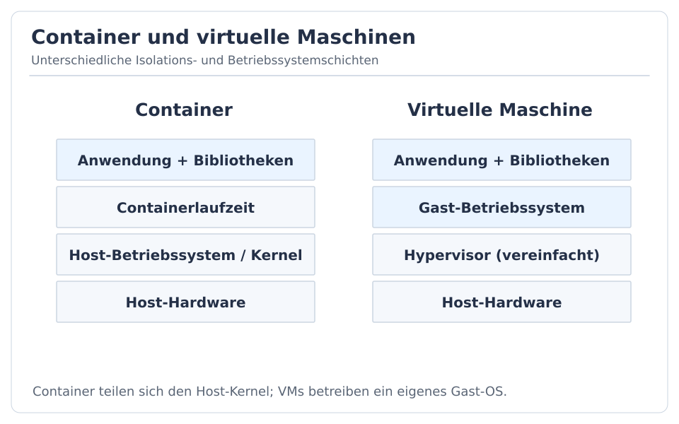
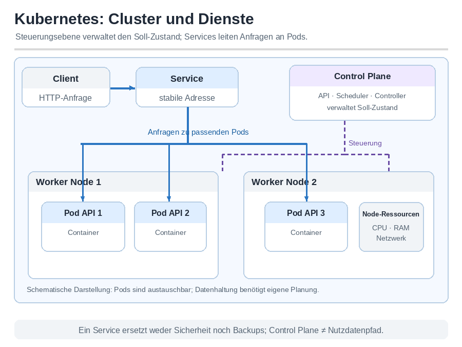

# M2-L4 – Virtualisierung und Container {#L4}

**Kursbereich:** M2 – Bachelor: Web, Server und Hosting

**Niveau:** Bachelor

**Vorwissen:** Keine festen Voraussetzungen angegeben.

## Überblick: Wie ein Computer mehrere scheinbar unabhängige Computer werden kann {#S1}

In M2-L1 ging es darum, wie ein gewöhnlicher Rechner über das Internet Dienste anbietet. In M2-L2 haben wir eine Anwendung in Frontend, Backend und Datenhaltung aufgeteilt. M2-L3 zeigte, wer die dafür benötigte Infrastruktur betreiben kann. Nun beantworten wir die Frage: **Wie schafft es ein Rechenzentrum, auf einem physischen Server viele voneinander getrennte Kundenumgebungen bereitzustellen?**

Die erste Antwort heißt **Virtualisierung**. Sie bildet aus realer Hardware mehrere logisch getrennte Rechenumgebungen. Die zweite Antwort heißt **Containerisierung**: Statt für jede Anwendung einen vollständigen virtuellen Computer zu starten, werden Prozesse mit ihren benötigten Programmbestandteilen isoliert ausgeführt. Beide Verfahren lösen verwandte, aber nicht identische Probleme. In realen Cloud-Systemen werden sie sogar häufig kombiniert.

Wir unterscheiden im Folgenden bewusst zwischen vier Ebenen:

1.  **Physischer Rechner:** Prozessoren, Arbeitsspeicher, Datenträger und Netzwerkschnittstellen.
2.  **Virtuelle Maschine:** eine vollständige Rechnerumgebung mit eigenem Betriebssystemkern.
3.  **Container:** ein isoliert laufender Prozess beziehungsweise eine Prozessgruppe, die sich auf Linux typischerweise einen Betriebssystemkern mit anderen Containern teilt.
4.  **Orchestrierungsplattform:** Software, die viele solcher Anwendungsinstanzen verwaltet, über Rechner verteilt und bei Fehlern ersetzt.

Eine Anwendung muss nicht alle vier Ebenen selbst verwalten. Ein gemieteter virtueller Server kann völlig ausreichen; ein verwalteter Plattformdienst kann sogar fast alle darunterliegenden Ebenen verbergen.

## Das Ausgangsproblem: Ein großer Server, viele kleine Aufgaben {#S2}

Angenommen, ein Rechenzentrum besitzt einen leistungsfähigen Computer mit vielen Prozessorkernen und viel Arbeitsspeicher. Ein kleiner Kunde benötigt davon nur einen Bruchteil. Würde jeder Kunde einen eigenen physischen Server erhalten, blieben zahlreiche Ressourcen ungenutzt. Außerdem müssten für Hunderte Kunden ebenso viele physische Geräte beschafft, verkabelt, überwacht und ersetzt werden.

Man könnte verschiedene Kundenprogramme direkt auf demselben Betriebssystem installieren. Das wäre technisch teilweise möglich, führt aber zu Konflikten: Ein Programm benötigt eine bestimmte Laufzeitbibliothek, das nächste eine andere. Unterschiedliche Administratoren sollen nicht dieselben Dateien sehen. Ein abgestürzter Dienst soll möglichst keine anderen Kunden beeinträchtigen. Auch Betriebssystemänderungen eines Kunden dürfen nicht alle betreffen.

**Virtualisierung löst hier das Problem der Aufteilung und Trennung.** Der Kunde erhält eine Umgebung, die sich wie ein eigener Computer verhält, obwohl sie sich die physische Hardware mit anderen Umgebungen teilt.

### Mini-Architektur: Ein Rechner, drei virtuelle Server

``` text
Physischer Server im Rechenzentrum
┌──────────────────────────────────────────┐
│ Prozessoren · RAM · SSD · Netzwerk       │
├──────────────────────────────────────────┤
│ Hypervisor / Virtualisierungsschicht     │
├────────────┬────────────┬────────────────┤
│ Virtuelle  │ Virtuelle  │ Virtuelle      │
│ Maschine A │ Maschine B │ Maschine C     │
│ Linux      │ Linux      │ Windows        │
│ Webdienst  │ Datenbank  │ Fachsoftware   │
└────────────┴────────────┴────────────────┘
```

Das Diagramm ist schematisch: Die tatsächliche Verteilung der Ressourcen wird vom Hypervisor und dem Hostsystem gesteuert. Virtuelle Maschinen bekommen nicht automatisch exklusiv eigene physische Prozessorkerne.

## Hypervisor: Der Verwalter virtueller Maschinen {#S3}

Ein **Hypervisor** ist die zentrale Virtualisierungssoftware beziehungsweise -schicht. Er stellt virtuellen Maschinen abstrahierte Hardware zur Verfügung und überwacht deren Ausführung auf der realen Hardware. Er kann beispielsweise Speicherbereiche zuordnen, Prozessorzeit verteilen und virtuelle Geräte mit physischen Ressourcen verbinden.

Man unterscheidet häufig zwei Grundformen:

- **Typ 1 („Bare Metal“):** Der Hypervisor arbeitet sehr nah an der Hardware. Beispiele für entsprechende Plattformen sind Microsoft Hyper-V und VMware ESXi. Bei manchen Systemen existiert zusätzlich eine besonders privilegierte Verwaltungs- oder Hostpartition.
- **Typ 2 („Hosted“):** Die Virtualisierungssoftware läuft auf einem gewöhnlichen Hostbetriebssystem, etwa in Form einer Desktop-Anwendung. Ein bekanntes Beispiel ist Oracle VirtualBox.

Diese Einteilung ist eine hilfreiche Orientierung, aber keine vollständige technische Taxonomie. **KVM** (*Kernel-based Virtual Machine*) ist beispielsweise eine Virtualisierungsfunktion des Linux-Kernels; zusammen mit weiteren Komponenten entsteht daraus eine vollständige Virtualisierungsplattform. Unterschiedliche Architekturen lassen sich nicht immer sauber in die vereinfachten zwei Schubladen einordnen.

### Mini-Architektur: Host, Hypervisor, Gast

``` text
Physische Hardware
       │
       ▼
Hypervisor / Virtualisierungsumgebung
       │
       ├── Gastbetriebssystem A → Anwendungen A
       └── Gastbetriebssystem B → Anwendungen B
```

**Gastbetriebssystem** bedeutet: Ein Betriebssystem, das innerhalb einer virtuellen Maschine läuft. Der **Host** ist der Rechner beziehungsweise die tragende Umgebung, die diese Maschine bereitstellt.

### Welches Problem löst das?

Der Hypervisor erlaubt getrennte Betriebssysteme und Ressourcenverwaltung auf derselben Hardware. Er kann dabei helfen, Kundensysteme unabhängig zu starten, herunterzufahren, umzuziehen und zu sichern. Besonders nützlich ist das bei Hostinganbietern, Unternehmensservern, Testumgebungen und Anwendungen mit unterschiedlichen Betriebssystemanforderungen.

**Wann unnötig?** Wenn eine einzelne Anwendung bereits auf dem eigenen Rechner zuverlässig läuft und keine getrennten Betriebssysteme benötigt werden, bringt eine zusätzliche VM nicht zwangsläufig einen Nutzen. Sie verursacht vielmehr eigenen Speicherbedarf, Betriebssystemupdates und Administrationsarbeit.

## Welche Teile eines Computers werden virtualisiert? {#S4}

### Virtuelle CPU (vCPU)

Eine **vCPU** (*virtual Central Processing Unit*, virtueller Prozessor) ist eine rechnerische Ausführungseinheit, die der virtuellen Maschine angeboten wird. Sie ist nicht automatisch identisch mit einem exklusiv zugewiesenen physischen Prozessorkern. Mehrere VMs können sich Prozessorzeit teilen. Darum bedeutet „vier vCPUs“ bei einem gemieteten Server ohne Kenntnis des Vertrags nicht, dass stets vier reale Kerne exklusiv verfügbar sind.

Ein Hypervisor koordiniert die Ausführung der virtuellen Prozessoren auf den vorhandenen Hardwarekernen. Moderne Prozessoren unterstützen die Virtualisierung durch spezielle Hardwarefunktionen. Das vermindert den Aufwand vieler Operationen, beseitigt ihn aber nicht vollständig.

### Virtueller Arbeitsspeicher

Die virtuelle Maschine erhält einen konfigurierten Speicherbereich. Der Hypervisor beziehungsweise das Hostsystem stellt dessen Abbildung und Isolation sicher. Auch eine VM kann innerhalb ihres eigenen Betriebssystems zusätzlich virtuellen Speicher und Auslagerungsdateien verwenden. Man sollte deshalb **den virtuellen Adressraum eines Prozesses** (Thema M1-L2) nicht mit **einer virtuellen Maschine** verwechseln.

### Virtuelle Datenträger

Eine VM kann einen Datenträger sehen, der in Wirklichkeit durch eine Datei, ein logisches Volume oder ein Netzwerkspeichersystem bereitgestellt wird. Die VM behandelt ihn oft wie eine eigene Festplatte. Datenträger können dynamisch anwachsen; bei gemeinsam genutztem Speicher entstehen aber Leistungsgrenzen. Ein schneller virtueller Server kann langsam werden, wenn das physische Speichersystem unter hoher Last steht.

### Virtuelle Netzwerkschnittstellen

Virtuelle Netzwerkkarten verbinden VMs mit einem virtuellen Switch und je nach Konfiguration mit einem physischen Netzwerk. Hier werden dieselben Grundideen verwendet wie bei realen Netzwerken: Adressierung, Weiterleitung, Firewall-Regeln und Segmentierung. Dass Maschinen virtuell sind, macht sie nicht automatisch öffentlich erreichbar oder ausreichend geschützt.

### Mini-Architektur: Netzwerkanbindung

``` text
Internet
   │
Router / Firewall des Hosters
   │
Virtueller Netzwerkswitch
   ├── VM A: öffentliches Web-Frontend
   └── VM B: interne Datenbank (kein öffentlicher Port)
```

Die Trennung ist ein **Architekturziel**, keine automatische Eigenschaft jeder Installation. Welche VM mit welcher anderen sprechen darf, muss über die Netzkonfiguration und Zugriffsregeln festgelegt werden.

## Die virtuelle Maschine als vollständig eigenständige Betriebsumgebung {#S5}

Eine **virtuelle Maschine (VM, Virtual Machine)** besitzt üblicherweise ein eigenes Gastbetriebssystem einschließlich eigenem Betriebssystemkern (*Kernel*). Dieser Kern kümmert sich beispielsweise um Prozesse, Dateisysteme, Speicherverwaltung und Netzwerkfunktionen innerhalb der VM. Ein Gast kann ein anderes Betriebssystem besitzen als der Host, soweit Architektur, Virtualisierungsplattform und Rechte dies unterstützen.

Das ist einer der wichtigsten Unterschiede zur üblichen Linux-Containertechnik: **Eine Linux-VM läuft mit eigenem Linux-Kernel; ein gewöhnlicher Linux-Container verwendet den Kernel seines Linux-Hosts.**

Bei VMs fallen deshalb typische Aufgaben mehrfach an: Systeminstallation, Updates, Konfiguration, Überwachung, Ressourcenplanung, Schutz der Administrationszugänge und Sicherung der Daten. Dafür bietet die Trennung eine vergleichsweise starke Sicherheitsgrenze. Sie ist nicht unüberwindbar: Hypervisor-Schwachstellen, Fehlkonfigurationen, gemeinsam genutzte Datenbereiche oder Netzwerkfehler können weiterhin Auswirkungen haben.

### Starten, Kopieren, Snapshot, Backup

Es ist praktisch, VMs als Dateien oder definierte Ressourcen zu verwalten. Manche Plattformen erlauben, den Zustand einer Maschine als **Snapshot** (Momentaufnahme) festzuhalten oder sie auf andere Hardware zu migrieren.

Ein Snapshot ist jedoch **nicht automatisch ein belastbares Backup**. Die Momentaufnahme kann von demselben Storage und von derselben Verwaltungsumgebung abhängen. Sie kann außerdem eine laufende Datenbank in einem Zustand erfassen, aus dem nur mit zusätzlicher Konsistenzsicherung zuverlässig wiederhergestellt werden kann. Für wichtige Daten braucht man getrennte Backups und getestete Wiederherstellung.

## Warum entstanden Container? {#S6}

Virtuelle Maschinen isolieren ganze Betriebssysteme. Das ist wertvoll, aber für eine kleine Anwendung häufig mehr als erforderlich.

Angenommen, ein Webdienst benötigt PHP, eine bestimmte Bibliotheksversion und einige Konfigurationsdateien. Der Betreiber möchte ihn auf dem Entwicklungsrechner, einem Testserver und später bei einem Cloudanbieter möglichst gleichartig betreiben. Ohne zusätzliche Maßnahmen können sich Versionen der Laufzeit, Systembibliotheken und Einstellungen unterscheiden. Der berühmte Satz „auf meinem Computer funktioniert es“ beschreibt dieses Problem.

**Containerisierung löst vor allem das Problem einer reproduzierbaren, isolierten Anwendungslaufzeit.** Die Anwendung samt erforderlichen Dateien wird als bereitstellbares Paket beschrieben und dann in einer kontrollierten Umgebung gestartet. Auf Linux werden dabei unter anderem Mechanismen des Kernels genutzt, die Prozesse isolieren und Ressourcen begrenzen. [https://docs.docker.com/get-started/docker-concepts/the-basics/what-is-a-container/](https://docs.docker.com/get-started/docker-concepts/the-basics/what-is-a-container/)

### Mini-Architektur: Drei Anwendungen, ein Kernel

``` text
Physischer oder virtueller Linux-Server
┌────────────────────────────────────────────┐
│ Gemeinsamer Linux-Kernel                   │
├──────────────┬──────────────┬──────────────┤
│ Container A  │ Container B  │ Container C  │
│ PHP-App      │ API-Worker   │ Webserver    │
│ Bibliotheken │ Bibliotheken │ Bibliothek   │
└──────────────┴──────────────┴──────────────┘
```

Die Container sind nicht drei vollständige Linux-Rechner. Sie verwenden getrennte Prozessumgebungen, haben aber dieselbe grundlegende Kernelbasis. Die Darstellung bedeutet auch **nicht**, dass jeder Container keinerlei Kontakt zu anderen Containern haben könnte; gewünschte Kommunikation kann ausdrücklich eingerichtet werden.

## Was ist ein Container technisch? {#S7}

Ein **Container** ist im üblichen Linux-Kontext keine eigene Hardwaremaschine, sondern ein isolierter laufender Prozess beziehungsweise eine Prozessgruppe mit einer definierten Sicht auf Prozesse, Dateien, Netzwerke und andere Ressourcen.

Zwei wichtige Linux-Techniken sind:

- **Namespaces** (Namensräume): Sie geben Prozessen eine eigene Sicht auf bestimmte Bereiche des Systems, beispielsweise Prozesse, Netzwerk, Einhängepunkte des Dateisystems und Benutzerkennungen. Dadurch sieht ein Programm nicht ohne Weiteres alle Prozesse des Hosts.
- **Control Groups (cgroups)** (Kontrollgruppen): Sie organisieren und begrenzen die Nutzung bestimmter Ressourcen, beispielsweise Prozessorzeit, Arbeitsspeicher und Prozessanzahl.

Zusätzlich können Sicherheitsmechanismen wie eingeschränkte Kernel-Fähigkeiten, Systemaufruf-Filter und weniger privilegierte Benutzer angewendet werden. Diese Schichten erhöhen die Sicherheit, doch ihre Wirkung hängt von Konfiguration und Umgebung ab. Die offizielle Docker-Dokumentation beschreibt ausdrücklich die Bedeutung von Namespaces, cgroups und dem Schutz des Docker-Daemons. [https://docs.docker.com/engine/security/](https://docs.docker.com/engine/security/)

**Wichtig:** Container sind nicht gleichbedeutend mit einer VM und garantieren keine gleichwertige Isolation. Ein Kernel-Fehler oder sehr weitreichende Containerrechte können den Host oder andere Container gefährden. Besonders bei der Ausführung nicht vertrauenswürdigen Codes ist die Wahl der Isolation entscheidend.

## Container-Image, Container und Registry: Drei unterschiedliche Dinge {#S8}

Hier werden Begriffe im Alltag häufig vermischt.

**Container-Image:** Ein paketierter, im Wesentlichen unveränderlicher Satz von Dateien, Programmcode, Bibliotheken und Konfigurationsangaben. Ein Image ist eine **Vorlage**, noch kein laufendes Programm. Images bestehen häufig aus mehreren wiederverwendbaren Schichten (*Layers*).

**Container:** Eine laufende oder gestoppte Instanz, die aus einem Image erzeugt wurde. Von demselben Image können mehrere voneinander getrennte Containerinstanzen gestartet werden. Für jede Instanz entsteht typischerweise eine eigene beschreibbare Schicht.

**Registry:** Ein Dienst zur Ablage und Verteilung von Images. Andere Rechner können dort freigegebene Images abrufen. Bekannte Beispiele sind Docker Hub und andere private oder öffentliche Container-Registries.

### Mini-Architektur: Von der Entwicklung zum Dienst

``` text
Quellcode + Abhängigkeiten
            │
            ▼
       Image erstellen
            │
            ▼
      Container-Registry
            │ Image abrufen
            ▼
     Produktiver Server
            │
      Container starten
            │
            ▼
   Öffentlich erreichbare API
```

Wird der Quellcode geändert, erstellt man sinnvollerweise ein neues Image und ersetzt die bestehende Instanz. Das vermeidet schwer nachvollziehbare manuelle Änderungen innerhalb bereits laufender Container.

**Versionskennzeichnung:** Images können über einen Tag (etwa eine Versionsbezeichnung) oder über einen kryptografischen Inhaltsbezeichner (*Digest*) angesprochen werden. Ein Tag kann unter Umständen später auf ein anderes Image zeigen; ein auf den Inhalt bezogener Digest ermöglicht eine präzisere Festlegung des verwendeten Pakets. Beides ersetzt allerdings keine Prüfung der Herkunft und Sicherheit.

### Was bedeutet „portabel“?

Ein Image macht die Anwendungsumgebung leichter übertragbar, **aber nicht universell überall lauffähig**. Prozessorarchitektur, Betriebssystemkern, benötigte Geräte, GPU-Treiber, Rechte, Netzwerke und Dateipfade können sich unterscheiden. Linux-Container benötigen einen passenden Linux-Kernel; Windows und macOS verwenden für die gängigen Linux-Container in Docker Desktop eine Linux-VM. Deshalb ist das Bild „ein Paket läuft ohne jede Anpassung auf jedem Computer“ zu einfach. [https://docs.docker.com/learn/content/what-is-a-container/](https://docs.docker.com/learn/content/what-is-a-container/)

## Docker: Werkzeug, nicht die Containertechnik selbst {#S9}

**Docker** ist eine verbreitete Werkzeug- und Softwareplattform zum Erstellen, Verteilen und Ausführen von Containern. Der Name bezeichnet nicht den gesamten technischen Standard und auch nicht zwingend die Laufzeit jedes Containers in einer Cloud.

Zum Docker-Ökosystem gehören unter anderem:

- **Docker Engine:** Komponenten zum Verwalten und Starten von Containern auf einem Host; dazu gehört der Docker-Dienst (*Daemon*).
- **Dockerfile:** Ein deklaratives Rezept, mit dem der Aufbau eines Images beschrieben wird.
- **Docker Hub:** Eine von Docker betriebene Registry für Container-Images.
- **Docker Compose:** Ein Werkzeug, das mehrere zusammengehörige Containerdienste, deren Netzwerke und Datenspeicher gemeinsam beschreibt und betreibt.

Das Stichwort **Open Container Initiative (OCI)** bezeichnet eine unabhängige Standardisierungsinitiative für Image-Formate, Ausführung und Distribution von Containern. Dadurch ist Containertechnik nicht an ein einziges Werkzeug gebunden. Auch andere Laufzeiten und Plattformen können kompatible Formate verwenden. [https://opencontainers.org/](https://opencontainers.org/)

Ein kleines Beispiel ohne Konfigurationsdatei: Eine Webanwendung besteht aus einem HTTP-Webserver, einem API-Prozess und einer Datenbank. Docker Compose kann die drei Dienste und ihre Kommunikation gemeinsam beschreiben. Das ist für einen einzelnen Server häufig bereits ausreichend – es ist **kein Kubernetes-Cluster erforderlich**.

### Mini-Architektur: Kleine Anwendung mit Compose

``` text
VPS oder lokaler Linux-Rechner
          │
    Docker / Compose
          │
   ┌──────┼─────────┐
   │      │         │
 Webserver API     Datenbank
   │      │         │
   └──────┴─────────┘
      Internes Netz
          │
      Externer Zugriff
      nur auf Webserver
```

Dieses Beispiel ist eine Architekturidee, keine vorgegebene Pflichtkonfiguration. Eine Datenbank kann auch als verwalteter Dienst außerhalb dieses Rechners laufen, was den Betrieb vereinfachen kann.

## Der häufig übersehene Punkt: Wo bleiben die Daten? {#S10}

Eine wichtige Eigenschaft vieler Container-Workflows ist die **Austauschbarkeit der Anwendungsinstanz**. Man löscht einen defekten Container und startet einen neuen aus dem geprüften Image. Das ist bei zustandslosen Diensten relativ einfach.

Schwieriger wird es, wenn ein Container dauerhafte Daten nur in seiner eigenen beschreibbaren Dateischicht speichert. Wird dieser Container gelöscht, gehen diese Daten in der Regel mit dieser Schicht verloren. **Ein Neustart desselben Containers ist nicht dasselbe wie sein Löschen und Ersetzen.** Man muss den Lebenszyklus korrekt unterscheiden.

Die Lösung: Daten werden bewusst **außerhalb der kurzlebigen Containerschicht** gespeichert. Docker unterstützt beispielsweise **Volumes** (verwaltete dauerhafte Speicherbereiche) und **Bind Mounts** (Einbindung eines bestimmten Hostverzeichnisses). [https://docs.docker.com/engine/storage](https://docs.docker.com/engine/storage)

### Mini-Architektur: Austauschbare Anwendung, dauerhafte Daten

``` text
         Container: API
         (austauschbar)
               │
               ▼
      Dauerhaftes Volume
               │
         Datenbankdateien
               │
               ▼
      Separates Offline-Backup
```

Ein Volume schützt Daten **nicht automatisch vor Datenträgerdefekt, versehentlicher Löschung, Ransomware oder fehlerhaften Datenbankänderungen**. Es ersetzt kein Backup. Für produktive Datenbanken sind zusätzlich konsistente Sicherungsverfahren, Zugriffsrechte, Überwachung und Wiederherstellungstests nötig. Dieses Thema behandeln wir vertieft in M3-L6.

## Vergleich: Virtuelle Maschine und Container {#S11}

  Frage                          Virtuelle Maschine                                    Typischer Linux-Container
  ------------------------------ ----------------------------------------------------- -------------------------------------------------------
  Was wird isoliert?             Vollständige virtuelle Rechnerumgebung                Anwendungsprozess und Ressourcenansicht
  Eigener Kernel?                Üblicherweise ja, im Gastbetriebssystem               Nein, Hostkernel wird geteilt
  Betriebssysteme                Unterschiedliche Gastbetriebssysteme möglich          Kernel-Kompatibilität zum Host erforderlich
  Start- und Ressourcenaufwand   Meist höher durch Gastbetriebssystem                  Meist geringer; hängt von Anwendung ab
  Sicherheitsgrenze              Tendenziell stärkere Trennung                         Isolierung durch gemeinsamen Kernel und Konfiguration
  Updates                        Gastbetriebssystem und Anwendung                      Hostkernel, Laufzeit und neue Images
  Portabilität                   An Virtualisierungs-/Hardwaremerkmale gebunden        Image leichter verteilbar, aber nicht universell
  Typischer Einsatz              VPS, getrennte Kunden, verschiedene Betriebssysteme   Wiederholbare Anwendungsbereitstellung, Worker, APIs

Der zusätzliche Ressourcen- und Verwaltungsaufwand wird häufig als **Overhead** bezeichnet: Eine VM verursacht typischerweise mehr Overhead durch das eigene Gastbetriebssystem, während auch Container nicht kostenlos sind und beispielsweise Speicher-, Netzwerk- und Überwachungskosten verursachen.

{alt="Zwei parallele Schichtenstapel zeigen Container mit gemeinsamem Host-Betriebssystem und virtuelle Maschine mit eigenem Gast-Betriebssystem."}

Container und virtuelle Maschinen unterscheiden sich insbesondere bei Kernel und Gast-OS.

Die Tabelle beschreibt die **üblichen** Fälle. Es existieren Sonderformen wie besonders isolierte Containerlaufzeiten, Micro-VMs und Kombinationen beider Ansätze. Aus einer allgemeinen Tabelle lässt sich deshalb keine absolute Garantie für Sicherheit oder Geschwindigkeit ableiten.

### Häufige Kombination

``` text
Rechenzentrum / physischer Host
               │
            Hypervisor
               │
       Virtuelle Maschine
               │
          Linux-Kernel
               │
      Container A + B + C
```

Diese Kombination ist in Hosting- und Cloudumgebungen sehr verbreitet: Der Kunde mietet eine VM und betreibt darauf mehrere Container. Damit erhält er sowohl die Trennung zum physischen Host als auch eine einheitliche Anwendungsbereitstellung.

## Was bedeutet Orchestrierung? {#S12}

Angenommen, eine API läuft nicht nur einmal, sondern in zahlreichen Instanzen auf mehreren Rechnern. Einige Rechner fallen aus, andere werden neu hinzugefügt. Updates sollen schrittweise erfolgen. Nutzeranfragen müssen auf die vorhandenen gesunden Instanzen verteilt werden. Jetzt genügt es nicht mehr, nur einzelne Container starten zu können.

**Orchestrierung** bezeichnet in diesem Zusammenhang das koordinierte Verwalten vieler laufender Anwendungsinstanzen und ihrer Abhängigkeiten. Typische Aufgaben sind: Platzierung, Neustart ausgefallener Prozesse, Bereitstellung neuer Versionen, gewünschte Instanzzahl, Konfiguration und Netzwerkerreichbarkeit.

Eine wichtige Form ist das **deklarative Betriebsmodell**: Man beschreibt, welchen Zustand das System haben soll, statt jeden einzelnen Schritt manuell vorzuschreiben. Die Plattform vergleicht laufend tatsächlichen und gewünschten Zustand und versucht Unterschiede zu beheben.

### Beispiel: Drei statt zwei Instanzen

``` text
Gewünschter Zustand: 3 API-Instanzen
                │
                ▼
        Plattform überprüft
                │
    Tatsächlich nur 2 vorhanden
                │
                ▼
      Weitere Instanz starten
                │
                ▼
     Soll-Zustand wieder erfüllt
```

Damit ist jedoch nur ein Teil der Zuverlässigkeitsfrage beantwortet: Wenn eine Anwendung fachlich falsche Ergebnisse liefert oder eine Datenbank beschädigt, heilt das zusätzliche Starten eines Containers den Fehler nicht.

## Kubernetes: Verwaltung von Containern in einem Cluster {#S13}

**Kubernetes** (oft **K8s** genannt, da zwischen K und s acht Buchstaben stehen) ist eine quelloffene Plattform zum Betrieb containerisierter Anwendungen. Der Name steht nicht für einen bestimmten Cloudanbieter und Kubernetes ist auch kein vollständiger Ersatz für eigene Entwicklungs- und Betriebsentscheidungen. [https://kubernetes.io/docs/concepts/overview/](https://kubernetes.io/docs/concepts/overview/)

{alt="Kubernetes-Cluster mit Client, Service und drei API-Pods auf zwei Worker Nodes. Eine getrennte Control Plane plant und überwacht die Pods; der Nutzdatenweg führt vom Service zu Pods."}

Vereinfachte Kubernetes-Topologie: Control Plane für Steuerung, Service für die Erreichbarkeit und Pods auf Worker Nodes. Keine Garantie für Sicherheit oder Verfügbarkeit.

Ein **Cluster** besteht aus einem oder mehreren Rechnern, die **Nodes** (Knoten) heißen, sowie einer **Control Plane** (Steuerungsebene), die den gewünschten und tatsächlichen Systemzustand verwaltet. Die Nodes können physische Maschinen oder virtuelle Maschinen sein.

Einige wichtige Begriffe:

- **Pod:** Kleinste in Kubernetes bereitstellbare Einheit. Ein Pod enthält einen oder wenige eng gekoppelte Container mit gemeinsamem Netzkontext und gegebenenfalls gemeinsamem Speicher.
- **Deployment:** Beschreibung eines gewünschten Betriebszustands für normalerweise austauschbare Anwendungs-Pods, etwa Instanzzahl und Imageversion. Kubernetes kümmert sich um die zugehörigen Aktualisierungen und Replikate.
- **Service:** Stabile Abstraktion, über die Anwendungsinstanzen im Cluster erreichbar werden können, auch wenn einzelne Pods ersetzt werden.
- **Scheduler:** Bestandteil der Steuerungsebene, der entscheidet, auf welchem geeigneten Node neue Pods platziert werden.
- **Container Runtime:** Software auf einem Node, die Container tatsächlich startet. Kubernetes ist nicht darauf festgelegt, dass jeder Node die Docker Engine als Laufzeit benutzt.

### Mini-Architektur: Ein Kubernetes-Cluster

``` text
           Eingehende Anfragen
                    │
              Dienstzugang
                    │
               Kubernetes
     ┌──────────────┴─────────────┐
     │      Control Plane         │
     │  Soll-Zustand, Verwaltung  │
     └──────────────┬─────────────┘
                    │ plant und steuert
           ┌────────┴────────┐
           ▼                 ▼
        Node 1             Node 2
       ┌───────┐          ┌───────┐
       │Pod:API│          │Pod:API│
       │Pod:API│          │Pod:API│
       └───────┘          └───────┘
```

Das Diagramm zeigt ausdrücklich **keine vollständige produktive Hochverfügbarkeitsinstallation**. Dafür wären unter anderem der Aufbau der Steuerungsebene, Speicherung des Clusterzustands, Netzwerkinfrastruktur, Ausfallszenarien und Backups gesondert zu planen.

### Was Kubernetes tatsächlich erleichtert

Kubernetes kann unter geeigneter Konfiguration ausgefallene Instanzen ersetzen, Anwendungen auf verfügbare Nodes verteilen, Updates koordinieren und die Zahl der Instanzen anpassen. Die offizielle Dokumentation nennt unter anderem Selbstheilungsmechanismen, deklarative Steuerung und horizontale Skalierung. [https://kubernetes.io/docs/concepts/overview/](https://kubernetes.io/docs/concepts/overview/)

**Was es nicht automatisch erledigt:** Das Schreiben korrekter Anwendungen, die Sicherheit jeder Konfiguration, die Auswahl eines Backupkonzepts, die fachliche Datenkonsistenz, Datenbankmigrationen, datenschutzkonformen Betrieb oder die Kontrolle der Cloudrechnung. Auch ein Neustart ist nicht gleichbedeutend mit echter Fehlerbehebung.

### Warum ist Kubernetes für kleine Anwendungen oft unnötig?

Ein einzelnes Online-Werkzeug mit überschaubarem Nutzerkreis benötigt möglicherweise nur eine Anwendung und eine Datenbank. Dafür ist eine verwaltete Plattform oder ein einfacher VPS oft leichter zu betreiben. Kubernetes bringt zusätzliche Verwaltungsobjekte, Netzwerkkonzepte, Rollen, Protokollsammlung, Secrets-Verwaltung, Updates und mögliche Fehlerszenarien mit sich.

Es kann sich lohnen, wenn viele Dienste unabhängig voneinander betrieben werden, Teams häufig neue Versionen ausrollen oder mehrere Rechner und Ausfallzonen koordiniert werden müssen. **Die Komplexität einer Plattform sollte durch einen tatsächlichen Bedarf gerechtfertigt sein, nicht durch ihre Bekanntheit.**

## Drei konkrete Anwendungsszenarien {#S14}

### Szenario A: Kleine PHP-Webanwendung

Du betreibst eine überschaubare Webanwendung mit Nutzerdaten und einfacher Datenbank.

**Mögliche Lösung:** Klassisches Webhosting oder ein kleiner VPS mit Webserver und Datenbank. Ein Container ist hier keine Voraussetzung. Docker Compose könnte sinnvoll werden, wenn du die Laufzeitkomponenten unabhängig vom Hostsystem versionieren möchtest. Eine Clusterplattform wäre üblicherweise zusätzlicher Aufwand ohne entsprechenden Nutzen.

**Betriebsfolgen:** Sicherheitsupdates, Benutzerrechte, regelmäßige Datenbankbackups, Protokollierung von Fehlern und gelegentliche Wiederherstellungsproben bleiben notwendig. Auch günstiges Hosting macht die Verantwortung für personenbezogene Daten nicht bedeutungslos.

### Szenario B: Analyse-API mit Hintergrundjobs

Die Anwendung nimmt Dateien entgegen, stellt eine **API** (*Application Programming Interface*, Programmschnittstelle) bereit und startet im Hintergrund Analyseaufträge.

**Mögliche Lösung:** Ein einzelner virtueller Server betreibt einen Webdienst, eine Auftragswarteschlange und einen oder mehrere Worker. Diese können in getrennten Containern laufen. Bei wachsender Last lassen sich Worker separat vermehren. Eine Datenbank sollte außerhalb kurzlebiger Containerschichten speichern und zuverlässig gesichert werden.

**Betriebsfolgen:** CPU- und Speicherauslastung, fehlgeschlagene Jobs, doppelte Bearbeitung, begrenzter paralleler Verbrauch und Nutzerberechtigungen werden relevant. Mehr Worker schaffen nicht automatisch mehr Datenbankleistung; die nächste Engstelle kann der Speicher oder eine gemeinsam genutzte Ressource sein.

### Szenario C: KI-Verarbeitung auf einer GPU

Ein KI-Dienst nimmt Aufgaben an, berechnet Bilder oder verarbeitet Sprache und liefert Ergebnisse zurück. Eine **GPU** (*Graphics Processing Unit*, Grafikprozessor) ist für viele dieser Berechnungen hilfreich, aber ein Teil des Systems (Webserver, Auftragsverwaltung, Benutzerrechte) läuft weiterhin häufig auf CPUs.

**Mögliche Lösung:** Ein günstiger Webserver nimmt Anfragen an; ein separater GPU-Rechner arbeitet die Jobs ab. Der KI-Worker kann containerisiert werden, solange die benötigten GPU-Treiber, Containerlaufzeit, Gerätetreiberkompatibilität und Rechenressourcen passen. Eine orchestrierte Mehrknotenlösung wird erst interessant, wenn mehrere Worker-Rechner zu verwalten sind.

``` text
Nutzer
  │
  ▼
Webanwendung / API
  │
  ▼
Auftragswarteschlange
  │
  ├── GPU-Worker 1 (ggf. Container)
  └── GPU-Worker 2 (optional)
  │
  ▼
Ergebnisablage → Nutzer erhält Ergebnis
```

**Betriebsfolgen:** GPU-Zeit, Grafikspeicher, Modellgrößen, große Dateien, parallele Aufträge, Strom oder Cloudnutzung, Missbrauchsschutz und Sicherheitsupdates müssen berücksichtigt werden. Mehrere GPU-Container bedeuten weder automatisch mehrere GPUs noch garantierte zusätzliche Rechenleistung.

## Sicherheit, Wartung und wirtschaftliche Grenzen {#S15}

**Sicherheit:** Ein Container ist keine vertrauenswürdige Sandbox allein aufgrund seines Namens. Sicherheitsmaßnahmen umfassen geprüfte Images, zeitnahe Updates, möglichst wenig Rechte, Geheimnisverwaltung, begrenzte Netzwerkzugriffe und eine möglichst kleine Angriffsfläche. Docker bietet beispielsweise einen *Rootless Mode*, bei dem Dienst und Container ohne dauerhaft privilegierten Root-Daemon laufen können; dies hat eigene Voraussetzungen und Einschränkungen. [https://docs.docker.com/engine/security/rootless/](https://docs.docker.com/engine/security/rootless/)

**Wartung:** Ein neues Image mit aktualisierten Bibliotheken muss erstellt, getestet und bereitgestellt werden. Containeraktualisierungen ersetzen keine Updates des Hostkernels, Hypervisors, der Containerlaufzeit oder einer externen Datenbank. Ein virtuelles System bleibt administrativ ein reales System.

**Backups und Ausfälle:** Das Image speichert Anwendung und Abhängigkeiten, aber nicht automatisch alle sich verändernden Nutzerdaten. Datenbank-Volumes, Schlüssel, Konfigurationen und externe Speicherdienste brauchen eigene Sicherungs- und Wiederherstellungsstrategien. Eine Kopie desselben Containers auf demselben Server schützt nicht vor dessen Ausfall.

**Kosten:** Neben der eigentlichen Rechenleistung entstehen Kosten für Speicher, Netzwerkverkehr, Imagespeicherung, Logdaten, Backups, Betrieb, Managed-Service-Gebühren und gegebenenfalls freie Kapazitäten zur Ausfallsicherung. Je nach Lösung kann eine einfache VM günstiger sein als eine hochverfügbare Containerplattform; pauschale Preisurteile wären ohne aktuelle Angebote und Lastprofil unzuverlässig.

**Anbieterabhängigkeit:** Standardisierte Images erleichtern den Wechsel der Ausführungsumgebung. Trotzdem hängen Anwendungen oft von Datenbanken, Netzwerkdiensten, Berechtigungen und proprietären Cloudfunktionen ab. Ein OCI-kompatibles Image macht eine komplexe Anwendung nicht automatisch innerhalb von Minuten zu einem anderen Anbieter umziehbar.

## Ein begrifflicher Kurzvergleich: Vier typische Entscheidungen {#S16}

  Anforderung                                                 Meist naheliegender Ansatz                      Wann aufwendigere Technik sinnvoll wird
  ----------------------------------------------------------- ----------------------------------------------- ------------------------------------------------------------
  Eine einfache Website erreichbar machen                     Shared Hosting oder verwaltete Webplattform     Eigene Laufzeit- oder Betriebssystemanforderungen
  Einen eigenen Server mit Administrationsrechten nutzen      Einzelne VM / VPS                               Trennung vieler Kundenumgebungen oder hohe Last
  Mehrere Anwendungskomponenten reproduzierbar betreiben      Container, gegebenenfalls Compose               Viele Dienste und mehrere unabhängige Rechner
  Große Anzahl von Anwendungsinstanzen laufend koordinieren   Verwaltete Containerplattform oder Kubernetes   Umfangreiche Mehrknoten- und Automatisierungsanforderungen

Diese Einordnung ist keine Kaufempfehlung. Sie erklärt, welches zusätzliche Problem eine Technik jeweils löst. **Ein fortgeschritteneres Werkzeug ist nicht automatisch die wirtschaftlichere oder sicherere Lösung.**

## Zusammenfassung und Übergang {#S17}

- **Virtualisierung** teilt reale Hardware in logisch getrennte Rechenumgebungen auf.
- Ein **Hypervisor** ermöglicht die Ausführung und Verwaltung virtueller Maschinen; eine VM besitzt in der Regel ein eigenes Gastbetriebssystem und einen eigenen Kernel.
- **Container** isolieren gewöhnlich Prozesse und ihre Laufzeitumgebung, teilen sich unter Linux aber einen Kernel.
- **Images** sind verteilbare Vorlagen; **Container** sind Instanzen daraus; **Registries** lagern und verteilen Images.
- **Docker** ist ein Werkzeugökosystem; **OCI** definiert offene Containerstandards. **Docker Compose** ist eine mögliche einfache Lösung für mehrere Komponenten auf einem Host.
- **Dauerhafte Daten** müssen bewusst außerhalb austauschbarer Containerschichten gespeichert und zusätzlich gesichert werden.
- **Kubernetes** hilft, viele Containeranwendungen deklarativ über Nodes zu verwalten; für eine kleine Webanwendung ist es häufig unnötig kompliziert.
- **VMs und Container schließen sich nicht aus.** Eine häufige Architektur besteht aus VMs, in denen Container laufen.

**Nächste Lektion [M2-L5 – Cloud-Netzwerke und Skalierung einer Anwendung](M2-L5.md):** Wir verfolgen, wie mehrere Anwendungsinstanzen über Lastverteiler, private Netzwerke und Zwischenspeicher zusammenarbeiten – und wo dabei neue Engpässe und Ausfallrisiken entstehen.


## Quellen {#S18}

**Letzte Quellenprüfung:** 03.11.2026

**Quellenprüfung: 03.11.2026.** Für diese Lektion wurden offizielle technische Dokumentationen herangezogen. Einige Begriffe und Mechanismen sind stabil; konkrete Produktfunktionen und Sicherheitsvorgaben können sich verändern. Es werden keine aktuellen Preise oder verbindlichen Rechtsaussagen behauptet.

1.  **Microsoft Learn**, *Hyper-V-Architektur*: Hypervisor, virtualisierte Rechner und Isolation. [https://learn.microsoft.com/de-de/windows-server/virtualization/hyper-v/architecture](https://learn.microsoft.com/de-de/windows-server/virtualization/hyper-v/architecture)
2.  **Docker Docs**, *What is a container?*: Containerkonzept und Abgrenzung gegenüber virtuellen Maschinen. [https://docs.docker.com/get-started/docker-concepts/the-basics/what-is-a-container/](https://docs.docker.com/get-started/docker-concepts/the-basics/what-is-a-container/)
3.  **Docker Docs**, *What is an image?*: Images, Schichten und Paketierung. [https://docs.docker.com/get-started/docker-concepts/the-basics/what-is-an-image/](https://docs.docker.com/get-started/docker-concepts/the-basics/what-is-an-image/)
4.  **Docker Docs**, *Docker Engine security*: Namespaces, cgroups und Sicherheitsgrenzen. [https://docs.docker.com/engine/security/](https://docs.docker.com/engine/security/)
5.  **Docker Docs**, *Storage*: persistente Volumes, Bind Mounts, Container-Lebenszyklus. [https://docs.docker.com/engine/storage](https://docs.docker.com/engine/storage)
6.  **Docker Docs**, *Docker Compose*: Zusammenspiel mehrerer Containerdienste. [https://docs.docker.com/compose](https://docs.docker.com/compose)
7.  **Open Container Initiative (OCI)**, offizielle Projektübersicht: standardisierte Image-, Runtime- und Distribution-Spezifikationen. [https://opencontainers.org/](https://opencontainers.org/)
8.  **Kubernetes**, *Concepts / Overview*: Aufgabe, Funktionsweise und Grenzen der Plattform. [https://kubernetes.io/docs/concepts/overview/](https://kubernetes.io/docs/concepts/overview/)
9.  **Kubernetes**, *Components*: Steuerungsebene und Node-Komponenten. [https://kubernetes.io/docs/concepts/overview/components/](https://kubernetes.io/docs/concepts/overview/components/)
10. **Kubernetes**, *Pods*: kleinste Bereitstellungseinheit, Netzwerk und gemeinsame Ressourcen. [https://kubernetes.io/docs/concepts/workloads/pods/](https://kubernetes.io/docs/concepts/workloads/pods/)
11. **Kubernetes**, *Deployments*: gewünschte Instanzzahl, Rollouts und Replikate. [https://kubernetes.io/docs/concepts/workloads/controllers/deployment/](https://kubernetes.io/docs/concepts/workloads/controllers/deployment/)
12. **Docker Docs**, *Rootless mode*: weniger privilegierter Betrieb und Voraussetzungen. [https://docs.docker.com/engine/security/rootless/](https://docs.docker.com/engine/security/rootless/)

**Weiterführend:** [M2-L1](M2-L1.md) erklärt die öffentliche Erreichbarkeit; [M2-L2](M2-L2.md) die Anwendungsbausteine; [M2-L3](M2-L3.md) das Hostingmodell. [M2-L5](M2-L5.md) vertieft Netzwerke und Skalierung, [M3-L6](M3-L6.md) den verlässlichen Schutz dauerhafter Daten, [M6-L6](M6-L6.md) den Betrieb verteilter KI-Systeme.
