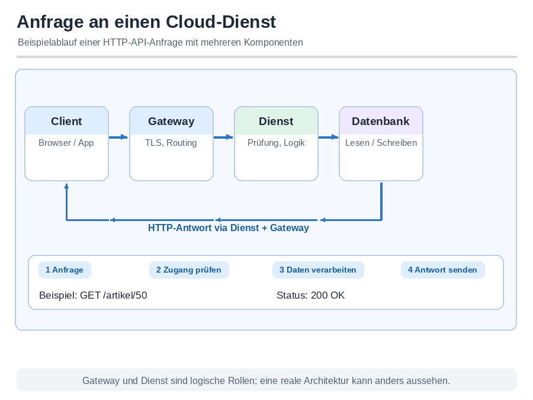
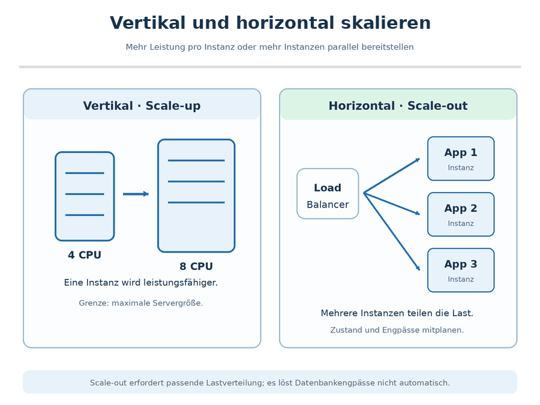

# M2-L5 – Cloud-Netzwerke und Skalierung einer Anwendung {#L5}

**Kursbereich:** M2 – Bachelor: Web, Server und Hosting

**Niveau:** Bachelor

**Vorwissen:** Keine festen Voraussetzungen angegeben.

## Überblick: Wie wächst eine Anwendung über einen einzelnen Server hinaus? {#S1}

In M2-L1 haben wir einen Computer öffentlich erreichbar gemacht. M2-L2 erläuterte, wie Browser, Schnittstellen, Benutzerkonten und Hintergrundverarbeitung zusammenarbeiten. M2-L3 verglich Hostingmodelle; M2-L4 erklärte virtuelle Maschinen und Container. Jetzt stellt sich die nächste Frage: **Was passiert, wenn ein einziger Server die Nachfrage nicht mehr zuverlässig bedienen kann – oder wenn ein Ausfall nicht mehr akzeptabel ist?**

Die naheliegende Antwort lautet: mehr Rechenleistung. Das kann bedeuten, einen stärkeren Server einzusetzen, mehrere Anwendungsinstanzen zu betreiben, häufig verwendete Inhalte zwischenzuspeichern oder lange Arbeiten in Warteschlangen zu verlagern. Diese Maßnahmen sind jedoch keine beliebig austauschbaren Lösungen. Ein zusätzlicher Webserver hilft kaum, wenn die einzige Datenbank alle Anfragen blockiert. Ein Cache beschleunigt häufig gelesene Daten, kann aber veraltete Antworten ausliefern. Mehr Instanzen vergrößern die Zahl gleichzeitig ausführbarer Aufgaben, verursachen aber Probleme bei Sitzungen und gemeinsamem Zustand.

**Skalierung** bedeutet hier, ein System an eine veränderte Last anzupassen. **Hochverfügbarkeit** bedeutet, einen Dienst trotz bestimmter Fehler möglichst weiter anzubieten. Beides hängt zusammen, ist aber nicht dasselbe: Ein leistungsfähiger Einzelserver kann viele Anfragen bedienen und trotzdem einen einzigen Ausfallpunkt darstellen. Ein redundantes System kann einen Serverausfall überstehen, obwohl es nicht besonders schnell ist.

### Mini-Architektur: Von einem zu mehreren Servern

``` text
Kleine Anwendung:

Browser ──► Webserver + Anwendung ──► Datenbank

Gewachsene Anwendung:

Browser
   │
   ▼
Load Balancer
   ├──► Anwendungsserver A ──┐
   ├──► Anwendungsserver B ──┼──► gemeinsame Datenbank
   └──► Anwendungsserver C ──┘
```

Das zweite Bild löst nicht automatisch alle Leistungs- oder Zuverlässigkeitsprobleme. Dafür müssen sich die Server denselben Datenzustand sinnvoll teilen und die einzelnen Komponenten aufeinander abgestimmt sein.

## Rechenzentrum, Region und Verfügbarkeitszone {#S2}

Ein **Rechenzentrum** ist zunächst ein physischer Ort mit Computerhardware, Stromversorgung, Kühlung und Netzwerkanschlüssen. Cloudanbieter ordnen ihre Infrastruktur häufig größeren geografischen Bereichen zu. Eine **Region** bezeichnet dabei eine vom Anbieter definierte geografische Standortgruppe. Eine **Availability Zone (AZ)**, auf Deutsch etwa *Verfügbarkeitszone*, bezeichnet bei bestimmten Cloudplattformen eine abgegrenzte Betriebsumgebung innerhalb einer Region. Die konkrete bauliche und technische Abgrenzung variiert je nach Anbieter: Eine Zone ist nicht zwingend mit einem einzigen Gebäude gleichzusetzen.

Warum gibt es solche Bereiche? Weil man nicht jeden Server in demselben Raum betreiben möchte. Wenn Stromversorgung, Brandabschnitt oder Netzwerkverbindung an einem Standort ausfallen, könnten sonst sämtliche Kopien einer Anwendung gleichzeitig betroffen sein. Verteilt man geeignete Komponenten auf mehrere unabhängige Zonen, kann der Ausfall einer Zone unter bestimmten Voraussetzungen abgefangen werden. Eine Region kann jedoch selbst großflächige Probleme erleben; mehrere Zonen garantieren daher keine absolute Verfügbarkeit.

``` text
Region: Beispielregion
│
├── Zone A
│     ├── Anwendungsinstanz 1
│     └── Datenbankknoten / Speicher
│
└── Zone B
      ├── Anwendungsinstanz 2
      └── Datenbankreplikat / Speicher
```

**Wann sinnvoll?** Für Dienste, bei denen der Ausfall eines einzelnen Standorts besonders schädlich wäre. **Wann überdimensioniert?** Für eine Hobbyseite, ein kleines internes Werkzeug oder einen Dienst, bei dem eine gelegentliche Unterbrechung akzeptabel ist. Zu beachten sind zusätzliche Datenübertragung, getrennte Ressourcen, komplexere Datenbankkonfiguration und ein anspruchsvollerer Wiederanlauf nach Störungen.

Der Standort hat außerdem praktische Folgen für Latenz und Datenschutz. Eine Anwendung, die überwiegend von europäischen Nutzern aufgerufen wird, kann von regionalen Standorten profitieren. Der physische Datenstandort allein beantwortet aber noch nicht alle rechtlichen Fragen zu Backups, Fernzugriff oder Auftragsverarbeitung. Die konkrete Rechtslage muss bei einem späteren realen Angebot separat geprüft werden.

## Virtuelle private Netze: Eine interne Landschaft innerhalb der Cloud {#S3}

Bei einem einzelnen gemieteten Server kann man gedanklich eine Maschine mit einer öffentlichen Internetadresse vor sich sehen. Sobald eine Anwendung aus Webserver, Datenbank, Worker und Verwaltungsdiensten besteht, sollten nicht sämtliche Komponenten öffentlich erreichbar sein. Man benötigt ein internes Netzwerk, in dem bestimmte Systeme miteinander kommunizieren können, andere Zugriffe jedoch begrenzt werden.

Ein **Virtual Private Cloud Network (VPC)** ist ein logisch abgegrenztes virtuelles Netzwerk innerhalb einer Cloudplattform. Es ähnelt einem firmeninternen Netz mit Adressbereichen, Netzsegmenten, Routen und Firewallregeln. Die Anbieter definieren unterschiedliche Einzelheiten; die grundlegende Funktion ist jedoch vergleichbar. **Ein VPC garantiert weder vollständige physische Isolation noch automatische Sicherheit.** Wer eine Datenbank versehentlich öffentlich freigibt oder zu breite Berechtigungen erlaubt, kann trotz privatem Netzwerk erhebliche Risiken schaffen.

Wichtige Bestandteile sind:

- **Subnetz (Subnet):** abgegrenzter IP-Adressbereich für einen Teil des Netzwerks. Je nach Anbieter ist die Zuordnung zu Regionen und Zonen verschieden.
- **Routing:** Regeln, welche Netzwerkwege für welche Zieladressen verwendet werden.
- **Firewall:** Regeln, die bestimmte Verbindungen erlauben oder blockieren.
- **Gateway:** Übergang zu anderen Netzwerken, beispielsweise zum Internet.
- **NAT (Network Address Translation):** Adressumsetzung, etwa damit interne Systeme ausgehende Internetverbindungen nutzen können, ohne selbst eine öffentliche IPv4-Adresse zu besitzen.

### Mini-Architektur: Öffentliches Eingangstor, interne Dienste

{alt="Beispiel eines HTTP-Anfragewegs vom Client über Gateway und Anwendungsdienst zur Datenbank und über Dienst und Gateway zurück zum Client."}

Schematischer Request-/Response-Weg durch einen Cloud-Dienst. Rollen und Sicherheitsprüfungen sind je nach System unterschiedlich verteilt.

``` text
                          Internet
                             │
                      Öffentlicher Zugang
                             │
                   ┌─────────▼─────────┐
                   │   VPC-Netzwerk     │
                   │                   │
                   │  Load Balancer    │
                   │        │          │
                   │   Webanwendung    │
                   │        │          │
                   │   Datenbank       │
                   │  (nur intern)     │
                   └───────────────────┘
```

Das Ziel ist keine vollständige Unerreichbarkeit aller internen Systeme. Die Anwendung muss ihre Datenbank erreichen können; ein beliebiger Besucher im Internet dagegen nicht. Diese Unterscheidung wird üblicherweise durch Netzgrenzen **und zusätzlich** durch Datenbankrechte und Authentifizierung umgesetzt. Eine Firewall ist deshalb nur eine Schicht der Sicherheitsarchitektur.

Für eine kleine Website kann ein einzelner virtueller Server mit einer lokal gebundenen Datenbank einfacher sein. Ein virtuelles Cloud-Netz lohnt sich vor allem, wenn mehrere unabhängig betriebene Komponenten vorhanden sind und klare Kommunikationsgrenzen nötig werden.

## Load Balancer: Eingehende Anfragen verteilen {#S4}

Ein **Load Balancer** ist ein Lastverteiler. Er nimmt Anfragen entgegen und gibt sie an einen geeigneten Anwendungsserver weiter. Das löst zwei Probleme: Ein einzelner Server muss nicht die gesamte Last allein tragen; und ein ausgefallener Server kann unter bestimmten Bedingungen von der Bearbeitung neuer Anfragen ausgeschlossen werden.

Eine einfache Verteilung könnte Anfragen abwechselnd auf Server A und B schicken (*Round Robin*). In realen Systemen sind weitere Kriterien möglich: bestehende Verbindungen, aktuelle Auslastung, regionale Nähe oder festgelegte Regeln für bestimmte Pfade. Ein Lastverteiler kann auf unterschiedlichen Netzwerkebenen arbeiten. Für Webanwendungen ist ein **Application Load Balancer** auf der Ebene von HTTP (Hypertext Transfer Protocol) häufig besonders anschaulich: Er kann beispielsweise Anfragen an `/api/` anders verteilen als Anfragen an die Website.

``` text
100 gleichzeitige Browseranfragen
                 │
                 ▼
            Load Balancer
             │       │
       50 Anfragen  50 Anfragen
             │       │
          Server A  Server B
```

Diese Zahlen sind ein vereinfachtes Anschauungsbeispiel, **keine Zusage**, dass die Verteilung stets gleichmäßig ausfällt. Manche Anfragen benötigen viel mehr Arbeit als andere, und Verbindungen können länger bestehen bleiben.

### Health Checks und Ausfälle

Ein Lastverteiler kann seine Zielserver regelmäßig prüfen. Solche **Health Checks** (Gesundheitsprüfungen) kontrollieren beispielsweise, ob eine Anwendung einen definierten Endpunkt erfolgreich beantwortet. Wird ein Server als fehlerhaft bewertet, kann er vorübergehend aus der Auswahl ausgeschlossen werden. Das setzt voraus, dass andere gesunde Server verfügbar sind und der Load Balancer selbst korrekt funktioniert. Ein Endpunkt, der nur „200 OK“ zurückgibt, beweist außerdem nicht, dass die gesamte Anwendung oder Datenbank ordnungsgemäß funktioniert.

Bei Updates kann ein Server aus dem normalen Anfragefluss genommen werden, sodass laufende Verbindungen möglichst beendet werden können (*Connection Draining*). Was genau möglich ist, hängt von Plattform und Protokoll ab. Lange WebSocket-Verbindungen oder laufende Dateiübertragungen benötigen besondere Aufmerksamkeit.

### Unterschied zu einem Reverse Proxy

Ein **Reverse Proxy** ist ein vorgeschalteter Server, der Anfragen für nachgelagerte Dienste annimmt. Er kann Verschlüsselung beenden, Anfragen weiterleiten, Header anpassen und Inhalte zwischenspeichern. Ein Load Balancer kann als spezialisierter Reverse Proxy auftreten; umgekehrt muss nicht jeder Reverse Proxy eine Last über mehrere Server verteilen. Ein einzelner NGINX-Server vor einer PHP-Anwendung kann bereits als Reverse Proxy sinnvoll sein, ohne dass irgendeine horizontale Skalierung stattfindet.

**Grenzen:** Ein Lastverteiler ist selbst eine zusätzliche Komponente mit Kosten, Regeln, Protokollen, Zertifikaten und Ausfallrisiken. Verwaltete Cloudprodukte können seine eigene Redundanz übernehmen, aber das muss anhand des konkreten Dienstes geprüft werden. Wenn alle Server eine überlastete gemeinsame Datenbank verwenden, verschiebt sich der Engpass lediglich dorthin.

## CDN: Inhalte näher an die Nutzer bringen {#S5}

Ein **Content Delivery Network (CDN)** ist ein verteiltes Netzwerk zur Auslieferung von Inhalten. Es hält geeignete Dateien oder Antworten an mehreren geografischen Standorten vor. So müssen häufig verwendete Inhalte nicht für jeden Besucher vom ursprünglichen Webserver (*Origin-Server*) übertragen werden. Das kann Ladezeiten und die Belastung des Ursprungsservers reduzieren.

Ein CDN ist beispielsweise gut geeignet für Bilder, Stylesheets, JavaScript-Dateien, Videos oder lange unveränderte Dokumente. Für personalisierte Kontodaten gelten andere Regeln. Würde ein gemeinsam genutzter Cache die private Antwort eines angemeldeten Nutzers an einen anderen Nutzer ausliefern, wäre dies ein schwerer Datenschutz- und Sicherheitsfehler. **Caching muss daher bewusst zwischen öffentlich wiederverwendbaren und individuellen Inhalten unterscheiden.**

``` text
Besucher in Berlin ──► CDN-Standort in der Nähe ──► Bild aus Cache
                             │
                             └── bei Cache-Miss:
                                  Ursprungsserver
```

Ein **Cache-Hit** bedeutet: Der gewünschte Inhalt liegt im Zwischenspeicher und kann dort ausgeliefert werden. Bei einem **Cache-Miss** muss der Cache ihn von der ursprünglichen Quelle abrufen. Das ist kein Fehler, sondern eine normale Betriebsweise.

### Inhalt aktuell halten

Caches benötigen Regeln, wie lange eine Antwort verwendet werden darf. Der HTTP-Header `Cache-Control` enthält dafür verschiedene Direktiven. `max-age` bezeichnet beispielsweise eine Aktualitätsdauer. `no-store` fordert dazu auf, eine Antwort nicht zu speichern; `no-cache` bedeutet dagegen **nicht**, dass gar nichts gespeichert werden darf, sondern verlangt vor der Wiederverwendung eine erneute Validierung. `private` weist auf eine für private Caches bestimmte Antwort hin; bei gemeinsam genutzten CDN-Caches muss man solche Eigenschaften sorgfältig beachten.

Ein typisches Verfahren für statische Dateien besteht darin, bei Änderungen einen neuen Dateinamen oder Inhalts-Hash zu verwenden. So kann ein altes Bild noch im Cache liegen, während eine neue Version unter einem anderen Namen erreichbar ist. Andere Möglichkeiten sind zeitlich begrenzte Gültigkeit und gezielte Cache-Löschung (*Invalidation*).

**Wann unnötig?** Eine kleine, regionale Website mit wenigen Besuchern muss nicht zwingend ein CDN verwenden. Es kann auch zusätzliche Konfiguration, Datenschutzfragen, Cachefehler und Anbieterabhängigkeiten erzeugen. Das CDN ersetzt zudem keine Datenbank und beschleunigt nicht automatisch jede dynamische Anfrage.

## Caching innerhalb einer Anwendung {#S6}

Ein CDN ist nur eine Form des Caching. Auch der Browser, ein Webserver, eine Anwendung oder eine Datenbank können häufig benötigte Ergebnisse vorhalten. Das gemeinsame Prinzip ist einfach: **Ein teures Ergebnis wird einmal berechnet oder geladen und anschließend möglichst oft wiederverwendet.**

Beispiel: Ein Statistikdienst benötigt für eine öffentliche Übersicht zehn Sekunden, um mehrere Millionen Datensätze auszuwerten. Wenn sich diese Statistik nur alle fünf Minuten verändert, könnte ein zwischengespeichertes Ergebnis ausreichen. Dadurch muss die Datenbank nicht bei jeder Seitenansicht dieselbe Rechnung durchführen.

``` text
Anfrage zur öffentlichen Statistik
              │
              ▼
        Anwendungscache
           │       │
        Treffer   Fehlt
           │       │
       Ergebnis    ▼
                Datenbank
                   │
             Cache auffüllen
```

Caches verursachen allerdings neue Entscheidungen: Wie erkennt man veraltete Daten? Wer löscht den Eintrag nach einer Änderung? Kann ein Nutzer versehentlich Daten eines anderen Nutzers sehen? Was passiert, wenn viele Anfragen gleichzeitig denselben abgelaufenen Eintrag neu berechnen wollen (*Cache Stampede*)? Ein Cache steigert oft die Leistung, erhöht aber die Zustandskomplexität.

Ein separater In-Memory-Dienst, etwa ein Schlüssel-Wert-Speicher, kann für mehrere Anwendungsserver einen gemeinsamen Cache bereitstellen. Das ist bei großen Systemen hilfreich. Für kleine Anwendungen genügen oft einfachere Verfahren: saubere Datenbankabfragen, angemessene Indizes, lokale Zwischenspeicherung oder statische Ausgabe vorab berechneter Seiten. Ein Cache ist kein Ersatz für ein korrektes Datenmodell.

## Vertikale und horizontale Skalierung {#S7}



*Abbildung: Mehr App-Instanzen erhöhen die Kapazität nur bei geeigneter Lastverteilung und Architektur. Datenbank, Sitzungszustand und gemeinsam genutzte Komponenten müssen mitgedacht werden; horizontale Skalierung garantiert keine lineare Leistungssteigerung.*

**Vertikale Skalierung (Scale Up)** bedeutet, die vorhandene Maschine leistungsfähiger zu machen: mehr Arbeitsspeicher, größere CPU-Kapazität, schnellerer Speicher. **Horizontale Skalierung (Scale Out)** bedeutet, zusätzliche Instanzen derselben Aufgabe einzusetzen. Beide Methoden können kombiniert werden.

  Eigenschaft                Vertikal: stärkerer Server                Horizontal: mehr Instanzen
  -------------------------- ----------------------------------------- ------------------------------------------------------
  Grundidee                  Mehr Ressourcen an einer Stelle           Last auf mehrere Rechner verteilen
  Vorteil                    Häufig einfachere Architektur             Zusätzliche Kapazität und mögliche Redundanz
  Grenze                     Hardwareobergrenze, Einzelpunkt-Ausfall   Koordination, gemeinsame Datenhaltung, Kommunikation
  Typischer erster Schritt   CPU/RAM erhöhen                           Zweite Anwendungsinstanz hinzufügen
  Betriebsaufwand            Meist geringer                            Meist höher

Ein kleiner Online-Dienst benötigt bei wachsender Nutzung möglicherweise zunächst nur mehr RAM oder eine optimierte Datenbankabfrage. Es wäre verfrüht, einen Cluster aufzubauen, solange der eigentliche Engpass nicht festgestellt wurde. **Skalierung ohne Messung** ist häufig kostspielige Spekulation.

### Weshalb horizontale Skalierung nicht immer funktioniert

Nicht jede Aufgabe lässt sich beliebig aufteilen. Angenommen, zwei Webserver verkaufen gleichzeitig das letzte verfügbare Ticket. Wenn beide unabhängig einen lokalen Bestand von „1“ sehen, können sie es doppelt verkaufen. Die Anzahl der Server hilft nicht gegen einen solchen Korrektheitsfehler. Beide benötigen eine koordinierte Datenhaltung mit geeigneten Transaktionen beziehungsweise einer anderen korrekten Reservierungslogik. Das behandeln wir ausführlicher in Modul M3.

Auch rechenintensive Einzelaufgaben werden nicht automatisch schneller, nur weil mehrere Server existieren. Ein Programm muss sinnvoll in unabhängige Teile zerlegbar sein oder mehrere unabhängige Aufträge gleichzeitig bedienen können. Hier unterscheiden wir **Durchsatz** (viele Aufträge pro Zeitraum) und **Latenz** (Wartezeit eines einzelnen Auftrags).

## Stateless: Warum zustandslose Webserver leichter zu vervielfältigen sind {#S8}

Ein **zustandsloser (stateless) Dienst** muss nicht darauf vertrauen, dass auf demselben Rechner noch Daten von einer vorherigen Anfrage liegen. Jede neue Anfrage bringt die notwendigen Informationen mit oder der Dienst holt sie aus einem gemeinsamen Speicher. Dadurch kann ein Load Balancer nachfolgende Anfragen an beliebige verfügbare Instanzen schicken.

Ein **zustandsbehafteter (stateful) Dienst** behält dagegen Informationen über die frühere Verarbeitung. Das ist keineswegs grundsätzlich schlecht: Datenbanken sind naturgemäß zustandsbehaftet, und langfristige Verbindungen haben ebenfalls Zustand. Für horizontal skalierte Webanwendungen ist es jedoch günstig, den besonders kurzlebigen Zustand nicht ausschließlich in einem einzelnen Webserver-Prozess zu speichern.

### Beispiel: Benutzeranmeldung

``` text
Browser mit Sitzungs-Cookie
          │
          ▼
      Load Balancer
       /          \
  Webserver A   Webserver B
       \          /
        ▼        ▼
     Gemeinsame Sitzungs-/Kontodaten
                │
             Datenbank
```

Ein **Cookie** ist ein kleines Stück Information, das ein Browser bei passenden Anfragen mitsendet. Ein serverseitiger **Session-Store** kann die zugehörigen Sitzungsdaten zentral vorhalten. Alternativ gibt es Verfahren mit signierten Token; auch diese benötigen eine sorgfältige Rechteprüfung, sichere Speicherung und einen Plan zum Widerruf. Weder ein Cookie noch ein Token allein macht eine Anwendung sicher.

Es gibt auch **Sticky Sessions**, bei denen ein Lastverteiler versucht, einen Nutzer wieder zum selben Server zu schicken. Das kann vorhandene Anwendungen kurzfristig leichter skalierbar machen. Fällt dieser Server aus oder wird er ersetzt, können lokale Sitzungsinformationen aber verloren gehen. Langfristig ist gemeinsamer oder anderweitig korrekt verwalteter Zustand häufig robuster, auch wenn er wiederum Infrastruktur und Kosten benötigt.

### Dateien und Datenbanken gemeinsam benutzen

Ein zweiter Webserver sieht nicht automatisch die lokal hochgeladenen Dateien des ersten. Benutzeruploads müssen beispielsweise in gemeinsamem Objektspeicher, einem passenden gemeinsamen Dateisystem oder einer anderen abgestimmten Datenhaltung landen. Dasselbe gilt für Datenbankdateien: Eine lokale SQLite-Datei auf Server A wird nicht von selbst zur identischen Datei auf Server B. Das einfache Kopieren einer laufenden Datenbankdatei ersetzt keine korrekte Replikation oder Transaktionskoordination.

Die bewährte Basiskonstruktion für viele Webdienste lautet daher: **austauschbare Webinstanzen plus ausdrücklich verwaltete gemeinsame Datenhaltung**. Die Datenbank kann dann allerdings selbst zum Engpass oder Ausfallpunkt werden. Deshalb folgt im Kurs anschließend der Schwerpunkt zu Datenbanken, Replikation und Sharding.

## Autoscaling: Kapazität nach Nachfrage anpassen {#S9}

**Autoscaling** bedeutet, dass eine Plattform anhand festgelegter Regeln oder Messwerte zusätzliche Ressourcen bereitstellt oder nicht mehr benötigte Kapazität reduziert. Ein solches System beobachtet beispielsweise CPU-Auslastung, Anzahl gleichzeitig offener Anfragen, Antwortzeiten oder die Länge einer Warteschlange.

In Kubernetes kann ein **Horizontal Pod Autoscaler (HPA)** die Anzahl von Pods – also bereitgestellten Anwendungsinstanzen – anhand von Messwerten verändern. Ein separates System kann dafür sorgen, dass zusätzlich benötigte Rechnerknoten verfügbar werden. Diese beiden Vorgänge sind nicht identisch: Mehr gewünschte Pods schaffen noch keine zusätzliche Hardware, wenn im Cluster kein Platz vorhanden ist. **Eine Besonderheit der Kubernetes-HPA-CPU-Metrik:** Die prozentuale *CPU-Auslastung* wird bei entsprechender HPA-Konfiguration gegenüber den für die Container definierten CPU-*Requests* ermittelt, nicht pauschal als Prozentwert eines gesamten Host-Prozessors. Fehlende erforderliche Requests können die Auswertung dieses Metriktyps verhindern; daneben unterstützt HPA auch andere Ressourcen-, benutzerdefinierte oder externe Metriken. Ein Wert wie „70 % CPU-Auslastung“ ist daher erst mit benanntem Messbezug aussagekräftig. Diese Feinheit ist in der [Kubernetes-HPA-Dokumentation](https://kubernetes.io/docs/concepts/workloads/autoscaling/horizontal-pod-autoscale/) beschrieben.

``` text
Messwerte: Anfragen / Auslastung
                │
                ▼
         Skalierungsregel
                │
       ┌────────┴────────┐
       ▼                 ▼
  Mehr Nachfrage    Weniger Nachfrage
       │                 │
  Instanzen ↑        Instanzen ↓
```

Ein Beispiel: Ein Online-Werkzeug erhält tagsüber viele Anfragen und nachts kaum welche. Die Plattform könnte tagsüber zusätzliche Anwendungsinstanzen starten und nachts einen Teil wieder abschalten. Das funktioniert aber nur, wenn Startzeiten, Datenzugriff und Lastmessung dazu passen. Container müssen unter Umständen Images laden, Anwendungen initialisieren und Datenbankverbindungen aufbauen, bevor sie überhaupt Anfragen bedienen können.

**Autoscaling ist keine sofortige Garantie gegen Überlast.** Ein plötzlicher Ansturm kann schneller eintreffen, als neue Instanzen bereitstehen. Zu aggressive Skalierungsregeln können zu ständigem Hoch- und Herunterfahren führen. Deshalb braucht es Mindest- und Höchstgrenzen, sinnvolle Messgrößen, Reservekapazität und eine Strategie zum geordneten Ablehnen zusätzlicher Last.

Eine reine CPU-Messung kann trügerisch sein: Wenn eine Anwendung überwiegend auf eine langsame Datenbank wartet, bleibt ihre CPU-Auslastung möglicherweise niedrig, obwohl Nutzer lange warten. Geeignete Kennzahlen müssen zum tatsächlichen Engpass passen.

## Rate Limits, Warteschlangen und Backpressure: Überlast kontrollieren {#S10}

Nicht jede Nachfrage sollte unmittelbar bis zur Datenbank oder zum KI-Modell durchgereicht werden. Wird ein System stärker beansprucht, als es verarbeiten kann, entstehen immer längere Wartezeiten, volle Speicher, abgebrochene Anfragen und womöglich ein vollständiger Zusammenbruch. Drei Mechanismen helfen, solche Last zu beherrschen.

### Rate Limiting – Anfrageraten begrenzen

Ein **Rate Limit** beschränkt die Häufigkeit bestimmter Aktionen innerhalb eines Zeitraums. Ein API-Dienst könnte beispielsweise die Anzahl von Anfragen je Nutzer, Zugangsschlüssel oder Konto begrenzen. Dies schützt Infrastruktur und andere Kunden vor unbeabsichtigter Überlast oder Missbrauch. Bei Überschreiten einer Grenze kann ein HTTP-Server den Status **429 Too Many Requests** zurückgeben und gegebenenfalls einen Hinweis liefern, wann eine erneute Anfrage sinnvoll ist.

Die konkrete Grenze hängt von Rechenkosten, Fairness, Vertragsmodell und Schutzbedarf ab. Eine einzige IP-Adresse reicht als Identifikationsmerkmal oft nicht aus, weil sich legitime Nutzer eine Adresse teilen können. Mehrere Konten oder verteilte Angriffe können umgekehrt eine naive IP-Begrenzung umgehen. Rate Limits sind Schutzregeln, kein vollständiges Sicherheitskonzept.

### Queue – Aufträge annehmen, später bearbeiten

Eine **Queue** ist eine Warteschlange. Statt einen aufwendigen Vorgang während der gesamten Browseranfrage auszuführen, kann eine Anwendung ihn als Auftrag speichern. Ein Hintergrundprozess – **Worker**, also Auftragsbearbeiter – nimmt ihn später aus der Queue und verarbeitet ihn. Die Webseite kann dem Nutzer unterdessen eine Auftragskennung und den Status anzeigen.

``` text
Nutzer ──► API ──► Auftragsdatenbank / Queue
                            │
                 ┌──────────┴──────────┐
                 ▼                     ▼
              Worker A              Worker B
                 │                     │
                 └──────────┬──────────┘
                            ▼
                        Ergebnis
                            │
                       Statusabfrage
```

Das ist besonders anschaulich bei Video-Konvertierung, Datenanalyse oder Bildgenerierung durch KI. Ein einzelner Auftrag kann viele Sekunden oder Minuten dauern. Er muss nicht die Webverbindung dauerhaft blockieren. Mehr Worker erhöhen den möglichen Durchsatz, solange Speicher, GPUs, Datenbank und andere Ressourcen mitkommen.

**Wichtig:** Warteschlangen können Aufträge erneut zustellen, wenn Bestätigungen fehlen oder ein Worker abstürzt. Die Anwendung muss unter Umständen dieselbe Nachricht mehrfach sicher behandeln können (**Idempotenz**). Ein Auftrag darf beispielsweise nicht unbemerkt zweimal abgerechnet werden. Die genaue Zustellgarantie hängt von der eingesetzten Queue ab.

### Backpressure – Eine Grenze rückwärts signalisieren

**Backpressure** bezeichnet das Prinzip, eine überlastete nachgelagerte Komponente nicht unbegrenzt mit weiteren Aufgaben zu versorgen. Vereinfacht: Wenn die Produktionsgeschwindigkeit größer als die Verarbeitungsgeschwindigkeit ist, muss das System entweder den Zufluss bremsen, Kapazität erhöhen, Aufgaben kontrolliert ablehnen oder unter klaren Regeln verwerfen.

Eine Queue allein löst das Problem nicht. Wenn pro Minute 1.000 Aufträge eintreffen, aber nur 500 verarbeitet werden, wächst die Warteschlange dauerhaft. Zusätzliche Worker könnten helfen, solange sie sinnvoll einsetzbar sind. Andernfalls braucht die Anwendung Annahmegrenzen und klare Statusmeldungen. Ein „Auftrag angenommen“ sollte nur dann ausgegeben werden, wenn seine zuverlässige Speicherung tatsächlich sichergestellt ist.

## Wie man den richtigen Engpass identifiziert {#S11}

Vor jeder Skalierungsentscheidung sollte man fragen, **welche Ressource den Dienst wirklich bremst**. Bei einer Webanwendung kommen mehrere Ursachen infrage:

  Symptom                                        Möglicher Engpass                 Häufig sinnvoller erster Ansatz
  ---------------------------------------------- --------------------------------- ---------------------------------------------------------------
  Server-CPU über lange Zeit stark beschäftigt   Rechenarbeit                      Code/Abfragen prüfen, stärkere CPU oder zusätzliche Instanzen
  Viele Zugriffe, aber niedrige CPU-Auslastung   Datenbank-/Netzwerkwartezeiten    Langsame Abfragen und Abhängigkeiten untersuchen
  Große Bilder laden langsam                     Dateigröße/Übertragung            Dateien optimieren, Caching oder CDN
  Nur bei gleichzeitiger Nutzung langsam         Ressourcen- oder Sperrkonflikte   Nebenläufigkeit, Verbindungsgrenzen, Datenbankzugriff prüfen
  Lange KI-Auftragswartezeit                     Zu wenige Worker/GPU-Kapazität    Queue-Länge, Laufzeiten und Kapazität auswerten
  Sporadischer Ausfall bei Serverfehlern         Einzelner Ausfallpunkt            Backups, Wiederanlauf und ggf. redundante Instanzen

Hierbei sind **Metriken** (messbare Zahlen), **Logs** (Ereignisprotokolle) und gegebenenfalls **Traces** (Nachverfolgung eines Aufrufs durch mehrere Dienste) nützlich. Eine Zahl allein kann irreführen. So kann eine durchschnittliche Antwortzeit gut aussehen, obwohl wenige Nutzer minutenlang warten. Für die Bedienbarkeit sind auch hohe Perzentile – beispielsweise die langsameren fünf Prozent der Anfragen – wichtig.

Bei kleinen Diensten genügen häufig einfache Maßnahmen: saubere Fehlerprotokolle, regelmäßige Backups, wenige verständliche Leistungskennzahlen und gelegentliche Kapazitätskontrollen. Ein komplettes Observability-System mit zahlreichen Spezialdiensten wäre hier möglicherweise überdimensioniert. Betrieb bedeutet auch, die Komplexität so gering wie möglich zu halten.

## Drei durchgehende Anwendungsbeispiele {#S12}

### Dokumentationswebsite mit Bildern {#121-dokumentationswebsite-mit-bildern}

**Ausgangslage:** Eine Website veröffentlicht Artikel, Programmdateien und Screenshots. Die Besucher lesen überwiegend, schreiben aber selbst wenig oder gar nichts. Das ist ein günstiger Fall für statische Inhalte und Caching.

**Mögliche Architektur:** HTML-Dateien und Bilder auf einem klassischen Webhoster oder kleinen Server; optional später ein CDN für größere, oft abgerufene Dateien. Es muss keine Datenbank, kein Load Balancer und kein Containercluster existieren. Sicherheitsupdates der eingesetzten Software, verlässliche Datensicherung und Domainverwaltung bleiben dennoch erforderlich.

**Grenze:** Eine komplexe Cloudplattform würde den eigentlichen Inhalt nicht verbessern. Sie wäre erst bei besonderen Anforderungen wie starkem weltweitem Traffic, aufwendiger Medienverarbeitung oder sehr hohen Verfügbarkeitszielen interessanter.

### Kleines kostenpflichtiges Online-Analysewerkzeug {#122-kleines-kostenpflichtiges-online-analysewerkzeug}

**Ausgangslage:** Kunden laden Daten hoch, starten Auswertungen und rufen Ergebnisse ab. Es entstehen persönliche Daten, Kundenkonten und unterschiedlich teure Aufträge.

**Mögliche Startarchitektur:** Eine Webanwendung auf einem einzelnen VPS (Virtual Private Server), eine passende Datenbank und gesicherte, begrenzte Uploadspeicherung. Für längere Auswertungen eine kleine Queue mit einem Worker. Rollen, Zugriffskontrolle pro Kunde, Limits, Backups und nachvollziehbare Rechnungsdaten sind wichtiger als frühzeitige Multi-Zonen-Architektur.

**Wachstumspfad:** Zunächst Programm und Datenbank optimieren, dann gegebenenfalls Worker auslagern und mehrere zustandslose Webinstanzen hinter einen Load Balancer stellen. Nutzerdaten, Sitzungen und hochgeladene Dateien benötigen dann gemeinsam zugängliche, korrekt abgesicherte Speicherung. Erst bei konkretem Bedarf folgen automatisches Skalieren oder redundante Datenbanken.

**Risiko:** Ein versehentlich öffentlich geteilter Ergebnis-Cache wäre gefährlicher als eine langsame Seite. Auch nicht begrenzte Uploads und Berechnungen können Kosten und Speicherbedarf unkontrolliert steigern.

### KI-Verarbeitungsdienst mit GPUs {#123-ki-verarbeitungsdienst-mit-gpus}

**Ausgangslage:** Nutzer starten Bild- oder Videoerstellungen, deren Laufzeit schwankt. **GPU** bedeutet *Graphics Processing Unit* (Grafikprozessor), der sich für viele parallelisierbare KI-Berechnungen eignet. Die eigentliche Verarbeitung ist wesentlich teurer als das Ausliefern einer Statusseite.

``` text
Browser
   │
   ▼
Leichte API / Anmeldung
   │
   ▼
Auftragsannahme und Kostenlimit
   │
   ▼
Warteschlange
   │
   ├──► GPU-Worker A
   └──► GPU-Worker B (bei Bedarf)
             │
             ▼
       Ergebnisablage
             │
             ▼
       Sichere Ausgabe
```

Die Webschnittstelle kann wenig Rechenleistung benötigen, während einzelne KI-Aufträge einen großen Teil der GPU-Kapazität beanspruchen. Deshalb sind zwei getrennte Skalierungsentscheidungen sinnvoll: Wie viele Webinstanzen braucht man, und wie viele KI-Worker? Auch GPU-Startzeiten, Modellladezeiten, Speicherverbrauch, Wartezeiten und die Behandlung abgebrochener Aufträge müssen berücksichtigt werden.

**Wann unnötig?** Wenn ein einzelner Betreiber gelegentlich lokal Bilder erzeugt oder einen kleinen eigenen Dienst testet, kann eine lokale GPU-Maschine beziehungsweise ein einzelner fest laufender Worker ausreichen. Das Cloud-Cluster ist keine Voraussetzung für KI-Forschung oder ein erstes Angebot.

## Betrieb, Kosten, Sicherheit und Fehlerfolgen {#S13}

Das entscheidende Problem moderner Cloud-Architekturen ist selten nur das Starten zusätzlicher Server. Langfristig müssen alle Komponenten gemeinsam verantwortet werden.

**Kosten:** Mehr Instanzen und Zonen bedeuten zusätzliche laufende Rechen- und Speicherkosten. Lastverteiler, CDN, öffentliche IP-Adressen, verwaltete Datenbanken, Übertragungen zwischen Zonen und ausgehender Datenverkehr können eigene Abrechnungspositionen verursachen. Ein Cache oder Autoscaling kann Kosten senken, aber falsch konfiguriert auch erhöhen. Konkrete Anbieterpreise werden hier bewusst nicht behauptet.

**Sicherheit:** Die öffentliche Eingangsfläche möglichst klein halten; Datenbanken und Verwaltungsdienste nicht unnötig im Internet veröffentlichen. Auch interne Verbindungen brauchen angemessene Authentifizierung, Berechtigungskontrollen, verschlüsselte Übertragung nach Bedarf und Schlüsselverwaltung. Jeder neue Dienst vergrößert die Zahl möglicher Fehlkonfigurationen.

**Verfügbarkeit:** Mehrfach laufende Webserver sind nur ein Teil der Lösung. Bleiben Datenbank, Session-Store oder Load Balancer ein einzelner Ausfallpunkt, kann der Gesamtdienst trotzdem ausfallen. Ein Ausfallplan sollte berücksichtigen, welche Daten erneut aufgebaut werden können, was zuverlässig gesichert ist und wie lange eine Wiederherstellung dauern darf.

**Datenschutz:** Logs, Caches, Uploads, Backupkopien und CDN-Standorte können personenbezogene Daten enthalten. Speicherung, Löschung, Zugriffsschutz und gegebenenfalls Auftragsverarbeitung sind für die konkrete Anwendung zu prüfen. Persönliche Inhalte gehören nicht ohne entsprechende Schutzmaßnahmen in einen öffentlich wiederverwendbaren CDN-Cache.

**Wartung und Support:** Mehr Dienste benötigen mehr Konfiguration, Updates, Überwachung und Fehlerdiagnose. Gerade als Einzelentwickler ist nicht nur das monatliche Infrastrukturentgelt relevant, sondern auch die eigene verfügbare Zeit für Betrieb und Kundenunterstützung.

## Entscheidungsregel: Von einfach zu komplex {#S14}

Für einen typischen kleinen Online-Dienst ist folgende Reihenfolge oft vernünftiger als der sofortige Aufbau eines Clusters:

1.  **Einfache funktionierende Anwendung** auf einem geeigneten Hostingangebot.
2.  **Messen, was tatsächlich begrenzt:** CPU, RAM, Netzwerk, Datenbank, Dateizugriff oder Nutzerverhalten.
3.  **Naheliegende Engpässe beseitigen:** effizientere Abfragen, bessere Indizes, geeignete Dateien, begrenzte Uploads und Caching.
4.  **Vertikal vergrößern**, soweit dies technisch und wirtschaftlich passend ist.
5.  **Langsame Aufgaben auslagern**, zum Beispiel in Worker mit einer Warteschlange.
6.  **Mehrere austauschbare Anwendungsinstanzen** erst bei realem Last- oder Verfügbarkeitsbedarf einsetzen.
7.  **Automatische Skalierung und mehrere Zonen** für Dienste erwägen, deren Anforderungen zusätzlichen Betriebsaufwand rechtfertigen.

Dies ist keine starre Vorschrift. Ein Dienst mit lebenswichtigen Anforderungen braucht von Anfang an andere Sicherheits- und Verfügbarkeitsvorkehrungen als eine Hobbyseite. Umgekehrt ist eine komplexe verteilte Architektur kein Gütesiegel, wenn sie Probleme löst, die man gar nicht hat.

## Zusammenfassung und Übergang zu M3-L1 {#S15}

Die wesentlichen Bausteine lassen sich kurz voneinander unterscheiden:

  Technik                             Hauptaufgabe                                       Typischer Irrtum
  ----------------------------------- -------------------------------------------------- ------------------------------------------------------------
  Region / Zone                       Räumliche und betriebliche Trennung                Mehrere Zonen garantieren jeden Ausfall zu überstehen
  VPC                                 Logisch getrennte Netzwerkbereiche                 „Privat“ bedeutet automatisch sicher
  Load Balancer                       Anfragen auf Instanzen verteilen                   Er beseitigt jeden Engpass
  CDN                                 Geeignete Inhalte nahe bei Nutzern bereitstellen   Alle dynamischen Antworten können gefahrlos gecacht werden
  Cache                               Wiederholte Berechnung/Übertragung vermeiden       Er liefert immer aktuelle Daten
  Vertikale Skalierung                Einer Maschine mehr Ressourcen geben               Rechenleistung wächst unbegrenzt
  Horizontale Skalierung              Weitere Instanzen hinzufügen                       Daten und Sitzungen teilen sich automatisch
  Autoscaling                         Kapazität regelbasiert anpassen                    Neue Kapazität ist sofort verfügbar
  Rate Limit / Queue / Backpressure   Überlast abfangen und kontrollieren                Eine Queue besitzt unbegrenzte Verarbeitungskapazität

**Der wichtigste Zusammenhang:** Eine Webanwendung ist leichter horizontal skalierbar, wenn ihre kurzlebigen Prozesse austauschbar bleiben und der gemeinsame Datenzustand bewusst verwaltet wird. Genau diese Datenhaltung wird anschließend zum zentralen technischen Thema.

Mit M2-L5 ist der Bereich **B – Server, Hosting und Internetanwendungen** abgeschlossen. In **M3-L1 – Eine Datenbank auf einem Server** verfolgen wir, was bei einer Datenbankabfrage intern geschieht, warum Indizes so wichtig sind, was gleichzeitige Schreibzugriffe auslösen und an welche Grenzen selbst leistungsfähige Einzelserver stoßen. Von dort aus führt der Weg zu Replikation, Datenbankclustern und Sharding.


## Quellen {#S16}

**Letzte Quellenprüfung:** 03.11.2026

Die Quellen dienen zur Überprüfung technischer Konzepte. Herstellerdokumentation beschreibt den jeweiligen Produktumfang; sie ist keine neutrale Wirtschaftlichkeitsbewertung. Bezeichnungen und Details können sich ändern.

1.  Google Cloud – Regionen und Zonen: [https://docs.cloud.google.com/compute/docs/regions-zones](https://docs.cloud.google.com/compute/docs/regions-zones)
2.  Google Cloud – VPC Networks: [https://docs.cloud.google.com/vpc/docs/vpc](https://docs.cloud.google.com/vpc/docs/vpc)
3.  Google Cloud – Subnets: [https://docs.cloud.google.com/vpc/docs/subnets](https://docs.cloud.google.com/vpc/docs/subnets)
4.  AWS – Application Load Balancer, Target Groups und Health Checks: [https://docs.aws.amazon.com/elasticloadbalancing/latest/application/load-balancer-target-groups.html](https://docs.aws.amazon.com/elasticloadbalancing/latest/application/load-balancer-target-groups.html)
5.  AWS – Health Checks für Target Groups: [https://docs.aws.amazon.com/elasticloadbalancing/latest/application/target-group-health-checks.html](https://docs.aws.amazon.com/elasticloadbalancing/latest/application/target-group-health-checks.html)
6.  Cloudflare – Einführung in CDN-Caching (aktualisiert 12.10.2026): [https://developers.cloudflare.com/cache/get-started/](https://developers.cloudflare.com/cache/get-started/)
7.  Cloudflare – Cache-Konzepte: [https://developers.cloudflare.com/cache/concepts/](https://developers.cloudflare.com/cache/concepts/)
8.  MDN – `Cache-Control` und Verhalten von Caches: [https://developer.mozilla.org/de/docs/Web/HTTP/Reference/Headers/Cache-Control](https://developer.mozilla.org/de/docs/Web/HTTP/Reference/Headers/Cache-Control)
9.  Kubernetes – Workload Autoscaling: [https://kubernetes.io/docs/concepts/workloads/autoscaling/](https://kubernetes.io/docs/concepts/workloads/autoscaling/)
10. Kubernetes – Horizontal Pod Autoscaling: [https://kubernetes.io/docs/concepts/workloads/autoscaling/horizontal-pod-autoscale/](https://kubernetes.io/docs/concepts/workloads/autoscaling/horizontal-pod-autoscale/)
11. AWS – Amazon SQS und Wiederholungen von Queue-Aufträgen: [https://docs.aws.amazon.com/AWSSimpleQueueService/latest/SQSDeveloperGuide/designing-for-outage-recovery-scenarios.html](https://docs.aws.amazon.com/AWSSimpleQueueService/latest/SQSDeveloperGuide/designing-for-outage-recovery-scenarios.html)

**Abgrenzung:** Kosten- und Lastbeispiele sind modellhafte Veranschaulichungen. Es werden keine konkreten aktuell buchbaren Angebote, garantiert erreichbare Verfügbarkeiten oder rechtsverbindlichen Datenschutzbewertungen behauptet.
