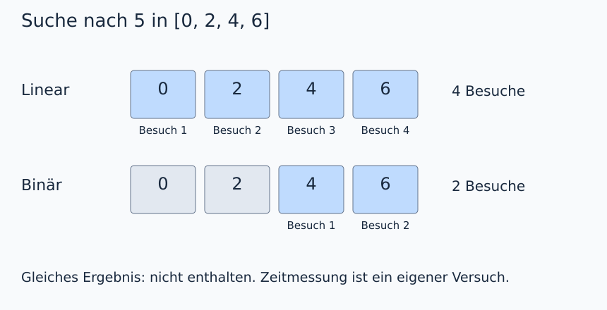

# M20-L1 – Reproduzierbares Informatikprojekt und Forschungsbericht {#L1}

**Kursbereich:** M20 – Projekt und Forschung

**Niveau:** Bachelor/Master · Projekt

**Vorwissen:** [M7-L6](M7-L6.md), [M13-L1](M13-L1.md), [M12-L4](M12-L4.md).

## Lernziele {#S1}

Eine prüfbare Forschungsfrage formulieren, Vergleichsbedingungen festlegen, einen Benchmark mit Rohdaten und Referenzprüfung durchführen und zwischen Wiederholbarkeit, Reproduzierbarkeit und Replikation unterscheiden.

## Forschungsfrage und Versuchsplan {#S2}

Die Frage „Welcher Suchalgorithmus ist besser?“ ist ohne Messgröße und Eingabeklasse nicht prüfbar. Wir vergleichen lineare Suche und binäre Suche auf bereits sortierten, aufsteigenden Listen eindeutiger gerader Ganzzahlen. Die Aufgabe ist ausschließlich die Entscheidung, ob ein Schlüssel enthalten ist. Hypothese: Bei wachsendem $n$ sinkt die mittlere Anzahl besuchter Elemente der binären Suche relativ zur linearen Suche. Unabhängige Variable ist $n$, abhängige Variablen sind die Zahl besuchter Elemente und die Laufzeit für 100 Anfragen. Die Anfragefolge muss für beide Verfahren gleich sein; Treffer und Fehltreffer bleiben enthalten. Die Kosten der Sortierung sind ausgeschlossen, da sortierte Eingaben vorausgesetzt werden. Für unsortierte Eingaben wäre das ein anderer Versuch.

Ein Besuch zählt unabhängig davon, ob im Programm ein oder zwei Vergleichsoperatoren ausgeführt werden. Bei einem Fehltreffer besucht die lineare Suche $n$ Elemente. Die binäre Suche halbiert den verbleibenden Suchbereich: Nach einem erfolglosen Besuch ist dessen Länge höchstens $\lfloor n/2\rfloor$. Induktiv folgen höchstens $\lfloor\log_2 n\rfloor+1$ Besuche für $n\ge1$. Für $n=0$ sind es null. Diese Schranke ist ein mathematisches Ergebnis, keine Messung der Laufzeit.

## Kontrollierter Benchmark und Auswertung {#S3}

Für die Liste $(0,2,4,6)$ und Anfrage 5 benötigt linear vier Besuche, binär zwei (4, 6). Ein Treffer beim ersten Element kann dagegen bei linearer Suche sofort gefunden werden. Einzelne Anfragen entscheiden also nicht über das Gesamtergebnis. Verwende die Größen 16, 64, 256 und 1024 sowie mindestens fünf vorher festgelegte Seeds. Erzeuge die Eingaben außerhalb der Zeitmessung und prüfe beide Antworten gegen eine Mengenreferenz. Wiederhole Zeitmessungen pro Eingabe; vertausche die Reihenfolge der Verfahren abwechselnd, um einfache Reihenfolgeeffekte zu mindern. Halte Python-Version, Betriebssystem, Prozessor, Hintergrundlast und Zeitmessmethode fest.

Für sieben Messwerte ist der Median der vierte sortierte Wert. Bei Zeiten 12, 13, 12, 50, 11, 14, 13 µs beträgt er 13 µs. Speichere auch die einzelnen Werte und die Spannweite 11–50 µs; der Median löscht den Ausreißer nicht aus den Rohdaten. Ein Speedup $S=T_{linear}/T_{binary}$ benötigt vergleichbare positive Zeiten. Bei 120 und 30 µs ergibt sich $S=4$. Diese Zahlen sind didaktisch gewählt, keine gemessenen Ergebnisse. Die tatsächliche Laufzeit enthält Interpreter-, Cache- und Verzweigungskosten; sie folgt nicht unmittelbar aus der Anzahl besuchter Elemente. Keine SPEC-Zertifizierung wird behauptet.

{alt="Kontrollierter Suchvergleich: identische Anfragen und unterschiedliche Besuchszahlen."}

## Forschungsartefakt und Bericht {#S4}

Ein abgabefähiges Projekt enthält eine README mit Fragestellung und einem vollständigen Startbefehl, Quellcode, Versionsangaben der Laufzeitumgebung, Eingabegenerator mit Seeds, unveränderte Rohdaten (CSV mit Größe, Seed, Variante, Wiederholung, Besuchen und Nanosekunden), Auswertungsskript, Bericht und Lizenz. Ein Hash belegt Byte-Identität, aber weder korrekte Messung noch Wahrheit. Speichere fehlgeschlagene Läufe samt Grund. Lege vor dem Experiment fest, welche Läufe ungültig sind (z. B. falsche Antworten); schließe nicht nachträglich unbequeme Messwerte aus.

Nach der ACM-Terminologie bezeichnet Wiederholbarkeit erneut erzielte Ergebnisse durch dasselbe Team unter gleichen Bedingungen. Reproduzierbarkeit verlangt eine andere Gruppe mit den bereitgestellten Artefakten; bei Replikation entwickelt sie eine eigene Umsetzung. Ein erfolgreicher eigener Neustart ist kein unabhängiger Nachweis. Der Bericht trennt Methode, Resultat, Interpretation und Grenzen. Erwähne, wenn die Hypothese nur für die getesteten Eingabeklassen gestützt wird; ein negatives Ergebnis ist ebenfalls zu berichten.

## Ausführbares Projekt {#S5}

`trial` zählt Besuche deterministisch, `benchmark` erfasst lokale Zeitwerte. Die Eingabekonstruktion und Referenzprüfung liegen außerhalb der Messung; die Erzeugung der Antwortliste liegt innerhalb. Die Zeitmessung ist keine reine Algorithmusmessung. Führe beide Funktionen für alle geplanten Größen und Seeds aus; protokolliere die Rohwerte, nicht nur den Median.

```python
from bisect import bisect_left
from statistics import median
from time import perf_counter_ns
import random

def linear(a, x):
    for i, y in enumerate(a):
        if y == x:
            return True, i + 1
    return False, len(a)

def binary(a, x):
    lo, hi, steps = 0, len(a), 0
    while lo < hi:
        mid = (lo + hi) // 2
        steps += 1
        if a[mid] == x:
            return True, steps
        if a[mid] < x:
            lo = mid + 1
        else:
            hi = mid
    return False, steps

def trial(n, seed):
    a = list(range(0, 2*n, 2))
    rng = random.Random(seed)
    queries = [rng.randrange(-1, 2*n+1) for _ in range(100)]
    ref = set(a)
    results = []
    for f in (linear, binary):
        answers = [f(a, q) for q in queries]
        assert all(found == (q in ref)
                   for q, (found, _) in zip(queries, answers))
        results.append(sum(s for _, s in answers))
    return tuple(results)

def benchmark(n, seed=42, repeats=7):
    if n < 1 or repeats < 1:
        raise ValueError('positive n and repeats required')
    a = list(range(0, 2*n, 2))
    rng = random.Random(seed)
    q = [rng.randrange(-1, 2*n+1) for _ in range(100)]
    fs = (linear, binary)
    members = set(a)
    ref = [x in members for x in q]
    for f in fs:
        assert [f(a,x)[0] for x in q] == ref
    raw = [[], []]
    for r in range(repeats):
        for k in ((0,1) if r%2==0 else (1,0)):
            t = perf_counter_ns()
            answers = [fs[k](a,x) for x in q]
            elapsed = perf_counter_ns()-t
            assert [found for found,_ in answers] == ref
            raw[k].append(elapsed)
    return raw, [median(xs) for xs in raw]

assert linear([0,2,4,6], 5) == (False,4)
assert binary([0,2,4,6], 5) == (False,2)
assert trial(16,42) == trial(16,42)
```

## Selbstkontrolle {#S6}

### Aufgaben

1. Formuliere eine messbare Hypothese für die Fehltreffer.
2. Bestimme die obere Besuchsschranke für $n=63$ und $n=64$.
3. Berechne Median und Spannweite der Werte 5, 7, 8, 6, 40.
4. Warum muss die Sortierung bei einer unsortierten Eingabe gesondert berücksichtigt werden?
5. Ein Kollege führt dein Skript erneut aus, ein anderer implementiert die Suche unabhängig. Ordne beide Versuche ein.

::: {.lc-solutions data-lc-section="S6"}
1. Für Fehltreffer benötigt linear genau $n$ Besuche, binär höchstens $\lfloor\log_2 n\rfloor+1$ für $n\ge1$; überprüfe dies je Größe.
2. 6 bzw. 7.
3. Median 7, Minimum 5, Maximum 40, Differenz 35.
4. Sortierung verändert die Gesamtkosten und die Voraussetzungen; bei wenigen Anfragen kann sie den Vorteil aufheben.
5. Bei hinreichend übereinstimmenden Ergebnissen: Reproduzierbarkeit bzw. Replikation im ACM-Sinn; bloße Ausführung ohne Resultatvergleich genügt nicht.
:::

## Quellen {#S7}

- [ACM – Artifact Review and Badging v1.1](https://prod-www.acm.bloomreach.cloud/publications/policies/artifact-review-and-badging-current) · Terminology; Artifacts Evaluated (Prüfumfang: Text) · Zuletzt abgerufen: 2026-11-24 · Inhaltlich geprüft: 2026-11-24
- [SPEC CPU 2017 – Run and Reporting Rules](https://www.spec.org/cpu2017/docs/runrules.html) · §1.2.1–1.3.1 (Prüfumfang: Text) · Zuletzt abgerufen: 2026-11-24 · Inhaltlich geprüft: 2026-11-24
