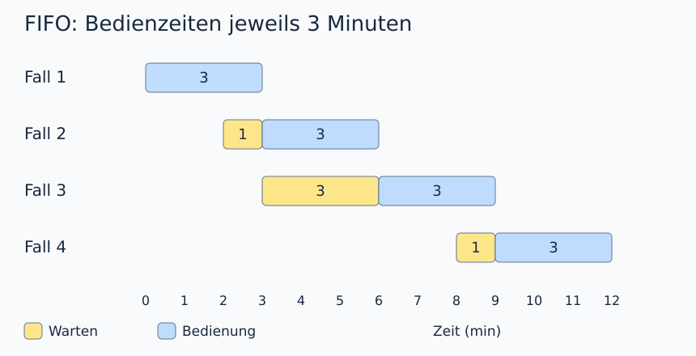

# M20-L2 – Interdisziplinäres Informatikprojekt: Modelle, Daten und Verantwortung {#L2}

**Kursbereich:** M20 – Projekt und Forschung

**Niveau:** Master · Wahlpflichtvertiefung

**Vorwissen:** [M20-L1](M20-L1.md), [M4-L3](M4-L3.md).

## Lernziele {#S1}

Ein interdisziplinäres Problem in ein überprüfbares Modell übersetzen, Datenqualität und Modellannahmen dokumentieren, Verifikation von Validierung abgrenzen, Akzeptanzkriterien und Einsatzgrenzen gemeinsam mit Fachpartnern definieren.

## Domänenmodell und Anforderungen {#S2}

Ein fiktives kommunales Servicezentrum möchte die Wartezeiten an einem Schalter verstehen. Wir betrachten ausschließlich ein vereinfachtes Modell, keine Empfehlung zur Personalplanung. Informatik liefert die Ereignislogik; Betriebsforschung prüft Warteschlangenannahmen; Mitarbeitende und Besuchende können erklären, wie Prioritäten, Pausen und Barrierefreiheit die tatsächlichen Abläufe beeinflussen. Eine gemeinsam vereinbarte Frage lautet: Wie gut sagt ein Ein-Schalter-Modell Wartezeiten für eine festgelegte Ankunftsfolge voraus? Definiere Zeiteinheit (Minuten), Beobachtungsbeginn, Ankunft, Bedienbeginn und Bedienende. Wir modellieren einen leeren Schalter zu Beginn, Bedienung in Ankunftsreihenfolge (FIFO), keine Unterbrechungen, keine Abbrüche, positive Bedienzeiten und bei gleicher Ankunftszeit die Eingabereihenfolge. Diese Annahmen sind prüfbar und können in Wirklichkeit verletzt sein.

Mit Ankunft $a_i$, Bedienzeit $s_i$ und Abschluss $c_{i-1}$ gilt $b_i=\max(a_i,c_{i-1})$, $w_i=b_i-a_i$, $c_i=b_i+s_i$ mit $c_0=0$. Weil $b_i\ge a_i$ und $b_i\ge c_{i-1}$, sind Wartezeiten nichtnegativ und Bedienintervalle überschneiden sich nicht. Für Ankünfte 0, 2, 3, 8 und Bedienzeiten jeweils 3 ergeben sich Startzeiten 0, 3, 6, 9, Abschlüsse 3, 6, 9, 12 und Wartezeiten 0, 1, 3, 1. Die mittlere Wartezeit beträgt 1,25 Minuten. Das Modell benötigt einen Durchlauf und $O(n)$ Speicher für die Ausgabeliste.

## Daten und Validierungsprotokoll {#S3}

Verifikation prüft, ob der Code das definierte Modell umsetzt; Validierung fragt, ob dessen Vorhersagen für den vorgesehenen Zweck hinreichend zutreffen. Ein fehlerfreies Programm kann ein unpassendes Modell implementieren. Die Datenprüfung betrifft u. a. Zeiteinheiten, fehlende Werte, Uhrenabweichungen, Auswahlverzerrung und nachvollziehbare Herkunft. Kalibriere unbekannte Parameter nur auf Entwicklungsdaten; halte andere Tage oder Schichten als Testdaten zurück. Vermeide die zufällige Aufteilung stark abhängiger Nachbarereignisse. Ein Fachpartner muss prüfen, ob Zeitstempel, Bedienregeln und Messgrößen tatsächlich den Arbeitsablauf repräsentieren.

Für getrennt erhobene Beobachtungen $y_i$ und Vorhersagen $\hat y_i$ definieren wir Residuen $r_i=y_i-\hat y_i$, $MAE=\sum|r_i|/n$ und den maximalen absoluten Fehler $\max|r_i|$. Als illustrative, vorab festgelegte Kriterien gelten MAE höchstens 1 Minute und maximaler Fehler höchstens 2 Minuten. Bei Vorhersagen $(0,1,3,1)$ und synthetischen Beobachtungen $(0,2,4,1)$ ergeben sich Residuen $(0,1,1,0)$, MAE 0,5 und Maximum 1; beide Kriterien sind erfüllt. Eine andere synthetische Schicht $(0,4,8,2)$ ergibt MAE 2,25 und Maximum 5; beide Kriterien scheitern. Das erste Ergebnis belegt nur die Übung, nicht die Eignung für reale Daten. Betrachte Residuen über die Zeit und nach relevanten Betriebsbedingungen; ein kleiner Mittelwert kann kritische Spitzen verdecken.

{alt="Warteschlangenmodell: Ankunft, Bedienung und Wartezeit."}

## Verantwortung und Abschlussprojekt {#S4}

Vor einer realen Datenerhebung kläre Zweck, Zugriffsberechtigung, notwendige Datenfelder, Löschfrist und Datenschutz mit der zuständigen Stelle. Für diese Übung sind keine personenbezogenen Daten nötig. Verwende synthetische Fallnummern und Zeitwerte. Keine Rückschlüsse auf individuelle Leistung, keine automatische Entscheidung über Mitarbeitende oder Besuchende. Prüfe mit Fachpartnern, ob relevante Gruppen (z. B. Personen mit längeren Unterstützungsbedarfen) im Modell nicht angemessen repräsentiert sind. Definiere einen Eskalationsweg, wenn Annahmen verletzt werden oder ein Grenzwert überschritten wird. Das Modell darf nicht außerhalb des vereinbarten Zwecks eingesetzt werden.

Abgabe: Anforderungsblatt mit Zweck, Nicht-Zweck, Fachpartnerrollen und Kriterien; Datenwörterbuch mit Einheiten und Herkunft; Modellgleichungen; Code und Verifikationstests; getrennte Validierungsdaten; Ergebnisbericht mit Residuen und Fehlern; Risikoliste mit Konsequenz, Gegenmaßnahme und Verantwortlichkeit. Wenn keine echten Fachpartner oder Daten vorhanden sind, dokumentiere die Validierung als ausstehend und nicht als erfolgreich. Vergleiche beispielsweise eine zweite Modellvariante mit Pausen; vereinbare vorher, wie diese gemessen werden. Bei Modelländerungen müssen Verifikation und Validierung wiederholt werden.

## Ausführbares Modell {#S5}

Die Funktion `queue` berechnet Wartezeiten für die festgelegten Annahmen. `errors` vergleicht exakt ausgerichtete, nichtleere Reihen. Die Beispiele verwenden synthetische Daten. Ein nicht bestandener Validierungstest ist ein Ergebnis und darf nicht durch nachträgliche Grenzwertänderung verborgen werden.

```python
from fractions import Fraction as F

def queue(arrivals, service):
    if len(arrivals) != len(service):
        raise ValueError('length mismatch')
    if any(t < 0 for t in arrivals) or any(s <= 0 for s in service):
        raise ValueError('invalid time')
    if any(a > b for a,b in zip(arrivals, arrivals[1:])):
        raise ValueError('arrivals must be sorted')
    end = 0
    waits = []
    for a,s in zip(arrivals,service):
        start = max(a,end)
        waits.append(start-a)
        end = start+s
    return waits

def errors(predicted, observed):
    if not observed or len(predicted) != len(observed):
        raise ValueError('aligned nonempty sequences required')
    residual = [o-p for p,o in zip(predicted,observed)]
    return (F(sum(map(abs,residual)),len(residual)),
            max(map(abs,residual)),residual)

assert queue([0,2,3,8],[3,3,3,3]) == [0,1,3,1]
assert errors([0,1,3,1],[0,2,4,1]) == (F(1,2),1,[0,1,1,0])
assert errors([0,1,3,1],[0,4,8,2]) == (F(9,4),5,[0,3,5,1])
```

## Selbstkontrolle {#S6}

### Aufgaben

1. Berechne Wartezeiten für Ankünfte 0, 1, 6 und Bedienzeiten 2, 4, 1.
2. Berechne MAE und maximalen Fehler für Vorhersagen 0, 2, 3 und Beobachtungen 1, 2, 7.
3. Besteht Fall 2 die vereinbarten Kriterien?
4. Warum wäre eine Kalibrierung auf denselben Daten wie die abschließende Validierung problematisch?
5. Nenne zwei verletzbare Domänenannahmen und passende Prüfungen.

::: {.lc-solutions data-lc-section="S6"}
1. Starts 0, 2, 6; Wartezeiten 0, 1, 0.
2. Residuen 1, 0, 4; MAE $5/3$, Maximum 4.
3. Nein, beide Grenzwerte werden überschritten.
4. Anpassung an Besonderheiten des Datensatzes kann den Fehler zu optimistisch erscheinen lassen; getrennte Daten prüfen Übertragbarkeit.
5. Z. B. keine Pausen: Bedienprotokolle gegen Pausenzeiten prüfen; FIFO: tatsächliche Reihenfolge mit Ankunftsreihenfolge vergleichen. Abweichungen dokumentieren und Modell oder Einsatzbereich anpassen.
:::

## Quellen {#S7}

- [Sargent (2013) – Verification and validation of simulation models](https://ics-websites.science.uu.nl/docs/vakken/msosi/VerificationValidationSargent.pdf) · §1, §3, §10; p. 14 page image (Prüfumfang: Text; PDF page 14 inspected) · Zuletzt abgerufen: 2026-11-24 · Inhaltlich geprüft: 2026-11-24
