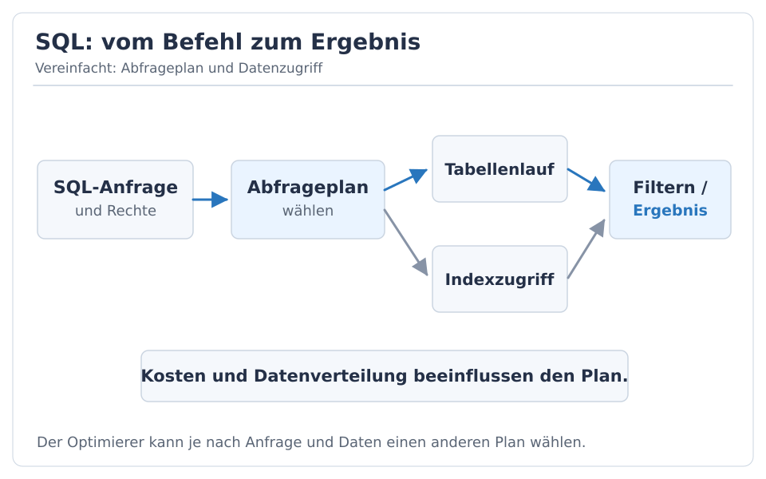
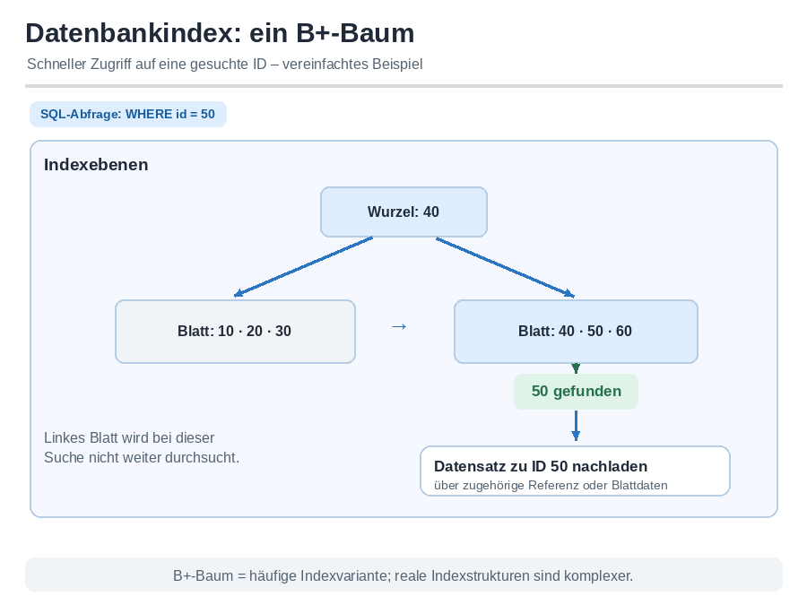

# M3-L1 – Eine Datenbank auf einem Server {#L1}

**Kursbereich:** M3 – Bachelor / Übergang: Datenbanksysteme

**Niveau:** Bachelor

**Vorwissen:** Keine festen Voraussetzungen angegeben.

## Worum es in diesem Abschnitt geht {#S1}

Im Grundlagenkapitel M1-L5 haben wir Tabellen, Schlüssel, die Datenbanksprache **SQL** (*Structured Query Language*) und Transaktionen kennengelernt. In M2-L1 bis M2-L5 ging es anschließend um Server, Anwendungen und ihre Verteilung. Nun fügen wir beides zusammen: **Was geschieht innerhalb eines Datenbankservers, wenn viele Nutzer gleichzeitig Daten lesen oder verändern möchten?**

Eine Datenbank ist nicht einfach eine große Datei mit einer Suchfunktion. Ein modernes **Datenbankmanagementsystem (DBMS)** verwaltet Datenformate und Beziehungen, entscheidet über Ausführungswege, koordiniert gleichzeitige Zugriffe, sichert Änderungen gegen bestimmte Ausfälle ab und setzt Berechtigungen durch. Es muss außerdem aus Tausenden einzelner Anfragen ein möglichst stabiles Gesamtsystem machen.

Wir bleiben zunächst **bewusst bei einem einzigen Datenbankknoten**. „Ein Knoten“ bedeutet hier eine selbstständig betriebene Datenbankinstanz mit ihren zugehörigen Ressourcen; der Knoten kann ein physischer Rechner, eine virtuelle Maschine oder ein verwalteter Einzelserver sein. Er muss nicht gleichzeitig der Webserver sein. Erst in M3-L2–M3-L6 verteilen wir Daten und Aufgaben auf mehrere Datenbankknoten.

## Das Ausgangsproblem: Von einer lokalen Tabelle zum Online-Dienst {#S2}

Stell dir einen kleinen Online-Dienst zur Verwaltung von Analyseaufträgen vor. Jeder Nutzer besitzt ein Konto, lädt Daten hoch und ruft später die Ergebnisse ab. Für einen Einzelentwickler wäre das zunächst sehr überschaubar: eine Anwendung und eine Datenbank. Bei zwei Besuchern ist die Belastung gering. Bei vielen gleichzeitig aktiven Nutzern können aber mehrere Schwierigkeiten auftreten:

- Viele Anfragen möchten dieselben Daten lesen.
- Zwei Vorgänge versuchen denselben Datensatz zu ändern.
- Einige Abfragen benötigen viel Rechenzeit oder lesen riesige Tabellenbereiche.
- Der Datenbankserver hat nur begrenzt Prozessorzeit, **RAM** (*Random Access Memory*, Arbeitsspeicher), Platz auf einem **SSD**-Datenträger (*Solid State Drive*) und Netzwerkbandbreite.
- Das System muss bei einem Stromausfall oder Absturz möglichst wenig bereits bestätigte Arbeit verlieren.

Die naheliegende Frage „Brauchen wir sofort eine verteilte Datenbank?“ ist meistens verfrüht. Zunächst verstehen wir, was ein einzelnes Datenbanksystem bereits leisten kann und welche Engpässe tatsächlich auftreten.

### Mini-Architektur: Ein Webdienst und eine Datenbank

``` text
Browser vieler Benutzer
          │
          ▼
      Webanwendung
          │  SQL-Anfragen
          ▼
┌────────────────────────────┐
│ Ein Datenbankserver        │
│                            │
│ Zugriffssteuerung          │
│ Abfrageplaner / Ausführung │
│ Transaktionen / Sperren    │
│ Zwischenspeicher           │
│ Protokollierung            │
│                            │
│ Tabellen, Indexe, Logdatei │
└─────────────┬──────────────┘
              │
          SSD / Storage
```

Die Blöcke sind Funktionen und Schichten, nicht zwingend eigenständige Programme. Eine Datenbankinstanz kann alle Funktionen in einer Serverinstallation bereitstellen.

## Was eine Tabelle intern bedeutet {#S3}

Für das Anwendungsprogramm sieht eine relationale Tabelle aus wie eine geordnete Liste von Spalten mit vielen Zeilen. Die Zeilen besitzen aber **keine allgemein garantierte physische Reihenfolge**. Ohne eine ausdrückliche Sortieranweisung darf sich die Anwendung nicht darauf verlassen, in welcher Reihenfolge Abfrageergebnisse erscheinen.

Eine schematische Tabelle `auftraege` könnte so aussehen:

    auftrag_id   kunde_id status        erstellt_am
  ------------ ---------- ------------- -------------
           101          7 wartend       10:00
           102          7 fertig        10:03
           103         12 verarbeitet   10:05

**Datensatz** und **Zeile** bezeichnen hier denselben logischen Eintrag. Die `auftrag_id` kann der **Primärschlüssel** sein: eine eindeutige Kennung. Die `kunde_id` kann auf die Kundentabelle verweisen. Solche Beziehungen und Integritätsregeln helfen, Widersprüche zu verhindern.

Physisch legt die Datenbank die Daten meist in **Seiten oder Blöcken** ab – kleinen, verwaltbaren Einheiten des Speichers. Das ist ein wichtiger Unterschied zur Vorstellung, jeder Datensatz wäre eine einzelne Datei. Ein Speichervorgang kann mehrere Zeilen derselben Seite betreffen, und das System muss entscheiden, welche Seiten im Arbeitsspeicher gehalten werden.

**Problem, das diese Organisation löst:** Ein DBMS kann Daten, freien Platz und Änderungen effizienter verwalten, statt jede Anwendung ihre eigenen Dateiformate erfinden zu lassen. **Wann unnötig?** Für eine einzige unveränderliche Konfigurationsdatei ist eine vollwertige Serverdatenbank meist überdimensioniert.

## Wie eine einzelne Leseanfrage abgearbeitet wird {#S4}

Eine typische Anfrage lautet in normaler Sprache: „Zeige die letzten zwanzig Aufträge dieses Kunden.“ Die Anwendung stellt eine SQL-Anfrage. Danach passiert vereinfacht Folgendes:

{alt="Vereinfachter Weg einer SQL-Leseanfrage: SQL und Berechtigungen, Auswahl des Zugriffsplans, Tabellenlauf oder Indexzugriff, Ausführung und Ergebnis."}

Ein möglicher Weg von SQL zur Ergebnismenge; reale Systeme optimieren unterschiedlich.

1.  Die Datenbank prüft, ob die Anfrage syntaktisch verständlich ist und ob die zugreifende Rolle die benötigten Rechte besitzt.
2.  Sie ermittelt, auf welche Tabellen und Spalten die Abfrage zugreift.
3.  Der **Abfrageplaner** (*Query Planner* oder Optimizer) beurteilt mögliche Wege: ganze Tabelle lesen, einen Index verwenden, Tabellen in unterschiedlicher Reihenfolge verbinden.
4.  Ein **Ausführungsplan** legt eine geeignete Reihenfolge von Teiloperationen fest.
5.  Die Ausführung liest erforderliche Daten aus dem Arbeitsspeicher oder nötigenfalls von der SSD, filtert und sortiert sie und liefert das Ergebnis zurück.

Bei vorbereiteten Anfragen können sich Teile dieser Verarbeitung wiederverwenden lassen; eine reale Datenbank durchläuft nicht für jede Anfrage zwingend sämtliche Schritte völlig neu.

``` text
Anwendung: „20 neueste Aufträge von Kunde 7“
                     │
                     ▼
              SQL verstehen
                     │
                     ▼
             Rechte überprüfen
                     │
                     ▼
         Geeigneten Zugriffsweg wählen
              │              │
         Tabellenlauf      Indexzugriff
              └──────┬───────┘
                     ▼
          Daten laden / filtern
                     │
                     ▼
          Sortieren / begrenzen
                     │
                     ▼
             20 Ergebniszeilen
```

Hier liegt bereits ein großer Leistungshebel: Nicht allein die Menge aller gespeicherten Daten ist entscheidend, sondern **wie viele Datenblöcke für eine konkrete Anfrage tatsächlich gelesen und verarbeitet werden müssen**.

## Tabellenlauf und Index: Warum eine Million Zeilen nicht automatisch langsam sind {#S5}

Ohne eine passende Suchhilfe kann die Datenbank eine Tabelle von Anfang bis Ende untersuchen. Das heißt **Sequential Scan** beziehungsweise sequentieller Tabellenlauf. Bei einer großen Tabelle und einer selten vorkommenden Kundennummer kann das aufwendig sein.

{alt="Vereinfachter B+-Baum-Index: Die Wurzel mit Trennwert 40 führt für die Suche nach ID 50 zum rechten Blatt mit den Werten 40, 50 und 60 und dann zum Datensatz."}

Ein B+-Baum kann eine gesuchte Schlüssel-ID gezielt über die Baumebenen finden, statt alle Zeilen nacheinander zu durchsuchen.

Ein **Index** ist eine zusätzliche Datenstruktur, die Suchwerte mit Fundstellen beziehungsweise anderen für die Suche wichtigen Informationen verbindet. Eine gebräuchliche Indexform ist der **B-Baum** oder **B-Tree**: ein balancierter Suchbaum, der für viele Gleichheits-, Bereichs- und Sortieranfragen geeignet ist.

**Anschaulicher Vergleich:** Du suchst in einem Sachbuch nach „Transaktion“. Ohne Stichwortverzeichnis blätterst du unter Umständen das ganze Buch durch. Mit einem Register findest du geeignete Seiten viel schneller. Das Register benötigt jedoch zusätzlichen Platz und muss bei Änderungen am Buch gepflegt werden.

``` text
Tabelle mit vielen Aufträgen
┌──────────────────────────────────┐
│ 101, 102, 103, 104, 105, ...     │
└──────────────────────────────────┘
          │
     Index auf kunde_id
          │
          ▼
     Kunde 7 → passende Einträge
          │
          ▼
       Nur benötigte Zeilen lesen
```

Ein Index ist **keine magische Beschleunigung jeder Abfrage**. Wenn fast alle Zeilen zurückgegeben werden, kann ein sequentieller Scan günstiger sein. Ein Index benötigt Speicher, vergrößert Backups und kann Änderungen verlangsamen, weil auch die Indexstruktur aktualisiert werden muss. Ein Index auf einem Feld, das kaum unterschiedliche Werte annimmt, ist nicht automatisch vorteilhaft. Der Nutzen hängt vom Abfrageverhalten und vom Datenbestand ab.

### Zusammengesetzte Indexe

Bei einer typischen Anfrage „Aufträge eines Kunden, neueste zuerst“ kann ein **zusammengesetzter Index** auf `(kunde_id, erstellt_am)` interessant sein. Dann sind die Daten für bestimmte Such- und Sortierbedingungen bereits günstig organisiert. Welche Teile eines Mehrspaltenindexes in einer konkreten Abfrage genutzt werden können, hängt vom Datenbanksystem, den Operatoren und der Sortierreihenfolge ab.

Für kleine Datenbestände ist eine solche Optimierung häufig gar nicht nötig. **Eine Handvoll sinnvollen Indexe ist besser als das reflexhafte Indizieren jeder Spalte.**

## Der Abfrageplaner entscheidet – nicht der Programmierer allein {#S6}

Selbst wenn ein Index existiert, muss die Datenbank ihn nicht verwenden. Der Abfrageplaner bewertet die geschätzten Kosten verschiedener Ausführungswege. Dazu dienen unter anderem **Statistiken** über Anzahl und Verteilung der Werte in einer Tabelle.

Wenn zum Beispiel fast sämtliche Aufträge den Status `fertig` besitzen, könnte ein Index auf dieser Spalte für die Frage „Zeige alle fertigen Aufträge“ wenig bringen. Sucht die Anwendung dagegen nach einem sehr seltenen Fehlerstatus, kann derselbe Index nützlich sein. **Selektivität** beschreibt, wie stark eine Bedingung die Zahl der infrage kommenden Zeilen einschränkt.

PostgreSQL bietet dafür das Werkzeug `EXPLAIN`: Es zeigt den geplanten Ausführungsweg, zum Beispiel einen Tabellenlauf oder einen Indexzugriff. `EXPLAIN ANALYZE` führt die Anfrage tatsächlich aus und misst den Ablauf. Bei schreibenden SQL-Anweisungen kann das Daten verändern; es ist also kein harmloses „Nur ansehen“.

Die wichtigste Denkregel lautet daher: **Eine langsame Abfrage erst verstehen, dann optimieren.** Man sollte nicht reflexhaft zusätzliche Server kaufen, solange eine ungeeignete Suchbedingung oder ein fehlender Index die Hauptursache ist.

**Quelle:** [PostgreSQL: Using EXPLAIN](https://www.postgresql.org/docs/current/using-explain.html) und [Examining Index Usage](https://www.postgresql.org/docs/current/indexes-examine.html), geprüft am 03.11.2026.

## Caching: Daten müssen nicht jedes Mal von der SSD kommen {#S7}

Datenbanken verfügen häufig über eigene **Buffer Pools** oder Seitenzwischenspeicher. Dort halten sie gerade benötigte Datenblöcke im Arbeitsspeicher. Zusätzlich kann das Betriebssystem einen Dateicache verwenden. Bei PostgreSQL wird unter anderem der Parameter `shared_buffers` für den gemeinsamen Datenbankpuffer genutzt. Die konkrete Aufteilung ist eine technische Konfigurationsfrage; sie lässt sich nicht durch eine universelle Prozentregel für jeden Workload richtig festlegen.

Ein **Cache-Hit** bedeutet: Eine benötigte Speicherseite ist bereits schnell erreichbar. Ein **Cache-Miss** bedeutet: Sie muss aus einer langsameren Speicherschicht nachgeladen werden. Der Begriff „Cache“ meint hier also nicht nur den Webcache aus M2-L5. Es gibt Caches auf unterschiedlichen Ebenen.

``` text
Datenbank fragt Datenblock an
              │
              ▼
      Datenbankpuffer (RAM)
       │             │
    Treffer        Fehlt
       │             │
       │             ▼
       │       Dateicache / SSD
       │             │
       └──────┬──────┘
              ▼
       Datensätze auswerten
```

**Was verbessert das?** Wiederholte Zugriffe auf dieselben Daten können deutlich schneller werden. **Wann hilft es wenig?** Wenn jede Anfrage ganz andere, sehr große Datenbereiche liest, passen die wichtigen Daten womöglich nicht mehr in den Speicher. Dann ist die I/O-Last (*Input/Output*, Ein-/Ausgabe von Daten) entscheidend.

Mehr RAM ist deshalb manchmal eine gute Investition, ersetzt aber keine sinnvollen Abfragen. Umgekehrt kann eine schlecht entworfene Anfrage selbst bei großem Arbeitsspeicher viel CPU-Zeit und unnötige Sortierarbeit verursachen.

## Was beim Schreiben geschieht {#S8}

Eine Leseanfrage verändert zunächst nichts. Ein Schreibvorgang – etwa „Setze Auftrag 101 auf fertig“ – muss deutlich mehr berücksichtigen:

- Ist die Änderung erlaubt und passen Datentypen sowie Integritätsregeln?
- Arbeitet ein anderer Vorgang gerade am selben Datensatz?
- Welche Tabellen- und Indexseiten ändern sich?
- Wann gilt die Änderung als bestätigt?
- Wie kann nach einem Absturz ein konsistenter Zustand wiederhergestellt werden?

Eine verbreitete Technik heißt **Write-Ahead Logging (WAL)**, wörtlich „vorauseilende Protokollierung“. PostgreSQL protokolliert Änderungen in einer dafür vorgesehenen Logstruktur, bevor die zugehörigen veränderten Datenseiten dauerhaft geschrieben werden müssen. So kann das System nach bestimmten Abstürzen Änderungen aus dem Protokoll nachspielen. Die genauen Garantien hängen unter anderem von Datenbankkonfiguration und der Zuverlässigkeit der Speicherhardware ab.

``` text
Anwendung ändert Auftragsstatus
               │
               ▼
        Datenbank prüft Änderung
               │
               ▼
     Änderungsinformation ins WAL
               │
               ▼
     Transaktion COMMIT (bestätigen)
               │
               ▼
     Datenseiten werden passend
     verwaltet und später geschrieben
```

Diese Skizze zeigt die Grundidee, nicht die vollständige interne Reihenfolge aller Schritte. Insbesondere heißt sie **nicht**, dass alle geänderten Tabellenseiten schon beim Bestätigen unmittelbar auf die SSD geschrieben sein müssen. Auch heißt ein vorhandenes WAL **nicht**, dass Daten gegen versehentliches Löschen, Ransomware, Hardwareverlust oder eine beschädigte gesamte Datenträgerumgebung geschützt sind.

**Wichtige Unterscheidung:** WAL trägt zu Wiederherstellbarkeit und Haltbarkeit bei, ist aber **kein eigenständiges externes Backup**. Backups und die Prüfung ihrer Wiederherstellbarkeit behandeln wir ausführlich in M3-L6.

**Quelle:** [PostgreSQL: Write-Ahead Logging](https://www.postgresql.org/docs/current/wal-intro.html), geprüft am 03.11.2026.

## Eine Transaktion ist mehr als eine einzelne SQL-Anweisung {#S9}

Eine **Transaktion** fasst zusammengehörige Datenbankoperationen zu einer logischen Einheit zusammen. Beispiel: Ein kostenpflichtiges Analysepaket wird einem Konto gutgeschrieben, gleichzeitig wird eine dazugehörige Buchung gespeichert. Es wäre problematisch, wenn nur eine der beiden Änderungen endgültig wirksam würde.

Die bekannte Abkürzung **ACID** fasst wichtige Eigenschaften zusammen:

  Buchstabe   Langform                       Bedeutung im Beispiel
  ----------- ------------------------------ -------------------------------------------------------------------------------------------------------
  A           Atomicity – Atomarität         Entweder werden die zusammengehörigen Änderungen übernommen oder keine
  C           Consistency – Konsistenz       Definierte Integritätsregeln bleiben gewahrt
  I           Isolation – Isolation          Gleichzeitige Vorgänge werden gemäß dem gewählten Isolationsniveau voneinander abgeschirmt
  D           Durability – Dauerhaftigkeit   Bestätigte Änderungen sollen gemäß den zugesicherten Haltbarkeitsbedingungen einen Absturz überstehen

Das bedeutet nicht, dass die Datenbank automatisch jede fachliche Regel kennt. Wenn die Anwendung eine falsche Rechnung ausführt, sorgt „C“ nicht von selbst für ein korrektes Geschäftsmodell. Fachliche Regeln müssen ausdrücklich modelliert und erzwungen werden.

Ein zweiter, verbreiteter Fehler ist ein zu langes Offenhalten von Transaktionen. Solange eine Transaktion läuft, können Sperren bestehen bleiben, Speicher-/Versionsbereinigung behindert werden oder andere Vorgänge warten. **Kurze, klar begrenzte Transaktionen** sind deshalb oft eine wichtige Betriebseigenschaft.

## Was passiert bei vielen gleichzeitigen Lesern? {#S10}

Angenommen, 1.000 Personen sind auf einer Webseite angemeldet. Das bedeutet zunächst **nicht**, dass 1.000 Datenbankanfragen zum selben Zeitpunkt ausgeführt werden. Viele Nutzer lesen eine Seite, überlegen oder sind inaktiv. Entscheidend ist, wie viele Anfragen pro Zeit eintreffen, wie lange diese dauern und welche Ressourcen sie beanspruchen.

Wenn viele Anfragen dieselben häufig benötigten Informationen lesen, können Indexe und Caches erhebliche Arbeit einsparen. Werden allerdings große Tabellen ohne passende Filter abgefragt, müssen möglicherweise dieselben Daten immer wieder verarbeitet werden. Dann steigt die Auslastung.

Für gleichzeitige Zugriffe benötigt der Datenbankserver außerdem Verbindungen. Eine **Connection** ist eine logische Sitzung beziehungsweise Kommunikationsverbindung zum DBMS. Bei Systemen mit relativ hohen Kosten pro Verbindung kann ein **Connection Pool** helfen: Die Anwendung hält eine begrenzte Zahl wiederverwendbarer Datenbankverbindungen vor und verteilt die Anfragen darauf.

``` text
Viele Browser
      │
      ▼
Webanwendung mit vielen Aufrufen
      │
      ▼
Connection Pool (begrenzte Zahl Verbindungen)
   │      │      │
   └──────┼──────┘
          ▼
     Datenbankserver
```

Ein Pool ist kein unbegrenzter Beschleuniger. Wenn sich alle Anfragen in eine kleine Zahl Verbindungen drängen, entstehen Warteschlangen. Er löst aber häufig das Problem, dass tausende kurzlebige Verbindungen aufwendig aufgebaut und wieder geschlossen würden.

## Gleichzeitiges Lesen und Schreiben: Versionen statt pauschaler Blockade {#S11}

Bei mehreren Nutzern wird besonders wichtig, **welche Datenversion ein Leser sieht, während ein anderer schreibt**. PostgreSQL nutzt dafür unter anderem **MVCC** (*Multi-Version Concurrency Control*, Mehrversions-Nebenläufigkeitskontrolle). Vereinfacht können unterschiedliche Transaktionen verschiedene Versionen eines Datensatzes sehen, je nachdem, wann ihr konsistenter Lesestand bestimmt wurde.

Beispiel:

1.  Nutzer A liest den Status eines Auftrags: `wartend`.
2.  Nutzer B setzt denselben Auftrag auf `fertig` und bestätigt die Änderung.
3.  Nutzer A kann – je nach Isolationsniveau und Abfragezeitpunkt – noch den alten oder bei einer neuen Abfrage den neuen Status sehen.

Das klingt zunächst seltsam, ist aber sinnvoll. Es verhindert, dass jede normale Leseanfrage pauschal sämtliche Schreibvorgänge blockieren müsste. Datenbankregeln sorgen dafür, welche Zustände ein Vorgang beobachten darf.

``` text
Zeit ─────────────────────────────────────►

Transaktion A: liest Version „wartend“
Transaktion B:              ändert → „fertig“ → COMMIT
Transaktion A: je nach Isolation weiterhin alter Snapshot
               oder spätere Abfrage mit neuem Sichtstand
```

Wichtig ist die Einschränkung: **MVCC beseitigt nicht alle Sperren.** Zwei Schreibvorgänge auf denselben Datensatz können weiterhin konkurrieren. Beispielsweise darf ein Kontostand nicht durch zwei unkoordiniert ausgeführte Abbuchungen unbemerkt falsch werden. Nebenläufige Transaktionen können warten, aneinander scheitern oder – bei ungünstigen Sperrfolgen – in einen **Deadlock** (wechselseitige Blockade) geraten. Datenbanken besitzen Mechanismen, solche Konflikte zu behandeln, aber die Anwendung muss Fehler und Wiederholungsversuche korrekt berücksichtigen.

Auch die Pflege alter Datenversionen verursacht Arbeit. PostgreSQL nutzt unter anderem **VACUUM**, um nicht mehr benötigte Zeilenversionen beziehungsweise Speicherbereiche zu bereinigen. Die Details behandeln wir vertieft in M3-L5. Bereits hier ist wichtig: Viele lange laufende Transaktionen können die Datenbankgesundheit beeinträchtigen.

**Quelle:** [PostgreSQL: MVCC Introduction](https://www.postgresql.org/docs/current/mvcc-intro.html), geprüft am 03.11.2026.

## Wenn viele Nutzer gleichzeitig schreiben {#S12}

Bei Leseanfragen ist eine wesentliche Frage: Wie viel muss gelesen werden? Bei Schreibanfragen kommt hinzu: **Wollen mehrere Transaktionen dieselben Ressourcen verändern?**

Beispiel für unproblematischere Parallelität: Mehrere Kunden legen unabhängig neue Analyseaufträge an. Die Datenbank kann viele Vorgänge gleichzeitig bearbeiten, soweit ihre Architektur und Ressourcen dies erlauben.

Beispiel für Konflikte: Tausende Aufträge aktualisieren ständig dieselbe globale Statistikzeile. Dann entsteht ein **Hotspot** – ein besonders stark umkämpfter Datensatz. Zusätzliche Prozessoren oder mehr Webserver lösen dieses Problem nicht automatisch. Häufig hilft schon eine andere Datenmodellierung: Einzelereignisse getrennt protokollieren und die Statistik zeitversetzt aggregieren, soweit die fachlichen Anforderungen das zulassen.

``` text
1000 unabhängige Schreibvorgänge
            │
            ▼
     Verschiedene Datensätze
            │
     oft gut parallelisierbar

1000 Schreibvorgänge auf dieselbe Zeile
            │
            ▼
       Konflikte / Warten
```

Die Zahlen dienen der Veranschaulichung. Reale Leistung hängt unter anderem von Transaktionsdauer, Indexen, Speichersystem, Datenbankimplementierung und Hardware ab. **Mehr gleichzeitige Arbeit kann den Durchsatz zunächst erhöhen, ab einer Grenze aber die Antwortzeiten stark verschlechtern.**

## Leistung verstehen: Latenz, Durchsatz und Warteschlangen {#S13}

Zwei Leistungsbegriffe sollte man auseinanderhalten:

- **Latenz** (*Latency*): Wie lange dauert es, bis eine bestimmte Anfrage beantwortet ist?
- **Durchsatz** (*Throughput*): Wie viele Anfragen oder Aufträge werden in einer bestimmten Zeit verarbeitet?

Eine Datenbank kann einzelne Anfragen sehr schnell beantworten und unter extremer Parallelbelastung trotzdem überfordert sein. Umgekehrt kann eine datenintensive Analyse lange dauern, während ein Server über eine Stunde viele solcher Analysen erfolgreich abarbeitet.

Wenn Anfragen schneller eintreffen, als das System sie abschließen kann, bildet sich eine **Warteschlange**. Deren Länge wächst, die Antwortzeit steigt, und schließlich können Verbindungen oder Zeitlimits erschöpft werden. Das ist kein Fehler der Datenbanklogik, sondern eine Folge begrenzter Kapazität.

### Vereinfachtes Lastbeispiel

Ein kleiner Datenbankserver kann in einem *rein hypothetischen* Beispiel dauerhaft 100 ähnliche Abfragen je Sekunde abarbeiten. Treffen nur 20 pro Sekunde ein, bleibt Reserve. Treffen dauerhaft 120 ein, wachsen ohne Begrenzung oder Lastsenkung Rückstände. Dass eine Anfrage unter Leerlauf 10 Millisekunden benötigt, bedeutet nicht, dass ein einzelner Server unter beliebiger Last dauerhaft 100 parallele Anfragen in derselben Zeit abschließen kann.

Diese Beispielwerte sind **keine Benchmarkangaben** für PostgreSQL, SQLite oder einen Cloudanbieter. Sie zeigen nur, warum Kapazität und Wartezeiten zusammen gedacht werden müssen.

Die wichtigste Folgerung: Eine höhere Nutzerzahl erfordert nicht zwingend einen zweiten Datenbankserver. Oft hilft es zuerst, Anfragen zu begrenzen, Caches sinnvoll einzusetzen, überflüssige Datenbankaufrufe zu vermeiden oder zeitaufwendige Arbeit in Hintergrundjobs auszulagern.

## Die fünf typischen Ressourcenengpässe {#S14}

Ein einzelner Datenbankserver hat mehrere begrenzte Ressourcen. Sie können völlig unterschiedliche Symptome erzeugen.

  Engpass                               Typische Ursache                                                                           Möglicher erster Ansatz
  ------------------------------------- ------------------------------------------------------------------------------------------ ----------------------------------------------------------
  **CPU** (*Central Processing Unit*)   Viele aufwendige Abfragen, Sortierungen, Berechnungen                                      Abfrageplan prüfen, überflüssige Berechnung vermeiden
  **RAM**                               Arbeitsdaten passen nicht in Puffer oder Sortier-/Hashoperationen brauchen viel Speicher   Speicherbedarf und Arbeitslast untersuchen, RAM anpassen
  **SSD / I/O**                         Viele Datenblöcke lesen, schreiben oder mit dauerhaften Garantien synchronisieren          Indexe, Cache, Speicherlatenz und Schreibmuster prüfen
  **Netzwerk**                          Große Ergebnisse oder hoher Kommunikationsaufwand zwischen Anwendung und DBMS              Weniger Daten übertragen, Abfragen zusammenfassen
  **Sperren/Konflikte**                 Viele Transaktionen warten auf dieselben Zeilen oder Ressourcen                            Transaktionen verkürzen, Hotspots und Modell prüfen

Ein häufiger Denkfehler lautet: „Die CPU ist nur zu 15 Prozent ausgelastet, also muss alles schnell sein.“ Tatsächlich könnte der Server überwiegend auf die SSD oder auf eine fremde Transaktion warten. Genauso kann viel freier RAM vorhanden sein und die Anwendung trotzdem zu viele unnötige Daten übers Netz schicken.

**Nicht die größte Serverkonfiguration, sondern die gemessene Engpassursache bestimmt die richtige Maßnahme.**

## Wie man einen Engpass erkennt, ohne im Blindflug zu optimieren {#S15}

Datenbanksysteme bieten Diagnosemöglichkeiten. PostgreSQL stellt beispielsweise Statistiken über laufende Sitzungen, Tabellenzugriffe und verschiedene Ein-/Ausgabevorgänge bereit. Das Zusatzmodul `pg_stat_statements` kann aggregierte Kennzahlen zu häufig ausgeführten SQL-Anweisungen erfassen, sofern es passend eingerichtet wurde.

Zur gedanklichen Analyse eignen sich fünf Fragen:

1.  **Welche Abfrage ist langsam?** Eine konkrete Anfrage oder jede Anfrage?
2.  **Welche Art von Last tritt auf?** Viele Leser, viele Schreiber oder wenige sehr große Analysen?
3.  **Wo wartet das System?** Prozessor, Datenträger, Netzwerk, Sperre oder freie Verbindung?
4.  **Welchen Ausführungsplan verwendet es?** Ist ein Tabellenlauf sinnvoll oder vermeidbar?
5.  **Was hat sich verändert?** Mehr Daten, anderer Index, neue Softwareversion, gestiegene Nutzerzahl oder neuer Hintergrundjob?

Anschließend lassen sich Maßnahmen gezielt vergleichen. Dazu gehören die Überarbeitung eines Indexes, eine geänderte SQL-Abfrage, ein Cache, ein stärkerer Einzelserver oder ein Pool für Datenbankverbindungen. Erst wenn der Engpass weiterhin nicht sinnvoll behoben werden kann, wird die Aufteilung auf mehrere Datenbankknoten zur ernsthaften Option.

**Quelle:** [PostgreSQL: Monitoring Statistics](https://www.postgresql.org/docs/current/monitoring-stats.html) und [`pg_stat_statements`](https://www.postgresql.org/docs/current/pgstatstatements.html), geprüft am 03.11.2026.

## SQLite gegen Serverdatenbanken: Was ändert sich an der Architektur? {#S16}

**SQLite** ist ein eingebettetes Datenbanksystem. Die Anwendung verwendet eine Bibliothek, die auf eine lokale Datenbankdatei zugreift; normalerweise läuft kein separat erreichbarer Datenbankserverprozess. Das macht SQLite sehr attraktiv für Desktopsoftware, lokale Werkzeuge, Kataloge und kleine, kontrollierte Anwendungen.

**PostgreSQL** ist ein Client-Server-System. Anwendungen kommunizieren mit einem eigenständigen Datenbankserver, der Verbindungen, Berechtigungen, Transaktionen und konkurrierende Anfragen zentral verwaltet. Das ist besonders hilfreich, wenn viele unterschiedliche Anwendungsprozesse gleichzeitig auf eine gemeinsame Datenhaltung zugreifen sollen.

``` text
Lokale Anwendung mit SQLite:
Desktop-Programm → SQLite-Bibliothek → Datenbankdatei

Online-Anwendung mit PostgreSQL:
Browser → Web-Backend → PostgreSQL-Prozess → Datenträger
```

Auch SQLite unterstützt Transaktionen und mehrere gleichzeitige Leser. Im **WAL-Modus** (*Write-Ahead Logging*) können Leser und ein Schreiber gleichzeitig aktiv sein. Allerdings ist **immer nur ein schreibender Vorgang gleichzeitig** möglich; das kann bei stark schreiblastigen Anwendungen zum Engpass werden. Dieser Unterschied sollte nicht mit „SQLite kann gar keine mehreren Nutzer“ verwechselt werden: Das wäre zu grob und falsch. Entscheidend ist, wie Anwendungen zugreifen und welche Gleichzeitigkeit benötigt wird. WAL-Modus und Zugriffe über Netzdateisysteme erfordern besondere Vorsicht; der übliche WAL-Modus von SQLite ist nicht für Prozesse auf unterschiedlichen Hosts über ein gemeinsames Netzdateisystem gedacht.

Bei PostgreSQL sind mehrere parallele Schreibtransaktionen möglich, soweit sie nicht in Konflikt miteinander stehen und genügend Ressourcen vorhanden sind. Das bedeutet wiederum nicht, dass beliebige Parallelität kostenlos wäre.

**Quelle:** [SQLite: Write-Ahead Logging](https://www.sqlite.org/wal.html), geprüft am 03.11.2026.

### Entscheidungshilfe

  Situation                                                                      Oft angemessener Ausgangspunkt
  ------------------------------------------------------------------------------ -------------------------------------------------------------------------------------------
  Ein lokaler PureBasic-Medienkatalog                                            SQLite
  Ein kleines lokales Hilfsprogramm mit Einstellungen und Listen                 SQLite oder einfache Datei
  Ein Online-Dienst mit vielen getrennten Backend-Prozessen und Benutzerkonten   Relationaler Datenbankserver wie PostgreSQL
  Ein kleiner öffentlich erreichbarer Dienst auf einem einzelnen Host            PostgreSQL oder je nach Schreiblast und Betriebsmodell auch SQLite
  Große Organisation mit sehr vielen Transaktionen                               Zunächst sorgfältig dimensioniertes Server-DBMS; Verteilung erst nach Anforderungsanalyse

Dies sind Architekturheuristiken, keine unveränderlichen Produktgrenzen. Anforderungen an Datenschutz, Verfügbarkeit, Datenvolumen und Datensicherungsprozesse können die Entscheidung verändern.

## Die unsichtbare Arbeit: Betrieb, Sicherheit und Kosten {#S17}

Ein Datenbankserver benötigt mehr als eine laufende DBMS-Software. Zu einem verlässlichen Betrieb gehören mindestens:

- **Zugriffsrechte:** Anwendungsprozesse erhalten nur die benötigten Berechtigungen; Administrator- und Anwendungskonten bleiben getrennt.
- **Netzwerkgrenzen:** Eine interne Datenbank wird in der Regel nicht ohne Not direkt aus dem öffentlichen Internet erreichbar gemacht.
- **Sichere Eingaben:** Parametrisierte Abfragen helfen, SQL-Injection – das Einschleusen fremder SQL-Befehle über unkontrollierte Eingaben – zu verhindern.
- **Aktualisierungen:** Sicherheitsupdates, gegebenenfalls geplante Wartungsfenster und Verträglichkeit der Anwendung mit neuen Versionen.
- **Backups:** Geprüfte Sicherungskopien mit geeigneter Aufbewahrung und Wiederherstellungsproben.
- **Monitoring:** Beobachtung von Kapazität, Laufzeiten, Fehlern, freien Speicherplätzen und ungewöhnlichen Zugriffen.
- **Datenschutz:** Überlegungen zu personenbezogenen Daten, Aufbewahrungsfristen, Löschung und Berechtigungen.

Auch bei einem **Managed Database Service** übernimmt der Anbieter nicht automatisch alle diese Aufgaben. Der Anbieter kann etwa Hardware, Betriebssystem und bestimmte Datenbankupdates verwalten; fachliche Datenmodelle, Rollen, sichere Anwendungsabfragen und die Eignung der Backups bleiben aber zumindest teilweise Verantwortung des Betreibers. Der genaue Umfang hängt vom Vertrag und Produkt ab.

Kosten entstehen durch Serverressourcen, SSD-Speicher, I/O-Last, Backups, Datenverkehr, Überwachung und vor allem Betriebszeit beziehungsweise Administrationsaufwand. Ein einzelner gut dimensionierter Datenbankserver ist in vielen Fällen leichter zu betreiben als ein frühzeitig verteilter Datenbankverbund. Konkrete Preise sind anbieter- und zeitabhängig; deshalb verwendet dieses Kapitel keine erfundenen Preisangaben.

## Drei Beispiele: Vom Medienkatalog zur KI-Verarbeitung {#S18}

### Beispiel A – Lokaler Medienkatalog

Du verwaltest eine umfangreiche Sammlung mit Metadaten, Dateipfaden und Schlagwörtern. Eine SQLite-Datei und passende Indexe können dafür sehr gut ausreichen. Wenn die Suche langsam wird, liegt die Ursache womöglich an fehlenden Indexen oder ungünstigen Abfragen, nicht daran, dass „zu wenig Cloud“ vorhanden ist. Eine öffentliche Serverdatenbank wäre möglicherweise zusätzliche Komplexität ohne echten Gewinn.

### Beispiel B – Bezahlter Analyse-Onlinedienst

Viele Kunden melden sich an, senden Analyseaufträge und fragen deren Status ab. Ein Web-Backend mit einem zentralen PostgreSQL-Server kann diese Daten konsistent verwalten. Zunächst sind vor allem gute Indexe auf `kunde_id` und Auftragsstatus, kurze Transaktionen, sinnvolle Verbindungspools sowie verlässliche Sicherungen wichtig. Bei steigender Nutzung misst man, ob wirklich die Datenbank und nicht ein externes Rechenprogramm der Engpass ist.

### Beispiel C – KI-Auftragsplattform

Ein Webdienst nimmt Anfragen entgegen. Eine Datenbank verwaltet Auftragsstatus, Zugriffsrechte und Ergebnisverweise. Eine **Queue** (Warteschlange) und mehrere **Worker** (Auftragsbearbeiter) können zeitintensive Bild- oder Textgenerierung übernehmen. Der Datenbankserver ist in diesem Modell eher die **Koordinations- und Metadateninstanz** – nicht automatisch der Ort, an dem große Modelle rechnen oder Bilddateien dauerhaft gespeichert werden müssen.

``` text
Nutzer → API → Datenbank: Auftrag anlegen
             │
             └→ Queue → KI-Worker → Ergebnisspeicher
                          │
                          └→ Datenbank: Status aktualisieren
```

Wenn 20 KI-Worker gleichzeitig fertig werden, muss die Datenbank 20 Statusänderungen verarbeiten. Das ist meist ein anderes Lastprofil als 20 riesige Modellberechnungen. Bei dieser Trennung kann ein einzelner Datenbankserver lange genügen, während die Rechenverarbeitung unabhängig wächst. Wie zuverlässige Warteschlangen und Wiederholungen funktionieren, vertiefen wir in M4-L1 und M3-L5.

## Wann sollten wir überhaupt über mehrere Datenbankserver nachdenken? {#S19}

Eine einzige Datenbankinstanz hat Grenzen: Sie kann ausfallen, Speicherressourcen sind endlich, und alle Änderungen müssen nach den Regeln dieses Systems koordiniert werden. Wenn der Dienst sehr hohe Verfügbarkeitsanforderungen besitzt, viele weit voneinander entfernte Nutzer bedient oder die Datenmenge nicht mehr wirtschaftlich auf einen Knoten passt, können weitere Datenbankknoten hilfreich werden.

Aber: **Mehr Knoten schaffen nicht automatisch mehr nutzbare Schreibleistung.** Sie erzeugen auch neue Fragen: Welche Änderungen werden wohin kopiert? Was passiert bei Netzwerkausfällen? Welcher Knoten darf schreiben? Wann sieht ein Leser eine neue Version? Wie wird nach einem Ausfall wieder ein gültiger Betriebszustand erreicht?

Damit sind wir genau an der Grenze zwischen einem einzelnen Datenbankserver und einem verteilten System angekommen.

### Übergang zur nächsten Lektion

In **M3-L2 – Replikation und Hochverfügbarkeit** untersuchen wir, wie Daten auf weiteren Servern vorgehalten werden, wann ein Replikat helfen kann und weshalb Replikation **kein Ersatz für Backups** ist. Anschließend behandeln wir in M3-L3 Sharding – also die tatsächliche Verteilung von Daten auf getrennte Knoten – und in M3-L4 verschiedene Architekturansätze für verteilte Datenbanken.

## Kurzfazit {#S20}

- Eine Datenbank ist ein aktives System aus Daten, Indexen, Abfrageplanung, Speicherpuffern, Transaktionen und Zugriffssteuerung.
- Viele Zeilen sind nicht automatisch ein Problem. Schlechte Abfragen, fehlende Indexe, unnötige Datenübertragung und Hotspots können schon bei kleineren Datenmengen bremsen.
- Gleichzeitiges Lesen und Schreiben erfordert ausdrücklich geregelte Sichtbarkeit und Konfliktbehandlung. MVCC hilft, beseitigt aber nicht alle Sperren.
- WAL unterstützt die Wiederherstellung nach bestimmten Fehlern, **ersetzt aber kein Backup**.
- Mehr Server sind eine mögliche spätere Antwort – meist **nicht** die erste Maßnahme, wenn ein Datenbankserver langsam erscheint.


## Quellen {#S21}

**Letzte Quellenprüfung:** 03.11.2026

**Prüfdatum: 03.11.2026.** Primärquellen, jeweils mit der aktuellen Hersteller-/Projekt-Dokumentation als Ausgangspunkt:

1.  PostgreSQL: [Introduction to Indexes](https://www.postgresql.org/docs/current/indexes-intro.html) – Zweck von Indexen, Indexpflege und Auswahl von Zugriffswegen.
2.  PostgreSQL: [Using EXPLAIN](https://www.postgresql.org/docs/current/using-explain.html) – Abfrageplanung, Pläne und gemessene Ausführung.
3.  PostgreSQL: [Multiversion Concurrency Control](https://www.postgresql.org/docs/current/mvcc-intro.html) – Sichtbarkeit von Datenversionen und Nebenläufigkeit.
4.  PostgreSQL: [Write-Ahead Logging](https://www.postgresql.org/docs/current/wal-intro.html) – Protokollierung und Recovery.
5.  PostgreSQL: [Resource Consumption](https://www.postgresql.org/docs/current/runtime-config-resource.html) – Speicher- und I/O-Konfiguration.
6.  PostgreSQL: [Monitoring Statistics](https://www.postgresql.org/docs/current/monitoring-stats.html) und [`pg_stat_statements`](https://www.postgresql.org/docs/current/pgstatstatements.html) – Diagnosemöglichkeiten und Anfragestatistiken.
7.  SQLite: [Write-Ahead Logging](https://www.sqlite.org/wal.html) – Leser-/Schreiber-Gleichzeitigkeit und Grenzen des WAL-Modus.

**Einordnung:** Die Lehrbeispiele und die Architekturentscheidungen dieses Kapitels sind vereinfachte didaktische Modelle. Sie sollen Funktionsprinzipien und typische Zielkonflikte verständlich machen, keine unveränderlichen Leistungszahlen, rechtlichen Zusagen oder Produktempfehlungen liefern.
