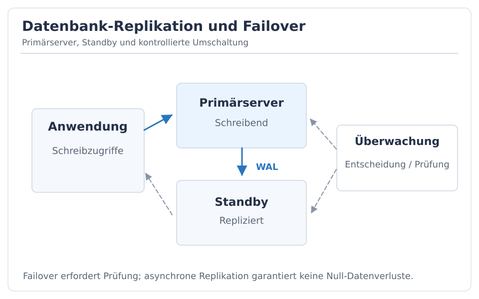

# M3-L2 – Replikation und Hochverfügbarkeit {#L2}

**Kursbereich:** M3 – Bachelor / Übergang: Datenbanksysteme

**Niveau:** Bachelor

**Vorwissen:** Keine festen Voraussetzungen angegeben.

## Überblick: Warum eine zweite Datenbank überhaupt interessant wird {#S1}

In M3-L1 haben wir gesehen, wie ein einzelner Datenbankserver Informationen speichert, abfragt, mit Indizes beschleunigt und gleichzeitige Änderungen koordiniert. Das funktioniert für erstaunlich viele Anwendungen ausgezeichnet. Aber nun stellen wir uns vor, die Datenbank enthält die Auftragsdaten eines kostenpflichtigen Online-Dienstes. Der Server fällt durch einen Hardwaredefekt aus – oder das Betriebssystem muss dringend aktualisiert werden. Können Nutzer dann weiterarbeiten?

Eine mögliche Antwort lautet: Wir halten einen **zweiten Datenbankserver bereit**, der die Daten und Änderungen des ersten verfolgt. Dies nennt man **Replikation**. Sie kann mehrere Probleme lösen: die Wiederaufnahme bei einem Ausfall beschleunigen, lesende Abfragen auf weitere Rechner verlagern oder Daten an anderen Standorten verfügbar machen.

Der entscheidende Vorbehalt: **Eine zweite Datenkopie ist noch kein fertiges hochverfügbares System.** Die Server müssen Änderungen erhalten, einen Ausfall erkennen, den Wechsel auf einen Ersatz koordinieren, den Anwendungsverkehr umlenken und verhindern, dass zwei Rechner unkontrolliert widersprüchliche Änderungen annehmen. Und eine Replik ist kein Ersatz für unabhängige Backups.

Diese Lektion behandelt den Weg von der einfachen Kopie zum funktionierenden, überwachten Ausfallkonzept. Wir verwenden PostgreSQL als konkretes, gut dokumentiertes Beispiel; die Grundprobleme gelten auch für andere Datenbanksysteme. Einzelne Begriffe und Garantien unterscheiden sich je nach Produkt und Konfiguration.

## Die wichtigsten Begriffe – sauber getrennt {#S2}

**Replikation** bedeutet, Daten oder Änderungen von einem System auf ein anderes zu übertragen, damit dort ein passender Datenbestand entsteht. Es ist ein *Verfahren zur Datenübertragung und -angleichung*, nicht von sich aus eine Zusage über Erreichbarkeit.

**Primärserver** (*Primary*) ist in unserem Grundmodell der Datenbankknoten, der Änderungen annimmt. **Replikat** beziehungsweise **Standby** ist ein weiterer Knoten, der den Datenbestand des Primärservers nachvollzieht. Nicht jede Art der Replikation ist darauf beschränkt, aber dieses Modell ist der verständlichste Einstieg.

**Hochverfügbarkeit** (*High Availability*, HA) beschreibt das Ziel, einen Dienst trotz bestimmter Ausfälle mit möglichst kurzen Unterbrechungen bereitzustellen. Dazu können redundante Rechner, ausfallsichere Netze, Überwachung, geregelte Umschaltung und getestete Wiederanlaufverfahren gehören. Hochverfügbarkeit heißt *nicht* absolute Ununterbrechbarkeit.

**Failover** nennt man den Wechsel vom ausgefallenen Primärserver auf einen Ersatz. **Switchover** ist dagegen ein geplanter, kontrollierter Rollenwechsel, beispielsweise vor Wartungsarbeiten. Ein **Read Replica** ist ein Replikat, das Leseanfragen bedient; eine reine Bereitschaftsinstanz muss nicht unbedingt Benutzerabfragen entgegennehmen.

**Recovery** bedeutet Wiederherstellung nach einem Fehler. Diese kann das Wiederhochfahren eines einzelnen Prozesses, die Übernahme durch einen Standby oder das Zurückspielen eines Backups umfassen. Die Verfahren unterscheiden sich in Dauer und in ihrer Fähigkeit, ältere Datenstände wiederherzustellen.

### Mini-Architektur: Grundkonzept

``` text
                     Online-Anwendung
                            │
                            ▼
                    Primär-Datenbank
                   (Lesen + Schreiben)
                            │
                            │ Änderungen übertragen
                            ▼
                       Replikat
                (Daten nachvollziehen)
```

Die zwei Rechtecke können auf unterschiedlichen physischen Servern, virtuellen Maschinen oder verwalteten Datenbankinstanzen liegen. Wären sie nur zwei Prozesse auf derselben kaputten Festplatte, bestünde kaum Schutz vor einem Datenträgerdefekt.

## Was wird eigentlich kopiert? {#S3}

Man könnte denken, der Primärserver versende nach jeder Änderung die komplette Datenbank. Das wäre bei großen Datenbeständen ineffizient. Stattdessen verwenden viele Systeme einen Ausgangsdatenbestand und übertragen anschließend nur weitere Änderungen.

PostgreSQL unterstützt hierfür unter anderem **physische Replikation**. Dabei verfolgt ein Standby Änderungen anhand des **Write-Ahead Log (WAL)**, eines vorab geschriebenen Änderungsprotokolls, das wir aus M3-L1 kennen. WAL-Einträge können über eine Verbindung fortlaufend gesendet werden (*Streaming Replication*) oder über archivierte Protokolldateien bereitgestellt werden (*Log Shipping*). Der Standby spielt die Änderungen nach und nähert sich dadurch dem Zustand des Primärservers an.

``` text
      Primärserver                      Standby
  ┌─────────────────┐              ┌─────────────────┐
  │ Tabellen + Indexe│             │ Tabellen + Indexe│
  │ Transaktionen    │             │ Wiederholung WAL │
  └────────┬────────┘              └────────▲────────┘
           │                              │
           ▼                              │
       WAL-Einträge ── fortlaufend ────────┘
```

In der Praxis startet ein neuer Standby nicht mit einer leeren Datenbank. Er benötigt zunächst einen zueinander passenden Grundbestand, oft über ein **Basis-Backup**. Danach kann er die späteren WAL-Änderungen nachführen. Eine solche Kopie muss korrekt zum Protokollstand passen; beliebige Dateikopien bei laufendem Betrieb genügen dafür nicht.

**Physische Replikation** betrifft bei PostgreSQL den gesamten Datenbank-Cluster im PostgreSQL-Sinne, also die zusammengehörige Serverinstanz samt Datenverzeichnis. Sie ist nicht dasselbe wie die selektive Verteilung einzelner Tabellen. Ihr Vorteil ist die vergleichsweise direkte Nachführung derselben Datenbankinstanz. Ihr Nachteil: Ein einzelner fachlicher Teil lässt sich nicht ohne Weiteres unabhängig behandeln; auch die Vereinbarkeit verschiedener Hauptversionen ist eingeschränkt.

### Logische Replikation – eine andere Ebene

PostgreSQL bietet außerdem **logische Replikation**. Sie überträgt logische Datenänderungen an veröffentlichten Datenobjekten und arbeitet typischerweise nach einem *Publish-Subscribe*-Modell: Ein Publisher stellt Datenänderungen bereit, ein Subscriber empfängt und verarbeitet sie. Damit lassen sich beispielsweise bestimmte Tabellen selektiv übertragen. Das ist hilfreich für Datenintegration oder Migrationen, aber **nicht automatisch ein drop-in-Ersatz für einen physisch replizierten Ausfallknoten**. Schemaänderungen, Sequenzstände und Konflikte können zusätzliche Behandlung erfordern.

``` text
Physisch: Primärinstanz ── WAL / Speicheränderungen ──► Standby-Instanz
Logisch:  ausgewählte Tabellenänderungen ────────────► Subscriber
```

Die genaue Auswahl zwischen diesen Varianten betrachten wir in M3-L4 noch ausführlicher. Für die folgenden Ausfallszenarien bleiben wir beim typischen physischen Primär-/Standby-Aufbau.

## Asynchrone Replikation – schnell, aber mit Zeitversatz {#S4}

Bei **asynchroner Replikation** muss der Primärserver nicht auf die Bestätigung des Replikats warten, bevor er dem Anwendungsprogramm den erfolgreichen Abschluss einer Transaktion bestätigt. Das reduziert die Wartezeit einer normalen Schreiboperation.

Ein Beispiel: Ein Nutzer speichert um 12:00:00 eine neue Bestellung. Der Primärserver bestätigt die Speicherung. Das Replikat hat die Änderung zu diesem Zeitpunkt vielleicht noch nicht empfangen oder verarbeitet. Wenig später holt es auf.

``` text
Zeit                Primärserver                 Replikat
12:00:00            Bestellung gespeichert      alter Stand
12:00:00            „Erfolg“ an Anwendung       alter Stand
12:00:01            weitere Arbeit              Änderung übernommen
```

Die Sekunde in diesem Beispiel ist **nur zur Anschauung gewählt**, kein zugesicherter typischer oder maximaler Zeitversatz. In realen Systemen kann die Verzögerung sehr klein sein, sich unter Last aber auch erheblich erhöhen – etwa bei langsamen Netzwerken, knappen Ressourcen oder einer gestörten Verbindung.

Diesen Rückstand nennt man **Replication Lag** oder **Replikationsverzug**. Er kann unterschiedlich gemessen werden: Änderungen sind erzeugt, aber noch nicht versendet; versendet, aber noch nicht empfangen; empfangen, aber noch nicht dauerhaft geschrieben; dauerhaft geschrieben, aber noch nicht für lesende Abfragen sichtbar. „Die Replik ist nur eine Sekunde zurück“ muss deshalb präzise definiert werden.

### Was passiert, wenn der Primärserver genau jetzt ausfällt?

Hat der Primärserver eine Änderung bereits bestätigt, der Standby aber noch nicht erhalten, kann diese Änderung beim Umschalten verloren gehen. Für eine Bildergalerie mit gelegentlichen unkritischen Metadatenänderungen mag ein kleiner Verlust tolerierbar sein. Für eine verbindlich bestätigte Bestellung oder einen Zahlungsvorgang ist er oft nicht akzeptabel.

**Vorteil der asynchronen Replikation:** geringe zusätzliche Wartezeit für die meisten Schreibvorgänge, häufig auch über größere Distanzen praktikabel. **Nachteil:** mögliche Datenlücke beim ungeplanten Wechsel sowie gegebenenfalls veraltete Leseergebnisse auf Replikaten.

Asynchrone Replikation ist nicht „falsch“ – sie ist eine bewusste Abwägung zwischen Antwortzeit, Distanz, Datenverlusttoleranz und Verfügbarkeit.

## Synchrone Replikation – stärkere Bestätigung, aber mehr Abhängigkeiten {#S5}

Bei **synchroner Replikation** wartet der Primärserver für entsprechend konfigurierte Transaktionen auf eine Rückmeldung eines oder mehrerer ausgewählter Standbys, bevor er den Abschluss bestätigt. Ziel ist, den bereits bestätigten Datenstand stärker gegen den Ausfall eines einzelnen Rechners abzusichern.

Anschaulich:

``` text
   Anwendung          Primärserver                synchroner Standby
       │                   │                             │
       ├─ Schreibauftrag ─►│                             │
       │                   ├── Änderung übertragen ────►│
       │                   │◄──── vereinbarte Bestätigung┤
       │◄── „Erfolg“ ──────┤                             │
```

Entscheidend ist das Wort **vereinbarte** Bestätigung. Bei PostgreSQL gibt es unterschiedliche Stufen. Bei der gewöhnlichen synchronen Bestätigung kann der Primärserver beispielsweise darauf warten, dass die entsprechende Änderung auf dem ausgewählten Standby dauerhaft in dessen WAL gesichert ist. Bei `remote_write` genügt eine schwächere Bestätigung des Schreibens an das Betriebssystem des Standbys; bei `remote_apply` wartet die Transaktion zusätzlich darauf, dass die Änderung auf dem Standby angewendet und für dortige Leseabfragen sichtbar wurde. Diese Stufen haben unterschiedliche Garantien und Verzögerungen.

Daher gilt nicht die vereinfachte Formel „synchron bedeutet, dass auf allen Servern jede Tabelle sofort im gleichen sichtbaren Zustand ist“. Es kommt darauf an, **welche Standbys beteiligt sind und worauf die Bestätigung genau wartet**. Auch können weitere asynchrone Replikate hinterherhinken.

**Ergänzung zur tatsächlichen Umschaltung:** Selbst eine erfolgreich bestätigte synchrone Transaktion beweist nicht, dass *jeder beliebige* Standby den bestätigten Stand besitzt. Wird beim Failover versehentlich ein nicht ausreichend aktuelles Replikat ausgewählt, können trotz zuvor bestehender synchroner Replikation bestätigte Änderungen fehlen. Deshalb müssen Bestätigungsregel, Auswahl des neuen Primärservers, abgesicherte Leitungsrolle und Schutz vor dem wiederkehrenden alten Primärserver als **ein zusammenhängendes Verfahren** geplant werden. Die genaue Sicherheit hängt von der Konfiguration und dem angenommenen Ausfallszenario ab. Siehe [PostgreSQL: Synchronous Replication](https://www.postgresql.org/docs/18/warm-standby.html) und den anschließenden Abschnitt über Split-Brain und Fencing.

### Der Preis stärkerer Sicherung

Der Primärserver wartet nun auf eine Netzwerkverbindung und auf eine Bestätigung eines zweiten Systems. Das kann Schreibvorgänge langsamer machen. Fällt der benötigte synchrone Standby aus und steht kein geeigneter Ersatz zur Verfügung, können bestätigungspflichtige Schreibvorgänge blockieren. Die Entscheidung für stärkere Datensicherheit kann dann die Verfügbarkeit von Schreiboperationen verschlechtern.

Man kann mehrere mögliche Standbys vorsehen und nach Priorität oder einem **Quorum** (einer erforderlichen Anzahl von Bestätigungen aus einer definierten Gruppe) auswählen. Das schafft zusätzliche Flexibilität, ersetzt aber weder eine durchdachte Ausfalllogik noch Schutz vor gemeinsamen Störungen.

**Wann sinnvoll?** Bei wertvollen, bestätigungspflichtigen Transaktionen, bei denen eine einzelne verlorene Schreiboperation schwerwiegende Folgen hätte. **Wann unnötig oder ungeeignet?** Bei günstigen, weit entfernten Zusatzreplikaten für Berichte, bei denen eine geringe Aktualisierungsverzögerung akzeptiert wird und die Antwortzeit der Hauptanwendung wichtiger ist.

## Lese-Replikate: Mehr Leser, aber nicht mehr Schreibkapazität {#S6}

Häufig besteht das Hauptproblem nicht in den Schreibvorgängen, sondern in sehr vielen Auswertungen, Berichten oder Katalogabfragen. Dann können **Read Replicas** helfen.

Die Anwendung sendet verändernde Anfragen weiterhin an den Primärserver. Geeignete reine Leseanfragen gehen an ein oder mehrere Replikate. Ein sogenannter **Read Router** oder die Anwendungslogik entscheidet, welche Verbindung verwendet wird. Das geschieht nicht allein dadurch, dass man ein Replikat startet.

``` text
                           Webanwendung
                              │
                  ┌───────────┴───────────┐
                  │                       │
               Schreiben                Lesen
                  │                       │
                  ▼                  Lese-Router
             Primärserver              ┌───┴───┐
                  │                     │       │
                  ├── Änderungen ──────►R1      R2
                  └── Änderungen ──────────────►│
```

Das kann Berichtsabfragen vom Primärserver fernhalten. Aber **die Schreibkoordinierung bleibt zunächst beim Primärserver**. Wenn fast die gesamte Last aus Änderungen an derselben Tabelle besteht, bringen zusätzliche Lese-Replikate wenig. Für eine echte Verteilung der Schreibdaten werden andere Konzepte benötigt, darunter Sharding (M3-L3) oder speziell entworfene verteilte Datenbanken (M3-L4).

### Das Problem des „gerade eben gespeicherten“ Datensatzes

Stell dir vor, ein Nutzer ändert seine Rechnungsadresse. Die Anwendung speichert sie erfolgreich auf dem Primärserver. Direkt danach lädt sie die Kontoseite aus einem asynchronen Lese-Replikat. Dort kann noch die alte Anschrift stehen.

Das wirkt wie ein Anwendungsfehler, obwohl beide Server aus technischer Sicht korrekt funktionieren.

Eine einfache Gegenmaßnahme lautet: **Besonders wichtige Leseabfragen direkt nach einer Änderung auf den Primärserver leiten.** Andere Möglichkeiten sind Warte- und Bestätigungsverfahren oder geeignete Konsistenzmechanismen des jeweiligen Systems. Der Fachbegriff für die Erwartung, nach einem eigenen Schreibvorgang die neue Version auch wieder zu lesen, lautet **Read-Your-Writes-Konsistenz**.

Auch hier verursacht die scheinbar einfache Lösung „mehr Server zum Lesen“ zusätzliche Softwarelogik. Ohne sorgfältige Abgrenzung kann sie neue Fehler erzeugen.

## Hochverfügbarkeit: Wenn ein Replikat übernehmen muss {#S7}

Bisher haben wir vor allem das Kopieren von Daten betrachtet. Für **Hochverfügbarkeit** benötigt man mehr: Ein Ersatzserver soll die Rolle des Primärservers übernehmen können, und die Anwendung muss die neue Verbindung verwenden.



Replikation und kontrollierter Failover sind unterschiedliche Vorgänge.

Angenommen, der Primärserver ist ausgefallen. Ein Standby wird zum neuen Primärserver **promoviert**, also in die Schreibrolle versetzt. Dann müssen die Anwendung beziehungsweise ein Verbindungsvermittler zum neuen Primärserver geleitet werden. Später wird ein weiterer Standby eingerichtet, damit nach dem Wechsel wieder Redundanz besteht.

``` text
Vor dem Ausfall:

App ──► Primär A ── Änderungen ──► Standby B

Nach erkanntem Ausfall und geordneter Übernahme:

App ────────────────────────────► Primär B
                                   │
                                   └─► neuer Standby C (später)
```

Das mag einfach aussehen, enthält aber viele Einzelschritte:

1.  Eine Überwachung registriert, dass auf Anfragen an A nicht mehr zuverlässig geantwortet wird.
2.  Das System entscheidet, ob A wirklich ausgefallen oder nur vorübergehend nicht erreichbar ist.
3.  Der ausgewählte Standby wird auf seinen Datenstand und seine Eignung zur Übernahme geprüft.
4.  Es wird verhindert, dass A gleichzeitig weiterhin Schreibvorgänge annimmt.
5.  B wird zum neuen Primärserver ernannt.
6.  Der Anwendungsverkehr wechselt zu B; laufende Verbindungen und Transaktionen müssen mit Fehlern oder Wiederholungen umgehen.
7.  Ein zusätzlicher Standby wird aufgebaut und die neue Topologie überwacht.

**Wichtig:** PostgreSQL bringt Mechanismen für Standby-Betrieb und Promotion mit, aber eine vollständige automatische Clusterverwaltung samt Ausfallerkennung, Schutzmaßnahmen und Verbindungsumschaltung ist eine zusätzliche Systemaufgabe. Ein zweiter PostgreSQL-Server allein erfüllt sie nicht.

### Failover versus geplantes Switchover

Bei einem **Failover** ist der bisherige Primärserver ungeplant ausgefallen oder nicht mehr zuverlässig verwendbar. Der Wechsel kann mit Unterbrechungen und bei asynchronem Standby mit Datenverlust verbunden sein.

Ein **Switchover** wird dagegen vorbereitet: Schreibverkehr kontrolliert behandeln, Datenstände angleichen, Rollen wechseln, Verbindungen umleiten. Das eignet sich beispielsweise für Wartung. Auch hierbei sind Tests notwendig; ein geplanter Wechsel ist nicht automatisch risikofrei.

### Wer schaltet die Verbindung um?

Ein **Proxy** (Vermittler für Datenbankverbindungen) kann einen stabilen Netzwerknamen anbieten und zum gerade zuständigen Primärserver weiterleiten. Alternativ können Anwendungen ihre Verbindung anhand einer gemeinsamen Dienstadresse oder Clusterinformation neu aufbauen. Ein reiner **Domain Name System (DNS)**-Eintrag reicht nicht immer für schnelle Umschaltung, weil bestehende Verbindungen bestehen bleiben und Namensauflösungen zwischengespeichert sein können.

Auch bei guter Umschaltung muss die Anwendung berücksichtigen, dass eine bereits laufende Transaktion abgebrochen sein kann. Sie darf fehlgeschlagene Buchungen nicht blind wiederholen und dadurch doppelt ausführen. Idempotenz und sichere Wiederholungsstrategien behandeln wir ausführlicher in M3-L5.

## Das gefährlichste Missverständnis: Ein ausgefallener Server ist nicht immer wirklich ausgefallen {#S8}

Stell dir zwei Datenbankserver in verschiedenen Gebäuden vor. Plötzlich bricht die Verbindung zwischen ihnen ab. A antwortet nicht mehr auf Kontrollnachrichten von B. Bedeutet das, dass A kaputt ist? **Nein.** Vielleicht funktioniert A weiterhin, nur das Netzwerk ist unterbrochen.

Wenn B nun zum Primärserver wird, während A weiterhin Änderungen annimmt, können **zwei aktive Primärserver mit auseinanderlaufenden Daten** entstehen. Diesen unerwünschten Zustand nennt man **Split-Brain** (wörtlich: gespaltenes Gehirn).

``` text
          Netzwerkverbindung ausgefallen

       A                           B
  „Ich bin Primary“          „Ich bin Primary“
      │                            │
  Kunde 1 schreibt            Kunde 2 schreibt
      │                            │
  Datenstand A                Datenstand B

      → Widersprüche, möglicherweise Datenverlust
```

Um das zu verhindern, muss eine verlässliche Instanz entscheiden, **wer Schreibberechtigung besitzt**. In verschiedenen Clusterarchitekturen gibt es dafür Abstimmungen, Quorum-Regeln, externe Entscheidungsdienste oder das technische Ausschalten beziehungsweise Abtrennen des alten Knotens.

Ein dafür verwendeter Begriff ist **Fencing**: Der bisherige Knoten wird so isoliert, dass er nicht weiter an denselben Daten schreiben kann. Die drastisch benannte Technik **STONITH** (*Shoot The Other Node In The Head*) bezeichnet eine Variante, bei der das problematische System gezielt abgeschaltet oder zurückgesetzt wird.

Ein einfaches „Wenn A fünf Sekunden nicht antwortet, nimm B“ reicht daher nicht als allgemeine Hochverfügbarkeitsstrategie. Gerade Netztrennungen zeigen, dass **Ausfallerkennung, Entscheidung und Schutz vor Doppelzuständigkeit** drei getrennte Aufgaben sind.

## Hochverfügbarkeit schützt nicht vor allen Fehlern {#S9}

Ein Ausfall kann unterschiedliche Ursachen haben. Nicht jede zusätzliche Kopie hilft gegen jede davon.

  Ereignis                                    Hilft eine Replik?                                              Weitere nötige Maßnahme
  ------------------------------------------- --------------------------------------------------------------- ----------------------------------------------------
  Hardwaredefekt des Primärservers            Häufig ja, wenn anderer Fehlerbereich und geregelter Failover   Umschaltung, Überwachung, neuer Standby
  Defekt nur des Standbys                     Primärserver arbeitet zunächst weiter                           Standby reparieren, Redundanz wiederherstellen
  Netzwerkunterbrechung zwischen Knoten       Nicht automatisch                                               Netzdiagnose, Quorum/Fencing, klare Führungsrolle
  Versehentliches Löschen aller Kundendaten   Meist nein: Löschung wird mit repliziert                        Unabhängiges Backup, Wiederherstellung
  Fehlerhafte Softwaremigration               Nicht zuverlässig: Änderung kann alle Kopien betreffen          Versioniertes Backup, Rollback-/Migrationsplan
  Ausfall eines gesamten Rechenzentrums       Nur wenn Standby wirklich unabhängig steht                      Andere Fehlerdomäne, Routing, Backupkonzept
  Kompromittiertes Admin-Konto                Nicht zuverlässig                                               Rechtebegrenzung, getrennte Sicherung, Überwachung

Hier steckt eine zentrale Erkenntnis: **Mehrere Kopien verhindern keine logischen Fehler, die korrekt kopiert werden.** Löscht eine berechtigte Person irrtümlich eine Tabelle, wird diese Löschung typischerweise an die Replikate weitergegeben.

Daher unterscheiden wir strikt:

- **Replikation:** Daten beziehungsweise Änderungen fortlaufend übertragen.
- **Hochverfügbarkeit:** Betriebsunterbrechungen bei bestimmten Ausfällen reduzieren.
- **Backup:** Ältere, unabhängig aufbewahrte Datenstände wiederherstellen können.
- **Desaster-Wiederherstellung** (*Disaster Recovery*): Nach größeren Schäden eine funktionsfähige Umgebung wieder aufbauen.

Backups benötigen ein geregeltes Aufbewahrungs- und Wiederherstellungsverfahren. Replikate sind dafür nicht automatisch geeignet. Wie Backups, Protokollarchive und zeitpunktbezogene Wiederherstellung zusammenwirken, folgt in M3-L6.

## Zwei Kennzahlen: Was darf verlorengehen und wie lange darf der Dienst stehen? {#S10}

Bei der Planung tauchen häufig zwei Abkürzungen auf:

**RPO** steht für **Recovery Point Objective** – auf Deutsch das *Wiederherstellungspunktziel*. Es beschreibt, wie groß die noch akzeptable Lücke zwischen dem letzten gesicherten beziehungsweise wiederherstellbaren Datenstand und dem Ausfall sein darf. Ein niedriges RPO bedeutet: möglichst wenig Datenverlustzeitraum.

**RTO** steht für **Recovery Time Objective** – das *Wiederanlaufzeitziel*. Es beschreibt, innerhalb welcher Zeit der Dienst nach einer Störung wieder nutzbar sein soll.

Angenommen, ein Unternehmen legt für einen Dienst beispielhaft fest: Nach einem Unfall soll er innerhalb einer Stunde wieder laufen und höchstens zehn Minuten zuletzt geänderter Daten verlieren dürfen. Das wäre ein **Planungsziel**, keine Garantie. Die Werte müssen zu den tatsächlichen Prozessen, Risiken und Kosten passen.

``` text
        letzter wiederherstellbarer Stand       Ausfall        Dienst wieder nutzbar
                       │                           │                    │
  Zeit ────────────────┼───────────────────────────┼────────────────────┼────►
                       ◄────────── RPO ────────────►
                                                   ◄─────── RTO ────────►
```

Wichtig: Ein sehr kleiner Replikationsverzug garantiert nicht automatisch ein entsprechend kleines RPO bei jedem Fehlertyp. Wenn eine falsche Löschung längst auf allen Replikaten angekommen ist, ist ein *älterer, unabhängiger Sicherungsstand* entscheidend. Ebenso kann trotz vollständig vorhandener Daten die RTO überschritten werden, wenn etwa Anwendungsserver, Netzwerkrouting oder Zugangsdaten nicht funktionieren.

## Praktisches Beispiel A: Ein kleiner Online-Dienst {#S11}

Stell dir eine Anwendung vor, die Dateien analysiert und Kundenergebnisse bereitstellt. Anfangs arbeiten nur wenige Kunden gleichzeitig. Eine kleine PostgreSQL-Instanz mit überwachten Backups kann dafür vollkommen ausreichen.

Bei wachsender Nutzung fallen jedoch gelegentliche Wartungsunterbrechungen stärker ins Gewicht. Eine mögliche Erweiterung besteht aus einem Primärserver und einem Standby. Der Standby verfolgt Änderungen. Kommt es zu einem Hardwareausfall, kann er – nach korrekter Prüfung und Umschaltung – die Aufgaben übernehmen.

``` text
Browser ─► Web-App ─► Datenbank-Proxy ─► Primärserver
                                            │
                                            └──► Standby
Separat: getestetes, unabhängig gespeichertes Backup
```

Für einen solchen Dienst wäre zunächst zu prüfen: Was kosten zwei Datenbankinstanzen samt Speicher und Datenverkehr? Wer überwacht die Replikation? Wer erkennt Fehler am Wochenende? Wie wird ein Failover getestet? Ist die Anwendung auf Verbindungsabbrüche vorbereitet? Hat das Backup tatsächlich schon eine erfolgreiche Wiederherstellungsprobe bestanden?

Wird keine bestimmte kurze Wiederanlaufzeit benötigt, kann **ein einzelner gut betreuter Server mit zuverlässigen Sicherungen** trotz geringerer Verfügbarkeit die wirtschaftlich und organisatorisch bessere Wahl sein. Die zweite Instanz verdoppelt zwar nicht pauschal alle Kosten, schafft aber zusätzliche Ressourcen- und Betriebsaufgaben.

## Praktisches Beispiel B: Viele Leser, wenige Änderungen {#S12}

Eine große öffentliche Wissensdatenbank oder ein Medienkatalog erhält zahlreiche Suchanfragen, aber nur gelegentlich neue Einträge. Hier können Lese-Replikate sinnvoll sein.

``` text
          Anwendungsschnittstelle
                  /       \
             Schreiben   Lesezugriffe
                │          │
             Primär      Read Replica 1
                │        Read Replica 2
                └─ Änderungsstrom ───► beide
```

Dabei muss die Anwendung definieren, welche Abfragen einen möglichst aktuellen Datenstand benötigen. Öffentliche Suchergebnisse vertragen oft geringe Verzögerungen. Benutzerberechtigungen oder gerade gespeicherte private Einstellungen verlangen in vielen Anwendungen eine strengere Handhabung.

Die Kosten bestehen nicht nur aus Instanzen und Speicher: Auch Übertragungsvolumen, Netzanbindung, Monitoring, Patches, Sicherungen, Fehlerbehandlung und zusätzlicher Testaufwand zählen. Für einen kaum besuchten Katalog wäre ein Datenbankcluster wahrscheinlich überdimensioniert.

## Praktisches Beispiel C: KI-Auftragsplattform {#S13}

Eine KI-Plattform verarbeitet Bild- oder Textaufträge über Worker. Die Auftragsdatenbank speichert, welcher Kunde welchen Auftrag gestartet hat, wie viele Ressourcen verbraucht wurden und wo das Ergebnis liegt. Die eigentliche Berechnung findet auf anderen Rechnern statt.

Wenn zehn zusätzliche KI-Worker eingeschaltet werden, heißt das **nicht**, dass die Datenbank automatisch zehn Primärserver benötigt. Worker dürfen dieselbe logisch zentrale Auftragsdatenbank verwenden. Replikate könnten später beispielsweise Berichte und Verlaufsauswertungen bedienen, während kritische Statusübergänge auf dem Primärserver stattfinden.

``` text
Nutzer ──► Anwendung ──► Auftragsdatenbank (Primary)
                │                 │
                │                 ├─► Standby für Ausfallvorsorge
                │                 └─► Read Replica für Berichte
                ▼
           Job-Warteschlange
                ▼
        mehrere KI-Worker / Grafikprozessoren
```

Hier wird oft eine andere Frage wichtiger als die bloße Zahl der Datenbankknoten: **Was passiert, wenn ein Worker einen Auftrag fertig berechnet, die Datenbankantwort aber wegen eines Failovers nicht erhält?** Die Anwendung braucht dann ein klares Modell für Auftragszustände, Bestätigung und sichere Wiederholung. Das vertiefen wir in M3-L5.

## Monitoring – Replikation muss beobachtet werden {#S14}

Eine technische Architektur wird erst dann betreibbar, wenn ihr tatsächlicher Zustand kontrolliert wird. Für replizierte Datenbanken gehören dazu beispielsweise:

- **Aktualität:** Wie weit liegt ein Standby beim Empfangen und Anwenden von Änderungen zurück?
- **Verbindung:** Besteht der Replikationskanal, und hat die Verbindung Fehler?
- **Rollen:** Gibt es genau den vorgesehenen Primärserver, und sind Standbys korrekt zugeordnet?
- **Datenträger:** Sind genügend Ressourcen für Daten, Änderungsprotokolle und temporäre Verarbeitung vorhanden?
- **Ausfallbereitschaft:** Kann ein Standby tatsächlich übernehmen, oder existiert er nur dem Namen nach?
- **Verbindungsumschaltung:** Wissen Anwendungsschnittstelle, Proxy und Hintergrundworker, wohin neue Verbindungen gehen?
- **Sicherheitslage:** Sind Replikationskonten, Netzwerke und Datenübertragungen ausreichend abgesichert?
- **Wiederherstellung:** Existieren unabhängig aufbewahrte Sicherungen und erfolgreiche Wiederherstellungstests?

PostgreSQL bietet unter anderem Ansichten für den Replikationszustand. Zusätzlich können **Replication Slots** dafür sorgen, dass noch benötigte WAL-Abschnitte nicht voreilig entfernt werden. Das ist hilfreich, birgt aber ein eigenes Risiko: Bleibt ein Replikat lange zurück, können zurückgehaltene Protokolldaten den Speicherplatz des Primärservers erschöpfen. Auch Schutzmechanismen müssen deshalb überwacht und begrenzt werden.

Gegen bloßes Vertrauen in eine grüne Statusanzeige spricht außerdem: Ein Test unter normalen Bedingungen beweist noch nicht, dass ein ungeplanter Ausfall unter Last oder eine Netztrennung sauber behandelt wird. Geplante Umschalttests, dokumentierte Wiederanlaufverfahren und klare Zuständigkeiten sind Teil des Betriebs, nicht bloß Zusatzkomfort.

## Was ist mit mehreren Standorten und „Multi-Region“? {#S15}

Mehr geografische Entfernung zwischen Rechnern hilft gegen bestimmte lokale Ausfälle, erhöht aber oft die Latenz bei synchronen Bestätigungen und kann zusätzliche Datenübertragungskosten verursachen. Zwei Server im selben Rack können beim Ausfall einer gemeinsamen Stromversorgung gleichzeitig betroffen sein. Zwei Server in weit entfernten Regionen sind unabhängiger, aber Netzwerkunterbrechungen werden relevanter.

**Fehlerdomäne** (*Failure Domain*) nennt man einen Bereich, in dem ein gemeinsamer Defekt mehrere Komponenten treffen kann – etwa dieselbe Stromversorgung, dasselbe Netzwerksegment, dieselbe Verfügbarkeitszone oder dasselbe Rechenzentrum. Redundanz ist nur so gut wie die Unabhängigkeit ihrer Fehlerdomänen.

Eine oft geeignete Abstufung lautet:

1.  Einzelserver mit geprüften Backups und klarer Wiederanlaufstrategie.
2.  Primärserver plus Standby innerhalb einer passenden Umgebung und mit abgesicherter Umschaltung.
3.  Verteilte Standbys über unabhängige Fehlerbereiche; gegebenenfalls zusätzliche Lese-Replikate.
4.  Erst bei tatsächlichem Bedarf geografisch weitreichender Mehrstandortbetrieb, mit genauer Analyse von Latenz, Datenverlustziel, Netztrennung und Kosten.

Das ist keine starre Rangliste für jedes System, sondern eine Hilfestellung, zunehmende Komplexität gegen einen realen Bedarf abzuwägen.

## Risiken, Sicherheit und wirtschaftliche Entscheidung {#S16}

Zusätzliche Datenbankknoten bedeuten zusätzliche Betriebssysteme oder verwaltete Instanzen, Datenträger, Netzwerkverkehr, Zertifikate und Zugangsdaten. Der Betreiber muss Versionskompatibilität, Sicherheitsupdates, Replikationsrechte, Backups, Benachrichtigungen und Fehlerszenarien planen. Besonders kritisch ist, dass ein Replikationsstrom sensible Daten enthalten kann; der Zugriff sollte daher ausdrücklich beschränkt und bei Übertragung über unsichere Netze passend geschützt werden.

Außerdem existieren **gemeinsame Fehlerursachen**: Eine fehlerhafte Anwendung schreibt falsche Daten auf allen Knoten; ein Angreifer verfügt möglicherweise über zu weit reichende Rechte; eine gleichzeitige Infrastrukturstörung trifft mehrere vermeintlich unabhängige Server. Ein Cluster ist also kein Allheilmittel.

### Einfache Entscheidungshilfe

  Ziel / Lage                                                                                       Häufig angemessener Ansatz                                 Zusätzlicher Aufwand
  ------------------------------------------------------------------------------------------------- ---------------------------------------------------------- ----------------------------------------------------
  Kleine Anwendung, kurze Unterbrechungen tolerierbar                                               Einzelserver, Monitoring, Backup, Wiederherstellungsplan   Niedrig bis mittel
  Kürzere Unterbrechung bei Serverdefekt erforderlich                                               Primär + Standby + geregelter Failover                     Monitoring, Rollenlogik, Tests
  Sehr viele Berichts- und Suchabfragen                                                             Eine oder mehrere Read Replicas                            Abfrage-Routing, Umgang mit Lag
  Bestätigte Transaktionen sollen einen einzelnen Knotenausfall möglichst ohne Verlust überstehen   Geeignete synchrone Replikation plus korrektes Failover    Schreibverzögerung, Quorum/Fencing, Ausfallplanung
  Strengere Anforderungen an ganze Standorte                                                        Redundanz über unabhängige Fehlerdomänen                   Netz, Latenz, höhere laufende Kosten

Die Beispiele sind **Architekturprinzipien**, keine aktuellen Angebote oder Preisempfehlungen. Ein konkretes System benötigt eine Analyse des Lastprofils, der Bedeutung der Daten und der akzeptablen Unterbrechungszeit. Je mehr Komponenten beteiligt sind, desto mehr Fehler können durch Fehlkonfiguration oder mangelnde Wartung überhaupt erst entstehen.

## Zusammenfassung – fünf Merksätze {#S17}

1.  **Replikation** überträgt Daten und Änderungen zwischen Knoten; sie allein macht aus einer Datenbank keinen automatisch verfügbaren Dienst.
2.  **Asynchrone Replikation** hält Schreibvorgänge meist unabhängig von einer Standby-Bestätigung, erlaubt aber Verzögerungen und potenziellen Datenverlust beim Failover.
3.  **Synchrone Replikation** koppelt die Bestätigung an eine definierte Rückmeldung anderer Knoten; welche Sicherheit daraus folgt, hängt von den Bestätigungsstufen und der Konfiguration ab.
4.  **Read Replicas** können Leseaufgaben übernehmen, beseitigen aber den einzelnen Schreib-Primärserver nicht. Veraltete Leseergebnisse sind zu berücksichtigen.
5.  **Hochverfügbarkeit und Backup sind unterschiedliche Schutzmaßnahmen.** Gegen Split-Brain braucht es sichere Rollenentscheidungen, gegen falsche Löschungen unabhängige Sicherungen.

### Übergang zu M3-L3

Wir haben jetzt **mehrere Kopien derselben Daten** auf unterschiedlichen Rechnern betrachtet. In **M3-L3 – Partitionierung und Sharding** kommt eine grundsätzlich andere Idee hinzu: Nicht jeder Rechner erhält alles, sondern verschiedene Datenbereiche werden gezielt auf unterschiedliche Knoten verteilt. Damit kann auch die Datenmenge und unter bestimmten Bedingungen die Schreiblast aufgeteilt werden – um den Preis zusätzlicher Koordinierung.

## Begriffe und Abkürzungen dieser Lektion {#S18}

  Begriff                 Bedeutung
  ----------------------- ----------------------------------------------------------------------------
  HA                      *High Availability*, Hochverfügbarkeit
  Primary / Standby       Schreibführender Primärserver / nachführender Ersatzknoten
  WAL                     *Write-Ahead Log*, vorab geschriebenes Änderungsprotokoll
  Streaming Replication   Laufende Übertragung von Änderungen über eine Verbindung
  Log Shipping            Übertragung archivierter Änderungsprotokollabschnitte
  Read Replica            Replikat, das Leseanfragen übernehmen kann
  Replication Lag         Rückstand zwischen erzeugten und übernommenen Änderungen
  Failover / Switchover   Ungeplanter Ersatzwechsel / geplanter Rollenwechsel
  Split-Brain             Zwei Knoten beanspruchen gleichzeitig widersprüchlich die Führungsrolle
  Fencing / STONITH       Abtrennung einer nicht mehr berechtigten Instanz / technische Abschaltung
  Quorum                  Erforderliche Zahl von Bestätigungen aus einer Gruppe
  RPO                     *Recovery Point Objective*, akzeptiertes Datenverlust-Zeitfenster als Ziel
  RTO                     *Recovery Time Objective*, Wiederanlaufzeit als Ziel
  Read-Your-Writes        Neue eigene Änderungen bei folgenden Leseabfragen wiederfinden
  Failure Domain          Fehlerdomäne: Bereich mit gemeinsamer Ausfallursache


## Quellen {#S19}

**Letzte Quellenprüfung:** 03.11.2026

**Recherchiert und geprüft am 03.11.2026.** Konkrete Beispiele beziehen sich bei Produktdetails auf PostgreSQL 18. Andere Datenbanksysteme können abweichende Verfahren und Sicherheiten anbieten. Kein reales System wurde für diese Lektion eingerichtet oder getestet.

1.  PostgreSQL 18, *High Availability, Load Balancing, and Replication*, Übersicht und Lösungsvergleich: [https://www.postgresql.org/docs/18/high-availability.html](https://www.postgresql.org/docs/18/high-availability.html)
2.  PostgreSQL 18, *Log-Shipping Standby Servers*, besonders Streaming, Synchronität, Replication Slots und kaskadierende Replikation: [https://www.postgresql.org/docs/18/warm-standby.html](https://www.postgresql.org/docs/18/warm-standby.html)
3.  PostgreSQL 18, *Failover*, Promotion, Umgang mit altem Primary und Split-Brain: [https://www.postgresql.org/docs/18/warm-standby-failover.html](https://www.postgresql.org/docs/18/warm-standby-failover.html)
4.  PostgreSQL 18, *Logical Replication*, Publish-Subscribe und Abgrenzung zur physischen Replikation: [https://www.postgresql.org/docs/18/logical-replication.html](https://www.postgresql.org/docs/18/logical-replication.html)
5.  PostgreSQL 18, *Restrictions of Logical Replication*, Schema- und Sequenzgrenzen: [https://www.postgresql.org/docs/18/logical-replication-restrictions.html](https://www.postgresql.org/docs/18/logical-replication-restrictions.html)
6.  PostgreSQL 18, *Backup and Restore*, unabhängige Datensicherung und kontinuierliche Archivierung: [https://www.postgresql.org/docs/18/backup.html](https://www.postgresql.org/docs/18/backup.html)
7.  PostgreSQL 18, *Replication Configuration*, synchrone Standby-Auswahl und Quorumvarianten: [https://www.postgresql.org/docs/18/runtime-config-replication.html](https://www.postgresql.org/docs/18/runtime-config-replication.html)

**Didaktische Abgrenzung:** Die Zahlen und Uhrzeiten in Beispielen sind frei gewählte Illustration, keine gemessenen oder zugesicherten Verzögerungen. M3-L3 erläutert Partitionierung und Sharding, M3-L4 weitere Datenbanksysteme, M3-L5 verteilte Korrektheit und M3-L6 Backups/Recovery im Detail.
