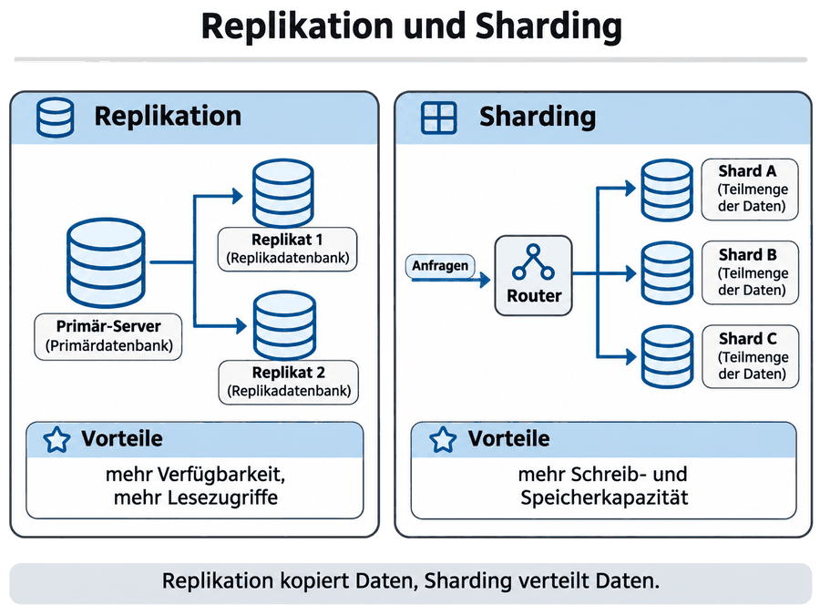

# M3-L3 – Partitionierung und Sharding {#L3}

**Kursbereich:** M3 – Bachelor / Übergang: Datenbanksysteme

**Niveau:** Bachelor / Master-Brücke

**Vorwissen:** Keine festen Voraussetzungen angegeben.

## Ausgangsfrage: Warum genügt eine zweite Kopie nicht immer? {#S1}

In M3-L1 haben wir betrachtet, wie ein einzelner Datenbankserver Tabellen, Indizes, Transaktionen und gleichzeitige Anfragen verwaltet. In M3-L2 haben wir gelernt, wie man **Kopien derselben Daten** auf weitere Server überträgt. Das kann bei Ausfällen helfen und Leseanfragen verteilen. Eine Replikation beantwortet jedoch noch nicht jedes Größenproblem.

Stellen wir uns einen Onlinedienst vor, dessen Datenbestand über Jahre wächst. Vielleicht enthält er Kundendaten, Aufträge und Auswertungsergebnisse. Irgendwann wird der Speicher eines einzelnen Servers knapp. Oder es treffen so viele Änderungen gleichzeitig ein, dass auch ein aufgerüsteter Primärserver zum Engpass wird. Weitere Lese-Replikate helfen dann nur begrenzt: Die Schreibarbeit konzentriert sich weiterhin auf den Primärserver.

Eine andere Strategie lautet: **Nicht alle Daten sollen auf jedem Rechner liegen.** Stattdessen teilen wir den Bestand in sinnvoll gewählte Abschnitte. In einer einfachen Variante bleiben diese Abschnitte innerhalb einer Datenbankinstanz. In einer weitergehenden Variante werden die Teile auf **verschiedene Datenbankknoten** verteilt. Dafür stehen die Begriffe *Partitionierung* und *Sharding*.

Das klingt zunächst nach einer einfachen Verteilungsaufgabe. Die entscheidenden Fragen beginnen aber erst danach: Wo liegt ein bestimmter Kunde? Was passiert, wenn seine Bestellung auf einem anderen Server liegt? Wie berechnet man eine Gesamtsumme? Wie verändert man die Verteilung, wenn ein Server überlastet ist? Und wie verhindert man widersprüchliche Daten bei einem Ausfall?

**Leitgedanke dieser Lektion:** Partitionierung ist zunächst eine Art, Daten logisch und physisch zu gliedern; Sharding ist eine Form der horizontalen Verteilung über getrennte Datenhaltungseinheiten beziehungsweise Knoten. Der Gewinn an Speicher- und möglicher Schreibkapazität wird mit komplexerer Koordinierung bezahlt.

## Zuerst die Unterscheidung: Partition, Shard und Replikat {#S2}



*Abbildung: Vereinfachter Vergleich: Replikate übernehmen Kopien der Daten; Shards halten unterschiedliche Teilmengen. Replikation und Sharding können kombiniert werden, und beide benötigen zusätzliche Maßnahmen für Verfügbarkeit und Fehlersicherheit.*

Eine **Partition** ist ein Teil eines größeren Datenbestands. Beispielsweise können die Einträge einer einzigen logischen Tabelle `Bestellungen` nach ihrem Bestellmonat in getrennten physischen Teilstücken gespeichert werden. Für eine Anwendung kann die Tabelle weiterhin wie eine einzige Tabelle erscheinen.

Ein **Shard** ist ein Teilbestand, der im Kontext verteilter Datenbanksysteme unabhängig auf einer Datenbankinstanz oder einem Datenbankknoten verwaltet wird. Häufig ist ein Shard selbst eine Sammlung zusammengehöriger Tabellenzeilen. Ein physischer Server kann durchaus mehrere Shards beherbergen; ein Shard ist also **nicht zwingend gleichbedeutend mit einem ganzen Server**.

Ein **Replikat** ist wiederum eine zusätzliche Kopie von Daten, die andernorts bereits vorliegen. Sharding und Replikation lassen sich kombinieren: Jeder Shard kann seinerseits repliziert werden.

### Mini-Architektur: Drei unterschiedliche Ideen

``` text
1) Tabellenpartitionierung auf EINEM Datenbankserver

        Logische Tabelle "Bestellungen"
                      │
          ┌───────────┼───────────┐
          ▼           ▼           ▼
       Januar       Februar      März
          └───────────┴───────────┘
             Ein Datenbankserver

2) Sharding über MEHRERE Datenbankknoten

        Alle Kunden und Bestellungen
                      │
                 Routing
                      │
          ┌───────────┼───────────┐
          ▼           ▼           ▼
       Shard A      Shard B      Shard C
       Server 1     Server 2     Server 3

3) Replikation eines Shards

        Shard A (führende Kopie)
                      │
               Änderungen kopieren
                      ▼
        Shard A (zweite Kopie)
```

Im ersten Fall hilft die Gliederung möglicherweise bei Wartung und einzelnen Abfragen; die Hardware bleibt aber dieselbe. Im zweiten Fall sind Daten und Arbeit über mehrere Knoten verteilt. Im dritten Fall liegt derselbe Teilbestand redundant vor. Die Begriffe beschreiben verschiedene Eigenschaften und dürfen nicht gleichgesetzt werden.

## Was bedeutet horizontale und vertikale Partitionierung? {#S3}

**Horizontale Partitionierung** teilt die *Zeilen* einer Tabelle auf. Die Teilstücke haben grundsätzlich vergleichbare Spalten, enthalten aber unterschiedliche Datensätze.

``` text
Kunden (eine logische Tabelle)

ID    Name       Land
10    Ada        DE
11    Ben        FR
12    Cem        DE
13    Dia        IT

Partition A: ID 10 und 11
Partition B: ID 12 und 13
```

**Vertikale Partitionierung** trennt dagegen *Spalten* oder fachliche Datenbereiche. So könnten häufig benötigte Kundennamen und Kontostände getrennt von selten gelesenen großen Profilinformationen liegen. Das kann unnötige Datenzugriffe vermeiden; es kann aber auch zusätzliche Verknüpfungen notwendig machen.

Im alltäglichen Sprachgebrauch werden außerdem ganze Funktionsbereiche auf eigene Datenbanken verteilt: etwa Rechnungswesen und Medienverwaltung. Das ist eher eine **fachliche Trennung** von Systemen, noch nicht automatisch Sharding einer gemeinsamen Tabelle.

Für die folgenden Abschnitte betrachten wir vor allem horizontale Partitionierung. Denn damit kann ein Datenbestand nach einem Schlüssel in Teilmengen zerlegt und gegebenenfalls auf mehrere Rechner verteilt werden.

## Partitionierte Tabellen in einer einzelnen PostgreSQL-Datenbank {#S4}

PostgreSQL 18 unterstützt **deklarative Tabellenpartitionierung**: Man beschreibt eine übergeordnete, logisch zusammengehörige Tabelle und legt fest, nach welchem Partitionsschlüssel die Daten auf physische Untertabellen verteilt werden. Dazu gibt es beispielsweise Bereichs-, Listen- und Hash-Partitionierung.

Nehmen wir die Bestellungen eines Shops. Eine Partition enthält Bestellungen von Januar, die nächste vom Februar und die dritte vom März. Eine Suchanfrage nach Februar kann dann häufig die übrigen Monate überspringen. Diese Optimierung heißt **Partition Pruning**, auf Deutsch sinngemäß das Weglassen nicht relevanter Partitionen.

``` text
Anfrage: "Bestellungen im Februar"
                 │
                 ▼
       PostgreSQL-Abfrageplaner
                 │
       ┌─────────┼──────────┐
       │         ▼          │
     Januar   Februar      März
   auslassen  durchsuchen  auslassen
```

Partitionierung kann außerdem das Entfernen ganzer alter Zeiträume vereinfachen. Statt Millionen einzelner Zeilen zu löschen, lässt sich eine dafür passende alte Partition abtrennen oder entfernen. Ob dies gefahrlos möglich ist, hängt von der Aufbewahrungsregel und dem gesamten Datenmodell ab.

Die Grenzen sind wichtig: Nicht jede Anfrage wird schneller. Eine Abfrage ohne geeigneten Filter muss womöglich alle Partitionen betrachten. Zu viele kleine Partitionen können Planung und Verwaltung erschweren. Und eine Tabelle, die auf einem Server partitioniert wurde, wird dadurch **nicht automatisch über mehrere Server verteilt**.

Eine konkrete PostgreSQL-Besonderheit zeigt, dass Partitionierung mehr als eine kosmetische Aufteilung ist: Bei einer partitionierten Tabelle muss eine globale `PRIMARY KEY`- oder `UNIQUE`-Beschränkung die Partitionsschlüsselspalten einschließen (unter den dafür geltenden weiteren Voraussetzungen). Die unabhängigen Teilindizes können eine Eindeutigkeit über beliebige Partitionen nicht einfach selbst nachweisen. Ein Datenmodell, das vorher problemlos einen einzigen eindeutigen Schlüssel verwendete, kann beim Partitionieren also angepasst werden müssen.

**Wann sinnvoll?** Große zeitlich gegliederte Protokoll-, Ereignis- oder Messwerttabellen, häufige Zeitraumabfragen, regelmäßige Datenarchivierung. **Wann überdimensioniert?** Kleine Tabellen, frei kombinierte Suchbedingungen ohne Bezug zum Partitionsschlüssel oder ein System, das mit einem passenden Index bereits schnell genug ist.

## Das Grundproblem beim Sharding: Wer weiß, wo eine Zeile liegt? {#S5}

Bei einem einzelnen Datenbankserver muss eine Anwendung normalerweise nicht wissen, auf welcher Festplatte ein Datensatz liegt. Der Datenbankserver organisiert den Zugriff. Bei Sharding reicht das nicht: Irgendeine Stelle muss entscheiden, **welcher Shard zuständig ist**.

Das kann ein Bestandteil der Anwendung sein, eine vorgeschaltete Routing-Schicht oder ein Datenbanksystem, das die Verteilung weitgehend selbst verwaltet. Der sogenannte **Shard Key** oder *Verteilungsschlüssel* entscheidet dabei, zu welchem Teilbestand ein Datensatz gehört. Häufig ist das eine stabile Kundennummer oder Mandantenkennung.

``` text
      Webanwendung: Kunde 2847 lädt seine Aufträge
                            │
                            ▼
                      Shard-Router
                  Schlüssel: Kunde 2847
                            │
             "Kunde 2847 liegt auf Shard B"
                            │
                            ▼
                      Datenbank B
                Kunde + seine Aufträge
```

Ein gut gewählter Schlüssel ermöglicht gezielte Zugriffe. Ein schlecht gewählter Schlüssel verteilt Daten ungleich, erzeugt unnötige Abfragen über mehrere Server oder macht spätere Änderungen teuer. Deshalb sollte der Shard Key nach den **tatsächlichen Lese- und Schreibmustern** gewählt werden – nicht nach einer zufällig vorhandenen Spalte.

Ein einzelner Datenbankknoten kann mehrere Shards besitzen. Das macht es leichter, bei Bedarf kleinere Einheiten umzuziehen, statt jedes Mal eine riesige Datenbank aufzuspalten.

## Vier wichtige Strategien zur Verteilung {#S6}

### Bereichsbasierte Verteilung (Range Sharding) {#61-bereichsbasierte-verteilung-range-sharding}

Man teilt den Wertebereich des Schlüssels in Abschnitte. Beispielsweise liegen Kundennummern von 1 bis 9999 auf Shard A und 10000 bis 19999 auf Shard B. Das ist einfach zu verstehen und eignet sich, wenn häufig *zusammenhängende Bereiche* abgefragt werden.

``` text
Kunden-ID 00001–09999  ──► Shard A
Kunden-ID 10000–19999  ──► Shard B
Kunden-ID 20000–29999  ──► Shard C
```

**Problem:** Sind neue Kunden besonders aktiv und erhalten fortlaufend steigende Nummern, konzentriert sich die neue Schreiblast oft auf den jeweils letzten Bereich. Ein großer Kunde kann außerdem deutlich mehr Datensätze erzeugen als viele kleine zusammen.

### Hashbasierte Verteilung (Hash Sharding) {#62-hashbasierte-verteilung-hash-sharding}

Hier wird der Schlüssel mit einer **Hashfunktion** in einen verteilbaren Zahlenwert umgerechnet. Eine Hashfunktion erzeugt aus einer Eingabe nach festen Regeln einen anderen Wert. Auf Basis dieses Werts entscheidet das System, welchem Teilbereich die Zeile zugeordnet wird.

``` text
Kunde 2847 ──► Hashfunktion ──► Bereich B ──► Shard B
Kunde 2848 ──► Hashfunktion ──► Bereich A ──► Shard A
Kunde 2849 ──► Hashfunktion ──► Bereich C ──► Shard C
```

Der Vorteil ist eine oft gleichmäßigere Streuung aufeinanderfolgender Kundennummern. Der Nachteil: Zusammenhängende Kundennummern liegen nun wahrscheinlich nicht mehr beieinander. Bereichsabfragen müssen unter Umständen viele Shards besuchen. Ein bloßes Schema wie `Hashwert modulo Anzahl Server` erschwert außerdem das Hinzufügen neuer Server: Ändert sich die Serverzahl, können viele Schlüssel ihre Zuordnung wechseln. Reale Systeme verwenden deshalb häufig zusätzliche Abstraktionsebenen wie virtuelle Teilbereiche.

### Verzeichnissystem oder Lookup-Sharding {#63-verzeichnissystem-oder-lookup-sharding}

Eine Zuordnungstabelle hält fest, welcher Kunde auf welchem Shard liegt. Der Router fragt diese Tabelle ab und leitet die Anfrage weiter. Das erlaubt gezielte Änderungen: Ein besonders großer Kunde kann auf einen eigenen Shard ziehen, während die übrigen Kunden unverändert bleiben.

Der Preis ist zusätzliche Metadatenverwaltung. Das Verzeichnis muss verfügbar, aktuell und konsistent sein. Ein falscher Eintrag führt zum falschen Datenbankknoten.

### Geografische Verteilung {#64-geografische-verteilung}

Man kann Daten nach Regionen aufteilen, etwa wenn Zugriffe aus einer Region überwiegend dort stattfinden sollen. Das kann Wege verkürzen oder besondere Anforderungen an den Speicherort berücksichtigen. Gleichzeitig entstehen andere Schwierigkeiten: Eine Region wird möglicherweise wesentlich stärker genutzt als eine andere; Nutzer reisen; weltweit benötigte Daten müssen über Regionsgrenzen erreichbar bleiben.

**Wichtig:** Der geografische Speicherort allein entscheidet nicht über die rechtliche Zulässigkeit einer Datenverarbeitung. Zugriffsrechte, Anbieterrollen, Übermittlungen und weitere Anforderungen müssen gesondert geprüft werden.

### Vergleich

  Strategie     Starke Seite                                                Typisches Risiko
  ------------- ----------------------------------------------------------- ---------------------------------------------
  Bereiche      Nachbarschaft verwandter Werte, einfache Bereichsabfragen   heißer letzter Bereich, ungleiche Größen
  Hash          oft bessere Streuung                                        teure Bereichsabfragen, Umverteilung
  Verzeichnis   flexible Zuordnung einzelner Kunden                         Metadaten, zusätzliche Routing-Abhängigkeit
  Geografie     regionale Datennähe                                         regionale Hotspots, globale Zugriffe

Es gibt Mischformen. Beispielsweise kann die Region zunächst den Datenstandort bestimmen und eine Hashfunktion die Kunden innerhalb dieser Region verteilen.

## Ein durchgehendes Beispiel: Kunden und Bestellungen {#S7}

Nehmen wir ein Software-as-a-Service-Angebot (**SaaS**: Software als online bereitgestellter Dienst) mit vielen Unternehmenskunden. Für jeden Kunden gibt es Benutzer, Aufträge und Rechnungsdaten. Eine typische Anfrage lautet: „Zeige mir die letzten 20 Aufträge von Kunde 2847.“

Wenn **Kunden, Benutzer und Aufträge desselben Mandanten** zusammen auf einem Shard liegen, kann die Datenbank diese Anfrage lokal erledigen. Das ist das Prinzip der **Co-Location**: Daten, die häufig gemeinsam abgefragt werden, werden nach demselben Verteilungsschlüssel angeordnet.

``` text
                Shard-Router
                     │
          ┌──────────┴──────────┐
          │                     │
          ▼                     ▼
     Shard A                Shard B
     Kunde 101              Kunde 2847
     Benutzer 101/*         Benutzer 2847/*
     Aufträge 101/*         Aufträge 2847/*
          │                     │
       lokale JOINs          lokale JOINs
```

Ein **JOIN** ist die relationale Verknüpfung von Datensätzen verschiedener Tabellen nach zusammengehörigen Schlüsseln. Lokal ist das vergleichsweise einfach: Ein Datenbankserver kennt die beteiligten Tabellen und Indizes. Über verschiedene Knoten wird es schwieriger, weil Daten über das Netzwerk übertragen oder Teilabfragen auf mehreren Rechnern ausgeführt werden müssen.

Zu beachten ist: **Nicht jedes System bietet diese Co-Location automatisch.** Eine Anwendung muss die Schlüssel sauber in ihrem Datenmodell führen, oder ein verteiltes Datenbanksystem muss die Tabellen entsprechend konfigurieren. Auch die strikte Trennung der Kundendaten ist eine eigenständige Sicherheitsaufgabe: Sharding nach Kundenkennung **ersetzt keine Berechtigungsprüfung**.

## Warum Cross-Shard-JOINs teuer werden können {#S8}

Angenommen, die Tabelle `Kunden` befindet sich auf Server A, die zugehörigen `Bestellungen` aber auf Server B. Eine Anfrage, die alle Kunden mit ihren letzten Bestellungen verbindet, kann nun nicht einfach auf einem Datenträger arbeiten. Irgendwo müssen die benötigten Zeilen zusammenkommen.

``` text
       Anfrage: Kunden mit Bestellwert
                     │
               Koordinator
               /         \
              ▼           ▼
        Server A       Server B
         Kunden       Bestellungen
              \           /
               ▼         ▼
              Daten zusammenführen
                     │
                     ▼
                 Ergebnis
```

Jeder Datentransfer verursacht Laufzeit und Netzwerkbelastung. Teilanfragen können unterschiedliche Laufzeiten besitzen. Fällt ein beteiligter Shard aus, kann die gesamte Anfrage scheitern. Manchmal ist es günstiger, eine kleine, selten veränderte **Referenztabelle** – beispielsweise Länderkennungen – auf mehrere Knoten zu kopieren. Das spart entfernte Nachschläge, verlangt aber eine geregelte Aktualisierung dieser Kopien.

Ein besonders problematischer Fall sind **Fan-out-Abfragen**: Eine Anfrage kann nicht gezielt an einen Shard geschickt werden und muss an alle Shards verteilt werden. Jeder Knoten liefert ein Teilergebnis, der Koordinator vereinigt oder sortiert es. Für eine Gesamtstatistik kann das sinnvoll sein. Für jede einzelne Benutzerinteraktion ist es oft unnötig teuer.

**Merksatz:** Eine gute Sharding-Strategie richtet sich nach den *häufigsten Abfragen*, nicht nur nach möglichst gleich vielen gespeicherten Zeilen.

## Suchen, Zählen und Sortieren über viele Shards {#S9}

Einzelne Kundensuchen sind im obigen Modell einfach. Was aber, wenn die Geschäftsleitung wissen möchte, wie hoch der Umsatz aller Kunden zusammen war?

Dann kann jeder Shard zunächst eine lokale Teilsumme berechnen. Der Koordinator addiert anschließend die Ergebnisse. Dieses Prinzip nennt man **Scatter/Gather**: Arbeit verteilen und Teilergebnisse einsammeln.

``` text
             "Umsatz aller Kunden"
                       │
                  Koordinator
              ┌────────┼────────┐
              ▼        ▼        ▼
           Shard A   Shard B   Shard C
           12.000     7.000     9.000
              └────────┼────────┘
                       ▼
                 Summe 28.000
```

Die Zahlen dienen nur zur Illustration. Eine Addition lässt sich so leicht zerlegen. Andere Operationen sind komplizierter: Für die *zehn weltweit größten Bestellungen* braucht man möglicherweise lokale Top-Listen und danach eine korrekte globale Zusammenführung. Bei komplexen Filtern und verschachtelten Verknüpfungen kann die Datenmenge zwischen den Knoten stark anwachsen.

Deshalb trennen manche Systeme laufende Benutzertransaktionen von aufwendigen Analysen. Daten werden etwa zeitversetzt in eine gesonderte Analyseumgebung übernommen. Das ist allerdings eine neue Kopie mit möglichen Aktualitätsverzögerungen, nicht von selbst ein stets konsistenter Live-Stand.

## Schreiben und Transaktionen über mehrere Shards {#S10}

Ein Schreibvorgang, der nur Daten eines einzigen Shards betrifft, kann häufig von dessen lokaler Datenbank als normale Transaktion behandelt werden. Schwieriger wird ein Vorgang, der **zwei Shards gemeinsam** verändern muss.

Beispiel: Ein Guthaben soll von Kundenkonto A auf Kundenkonto B übertragen werden. Konto A liegt auf Shard 1, Konto B auf Shard 2. Der Betrag darf nicht auf einer Seite verschwinden und auf der anderen nie erscheinen.

``` text
            "Übertrage 50 Einheiten"
                        │
               Transaktionslogik
                /           \
               ▼             ▼
            Shard 1        Shard 2
          A abbuchen      B gutschreiben
                \           /
                  gemeinsam korrekt?
```

Eine **lokale ACID-Transaktion** (Atomicity, Consistency, Isolation, Durability: Atomarität, Konsistenz, Isolation, Dauerhaftigkeit) auf Shard 1 garantiert noch nicht automatisch die vollständige Ausführung auf Shard 2. Manche verteilten Datenbanksysteme unterstützen koordinierte Transaktionen mit definierten Garantien. Andere Architekturen arbeiten mit getrennten Buchungen, Ereignissen, Wiederholungslogik und kompensierenden Schritten. Welche Variante fachlich zulässig ist, hängt stark vom Anwendungsfall ab.

Die klassische **Zwei-Phasen-Bestätigung** (*Two-Phase Commit*, 2PC) kann mehrere Teilnehmer in eine gemeinsame Entscheidung einbeziehen: zuerst vorbereiten, dann gemeinsam bestätigen oder zurückrollen. Das erhöht jedoch Netzwerkkommunikation und schafft neue Fehlersituationen. Das genaue Zusammenspiel mit Ausfällen, Sperren und Wiederaufnahme behandeln wir in **M3-L5 – Transaktionen und verteilte Korrektheit**.

Nicht jedes verteilte System verzichtet auf strenge Konsistenz. Und nicht jedes System, das Sharding unterstützt, bietet dieselben Transaktionsgarantien. **Sharding beschreibt die Datenverteilung, nicht automatisch das Konsistenzmodell.**

## Eindeutige Kennungen und Fremdschlüssel {#S11}

In einer einzelnen Datenbank kann eine eindeutige Bestellnummer bequem durch einen zentralen Index überprüft werden. Verteilen wir Bestellungen auf mehrere Shards, stellt sich die Frage: Wer verhindert, dass zwei Knoten gleichzeitig dieselbe Nummer vergeben?

Eine verbreitete Strategie besteht darin, Kennungen so zu gestalten, dass sie ohne eine zentrale fortlaufende Nummernvergabe ausreichend eindeutig sind, beispielsweise durch geeignete zusammengesetzte Kennungen oder verteilte ID-Verfahren. Eine andere besteht darin, eine gemeinsame Vergabestelle einzusetzen. Beide Ansätze bringen eigene Vor- und Nachteile bei Komplexität, Verfügbarkeit und Koordinierungsbedarf.

Auch **Fremdschlüssel** (*Foreign Keys*), also Regeln, dass eine Bestellung zu einem tatsächlich vorhandenen Kunden gehören muss, lassen sich über Servergrenzen hinweg nicht in jedem System genauso einfach erzwingen wie innerhalb einer lokalen Datenbank. Wenn Kunden und ihre Bestellungen zusammen liegen, ist die Prüfung deutlich leichter. Bei global verteilten Beziehungen sind zusätzliche Datenbankfähigkeiten oder Anwendungskontrollen nötig.

Das heißt nicht, dass relationale Regeln in verteilten Datenbanken grundsätzlich unmöglich wären. Es heißt: Die Garantien sind **eine konkrete Systemeigenschaft**, die geprüft werden muss.

## Hotspots: Wenn ein Shard alles ausbremst {#S12}

Eine gleichmäßige Datenmenge ist nicht dasselbe wie eine gleichmäßige Last. Vielleicht besitzen zehn kleine Unternehmenskunden zusammen ebenso viele Datensätze wie ein einzelner Großkunde. Der Großkunde sendet aber tausendfach mehr Anfragen. Dann bleibt dessen Shard unter Dauerlast, während andere Knoten wenig arbeiten.

Das nennt man einen **Hotspot**, also einen überproportional stark beanspruchten Teilbestand. Hotspots können entstehen durch:

- einen sehr großen oder sehr aktiven Mandanten;
- einen monoton wachsenden Schlüssel, der neue Schreibvorgänge im letzten Bereich bündelt;
- ein besonders häufig abgefragtes Objekt oder eine globale Zählertabelle;
- ungleich verteilte Zeiträume, Regionen oder Auftragsarten;
- schlechte Abfragepläne oder fehlende lokale Indizes.

Zusätzliche Server helfen nicht, wenn alle heißen Schreibvorgänge weiter auf **demselben einzelnen Shard** landen. Mögliche Gegenmaßnahmen sind ein anderer Verteilungsschlüssel, das Aufteilen eines zu großen Shards, das Verlegen eines Großkunden, ein gezielter Cache für Leser oder eine fachliche Umgestaltung der Schreibvorgänge.

All diese Änderungen können teuer sein. Ein Sharding-Konzept sollte deshalb nicht nur den heutigen Durchschnitt, sondern auch realistische Spitzen und besonders große Kunden berücksichtigen.

## Rebalancing: Was geschieht, wenn ein vierter Server hinzukommt? {#S13}

Wenn ein Cluster wächst, reicht es nicht aus, einen neuen Rechner einzuschalten. Der neue Rechner hat zunächst keine Daten und damit auch keine nützliche Arbeit. Teile des vorhandenen Datenbestands müssen zu ihm wandern. Dieser Vorgang heißt **Rebalancing**, also erneutes Ausgleichen der Daten- und Lastverteilung.

``` text
Vorher:
  Server A: Shard 1, 2, 3
  Server B: Shard 4, 5, 6
  Server C: Shard 7, 8, 9

Nach Hinzufügen von Server D (nur Beispiel):
  Server A: Shard 1, 2
  Server B: Shard 4, 5
  Server C: Shard 7, 8
  Server D: Shard 3, 6, 9
```

Beim Umzug darf ein Datensatz nicht unkontrolliert auf beiden Knoten unabhängig verändert werden. Je nach Produkt kann die Migration zeitweise Schreibvorgänge begrenzen, Änderungen nachführen und abschließend die Routing-Metadaten umstellen. Dabei werden Netzwerk, Datenträger und Prozessor zusätzlich belastet. Ein Umzug muss fehlertolerant sein: Was passiert, wenn während der Kopie eine Verbindung ausfällt?

**Virtuelle Shards** oder viele kleine Teilbereiche machen diese Arbeit oft flexibler. Statt alle Kundendaten neu zu verteilen, verschiebt man nur bestimmte Teilbereiche zwischen physischen Servern. Wie automatisch das geschieht, ist produktabhängig.

### MongoDB als konkretes Beispiel

MongoDB verteilt Dokumente einer *sharded collection* anhand eines Shard Keys über mehrere Shards. Dabei verwendet die dokumentierte Architektur **Chunks**, also Abschnitte des Schlüsselraums, und einen **Balancer**, der geeignete Bereiche zwischen Shards verschieben kann. MongoDB unterstützt sowohl bereichs- als auch hashbasierte Strategien. Das ist ein konkretes Produktbeispiel und nicht die allgemeine Definition aller verteilten Datenbanken.

## Routing und Koordinator: Wer wird zum neuen Engpass? {#S14}

Ein verteiltes System benötigt eine kontrollierte Antwort auf die Frage, welcher Knoten für welche Daten zuständig ist. Der Router kann in der Anwendung integriert sein oder als gesonderte Komponente arbeiten. Ein verteiltes Datenbanksystem kann diese Aufgabe ebenfalls selbst übernehmen.

Beispielsweise beschreibt die Dokumentation der PostgreSQL-Erweiterung **Citus** eine Architektur mit Koordinator und Worker-Knoten. Der Koordinator kennt Verteilungsmetadaten und kann Anfragen gezielt an einen Worker weiterleiten oder über mehrere Worker parallelisieren. Die eigentlichen Tabellenzeilen liegen verteilt auf den Workern.

``` text
              Anwendung / SQL-Anfrage
                       │
                       ▼
              Koordinator / Router
               /        |        \
              ▼         ▼         ▼
          Worker A  Worker B  Worker C
           Shards     Shards    Shards
```

**SQL** steht für *Structured Query Language* (strukturierte Abfragesprache). Die Verwendung von SQL bedeutet nicht, dass jede verteilte Anfrage so günstig ausgeführt werden kann wie auf einer lokalen Datenbank. Der Koordinator muss bei komplexen Anfragen Teilresultate zusammenführen und kann selbst zur Last- oder Ausfallkomponente werden. Solche Systeme benötigen darum einen passenden Betrieb ihrer Steuer- und Metadatenebene.

Wichtig ist die Produktabgrenzung: **Die eingebaute PostgreSQL-Tabellenpartitionierung verteilt Daten nicht von selbst als vollwertiges Sharding-System über unabhängige Datenbankserver.** Citus fügt separate, verteilte Funktionen hinzu. MongoDB verwendet eine andere Architektur. Weitere Distributed-SQL-Systeme werden in M3-L4 verglichen.

## Sharding und Replikation zusammendenken {#S15}

In einer ernsthaften Mehrknotenarchitektur kann jeder Shard einen eigenen redundanten Datenbestand besitzen. Dann betreibt man nicht drei voneinander unabhängige Datenbankserver, sondern möglicherweise mehrere Gruppen von Primär- und Ersatzknoten.

``` text
                 Anwendungen
                      │
                 Shard-Router
               /      |      \
              ▼       ▼       ▼
           Shard A  Shard B  Shard C
           Primär   Primär   Primär
              │       │       │
              ▼       ▼       ▼
           Replik A Replik B Replik C
```

Hier erfüllt **Sharding** das Ziel der Aufteilung. **Replikation** erfüllt ein anderes Ziel: Kopien der jeweiligen Teile halten. Die tatsächliche Verfügbarkeit hängt zusätzlich von Failover, Netzwerken, Quorumregeln und dem Verhalten der Anwendung ab.

Ein Ausfall von Shard B könnte die Kunden auf A und C unbeeinträchtigt lassen – **sofern** ihre Abfragen wirklich unabhängig sind. Benötigt die Startseite globale Statistiken aus allen drei Shards, kann der Fehler dennoch das gesamte Nutzererlebnis beeinträchtigen. Es reicht also nicht, nur die Daten physisch zu trennen. Die Anwendung muss geeignete Fehlergrenzen besitzen.

## Betrieb: Monitoring, Updates, Backups und Datenschutz {#S16}

Mit Sharding vergrößert sich die betriebliche Oberfläche eines Systems. Jeder zusätzliche Knoten benötigt Datenträger, Arbeitsspeicher, Sicherheitsupdates, geeignete Zugangskontrollen, Überwachung und Wiederherstellungsverfahren. Dazu kommen Router, Metadaten, Netzwerkverbindungen und gegebenenfalls Replikate.

Zu beobachten sind nicht nur CPU und Speicher, sondern auch die **Verteilung**: Wie groß sind die einzelnen Shards? Wie viele Lese- und Schreibvorgänge treffen sie? Gibt es besonders langsame Knoten? Wie lange dauern Umzüge? Bleiben Teilanfragen an einem ausgefallenen Shard hängen? Lassen sich Anfragen gezielt routen oder verursachen sie unnötige Fan-outs?

**Backups** werden komplizierter. Jeder Shard muss gesichert werden, aber für zusammenhängende Geschäftsvorgänge kann auch der *gemeinsame Zeitpunkt* entscheidend sein. Stellt man Shard A auf Montag und Shard B auf Mittwoch zurück, können übergreifende Beziehungen widersprüchlich werden. Backups und ihre Wiederherstellung sollten deshalb für das Gesamtsystem geplant und tatsächlich getestet werden. Replikate ersetzen diese Sicherungen nicht.

Bei Änderungen des Datenbankschemas müssen mehrere Shards auf einen zueinander passenden Stand gelangen. Datenwanderungen können sensible Datensätze durch zusätzliche Netzverbindungen bewegen. Die Zugriffe müssen authentifiziert, autorisiert und bei Bedarf verschlüsselt werden; Protokolle sollten keine unnötigen personenbezogenen Inhalte enthalten. Mandantenfähigkeit erfordert außerdem, dass selbst ein falsch gerouteter Request nicht zu Daten eines fremden Kunden führen darf.

Das alles verursacht Kosten: zusätzliche Datenbankinstanzen, Speicherkopien, Datenübertragung, Backups, Monitoring und vor allem Betriebszeit. Es gibt deshalb keinen allgemeinen Satz wie „drei kleinere Shards sind günstiger als ein großer Datenbankserver“. Für echte Preisentscheidungen wären aktuelle Anbieterpreise und ein gemessenes Lastprofil erforderlich.

## Drei realistische Anwendungsszenarien {#S17}

### A. Lokaler Medienkatalog {#a-lokaler-medienkatalog}

Ein lokales Werkzeug verwaltet hunderttausende Mediendateien und Metadaten. Suchanfragen nach Dateinamen, Tags oder Projektzugehörigkeit laufen auf einem einzelnen Rechner. **Sharding wäre hier in der Regel eine unnötige zusätzliche Fehlerquelle.** Sinnvoller sind passende SQLite-Indizes, gegebenenfalls eine Volltextsuche, gute Abfrageplanung und getestete Sicherungen. Selbst wenn die Daten inhaltlich nach Jahren gegliedert werden, muss daraus kein Mehrserver-System werden.

### B. Bezahlter Online-Analysedienst für viele Kunden {#b-bezahlter-online-analysedienst-für-viele-kunden}

Ein Online-Angebot speichert die Ergebnisse verschiedener Kunden. Wenn eine einzelne Datenbank das tatsächliche Lastprofil nicht mehr bewältigt, könnte die Kundennummer als Shard Key dienen. Damit liegen ein Kundenkonto und seine Auswertungsaufträge zusammen auf einem Knoten. Ein kleiner Kunde könnte mit vielen anderen einen Shard teilen; ein sehr großer Kunde benötigt möglicherweise einen eigenen Bereich. Globale Geschäftsstatistiken müssen ausdrücklich als shardübergreifende Anfragen betrachtet werden.

Die Betriebsfrage lautet nicht nur „Wie viele Kunden habe ich?“, sondern: „Wie viele Daten, wie viele gleichzeitige Zugriffe, wie viele Änderungen pro Kunde und wie kritisch sind Ausfälle?“ Ein kleiner Dienst mit wenigen hundert ruhigen Kunden braucht unter Umständen überhaupt kein Sharding.

### C. KI-Verarbeitungsdienst mit Hintergrundaufträgen {#c-ki-verarbeitungsdienst-mit-hintergrundaufträgen}

Eine Cloud-Anwendung nimmt Bild- oder Textverarbeitungsaufträge an. Mehrere **Worker** – selbstständige Hintergrundprozesse – arbeiten sie ab. Die großen Dateien liegen eventuell in einem gesonderten Objektspeicher. Eine Datenbank hält nur Auftragsstatus, Kundenkennung, Ergebnisverweise und Abrechnungseinträge.

Oft ist hier zunächst die **Rechenverarbeitung** der Engpass, nicht die Metadatenbank. Man kann zusätzliche Worker starten, ohne die Datenbank zu sharden. Erst wenn die zentrale Auftrags- oder Ereignistabelle nachweislich an ihre Grenzen stößt, stellt sich die Frage nach Partitionierung oder nach mehreren Datenbankknoten. Ein nach Mandanten partitioniertes Auftragsregister kann sinnvoll sein; eine globale Prioritätswarteschlange benötigt dagegen besondere Koordination und ist nicht automatisch durch Sharding gelöst.

Diese Beispiele zeigen: **Mehr Verarbeitungsrechner, mehr Datenbankreplikate und mehr Shards lösen drei unterschiedliche Probleme.** Die Infrastruktur sollte nach dem tatsächlichen Engpass ausgewählt werden.

## Entscheidungshilfe: Wann Partitionierung, wann Sharding? {#S18}

  Ausgangslage                                               Zunächst prüfen                                     Warum nicht sofort sharden?
  ---------------------------------------------------------- --------------------------------------------------- -----------------------------------------------------
  Kleine bis mittlere Anwendung                              Ein Server, saubere Indizes und Abfragen            Einfacher Betrieb und lokale Transaktionen
  Sehr große Zeitreihentabelle                               Tabellenpartitionierung nach Zeit                   Daten bleiben in einer Instanz verwaltbar
  Viele Leseanfragen, überschaubare Schreiblast              Caching und Lese-Replikate                          Kein neuer verteilter Schreibpfad nötig
  Zu wenig Speicher oder Schreibkapazität auf einem Knoten   Geeignete Shard-Verteilung, gemessene Last          Mehr Knoten sind nur mit gutem Routing nützlich
  Größte Last entsteht bei einem einzelnen Kunden            Mandanten-Isolation oder Neuaufteilung prüfen       Reines Hinzufügen anderer Shards löst Hotspot nicht
  Viele globale JOINs und atomare Vorgänge                   Datenmodell, Transaktionsanforderungen überprüfen   Sharding könnte den Hauptfall verschlechtern

Eine brauchbare Reihenfolge lautet: **erst messen, dann Abfragen und Indizes verbessern, danach gegebenenfalls Tabellen partitionieren oder Lesezugriffe verteilen und erst bei wirklichem Bedarf schreibende Daten auf mehrere Knoten verteilen.** Diese Reihenfolge ist eine Faustregel, keine zwingende Rangfolge für jedes System.

## Zusammenfassung – sechs Merksätze {#S19}

1.  **Tabellenpartitionierung** gliedert einen logischen Datenbestand und kann auf einem einzigen Server erfolgen.
2.  **Sharding** verteilt Teilbestände auf getrennte Datenbankeinheiten beziehungsweise Knoten; ein Shard muss nicht einem Server entsprechen.
3.  Ein guter **Shard Key** hält häufig zusammen benötigte Daten beieinander und ermöglicht gezieltes Routing.
4.  **Cross-Shard-JOINs, globale Auswertungen und verteilte Transaktionen** machen den Betrieb komplexer und oft langsamer.
5.  **Hotspots und Rebalancing** bleiben auch mit vielen Servern wichtige Probleme; gleich große Shards bedeuten nicht automatisch gleichmäßige Last.
6.  **Sharding, Replikation und Backup** sind voneinander unabhängige Konzepte, die sich ergänzen, aber nicht gegenseitig ersetzen.

### Übergang zu M3-L4

Wir haben heute die **Grundmechanik der Verteilung** kennengelernt. In **M3-L4 – Distributed SQL / NoSQL / Oracle / PostgreSQL** vergleichen wir Systeme, die diese Mechanik verschieden umsetzen. Dabei geht es darum, welche Fähigkeiten zur Datenverteilung bereits im Datenbanksystem stecken, wie relationale Garantien umgesetzt werden und welche Kompromisse bei Konsistenz und Verfügbarkeit entstehen.

## Begriffe und Abkürzungen dieser Lektion {#S20}

  Begriff                       Bedeutung
  ----------------------------- --------------------------------------------------------------------------
  Partitionierung               Aufteilung eines Datenbestands in physische/logische Teilbereiche
  Horizontale Partitionierung   Verschiedene Zeilen auf verschiedene Teilbereiche verteilen
  Vertikale Partitionierung     Spalten oder Datenbereiche getrennt halten
  Shard                         Unabhängig verwaltete Teilmenge eines verteilten Datenbestands
  Shard Key                     Verteilungsschlüssel, der die Zuordnung eines Datensatzes mitbestimmt
  Shard-Router                  Routingkomponente, die Anfragen an zuständige Shards leitet
  Partition Pruning             Nicht benötigte Tabellenpartitionen bei einer Abfrage überspringen
  Co-Location                   Häufig gemeinsam benötigte Daten gezielt zusammen ablegen
  JOIN                          Relationale Verknüpfung mehrerer Tabellen
  Fan-out / Scatter-Gather      Anfrage an mehrere Knoten verteilen / Teilergebnisse einsammeln
  Hotspot                       Übermäßig stark belasteter Teilbereich oder Knoten
  Rebalancing                   Neuverteilung von Shards oder Teilbereichen bei veränderter Last
  Referenztabelle               Kleine, häufig gemeinsam benötigte Daten, ggf. auf Knoten kopiert
  ACID                          Atomicity, Consistency, Isolation, Durability: Transaktionseigenschaften
  2PC                           Two-Phase Commit, zweiphasiges Protokoll zur verteilten Bestätigung
  SaaS                          Software as a Service, online bereitgestellte Software
  SQL                           Structured Query Language, strukturierte Datenbank-Abfragesprache
  Worker                        Hintergrundprozess für eigenständig bearbeitbare Aufgaben


## Quellen {#S21}


**Primär- und Projektdokumentationen, geprüft am 03.11.2026.** Die Produktbeispiele erklären Fähigkeiten bestimmter Systeme; sie sind keine allgemeine Zusicherung, keine Preisrecherche und kein praktischer Installationstest.

1.  [PostgreSQL 18 – Table Partitioning](https://www.postgresql.org/docs/18/ddl-partitioning.html) · deklarative Partitionierung, Bereich/Liste/Hash, Partition Pruning und Einschränkungen · Zuletzt abgerufen: 2026-11-22
2.  [Microsoft Learn – Sharding pattern](https://learn.microsoft.com/azure/architecture/patterns/sharding) · Range/Hash/Lookup/Geografie, Schlüsselwahl, Routing, Cross-Shard-Abfragen, Rebalancing und Betriebsrisiken · Zuletzt abgerufen: 2026-11-22
3.  [MongoDB – Sharding](https://www.mongodb.com/docs/manual/sharding/) · Shard Keys, Chunks, Balancer, bereichs- und hashbasierte Strategien · Zuletzt abgerufen: 2026-11-22
4.  [MongoDB – Choose a Shard Key](https://www.mongodb.com/docs/manual/core/sharding-choose-a-shard-key/) · Kardinalität, Verteilung und Hotspots · Zuletzt abgerufen: 2026-11-22
5.  [Citus – Concepts](https://docs.citusdata.com/en/stable/get_started/concepts.html) · PostgreSQL-Erweiterung, Koordinator/Worker, verteilte Tabellen und Co-Location · Zuletzt abgerufen: 2026-11-22

**Quellengrenze:** Die Quellen beschreiben Konzepte und konkrete Produktfunktionen. Die Kundennummern, Bestellbeträge, Serveranzahlen und Beispielarchitekturen dieser Lektion sind frei konstruiert. Ob ein System für einen tatsächlichen Dienst geeignet ist, lässt sich erst aus Anforderungen, dokumentierten Garantien und Messungen ableiten.
