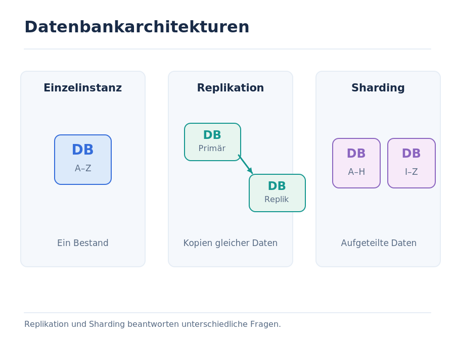

# M3-L4 – Distributed SQL, NoSQL, Oracle und PostgreSQL {#L4}

**Kursbereich:** M3 – Bachelor / Übergang: Datenbanksysteme

**Niveau:** Bachelor / Master-Brücke

**Vorwissen:** Keine festen Voraussetzungen angegeben.

## Ausgangsfrage: Welche Art von Datenbank braucht man für viele Server? {#S1}

In M3-L1 haben wir eine einzelne Datenbankinstanz kennengelernt. In M3-L2 haben wir Kopien derselben Datenbank betrachtet, die für Lesezugriffe oder Ausfallsicherheit nützlich sind. In M3-L3 haben wir Datenbestände in einzelne Teilbereiche, sogenannte **Shards**, aufgeteilt. Nun stellt sich die Frage: **Welches Datenbanksystem übernimmt welche dieser Aufgaben bereits selbst?**

Man kann eine kleine PHP-Anwendung mit einer SQLite-Datei betreiben. Für einen größeren Webdienst verwendet man vielleicht PostgreSQL oder eine andere Serverdatenbank. Später könnten mehrere Standorte, stark steigende Schreiblast oder strengere Anforderungen an Ausfallsicherheit hinzukommen. Deshalb ist es verlockend, nach einer „verteilten Datenbank“ zu suchen. Doch dieser Ausdruck bezeichnet nicht eine einzige Technik, sondern mehrere grundverschiedene Architekturen.

Eine Datenbank kann beispielsweise dieselben Informationen auf mehreren Servern *replizieren*. Sie kann ihre Daten auf mehrere Server *verteilen*. Sie kann mehreren Instanzen parallelen Zugriff auf **gemeinsam genutzten Speicher** erlauben. Oder sie kann die Verteilung hinter einer SQL-Schnittstelle verstecken und für Transaktionen eine komplexe Abstimmung durchführen. Solche Systeme lösen unterschiedliche Probleme und haben unterschiedliche Grenzen.

**Leitgedanke:** Die wichtigste Frage lautet nicht zuerst „SQL oder NoSQL?“, sondern: Welche Datenbeziehungen und Korrektheitsgarantien braucht meine Anwendung, welche Last entsteht tatsächlich und welche Betriebsverantwortung kann ich tragen?

## Die Begriffe sauber auseinanderhalten {#S2}

**SQL** bedeutet *Structured Query Language* („strukturierte Abfragesprache“). Sie dient unter anderem dazu, Daten in relationalen Datenbanken abzufragen oder zu verändern. **Eine SQL-Abfrage ist kein Datenbankserver.**

{alt="Einzelinstanz, Replikation und Partitionierung/Sharding im Vergleich"}


Ein **relationales Datenbankmanagementsystem (RDBMS)** speichert Daten in logisch verbundenen Tabellen und stellt unter anderem Schlüssel, Beziehungen und Transaktionen bereit. PostgreSQL und Oracle Database gehören in diese Familie. Das Wort „relational“ beschreibt das Datenmodell – nicht automatisch die Zahl der beteiligten Server.

**NoSQL** ist ein Sammelbegriff für Datenbanksysteme, die nicht primär dem klassischen relationalen SQL-Modell folgen oder zusätzlich andere Modelle in den Mittelpunkt stellen. Er bedeutet nicht, dass die Daten „unstrukturiert“ sein müssen, keine Transaktionen möglich wären oder grundsätzlich schwache Konsistenz gelten würde. Die Eigenschaften unterscheiden sich stark zwischen Produkten und Einstellungen.

**Distributed SQL** bezeichnet Systeme, die eine SQL-Schnittstelle und wesentliche relationale Eigenschaften mit einer auf mehrere Knoten verteilten Datenhaltung verbinden. Diese Systeme versuchen, Sharding, Replikation, Abfrageplanung und Transaktionskoordination weitgehend im Datenbanksystem zu organisieren. Die einzelnen Produkte unterscheiden sich jedoch bezüglich SQL-Kompatibilität, Isolationsstufen, Konsistenzgarantien und Betriebsmodellen.

### Mini-Architektur: Dieselbe Anwendung, drei unterschiedliche Datenhaltungen

``` text
A) Eine relationale Serverdatenbank

   PHP-Anwendung ─── SQL ───> PostgreSQL-Server
                                  │
                             Alle Tabellen

B) Replizierte relationale Datenbank

                          ┌──> Standby (Kopie)
   PHP-Anwendung ───> Primärserver
                          └──> Standby (Kopie)

C) Verteilte SQL-Datenbank (schematisch)

   PHP-Anwendung ─── SQL ───> SQL-Zugang / Koordinator
                                      │
                           Anfrage planen und routen
                                      │
                           ┌──────────┼──────────┐
                           ▼          ▼          ▼
                        Knoten A   Knoten B   Knoten C
                        Teilmenge  Teilmenge  Teilmenge
                         + Kopien  + Kopien   + Kopien
```

Die drei Bilder sind keine Qualitätsrangfolge. Die einfachste Lösung kann technisch wie wirtschaftlich die richtige sein. Bei der dritten Architektur kommt zusätzlich zur eigentlichen Datenbankarbeit erhebliche Koordination hinzu.

## Relationale Tabellen, Dokumente und Schlüssel-Wert-Speicher {#S3}

Bei der Wahl einer Datenbank geht es zunächst um die Struktur des Problems.

### Relationale Datenbanken {#31-relationale-datenbanken}

In einem Onlinedienst gibt es vielleicht Tabellen für `Kunden`, `Aufträge` und `Zahlungen`. Ein Auftrag besitzt eine Kundennummer, über die sich der zugehörige Kunde ermitteln lässt. Solche Beziehungen lassen sich mit einem **JOIN** (Tabellenverknüpfung) auswerten. Primär- und Fremdschlüssel können dazu beitragen, ungültige Beziehungen zu verhindern.

Die Herausforderung: Bei einer Verteilung müssen möglicherweise Daten verschiedener Tabellen oder Knoten gemeinsam gelesen und geändert werden. Relationale Funktionen verschwinden nicht, aber ihre Umsetzung wird schwieriger.

### Dokumentenorientierte Datenbanken {#32-dokumentenorientierte-datenbanken}

Eine **Dokumentendatenbank** wie MongoDB speichert zusammengehörige Daten in Dokumenten, häufig in einer JSON-ähnlichen Struktur. JSON steht für *JavaScript Object Notation*, ein verbreitetes Textformat für strukturierte Daten. Ein Kundendokument könnte neben Namen und Kennung auch mehrere Anschriften enthalten.

Das kann eine Anwendung vereinfachen, wenn meist ein ganzes Objekt gelesen oder verändert wird. Werden hingegen viele Objekte häufig quer miteinander verknüpft, können duplizierte Angaben, besondere Abfrageverfahren und Aktualisierungsregeln zusätzlichen Aufwand verursachen. MongoDB besitzt inzwischen auch Transaktionen über mehrere Dokumente; das Modell „Dokument“ bedeutet also keineswegs „keine Transaktionen“.

### Schlüssel-Wert-Datenbanken {#33-schlüssel-wert-datenbanken}

Ein **Key-Value-Store** („Schlüssel-Wert-Speicher“) ordnet einem eindeutigen Schlüssel einen Wert zu:

``` text
"auftrag:4812:status"  →  "fertig"
"nutzer:102:ansicht"   →  "kompakt"
```

Das ist bei einfachen und häufigen Zugriffen attraktiv. Für komplexe Beziehungen und Auswertungen ist ein solches Modell nicht automatisch geeignet. Manche Schlüssel-Wert-Systeme werden besonders häufig als Cache verwendet; andere sind dauerhaft speichernde Datenbanksysteme.

### Weitere NoSQL-Familien {#34-weitere-nosql-familien}

**Wide-Column-Systeme** gliedern große Datenmengen häufig nach Partitionsschlüsseln und spaltenorientierten beziehungsweise spaltenfamilienähnlichen Strukturen. **Graphdatenbanken** beschreiben vor allem Beziehungen zwischen Knoten und Kanten. Beide lösen spezielle Probleme, ersetzen aber nicht grundsätzlich jede relationale Datenbank.

Die Bezeichnung „NoSQL“ liefert deshalb noch keine Aussage über die tatsächliche Verfügbarkeit, Verteilung oder Konsistenz. Diese Eigenschaften müssen für das konkrete Produkt und den gewählten Betriebsmodus geprüft werden.

## Distributed SQL: Eine Datenbank, die intern viele Knoten koordiniert {#S4}

Das Ziel einer verteilten SQL-Datenbank kann man sich als **ein logisches Datenbanksystem mit mehreren physischen Rechnern** vorstellen. Die Anwendung sendet weiterhin SQL-Abfragen. Intern entscheidet das System, welche Knoten die Daten besitzen und welche Kopien für eine Operation beteiligt sein müssen.

Ein typischer Aufbau besitzt mehrere Ebenen:

1.  **SQL-Schicht:** Nimmt Abfragen entgegen, analysiert sie, plant Verknüpfungen und erstellt die Ausführungsschritte.
2.  **Verteilungs- und Routing-Schicht:** Ordnet Datensätze Bereichen, Shards oder sogenannten Tablets zu und findet deren aktuelle Speicherorte.
3.  **Replikationsschicht:** Verwaltet mehrere Kopien von Datenbereichen, um bei Ausfällen weiterarbeiten zu können.
4.  **Koordination für Transaktionen:** Sorgt gegebenenfalls dafür, dass Änderungen über mehrere Datenbereiche hinweg korrekt bestätigt oder verworfen werden.
5.  **Speicherschicht:** Hält die Daten auf Datenträgern vor, verwaltet lokale Indizes und führt Wiederherstellungsschritte aus.

### Mini-Architektur: Eine verteilte Buchung

``` text
   Buchungsanfrage: "Platz 42 für Kunde 7 reservieren"
                         │
                         ▼
                  SQL-Zugangsknoten
                         │
                  Transaktion planen
                         │
            ┌────────────┴────────────┐
            ▼                         ▼
   Datenbereich "Plätze"    Datenbereich "Buchungen"
      Knoten A (+ Kopien)       Knoten B (+ Kopien)
            │                         │
            └────────────┬────────────┘
                         ▼
           Koordinierte Bestätigung
                         │
                         ▼
             Erfolg oder Abbruch
```

Wichtig: Das Bild zeigt eine **mögliche logische Architektur**, nicht den genauen internen Ablauf jedes Produkts. Manche Datenbanken organisieren die Schichten anders, und nicht jede SQL-Operation benötigt eine Transaktion über mehrere Knoten.

### Konsensverfahren und Mehrheitsentscheidungen {#41-konsensverfahren-und-mehrheitsentscheidungen}

Wenn mehrere Kopien eines Datenbereichs existieren, müssen Schreibvorgänge oft in einer gemeinsamen Reihenfolge bestätigt werden. Dafür verwenden manche Systeme einen **Konsensalgorithmus** wie *Raft*. Vereinfacht entscheidet bei einer Gruppe von drei Replikaten eine Mehrheit von zwei über bestätigte Protokolleinträge. Fällt ein Knoten aus, können die beiden verbleibenden Knoten häufig weiterhin eine Mehrheit bilden. Werden die Knoten durch einen Netzausfall in Gruppen von einem und zwei Rechnern getrennt, kann die Ein-Knoten-Gruppe normalerweise keine neuen mehrheitsbestätigten Schreibvorgänge durchführen.

Daraus darf man nicht schließen, dass ein Raft-Protokoll allein sämtliche Datenbanktransaktionen löst. Es ordnet die Änderungen einer bestimmten Replikationsgruppe. Wenn eine Transaktion mehrere Datenbereiche betrifft, ist weitere Abstimmung erforderlich. Die vollständigen Garantien ergeben sich aus dem Zusammenspiel von Speicher-, Replikations- und Transaktionsprotokoll.

**Wann sinnvoll?** Wenn ein Dienst tatsächlich mehrere Knoten für steigende Datenmengen oder Schreiblast benötigt und dabei weiterhin relationale Abfragen und strenge Korrektheitsregeln nutzen möchte. **Wann unnötig?** Wenn ein einzelner Server die gemessene Last problemlos bewältigt. Dann bezahlt man die zusätzliche Verteilung häufig mit mehr Netzwerkverkehr, höherer Latenz und komplizierterem Betrieb.

## Was Distributed SQL nicht automatisch garantiert {#S5}

Eine SQL-Schnittstelle ist kein Gütesiegel für identische Funktionen. Selbst bei PostgreSQL-ähnlicher Syntax können sich verfügbare Datentypen, Erweiterungen, Transaktionsdetails, Abfragepläne, Systemkataloge und administrative Funktionen unterscheiden. Ein bestehendes PostgreSQL-Projekt lässt sich deshalb nicht allein wegen eines kompatiblen Netzwerkprotokolls garantiert unverändert übernehmen.

Auch der Ausdruck **„horizontale Skalierung“** verdient Prüfung. Mehr Knoten können weitere Speicherkapazität und parallele Verarbeitung ermöglichen. Eine einzelne globale Abfrage, eine Transaktion über viele Knoten oder ein stark umkämpfter Datensatz wird dadurch aber nicht beliebig schnell. Besonders schwierig sind:

- globale Sortierungen und Auswertungen;
- häufige Tabellenverknüpfungen über Verteilungsgrenzen;
- eindeutige Kennungen und andere Integritätsregeln über Knoten hinweg;
- gleichzeitige Änderungen derselben Informationen;
- Neuverteilung während des laufenden Betriebs;
- der Zugriff über große geografische Distanzen.

Für Anwendungen mit wenigen Benutzern bringt das zusätzliche Netz häufig keinen Vorteil. Für große Dienste kann die Verteilung notwendig sein, obwohl die einzelnen Zugriffe dann technisch aufwendiger werden.

## PostgreSQL: Starkes Einzelsystem, Replikation und externe Erweiterungen {#S6}

**PostgreSQL** ist ein konkretes, frei verfügbares relationales Datenbanksystem. Es bietet viele Funktionen, die wir bereits betrachtet haben: Indizes, Transaktionen, verschiedene Isolationsstufen, deklarative Tabellenpartitionierung, physische Replikation und logische Replikation.

**Physische Replikation** überträgt insbesondere Änderungen des *Write-Ahead Log* (WAL; vorab geführtes Änderungsprotokoll) auf Standby-Systeme. Diese können im passenden Modus auch lesende Abfragen ausführen. Das erweitert die Verfügbarkeit oder die Lesekapazität; im üblichen Primär-Standby-Modell werden jedoch nicht mehrere unabhängige Primärserver für dieselben Daten transparent zu einem verteilten Schreibsystem zusammengefasst.

**Logische Replikation** überträgt bestimmte Datenänderungen anhand logischer Datenobjekte. Sie arbeitet nach dem Publisher-Subscriber-Prinzip: Ein veröffentlichender Server stellt Änderungen bereit, ein abonnierender Server übernimmt sie. Das hilft zum Beispiel bei ausgewählter Datenübertragung, Migration oder analytischen Nebenbeständen. Es ist nicht automatisch konfliktfreies Multi-Primary-Schreiben; Schreibkonflikte müssen bei komplexeren Topologien gesondert behandelt werden.

Die eingebaute **Tabellenpartitionierung** kann eine große Tabelle intern in Teilstücke aufgliedern. Sie ersetzt kein automatisches Sharding über unabhängige Server. Es gibt dafür zusätzliche Software – beispielsweise die PostgreSQL-Erweiterung **Citus**, die Koordinator-/Worker- und Shard-Funktionen bereitstellt. Die konkrete Unterstützung, Version und Betriebsform einer solchen Lösung muss eigenständig geprüft werden.

### Mini-Architektur: PostgreSQL mit Lese-Replikat

``` text
       PHP-Anwendung
            │
     ┌──────┴─────────┐
     ▼                ▼
 Änderungen        Leseabfrage
     │                │
     ▼                ▼
 PostgreSQL        Standby /
 Primärserver      Lese-Replikat
     │                ▲
     └── WAL-Daten ───┘
```

Ein solches System kann einen sehr großen Anwendungsbereich abdecken und operativ überschaubarer bleiben als echtes Sharding. Replikationsverzug, Umschaltung bei Ausfällen und unabhängige Backups bleiben dennoch wichtige Aufgaben.

**Entscheidende Abgrenzung:** PostgreSQL selbst, die PostgreSQL-Erweiterung Citus und ein eigenständiges verteiltes SQL-Produkt mit PostgreSQL-Kompatibilität sind **drei verschiedene Dinge**.

## Oracle: Einzelinstanz, RAC und global verteilte Datenbank {#S7}

Bei „Oracle“ muss man unterscheiden, ob der Hersteller, das klassische Oracle-Datenbankprodukt oder eine zusätzliche Clusterarchitektur gemeint ist. Die Produktdokumentation verwendet 2026 unter anderem die Bezeichnung **Oracle AI Database 26ai**. Entscheidend sind die technischen Unterschiede, nicht das Marketingetikett.

### Oracle Database als einzelnes Datenbanksystem {#71-oracle-database-als-einzelnes-datenbanksystem}

Eine normale Oracle-Datenbank kann als einzelne Instanz auf einem Server betrieben werden. In diesem Grundmodell führt eine Instanz Datenbankprozesse aus und greift auf die zugehörigen Datenbankdateien zu. Das ist – stark vereinfacht – mit der Rolle einer einzelnen PostgreSQL-Instanz vergleichbar, auch wenn Produkte, Fähigkeiten und Lizenzmodelle verschieden sind.

### Oracle Real Application Clusters (RAC) {#72-oracle-real-application-clusters-rac}

**RAC** steht für *Real Application Clusters* („Cluster realer Anwendungsinstanzen“). Diese Oracle-Technik erlaubt mehreren Datenbankinstanzen auf unterschiedlichen Rechnern, gleichzeitig auf **dieselbe logisch gemeinsame Datenbank mit gemeinsamem Storage** zuzugreifen. Dafür sind Clusterware, abgestimmter gemeinsamer Speicher, schnelle Kommunikation zwischen den Knoten und die Koordination der Pufferinhalte erforderlich.

### Mini-Architektur: RAC mit gemeinsamem Datenbestand

``` text
              Anwendung
                  │
             Datenbankdienst
                  │
         ┌────────┴────────┐
         ▼                 ▼
    Oracle-Instanz A   Oracle-Instanz B
      Rechner 1          Rechner 2
         │                 │
         └────────┬────────┘
                  ▼
           Gemeinsamer,
        clusterfähiger Speicher
          (dieselben Dateien)
```

Mehrere Instanzen teilen hier **einen gemeinsamen logischen Datenbestand**. Sie halten ihre Puffer nicht einfach ungeordnet nebeneinander; das System organisiert deren Kohärenz. RAC kann für Verfügbarkeit und bestimmte Lastprofile interessant sein, ist aber betrieblich anspruchsvoll. Der gemeinsame Storage und die Clusterkoordination sind zentrale Architekturmerkmale.

**RAC ist keine bloße gewöhnliche Lese-Replikation, aber auch nicht mit unabhängigem Sharding gleichzusetzen.** Die Daten liegen nicht einfach als voneinander getrennte Teilbestände je Server vor.

### Oracle Globally Distributed AI Database / Sharding {#73-oracle-globally-distributed-ai-database-sharding}

Die offiziell als **Oracle Globally Distributed AI Database** bezeichnete Architektur verteilt eine **logisch zusammengehörige Datenbank auf unabhängige physische Oracle-Datenbanken**, die sogenannten Shards. Jeder Shard beherbergt einen Teil der Daten und benötigt keinen gemeinsam genutzten Speicher mit den anderen Shards. Ein *Shard Director* kann Verbindungen unter Berücksichtigung des Verteilungsschlüssels an den passenden Shard leiten.

``` text
                Anwendung
                    │
               Shard Director
                    │
         ┌──────────┼──────────┐
         ▼          ▼          ▼
     Oracle DB A  Oracle DB B  Oracle DB C
     Kunden 1–?   Kunden ...  Kunden ...
     Eigene Daten Eigene Daten Eigene Daten
     Eigener      Eigener     Eigener
     Speicher     Speicher    Speicher
```

Die Kundenaufteilung ist nur ein Anschauungsbeispiel: Die reale Verteilung kann andere Schlüssel und Regeln verwenden. Mit Sharding kann sich die Daten- und Lastkapazität auf mehrere unabhängige Einheiten erstrecken. Es entstehen aber auch Fragen nach verteilten Abfragen, globalen Transaktionen, Platzierung und Verwaltung.

**Direkter Vergleich:**

  Variante                                  Grundidee                                                 Wesentlicher Unterschied
  ----------------------------------------- --------------------------------------------------------- ---------------------------------------------------
  Einzelne Oracle-Instanz                   Ein Datenbanksystem mit einer Instanz                     Keine automatische Mehrknoten-Verteilung
  Oracle RAC                                Mehrere Instanzen greifen auf denselben Datenbestand zu   Gemeinsam genutzter, clusterfähiger Speicher
  Oracle Globally Distributed AI Database   Daten auf unabhängige Shards verteilen                    Jeder Shard hat eigene Daten und eigenen Speicher

Für ein kleines Webprojekt wäre weder RAC noch eine global verteilte Oracle-Architektur ohne konkrete Betriebsanforderung eine naheliegende Einstiegslösung. Diese Systeme sind auch nicht allein durch die Aussage „Oracle unterstützt Cluster“ beschrieben.

## Weitere reale Beispiele: MongoDB, CockroachDB und YugabyteDB {#S8}

### MongoDB – Dokumentendatenbank mit Replikation und Sharding {#81-mongodb-dokumentendatenbank-mit-replikation-und-sharding}

MongoDB ist eine Dokumentendatenbank. Sie kann sowohl **Replica Sets** für Replikation und Ausfallsicherheit als auch **Sharded Clusters** für die Aufteilung einer Sammlung einsetzen. Ein Shard ist in der beschriebenen Clusterarchitektur selbst als Replica Set ausgelegt. Ein `mongos`-Router empfängt Anfragen und bestimmt anhand der Metadaten, wohin sie gehören; Konfigurationsserver verwalten die Clusterinformationen.

``` text
   Anwendung
       │
       ▼
    mongos-Router
       │
  ┌────┴──────────┐
  ▼               ▼
Shard A         Shard B
(Replica Set)   (Replica Set)
```

Der **Shard-Schlüssel** beeinflusst, ob Anfragen gezielt einen Knoten erreichen oder auf viele Shards verteilt werden müssen. MongoDB bietet je nach `readConcern`, `writeConcern`, Sitzungsmodus und Lesepräferenz verschiedene Konsistenz- und Dauerhaftigkeitsgarantien. Das pauschale Urteil „Dokumentendatenbanken sind immer nur eventual consistent“ wäre daher falsch.

### CockroachDB – SQL über verteiltem Schlüssel-Wert-Speicher {#82-cockroachdb-sql-über-verteiltem-schlüssel-wert-speicher}

CockroachDB ist ein Beispiel für Distributed SQL. Die SQL-Schicht stellt relationale Funktionen bereit; darunter verteilt das System Daten in Schlüsselbereichen (*Ranges*) auf unterschiedliche Knoten. Replikationsgruppen verwenden Raft. Das Produkt unterstützt verteilte Transaktionen und standardmäßig die Isolationsstufe **Serializable** („serialisierbar“), sodass gleichzeitig ausgeführte Transaktionen aus Sicht der Datenbank einem zulässigen seriellen Ablauf entsprechen sollen.

Das ist kein Versprechen, dass jede konfliktträchtige Transaktion beim ersten Versuch erfolgreich ist. Unter Konkurrenz können Transaktionen wiederholt oder von der Anwendung erneut gestartet werden müssen. Auch CockroachDB verwendet PostgreSQL-ähnliche Schnittstellen, ist aber nicht identisch mit dem PostgreSQL-Datenbankserver oder allen PostgreSQL-Erweiterungen.

### YugabyteDB – PostgreSQL-nahe SQL-Schicht und verteilte Tablets {#83-yugabytedb-postgresql-nahe-sql-schicht-und-verteilte-tablets}

YugabyteDB verbindet eine PostgreSQL-orientierte SQL-Schnittstelle namens **YSQL** mit einer verteilten Speicherschicht. Daten werden in *Tablets* aufgeteilt; diese werden laut Projektdokumentation typischerweise über Raft-Replikationsgruppen verwaltet. Auch hier wird eine logische Datenbank aus mehreren physischen Einheiten aufgebaut.

Die YSQL-Kompatibilität kann den Einstieg für PostgreSQL-erfahrene Entwickler erleichtern. Sie bedeutet aber nicht vollständige Gleichheit sämtlicher Funktionen, Erweiterungen und Versionsstände. Ob eine konkrete vorhandene Anwendung ohne Änderungen funktioniert, muss gezielt geprüft werden.

### Produkte nicht nach bloßem Etikett auswählen {#84-produkte-nicht-nach-blossem-etikett-auswählen}

  System/Familie                            Datenmodell und Schnittstelle                           Prinzip zur Verteilung                                Wichtige Grenze
  ----------------------------------------- ------------------------------------------------------- ----------------------------------------------------- -------------------------------------------------------------------------------
  PostgreSQL (Kernsystem)                   Relational, SQL                                         Replikation und Tabellenpartitionierung               Kein automatisch transparenter Distributed-SQL-Mehrknoten-Schreibcluster
  PostgreSQL + Citus                        Relational, SQL                                         Zusätzliche Sharding-/Koordinatorfunktionen           Erweiterung mit eigenem Funktions- und Betriebsumfang
  Oracle RAC                                Relational, Oracle SQL                                  Mehrere Instanzen mit gemeinsamem Storage             Clusterkoordination und gemeinsame Speicherarchitektur
  Oracle Globally Distributed AI Database   Relational, Oracle SQL                                  Unabhängige Shards                                    Verteilte Daten und Anfragen erfordern Zusatzkoordination
  MongoDB                                   Dokumente, eigene Abfrageschnittstelle                  Shards und Replica Sets                               Schlüsselwahl, Abfrageverteilung und differenzierte Konsistenzeinstellungen
  CockroachDB                               Distributed SQL, PostgreSQL-kompatible Schnittstellen   Bereiche, Raft-Replikation, verteilte Transaktionen   Netz- und Transaktionskoordinierung, nicht vollständige PostgreSQL-Gleichheit
  YugabyteDB (YSQL)                         Distributed SQL, PostgreSQL-nahe Schnittstelle          Tablets, Raft-Replikation                             Kompatibilität und Verteilung müssen pro Funktion geprüft werden

Diese Tabelle beschreibt Architekturprinzipien, keine Produktbewertung oder Preisempfehlung. Produktvarianten und unterstützte Funktionen können sich ändern; die Quellen am Ende dokumentieren den geprüften Stand.

## Was bedeutet Konsistenz eigentlich? {#S9}

Das Wort **Konsistenz** hat in der Datenbankwelt mehrere Bedeutungen. Gerade bei verteilten Systemen entstehen Missverständnisse, wenn man diese Bedeutungen vermischt.

**ACID-Konsistenz:** In der Abkürzung **ACID** (*Atomicity, Consistency, Isolation, Durability* – Atomarität, Konsistenz, Isolation, Dauerhaftigkeit) bezeichnet „Consistency“ die Einhaltung definierter Datenregeln und Integritätsbedingungen vor und nach erfolgreichen Transaktionen. Beispielsweise darf eine verbindlich definierte Bestellnummer nicht doppelt vorkommen. Das ist **nicht dasselbe** wie die Konsistenzbedeutung des CAP-Theorems.

**Replikatkonsistenz:** Welche Datenversion sieht man, wenn dieselben Daten auf mehreren Servern liegen? Könnte ein Replikat noch einen früheren Kontostand anzeigen, während der Primärserver bereits eine Änderung bestätigt hat?

**Transaktionsisolation:** Was beobachten mehrere gleichzeitig ausgeführte Transaktionen voneinander? Eine Datenbank kann eine bestimmte Transaktionsisolation bieten, während bestimmte Replikate dennoch verzögerte Daten liefern. Die beiden Fragen müssen getrennt betrachtet werden.

### Starke Konsistenz und Linearisierbarkeit {#91-starke-konsistenz-und-linearisierbarkeit}

Im verteilten Kontext meint **Linearisierbarkeit** vereinfacht, dass jede einzelne Operation so erscheint, als hätte sie zu einem bestimmten Punkt zwischen ihrem Aufruf und ihrer Antwort stattgefunden – unter Beachtung der realen Reihenfolge nicht überlappender Operationen. Wenn eine bestätigte Änderung vollständig abgeschlossen ist und danach eine passende neue Leseoperation beginnt, sollte diese nicht ohne Weiteres einen älteren Wert liefern.

Das ist eine starke Eigenschaft. Sie kann bei wichtigen Bestands-, Reservierungs- oder Sperrinformationen erforderlich sein. Sie kostet jedoch möglicherweise Wartezeit und kann bei Netzproblemen verhindern, dass eine isolierte Teilgruppe Schreibvorgänge bestätigt.

**Serializable** und **linearizable** sind wiederum nicht Synonyme. Serializable beurteilt vor allem, ob das Ergebnis gleichzeitig ausgeführter Transaktionen zu einem seriellen Ablauf passt; Linearisierbarkeit berücksichtigt zusätzlich den zeitlichen Realverlauf einzelner Operationen. Die präzisen Garantien sind produktspezifisch.

### Eventual Consistency – letztlich übereinstimmende Kopien {#92-eventual-consistency-letztlich-übereinstimmende-kopien}

**Eventual Consistency** („schließlich eintretende Konsistenz“) beschreibt – unter geeigneten Voraussetzungen, insbesondere wenn keine weiteren Änderungen hinzukommen und die Kommunikation wieder funktioniert –, dass Kopien langfristig auf denselben Wert zulaufen. Direkt nach einer Änderung können verschiedene Knoten unterschiedliche Stände anzeigen.

Ein Beispiel: Der Zähler „Wie oft wurde ein Bild angesehen?“ kann in einer öffentlichen Galerie vorübergehend nicht überall identisch sein. Für einen verfügbaren Sitzplatz bei einer kostenpflichtigen Buchung kann dieselbe Verzögerung dagegen unzulässig sein.

Eventual Consistency bedeutet also **nicht**, dass ein System beliebig inkorrekt sein darf oder dass überhaupt keine Regeln gelten. Die Anwendung muss entscheiden, welche vorübergehenden Unterschiede sie toleriert und wie Konflikte zusammengeführt werden.

### Weitere wichtige Garantien {#93-weitere-wichtige-garantien}

- **Read Your Writes:** Ein Nutzer sieht seine eigenen bestätigten Änderungen bei späteren passenden Lesezugriffen wieder.
- **Monotonic Reads:** Ein Nutzer fällt bei aufeinanderfolgenden Lesezugriffen nicht auf einen älteren bereits überholten Stand zurück.
- **Causal Consistency:** Kausal aufeinander aufbauende Änderungen werden in einer passenden Reihenfolge beobachtet, auch wenn unabhängige Ereignisse freier verteilt sein können.
- **Quorum:** Für bestimmte Entscheidungen müssen genügend Replikate zustimmen; welcher Anteil erforderlich ist, hängt vom jeweiligen Protokoll ab.

Die konkrete Kombination hängt von der Datenbank und ihren Einstellungen ab. Dokumentendatenbanken können starke Operationen anbieten; relationale Datenbanken können auf verzögerten Lese-Replikaten veraltete Werte zurückgeben. Das Etikett SQL/NoSQL entscheidet darüber nicht allein.

## Das CAP-Theorem – was es wirklich aussagt {#S10}

**CAP** steht für **Consistency**, **Availability** und **Partition Tolerance**. Das Theorem wird häufig als „Von drei Eigenschaften bekommt man nur zwei“ vereinfacht. Diese Kurzformel ist ohne weitere Erklärung irreführend.

Die drei Begriffe bedeuten in diesem Zusammenhang vereinfacht:

- **C – Consistency:** Im üblichen CAP-Modell ist damit eine starke, linearisiert wirkende Sicht auf Datenzugriffe gemeint, nicht bloß die Einhaltung von Tabellenregeln.
- **A – Availability:** Jeder Zugriff auf einen nicht ausgefallenen beteiligten Knoten soll eine gültige Antwort erhalten. Ein bloßes „Fehler: derzeit nicht möglich“ erfüllt diese starke Verfügbarkeitsforderung nicht als erfolgreiche Operation.
- **P – Partition Tolerance:** Das verteilte System muss berücksichtigen, dass Nachrichten zwischen Teilen des Netzes verloren gehen oder nicht rechtzeitig ankommen können. Eine **Netzpartition** trennt Knoten kommunikativ voneinander.

### Mini-Architektur: Wenn das Netz zerfällt

``` text
             Gemeinsamer Datenstand: Bestand = 1

           Server A          Server B
              │                │
              └── Netzwerk ────┘

                 NETZPARTITION

           Server A       X       Server B
              │                      │
   Nutzer 1: "kaufe"         Nutzer 2: "kaufe"
              │                      │
      Verbindung zwischen den Servern gestört
```

Wenn beide Seiten unabhängig voneinander denselben letzten Artikel verkaufen und beide Käufe bestätigen, kann der gemeinsame Bestand inkorrekt werden. Wenn dagegen eine Seite auf ausreichend bestätigte Koordination wartet oder eine Anfrage ablehnt, ist die strenge „jeder nicht ausgefallene Knoten antwortet erfolgreich“-Verfügbarkeit verletzt.

**Der Kern des Theorems:** Unter den von Gilbert und Lynch untersuchten Annahmen kann ein verteiltes System während einer Netzpartition nicht gleichzeitig uneingeschränkte linearisierbare Konsistenz und diese starke Form von Verfügbarkeit für alle betroffenen Operationen garantieren. Das ist ein *Konfliktfall bei Kommunikationsausfällen*, keine gewöhnliche Menüauswahl für die drei Eigenschaften im störungsfreien Betrieb.

### Wie zwei typische Reaktionen aussehen {#101-wie-zwei-typische-reaktionen-aussehen}

Ein System kann bei getrennten Knoten die strenge Konsistenz bevorzugen: Nur eine ausreichend koordinierte Seite bestätigt kritische Änderungen. Der isolierte andere Teil kann vorübergehend keine entsprechenden Schreibvorgänge erfolgreich abschließen. Umgangssprachlich wird eine solche Architektur oft **CP-orientiert** genannt.

Oder ein System kann weiter lokale Antworten und Änderungen auf getrennten Seiten zulassen und spätere Zusammenführung verlangen. Dann kann die strenge Konsistenz während der Partition verloren gehen; vereinfacht spricht man oft von **AP-orientiert**. Wie Konflikte erkannt und gelöst werden, ist Teil des konkreten Anwendungsentwurfs.

**Wichtig:** Viele Datenbanken bieten je nach Operation, Einstellung und Topologie verschiedene Garantien. Es ist oft ungenau, ein gesamtes Produkt ohne diese Einschränkungen als „die CP-Datenbank“ oder „die AP-Datenbank“ zu etikettieren.

### Was CAP nicht erklärt {#102-was-cap-nicht-erklärt}

CAP sagt nicht voraus, welche Datenbank am schnellsten ist, wie teuer sie wird oder welche Abfragesprache sie unterstützt. CAP ist auch keine Aussage darüber, dass ein System bei störungsfreiem Netz immer eine der drei Eigenschaften abschalten müsse. Die praktisch wichtige Abwägung zwischen niedriger Latenz und stärkerer Koordination gibt es selbst ohne Netzpartition – dieser zusätzliche Zielkonflikt wird unter anderem mit **PACELC** beschrieben. Für die Auswahl eines realen Produkts benötigt man deshalb mehr als das CAP-Etikett.

## Der geografische Faktor: Mehrere Rechenzentren ändern die Physik nicht {#S11}

Verteilte Datenhaltung wird besonders anspruchsvoll, wenn Knoten in verschiedenen Städten oder Ländern stehen. Innerhalb eines Rechenzentrums sind die Kommunikationswege meist relativ kurz. Zwischen weit entfernten Regionen benötigen Signale und Datenpakete mehr Zeit, und die Verbindungen können voneinander unabhängig ausfallen.

Wenn ein Schreibvorgang erst nach Zustimmung mehrerer geografisch verteilter Replikate als bestätigt gilt, muss die Anwendung auf deren Kommunikation warten. Mehr Knoten erhöhen deshalb nicht automatisch die Geschwindigkeit einer einzelnen Transaktion. Gleichzeitig kann geografische Verteilung helfen, einen größeren regionalen Ausfall zu überstehen – sofern Platzierung, Replikation und Wiederanlauf sinnvoll geplant sind.

Auch rechtliche Fragen können eine Rolle spielen. Der Standort personenbezogener Daten, der Einsatz externer Auftragsverarbeiter, die Übermittlung in andere Länder und Lösch- beziehungsweise Aufbewahrungspflichten müssen für den konkreten Dienst geprüft werden. Die technische Möglichkeit, Daten über Kontinente zu replizieren, ist keine automatische datenschutzrechtliche Erlaubnis.

## Drei Praxisbeispiele – die jeweils angemessene Architektur {#S12}

### Lokaler Medienkatalog {#121-lokaler-medienkatalog}

Ein lokales Programm verwaltet mehrere hunderttausend Einträge zu Bildern, Videos und Metadaten. Ein großer Teil der Arbeit besteht aus Suchen, Sortieren und gelegentlichen Änderungen. **Eine lokale SQLite-Datenbank** kann hier sehr sinnvoll sein. Die Größe der Tabelle allein ist kein Grund, ein verteiltes Datenbanksystem zu betreiben. Gute Indizes, eine nachvollziehbare Datenstruktur und verlässliche Backups lösen in diesem Szenario meist die wichtigeren Probleme.

### Kleiner bezahlter Webdienst {#122-kleiner-bezahlter-webdienst}

Ein PHP-Tool bietet Kunden Auswertungen an. Es besitzt Konten, Auftragsdaten und Ergebnisse. Solange die Last überschaubar ist, sind **ein Anwendungsserver und eine PostgreSQL-Datenbank** eine nachvollziehbare Ausgangsarchitektur. Wenn später Verfügbarkeit oder Lesevolumen wichtiger wird, kann eine Standby- beziehungsweise Lese-Replikation sinnvoll sein. Ein vollständiger Distributed-SQL-Cluster wäre ohne gemessenen Engpass zunächst zusätzliche Komplexität.

### Buchungsdienst mit mehreren Regionen {#123-buchungsdienst-mit-mehreren-regionen}

Ein großer Dienst verwaltet begrenzte Reservierungsplätze für Nutzer an verschiedenen Standorten. Der gleiche Platz darf nicht zweimal verbindlich verkauft werden. Hier gewinnen strenge Korrektheit, eindeutige Schreibzuständigkeit, transaktionale Garantien und definierte Ausfallreaktionen an Bedeutung. Eine gut entworfene zentrale Datenbank mit Failover kann ausreichend sein; eine verteilte SQL-Architektur ist **eine mögliche**, aber nicht zwangsläufig die beste Lösung. Entscheidend ist, welche Antwort bei Ausfällen zulässig ist: „Buchung momentan nicht möglich“ kann fachlich besser sein als eine fälschlich bestätigte Doppelbuchung.

Für eine **KI-Auftragswarteschlange** gilt nochmals etwas anderes: Die Auftragsdatenbank braucht klare Zustände und eindeutige Auftragskennungen, aber die aufwendige Bild- oder Modellverarbeitung findet bei Workern statt. Zusätzliche GPU-Rechner bedeuten nicht automatisch, dass auch die Datenbank geshardet werden muss.

## Betrieb, Risiken und Kosten {#S13}

Eine technisch anspruchsvolle Datenbankarchitektur löst selten alle Betriebsprobleme selbst. Zu prüfen sind mindestens:

  Frage                                           Warum wichtig?
  ----------------------------------------------- ---------------------------------------------------------------------------------------------------
  Wer aktualisiert die Knoten?                    Sicherheitslücken und Versionsunterschiede können den Betrieb gefährden.
  Wer überwacht Replikation und Quorum?           Eine scheinbar laufende Anwendung kann unter Umständen keine neuen Änderungen sicher bestätigen.
  Wie werden Daten wiederhergestellt?             Replikation verteilt auch fehlerhafte Löschungen; unabhängige Backups bleiben nötig.
  Wie wird ein Schema geändert?                   In verteilten Umgebungen können längere Migrationen und Versionsunterschiede auftreten.
  Wo befinden sich Daten und Kopien?              Datenschutz, Latenz und regionale Ausfälle sind betroffen.
  Welche Transaktionen brauchen mehrere Shards?   Netzkoordination und Konkurrenz können Antwortzeiten verschlechtern.
  Wie werden Zugangsdaten geschützt?              Zusätzliche Knoten und Dienste erhöhen die Angriffsfläche.
  Was kostet der laufende Betrieb?                Rechenknoten, Speicher, Replikate, Datenverkehr, Monitoring und Support fallen kontinuierlich an.

Ein Anbieter kann Teile dieses Aufwands als **Managed Service** übernehmen. Damit entfallen nicht die Verantwortung für das fachliche Datenmodell, Rechte, Datensicherungsziele, Missbrauchsschutz und die korrekte Behandlung von Anwendungsfehlern. Auch verwaltete Dienste verursachen laufende Kosten und können Abhängigkeiten von bestimmten Funktionen oder Lizenzmodellen schaffen.

**Keine Kostenrangfolge ohne Messwerte:** Ein kleiner Server kann günstiger und einfacher sein als ein Mehrknotencluster. Bei sehr hoher tatsächlicher Last kann ein Cluster dagegen technisch oder wirtschaftlich notwendig werden. Die Entscheidung braucht reale Anforderungen, beobachtete Engpässe und einen Vergleich der vollständigen Betriebskosten – nicht nur einen Werbebegriff.

## Entscheidungsfragen vor einer Datenbankmigration {#S14}

Bevor eine vorhandene Anwendung in Richtung verteilter Datenbanken umgebaut wird, sollten fünf Fragen beantwortet sein:

1.  **Was ist der nachgewiesene Engpass?** Lesen, Schreiben, Speicher, Verfügbarkeit oder geografische Distanz?
2.  **Welche Daten dürfen niemals widersprüchlich sein?** Beispielsweise Bestände, Zahlungen, Reservierungen oder Zugriffsrechte.
3.  **Was darf zeitweise veraltet sein?** Beispielsweise Statistikzähler, öffentliche Suchindizes oder abgeleitete Ansichten.
4.  **Welche Schnittstellen muss die neue Datenbank wirklich unterstützen?** SQL-Syntax, Transaktionen, Treiber, Erweiterungen, Datentypen, Migrationswerkzeuge.
5.  **Wer betreibt, sichert und bezahlt das System?** Monitoring, Updates, Wiederherstellung, Fehlerdiagnose, Datenschutz und Nutzer-Support.

Falls bereits eine einzelne gut gewartete Datenbank alle Anforderungen erfüllt, ist eine Migration vor allem eines: **unnötiges Risiko**.

## Zusammenfassung und Ausblick auf M3-L5 {#S15}

Wir haben in dieser Lektion mehrere Ebenen voneinander getrennt:

- **SQL** ist eine Abfragesprache; **PostgreSQL** und **Oracle Database** sind konkrete relationale Datenbanksysteme.
- **NoSQL** ist eine Sammelfamilie unterschiedlicher Datenmodelle, keine einheitliche Aussage über Konsistenz.
- **PostgreSQL-Replikation** kopiert Daten; **PostgreSQL-Tabellenpartitionierung** verteilt Tabellen intern; zusätzliche Shardinglösungen sind davon zu unterscheiden.
- **Oracle RAC** arbeitet mit mehreren Instanzen auf gemeinsamem Speicher; **Oracle Globally Distributed AI Database** verteilt Daten auf unabhängige Shards.
- **Distributed SQL** verbindet SQL- und relationale Funktionen mit intern koordinierter Datenverteilung – allerdings nicht ohne Netzwerk-, Transaktions- und Betriebsaufwand.
- **CAP** beschreibt einen fundamentalen Zielkonflikt bei Netzpartitionen, keine allgemeine Rangliste aller Datenbanken und keine einfache freie „Zwei-von-drei“-Wahl.

Damit kennen wir die grundsätzlichen Architekturvarianten. In **[M3-L5 – Transaktionen und verteilte Korrektheit](M3-L5.md)** untersuchen wir als Nächstes genauer, wie man gleichzeitig eintreffende Änderungen, Wiederholungen, doppelte Nachrichten und mehrstufige Transaktionen korrekt verarbeitet. Gerade bei Reservierungen, Zahlungen und KI-Auftragsketten entscheidet diese Ebene darüber, ob eine Anwendung wirklich zuverlässig funktioniert.


## Quellen {#S16}

**Dokumentierter Quellenstand:** 03.11.2026

Alle genannten Produktfunktionen sind auf den **Quellenstand 03.11.2026** bezogen. Die offiziellen Dokumentationen können sich später ändern. Die folgenden Links sind Primärquellen; die Kernaussagen dieser Lektion wurden mit ihnen abgeglichen:

1.  PostgreSQL 18, *High Availability, Load Balancing, and Replication*: [https://www.postgresql.org/docs/18/high-availability.html](https://www.postgresql.org/docs/18/high-availability.html)
2.  PostgreSQL 18, *Logical Replication*: [https://www.postgresql.org/docs/18/logical-replication.html](https://www.postgresql.org/docs/18/logical-replication.html)
3.  PostgreSQL 18, *Table Partitioning*: [https://www.postgresql.org/docs/18/ddl-partitioning.html](https://www.postgresql.org/docs/18/ddl-partitioning.html)
4.  Oracle Database 26ai, *Overview of Oracle RAC Architecture and Processing*: [https://docs.oracle.com/en/database/oracle/oracle-database/26/racad/introduction-to-oracle-rac/overview-of-oracle-rac-architecture-and-processing.html](https://docs.oracle.com/en/database/oracle/oracle-database/26/racad/introduction-to-oracle-rac/overview-of-oracle-rac-architecture-and-processing.html)
5.  Oracle Database 26ai, *Oracle Globally Distributed AI Database – Architecture and Components*: [https://docs.oracle.com/en/database/oracle/oracle-database/26/shard/architecture-components.html](https://docs.oracle.com/en/database/oracle/oracle-database/26/shard/architecture-components.html)
6.  Oracle Database 26ai, *Oracle Globally Distributed AI Database Overview*: [https://docs.oracle.com/en/database/oracle/oracle-database/26/shard/overview1.html](https://docs.oracle.com/en/database/oracle/oracle-database/26/shard/overview1.html)
7.  MongoDB, *Sharding*: [https://www.mongodb.com/docs/manual/sharding/](https://www.mongodb.com/docs/manual/sharding/)
8.  MongoDB, *Read Isolation, Consistency, and Recency*: [https://www.mongodb.com/docs/manual/core/read-isolation-consistency-recency/](https://www.mongodb.com/docs/manual/core/read-isolation-consistency-recency/)
9.  CockroachDB, *Developer Basics* (SQL-Kompatibilität, Isolationsstufen, Wiederholungen): [https://www.cockroachlabs.com/docs/stable/developer-basics.html](https://www.cockroachlabs.com/docs/stable/developer-basics.html)
10. YugabyteDB, *Architecture* und *DocDB Replication*: [https://docs.yugabyte.com/stable/architecture/](https://docs.yugabyte.com/stable/architecture/) und [https://docs.yugabyte.com/stable/architecture/docdb-replication/](https://docs.yugabyte.com/stable/architecture/docdb-replication/)
11. Gilbert, Seth / Lynch, Nancy (2002), *Brewer’s conjecture and the feasibility of consistent, available, partition-tolerant web services*, ACM SIGACT News 33(2): [https://apice.unibo.it/bin/view/Publication/CapproofSigactnews33](https://apice.unibo.it/bin/view/Publication/CapproofSigactnews33)

**Lesehinweis:** Technische Eigenschaften unterscheiden sich nach Produktversion, Konfiguration, Betriebsumgebung und konkreter Operation. Die vereinfachten Beispiele (Buchungsnummern, Kundenverteilung, Knotenzahlen) sind keine Behauptungen über Leistungsgrenzen eines bestimmten Herstellers.
