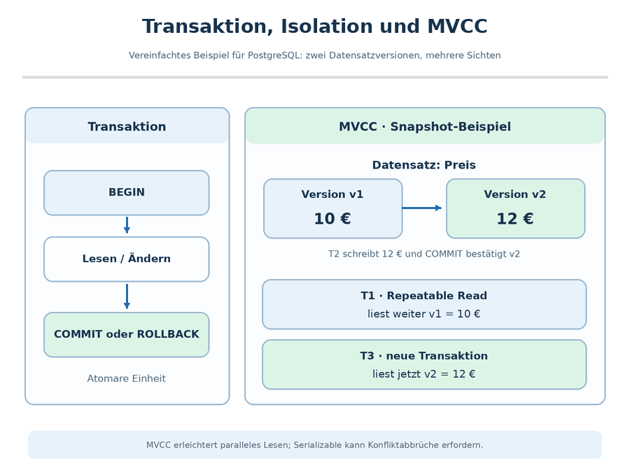
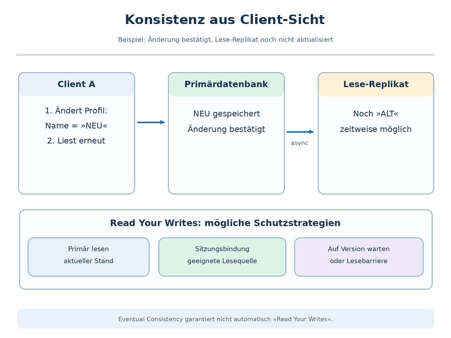

# M3-L5 – Transaktionen und verteilte Korrektheit {#L5}

**Kursbereich:** M3 – Bachelor / Übergang: Datenbanksysteme

**Niveau:** Bachelor / Master-Brücke

**Vorwissen:** Keine festen Voraussetzungen angegeben.

## Ausgangsproblem: Eine erfolgreiche Anfrage ist nicht automatisch eine korrekte Änderung {#S1}

Eine Datenbank mit nur einem Benutzer ist leicht vorstellbar: Eine Anwendung liest einen Wert, verändert ihn und speichert ihn zurück. Sobald mehrere Benutzer, Hintergrundprozesse oder Server gleichzeitig handeln, genügt dieses einfache Modell nicht mehr. Ein Teil des Systems könnte Daten lesen, die sich inzwischen verändert haben. Eine Nachricht könnte zweimal eintreffen. Oder Server A bestätigt eine Änderung, während Server B noch nichts davon weiß.

Das Grundproblem heißt **Korrektheit bei gleichzeitigen und verteilten Änderungen**. Eine Anwendung soll nicht nur irgendwie reagieren: Ihre fachlichen Regeln müssen auch dann gelten, wenn Vorgänge überlappen und einzelne Komponenten ausfallen.

Ein leicht verständliches Beispiel ist die Platzreservierung. Für den letzten verfügbaren Platz treffen gleichzeitig zwei Anfragen ein. Beide lesen zunächst „ein Platz frei“. Wenn beide danach unabhängig „reserviert“ speichern, haben wir zwei Zusagen für einen einzigen Platz. Jede einzelne Programmanweisung mag technisch fehlerfrei gewesen sein; die *Gesamtwirkung* wäre falsch.

``` text
Anfrage A ── liest „1 Platz frei“ ─┐
                                   ├── beide wollen reservieren
Anfrage B ── liest „1 Platz frei“ ─┘
                                   ↓
                        Korrektheitsentscheidung nötig
                                   ↓
                      höchstens eine gültige Zusage
```

Welche Technik dieses Problem löst, hängt davon ab, ob beide Anfragen dieselbe Datenbank benutzen oder die Daten auf unabhängigen Servern liegen. Wir beginnen beim einfacheren Fall und steigern die Komplexität schrittweise.

## Was eine Datenbanktransaktion garantiert {#S2}

Eine **Transaktion** ist eine logisch zusammengehörige Folge von Datenbankoperationen, die unter bestimmten Garantien behandelt wird. Häufig beginnt sie, führt mehrere Änderungen aus und wird erst am Ende endgültig bestätigt (*Commit*). Schlägt sie vorher fehl, kann die Datenbank die noch nicht abgeschlossenen Änderungen zurücknehmen (*Rollback*).

Man kann sich eine Transaktion als eine abgeschlossene Geschäftshandlung vorstellen. Wenn 20 Euro von einem Konto auf ein anderes übertragen werden, gehören „20 Euro abbuchen“ und „20 Euro gutschreiben“ zusammen. Die erste Änderung ohne die zweite wäre fachlich problematisch.

``` text
Transaktion „20 Euro übertragen“
       │
       ├── Konto A: -20 Euro
       ├── Konto B: +20 Euro
       │
       └── COMMIT: beide Änderungen gelten
            oder
           ROLLBACK: beide werden verworfen
```

Die bekannten Eigenschaften einer solchen Verarbeitung werden als **ACID** zusammengefasst:

  Kürzel   Auflösung                        Bedeutung in Alltagssprache
  -------- -------------------------------- --------------------------------------------------------------------------------------------------------------------------
  A        *Atomicity* – Atomarität         Entweder die ganze Transaktion oder keine ihrer Änderungen wird wirksam.
  C        *Consistency* – Konsistenz       Die Datenbank wahrt ihre definierten Integritätsregeln; zusätzliche Geschäftsregeln müssen korrekt modelliert werden.
  I        *Isolation* – Isolation          Gleichzeitige Transaktionen sollen sich nicht auf unzulässige Weise beeinflussen.
  D        *Durability* – Dauerhaftigkeit   Bestätigte Änderungen sollen die garantierten Ausfallszenarien überstehen, vorbehaltlich Konfiguration und Fehlermodell.

**Wichtig:** ACID-Konsistenz bedeutet nicht, dass die Datenbank selbst jede Geschäftsregel kennt. Wenn im System kein Schutz gegen doppelte Ticketreservierungen definiert ist, kann auch eine atomare Speicherung eines fachlich falschen Zustands erfolgen. Fachregeln müssen als Constraints, passende Änderungen oder überprüfbare Transaktionslogik umgesetzt werden.

**Wann unnötig?** Für das Anzeigen einer statischen Informationsseite benötigt man keine Schreibtransaktion. Für zusammengehörige Änderungen an Geldbeträgen, Bestellungen oder Berechtigungen ist sie dagegen häufig zentral.

## Warum gleichzeitige Zugriffe Fehler erzeugen können {#S3}

Stellen wir uns einen Zähler mit dem Wert 10 vor. Zwei Prozesse möchten jeweils 1 addieren.

``` text
Anfangswert: 10

Prozess A: liest 10       Prozess B: liest 10
Prozess A: berechnet 11  Prozess B: berechnet 11
Prozess A: schreibt 11   Prozess B: schreibt 11

Endwert: 11       Erwartet wäre: 12
```

Das ist ein klassisches Beispiel für eine **verlorene Änderung** (*Lost Update*). Der zweite Schreibvorgang überschreibt das Ergebnis des ersten. Je nach Datenbanksystem, Isolationsstufe und Form der Aktualisierung kann die Datenbank das verhindern oder einen Fehler melden. Entscheidend ist, ob die Anwendung den Wert außerhalb der Datenbank erst liest und dann ungeschützt zurückschreibt oder beispielsweise eine geeignete atomare Aktualisierung und korrekte Konfliktbehandlung nutzt.

Eine weitere Schwierigkeit ist die **nicht wiederholbare Leseoperation**: Ein Vorgang liest eine Zeile, ein anderer verändert sie und bestätigt die Änderung, und der erste liest bei derselben Abfrage später einen anderen Wert. Bei **Phantom Reads** ändert sich statt einer konkreten Zeile die Menge der Treffer, weil zwischenzeitlich passende Datensätze hinzugekommen oder weggefallen sind.

Bei **Write Skew** können sogar Transaktionen, die unterschiedliche Zeilen ändern, gemeinsam eine fachliche Regel verletzen. Beispiel: Zwei Ärzte müssen sicherstellen, dass immer mindestens einer Bereitschaftsdienst hat. Beide lesen „der andere bleibt da“ und tragen sich unabhängig ab. Wenn die verwendete Isolation diesen Konflikt nicht ausreichend verhindert, ist anschließend niemand im Dienst. Die Zeilen kollidieren nicht direkt; die *gemeinsam ausgewertete Regel* kollidiert.

Die Lehre: Es reicht nicht, jede Einzelzeile korrekt zu speichern. Oft müssen Beziehungen zwischen mehreren Zeilen oder Bedingungen über ganze Datenmengen erhalten bleiben.

## Isolation: Wie stark dürfen Transaktionen voneinander getrennt sein? {#S4}

**Isolation** beschreibt, welche Auswirkungen paralleler Transaktionen ein Vorgang sehen darf. Die SQL-Welt kennt mehrere klassische Isolationsstufen. Ihre konkrete Umsetzung ist datenbankspezifisch; die folgenden Bezeichnungen dienen zunächst der Orientierung.

  Isolationsstufe    Leitidee                                                                                               Typischer Zielkonflikt
  ------------------ ------------------------------------------------------------------------------------------------------ -------------------------------------------------------------------------------------------
  Read Uncommitted   Schwächste klassische Stufe; prinzipiell Lesen unbestätigter Änderungen möglich                        Gefahr unzuverlässiger Zwischenwerte; PostgreSQL behandelt diese Stufe wie Read Committed
  Read Committed     Gelesene Änderungen sind bestätigt; zwischen zwei Abfragen können neue Bestätigungen sichtbar werden   Gut für viele Standardvorgänge, aber nicht jede Mehr-Schritt-Regel
  Repeatable Read    Ein konsistenterer Blick über die Transaktion hinweg                                                   Produktabhängige Konflikt- und Anomaliebehandlung
  Serializable       Ergebnis entspricht einer möglichen seriellen Reihenfolge vollständiger Transaktionen                  Zusätzliche Prüfungen, Konfliktabbrüche und Wiederholungen

**Serialisierbarkeit** bedeutet nicht zwingend, dass tatsächlich alles nacheinander ausgeführt wird. Das System darf Vorgänge parallel bearbeiten, solange das endgültige Ergebnis so ist, als hätte es eine erlaubte Reihenfolge gegeben.

PostgreSQL 18 nutzt **Multi-Version Concurrency Control (MVCC, Mehrversions-Nebenläufigkeitskontrolle)**: Leser und Schreiber können unter passenden Bedingungen unterschiedliche Datensatzversionen sehen, statt sich bei jeder Operation gegenseitig zu blockieren. Bei *Serializable* kann PostgreSQL Transaktionen abbrechen, wenn eine unerlaubte Überschneidung droht. Anwendungen müssen dann für einen sauberen Wiederholungsversuch vorbereitet sein.

**PostgreSQL-spezifische Präzisierung:** `Repeatable Read` verhindert in PostgreSQL auch klassische Phantom Reads, lässt aber weiterhin bestimmte **Serialisierungsanomalien** zu. Gerade das oben beschriebene *Write Skew* kann bei einer Mehrzeilen-Geschäftsregel relevant sein. `Serializable` führt zusätzliche Prüfungen durch und kann in diesem Fall eine der betroffenen Transaktionen mit einem Serialisierungsfehler zurückweisen. Die Anwendung muss dann gegebenenfalls die **gesamte Transaktion** anhand aktueller Daten neu beginnen. Eine hohe Isolationsstufe ersetzt dabei weder korrekte Integritätsregeln noch sinnvolle Zugriffsmuster. Beleg: [PostgreSQL 18 – Transaction Isolation](https://www.postgresql.org/docs/18/transaction-iso.html).



*Abbildung: Vereinfachtes **PostgreSQL-Repeatable-Read**-Beispiel: T1 besitzt bereits einen älteren Snapshot und sieht weiterhin Version v1 (10 €), nachdem T2 die Änderung auf v2 (12 €) bestätigt hat. Eine danach gestartete T3 sieht v2. Entscheidend sind Snapshot-Zeitpunkt und Isolation; MVCC allein garantiert **keine** Serialisierbarkeit und `Serializable` kann Wiederholungen nach Konfliktabbrüchen erfordern.*

``` text
Zwei Transaktionen zugleich
             │
             ▼
    Datenbank verfolgt Versionen
    und mögliche Konflikte
             │
       ┌─────┴─────┐
       ▼           ▼
  sicherer Ablauf  Konflikt erkannt
       │           │
    Commit         Abbruch
                   │
                   ▼
          ggf. komplett erneut versuchen
```

**Praktische Folgerung:** Die strengste Isolation ist nicht bei jeder Abfrage nötig. Sie kann für kritische Regeln angemessen sein, führt aber je nach Last zu mehr Konfliktarbeit und Abbrüchen. Die passende Stufe sollte sich aus dem fachlichen Risiko ergeben, nicht aus dem Wunsch nach maximal klingenden Garantien.

## Sperren, optimistische Konfliktprüfung und Deadlocks {#S5}

Datenbanken nutzen verschiedene Mechanismen, um gleichzeitige Änderungen zu koordinieren. **Sperren** (*Locks*) sind einer davon: Eine Transaktion kann eine Zeile oder andere Ressource reservieren, sodass widersprechende Vorgänge warten müssen.

Bei einer **pessimistischen Strategie** wird der Konflikt durch geeignete Sperren früh verhindert. Bei einer **optimistischen Strategie** dürfen Vorgänge zunächst arbeiten und prüfen beim Abschluss, ob zwischenzeitlich jemand denselben maßgeblichen Zustand verändert hat. Ein Versionsfeld oder die Konflikterkennung des Datenbanksystems kann dabei helfen.

Keine der beiden Strategien ist universell besser. Sperren können Wartezeiten und Blockierungen auslösen; optimistische Verfahren können unter hoher Konfliktlast häufige Wiederholungen verursachen.

Ein **Deadlock** (*Verklemmung*) entsteht, wenn mehrere Transaktionen gegenseitig aufeinander warten:

``` text
Transaktion A sperrt Datensatz X
Transaktion B sperrt Datensatz Y

A will nun Y  ───────► wartet auf B
B will nun X  ───────► wartet auf A

                  Stillstand
                    │
        Datenbank erkennt Deadlock
                    │
       eine Transaktion wird abgebrochen
```

PostgreSQL erkennt solche Verklemmungen und bricht eine beteiligte Transaktion ab. Anwendungen sollten dann nicht blind jede Art von Fehler erneut ausführen, sondern den gesamten Vorgang gegebenenfalls gezielt wiederholen. Das Risiko lässt sich häufig reduzieren, indem Zugriffe auf mehrere Ressourcen in einer einheitlichen Reihenfolge erfolgen und Transaktionen kurz bleiben.

**Wann überdimensioniert?** Ein privater Einzelbenutzer-Katalog mit wenigen Änderungen benötigt normalerweise keine komplizierte eigene Sperrverwaltung. Die Transaktionsgarantien der verwendeten Datenbank können ausreichen. Mit gleichzeitigen Reservierungen, Lagerbeständen oder Zahlungszuordnungen steigt die Bedeutung hingegen deutlich.

## Warum „noch einmal versuchen“ im verteilten System gefährlich werden kann {#S6}

Bei einem Netzwerkaufruf gibt es mindestens drei Möglichkeiten: Die Zielseite verarbeitet die Anfrage erfolgreich, sie lehnt sie ab oder die Verbindung bricht unterwegs ab. Im dritten Fall weiß der Aufrufer unter Umständen nicht, *ob die Änderung bereits stattgefunden hat*.

Angenommen, ein Kunde klickt auf „Bestellen“. Die Anwendung legt die Bestellung an. Dann fällt die Verbindung aus, bevor die Bestätigung den Browser erreicht. Der Browser versucht die Anfrage erneut. Ohne Schutz kann eine zweite Bestellung entstehen.

``` text
Browser ── „Bestellung 4711 anlegen“ ──► Server
   ▲                                      │
   │                 Datenbank speichert  │
   │                                      ▼
   └──── Antwort geht im Netz verloren  [gespeichert]

Browser ── dieselbe Anfrage erneut ───► Server
                         Gefahr: zweite Bestellung
```

Eine Wiederholung heißt **Retry**. Wiederholungen sind bei vorübergehenden Ausfällen nützlich, lösen aber das Problem der Ungewissheit nicht selbst. Ein Timeout beweist weder, dass die ursprüngliche Operation fehlgeschlagen ist, noch dass sie erfolgreich war.

Daher benötigen wichtige Schreiboperationen oft eine **Idempotenzstrategie**. **Idempotent** bedeutet: Die mehrfache Ausführung desselben beabsichtigten Vorgangs hat dieselbe fachliche Endwirkung wie eine einmalige Ausführung.

Beispiel: Jede Bestellung bekommt eine eindeutige, vom Aufrufer oder der Anwendung verlässlich festgelegte **Vorgangskennung**. Der Server speichert diese Kennung zusammen mit dem Ergebnis unter einem Eindeutigkeitszwang. Trifft dieselbe Kennung erneut ein, wird der vorhandene Vorgang erkannt, statt eine zweite Bestellung zu erzeugen.

``` text
Anfrage + Vorgangskennung K123
               │
               ▼
     Kennung schon gespeichert?
           /           \
         Nein           Ja
          │              │
    Vorgang einmal    Voriges Ergebnis
    verbindlich       zu K123 zuordnen
    speichern         (keine Doppelwirkung)
```

Für eine belastbare Umsetzung müssen Kennung und Ergebnis konsistent gespeichert werden. Außerdem braucht das System Regeln zur Gültigkeitsdauer, zum Umgang mit derselben Kennung bei unterschiedlichen Nutzdaten und zur Nebenläufigkeit zweier gleichzeitig eintreffender identischer Anfragen. Eine flüchtige Liste im Arbeitsspeicher reicht bei Neustarts häufig nicht aus.

Im **Hypertext Transfer Protocol (HTTP)** gelten die Methoden `GET`, `PUT` und `DELETE` gemäß ihrer definierten Semantik als sicher beziehungsweise idempotent in unterschiedlicher Hinsicht; `POST` ist nicht generell idempotent. Entscheidend bleibt die tatsächliche fachliche Implementierung, nicht allein der Methodenname. `GET` soll keine fachliche Änderung auslösen; ein unvorsichtig implementiertes `GET /zahlung-ausloesen` widerspricht gerade dieser Idee.

## Doppelte Nachrichten sind normaler, als man denkt {#S7}

Online-Dienste kommunizieren nicht nur direkt über HTTP. Häufig senden sie Ereignisse oder Aufträge an einen **Nachrichtenbroker**, der sie zwischenspeichert und an **Worker** (Hintergrundprozesse) ausliefert. Ein Worker kann nach einer Bearbeitung abstürzen, bevor er den Eingang als erfolgreich quittiert. Dann wird der Broker die Nachricht möglicherweise erneut zustellen.

**At-least-once Delivery** bedeutet: Unter den jeweiligen Betriebsannahmen wird mindestens eine Zustellung angestrebt; doppelte Zustellungen sind möglich. **At-most-once Delivery** vermeidet Duplikate unter der jeweiligen Semantik eher auf Kosten möglicher Verluste. Ein vollumfängliches *Exactly Once* über Nachrichtenzustellung, Datenbank und externe Nebenwirkungen hinweg ist nicht durch das bloße Einschalten einer Brokeroption garantiert.

``` text
Auftragswarteschlange
        │
        ▼
     Worker A ── verarbeitet Auftrag ──► Datenbank
        │
        └── Absturz vor Quittung
                    │
          Broker sendet erneut
                    │
                    ▼
                 Worker B
                    │
        Prüft Bearbeitungskennung
        und vermeidet Doppelwirkung
```

Ein häufiges Verfahren ist die **Inbox- oder Verarbeitungstabelle**: Die Datenbank speichert die eindeutige Nachrichtenkennung gemeinsam mit der fachlichen Änderung in einer Transaktion. Ein erneut eintreffender Auftrag erkennt, dass seine Wirkung bereits übernommen wurde.

Zudem ist eine Nachricht nicht automatisch in der Reihenfolge unterwegs, in der sie erzeugt wurde. Bei mehreren Workern können Antworten und Änderungen in anderer Reihenfolge eintreffen. Wenn Reihenfolge wichtig ist, benötigen wir geeignete Schlüssel, Sequenznummern, Versionen oder eine pro Kunde/Objekt geordnete Verarbeitung.

Für einen lokalen Batch-Prozess mit nur einem kontrollierten Ausführungspfad kann diese Infrastruktur unnötig sein. Sobald jedoch Server, Queues und externe APIs beteiligt sind, wird die Frage der Doppelverarbeitung grundlegend.

## Zwei Systeme aktualisieren: Das Problem der doppelten Schreiboperation {#S8}

Ein Onlinedienst speichert eine Bestellung in seiner Datenbank und möchte anschließend eine Nachricht „Bestellung erstellt“ verschicken. Ein naiver Ablauf besteht aus zwei unabhängigen Schritten:

``` text
1. Datenbank: Bestellung speichern          ✓
2. Nachrichtenbroker: Ereignis veröffentlichen   ✗ Ausfall

Ergebnis: Bestellung existiert,
         andere Dienste wurden nicht informiert.
```

Die umgekehrte Reihenfolge hilft nicht zuverlässig: Wird erst die Nachricht verschickt und danach schlägt der Datenbankzugriff fehl, existiert eventuell eine Benachrichtigung über einen nie gespeicherten Vorgang. Dieses Grundproblem wird **Dual Write** genannt.

### Transactional Outbox

Ein häufig verwendetes Gegenmittel heißt **Transactional Outbox**, sinngemäß „transaktionaler Postausgang“. Die Anwendung schreibt die eigentliche Änderung und einen Versandauftrag **innerhalb derselben lokalen Datenbanktransaktion**. Ein separater Prozess verschickt den Postausgangseintrag später.

``` text
Webanwendung
     │
     ▼
Eine lokale Datenbanktransaktion
     ├── Bestellung speichern
     └── Outbox-Ereignis speichern
     │
     ▼
   COMMIT
     │
     ▼
Outbox-Worker ──► Nachrichtenbroker ──► Empfänger
                             │
                 bei Wiederholung: Duplikate erkennen
```

Das löst den kritischen Spalt zwischen *lokaler Änderung* und *dauerhaft vorgemerkter Nachricht*. Es garantiert jedoch nicht von selbst eine exakt einmalige Verarbeitung beim Empfänger. Beim Versenden kann die Quittung verlorengehen; der Outbox-Prozess sendet dann möglicherweise erneut. Deshalb gehören **Outbox und idempotenter Empfänger zusammen**.

Der technische Aufwand ist nicht kostenlos: Es werden Versandstatus, ausstehende Einträge, Fehler, Rückstau und Bereinigung überwacht. Für ein einzelnes Programm ohne externen Nachrichtenversand lohnt sich das Muster normalerweise nicht.

## Verteilte Transaktionen: Wenn mehrere Datenbanken gemeinsam entscheiden müssen {#S9}

Nun verteilen wir einen Vorgang auf **zwei unabhängige Datenbanken**. Server A soll einen Geldbetrag abbuchen, Server B ihn gutschreiben. Es genügt nicht, auf beiden jeweils eine normale ACID-Transaktion zu starten: Die beiden Transaktionen wissen zunächst nichts voneinander.

Man benötigt ein übergeordnetes Verfahren für die gemeinsame Entscheidung. Ein klassischer Ansatz ist **Two-Phase Commit (2PC, Zwei-Phasen-Bestätigung)**. Ein **Koordinator** stimmt mit mehreren Teilnehmern ab.

1.  **Vorbereitungsphase:** Der Koordinator fragt, ob jeder Teilnehmer seine geplanten Änderungen dauerhaft vorbereiten und später bestätigen kann. Die Teilnehmer stimmen zu oder lehnen ab.
2.  **Entscheidungsphase:** Wenn alle zustimmen, entscheidet der Koordinator für Commit; andernfalls für Rollback. Diese Entscheidung muss zuverlässig an alle Teilnehmer gelangen.

``` text
             Transaktionskoordinator
                      │
        ┌─────────────┴─────────────┐
        ▼                           ▼
   Datenbank A                  Datenbank B
   „bereit?“                    „bereit?“
        │                           │
      Ja/Nein                     Ja/Nein
        └─────────────┬─────────────┘
                      ▼
             gemeinsame Entscheidung
                      │
        ┌─────────────┴─────────────┐
        ▼                           ▼
   Commit/Rollback             Commit/Rollback
```

**Warum ist 2PC nicht überall Standard?** Während der Vorbereitung können Ressourcen reserviert bleiben. Fällt der Koordinator in einem kritischen Moment aus, müssen Teilnehmer unter Umständen auf die Wiederherstellung der Entscheidung warten. Das Verfahren benötigt Unterstützung aller beteiligten Systeme und zusätzliche Betriebslogik.

PostgreSQL 18 unterstützt vorbereitete Transaktionen für einen externen Transaktionsmanager. Das bedeutet **nicht**, dass zwei beliebige PostgreSQL-Server durch einen einfachen Schalter automatisch zu einem korrekt koordinierten Transaktionssystem werden. Der Koordinator und das Fehler-/Recovery-Verfahren bleiben wesentliche Bestandteile.

Auch moderne verteilte SQL-Datenbanken koordinieren Transaktionen, allerdings mit produktspezifischen Mechanismen. Es wäre falsch, überall dieselbe 2PC-Implementierung anzunehmen.

**Einsatzgrenze:** Braucht eine kleine Anwendung lediglich eine einzige Datenbank, ist eine lokale Transaktion meist wesentlich einfacher, verständlicher und kostengünstiger.

## Sagas und Kompensation: Geschäftsprozesse statt einer großen Sperre {#S10}

Nicht jeder lang laufende Vorgang kann oder sollte in einer einzigen globalen Transaktion stattfinden. Eine Bestellung kann Waren reservieren, eine Zahlungsabwicklung anstoßen, einen Versandauftrag erzeugen und später eine E-Mail auslösen. Solche Schritte liegen häufig bei unterschiedlichen Diensten oder externen Partnern.

Eine **Saga** zerlegt einen zusammengehörigen Geschäftsprozess in mehrere lokale Transaktionen. Nach jedem erfolgreichen Schritt wird der nächste gestartet. Schlägt ein späterer Schritt dauerhaft fehl, folgen geeignete **Kompensationen** (*ausgleichende Aktionen*), etwa „Reservierung wieder freigeben“.

``` text
1. Bestellung anlegen   ──► erfolgreich
2. Artikel reservieren  ──► erfolgreich
3. Zahlung freigeben    ──► fehlgeschlagen
                             │
                             ▼
                 Reservierung freigeben
                 Bestellung auf „abgebrochen“ setzen
```

**Kompensation ist nicht dasselbe wie Datenbank-Rollback.** Eine abgeschlossene lokale Transaktion ist bereits bestätigt und kann zwischenzeitlich von anderen Vorgängen gesehen worden sein. Die spätere Gegenaktion ist ein neuer Geschäftsvorgang. Ein versandtes Paket lässt sich nicht einfach „zurückrollen“; eine Rücksendung kann organisatorisch nötig werden. Auch Zahlungen, Benachrichtigungen und externe Nebenwirkungen haben ihre eigenen Regeln.

Sagas können **orchestriert** sein: Ein zentraler Ablaufmanager entscheidet, welchen Schritt er als Nächstes auslöst. Oder sie können **choreografiert** sein: Dienste reagieren auf Ereignisse anderer Dienste. Beide Modelle müssen mit Teilfehlern, Wiederholungen, ausbleibenden Antworten und unklaren Zwischenzuständen umgehen.

Eine Saga ist besonders geeignet, wenn ein Geschäftsvorgang über längere Zeit und mehrere unabhängige Systeme läuft und vorübergehende Zwischenzustände akzeptabel sind. Wo niemals ein ungültiger Zwischenzustand sichtbar werden darf, kann stattdessen eine lokale oder geeignete verteilte strenge Transaktion erforderlich sein.

## Eventual Consistency: Warum vorübergehend verschiedene Ansichten zulässig sein können {#S11}

**Eventual Consistency** bedeutet ungefähr: Wenn keine neuen Änderungen hinzukommen und die nötige Kommunikation wieder funktioniert, nähern sich die relevanten Kopien gemäß den Garantien des Systems einem konsistenten Zustand an. Es heißt **nicht**, dass jede beliebige verspätete Änderung irgendwann automatisch fachlich richtig wird.

Ein Bilderportal könnte eine neue Bildbeschreibung sofort im Hauptspeicher der Anwendung speichern und die öffentliche Suchfunktion erst später aktualisieren. Für einige Sekunden sieht die Suche dann einen älteren Stand. Das ist für viele Nutzer akzeptabel.

Bei einem Bestellsystem kann ein veralteter Kontostand oder eine doppelt vergebene Reservierung dagegen erheblichen Schaden anrichten. Hier muss man unterscheiden: Welche Informationen dürfen verzögert erscheinen, und welche Entscheidungen müssen sofort auf einer eindeutigen, aktuellen Grundlage getroffen werden?

``` text
Bildportal:                     Buchungssystem:
Bild hochladen                  letzten Platz reservieren
    │                                 │
    ▼                                 ▼
Datenbank bestätigt            strenge Verfügbarkeitsprüfung
    │                                 │
    ├── später Suchindex              ▼
    └── später Vorschaubild       eindeutige Reservierung

Verzögerung meist tolerierbar    Doppelzusage nicht tolerierbar
```

Eine Anwendung kann **beide Strategien zugleich** nutzen: streng korrekte Buchungsentscheidung, aber zeitversetzte E-Mail-Bestätigung oder Suchindexaktualisierung. Diese Trennung reduziert Komplexität und vermeidet unnötig starre Gesamtarchitekturen.

Wichtige Konsistenzfragen sind: Sieht der Nutzer seine eigene bestätigte Änderung (*Read Your Writes*)? Werden abhängige Ereignisse in der richtigen Reihenfolge verarbeitet? Kann ein zweiter Server ältere Daten liefern? Und was soll passieren, wenn ein Standort gerade nicht erreichbar ist?



*Abbildung: Ein bewusst vereinfachtes Beispiel für asynchrone Replikation und **Eventual Consistency**. Ein bereits bestätigter Schreibvorgang kann bei einer anschließenden Abfrage über einen verzögerten Replikatserver noch nicht sichtbar sein. **Read Your Writes** benötigt daher eine passende Lesequelle oder Versionskoordination; das ist von den zuvor erklärten Transaktions-Isolationsstufen zu unterscheiden.*

## Durchgehendes Beispiel: Drei Server, zwei Bestellungen, ein Restbestand {#S12}

Wir betrachten ein Online-Werkzeug, das eine begrenzte Anzahl von Verarbeitungsguthaben verkauft. Ein Kundenkonto besitzt noch **ein Guthaben**. Zwei Browserfenster senden gleichzeitig je einen KI-Bildauftrag, der ein Guthaben kostet.

### Variante A: Unkoordinierte Verarbeitung

Server 1 und Server 2 lesen beide den Guthabenstand 1. Beide starten ihren KI-Worker und ziehen später jeweils ein Guthaben ab. Das Ergebnis könnte ein negativer Kontostand, eine verlorene Aktualisierung oder zwei bezahlte Leistungen zum Preis von einer sein. Entscheidend ist: Das Lesen und die spätere Entscheidung waren nicht ausreichend gekoppelt.

### Variante B: Eine Datenbank als verbindliche Entscheidungsstelle

``` text
Browser A ──► Webserver 1 ─┐
                           ├──► dieselbe Datenbank
Browser B ──► Webserver 2 ─┘          │
                                     ▼
                        Guthaben atomar reservieren
                        nur wenn Stand ausreichend
                                     │
                          ┌──────────┴─────────┐
                          ▼                    ▼
                       Erfolg               Ablehnung
                          │
                 Auftrag in Queue
                          │
                          ▼
                       KI-Worker
```

Der wichtige Gedanke: Alle Webserver dürfen parallel laufen, während **eine konsistente Datenbankoperation** verbindlich darüber entscheidet, welcher Auftrag gültig ist. Eine passende eindeutige Auftragskennung schützt zusätzlich vor unbeabsichtigter Doppeleinreichung. Der Auftrag wird erst nach erfolgreicher Reservierung angenommen.

### Variante C: Verteilte Verarbeitung mit Outbox

Wenn die Auftragserstellung, Guthabenreservierung und das Vormerken des Queue-Ereignisses in einer lokalen Datenbanktransaktion zusammengefasst werden, lässt sich die Übergabe an den Worker zuverlässiger gestalten. Der Versand aus der Outbox erfolgt später. Der Worker behandelt erneute Nachrichtenzustellungen idempotent.

Bei einem Ausfall des KI-Workers kann das System den Auftrag erneut ausführen oder je nach Geschäftsregel Guthaben erstatten. Ob eine teilweise generierte Bilddatei übernommen, gelöscht oder berechnet wird, muss fachlich entschieden werden: Datenbanktechnik allein beantwortet diese Frage nicht.

### Variante D: Mehrere eigenständige Kontodatenbanken

Werden die Guthaben verschiedener Kunden auf getrennte Shards verteilt, können Vorgänge, die nur **einen** Kunden betreffen, oft innerhalb eines Shards abgewickelt werden. Muss dagegen Guthaben zwischen Kunden verschiedener Shards übertragen werden, entsteht ein neues Koordinationsproblem. Darum ist die Wahl des Shard-Schlüssels aus M3-L3 nicht nur eine Frage der Geschwindigkeit, sondern auch der Transaktionsgrenzen.

**Erkenntnis:** Eine skalierbare Architektur benötigt nicht überall maximale Verteilung. Es hilft, die fachlich kritische Entscheidung so lokal und eindeutig wie möglich zu halten und nachgelagerte Arbeiten gezielt asynchron auszuführen.

## Betrieb, Sicherheit, Kosten und Fehlersuche {#S13}

Mit jeder zusätzlichen Instanz und jedem zusätzlichen Dienst wächst nicht nur die Kapazität, sondern auch die Zahl der möglichen Fehlerzustände. Für korrekte verteilte Verarbeitung müssen Betreiber deshalb mehrere Aspekte berücksichtigen:

**Beobachtbarkeit:** Vorgänge benötigen eindeutige Kennungen, die in Datenbank, Nachricht und Anwendung wiederzufinden sind. Sonst lässt sich eine doppelte oder verlorene Verarbeitung schwer rekonstruieren.

**Überwachung:** Neben der allgemeinen Serverauslastung sind Konfliktabbrüche, Deadlocks, Retry-Raten, Warteschlangenrückstau, alte Outbox-Einträge und lang laufende Transaktionen wichtige Signale. Eine niedrige CPU-Auslastung schließt einen massiven Sperrengpass nicht aus.

**Sicherheitsgrenzen:** Server dürfen nur auf die Daten und Nachrichten zugreifen, die sie für ihre Aufgabe benötigen. Fehlende Mandantentrennung kann auch dann Daten offenlegen, wenn Transaktionen technisch korrekt sind. Idempotenzschlüssel dürfen nicht dazu führen, dass ein Nutzer fremde Auftragsergebnisse abrufen kann; sie müssen an berechtigte Identitäten und Operationen gebunden sein.

**Backups und Wiederherstellung:** Eine Transaktion schützt nicht gegen jede Art von Datenverlust. Wenn fehlerhafte Änderungen korrekt gespeichert wurden, bleiben sie auch korrekt gespeichert – und können repliziert werden. Unabhängige Backups und getestete Wiederherstellung bleiben erforderlich. Die Details folgen in M3-L6.

**Kosten:** Strenge Isolation, koordinierte Mehrknoten-Transaktionen, zusätzliche Tabellen, Queue-Infrastruktur und dauerhafte Überwachung beanspruchen Rechenzeit, Speicher, Netzwerkverkehr und Pflege. Auch die Fehlersuche wird aufwendiger. Die Kosten entstehen nicht nur durch Mietpreise, sondern durch Entwicklungs- und Betriebsstunden.

**Betriebliche Entscheidung:** Wenn die gesamte Anwendung mit einer einzelnen Datenbank und wenigen sauber definierten Transaktionen zuverlässig funktioniert, ist das häufig die wirtschaftlichere Architektur als ein verteilter Transaktionsapparat. Einen komplexen Mechanismus sollte man erst einsetzen, wenn konkrete fachliche oder betriebliche Anforderungen ihn rechtfertigen.

## Eine Orientierung für die Wahl des richtigen Mechanismus {#S14}

  Situation                                                   Meist geeignete Ausgangslösung                                    Zusätzliche Vorsicht
  ----------------------------------------------------------- ----------------------------------------------------------------- -----------------------------------------------------------
  Zwei Felder einer lokalen Datenbank gemeinsam ändern        Eine normale ACID-Transaktion                                     Fachliche Constraints richtig definieren
  Gleichzeitige Reservierung desselben Platzes                Atomare Entscheidung, geeignete Isolation oder Sperre             Konflikte und Retries korrekt behandeln
  Derselbe Webauftrag wird zweimal gesendet                   Eindeutige Vorgangskennung und idempotente Verarbeitung           Ergebnis, Kennung und Berechtigungen konsistent speichern
  Datenbankänderung soll später eine Nachricht auslösen       Transactional Outbox mit idempotentem Empfänger                   Versand kann wiederholt stattfinden
  Zwei unabhängige Datenbanken müssen atomar entscheiden      Geeignete koordinierte verteilte Transaktion, falls unterstützt   Recovery, Sperren und Ausfall des Koordinators
  Lang laufender Auftrag über mehrere externe Dienste         Saga mit dokumentierten Zuständen und Kompensation                Nicht alle realen Handlungen sind rückgängig zu machen
  Öffentlicher Suchindex hinkt einer Bildänderung hinterher   Eventual Consistency häufig akzeptabel                            Verzögerung sichtbar und begrenzt halten
  Zahlungs- oder Buchungsentscheidung                         Verbindliche, korrekt koordinierte Datenbasis                     Keine Doppelwirkung oder widersprüchliche Zusage zulassen

Die Tabelle ist bewusst keine universelle Produktempfehlung. Sie trennt erst einmal das **Korrektheitsproblem** von der Frage, ob man es mit PostgreSQL, SQLite, einem Managed Service oder einer verteilten Datenbank lösen möchte.

## Zusammenfassung und Übergang zu M3-L6 {#S15}

Datenbanken über mehrere Server zu betreiben ist nicht nur ein Problem der Geschwindigkeit und Datenverteilung. Die schwerere Frage lautet oft: **Was darf bei gleichzeitigen Änderungen und teilweisen Ausfällen keinesfalls passieren?**

- **ACID-Transaktionen** bündeln zusammengehörige lokale Änderungen; fachliche Regeln müssen dabei richtig beschrieben sein.
- **Isolation und Sperren** koordinieren parallele Zugriffe, können jedoch Konflikte, Wartezeiten und Deadlocks erzeugen.
- **Retries** sind wichtig, dürfen aber nicht unkontrolliert dieselbe Geschäftsaktion mehrfach auslösen.
- **Idempotenz** und eindeutige Vorgangskennungen schützen vor unerwünschten Doppelwirkungen.
- **Transactional Outbox** koppelt Datenänderung und vorgemerkte Nachricht in einer lokalen Transaktion; Empfänger müssen Duplikate behandeln.
- **Two-Phase Commit** koordiniert atomare Entscheidungen über Systeme hinweg, fügt aber erhebliche Betriebsanforderungen hinzu.
- **Sagas** koordinieren mehrstufige Geschäftsprozesse mithilfe lokaler Transaktionen und möglicher Ausgleichsaktionen.
- **Eventual Consistency** kann für weniger kritische Datenansichten sinnvoll sein, ersetzt aber keine strenge Entscheidung dort, wo Doppelzusagen unzulässig sind.

M3-L6 behandelt als Nächstes **Datenhaltbarkeit**: unabhängige Backups, Snapshots, zeitpunktgenaue Wiederherstellung und die Frage, wie viel Datenverlust und Ausfallzeit ein System überhaupt verkraften darf.

## Begriffe und Abkürzungen auf einen Blick {#S16}

  Begriff                Auflösung / Bedeutung
  ---------------------- --------------------------------------------------------------------------------
  ACID                   Atomicity, Consistency, Isolation, Durability – Transaktionsgarantien
  Commit / Rollback      Transaktion verbindlich bestätigen / unbestätigte Änderungen zurücknehmen
  MVCC                   Multi-Version Concurrency Control – mehrversionierte Nebenläufigkeitskontrolle
  Lock / Deadlock        Sperre / gegenseitige Blockierung von Transaktionen
  Serializable           Isolationsgarantie: Wirkung wie bei irgendeiner seriellen Ausführung
  Retry                  Gezielte Wiederholung eines möglicherweise fehlgeschlagenen Vorgangs
  Idempotenz             Mehrmalige gleiche Anforderung ohne mehrfache fachliche Wirkung
  HTTP                   Hypertext Transfer Protocol – Webkommunikationsprotokoll
  Outbox / Inbox         Gespeicherte ausgehende / eingehende Nachrichten- bzw. Verarbeitungskennungen
  2PC                    Two-Phase Commit – Zwei-Phasen-Bestätigung einer verteilten Transaktion
  Saga                   Folge lokaler Transaktionen mit dokumentierten Kompensationsschritten
  Eventual Consistency   Bei geeigneten Bedingungen schließlich eintretende Angleichung von Kopien
  Shard                  Eigenständiger Teil einer aufgeteilten Datenbank
  Worker                 Hintergrundprozess, der Nachrichten oder Arbeitsaufträge verarbeitet


## Quellen {#S17}

**Letzte Quellenprüfung:** 03.11.2026

**Geprüft am 03.11.2026.** Relevante Primärdokumentationen und Standards:

1.  PostgreSQL 18, *Transaction Isolation*: [https://www.postgresql.org/docs/18/transaction-iso.html](https://www.postgresql.org/docs/18/transaction-iso.html) — Standard-Isolationsstufen, Anomalien, Serializable und PostgreSQL-spezifische Besonderheiten.
2.  PostgreSQL 18, *Explicit Locking*: [https://www.postgresql.org/docs/18/explicit-locking.html](https://www.postgresql.org/docs/18/explicit-locking.html) — Sperren, Deadlocks und Konfliktvermeidung.
3.  PostgreSQL 18, *Serialization Failure Handling*: [https://www.postgresql.org/docs/18/mvcc-serialization-failure-handling.html](https://www.postgresql.org/docs/18/mvcc-serialization-failure-handling.html) — Wiederholung vollständiger Transaktionen nach Serialisierungsfehlern.
4.  PostgreSQL 18, *Two-Phase Transactions*: [https://www.postgresql.org/docs/18/two-phase.html](https://www.postgresql.org/docs/18/two-phase.html) — Unterstützung für vorbereitete Transaktionen mit externem Koordinator.
5.  RFC 9110, *HTTP Semantics*, Abschnitt 9.2.2: [https://www.rfc-editor.org/rfc/rfc9110.html#section-9.2.2](https://www.rfc-editor.org/rfc/rfc9110.html#section-9.2.2) — Idempotenz von HTTP-Methoden und Retry-Semantik.
6.  Microsoft Learn, *Compensating Transaction pattern*: [https://learn.microsoft.com/en-us/azure/architecture/patterns/compensating-transaction](https://learn.microsoft.com/en-us/azure/architecture/patterns/compensating-transaction) — Grenzen und Bedeutung von Ausgleichstransaktionen sowie Bezug zu Sagas.
7.  Microsoft Learn, *Transactional Outbox pattern* (Azure Cosmos DB): [https://learn.microsoft.com/en-us/azure/architecture/databases/guide/transactional-out-box-cosmos](https://learn.microsoft.com/en-us/azure/architecture/databases/guide/transactional-out-box-cosmos) — dauerhaft vorgemerkte Ereignisse und asynchrone Veröffentlichung.
8.  Microsoft Learn, *Implement the Transactional Outbox pattern with Dataverse*: [https://learn.microsoft.com/en-us/power-platform/architecture/reference-architectures/transactional-outbox-pattern](https://learn.microsoft.com/en-us/power-platform/architecture/reference-architectures/transactional-outbox-pattern) — doppelte Nachrichtenzustellung und idempotente Empfänger.

**Hinweis:** Die Lektion vergleicht Architekturprinzipien. Welche Isolation, Zustellgarantie oder Konfiguration ein konkretes Produkt tatsächlich bietet, muss für dessen Version und Betriebsweise separat geprüft werden. Keine eigenen Belastungstests und keine produktiven Zahlungen, Buchungen oder Cluster werden hier durchgeführt.
