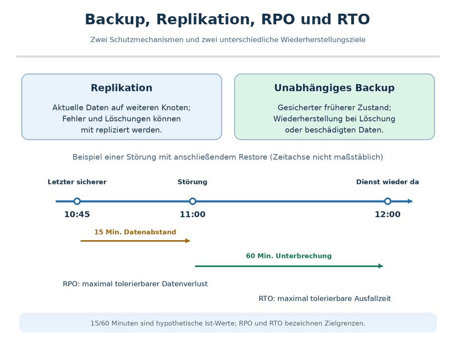

# M3-L6 – Datenhaltbarkeit: Backups, Wiederherstellung und Ausfallvorsorge {#L6}

**Kursbereich:** M3 – Bachelor / Übergang: Datenbanksysteme

**Niveau:** Bachelor

**Vorwissen:** Keine festen Voraussetzungen angegeben.

## Das Ausgangsproblem: Daten müssen einen Fehler überleben {#S1}

Eine Datenbank ist nicht allein deshalb sicher, weil sie auf einem zuverlässigen Server läuft. Ein Rechner kann ausfallen, ein Datenträger kann beschädigt werden, ein Bedienfehler kann Tausende Datensätze löschen, ein Softwarefehler kann Inhalte falsch überschreiben oder ein Angreifer kann Daten verschlüsseln und Sicherungen angreifen. Selbst ein perfekt arbeitender Datenbankserver kann eine *fachlich falsche, aber technisch gültige* Löschung dauerhaft speichern.

**Datenhaltbarkeit** bedeutet zunächst, dass bestätigte Änderungen auch nach bestimmten technischen Störungen erhalten bleiben. In der Praxis reicht diese Eigenschaft nicht aus: Ein Betreiber muss außerdem darauf vorbereitet sein, den Datenbestand nach unbeabsichtigten oder böswilligen Veränderungen wiederherzustellen. Genau dafür existieren unabhängige **Backups** und geplante **Wiederherstellungsverfahren**.

Ein kleiner Medienkatalog, ein SaaS-Dienst (Software as a Service, über das Internet bereitgestellte Software) und ein bezahlter KI-Auftragsdienst benötigen dabei unterschiedlich starken Schutz. Je größer der Schaden einer Unterbrechung oder eines Datenverlusts ist, desto umfangreicher werden normalerweise Sicherung, Überwachung, Test und organisatorische Verantwortung.

``` text
Laufende Anwendung
        │
        ▼
Produktive Datenbank ───────► unabhängige Sicherung
        │                          │
        │ technische Störung        │ aufbewahrte, geprüfte Kopie
        ▼                          ▼
Daten fehlen / falsch ─────► Wiederherstellung
                                   │
                                   ▼
                          geprüfter Datenbestand
```

Die Lektion beantwortet nicht die Frage, wie man einen bestimmten Server per Kommando administriert, sondern welche Schutzmechanismen es gibt, welchen Fehler sie abfangen und welche neuen Aufgaben dadurch entstehen.

## Vier Dinge, die ähnlich aussehen, aber Unterschiedliches leisten {#S2}

Im Alltag werden **Replikation**, **Backup**, **Snapshot** und **Archivierung** häufig miteinander verwechselt. Sie beantworten jedoch unterschiedliche Fragen.

  Verfahren      Hauptzweck                                                                     Typische Stärke                                                               Typische Grenze
  -------------- ------------------------------------------------------------------------------ ----------------------------------------------------------------------------- --------------------------------------------------------------------------------------------
  Replikation    Daten auf anderen laufenden Knoten nachführen                                  Schnellere Übernahme bei bestimmten Serverausfällen; ggf. zusätzliche Leser   Fehlerhafte Änderungen und Löschungen können mitrepliziert werden
  Backup         Ältere, möglichst unabhängige und wiederherstellbare Datenstände aufbewahren   Rückkehr nach Löschung, Beschädigung oder Ausfall                             Wiederherstellung braucht Zeit; Sicherung kann unvollständig sein
  Snapshot       Zustand eines Speichersystems oder Dienstes zu einem Zeitpunkt festhalten      Oft sehr schnelle Erstellung eines Zustandsbilds                              Ohne passende Konsistenz und unabhängige Aufbewahrung kein verlässlicher Ersatz für Backup
  Archivierung   Daten oder Sicherungen langfristig aufbewahren                                 Historische Nachvollziehbarkeit und langfristiger Erhalt                      Archiv ist nicht automatisch schnell oder als laufende Datenbank wiederherstellbar

Ein Beispiel: Wird um 14:00 Uhr versehentlich die Kundentabelle gelöscht, kann ein zweiter synchron nachgeführter Datenbankserver diese Löschung ebenfalls erhalten. Er ist dann zwar technisch verfügbar, enthält aber denselben Fehler. Ein unabhängiges Backup von 13:00 Uhr könnte die Daten retten. Es fehlen in diesem Fall allerdings Änderungen zwischen 13:00 und 14:00 Uhr, wenn keine ergänzenden Änderungsprotokolle gesichert sind.

**Wann unnötig?** Ein rein öffentliches, unveränderliches Demoprojekt, dessen Daten vollständig aus Versionsverwaltung oder anderen Originalquellen regeneriert werden können, benötigt eventuell keine umfangreiche Datenbanksicherung. Trotzdem müssen die Wiederherstellung der Anwendung und die Bezugsquellen gesichert sein.

## Wie eine Datenbank ihre Änderungen überhaupt dauerhaft macht {#S3}

In M3-L1 haben wir das **Write-Ahead Logging (WAL)** kennengelernt: Datenbankänderungen werden bei vielen Systemen zunächst in einem Änderungsprotokoll festgehalten, bevor die betroffenen Datenseiten später dauerhaft aktualisiert werden. Das hilft bei einem abrupten Absturz. Der Server kann nach dem Neustart prüfen, welche Änderungen als abgeschlossen gelten, und den Zustand anhand des Protokolls wieder konsistent herstellen.

WAL allein ist jedoch **kein externes Backup**. Gehen Datendateien und Protokolle gemeinsam verloren, ist damit nichts gewonnen. Ebenso wenig hilft das Protokoll automatisch gegen eine Löschung, die das Datenbanksystem korrekt ausgeführt hat. Der Unterschied lautet: *Absturz-Recovery* stellt die interne Konsistenz nach einem bestimmten Systemausfall wieder her; *Backup-Recovery* rekonstruiert den Datenbestand aus gesondert aufbewahrten Sicherungen.

``` text
                 Transaktion
                      │
                      ▼
             Änderungsprotokoll (WAL)
                      │
          ┌───────────┴───────────┐
          ▼                       ▼
     Bestätigung            Datendateien
                                  │
                         späterer Schreibvorgang

Externes Backup: eigene Kopie + ggf. archivierte WAL-Abschnitte
```

Wie exakt ein Commit (endgültige Transaktionsbestätigung) abgesichert ist, hängt vom Datenbanksystem, den Einstellungen und der Speicherhardware ab. Betriebssystem, Dateisystem, Speichercontroller und Stromausfallverhalten bleiben relevante Teile der Sicherheitskette.

## Einfache Sicherung: Vollständige Kopie oder logischer Export {#S4}

Eine **Vollsicherung** enthält einen vollständigen wiederherstellbaren Ausgangsbestand. Bei PostgreSQL kann diese Sicherung unterschiedlich aussehen.

Ein **logisches Backup** exportiert Datenbankobjekte und Daten in einer Form, aus der sie wieder aufgebaut werden können. PostgreSQL bietet dafür `pg_dump`; `pg_dumpall` berücksichtigt darüber hinaus mehrere Datenbanken und globale Objekte wie Rollen. Ein solcher Export eignet sich unter anderem für kleinere Bestände, Migrationen und die Wiederherstellung ausgewählter Datenbankobjekte. Er ist aber nicht dasselbe wie eine physische Sicherung eines vollständigen Datenbankclusters.

Ein **physisches Backup** sichert die Datenbankdateien in einer für das System verwendbaren Form. Bei PostgreSQL ist `pg_basebackup` ein vorgesehenes Werkzeug für ein konsistentes Basisbackup. Der Vorteil kann eine zügigere Wiederherstellung großer Datenbestände sein; dafür sind Versionskompatibilität, Vollständigkeit der Dateien und passende Änderungsprotokolle besonders wichtig.

Die offizielle PostgreSQL-Dokumentation unterscheidet drei Grundstrategien: SQL-Dump, Dateisystemsicherung und kontinuierliche Archivierung. Die Verfahren sind nicht beliebig austauschbar.

``` text
                  PostgreSQL
                      │
          ┌───────────┴───────────┐
          ▼                       ▼
     Logischer Export         Physisches Backup
     Tabellen + Struktur      Datenbankdateien
          │                       │
          ▼                       ▼
     Wiederimport            Cluster-Restore
```

**Grenze:** Ein Export, den niemand erfolgreich importieren kann, ist nur eine Datei, aber noch keine nachgewiesen funktionsfähige Sicherung. Bei großen Datenbanken können sowohl Export als auch Import lange dauern. Die Sicherung sollte außerdem die benötigte Softwareversion, Zugangsdatenverwaltung und Konfiguration berücksichtigen.

## Snapshots: schnell erstellt, aber nur unter Bedingungen nützlich {#S5}

Ein **Snapshot** ist ein Zustandsbild, etwa eines Datenträgers oder eines Cloud-Speichervolumens. Viele Speichersysteme können solche Zustände schnell anlegen und anschließend veränderte Blöcke gesondert verwalten. Das macht Snapshots für kurze Rücksprünge, Wartung oder zusätzliche Sicherungsstufen attraktiv.

Der kritische Begriff lautet **Konsistenz**. Eine Datenbank schreibt häufig mehrere zusammengehörende Dateien und Protokolle. Wird im ungeeigneten Moment nur ein Teil davon abgebildet, entsteht möglicherweise kein verwendbarer Datenbankzustand. Ein *crash-konsistenter* Snapshot kann je nach Datenbanksystem mithilfe des eigenen Wiederanlaufprotokolls brauchbar sein; eine *anwendungskonsistente* Sicherung berücksichtigt zusätzlich die spezifischen Anforderungen der Datenbank. Ob ein Snapshot verwendbar ist, muss für die konkrete Plattform überprüft werden.

``` text
Datenbank läuft ──► koordinierter Snapshot
                           │
                           ▼
                     Zustandsbild
                           │
                           ▼
                getrennte Aufbewahrung
                           │
                           ▼
                  Test-Wiederherstellung
```

Ein Snapshot, der ausschließlich auf demselben Speichersystem liegt wie die produktive Datenbank, ist gegen dessen vollständigen Verlust oft unzureichend geschützt. Auch Cloud-Snapshots teilen unter Umständen Berechtigungen, Kontorisiken oder Ausfallbereiche mit dem Original. **Eine separat aufbewahrte, testbar wiederherstellbare Sicherung ist wichtiger als der Name des Verfahrens.**

## Vollbackup, inkrementell und differenziell {#S6}

Nicht jede Sicherung muss immer alle Daten erneut übertragen. Das führt zu drei grundlegenden Strategien.

**Vollbackup:** Zu einem bestimmten Zeitpunkt wird der komplette benötigte Datenbestand gesichert. Der Wiederherstellungsweg ist vergleichsweise direkt, aber Sicherungszeit und Speicherbedarf können steigen.

**Inkrementelles Backup:** Nach einer Ausgangssicherung werden nur bestimmte Änderungen seit einem vorherigen Sicherungsstand übernommen. Das kann Speicher sparen, erzeugt aber Abhängigkeiten: Für die Wiederherstellung sind die passende Basis und die benötigte Änderungsfolge erforderlich.

**Differenzielles Backup:** Üblicherweise werden die Änderungen seit einer bestimmten Vollsicherung gesammelt. Die Wiederherstellung benötigt dann etwa das Vollbackup und ein späteres Differenzbackup. Nicht jedes Produkt verwendet diese Begriffe oder Verfahren identisch.

``` text
Vollbackup Montag
     │
     ├── Dienstag: Änderungen A
     ├── Mittwoch: Änderungen B
     └── Donnerstag: Änderungen C

Inkrementell: Voll + A + B + C (abhängig vom Verfahren)
Differenziell: Voll + Sammelstand A/B/C
```

In PostgreSQL 18 dokumentiert das Projekt auch **inkrementelle physische Basisbackups**. Sie benötigen passende Vorversionen und die Rekonstruktion über entsprechende Werkzeugunterstützung; das Projekt weist ausdrücklich darauf hin, dass erforderliche Sicherungsabhängigkeiten nicht automatisch für den Betreiber verwaltet werden. Für kleine Datenbanken sind regelmäßige Vollsicherungen deshalb oft einfacher und wirtschaftlicher. Für große, relativ wenig veränderte Datenbestände können inkrementelle Strategien helfen.

**Betriebsrisiko:** Eine fehlende Zwischensicherung oder eine beschädigte notwendige Datei kann eine ganze Wiederherstellungskette unbrauchbar machen. Komplexere Sicherungsverfahren erfordern sorgfältige Aufbewahrungsregeln und Prüfungen.

## Point-in-Time Recovery: Zurück zu einem bestimmten Zeitpunkt {#S7}

**Point-in-Time Recovery (PITR)** bedeutet Wiederherstellung zu einem ausgewählten früheren Zeitpunkt. Das hilft besonders, wenn man zwar weiß, *wann* ein Fehler begann, aber nicht einfach den gesamten Datenbestand auf den letzten Tagesstand zurücksetzen will.

Nehmen wir einen kleinen Online-Dienst: Um 14:07 Uhr löscht ein fehlerhaftes Update eine Tabelle. Das letzte Vollbackup stammt von 02:00 Uhr. Ohne weitere Sicherungen müsste der Dienst auf den Stand von 02:00 Uhr zurück. Damit gingen die Änderungen aus zwölf Stunden und sieben Minuten verloren. Mit einer passenden physischen Basis und **kontinuierlich archivierten WAL-Dateien** kann PostgreSQL die Änderungen bis unmittelbar vor dem Fehler wieder einspielen.

``` text
02:00       10:00       14:06       14:07       15:00
  │            │           │            │           │
  ▼            ▼           ▼            ▼           ▼
Basisbackup ───────── WAL-Änderungsfolge ───────►
                           ▲            ▲
                           │            └─ falsche Löschung
                           └─ mögliches Wiederherstellungsziel

Wiederherstellung = passende Basis + vollständige WAL-Kette
                    + bewusst gewählter Stoppunkt
```

Der Mechanismus hat mehrere Voraussetzungen. Die Basis muss zu den WAL-Protokollen passen. Die benötigten Segmente müssen lückenlos vorhanden und lesbar sein. Außerdem muss sich der korrekte Zielzeitpunkt ermitteln lassen. PostgreSQL kann bei der Wiederherstellung an einem festgelegten Zeitstempel oder benannten Wiederherstellungspunkt anhalten.

**Wichtige Grenze:** Ein normaler `pg_dump` lässt sich nicht einfach mit späteren WAL-Segmenten zu einer PITR-Kette kombinieren. Die hierfür verwendete Basis ist eine passende physische Sicherung. Und ein zu später Stoppunkt würde die fehlerhafte Löschung erneut einspielen.

PITR bedeutet auch nicht, dass der Aufwand trivial ist. Ein großer Datenbestand muss unter Umständen erst vollständig zurückgespielt und dann viele Änderungen erneut verarbeitet werden. Die Wiederherstellungsdauer kann dadurch deutlich steigen. Gerade deshalb sollten Sicherung und Wiederanlauf gemeinsam geplant werden.

## RPO und RTO: Zwei unterschiedliche Anforderungen {#S8}



*Abbildung: Beispiel mit letztem wiederherstellbarem Stand um 10:45 Uhr, Störung um 11:00 Uhr und Wiederaufnahme um 12:00 Uhr. Die dargestellten 15 bzw. 60 Minuten sind angenommene Ist-Abstände und **keine** zugesicherten RPO-/RTO-Ziele. Replikation allein schützt nicht zuverlässig gegen logisch fehlerhafte oder absichtlich gelöschte Daten.*

Um die akzeptablen Folgen einer Störung klar zu benennen, verwendet die Informatik zwei Kennzahlen.

**RPO – Recovery Point Objective:** das Ziel dafür, wie weit ein wiederhergestellter Datenbestand gegenüber dem Störungszeitpunkt zurückliegen darf. Anschaulich ist es der maximal akzeptierte zeitliche Datenverlust. Ein RPO von einer Stunde bedeutet beispielsweise, dass der Betreiber in einem festgelegten Schadensszenario höchstens rund eine Stunde an Änderungen verlieren *dürfen möchte*. Das ist eine Anforderung, keine automatische Garantie.

**RTO – Recovery Time Objective:** das Ziel für die Dauer, bis ein System nach einer Störung wieder in einem nutzbaren Zustand sein soll. Ein RTO von vier Stunden bedeutet, dass die vorgesehene Wiederherstellung innerhalb dieses Zeitfensters stattfinden soll. Auch das muss technisch und organisatorisch nachgewiesen werden.

``` text
RPO – Wie ALT dürfen gerettete Daten höchstens sein?

letzte sicher wiederherstellbare Änderung       Ausfall
              │                                    │
              └──────────── Datenlücke ────────────┘

RTO – Wie LANGE darf die Wiederherstellung dauern?

             Ausfall                    Dienst wieder nutzbar
                │                               │
                └──── Unterbrechungszeit ────────┘
```

  Gedachtes Angebot                            Beispiel-Ziel für RPO                   Beispiel-Ziel für RTO   Begründung
  -------------------------------------------- --------------------------------------- ----------------------- -------------------------------------------------------------------------
  Privater, selten veränderter Medienkatalog   24 Stunden                              1–2 Tage                Änderungen sind im Zweifel rekonstruierbar
  Kleines Online-Verwaltungswerkzeug           1 Stunde                                4 Stunden               Nutzer erwarten begrenzten Datenverlust und überschaubare Unterbrechung
  Buchungs- oder Guthabendienst                Sehr gering, gegebenenfalls nahe null   Sehr gering             Bestätigte Buchungen können wirtschaftlich verbindlich sein

Diese Werte sind **frei gewählte Lehrbeispiele** und ausdrücklich keine branchentypischen Standards. Auch ein RPO nahe null verlangt nicht automatisch Sharding oder besonders viele Server, sondern eine auf konkrete Fehler zugeschnittene Architektur. Ein RTO von null ist praktisch für die meisten Störungsmodelle nicht erreichbar.

Eine kurze Unterbrechung und geringer Datenverlust sind **zwei getrennte Ziele**. Ein Umschalten auf ein Replikat kann den Betrieb rasch wiederherstellen und dennoch einige zuletzt bestätigte Änderungen verlieren. Umgekehrt kann ein vollständiges Backup alle gewünschten Daten liefern, aber viele Stunden für die Wiederherstellung brauchen.

## Offsite-Sicherung, 3-2-1 und Schutz vor gemeinsamen Fehlern {#S9}

Eine **Offsite-Kopie** ist eine Sicherung, die außerhalb des primären Betriebsstandorts beziehungsweise Ausfallbereichs aufbewahrt wird. Der zentrale Gedanke ist, nicht alle Kopien durch dieselbe Ursache verlieren zu können. Wenn Produktion und Backup auf demselben Server und Datenträger liegen, kann ein einziger Defekt beide zerstören.

Eine bekannte Merkhilfe ist **3-2-1**: drei Kopien wichtiger Daten (einschließlich Produktivdaten), auf zwei unterschiedlichen Speichermedien oder -systemen, eine davon räumlich oder technisch getrennt. Für moderne Online-Dienste ist entscheidender als eine starre Zahl, dass voneinander **unabhängige Ausfall-, Zugriffs- und Löschpfade** existieren. Ein Cloud-Backup in derselben administrativen Identität kann bei kompromittiertem Zugang ebenfalls gefährdet sein.

``` text
Produktive Datenbank
       │
       ├── lokale Sicherung (schnelle Rückkehr)
       │
       └── getrennte Sicherung (Offsite)
                │
                ├── begrenzte Schreib-/Löschrechte
                ├── ggf. unveränderliche Aufbewahrungszeit
                └── geprüfte Wiederherstellbarkeit
```

**Unveränderliche Sicherung** (*immutable backup*) bedeutet, dass ein gespeicherter Sicherungsstand während eines festgelegten Schutzzeitraums nicht ohne Weiteres überschrieben oder gelöscht werden kann. **Offline-Sicherung** bezeichnet eine zeitweise oder dauerhaft vom laufenden System getrennte Kopie. Beide Eigenschaften können vor Angriffen helfen, sind aber nicht identisch.

Die US-Behörden FBI und NIST betonen in ihren Sicherheitsleitlinien getrennte beziehungsweise unveränderliche Sicherungen und praktische Wiederherstellungstests. Solche Empfehlungen sind Orientierungshilfen; welche konkrete Strategie nötig ist, hängt von den Daten und Risiken ab.

## Eine Sicherung muss mehr als eine Datenbankdatei berücksichtigen {#S10}

Angenommen, die Datenbank eines Online-Dienstes ist wieder da. Die Webseite startet trotzdem nicht, weil die Konfiguration fehlt, ein Schlüssel nicht verfügbar ist, die hochgeladenen Dateien nicht gesichert wurden oder die Version der Anwendung nicht zu den Daten passt. Dann wurde *nur ein Teil* des Dienstes wiederhergestellt.

Für eine vollständige Wiederanlaufplanung können außerdem erforderlich sein:

- Datenbankschema, Datenbankrollen, Berechtigungen und benötigte Erweiterungen.
- Anwendungsversion, Konfiguration, Infrastrukturbeschreibung und Dokumentation.
- Hochgeladene Dateien, Bilder, Dokumente oder externe Objektspeicher-Daten.
- Geheimnisse und Verschlüsselungsschlüssel – sicher getrennt und mit kontrolliertem Zugriff.
- Domain-/Netzwerkzuordnung, externe Abhängigkeiten, Identitäts- und Zahlungsdienste.
- Eine verständliche Reihenfolge für das Wiederherstellen und das Prüfen der Anwendung.

Nicht jede dieser Komponenten muss über dasselbe Backupverfahren gesichert werden. Programmcode kann beispielsweise aus einer Versionsverwaltung wiederhergestellt werden, solange der Zugang und die Versionen ebenfalls geschützt sind. Nicht rekonstruierbare Kundendaten brauchen normalerweise eine stärkere Sicherung als statische Anwendungsdateien.

**Besonderes Risiko: Verschlüsselungsschlüssel.** Wer Daten verschlüsselt aufbewahrt, aber den einzigen Entschlüsselungsschlüssel verliert, kann auch ein technisch intaktes Backup unter Umständen nicht mehr lesen. Der Schlüssel wiederum darf nicht völlig ungeschützt direkt neben der Datensicherung liegen.

## Sicherheit und Datenschutz bei Backups {#S11}

Ein Backup enthält häufig denselben sensiblen Inhalt wie das produktive System: Kundendaten, interne Dokumente, gegebenenfalls Zugangsinformationen. Mit jeder zusätzlichen Kopie entsteht eine weitere Zugriffsmöglichkeit und eine weitere Aufbewahrungspflicht.

Sinnvolle Schutzprinzipien sind:

**Zugriffsminimierung:** Nur ausdrücklich berechtigte Personen und Dienste dürfen Sicherungen lesen, wiederherstellen oder löschen. Das schützt insbesondere gegen versehentliches und böswilliges Löschen.

**Verschlüsselung:** Transport und Aufbewahrung können verschlüsselt werden. Schlüsselverwaltung und deren Wiederherstellbarkeit gehören zur gesamten Lösung.

**Aufbewahrungsdauer:** Kopien nicht unbegrenzt ohne Zweck behalten. Längere Historien helfen bei spät entdeckter Beschädigung, können aber Datenschutz- und Speicherprobleme verursachen.

**Trennung:** Besonders wertvolle Sicherungen möglichst getrennt von denselben Administratorrechten, dem laufenden Server und gemeinsamen Ausfallursachen sichern.

**Nachvollziehbarkeit:** Wer hat wann welche Sicherung erstellt, gelöscht, geprüft oder wiederhergestellt? Protokolle selbst benötigen Schutz.

Bei personenbezogenen Daten können unter anderem datenschutzrechtliche Lösch- und Aufbewahrungsfragen entstehen. Ein Backup ist kein rechtsfreier Nebenbestand; konkrete Anforderungen sind je nach Land, Rechtsgrundlage, Vertrag und technischer Gestaltung zu prüfen. Dieses Kapitel ist keine Rechtsberatung.

## Restore-Test: Die zentrale Bewährungsprobe {#S12}

Eine Datei namens `backup-2026-11-03.zip` beweist zunächst nur, dass eine Datei existiert. Ob sie vollständig, lesbar, korrekt und auf einem anderen System wiederherstellbar ist, weiß man damit nicht. Selbst eine erfolgreiche Prüfsumme zeigt nur einen begrenzten Teil der notwendigen Eigenschaften.

Ein echter **Restore-Test** (*Wiederherstellungstest*) spielt eine Sicherung in eine geeignete Testumgebung ein. Anschließend werden Daten und Anwendung geprüft: Sind die Tabellen vorhanden? Stimmen erwartete Datensätze und Beziehungen? Funktionieren Anmeldung, wesentliche Abfragen und Geschäftsabläufe? Wie lange hat der gesamte Vorgang gedauert?

``` text
Datensicherung
      │
      ▼
Integritätsprüfung (Dateien/Manifest)
      │
      ▼
Wiederherstellung in Testumgebung
      │
      ▼
Start von Datenbank + Anwendung
      │
      ▼
Fachlicher Test + Zeitmessung
      │
      ▼
Dokumentierter Nachweis
```

PostgreSQL stellt mit `pg_verifybackup` ein Werkzeug bereit, das passende physische Basisbackups anhand eines Sicherungsmanifests überprüft. Die Projektdokumentation warnt aber ausdrücklich: Solche Prüfungen können **keinen vollständigen Wiederherstellungstest ersetzen**. Es können Fehler existieren, die erst beim Start oder bei fachlichen Abfragen sichtbar werden.

Ein sinnvoller Test beurteilt getrennt die **Datenintegrität** (ist das Backup technisch korrekt?), die **fachliche Plausibilität** (ist es der gewünschte Datenstand?) und die **Betriebsfähigkeit** (können Nutzer den Dienst tatsächlich wieder verwenden?).

## Ein Wiederherstellungsplan braucht Entscheidungen, nicht nur Technik {#S13}

Bei einer Störung ist nicht jeder Schritt sofort eindeutig. Soll man den alten Server reparieren oder ein neues System aufbauen? Auf welchen Sicherungsstand greift man zurück? Muss man bestimmte Zahlungen oder Änderungen nachträglich manuell abgleichen? Wie verhindert man, dass Benutzer während einer Teilwiederherstellung erneut widersprüchliche Daten erzeugen?

Ein realistischer Ablauf kann so aussehen:

1.  **Störung erkennen und eingrenzen:** Reiner Hardwareausfall, verlorene Datenbankdatei, falsche Änderung oder Angriff?
2.  **Weitere Schäden verhindern:** Problematischen Schreibzugriff begrenzen, soweit ohne zusätzlichen Datenverlust möglich; unveränderte Sicherungen schützen.
3.  **Wiederherstellungsziel wählen:** Letzter intakter Stand, definierter Zeitpunkt oder noch intaktes Replikat?
4.  **Neue Umgebung vorbereiten:** Softwareversion, Konfiguration, Schlüssel und Speicherkapazität passend bereitstellen.
5.  **Daten wiederherstellen:** Aus vollständiger Sicherung und eventuell notwendigen Änderungsprotokollen.
6.  **Technisch und fachlich prüfen:** Sind die Daten konsistent, erwartete Datensätze vorhanden und Anwendungsfunktionen nutzbar?
7.  **Dienst kontrolliert freigeben:** Nutzer informieren, ausstehende Vorgänge abgleichen, nachträglich protokollieren.

Diese Abfolge ist eine Orientierung, kein universelles Notfallhandbuch. Bei Verdacht auf einen Angriff darf ein kompromittiertes System nicht unbesehen als vertrauenswürdige Ausgangsbasis gelten. Bei finanziell verbindlichen Vorgängen können zusätzliche Abstimmungen und dokumentierte Entscheidungen nötig sein.

## Drei durchgehende Praxisfälle {#S14}

### Fall A: Lokaler Medienkatalog mit SQLite

Ein lokal entwickelter Medienkatalog speichert Dateipfade, Kategorien, Bewertungen und Notizen in SQLite. Die Datenbank liegt als Datei auf einem einzelnen Rechner. Für eine überschaubare Anwendung ist das oft eine sehr gute, einfache Lösung.

**Sicherungsproblem:** Wenn die SSD ausfällt, gehen eigene Kategorien und Notizen verloren. Ein nächtliches Kopieren der Datei kann bei aktiven Datenbankzugriffen – je nach Journalmodus und Ablauf – problematisch sein. Die offizielle SQLite-Dokumentation bietet für Sicherungen während des Betriebs die **Online Backup API** (Programmschnittstelle für konsistente Online-Kopien) und alternativ `VACUUM INTO` an. Beide können eine konsistente Datenbankkopie erzeugen, ohne dass hier ein Installationsprojekt nötig wäre.

``` text
SQLite-Datenbank
       │
       ▼
Konsistente Online-Sicherung
       │
       ├── lokale Kopie
       └── getrenntes Archiv
                │
                ▼
          Testweise öffnen
```

Zusätzlich ist zu überlegen, ob die katalogisierten Mediendateien selbst gesichert werden müssen oder ob sie aus einem vorhandenen Archiv wiederhergestellt werden können. **Eine gesicherte SQLite-Katalogdatei schützt nicht automatisch die katalogisierten Medien.**

### Fall B: Kleiner Online-Dienst mit PostgreSQL

Ein Dienst nimmt Kundeneinstellungen, Aufträge und Statusinformationen entgegen. Ein kleiner gemieteter Server und eine einzelne PostgreSQL-Datenbank reichen für den Betrieb möglicherweise aus.

Die naheliegende Sicherung besteht aus regelmäßigen Datenbankexporten oder geeigneten physischen Backups, einer getrennten Kopie und einem dokumentierten Restore. Falls wenige Stunden Datenverlust nicht akzeptabel sind, kann eine Kombination aus physischem Basisbackup und kontinuierlicher WAL-Archivierung sinnvoll werden. Der Preis dafür sind Speicher, Überwachung, komplexere Wiederherstellung und wiederkehrende Tests.

``` text
Webanwendung → PostgreSQL
                     │
              Basisbackup + WAL-Archiv
                     │
              separates Sicherungsziel
                     │
               kontrollierter Restore
```

Ein zusätzlicher Standby kann bestimmte Ausfälle schneller abfedern, ersetzt aber weder diese Sicherung noch die fachliche Fehlerkorrektur. Bei einem Dienst, der täglich nur wenige Änderungen erzeugt, kann eine einfachere Sicherung wirtschaftlicher sein.

### Fall C: KI-Auftragsdienst mit Datenbank und Objektspeicher

Ein Online-KI-Dienst verwaltet Benutzerguthaben, Bild-/Videouploads, Arbeitsaufträge und fertige Ergebnisse. Hier liegen wichtige Informationen nicht ausschließlich in einer Datenbank. Die Auftragsdaten könnten in PostgreSQL stehen, Eingabe- und Ausgabedateien in einem separaten Objektspeicher und die eigentliche Verarbeitung auf einem oder mehreren GPU-Servern (Graphics Processing Units, Grafik-/Parallelprozessoren) stattfinden.

``` text
          Nutzer
             │
             ▼
     Auftragsverwaltung
        │          │
        ▼          ▼
   PostgreSQL   Objektspeicher
        │          │
        └────┬─────┘
             ▼
        KI-Worker
             │
             ▼
       Ergebnis + Status

Sicherungen: DB-Zustand + Dateien + Zuordnungen
```

Wird nur die Datenbank aus der Nacht wiederhergestellt, die Objektspeicher-Dateien aber aus dem aktuellen Zustand übernommen, können Einträge auf nicht vorhandene Dateien verweisen oder fremde Dateien keine zugehörigen Metadaten mehr besitzen. Eine solide Wiederanlaufstrategie muss **konsistente Zusammenhänge zwischen mehreren Speichern** berücksichtigen. Dafür kann es nötig sein, eine gemeinsame Sicherungslogik, nachvollziehbare Objektversionen und nachprüfbare Auftragskennungen vorzusehen.

**Kostenfalle:** Große Bild- und Videodaten, mehrere Sicherungsversionen und Transfer aus einem entfernten Speicher können erhebliche laufende Kosten erzeugen. Nicht alle generierten Zwischenergebnisse müssen für immer aufbewahrt werden. Gerade für einen kleinen Dienst sollte zuerst geklärt werden, welche Daten wirklich unverzichtbar sind.

## Wie man die richtige Sicherungsstrategie auswählt {#S15}

Bei einer konkreten Anwendung sind fünf Leitfragen hilfreich:

  Frage                                     Was daraus folgt
  ----------------------------------------- ---------------------------------------------------------------------------------------------------------
  Welche Daten sind unersetzlich?           Je schlechter rekonstruierbar, desto wichtiger die unabhängige Sicherung
  Wie viel Datenverlust ist akzeptabel?     Daraus ergibt sich die RPO-Anforderung
  Wie lange darf der Dienst ausfallen?      Daraus ergibt sich die RTO-Anforderung
  Welche Fehler sollen abgefangen werden?   Hardwaredefekt, Bedienfehler, Löschung, Angriff, Rechenzentrumsausfall erfordern teils andere Maßnahmen
  Wer betreibt und prüft das Verfahren?     Sicherung ohne Verantwortliche, Warnungen und Restore-Test bleibt riskant

Für ein privates Projekt kann ein konsistenter täglicher Datenbankexport mit einer getrennten Kopie genügen. Für einen Dienst mit zahlenden Kunden können häufigere Sicherungen, längere Historien oder ein überprüftes Wiederherstellungsprotokoll notwendig sein. Für besonders kritische Daten können mehrere unabhängige Verfahren sinnvoll sein.

Man sollte jedoch **nicht automatisch die teuerste Architektur wählen**. Mehr Sicherungen, mehr Replikate und mehr Automatisierung erhöhen auch die Anzahl potenziell falsch konfigurierter Komponenten. Eine einfache, überprüfte Sicherung ist wertvoller als ein komplexes System, dessen Wiederherstellung niemand zuverlässig beherrscht.

## Betriebskosten und typische Fehlannahmen {#S16}

Die Kosten einer Sicherungsarchitektur bestehen nicht nur aus Gigabyte Speicherplatz. Hinzu kommen Rechen- und Eingabe-/Ausgabelast beim Erstellen, Netzwerkverkehr, mögliche Entgelte bei Datenabruf, Aufbewahrungsdauer, Überwachung, Schlüsselverwaltung und Arbeitszeit für Tests. Bei großen Datenbanken kann auch die Dauer einer Wiederherstellung den Betriebsaufwand stark beeinflussen.

Typische Fehlannahmen sind:

- **„Wir haben ein Replikat, also haben wir ein Backup.“** Nein; viele Fehler werden ebenfalls repliziert.
- **„Snapshots sind immer vollständige Datensicherungen.“** Nein; Konsistenz, Aufbewahrung und Unabhängigkeit müssen geprüft werden.
- **„Ein täglicher Export garantiert null Datenverlust.“** Nein; Änderungen seit dem letzten sicheren Stand können fehlen.
- **„Backup erfolgreich heißt Restore erfolgreich.“** Nein; erst der überprüfte Wiederherstellungsversuch zeigt einen großen Teil der tatsächlichen Nutzbarkeit.
- **„Verschlüsselt bedeutet automatisch sicher.“** Nein; Schlüsselverlust und kompromittierte Berechtigungen bleiben Risiken.
- **„Cloud-Daten werden vom Anbieter immer vollständig geschützt.“** Nein; vertragliche Leistungsgrenzen und geteilte Betriebsverantwortung sind zu prüfen.
- **„Ein Backup betrifft nur die Datenbank.“** Nein; Dateien, Konfiguration, Geheimnisse und externe Dienste können ebenso entscheidend sein.

Das Ziel ist eine **angemessene, nachweisbar funktionsfähige Wiederherstellbarkeit** – nicht maximale Komplexität.

## Zusammenfassung und Übergang zu M4-L1 {#S17}

Datenhaltbarkeit besteht aus mehreren zusammenwirkenden Eigenschaften. Die Datenbank selbst schützt bestätigte Transaktionen gegen bestimmte Abstürze. Replikation erhöht unter passenden Bedingungen Verfügbarkeit. Backups erhalten unabhängige Wiederherstellungsstände. Snapshots können dabei helfen, sind aber ohne Konsistenzprüfung und unabhängige Speicherung kein vollständiger Schutz. Eine Point-in-Time Recovery kann Änderungen bis vor einen Fehler rekonstruieren, wenn Basisbackup und Protokollkette vollständig und kompatibel sind.

**RPO** beantwortet die Frage nach akzeptablem Datenverlust, **RTO** nach akzeptabler Wiederanlaufzeit. Beide Werte sind Ziele, die man durch echte Wiederherstellungstests überprüfen muss. Die wichtigste praktische Erkenntnis lautet: **Eine Datensicherung ist erst dann wirklich nützlich, wenn der benötigte Datenbestand in angemessener Zeit wiederhergestellt werden kann.**

Damit schließen wir den besonders ausführlichen Abschnitt **C – Datenbanken über mehrere Server verteilen** ab. Im nächsten Abschnitt **M4-L1 – Verteilte Verarbeitung** verlassen wir die reine Datenhaltung und betrachten, wie Nachrichtenbroker, Warteschlangen und Worker komplexe Aufgaben über mehrere Rechner koordinieren. Gerade für automatisierte Medien- und KI-Workflows bildet das die Brücke von der Datenbank zum tatsächlichen Dienstbetrieb.


## Quellen {#S18}

**Letzte Quellenprüfung:** 03.11.2026

Die nachstehenden offiziellen und fachlichen Quellen wurden am **03.11.2026** geprüft; Details können sich mit Softwareversionen ändern. Die didaktischen Beispiele sind eigenständige Veranschaulichungen und keine produktiven Konfigurationsanleitungen.

1.  PostgreSQL 18, *Backup and Restore*: [https://www.postgresql.org/docs/18/backup.html](https://www.postgresql.org/docs/18/backup.html) — SQL-Dumps, Dateisystemsicherung, kontinuierliche Archivierung.
2.  PostgreSQL 18, *Continuous Archiving and Point-in-Time Recovery*: [https://www.postgresql.org/docs/18/continuous-archiving.html](https://www.postgresql.org/docs/18/continuous-archiving.html) — WAL-Basis, PITR, physische/inkrementelle Backups, Abhängigkeiten und Grenzen.
3.  PostgreSQL 18, *pg_verifybackup*: [https://www.postgresql.org/docs/18/app-pgverifybackup.html](https://www.postgresql.org/docs/18/app-pgverifybackup.html) — Verifikation von Backupmanifesten; ausdrückliche Grenze gegenüber echten Restore-Tests.
4.  PostgreSQL 18, *pg_dumpall*: [https://www.postgresql.org/docs/18/app-pg-dumpall.html](https://www.postgresql.org/docs/18/app-pg-dumpall.html) — globale Datenbankobjekte, Rollen und mehrere Datenbanken.
5.  SQLite, *Online Backup API*: [https://www.sqlite.org/backup.html](https://www.sqlite.org/backup.html) — konsistente Online-Sicherung und Alternative `VACUUM INTO`.
6.  NIST, *Recovery Point Objective*: [https://csrc.nist.gov/glossary/term/recovery_point_objective](https://csrc.nist.gov/glossary/term/recovery_point_objective) — Begriff und Abgrenzung des Datenwiederherstellungsziels.
7.  NIST, *Recovery Time Objective*: [https://csrc.nist.gov/glossary/term/Recovery_Time_Objective](https://csrc.nist.gov/glossary/term/Recovery_Time_Objective) — Begriff und Abgrenzung der Wiederanlaufzeit.
8.  FBI, *Ten Actions to Improve Cyber Resiliency*: [https://www.fbi.gov/investigate/cyber/ten-actions-to-improve-cyber-resiliency](https://www.fbi.gov/investigate/cyber/ten-actions-to-improve-cyber-resiliency) — getrennte/unveränderliche Backups und Restore-Tests.

**Fachliche Grenzen:** RPO-/RTO-Beispielwerte sind hypothetisch. PostgreSQL- und SQLite-Verfahren hängen von Version und Konfiguration ab. Es wurden keine produktiven Wiederherstellungen, Kostenmessungen oder Rechtseinzelfallprüfungen durchgeführt.
