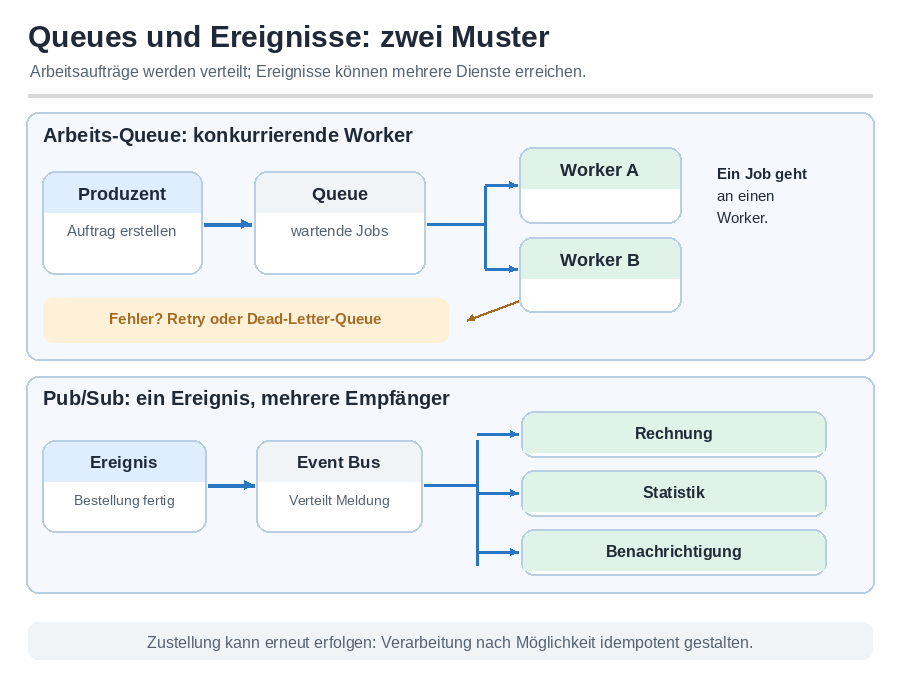
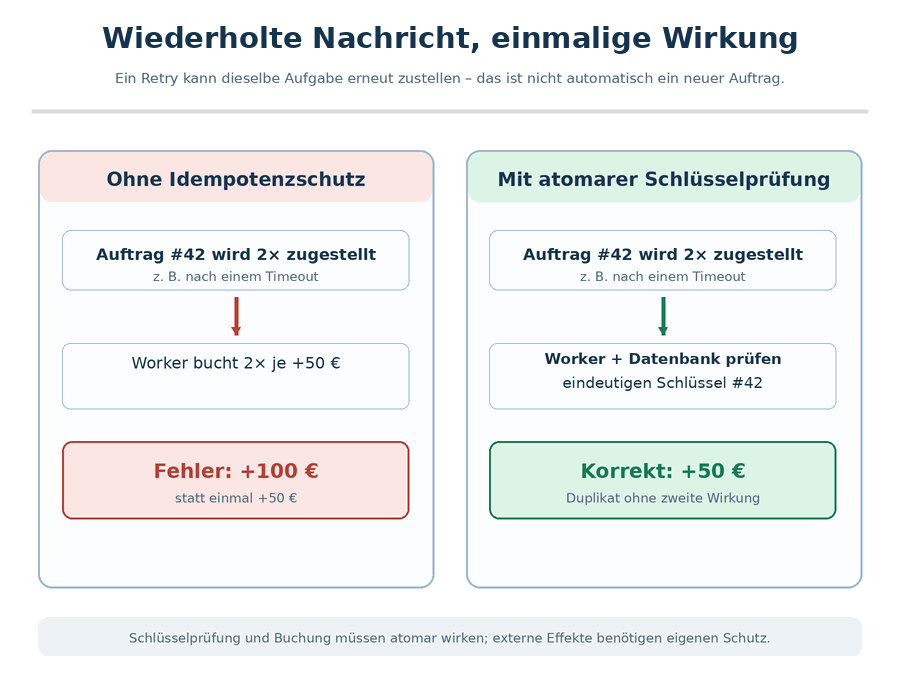

# M4-L1 – Verteilte Verarbeitung: Warteschlangen, Worker und KI-Aufträge {#L1}

**Kursbereich:** M4 – Bachelor / Übergang: Cloud-Betrieb

**Niveau:** Bachelor / Master-Brücke

**Vorwissen:** Keine festen Voraussetzungen angegeben.

## Warum ein Programm seine Arbeit nicht immer selbst erledigen sollte {#S1}

Ein kleines Desktopprogramm kann eine Datei öffnen, analysieren und sofort ein Ergebnis anzeigen. Auch ein einfacher Webdienst kann synchron arbeiten: Der Browser schickt eine Anfrage, der Server führt die Berechnung aus und liefert unmittelbar seine Antwort. Für eine Datenbankabfrage oder eine kurze Textumwandlung ist das oft die naheliegendste und beste Architektur.

Anders sieht es aus, wenn eine Verarbeitung Minuten dauert. Ein Server soll vielleicht ein langes Video umwandeln, tausend Dokumente auswerten oder für einen Kunden ein Bild mit künstlicher Intelligenz erzeugen. Gleichzeitig melden sich weitere Nutzer an. Würden sämtliche Berechnungen unmittelbar in ihren Webanfragen stattfinden, könnten Verbindungen auslaufen, die Antwortzeiten stark schwanken und der Webserver durch lange Arbeiten blockiert werden. Noch schwieriger: Was passiert, wenn während eines Auftrags der zuständige Prozess abstürzt?

Hier hilft **asynchrone Verarbeitung**. Die Anwendung nimmt den Auftrag an, speichert ihn und lässt ihn später von einem separaten Prozess bearbeiten. Dieser Prozess kann auf demselben Rechner laufen oder auf einem anderen Computer. **Verteilte Verarbeitung** ist die weiterführende Idee, Arbeit auf mehrere unabhängige Prozesse oder Rechner zu verteilen, wenn das tatsächlich nützt.

``` text
SYNCHRON
Browser ──► Webserver ──► lange Berechnung ──► Ergebnis
           (Browser wartet bis zum Ende)

ASYNCHRON
Browser ──► Webserver ──► Auftrag/Warteschlange
   ▲                           │
   │                           ▼
   └──── Status/Ergebnis ◄── Hintergrundprozess
```

Der Vorteil ist nicht automatisch eine kürzere Gesamtrechenzeit, sondern vor allem die **Entkopplung**: Die Webanwendung kann schnell reagieren, während die aufwendige Arbeit kontrolliert abgearbeitet wird. Eine neue Warteschlange bedeutet allerdings mehr Verwaltung. Für sehr kurze, seltene und unkritische Aufgaben ist sie unnötig.

## Vier Grundbegriffe: Job, Queue, Worker und Scheduler {#S2}

Ein **Job** ist ein abgegrenzter Arbeitsauftrag. Beispiele sind „Datei 753 konvertieren“, „den Tagesbericht erzeugen“ oder „aus diesem Prompt ein Bild berechnen“. Ein guter Job besitzt eine eindeutige Kennung, eine Aufgabenart, Parameter und einen nachvollziehbaren Status. Große Eingabedateien werden häufig in einem gesonderten Speicher verwahrt; der Job enthält dann lediglich einen kontrollierten Verweis darauf.

Eine **Queue** (*Warteschlange*) ist ein Puffer für noch nicht ausgeführte Aufträge. Sie trennt den Zeitpunkt der Annahme vom Zeitpunkt der Bearbeitung. Eine Queue kann als Datenbanktabelle, als Funktion eines Nachrichtenbrokers oder als verwalteter Cloud-Dienst umgesetzt werden. Ihre Haltbarkeit, maximale Länge und Reihenfolgegarantien hängen vom konkreten System ab.

Ein **Worker** (*Arbeiterprozess*) übernimmt Jobs und führt sie aus. Ein Worker könnte PDF-Dateien erzeugen, ein anderer Videos verarbeiten und ein dritter auf einer Grafikkarte ein KI-Modell ausführen. Manche Worker laufen dauerhaft und bearbeiten nacheinander viele Jobs; andere werden für jeden Auftrag neu gestartet.

Ein **Scheduler** (*Planer*) bestimmt, wann eine Aufgabe startet beziehungsweise welchem Rechner sie zugeordnet wird. Ein zeitbasierter Scheduler startet zum Beispiel jeden Morgen eine Auswertung. Ein Ressourcen-Scheduler sucht einen Rechner mit genügend Arbeitsspeicher oder einer geeigneten Grafikkarte. Diese beiden Planungsaufgaben sind verwandt, aber nicht identisch.

``` text
                   Auftragsannahme
                         │
                   ┌─────▼─────┐
                   │   QUEUE   │
                   └─────┬─────┘
                         │
             ┌───────────┼───────────┐
             ▼           ▼           ▼
          Worker A    Worker B    Worker C
           Texte       Video      KI-Bild
             └───────────┼───────────┘
                         ▼
                  Ergebnisspeicher
```

**Welches Problem wird gelöst?** Unterschiedliche Rechenarbeiten können unabhängig angenommen, zugeteilt und durchgeführt werden. **Wann unnötig?** Ein lokales Programm, das eine einzige kurze Aufgabe erledigt, braucht keinen spezialisierten Ressourcen-Scheduler.

## Der Lebensweg eines Auftrags {#S3}

Ein Hintergrundauftrag ist nicht einfach nur „da“ oder „weg“. Für eine zuverlässige Anwendung braucht man ein Zustandsmodell. Die folgende Skizze ist ein didaktisches Beispiel, kein vorgeschriebener Standard:

``` text
ANGENOMMEN ──► WARTEND ──► IN_BEARBEITUNG ──► ERFOLGREICH
                    │               │
                    │               ├──► ERNEUT_VERSUCHEN ──► WARTEND
                    │               └──► ENDGUELTIG_FEHLGESCHLAGEN
                    └──► ABGEBROCHEN
```

Die Nutzeranwendung prüft beim Eingang zunächst Berechtigungen, Dateigrößen und die grundsätzliche Zulässigkeit der angefragten Verarbeitung. Sie speichert einen Datensatz mit **Job-ID (Job Identifier, Auftragskennung)**. Ein Worker reserviert den Job, führt die Arbeit aus, speichert sein Ergebnis und meldet die Fertigstellung. Der Browser kann den Status anhand der Job-ID abfragen. Alternativ kann ein Dienst bei einem Statuswechsel eine Nachricht oder Benachrichtigung versenden.

Eine **Application Programming Interface (API, Programmierschnittstelle)** muss dann nicht erst nach einer langen KI-Berechnung antworten. Sie kann sofort mitteilen: „Auftrag 753 angenommen“. Das Ergebnis wird später über die API bereitgestellt. Dabei darf ein Auftrag nicht nur anhand seiner Nummer auffindbar sein: Der Server muss auch prüfen, ob der anfragende Nutzer Zugriff auf genau diesen Auftrag hat.

Zwischen „angenommen“ und „ausgeführt“ kann viel schiefgehen. Ein Prozess kann abstürzen, eine Datei fehlen, ein externes Modell nicht antworten oder eine Berechnung abgebrochen werden. Die Statusverwaltung muss diese Fälle sichtbar machen, statt einen Auftrag auf unbestimmte Zeit als „läuft“ stehen zu lassen.

## Nachrichtenbroker: Ein Vermittler zwischen Programmen {#S4}

Ein **Message Broker (Nachrichtenbroker)** nimmt Nachrichten von sendenden Programmen entgegen und stellt sie passenden Empfängern bereit. Das sendende Programm wird **Producer (Produzent)** genannt, das empfangende **Consumer (Konsument)**. RabbitMQ ist ein Beispiel für einen solchen Broker. Andere Produkte bieten ähnlich wirkende Komponenten, aber nicht zwingend dieselben Zustell- und Speicherregeln.

``` text
Webanwendung (Producer)
          │
          ▼
    Nachrichtenbroker
          │
      Arbeits-Queue
          │
       ┌──┴──┐
       ▼     ▼
    Worker  Worker
      1       2
```

Der Broker kann Nachrichten puffern, an Verbraucher vermitteln und je nach Verfahren erneut zustellen, wenn die Bearbeitung nicht bestätigt wurde. Das entkoppelt die Laufzeit der Webanwendung von der Laufzeit des Workers. Es bedeutet jedoch nicht, dass Nachrichten automatisch sicher und für unbegrenzte Zeit aufbewahrt werden. Dauerhafte Speicherung, Replikation, Aufbewahrungsdauer, maximale Größen und Bestätigungsverfahren müssen passend gewählt werden.

**Ein Broker ersetzt nicht die fachliche Datenbank.** In der Datenbank stehen beispielsweise Eigentümer, Nutzerrechte, Preis, Status und Ergebnisverweise. Der Broker übernimmt die Verteilung der auszuführenden Arbeit. Große Videos, Modellgewichte oder ganze Bildserien verschickt man üblicherweise nicht als Nachrichteninhalt, sondern legt sie in einem geeigneten Speicher ab und übermittelt nur einen Verweis.

Der Nachteil ist der zusätzliche Betrieb: Ein Broker braucht Ressourcen, Updates, Zugriffsregeln, Monitoring und eine Strategie für den eigenen Ausfall. Für wenige Jobs auf einem Server kann eine sauber koordinierte Datenbank-Queue einfacher und robuster sein.

## Arbeitswarteschlange, Pub/Sub und Event Bus unterscheiden {#S5}

Bei einer klassischen Arbeits-Queue sollen mehrere Worker die *anstehenden Aufgaben untereinander aufteilen*. Das nennt man **Competing Consumers** (*konkurrierende Konsumenten*). Für eine einzelne Zustellung wird ein Worker ausgewählt. Das heißt nicht automatisch, dass ein Auftrag niemals mehrfach ausgeführt werden könnte; bei Fehlern sind Wiederholungen möglich.



Queue verteilt Arbeit an einen Worker; Pub/Sub informiert mehrere unabhängige Empfänger. Bei Fehlern können Wiederholungen und eine Dead-Letter-Queue erforderlich sein.

Anders bei **Publish/Subscribe (Pub/Sub, Veröffentlichen/Abonnieren)**: Ein Ereignis interessiert mehrere unabhängige Empfänger. Beispielsweise soll die Meldung „Bestellung abgeschlossen“ sowohl den Rechnungsdienst als auch eine Statistikfunktion und einen Benachrichtigungsdienst erreichen. Ein **Event Bus (Ereignisbus)** vermittelt solche Ereignisse anhand von Typen oder Regeln. Ein **Event Stream (Ereignisstrom)** ist häufig ein länger aufbewahrter und fortlaufend lesbarer Ereignisverlauf, aus dem verschiedene Konsumenten unabhängig lesen können.

``` text
QUEUE / ARBEITSTEILUNG
Auftrag 1 ──► Queue ──► einer der verfügbaren Worker

PUB/SUB / INFORMATION VERTEILEN
"Bestellung abgeschlossen"
                │
                ▼
             Event Bus
         ┌──────┼──────┐
         ▼      ▼      ▼
     Rechnung Statistik E-Mail
```

Eine Queue verarbeitet also typischerweise einen Arbeitsbedarf, während Pub/Sub dasselbe Ereignis mehreren unabhängigen Empfängern zugänglich macht. Ein Event Stream unterstützt oft eine wiederholte Verarbeitung historischer Ereignisse. Reale Produkte können mehrere Muster kombinieren; daraus folgt aber nicht, dass alle Begriffe austauschbar sind.

**Wann unnötig?** Ein Programm mit einem einzigen Hintergrundarbeiter benötigt keinen eigenständigen Ereignisbus. Große Event-Architekturen erzeugen zusätzliche Datenflüsse, die beobachtet, dokumentiert und bei Fehlern nachvollzogen werden müssen.

## Nebenläufigkeit, Parallelität und Verteilung {#S6}

**Nebenläufigkeit** (*Concurrency*) bedeutet, dass mehrere Aufgaben innerhalb desselben Zeitraums Fortschritte machen können. Ein Prozess wartet beispielsweise auf eine Netzwerkantwort und nutzt die Zwischenzeit für andere Arbeit. Das ist auch mit nur einem Prozessorkern möglich.

**Parallelität** (*Parallelism*) bedeutet, dass mehrere Rechenarbeiten tatsächlich gleichzeitig stattfinden, beispielsweise auf verschiedenen CPU-Kernen. Dabei ist entscheidend, ob sich die Arbeit sinnvoll in voneinander unabhängige Teile zerlegen lässt.

**Verteilte Verarbeitung** nutzt mehrere eigenständige Rechner, die über ein Netzwerk zusammenarbeiten. Jeder Rechner kann seinerseits parallel arbeiten. Die Verteilung verursacht aber zusätzlichen Aufwand durch Datenübertragung, Synchronisation und mögliche Teil-Ausfälle.

``` text
NEBENLÄUFIG:  ein Kern wechselt A ── B ── A ── B
PARALLEL:    Kern 1: AAAAAAAA
             Kern 2: BBBBBBBB
VERTEILT:    Rechner 1: AAAAAAAA
                  Netzwerk
             Rechner 2: BBBBBBBB
```

Ein Beispiel: Tausend voneinander unabhängige Bilder können auf mehrere Worker verteilt werden. Ist dagegen jede Berechnung zwingend vom Ergebnis der vorherigen abhängig, bringt eine Vervielfachung der Rechner kaum Nutzen. Diesen Effekt beschreibt das **Amdahlsche Gesetz**: Ein serieller Anteil begrenzt den möglichen Geschwindigkeitsgewinn durch Parallelisierung. In realen Systemen kommen noch Netzwerk- und Koordinationskosten hinzu.

Mehr Server sind deshalb kein automatisches Leistungsversprechen. Manchmal ist ein leistungsfähiger Einzelrechner schneller, billiger und leichter zu administrieren als ein komplizierter Verbund.

## CPU- und GPU-Workloads {#S7}

Eine **Central Processing Unit (CPU, Hauptprozessor)** eignet sich für allgemeine Programmlogik, Datenbankarbeit, Dateiverarbeitung und zahlreiche unterschiedliche Aufgaben. Eine **Graphics Processing Unit (GPU, Grafikprozessor)** ist bei vielen gleichartigen parallelen Berechnungen besonders effizient. KI-Modelle verwenden häufig große Matrixoperationen und können deshalb stark von geeigneter GPU-Hardware profitieren.

Das heißt nicht, dass jede KI-Berechnung eine GPU erfordert oder dass CPU-Arbeit durch Verteilung automatisch schneller wird. Ein vorbereitender Schritt wie Dateiprüfung oder Metadatenanalyse kann auf CPU laufen. Eine aufwendige Bildgenerierung kann eine GPU und viel Grafikspeicher benötigen. Wichtig ist, die Eigenschaften der Aufgabe zu kennen und den passenden Worker auszuwählen.

``` text
               Auftragsannahme
                     │
              Aufgabenklassifikation
                ┌────┴─────┐
                ▼          ▼
          CPU-Worker    GPU-Worker
          Metadaten     Bildmodell
          Parsing       Inferenz
                └────┬─────┘
                     ▼
                 Ergebnis
```

**Inferenz** bedeutet, ein bereits trainiertes Modell mit neuen Eingaben auszuführen; **Training** verändert dagegen die Modellparameter anhand von Daten. Beide Prozesse können sich erheblich in Speicherbedarf, Ausführungsdauer und Verteilbarkeit unterscheiden. Beim Training großer Modelle kann eine aufwendige Koordination von Berechnungen und Speichern erforderlich sein, die wir in M5-L3 und M6-L6 vertiefen.

Ein Rahmenwerk wie **Ray** kann Rechenaufträge anhand logischer CPU-/GPU-Anforderungen geeigneten Rechenknoten zuordnen. Diese Zuteilung ist keine Garantie, dass eine beliebige Aufgabe tatsächlich nur so viel physischen Speicher verbraucht. Zusätzlich braucht man reale Überwachung und geeignete Ressourcengrenzen. Manche Workloads erfordern außerdem, dass bestimmte Modellversionen oder große Dateien bereits lokal auf dem Zielrechner verfügbar sind.

**Kostenfolgen:** GPU-Instanzen können bei Leerlauf Geld kosten; andererseits dauern Modellstart und Laden von Gewichten. Es gibt einen Zielkonflikt zwischen ständig bereitstehenden Ressourcen und längeren Wartezeiten beim Start. Für überschaubare eigene Experimente kann eine vorhandene lokale KI-Maschine zweckmäßiger sein als ein dauerhaft gemieteter GPU-Server.

## Kurze Jobs, dauerhafte Dienste und zeitbasierte Planung {#S8}

Ein **kurzer Job** endet nach der Bearbeitung eines konkreten Auftrags: etwa das Erstellen eines Thumbnails. Ein **dauerhafter Dienst** bleibt aktiv, um fortlaufend Anfragen zu bearbeiten: beispielsweise ein Webserver oder ein Modellserver. Ein **zeitgesteuerter Job** startet nach einem Zeitplan, beispielsweise jede Nacht. Ein dauerhafter Worker kann viele kurze Jobs nacheinander ausführen; das sind unterschiedliche Ebenen.

Das Container-Orchestrierungssystem **Kubernetes** kennt dafür das Objekt *Job*, das bestimmte Aufgaben bis zum erfolgreichen Abschluss ausführt, und *CronJob*, das Jobs regelmäßig nach einem Zeitplan erzeugt. Ein CronJob ist aber nicht automatisch ein vollständiges System für Geschäftsprozesse; unter bestimmten Umständen können auch mehrere Jobs entstehen. Wiederholungs- und Parallelitätsregeln sind daher weiterhin relevant.

``` text
Zeitplan ──► Scheduler ──► "Nächtlicher Bericht" ──► Worker

Dauerhaft laufender Modellserver ◄── wiederholte Inferenzanfragen
```

Für einen einfachen täglichen Bericht über eine lokale SQLite-Datenbank kann ein Betriebssystem-Zeitplaner und ein kleines Programm genügen. Ein großer Containercluster wird erst interessant, wenn tatsächliche Anforderungen an Wiederanlauf, Zuteilung, Parallelität und wechselnde Maschinen dies rechtfertigen.

## Batch, Streaming, niedrige Latenz und Echtzeit {#S9}

**Batch Processing (Stapelverarbeitung)** verarbeitet einen Bestand in Paketen. Eine Anwendung könnte nachts tausend Datensätze analysieren oder sämtliche neuen Videos in einer Warteschlange abarbeiten. Vorteil sind Einfachheit, Wiederholbarkeit und häufig eine gute Auslastung; Nachteil ist, dass Ergebnisse verzögert erscheinen.

**Streaming** verarbeitet fortlaufend ankommende Daten oder Ereignisse, beispielsweise Sensormessungen oder Logereignisse. Dabei spielen Reihenfolge, verspätete Meldungen, Fehler und der Zustand laufender Auswertungen eine größere Rolle.

**Niedrige Latenz** bedeutet eine kurze Reaktionszeit, beispielsweise für einen Chat. Das ist nicht gleichbedeutend mit **harter Echtzeit**: Dort müssen bestimmte Aktionen innerhalb festgelegter Fristen abgeschlossen sein. Eine normale Cloud-Verbindung und ein allgemeines Betriebssystem können diese Garantien nicht ohne Weiteres geben. Zeitkritische Robotik-Steuerkreise benötigen geeignete lokale Hardware und Echtzeitmechanismen.

  Verarbeitungsart   Ziel                                  Beispiel                             Typische Grenze
  ------------------ ------------------------------------- ------------------------------------ ----------------------------------
  Batch              Viele Aufgaben gesammelt abarbeiten   Medienkatalog aktualisieren          Ergebnis erst später
  Streaming          Fortlaufende Daten auswerten          Sensor- und Ereignisdaten            Reihenfolge und Zustand
  Niedrige Latenz    Schnell antworten                     Interaktiver Chat                    Schwankende Wartezeit
  Harte Echtzeit     Zeitgrenze garantieren                Sicherheitskritische Motorregelung   Fristverletzung nicht akzeptabel

Diese Trennung wird im Robotikteil besonders wichtig. Eine KI kann eine längerfristige Aufgabe planen, während die eigentliche Motorregelung unabhängig und zeitlich vorhersagbar ausgeführt werden muss.

## Wie groß sollten Arbeitsaufträge sein? {#S10}

Eine Million Einzelnachrichten für eine Million winzige Bildoperationen können einen unverhältnismäßig hohen Koordinationsaufwand verursachen. Ein einziger riesiger Job kann dagegen nur einen Worker beschäftigen und nach einem Fehler sehr viel Arbeit wiederholen müssen. Häufig ist ein mittlerer Zuschnitt sinnvoll, beispielsweise Pakete mit mehreren Dutzend Dateien. Die optimale Paketgröße ist abhängig von Rechenzeit, Dateigrößen, Wiederholungskosten und Hardware.

Manche Aufgaben sind voneinander unabhängig; andere benötigen Vorarbeiten. Ein Workflow lässt sich als **Directed Acyclic Graph (DAG, gerichteter azyklischer Graph)** darstellen: Schritte und ihre Abhängigkeiten werden als Knoten und Pfeile beschrieben, ohne kreisförmige Abhängigkeiten.

``` text
            Eingabedatei
                 │
           Metadaten lesen
                 │
         ┌───────┴─────────┐
         ▼                 ▼
   Vorschau erzeugen   Sprache erkennen
         │                 │
         └───────┬─────────┘
                 ▼
             Index bilden
```

Der Vorteil ist die nachvollziehbare Wiederaufnahme einzelner Teilschritte. Die Schwierigkeit: Das System muss wissen, welche Zwischenergebnisse gültig sind und was bei einem Teilausfall neu erzeugt werden muss. Aufwendige Workflow-Engines sind nicht zwingend erforderlich, solange es nur wenige klar definierte Schritte gibt.

## Ausfälle, Bestätigungen, Retries und Idempotenz {#S11}



*Abbildung: Eine mehrfache Zustellung lässt sich nicht immer vermeiden. Im geschützten Schema wirken die Schlüsselreservierung und die Buchung innerhalb einer geeigneten atomaren Verarbeitung; externe Nebenwirkungen wie Zahlungen benötigen eigene Idempotenz- oder Abgleichmechanismen.*

Aufträge können an mehreren Stellen verloren gehen oder doppelt ausgeführt werden. Die Webanwendung könnte einen Datensatz speichern und vor dem Senden der Nachricht abstürzen. Ein Worker kann das Ergebnis sichern, aber vor der Abschlussmeldung ausfallen. Eine wieder zugestellte Nachricht startet dann möglicherweise die Arbeit erneut.

Eine **Acknowledgement (ACK, Empfangs- beziehungsweise Verarbeitungsbestätigung)** teilt dem Nachrichtendienst mit, dass eine Nachricht gemäß seinem Zustellmodell abgeschlossen wurde. Fehlt die Bestätigung, kann eine erneute Zustellung stattfinden. Amazon **Simple Queue Service (SQS, verwalteter Warteschlangendienst)** verwendet unter anderem einen *Visibility Timeout*: Während dieser Zeit ist eine empfangene Nachricht normalerweise für andere Consumer verborgen. Das ist bei Standardwarteschlangen keine absolute Genau-einmal-Garantie.

**Idempotenz** beschreibt eine Bearbeitung, bei der die erneute Ausführung desselben fachlichen Auftrags keinen unerwünschten zweiten Effekt auslöst. Ein KI-Auftrag mit der ID 753 darf beispielsweise nicht zweimal abgerechnet werden. Auch wenn eine Bildgenerierung unter Umständen erneut rechnet und dadurch Ressourcen verbraucht, muss die Geschäftslogik entscheiden, welches Ergebnis gilt und welcher Abrechnungseintrag zulässig ist. **Wichtig bei zwei gleichzeitig gestarteten Workern:** Die bloße Abfrage „Ist Auftrag 753 schon fertig?“ ist keine atomare Duplikatsperre. Beide Worker können vor einem Abschluss dieselbe Antwort „nein“ erhalten. Für einen nur einmal zulässigen Abrechnungseintrag braucht man beispielsweise eine eindeutige Auftragskennung als Datenbank-Constraint und ein atomar abgesichertes Einfügen beziehungsweise einen passenden Transaktions- oder Sperrmechanismus. PostgreSQL dokumentiert hierfür etwa `INSERT ... ON CONFLICT`; der konkrete Ablauf muss fachlich so gestaltet sein, dass nicht nur eine zweite Zeile, sondern auch unerwünschte zweite Seiteneffekte verhindert werden. [PostgreSQL – INSERT](https://www.postgresql.org/docs/18/sql-insert.html).

``` text
Worker erhält Job 753
        │
        ▼
Ist Job 753 bereits erfolgreich abgeschlossen?
      │ Ja                    │ Nein
      ▼                       ▼
Vorhandenes Ergebnis      Berechnung
verwenden                     │
                              ▼
                      Ergebnis sichern
                              │
                              ▼
                      Status + Bestätigung
```

**Retry** heißt Wiederholungsversuch. Ein begrenzter Retry kann vorübergehende Netzwerkfehler beheben. Unbegrenzte Wiederholungen könnten dagegen einen überlasteten Dienst zusätzlich belasten. Deshalb verwendet man häufig Wartezeiten, die nach mehreren Fehlern wachsen (*Backoff*). Dauerhaft fehlerhafte Nachrichten können in einer **Dead-Letter Queue (DLQ, Auffangwarteschlange für nicht verarbeitbare Nachrichten)** abgelegt werden, wo sie untersucht und bei Bedarf nach Korrektur erneut eingereicht werden.

Aus Lektion M3-L5 kennen wir das **Transactional-Outbox-Muster**. Die fachliche Änderung und der spätere Nachrichtenversandauftrag werden zuerst in einer gemeinsamen Datenbanktransaktion festgehalten. Ein gesonderter Prozess versendet die Nachricht. So wird die Lücke zwischen erfolgreich gespeichertem Auftrag und nicht versendeter Queue-Nachricht verringert. Mehrfache Übertragungen müssen trotzdem auf Empfängerseite behandelt werden.

## Überlastschutz und Backpressure {#S12}

Eine Queue kann Lastspitzen ausgleichen, sie ist jedoch kein unendlicher Puffer. Wenn auf Dauer mehr Aufträge eintreffen, als alle Worker zusammen verarbeiten, wächst der Rückstand. Dann steigen Wartezeiten und möglicherweise Speicherbedarf und Kosten.

Ein bewusst einfaches Beispiel: Ein Worker benötigt im Mittel 30 Sekunden pro Auftrag und bearbeitet immer nur einen. Idealisiert schafft er zwei Jobs pro Minute; drei gleichartige Worker schaffen sechs. Treffen dauerhaft zwölf Jobs pro Minute ein, wächst der Rückstand ungefähr um sechs pro Minute. Nach zehn Minuten wären ohne Anfangsbestand und Sonderfälle etwa 60 zusätzliche Aufträge offen. Das ist lediglich eine Modellrechnung, keine reale Leistungszusage.

Gegenmaßnahmen sind **Rate Limits (Anfragebegrenzungen)**, maximale Queue-Längen, faire Verteilung nach Kunden, Kapazitätsgrenzen, frühzeitige Ablehnung und **Backpressure (Rückdruck)**: Ein überlastetes System signalisiert früheren Stufen, dass sie weniger oder langsamer senden sollen. Die Zahl von Workern zu erhöhen hilft nur, wenn Datenbank, Dateispeicher, externe APIs und Grafikkarten die zusätzliche Last ebenfalls bewältigen können.

``` text
Anfragen ──► Limits / Validierung
                    │
          Kapazität vorhanden?
             │           │
            Ja          Nein
             │           └──► kontrolliert ablehnen/vertagen
             ▼
          begrenzte Queue ──► Worker ──► Datenbank / GPU
                                   ▲
                         Kapazität überwachen
```

Wichtige Messgrößen sind die Länge der Queue, das Alter der ältesten Nachricht, die Zeit bis zum Start, Bearbeitungsdauer, Fehlerrate, Zahl der Retries sowie CPU-/GPU-Auslastung. Überwachung, Alarmierung und Zuverlässigkeitsziele werden in M4-L2 ausführlich behandelt.

## Drei praxisnahe Lösungen {#S13}

### Lokaler Medienkatalog {#131-lokaler-medienkatalog}

Ein lokales Programm soll tausend Videodateien analysieren. Eine SQLite-Tabelle kann den Zustand jeder Datei und ihrer Analyseaufträge speichern. Ein lokaler Hintergrundprozess nimmt die nächsten offenen Aufgaben und trägt seine Ergebnisse ein. Werden zwei Prozesse verwendet, müssen Reservierungen und Zustandswechsel sauber koordiniert werden. Ein Nachrichtendienst oder Kubernetes wären hier häufig unnötig.

``` text
Desktopprogramm ──► SQLite-Auftragstabelle
                          │
                          ▼
                     Lokaler Worker
                          │
                          ▼
                    Medienarchiv / Ergebnis
```

Vorteile sind geringe Abhängigkeiten und gute Kontrollierbarkeit. Der Nachteil: Wenn der Rechner ausgeschaltet ist, wird nicht gearbeitet. Wichtige Metadaten benötigen Backups; während eines Absturzes begonnene Jobs müssen beim nächsten Start geprüft werden.

### Kleiner Online-Analysedienst {#132-kleiner-online-analysedienst}

Eine PHP-Webanwendung nimmt Dateien und Analyseaufträge entgegen. Die Webkomponente verwaltet Anmeldung, Zugriffsrechte und Statusabfragen, während ein Worker die eigentliche Berechnung übernimmt. Ein geschützter Dateispeicher enthält Eingabe und Ergebnis. Später können bei Bedarf mehrere Worker hinzukommen.

``` text
Browser ──► PHP-Webanwendung ──► Auftragsdatenbank
                    │
                    ▼
                   Queue
                    │
                    ▼
                 CPU-Worker ──► Ergebnisspeicher
```

Wichtig sind Größenlimits, Dateitypkontrollen, Datentrennung je Kunde, Löschfristen, Statusmeldungen, transparente Kosten und eine Regel für gescheiterte Aufträge. Ein einzelner gut gewarteter Server kann für geringe Nachfrage wirtschaftlicher sein als eine komplexe Plattform. Der Betreiber bleibt für die fachliche Korrektheit verantwortlich, auch wenn er einzelne Infrastrukturleistungen mietet.

### KI-Auftragsdienst mit mehreren Spezialisten {#133-ki-auftragsdienst-mit-mehreren-spezialisten}

Eine anspruchsvollere Pipeline könnte Videomaterial transkribieren, zusammenfassen, Metadaten erzeugen und daraus Bildentwürfe erstellen. Unterschiedliche Worker benötigen unterschiedliche Hardware. Ein einfacher Workflow-Controller verfolgt, welche Schritte abgeschlossen sind, und gibt abhängige Aufträge erst dann frei, wenn ihre Voraussetzungen vorliegen.

``` text
Kunde ──► Auftrag / Berechtigung / Budget
                     │
               Workflow-Controller
                     │
          ┌──────────┼──────────┐
          ▼          ▼          ▼
       CPU-Job    Sprachmodell Bildmodell
                    (CPU/GPU)    (GPU)
          └──────────┼──────────┘
                     ▼
                 Ergebnisprüfung
                     │
                     ▼
              geschützter Speicher
                     │
                     ▼
              Status / Abrechnung
```

Ein **KI-Agent** kann dabei organisatorisch ebenfalls ein Worker sein: Er erhält eine begrenzte Aufgabe und nutzt gegebenenfalls Werkzeuge. Seine Modellentscheidungen sind aber kein Ersatz für feste Berechtigungsregeln, Sicherheitsprüfungen, Kostenbudgets oder menschliche Freigaben bei riskanten Aktionen. Wie ein LLM (Large Language Model, großes Sprachmodell) arbeitet und wie Agenten Werkzeuge verwenden, behandeln wir in den Modulen M5 und M6.

Die Entwicklungslinie lautet nicht zwangsläufig „lokal → Kubernetes“. Sie kann vielmehr lauten: **ein lokaler Hintergrundprozess → ein getrennter Worker auf dem Webserver → mehrere spezialisierte Worker**. Jeder zusätzliche Schritt sollte durch gemessenen Bedarf gerechtfertigt werden.

## Produkte richtig einordnen {#S14}

  Kategorie                  Beispiel                   Typischer Nutzen                                      Häufig unnötig, wenn …
  -------------------------- -------------------------- ----------------------------------------------------- ---------------------------------------------------
  Job-Tabelle                SQLite/PostgreSQL          Einfache Auftragsverwaltung                           Die Aufgabe direkt und kurz erledigt werden kann
  Nachrichtenbroker          RabbitMQ                   Nachrichten zwischen Prozessen vermitteln             Ein einzelner lokaler Worker genügt
  Verwaltete Warteschlange   Amazon SQS                 Queue-Infrastruktur teilweise auslagern               Kein dauerhafter Online-Auftragsbetrieb nötig ist
  Task-Framework             Celery                     Aufgaben mit Worker-Pools organisieren                Wenige einfache eigene Prozesse ausreichen
  Job-Orchestrierung         Kubernetes Jobs/CronJobs   Viele Containerjobs planen/überwachen                 Ein kleiner Server genügt
  Verteiltes Rechnen         Ray                        Rechenaufgaben auf geeignete Clusterknoten zuordnen   Kein großer verteilbarer Rechenbedarf besteht

Die Namen sind Beispiele, keine Kauf- oder Architekturvorgabe. Eine Queue ist kein vollständiger Workflow-Controller. Ein Container-Orchestrator ist keine Garantie für fachliche Genau-einmal-Verarbeitung. Und ein Broker ersetzt weder eine Datenbank noch ein Backup.

## Sicherheit, Wartung und wirtschaftliche Grenzen {#S15}

Ein verteiltes System hat mehr Zugänge und mehr mögliche Fehlerstellen. Worker sollten nur die Berechtigungen erhalten, die für ihre Aufgaben nötig sind. Auftragsnachrichten dürfen keine unnötigen Passwörter, geheimen Schlüssel oder vollständigen personenbezogenen Daten enthalten. Große Eingaben gehören in geschützte Speicherbereiche, nicht unkontrolliert in Nachrichten. Wenn externe KI-Dienste beteiligt sind, muss geprüft werden, welche Daten übertragen und wie sie verarbeitet, gespeichert und gelöscht werden. Rechtliche Fragen sind vom Einzelfall abhängig und werden hier nicht verbindlich beantwortet.

Ein abgeschickter Job ist noch kein erfolgreich ausgeführter Job. Neben der Queue müssen deshalb Datenbank, Worker, Modellserver, externe Schnittstellen und Ergebnisspeicher beobachtet werden. Das System muss auf Neustarts, verlorene Verbindungen, Duplikate und dauerhaft fehlerhafte Aufträge vorbereitet sein. Dazu gehören passende Backups und Wiederherstellungstests, wie in M3-L6 beschrieben.

Kosten entstehen durch **CPU- und GPU-Rechenzeit, Arbeitsspeicher, Speicherplatz, Übertragung, Queue-Operationen, externe API-Aufrufe, Überwachung, Backups und Support**. Einige Systeme verursachen fixe Kosten auch im Leerlauf, andere berechnen Nutzung. Schnelleres paralleles Abarbeiten kann kurzfristig mehr kosten, selbst wenn die Gesamtrechenmenge gleich bleibt. Konkrete Anbieterpreise werden bewusst nicht aus älteren Lehrtexten übernommen.

Die entscheidende Frage für jedes Architekturmerkmal bleibt: *Welches reale Problem löst es und lohnt sich seine Wartung?* Ein kleiner belastbarer Dienst kann einer großen, aufwendigen Architektur überlegen sein, wenn die Nachfrage noch gering ist.

## Zusammenfassung und Ausblick {#S16}

Eine **Queue** puffert Aufträge; ein **Worker** erledigt sie; ein **Broker** vermittelt Nachrichten; ein **Scheduler** plant deren Ausführung oder Ressourcenzuteilung. Diese Rollen können sich auf einem einzigen Computer befinden oder über ein Netzwerk verteilt werden. Nebenläufigkeit, Parallelität und Verteilung sind unterschiedliche Konzepte. Batch, Streaming, niedrige Latenz und harte Echtzeit erfüllen unterschiedliche zeitliche Anforderungen.

Zuverlässige Auftragsverarbeitung braucht mehr als Rechenleistung: Zustände, eindeutige Kennungen, Idempotenz, begrenzte Wiederholungen, Schutz vor Überlast und überprüfbare Ergebnisse. Eine zusätzliche Infrastrukturkomponente ist nur dann sinnvoll, wenn ihre Vorteile den Betriebsaufwand überwiegen.

**Nächste Lektion: [M4-L2 – Bereitstellung und Zuverlässigkeit](M4-L2.md).** Dort beschäftigen wir uns mit Deployment, Infrastruktur als Code, Logs, Metriken, Monitoring, Alarmierung, Rollbacks und Verfügbarkeitszielen.


## Quellen {#S17}

**Letzte Quellenprüfung:** 03.11.2026

Offizielle technische Dokumentationen, am **03.11.2026** auf Kernaussagen und Erreichbarkeit geprüft. Die Beispiele sind allgemeine Architekturprinzipien; Produktdetails und Preise sind vor einem konkreten Einsatz erneut zu prüfen.

1.  Microsoft Learn: *Queue-Based Load Leveling Pattern* – Queue als Puffer, Rückstau, Aufbewahrung und Idempotenz. [https://learn.microsoft.com/en-us/azure/architecture/patterns/queue-based-load-leveling](https://learn.microsoft.com/en-us/azure/architecture/patterns/queue-based-load-leveling)
2.  Microsoft Learn: *Competing Consumers Pattern* – mehrere Worker, Queue und Publish/Subscribe. [https://learn.microsoft.com/en-us/azure/architecture/patterns/competing-consumers](https://learn.microsoft.com/en-us/azure/architecture/patterns/competing-consumers)
3.  RabbitMQ: *Tutorial One* – Producer, Consumer, Broker und Nachrichten. [https://www.rabbitmq.com/tutorials/tutorial-one-python](https://www.rabbitmq.com/tutorials/tutorial-one-python)
4.  Amazon Web Services: *Amazon SQS Visibility Timeout* – Nachrichtenreservierung, Zustellwiederholung. [https://docs.aws.amazon.com/AWSSimpleQueueService/latest/SQSDeveloperGuide/sqs-visibility-timeout.html](https://docs.aws.amazon.com/AWSSimpleQueueService/latest/SQSDeveloperGuide/sqs-visibility-timeout.html)
5.  Kubernetes: *Jobs* – abgeschlossene und parallele Containerjobs. [https://kubernetes.io/docs/concepts/workloads/controllers/job/](https://kubernetes.io/docs/concepts/workloads/controllers/job/)
6.  Kubernetes: *CronJob* – regelmäßige zeitgesteuerte Jobs. [https://kubernetes.io/docs/concepts/workloads/controllers/cron-jobs/](https://kubernetes.io/docs/concepts/workloads/controllers/cron-jobs/)
7.  Ray: *Tasks* – entfernte Aufgaben und Anforderungen an CPU/GPU. [https://docs.ray.io/en/latest/ray-core/tasks.html](https://docs.ray.io/en/latest/ray-core/tasks.html)
8.  Ray: *Key Concepts* – Task, Actor und verteilte Ressourcenplanung. [https://docs.ray.io/en/latest/ray-core/key-concepts.html](https://docs.ray.io/en/latest/ray-core/key-concepts.html)

**Querverweise:** M2-L2 (Webanwendungen und APIs), M2-L5 (Skalierung), M3-L5 (verteilte Korrektheit), M3-L6 (Wiederherstellung), M4-L2 (Monitoring) sowie M6-L4/M6-L6 (Agenten und verteilte KI).
