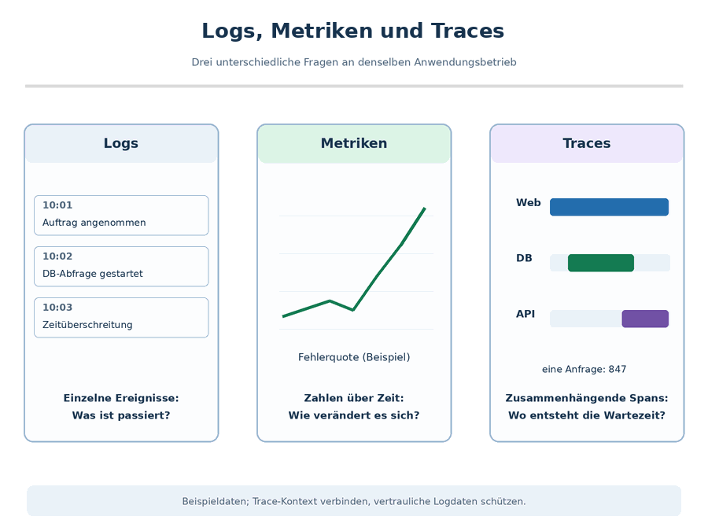

# M4-L2 – Bereitstellung und Zuverlässigkeit {#L2}

**Kursbereich:** M4 – Bachelor / Übergang: Cloud-Betrieb

**Niveau:** Bachelor / Master-Brücke

**Vorwissen:** Keine festen Voraussetzungen angegeben.

## Ausgangsproblem: Eine Anwendung zu programmieren ist nur der Anfang {#S1}

Ein Desktopprogramm kann man lokal bauen, testen und starten. Wenn es abstürzt, ist die Auswirkung zunächst auf den eigenen Rechner begrenzt. Ein öffentlich angebotener Dienst wird hingegen möglicherweise gerade von Menschen verwendet, wenn eine neue Softwareversion installiert wird. Dort sind Fehler nicht nur unbequem: Ein Nutzer könnte einen Auftrag verlieren, eine Rechnung doppelt erhalten oder längere Zeit nicht an seine Daten gelangen.

**Bereitstellung** – auf Englisch *Deployment* – bezeichnet den Vorgang, eine bestimmte Programmversion in einer vorgesehenen Umgebung nutzbar zu machen. Dazu gehören nicht nur die Programmdateien, sondern auch Einstellungen, benötigte Dienste, Zugriffsmöglichkeiten und gegebenenfalls Datenbankänderungen. **Zuverlässigkeit** bedeutet, dass ein Dienst unter definierten Bedingungen über einen Zeitraum hinweg erwartungsgemäß funktioniert, mit Störungen kontrolliert umgeht und bei Fehlern wiederhergestellt werden kann.

Die beiden Themen gehören zusammen: Eine Software kann im Test fehlerfrei laufen und trotzdem beim Veröffentlichen ausfallen, weil etwa ein erforderlicher Konfigurationswert fehlt. Umgekehrt ist ein gut überwachter Server wenig nützlich, wenn jede Veröffentlichung manuell und unvorhersehbar abläuft.

``` text
Entwicklung ─► Prüfung ─► Veröffentlichung ─► laufender Dienst
                                                │
                             Messung ◄──────────┘
                               │
                     Fehler erkennen und beheben
                               │
                      verbessern / zurückrollen
```

**Welches Problem wird gelöst?** Änderungen werden nachvollziehbar, Störungen erkennbar und Wiederherstellung planbar. **Wann ist die große Lösung unnötig?** Eine selten geänderte private Seite benötigt kein umfangreiches Betriebszentrum. Ein nachvollziehbarer Veröffentlichungsweg und ein brauchbares Backup bleiben trotzdem sinnvoll.

## Drei Dinge auseinanderhalten: Anwendung, Konfiguration und Infrastruktur {#S2}

Stell dir einen kleinen Online-Analysedienst vor. Sein **Anwendungscode** verarbeitet hochgeladene Dateien. Seine **Konfiguration** legt beispielsweise fest, wie groß Dateien sein dürfen, welche Datenbank angesprochen wird und welche externen Dienste benutzt werden. Die **Infrastruktur** umfasst den Computer beziehungsweise Cloud-Dienst, das Netzwerk, den Datenspeicher und weitere Betriebsressourcen.

``` text
       Anwendungscode: "Was tut das Programm?"
                          │
       Konfiguration: "Wie läuft es hier?"
                          │
       Infrastruktur: "Worauf läuft es?"
                          │
               Laufender Online-Dienst
```

In einem kleinen Projekt können alle drei Dinge auf einem virtuellen Server liegen. Größere Systeme trennen sie stärker, etwa indem Programmcode in einem Container-Image gespeichert und die Datenbank als verwalteter Dienst betrieben wird. Die Unterscheidung bleibt jedoch auch beim einfachen Webhosting wichtig.

Ein typischer Fehler besteht darin, Zugangsdaten, Serveradressen oder geheime Schlüssel direkt in die veröffentlichten Programmdateien zu schreiben. Dann gelangen vertrauliche Informationen möglicherweise ins Versionsarchiv oder sogar auf eine öffentliche Downloadseite. Sinnvoller sind getrennte Einstellungen und geeignete **Secret-Verwaltung** für Passwörter, Schlüssel und Zugriffstoken. Ein *Secret* ist ein vertraulicher Konfigurationswert; bloßes Umwandeln in ein anderes Textformat schützt ihn nicht. Weiterführende Zugriffs- und Datenschutzfragen behandeln wir in [M4-L3](M4-L3.md).

## Was genau wird bei einer Veröffentlichung ausgetauscht? {#S3}

Ein gutes Veröffentlichungspaket ist **reproduzierbar**: Man kann nachvollziehen, aus welchem Quelltext und welchen Abhängigkeiten es entstanden ist. Bei einem kompilierten Programm ist das eine ausführbare Datei mitsamt benötigten Bibliotheken. Bei einer PHP-Anwendung kann es ein definierter Dateistand sein; bei einer Containeranwendung ein **Container-Image** als versioniertes Paket aus Anwendung und Laufzeitbestandteilen.

Wichtig ist die Trennung zwischen **Build** (Erzeugung des Pakets) und **Deployment** (Einspielen in die Zielumgebung). Ein einmal geprüftes Paket sollte möglichst in unveränderter Form in die Produktionsumgebung gelangen. Anderenfalls kann der Produktionsstand von dem abweichen, was tatsächlich getestet wurde.

``` text
Quelltext (Version X)
       │
       ▼
Build + Tests ──► geprüftes Artefakt X
                          │
                 Freigabe / Deployment
                          │
                          ▼
                  Produktionsumgebung
```

Ein **Artefakt** ist hier das fertige, weitergebbare Ergebnis des Build-Prozesses. Die Versionskennung sollte eindeutig sein. Bei Containern lassen sich dafür beispielsweise unveränderliche Image-Digests verwenden; ein bloßes Etikett wie `latest` ist nicht ausreichend, um einen exakten Stand langfristig zu identifizieren.

Auch das verlässlichste Paket hilft wenig, wenn Konfiguration und Datenbankstand nicht zur Version passen. Diese zusätzlichen Abhängigkeiten gehören deshalb zur Veröffentlichungsplanung.

## Entwicklungs-, Test- und Produktionsumgebungen {#S4}

Eine **Entwicklungsumgebung** dient zum Ausprobieren und Ändern. Eine **Test- oder Staging-Umgebung** soll wichtige Eigenschaften des späteren Betriebs nachbilden, ohne echte Nutzer zu beeinträchtigen. Die **Produktionsumgebung** (*Production*) ist die tatsächlich angebotene Anwendung.

Das muss nicht heißen, dass man sofort drei separate Server mieten muss. Bei sehr kleinen Projekten kann die Testumgebung lokal oder zeitweise betrieben werden. Entscheidend ist, **was** man testet: Funktionieren Programmlogik, Netzwerkeinstellungen, Datenbankschema, Berechtigungen und externe Verbindungen zusammen?

**Grenze:** Eine Testumgebung ist selten vollständig identisch mit Produktion. Datenmengen, Last, reale Browser, Netzausfälle und Berechtigungen können sich unterscheiden. Deshalb ersetzen Tests weder Überwachung noch die Möglichkeit zur kontrollierten Rücknahme eines Updates. Umgekehrt darf eine Testumgebung nicht ungeschützt echte Kundendaten oder Produktionsschlüssel kopieren.

## CI/CD: Änderungen automatisch prüfen und bereitstellen {#S5}

Die Abkürzung **CI/CD** steht für *Continuous Integration* (kontinuierliche Integration) und je nach Verwendung *Continuous Delivery* (kontinuierlich auslieferbare Software) oder *Continuous Deployment* (automatische Veröffentlichung). Die beiden letzten Begriffe sind nicht identisch: Bei Delivery kann vor dem Produktivschritt eine manuelle Freigabe stehen; bei Deployment geschieht dieser Schritt nach bestandenen Prüfungen automatisiert.

CI sorgt dafür, dass neu zusammengeführte Änderungen beispielsweise gebaut, auf Syntaxfehler untersucht und getestet werden. Ein geplanter **Workflow** führt dafür nacheinander oder parallel einzelne Arbeitsschritte aus. GitHub Actions ist ein konkretes Produkt, das solche Workflows durch Jobs auf sogenannten Runnern ausführen kann; das zugrundeliegende Prinzip ist nicht an GitHub gebunden.

``` text
Änderung im Versionsarchiv
          │
          ▼
        CI: Build ─► Tests ─► Sicherheits- und Qualitätsprüfungen
                                             │
                                            Freigabe
                                             │
                                 CD: geprüfte Version bereitstellen
                                             │
                                     Betrieb beobachten
```

Solche Abläufe verhindern unter anderem, dass man versehentlich einen alten Ordner hochlädt oder offensichtliche Testfehler übersieht. Sie garantieren keine Fehlerfreiheit: Ein erfolgreiches Testprogramm kann einen Fehler in einer kaum genutzten Kombination übersehen.

**Wann unnötig?** Ein kleines, selten aktualisiertes Skript braucht keine umfassende Pipeline. Schon ein dokumentierter Ablauf – welche Version wurde getestet, welche Dateien werden veröffentlicht, wie geht man zurück? – ist wertvoll. Sobald Veröffentlichungen häufig werden oder mehrere Personen Änderungen vornehmen, wächst der Nutzen automatisierter Prüfungen stark.

## Infrastruktur als Code: Die Umgebung als nachvollziehbare Beschreibung {#S6}

**Infrastructure as Code (IaC, Infrastruktur als Code)** bedeutet, Server, Netzwerke oder andere Ressourcen durch versionierbare, maschinenlesbare Beschreibungen zu definieren. Statt bei jeder Neuinstallation eine lange Folge von Klicks zu wiederholen, beschreibt man die gewünschte Zielumgebung und lässt ein Werkzeug die notwendigen Änderungen planen oder ausführen.

Beispielsweise beschreibt man: „Es gibt einen privaten Netzwerkbereich, einen Anwendungsserver und einen verwalteten Datenspeicher.“ Das Werkzeug gleicht diese Beschreibung mit vorhandenen Ressourcen ab. **Terraform** ist ein Beispiel für eine solche Plattform. Seine zentrale Arbeitsweise lässt sich als *Write – Plan – Apply* zusammenfassen: beschreiben, geplante Änderungen prüfen, Änderungen umsetzen.

``` text
Versionierte Infrastrukturbeschreibung
                 │
                 ▼
         Änderungsvorschau
                 │
        Kontrolle / Freigabe
                 │
                 ▼
          Cloud-API / Host
                 │
                 ▼
       Tatsächliche Infrastruktur
```

IaC hat einen echten Vorteil bei wiederholbaren Umgebungen, mehreren Standorten und Teamarbeit. Es schafft aber auch neue Risiken: Eine falsche Änderung kann viele Ressourcen zugleich verändern oder löschen. Werkzeuge verwalten oft einen **State** (Zustandsinformation über die zugeordneten Ressourcen), der selbst geschützt und gesichert werden muss. **IaC ist weder automatisch ein Backup noch eine Sicherheitsgarantie.** Geheimnisse gehören nicht unkontrolliert in die Infrastrukturdefinition oder ihre Zustandsdatei.

Für einen einzelnen VPS (Virtual Private Server, virtueller gemieteter Server) kann eine einfache schriftliche Installationsdokumentation wirtschaftlicher sein als ein ganzes IaC-Projekt.

## Container-Deployment und Orchestrierung {#S7}

Eine Anwendung lässt sich als Container-Image verpacken. Mit einer einfachen Container-Laufzeit oder einem kleinen Compose-Verbund kann ein Betreiber mehrere zusammengehörende Dienste starten. In größeren Installationen übernehmen **Orchestratoren** wie Kubernetes die Platzierung, Aktualisierung und Überwachung zahlreicher Container-Instanzen.

In Kubernetes verwaltet ein **Deployment** unter anderem den gewünschten Zustand einer Anwendung. Eine Veröffentlichung kann die bisher laufenden **Pods** (zusammengehörige Container-Ausführungseinheiten) schrittweise durch neue ersetzen. Dafür bietet Kubernetes **Rolling Updates** an. Nach einem Fehler kann unter bestimmten Bedingungen auf eine ältere Deployment-Revision zurückgegangen werden.

``` text
           Gewünschte Version B
                   │
                   ▼
             Orchestrator
                   │
     alter Pod A ──► neuer Pod B
     alter Pod A ──► neuer Pod B
                   │
           Lastverteilung / Nutzer
```

Die Technik löst vor allem wiederkehrende Betriebsaufgaben bei vielen Instanzen. Sie macht aber aus einer fehlerhaften Anwendung keine korrekte. Kubernetes kann Container neu starten und Verkehr umlenken; es erkennt nicht automatisch, ob eine Rechnung fachlich falsch berechnet wurde. Und eine Rücknahme des Container-Images macht keine bereits ausgeführten Datenbankänderungen rückgängig.

**Wann unnötig?** Bei einem kleinen Online-Tool reicht oft ein klassischer Webhoster, ein VPS oder eine einfache verwaltete Plattform. Kubernetes bringt eigene Netzwerk-, Speicher-, Berechtigungs-, Überwachungs- und Wartungsaufgaben mit sich. Die Orchestrierung sollte ein bestehendes Problem lösen, nicht Selbstzweck sein.

## Gesundheitsprüfungen: Läuft die Anwendung oder ist sie wirklich benutzbar? {#S8}

Ein Prozess kann aktiv sein und dennoch keine brauchbaren Ergebnisse liefern. Vielleicht hängt er in einer Endlosschleife, wartet auf eine ausgefallene Datenbank oder hat sein KI-Modell noch nicht geladen. Deshalb unterscheiden moderne Betriebsumgebungen mehrere Arten von **Health Checks** (Gesundheitsprüfungen):

- **Liveness:** Lebt der Prozess in einem Zustand, in dem ein Neustart helfen könnte?
- **Readiness:** Kann die Instanz *jetzt* neue Anfragen annehmen?
- **Startup:** Ist die längere Anfangsphase beendet, sodass gewöhnliche Prüfungen sinnvoll sind?

Das Kubernetes-Projekt dokumentiert diese drei Prüfungen ausdrücklich. Die Unterscheidung ist allerdings auch ohne Kubernetes nützlich.

``` text
Dienst startet ─► Startprüfung ─► bereit für Nutzeranfragen
                     │                    │
                     ▼                    ▼
             noch nicht fertig       Readiness-Prüfung
                                          │
                                bei Fehler: keine neuen Anfragen

Liveness-Prüfung: bei festgestellter Blockade eventuell Neustart
```

Ein schlecht entworfener Health Check kann selbst einen Ausfall verstärken. Wenn die Datenbank kurz langsam ist und deshalb sofort alle Webserver gleichzeitig neu gestartet werden, entsteht zusätzliche Last. Auch gilt: **Ein erfolgreicher Health Check beweist nicht, dass die Fachfunktion korrekt ist.** Die Antwort „HTTP 200“ kann geliefert werden, obwohl einzelne Kunden keine Dateien mehr abrufen können. Dafür braucht es zusätzlich Tests und aussagekräftige Betriebsdaten.

## Monitoring: Den Betrieb nicht im Blindflug führen {#S9}

**Monitoring** bedeutet, fortlaufend ausgewählte Signale eines Systems zu erfassen und bei auffälligen Zuständen zu reagieren. Typische Fragen lauten: Ist die Seite erreichbar? Wie lange dauern Antworten? Häufen sich Fehler? Wie voll ist die Warteschlange? Ist der verfügbare Speicher knapp?

Die naheliegende Versuchung ist, alles zu überwachen, was messbar ist. Das führt jedoch leicht zu tausenden Zahlen ohne Entscheidungswert. Sinnvoller ist, zunächst die Funktionen zu betrachten, die den Nutzern wichtig sind. Bei einem Dateidienst kann dies die erfolgreiche Annahme und Bereitstellung von Dateien sein; bei einem KI-Dienst die korrekte Abarbeitung von Aufträgen.

``` text
Anwendung ─► Messwerte ─► Auswertung ─► Alarm bei Bedarf
    │                                  │
    └──────── Nutzerverhalten ◄────────┘
```

Monitoring erkennt bekannte Fehlermuster und Grenzwertüberschreitungen. **Observability** (*Beobachtbarkeit*) geht weiter: Sie soll aus beobachtbaren Ausgaben auch Rückschlüsse auf zunächst unbekannte Ursachen erlauben. Diese beiden Begriffe sind verwandt, aber nicht synonym.

## Logs, Metriken und Traces – drei unterschiedliche Blickwinkel {#S10}

**Logs (Protokolle)** sind einzelne zeitlich zugeordnete Ereignisse: „Auftrag angenommen“, „Anmeldung verweigert“, „Datenbankverbindung fehlgeschlagen“. Sie erzählen, *was* ein Programm gemeldet hat.

**Metriken** sind Zahlenreihen: Anfragen pro Minute, Anteil fehlerhafter Antworten, Speichernutzung, Dauer einer Berechnung. Sie machen Veränderungen über die Zeit sichtbar.

**Traces (Ablaufspuren)** verbinden zusammengehörige Verarbeitungsschritte. Eine einzelne Browseranfrage kann erst beim Webdienst ankommen, dann eine Datenbankabfrage auslösen und schließlich einen Worker kontaktieren. Ein Trace zeigt, wo innerhalb dieser Kette Zeit verbraucht oder ein Fehler ausgelöst wurde. Einzelne Teiloperationen eines Traces werden **Spans** genannt.

``` text
Nutzeranfrage 847
       │
       ├── Webserver: 30 ms  ──┐
       ├── Datenbank: 90 ms    ├── zusammengehöriger Trace
       └── externer Dienst: ...┘

Logs:    „Zeitüberschreitung beim externen Dienst“
Metrik:  „Anteil fehlgeschlagener Anfragen steigt“
Trace:   „Verzögerung entsteht im externen Aufruf“
```

Die Zahlen sind frei erfunden und dienen nur der Veranschaulichung. **OpenTelemetry** ist ein herstellerneutraler Werkzeug- und Spezifikationsrahmen, um solche Telemetriedaten zu erfassen und weiterzugeben. Es ist nicht automatisch die Datenbank, in der sie dauerhaft gespeichert werden, und auch nicht schon ein fertiges Alarmzentrum.

**Betriebsfolge:** Logs und Traces können personenbezogene Daten, Dateinamen, Anfragen oder Geheimnisse enthalten. Deshalb sind Datenminimierung, Zugriffsschutz und eine passende Aufbewahrungsfrist notwendig. Volle Detailprotokollierung jeder Anfrage kann zudem hohe Speicher- und Übertragungskosten erzeugen.



*Abbildung: Drei Perspektiven auf denselben Betrieb: Logs sind Ereignisse, Metriken Zeitreihen, Traces verknüpfen Spans eines Aufrufs. Alle gezeichneten Werte sind hypothetisch; sensible Informationen gehören nicht ungefiltert in Telemetriedaten.*

## Alerting: Ein Alarm muss eine Reaktion ermöglichen {#S11}

**Alerting** bezeichnet das Auslösen einer Benachrichtigung, wenn eine relevante Bedingung eintritt. Ein sinnvoller Alarm lautet beispielsweise: „Seit zehn Minuten können viele Nutzer ihre Aufträge nicht abrufen.“ Ein weniger sinnvoller Alarm lautet: „Prozessorauslastung überschritt kurz 65 Prozent“ – ohne Bezug zu einem Schaden oder erforderlichen Eingriff.

Alarme sollen die für einen Betrieb verantwortliche Person erreichen und eine erkennbare Handlung auslösen können. Sonst entsteht **Alarmmüdigkeit**: Wenn täglich viele bedeutungslose Meldungen eintreffen, werden wichtige Warnungen übersehen.

Eine einfache Abstufung hilft:

- **Information:** Auffälligkeit wird protokolliert; keine sofortige Aktion notwendig.
- **Warnung:** Eine Grenze nähert sich; Kapazität oder Fehlertrend später prüfen.
- **Kritisch:** Ein wesentlicher Nutzerablauf ist gestört; zeitnah handeln.

Für einen kleinen privaten Dienst kann zunächst eine automatische Erreichbarkeitsprüfung mit E-Mail-Hinweis genügen. Wer einen kostenpflichtigen Dienst mit verbindlichen Zusagen betreibt, benötigt dagegen einen realistischen Weg, Störungen auch außerhalb normaler Entwicklungszeiten zu behandeln. Eine Benachrichtigung allein repariert keine Anwendung.

## Updates ohne unnötige Unterbrechung: Vier Strategien {#S12}

Die einfachste Variante heißt **Recreate**: Alte Anwendung stoppen, neue starten. Es entsteht normalerweise eine kurze Unterbrechung. Bei kleineren Diensten mit akzeptabler Wartungszeit kann das völlig angemessen sein.

Bei einem **Rolling Update** werden Instanzen schrittweise ersetzt. Voraussetzung ist unter anderem, dass alte und neue Version zeitweise zusammenarbeiten können. Ein **Blue-Green Deployment** hält zwei getrennte Umgebungen bereit: Die neue Version wird zunächst auf der nicht öffentlichen Umgebung geprüft; dann wird Verkehr umgeschaltet. Beim **Canary Release** erhält zunächst nur ein kleiner Teil der Nutzer beziehungsweise Anfragen die neue Version, bevor die Freigabe ausgeweitet wird.

``` text
RECREATE:      [Version A] ──Stopp──► [Version B]
ROLLING:       [A A A] ─► [A A B] ─► [A B B] ─► [B B B]
BLUE-GREEN:    Nutzer ─► [Blau / A]    [Grün / B bereit]
                               └── Umschalten ─► [Grün / B]
CANARY:        95 % zu A  +  5 % zu B (nur Beispielwerte)
```

Diese Verfahren senken manche Veröffentlichungsrisiken, sind aber kein Beweis für durchgängige Verfügbarkeit. Mehrere Versionen gleichzeitig zu betreiben, kann zusätzliche Serverkosten verursachen. Canary-Verteilungen benötigen genügend echte Aufrufe, damit Fehlerstatistiken aussagekräftig werden. Für eine Anwendung mit wenigen Nutzern ist ein bewusstes Wartungsfenster manchmal besser.

## Feature Flags: Funktionen getrennt vom Programmpaket einschalten {#S13}

Ein **Feature Flag (Funktionsschalter)** erlaubt, eine Funktion in der Software mitzuliefern, ohne sie sofort allen Nutzern anzubieten. Beispielsweise können zuerst interne Tester oder nur ausgewählte Kunden eine neue Exportfunktion sehen. Der Schalter beeinflusst das Verhalten während der Ausführung und kann häufig schneller geändert werden als ein komplettes Deployment.

``` text
Gleiche Programmversion
       │
       ├── Flag AUS ─► bisheriger Ablauf
       └── Flag AN  ─► neue Funktion
```

Flags sind vor allem nützlich, wenn Veröffentlichung und Aktivierung getrennt werden sollen. Sie erlauben jedoch keinen magischen Rückweg: Wenn die neue Funktion schon Daten geändert oder kostenpflichtige Aktionen ausgelöst hat, macht ein ausgeschalteter Schalter diese Folgen nicht ungeschehen.

Außerdem wachsen mit jedem Flag zusätzliche Kombinationsmöglichkeiten, die getestet und später aufgeräumt werden müssen. Ein einzelner kleiner Webdienst benötigt daher nicht automatisch ein professionelles Feature-Flag-System.

## Rollback: Warum ein altes Programm nicht automatisch alte Daten bedeutet {#S14}

**Rollback** bezeichnet die Rücknahme einer Änderung auf einen früheren funktionsfähigen Stand. Bei einer simplen Webseite kann es reichen, die vorherigen Dateien wieder bereitzustellen. Komplexer wird es bei Datenbanken: Eine neue Version hat womöglich eine Spalte umbenannt, Daten in ein anderes Format umgerechnet oder neue Aufträge verarbeitet.

Dann kann die alte Version plötzlich nicht mehr mit den neuen Daten arbeiten. Eine Wiederherstellung des gesamten Datenbestands auf einen früheren Zeitpunkt wäre wiederum gefährlich, weil damit zwischenzeitliche Kundenaktionen verloren gingen.

Ein verbreiteter Ansatz ist die **rückwärtskompatible Datenbankmigration**: Zunächst wird die Datenstruktur so erweitert, dass alte und neue Programmversion damit arbeiten können; erst in einem späteren Schritt entfernt man veraltete Teile. Diese Grundidee wird oft mit *Expand and Contract* bezeichnet. Sie erhöht kurzfristig den Wartungsaufwand, kann aber sichere schrittweise Veröffentlichungen erleichtern.

``` text
1. Datenbankschema erweitern (alte Version läuft weiter)
2. Neue Programmversion bereitstellen
3. Daten / Nutzerzugriffe kontrolliert umstellen
4. Erst später alte Felder und Pfade entfernen
```

**Abgrenzung zu M3-L6:** Ein Rollback ist keine reguläre Datensicherung. Backups und Wiederherstellung brauchen eine eigene Strategie. Auch nach einem scheinbar gelungenen Rollback muss die Datenkonsistenz geprüft werden.

## Zuverlässigkeit messen: SLI, SLO und SLA {#S15}

Wenn ein Dienst „zuverlässig“ sein soll, stellt sich die Frage: Was bedeutet das konkret? Drei Begriffe helfen dabei:

- **Service Level Indicator (SLI, Dienstgüteindikator):** Eine messbare Größe, etwa der Anteil erfolgreicher Uploads oder die Antwortzeit eines Dienstes.
- **Service Level Objective (SLO, Dienstgüteziel):** Ein bewusst festgelegtes Ziel für einen Indikator, etwa „mindestens 99,5 Prozent erfolgreich abgeschlossene Uploads innerhalb eines Monats“; dieser Wert ist hier nur ein Beispiel.
- **Service Level Agreement (SLA, Dienstgütevereinbarung):** Eine Vereinbarung mit Kunden über zugesagte Leistungen und gegebenenfalls Folgen bei Nichterfüllung.

``` text
Was messen wir?         SLI: erfolgreiche Uploads / alle Uploads
Welche Güte wollen wir? SLO: beispielhaft 99,5 % im Kalendermonat
Was versprechen wir?    SLA: vertragliche Zusage samt Bedingungen
```

Ein SLO ist nicht automatisch eine rechtlich zugesicherte Garantie. Auch eine vermeintliche „99,9-Prozent-Verfügbarkeit“ ist ohne präzise Messdefinition wenig aussagekräftig: Zählt eine kaputte Uploadfunktion als Ausfall, obwohl die Startseite erreichbar bleibt? Welche Nutzerregionen und welchen Zeitraum betrachten wir? Werden angekündigte Wartungsfenster berücksichtigt?

Ein **Error Budget (Fehlerbudget)** ist die im Rahmen eines SLO rechnerisch zugelassene Abweichung. Dieses Budget hilft bei der Abwägung, ob neue Funktionen schnell veröffentlicht werden sollten oder zunächst Stabilisierung Vorrang hat. Es ist kein Guthaben, mit dem man absichtlich Fehler „verbrauchen“ sollte. Google beschreibt diese Trennung von Indikatoren, Zielen und Vereinbarungen in seinen Materialien zum Site Reliability Engineering (SRE, systematische Zuverlässigkeitstechnik).

Für einen kleinen kostenlosen Dienst können zunächst wenige realistische interne Ziele genügen. Verpflichtende SLA-Zusagen ohne Personal, Notfallplan und belastbare Messung können dagegen erhebliche Support- und Haftungsfolgen haben.

## Ein Server oder mehrere Verfügbarkeitszonen? {#S16}

Ein einzelner gemieteter Server kann für viele Anwendungen zuverlässig genug sein – insbesondere wenn ein Betreiber Ausfallzeiten hinnehmen kann und eine geprüfte Wiederherstellung besitzt. Er hat dennoch einen offensichtlichen **Single Point of Failure** (einzelnen Ausfallpunkt): Fällt die Maschine oder ihr Standort aus, ist der Dienst möglicherweise nicht erreichbar.

Ein Mehrzonenbetrieb verteilt geeignete Ressourcen auf getrennte **Availability Zones (Verfügbarkeitszonen)** innerhalb einer Cloud-Region. Das kann die Auswirkungen bestimmter Infrastrukturfehler vermindern. Voraussetzung ist allerdings, dass auch Datenbank, Lastverteilung, Netzwerkzugang und abhängige Dienste zur gewünschten Ausfalltoleranz passen. Zwei Webserver in verschiedenen Zonen helfen wenig, wenn beide dieselbe ausgefallene Datenbank benötigen.

``` text
KLEINER DIENST
Nutzer ─► ein VPS ─► Datenbank + Sicherung an anderem Ort

MEHRZONENBETRIEB (vereinfacht)
                          ┌──► Zone A: Web + Datenzugriff
Nutzer ─► Lastverteilung ─┤
                          └──► Zone B: Web + Datenzugriff
                                      │
                           abgestimmte Datenhaltung
```

Mehrzonenbetrieb bedeutet außerdem zusätzliche Netzverbindungen, ggf. Replikation, Tests für das Fehlerumschalten und oft höhere Fixkosten. **Verfügbarkeit** und **Datenhaltbarkeit** sind verschiedene Ziele: Ein Dienst kann während eines Ausfalls weiter Anfragen beantworten und trotzdem einzelne Daten verlieren – oder alle Daten behalten, obwohl er stundenlang unerreichbar ist. Die Datenbankaspekte hierzu wurden in M3-L2 und M3-L6 behandelt.

## Wie eine Störung organisiert bearbeitet wird {#S17}

Ein technischer Ausfall verlangt nicht nur Werkzeuge, sondern auch Entscheidungen. Ein überschaubarer Störungsablauf sieht so aus:

``` text
Störung erkannt
      │
      ▼
Betroffene Funktionen und Nutzer ermitteln
      │
      ▼
Schaden begrenzen (z. B. neue Aufträge pausieren)
      │
      ▼
Wiederherstellen / sicheren Stand aktivieren
      │
      ▼
Daten und Geschäftsabläufe kontrollieren
      │
      ▼
Ursachen dokumentieren und Schutz verbessern
```

Wer einen Dienst betreibt, sollte wissen, wo relevante Protokolle liegen, wer Zugriff erhält, welche Änderungen zuletzt veröffentlicht wurden und welche Wiederherstellungsmittel tatsächlich funktionieren. Bei mehreren Personen wird eine klare Verantwortungsverteilung wichtig. Ohne solche Festlegungen kann eine vermeintlich kleine Störung lange dauern.

Das bedeutet nicht, dass ein Einzelentwickler eine rund um die Uhr besetzte Einsatzleitung benötigt. Aber er sollte seinen Kunden keine Erreichbarkeit versprechen, die er ohne entsprechende Organisation realistisch nicht gewährleisten kann. Gerade bei bezahlten Aufträgen gehören außerdem verständliche Statusmeldungen und ein praktikabler Supportweg zur Zuverlässigkeit.

## Drei Anwendungsbeispiele: von einfach bis verteilt {#S18}

### Beispiel A: Private Dokumentationsseite

Eine selten geänderte Informationsseite wird bei einem klassischen Webhoster betrieben. Änderungen werden lokal geprüft und als klar benannte Version hochgeladen. Die Domain und das TLS-Zertifikat werden überwacht; die Inhalte liegen zusätzlich in einem unabhängigen Archiv. Wenn eine Änderung fehlschlägt, wird der vorherige Dateistand wieder veröffentlicht.

**Sinnvoll:** Wenig Infrastruktur, einfache Kontrolle, geringe Wartung. **Überdimensioniert:** Kubernetes, Mehrzonen-Datenbankcluster, Tracing zwischen zehn Microservices. **Restrisiko:** Ausfall beim Anbieter und Verzögerung der manuellen Wiederherstellung.

### Beispiel B: Kleines bezahltes Online-Analysewerkzeug

Die Anwendung besteht aus einer Weboberfläche, einem Backend und einer Datenbank. Git verwaltet den Quelltext. Vor Veröffentlichungen laufen automatisierte Grundtests. Der Betreiber prüft, ob eine neue Version Datenbankmigrationen benötigt, und beobachtet danach Fehlerquote, Antwortzeiten und erfolgreiche Aufträge.

``` text
Nutzer ─► Web-/API-Dienst ─► Datenbank
                    │
                    └──► Monitoring / Alarm
Entwicklung ─► Test ─► versioniertes Deployment
```

**Sinnvoll:** Einfache CI, wenige Messgrößen, Wiederherstellungstest, verständliche Wartungsinformation. **Überdimensioniert:** Zwei zusätzliche Cloud-Regionen und ein aufwendiger Canary-Prozess bei wenigen täglichen Anfragen. **Betriebsfolgen:** Sicherheitsupdates, Benutzerrechte, Backups, Kundenkommunikation und Support.

### Beispiel C: Verteilter KI-Verarbeitungsdienst

Ein Webdienst nimmt Aufträge entgegen, eine Warteschlange verteilt sie an Worker mit geeigneter Hardware. Ein Teil dieser Worker lädt große Modelle in den Grafikspeicher und benötigt daher länger zum Start. Eine neue Version sollte erst Aufträge übernehmen, wenn das Modell tatsächlich verfügbar ist. Bei einem Fehler darf derselbe Auftrag nicht versehentlich zweimal ausgeführt und doppelt abgerechnet werden.

``` text
Nutzer ─► API ─► Auftragsdatenbank
                 │
                 ▼
               Queue
          ┌──────┴──────┐
          ▼             ▼
     GPU-Worker A  GPU-Worker B
          └──────┬──────┘
                 ▼
          Ergebnisspeicher
                 │
             Status + Logs + Metriken + Traces
```

Hier sind Queuelänge, Auftragswartezeit, fehlgeschlagene Jobs, Modell-Ladefehler und Kosten pro erfolgreichem Auftrag oft aussagekräftiger als nur die CPU-Auslastung des Webservers. Ein Worker-Neustart muss mit einer sicheren Wiederaufnahme oder bewussten Wiederholung eines Auftrags verbunden sein. Bei kostenintensiven GPU-Ressourcen kann zusätzlich die Frage entscheidend werden, ob ein zweiter Worker ständig bereitsteht oder nur bei Bedarf gestartet wird.

**Sinnvoll:** Sauberes Auftragsprotokoll, Idempotenz, Health Checks, nachvollziehbare Versionen und Kostenalarm. **Überdimensioniert:** Eine globale Kubernetes-Flotte, wenn die tatsächlich anfallende Arbeit auf einer einzelnen lokalen GPU zuverlässig und wirtschaftlich verarbeitet werden kann.

## Vergleich: Welche Betriebsstufe passt zu welchem Bedarf? {#S19}

  Betriebsform                     Typische Bereitstellung                Typische Kontrolle                           Zusätzlicher Aufwand
  -------------------------------- -------------------------------------- -------------------------------------------- ----------------------------------------------
  Lokales Werkzeug                 Manuell freigegebene Programmversion   Funktionstest, Versionsarchiv                Updates und lokale Datensicherung
  Kleine statische Website         Versionsbezogener Datei-Upload         Erreichbarkeit, Zertifikat, Inhalte          Hosting und Wiederherstellung
  Kleiner VPS-Webdienst            Kontrolliertes Deployment, ggf. CI     Logs, Fehlerquote, Backups                   Betriebssystem, Sicherheit, Support
  Verwaltete Anwendungsplattform   Anbieterunterstütztes Deployment       Anwendungsmetriken, externe Abhängigkeiten   Nutzungsgebühren, Plattformgrenzen
  Verteilte Containerplattform     Orchestrierung, Rolling/Canary         Traces, SLOs, mehrstufige Alarme             Viele Infrastruktur- und Datenabhängigkeiten

Diese Tabelle ist keine starre Entwicklungstreppe. Eine Anwendung muss nicht irgendwann auf Kubernetes umsteigen, nur weil die Nutzerzahl wächst. Leistungsbedarf, Ausfallfolgen, Datenschutz, Betriebszeit und verfügbare personelle Kapazität entscheiden gemeinsam über die Architektur.

## Zusammenfassung und Übergang zu M4-L3 {#S20}

**Bereitstellung** ist die kontrollierte Veröffentlichung einer bestimmten Programmversion samt passenden Einstellungen und Abhängigkeiten. CI/CD und Infrastructure as Code können Wiederholbarkeit verbessern, wenn ihre zusätzliche Komplexität gerechtfertigt ist. Container und Orchestratoren erleichtern den Betrieb vieler Instanzen, ersetzen aber weder Fachlogik noch Datenbankkorrektheit.

**Zuverlässigkeit** entsteht nicht allein durch mehr Server. Sie benötigt sinnvolle Tests, gute Gesundheitsprüfungen, Logs, Metriken und Traces, verständliche Alarme, einen realistischen Wiederherstellungsweg und ehrliche Dienstgüteziele. Rollbacks, Blue-Green- und Canary-Verfahren können Veröffentlichungsrisiken reduzieren, sind aber kein Ersatz für Backups oder die Prüfung von Datenmigrationen.

Die praktische Leitfrage lautet: **Welche Störung wäre für die Nutzer wirklich problematisch – und welche einfache, überprüfbare Maßnahme verhindert oder begrenzt genau diese Störung?**

Als Nächstes folgt **M4-L3 – Sicherheit, Datenschutz und Verantwortung**. Dort betrachten wir unter anderem Identitäts- und Rechteverwaltung, Secret-Management, Angriffe auf öffentlich erreichbare Schnittstellen und die Verantwortung für personenbezogene Daten.


## Quellen {#S21}

**Letzte Quellenprüfung:** 03.11.2026

**Prüfdatum: 03.11.2026.** Die nachfolgenden Projekt- und Herstellerseiten sind Quellen für die beschriebenen technischen Prinzipien. Die Literatur zu SLOs ist teilweise älter, bleibt jedoch eine grundlegende Definition der Konzepte. Anbieterpreise und konkrete Produktzusagen sind nicht Bestandteil dieser Lektion.

1.  GitHub Docs: *Understanding GitHub Actions* – CI-/CD-Workflows, Jobs, Runner und Automatisierung. [https://docs.github.com/en/actions/get-started/understand-github-actions](https://docs.github.com/en/actions/get-started/understand-github-actions)
2.  HashiCorp Developer: *What is Terraform?* – IaC, versionierte Infrastruktur, Write/Plan/Apply und Zustand. [https://developer.hashicorp.com/terraform/intro](https://developer.hashicorp.com/terraform/intro)
3.  Kubernetes Docs: *Deployments* – Rolling Updates, Revisionen und Rücknahme. [https://kubernetes.io/docs/concepts/workloads/controllers/deployment/](https://kubernetes.io/docs/concepts/workloads/controllers/deployment/)
4.  Kubernetes Docs: *Configure Liveness, Readiness and Startup Probes* – unterschiedliche Arten der Zustandsprüfung. [https://kubernetes.io/docs/tasks/configure-pod-container/configure-liveness-readiness-startup-probes/](https://kubernetes.io/docs/tasks/configure-pod-container/configure-liveness-readiness-startup-probes/)
5.  OpenTelemetry: *Observability Primer* – Logs, Metriken, Traces und Observability. [https://opentelemetry.io/docs/concepts/observability-primer/](https://opentelemetry.io/docs/concepts/observability-primer/)
6.  OpenTelemetry: *What is OpenTelemetry?* – herstellerunabhängige Erfassung und Weitergabe von Telemetriedaten. [https://opentelemetry.io/docs/what-is-opentelemetry/](https://opentelemetry.io/docs/what-is-opentelemetry/)
7.  Google: *Site Reliability Engineering – Service Level Objectives* – SLI, SLO, SLA und Fehlerbudget. [https://sre.google/sre-book/service-level-objectives/](https://sre.google/sre-book/service-level-objectives/)
8.  Microsoft Learn: *Safe deployment practices* – Canary, Blue-Green und schrittweise Freigabe. [https://learn.microsoft.com/en-us/azure/well-architected/operational-excellence/safe-deployments](https://learn.microsoft.com/en-us/azure/well-architected/operational-excellence/safe-deployments)
9.  Kubernetes Docs: *Secrets* – vertrauliche Werte und Grenzen einfacher Codierung. [https://kubernetes.io/docs/concepts/configuration/secret/](https://kubernetes.io/docs/concepts/configuration/secret/)
