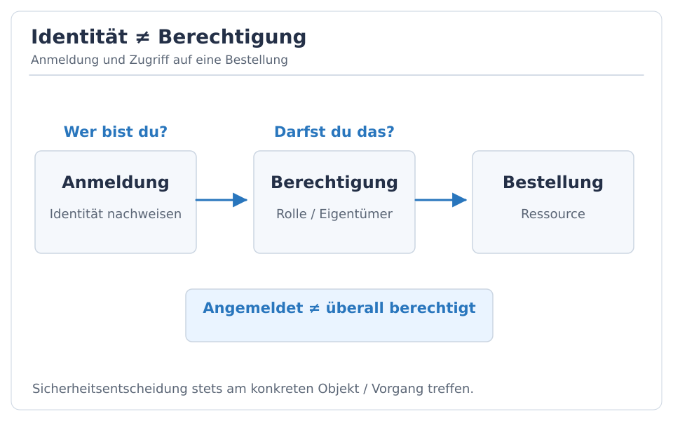

# M4-L3 – Sicherheit, Datenschutz und Verantwortung {#L3}

**Kursbereich:** M4 – Bachelor / Übergang: Cloud-Betrieb

**Niveau:** Bachelor / Master-Brücke

**Vorwissen:** Keine festen Voraussetzungen angegeben.

## Ausgangsproblem: Ein erreichbarer Dienst ist auch eine Angriffsfläche {#S1}

In den bisherigen Lektionen haben wir Anwendungen über das Internet erreichbar gemacht, auf mehrere Server verteilt und auf verlässlichen Betrieb vorbereitet. Nun entsteht eine zusätzliche Aufgabe: Nicht jeder, der den Dienst erreichen kann, darf ihn uneingeschränkt benutzen. Und selbst ein berechtigter Nutzer darf normalerweise nicht auf Daten anderer Nutzer zugreifen.

**Informationssicherheit** soll Informationen und Systeme vor unbefugtem Zugriff, unerwünschter Veränderung und Ausfällen schützen. Die drei oft genannten Grundziele sind **Vertraulichkeit** (nicht jeder darf mitlesen), **Integrität** (Daten und Abläufe sollen nicht unbemerkt verfälscht werden) und **Verfügbarkeit** (berechtigte Nutzer sollen einen Dienst verwenden können). **Datenschutz** fragt zusätzlich, ob die Verarbeitung *personenbezogener Daten* gerechtfertigt, transparent, zweckgebunden und angemessen ist. Ein technisch sicherer Dienst kann trotzdem gegen Datenschutzregeln verstoßen, wenn er mehr Daten erhebt als nötig.

Ein Beispiel: Eine Kundenanalyse wird korrekt über eine verschlüsselte Verbindung übertragen. Trotzdem könnte ein Programmierfehler zulassen, dass ein angemeldeter Kunde durch Ändern einer Auftragsnummer die Datei eines anderen Kunden herunterlädt. Die Verschlüsselung funktioniert; die **Berechtigungsprüfung** fehlt.

``` text
Öffentliches Internet
        │
        ▼
    Webdienst / API
        │
  Wer greift zu? ──► Identität prüfen
        │
  Was darf er?   ──► Berechtigung für genau dieses Objekt prüfen
        │
        ▼
   Geschäftsfunktion ──► geschützte Datenbank
        │
        └──────────────► nachvollziehbare Sicherheitsereignisse
```

**Welches Problem lösen Sicherheitsmaßnahmen?** Sie begrenzen Zugriff, Missbrauch, Datenverlust und Betriebsstörungen. **Wann ist eine große Sicherheitsplattform überdimensioniert?** Bei einem rein lokalen, offline genutzten Werkzeug ohne fremde Daten. Dennoch bleiben dort Datensicherung und grundlegende Systemhygiene wichtig. Die angemessene Schutzstufe hängt vom möglichen Schaden ab, nicht davon, wie modern das System aussehen soll.

## Zuerst das Risiko verstehen: Schutzgüter und Bedrohungsmodell {#S2}

Ein **Bedrohungsmodell** ist eine strukturierte Betrachtung dessen, was geschützt werden soll, wer auf welche Weise Schaden verursachen könnte und wo die relevanten Schnittstellen liegen. Dafür braucht man zunächst keine komplizierte Software.

Bei einem kleinen Online-Dienst könnten die Schutzgüter Kundendateien, Konten, API-Schlüssel, Geldguthaben und die Verfügbarkeit der Anwendung sein. Risiken reichen von versehentlichen Fehlkonfigurationen über gestohlene Zugangsdaten bis zu automatisiertem Missbrauch. Nicht jede Störung ist ein absichtlicher Angriff: Ein falsch gesetztes Datenbankrecht oder ein offener Dateibucket kann genauso gravierende Folgen haben.

Hilfreich ist das Denken in *Vertrauensgrenzen*. Zwischen öffentlichem Browser und Server dürfen übermittelte Daten nie allein deshalb als korrekt gelten, weil die Oberfläche sie vorher geprüft hat. Zwischen Anwendungsserver und Datenbank müssen Rechte eingeschränkt werden. Zwischen einem eigenen KI-Worker und einem externen Modellanbieter kann eine weitere Grenze mit eigener Datenübermittlung entstehen.

``` text
[Unbekannter Browser] ─┬─ Vertrauensgrenze ─► [Eigene Anwendung]
                      │                            │
        Eingaben kontrollieren             Rechte und Daten prüfen
                                                   │
                                       Vertrauensgrenze zur Datenbank
                                                   │
                                       [Kundendaten / Aufträge]
                                                   │
                                      evtl. weitere Grenze nach außen
                                                   ▼
                                         [Externer Dienstleister]
```

Die Sicherheitsfrage lautet nicht nur „Kann jemand einbrechen?“, sondern auch „Was geschieht bei einem einzelnen Fehler, und wie weit reichen die Folgen?“ Eine konsequente Begrenzung der Rechte sorgt dafür, dass eine kompromittierte Teilkomponente nicht automatisch das gesamte System kontrolliert.

## Authentifizierung und Autorisierung sind zwei verschiedene Aufgaben {#S3}

**Authentifizierung** bedeutet: Ein System prüft, ob jemand die behauptete Identität nachweisen kann. **Autorisierung** bedeutet: Das System entscheidet, was diese Identität tun darf. Oft funktionieren beide Schritte nacheinander, aber sie dürfen nicht vermischt werden.



Authentifizierung beantwortet „Wer?“, Autorisierung entscheidet „Darf diese Person das?“.

Ein Benutzer kann korrekt angemeldet sein und trotzdem keine Berechtigung besitzen, eine fremde Bestellung zu öffnen. Umgekehrt kann ein öffentlicher Artikel absichtlich ohne Anmeldung lesbar sein. Die beiden Fragen sind unabhängig.

Für die Verwaltung von Identitäten und Zugriffsrechten wird die Abkürzung **IAM** (*Identity and Access Management*, Identitäts- und Berechtigungsmanagement) verwendet. Das umfasst Benutzerkonten, Maschinenidentitäten, Rollenzuweisungen, Anmeldeverfahren und das Entziehen nicht mehr benötigter Rechte.

**Least Privilege** oder *Prinzip der geringsten Rechte* besagt: Jede Identität erhält nur die tatsächlich erforderlichen Zugriffe, und zwar möglichst nicht länger als nötig. Ein Webprozess, der Kundendateien lesen muss, benötigt deshalb nicht automatisch das Recht, sämtliche Datenbanktabellen zu löschen. Ein automatischer Bild-Worker sollte nicht über denselben umfassenden Administratorschlüssel verfügen wie der Betreiber.

Eine verbreitete Methode ist die **rollenbasierte Zugriffssteuerung** (*Role-Based Access Control*, RBAC): Rollen wie „Kunde“, „Support“ oder „Administrator“ erhalten unterschiedliche Befugnisse. Bei der **attributbasierten Zugriffssteuerung** (*Attribute-Based Access Control*, ABAC) können zusätzlich Merkmale wie Eigentümer, Projektzugehörigkeit oder Datenklassifikation entscheidend sein.

  Zugriffssituation                         Identitätsprüfung                                 Zusätzlich nötige Berechtigungsprüfung
  ----------------------------------------- ------------------------------------------------- ---------------------------------------------------------------
  Kunde liest eigenen Auftrag               Angemeldete Sitzung oder gültiges Zugriffstoken   Gehört genau dieser Auftrag dem Kunden?
  Mitarbeiter bearbeitet Supportfall        Mitarbeiteridentität                              Ist Zugriff auf diesen Fall und diese Datenkategorie erlaubt?
  KI-Worker lädt Eingabedatei               Maschinenidentität                                Ist genau diese Datei für genau diesen Auftrag freigegeben?
  Betreiber verändert Servereinstellungen   Stark abgesichertes Administratorkonto            Besteht die passende Betriebsberechtigung?

Eine besonders wichtige technische Konsequenz: Die Prüfung muss **im Backend für jede relevante Aktion** stattfinden. Ein ausgeblendeter Button oder eine nicht angezeigte Dateinummer ist keine Zugriffssicherung. Solche Objektberechtigungsfehler nennt die Open Worldwide Application Security Project (OWASP) in ihrer API-Sicherheitsübersicht *Broken Object Level Authorization*.

## Passwörter, MFA und Passkeys {#S4}

Ein Passwort ist ein Geheimnis, das allein oder zusammen mit einem anderen Nachweis zur Anmeldung dient. Ein unsicheres Anmeldesystem kann selbst dann alle anderen Maßnahmen unterlaufen, wenn die Datenbank ansonsten gut geschützt ist.

**Mehrfaktor-Authentifizierung** (*Multi-Factor Authentication*, MFA) kombiniert unterschiedliche Arten von Nachweisen, beispielsweise Wissen (Passwort) und Besitz (ein Gerät oder Sicherheitsschlüssel). Zwei Passwörter sind dagegen nicht automatisch zwei unabhängige Faktoren. MFA verringert das Risiko durch gestohlene Passwörter, garantiert aber keinen vollständigen Schutz gegen jede Form von Täuschung oder Kontenübernahme.

**Passkeys** verwenden typischerweise die Standards FIDO2/WebAuthn und kryptografische Schlüsselpaare. Bei geeigneter Umsetzung kann der Nutzer sich ohne ein wiederverwendbares Webseitenpasswort anmelden; der private Schlüssel verlässt den entsprechenden Authenticator nicht im üblichen Authentifizierungsablauf. Das kann besonders widerstandsfähig gegen klassische Phishing-Seiten sein. Die konkrete Ausgestaltung kann zwischen Gerät, Synchronisationsverfahren und Anbieter variieren.

Die 2025 veröffentlichte **NIST SP 800-63B-4** (*National Institute of Standards and Technology, Special Publication*, Leitlinie zu Authentifizierung) ist eine aktuelle technische Referenz. Ihre Anforderungen gelten unmittelbar für den von ihr definierten Anwendungsbereich, nicht pauschal als Gesetz für jede private Webanwendung. Sie ist dennoch eine hilfreiche Orientierung zu starken, benutzerfreundlichen Anmeldeverfahren.

``` text
Benutzer ─► Anmeldeverfahren ─► verifizierte Identität
                                  │
                                  ▼
                          kurzlebige Sitzung
                                  │
                                  ▼
                          jede Aktion autorisieren
```

**Warum nicht jedes Projekt ein eigenes Loginsystem entwickeln sollte:** Sichere Anmeldung benötigt auch Kontowiederherstellung, Schutz vor automatisierten Versuchen, Sitzungsablauf, Sperrung verlorener Zugänge und den Umgang mit gestohlenen Zugangsdaten. Eine etablierte Authentifizierungslösung kann Fehler vermeiden, schafft aber ebenfalls Betriebs- und Anbieterabhängigkeiten. Ein öffentliches Dokumentationsprojekt ohne Nutzerkonten braucht womöglich gar keine Anmeldung.

## Passwörter speichern: Hash statt Klartext {#S5}

Wenn ein Dienst Passwörter verarbeitet, dürfen sie nicht als Klartext in einer Datenbank landen. Auch einfache reversible Verschlüsselung ist für die Passwortprüfung normalerweise nicht das richtige Grundprinzip.

Stattdessen wird ein speziell für Passwörter geeigneter, absichtlich rechenaufwendiger **Hash-Algorithmus** eingesetzt. Ein *Hash* ist hier ein Einweg-Prüfwert; mit einem zufälligen **Salt** (individuellem Zusatzwert) und passenden Kostenparametern wird massenhaftes Raten erschwert. Der Server speichert dann die zur Prüfung erforderlichen Werte, aber nicht das ursprüngliche Passwort. Moderne Verfahren sind etwa **Argon2id**, **scrypt** und für bestimmte Anforderungen **PBKDF2** (*Password-Based Key Derivation Function 2*). Ein gewöhnlicher, sehr schneller SHA-256-Hash allein ist für Passwortspeicherung ungeeignet.

``` text
Neues Passwort ─► Salt + geeigneter Passwort-Hash ─► Prüfwert speichern

Anmeldepasswort ─► dieselbe Prüfprozedur ─► Vergleich ─► ja / nein
```

Der genaue Algorithmus und seine Parameter müssen zur Laufzeitumgebung, erwarteten Last und aktuellen Empfehlungen passen. Selbst ein korrekt gespeicherter Hash hilft nicht, wenn das Passwort zuvor in einem Log oder in einer Fehlermeldung auftaucht. Die OWASP-Leitlinie zur Passwortspeicherung bietet konkrete, regelmäßig überprüfbare technische Empfehlungen.

## Sitzungen, Cookies und Zugriffstoken {#S6}

Nach einer Anmeldung muss ein Dienst den Benutzer bei späteren Anfragen wiedererkennen können. Häufig geschieht das über eine **Sitzung** (*Session*) und ein vom Browser übermitteltes **Cookie**. Das Cookie sollte möglichst nur einen schwer erratbaren Sitzungsbezeichner enthalten, während die eigentliche Berechtigungsinformation kontrolliert auf der Serverseite gehalten wird.

Ein **Token** ist ein digitaler Nachweis für einen bestimmten Zugriff. API-Zugriffstoken können Rechte und Gültigkeitszeiten besitzen. Das Format allein beweist nicht, dass ein Token sicher ist: Es muss authentisch geprüft, begrenzt, sicher gespeichert, sinnvoll widerrufbar oder kurzlebig und dem korrekten Empfänger zugeordnet sein.

Eine typische Browser-Sitzung benötigt weitere Schutzregeln, etwa `Secure` für ausschließlich verschlüsselte Übertragung und `HttpOnly`, damit Browser-Skripte ein Cookie nicht direkt auslesen können. `SameSite` kann bestimmte browserübergreifende Anfrageszenarien erschweren; es ersetzt nicht jede erforderliche Maßnahme gegen **Cross-Site Request Forgery** (CSRF, erzwungene Anfragen über fremde Webseiten). Die passenden Einstellungen hängen vom Anwendungstyp ab.

**Wann unnötig?** Ein öffentliches, vollständig statisches Dokument ohne Benutzerfunktion braucht weder Sitzungen noch personalisierte Zugriffstoken. Jeder zusätzliche Loginmechanismus schafft auch neue Risiken und Wartungslasten.

## Maschinenidentitäten, Secrets und Schlüsselverwaltung {#S7}

Nicht nur Menschen melden sich an. Eine Anwendung greift auf eine Datenbank zu, ein Worker lädt Dateien und ein Dienst nutzt ein externes Modell über eine Programmschnittstelle. Dafür braucht man häufig **Secrets** – vertrauliche Werte wie Datenbankpasswörter, API-Schlüssel oder private kryptografische Schlüssel.

Solche Werte sollten nicht im öffentlichen Quellcode, in Git-Repositories oder in dauerhaft ausgelieferten Container-Images stehen. Auch eine Base64-Codierung ist keine Verschlüsselung. Ein **Secret Manager** beziehungsweise *Key Vault* kann Speicherung, Berechtigungen, Nachvollziehbarkeit und Wechsel von Geheimnissen zentral verwalten. Für kleine Installationen können restriktiv geschützte Konfigurationsdateien ausreichen, wenn das Risiko und die Umgebung dies erlauben. Umgebungsvariablen werden häufig verwendet, können aber bei unsorgfältiger Diagnose oder Prozessinspektion ebenfalls offengelegt werden.

Wichtige Begriffe:

- **API-Key:** Geheimnis oder Kennung für Programmzugriff; je nach System kann dies allein für Authentifizierung stehen oder mit anderen Nachweisen kombiniert werden.
- **Access Token:** Zeitlich oder sachlich begrenzter Zugriffsbeleg.
- **Rotation:** Geplanter oder anlassbezogener Austausch eines Secrets, beispielsweise nach Verdacht auf Kompromittierung.
- **Schlüsselverwaltung:** Erzeugen, Aufbewahren, Benutzen, Erneuern und Vernichten kryptografischer Schlüssel.

``` text
Anwendung ─► begrenzte Maschinenidentität
                      │
                      ▼
              Secret-Verwaltung
                 ├── DB-Zugang nur für diese Anwendung
                 └── API-Zugang nur für diesen externen Dienst
```

Der Grundsatz lautet: Nicht alle Dienste denselben Hauptschlüssel benutzen. Dann kann ein einzelner Fehler wenigstens auf einen begrenzten Bereich beschränkt bleiben. Das erfordert allerdings Dokumentation und regelmäßige Prüfung der Rechte.

## Verschlüsselung: unterwegs und gespeichert {#S8}

**TLS** (*Transport Layer Security*, Transportverschlüsselung) schützt bei korrekt aufgebauten Verbindungen typischerweise Vertraulichkeit und Integrität während der Übertragung. **HTTPS** verbindet das Webprotokoll HTTP mit TLS. Das ist unverzichtbar für Login- und Kundendaten, schützt aber nicht gegen jede Sicherheitslücke *innerhalb* des Empfängersystems.

**Verschlüsselung ruhender Daten** (*Encryption at Rest*) schützt gespeicherte Inhalte gegen bestimmte Angriffe, etwa den Zugriff auf verlorene Datenträger oder unerlaubte Speicherabbilder. Ob sie auch gegen einen kompromittierten laufenden Anwendungsserver hilft, hängt stark davon ab, wo der Schlüssel liegt und wer ihn verwenden darf. Wenn Anwendung und Angreifer denselben Schlüsselzugriff besitzen, bleibt ein wesentlicher Teil des Risikos bestehen.

**Ende-zu-Ende-Verschlüsselung** ist ein stärkeres, eigenständiges Architekturprinzip: Nur die vorgesehenen Endpunkte sollen den Klartext lesen können. Das ist nicht automatisch gegeben, nur weil die Daten per HTTPS zu einer Cloud-Anwendung übertragen werden. Muss ein Server Kundendateien analysieren, braucht die Anwendung üblicherweise Zugriff auf den Inhalt; das hat Folgen für ihre Datenschutz- und Sicherheitsarchitektur.

``` text
Browser == TLS ==► Anwendung ─► Datenbank mit Speicher-Verschlüsselung
                         │                      │
                   hier ggf. Klartext       Schlüsselzugriff
```

**Welche Technik löst welches Problem?** TLS schützt die Transportstrecke, Datenträgerverschlüsselung bestimmte Speicherverluste, Rechteverwaltung den erlaubten Zugriff, Backup die Wiederherstellung. Keine einzelne Maßnahme ersetzt die anderen.

## Sicherheitsupdates, Backup, Überwachung und Vorfallreaktion {#S9}

Sicherheit ist keine einmalige Installation. Betriebssysteme, Bibliotheken, Anwendungsabhängigkeiten und Geräte brauchen Updates. Auch die Abhängigkeiten eines Projekts – beispielsweise eine PHP-Bibliothek oder ein Container-Basisimage – können verwundbar werden. Ein Update muss daher geprüft und zeitnah eingespielt werden, ohne dabei leichtfertig produktive Datenbestände zu beschädigen.

**Backups** gehören ausdrücklich zur Sicherheit, insbesondere zur Verfügbarkeit. Ein gesichertes Archiv ist aber nur nützlich, wenn es geschützt, vollständig und wiederherstellbar ist. Die Einzelheiten von Wiederherstellungszielen und Tests wurden in M3-L6 behandelt. Besonders wichtig: Ein Backup kann ebenfalls personenbezogene Daten und Zugangsdaten enthalten; seine eigene Aufbewahrung muss berücksichtigt werden.

**Sicherheitsüberwachung** sollte ungewöhnliche Anmeldungsvorgänge, massenhafte fehlgeschlagene Berechtigungsprüfungen oder unerwartet hohe API-Aufrufe erkennen. Gleichzeitig dürfen die Protokolle nicht selbst zu einer ungeschützten Sammlung sensibler Kundendaten werden. Statt kompletter Dateiinhalte oder Passwortwerte genügen häufig Ereignistyp, Zeit, technische Kennung und eine begrenzte Fehlerbeschreibung.

Eine **Vorfallreaktion** (*Incident Response*) umfasst Erkennen, Eingrenzen, Bewerten, Beheben und Nachbereiten. Wenn beispielsweise ein API-Schlüssel öffentlich geworden ist, reicht es nicht, die betroffene Datei später zu löschen. Der Schlüssel muss als kompromittiert betrachtet und außer Kraft gesetzt beziehungsweise ersetzt werden; Zugriffe und mögliche Folgen sind zu untersuchen.

## Öffentliche APIs: Datenabfluss, Spam und Kostenangriffe {#S10}

Eine öffentliche **API** (*Application Programming Interface*, Programmschnittstelle) bietet Programmeingänge an, über die auch automatisierte Clients Anfragen stellen können. Die größte Gefahr ist nicht nur die Überlastung eines Servers. Bei einer KI-API kann schon eine kleine Zahl teurer Aufträge erhebliche externe Kosten verursachen.

Die OWASP **API Security Top 10 von 2023** benennt unter anderem Fehler bei Objektberechtigungen, Authentifizierung, unerlaubten Funktionsaufrufen, Ressourcenverbrauch, Server-Side Request Forgery und unsicherer Weiterverarbeitung externer API-Antworten. Die Jahreszahl ist wichtig: Es handelt sich um eine konkrete Ausgabe einer gepflegten Sicherheitsübersicht, nicht um eine Aussage, dass 2023 die einzige künftig maßgebliche Version bleibt.

Typische Gegenmaßnahmen sind:

  Risiko                                       Grundprinzip der Abwehr                                                Grenze
  -------------------------------------------- ---------------------------------------------------------------------- --------------------------------------------------------
  Kunde ruft fremden Auftrag ab                Serverseitige Objektberechtigung bei jeder Anfrage                     Ein Login allein genügt nicht
  Bot erzeugt Millionen Aufrufe                **Rate Limit**, also Aufrufbegrenzung pro Identität/Zeitraum           Verteilter Missbrauch kann mehrere Identitäten nutzen
  KI-Auftrag verbraucht enorme Rechenkosten    Größenlimits, Guthaben-/Kostenbudget, Kontingent vor Auftragsannahme   Preise und tatsächlicher Verbrauch können schwanken
  Hochgeladene Datei enthält Schadinhalt       Format- und Größenprüfung, isolierte Verarbeitung, begrenzte Rechte    Ein Scanner erkennt nicht jede Gefahr
  API ruft vom Nutzer vorgegebene Adresse ab   Zielbeschränkung und Kontrolle serverseitiger Netzwerkanfragen         Offen konfigurierte Weiterleitungen bleiben gefährlich
  Spam oder massenhafte Kontoerstellung        abgestufte Missbrauchsprüfung, geeignete Quoten                        Zu strenge Hürden belasten legitime Nutzer

Bei **Server-Side Request Forgery** (SSRF) wird ein Server dazu gebracht, ungewollte Netzwerkziele aufzurufen. Das ist besonders relevant, wenn ein Dienst beliebige URLs lädt oder Webhooks an frei eingegebene Ziele sendet. Bei KI-Systemen entstehen weitere Risiken, beispielsweise durch Prompt Injection: Unvertrauenswürdiger Text versucht, das Verhalten eines KI-Workflows zu beeinflussen. Die eigentlichen Zugriffsrechte dürfen deshalb nicht allein durch sprachliche Anweisungen an ein Modell durchgesetzt werden.

**Kostenangriff** heißt in diesem Zusammenhang: Jemand nutzt eine Funktion so, dass dem Betreiber hohe Rechnungen oder Engpässe entstehen. Eine allgemeine Aufrufbegrenzung reicht häufig nicht, wenn einzelne Aufrufe stark unterschiedliche Rechenkosten verursachen. Begrenzungen müssen auch an der tatsächlichen Ressource ansetzen – etwa an Upload-Größe, Rechenzeit, Tokenverbrauch oder Anzahl parallel zugelassener Aufträge.

``` text
Unbekannter Client
       │
       ▼
  Rate Limit / Eingangskontrolle
       │
       ▼
  Anmeldung + Objektberechtigung
       │
       ▼
  Größen-, Kosten- und Auftragsbudget
       │
       ▼
   Auftrag in Queue ─► begrenzter Worker ─► Ergebnis
```

Eine pauschale Empfehlung „viel Cloud = viel Sicherheit“ wäre falsch. Mehr Komponenten bedeuten auch mehr Sicherheitskonfiguration, Schlüssel, Schnittstellen und Überwachung.

## Datenschutz: Wann sind Daten personenbezogen? {#S11}

Die europäische **Datenschutz-Grundverordnung** (DSGVO; englisch *General Data Protection Regulation*, GDPR) regelt unter anderem die Verarbeitung personenbezogener Daten. Personenbezogen sind Informationen, die sich auf eine identifizierte oder identifizierbare natürliche Person beziehen. Typische Beispiele können Name, E-Mail-Adresse, Kundenkennung, IP-Adresse oder bestimmte Nutzungsdaten sein, wenn sie einer Person zugeordnet werden können.

Dabei kommt es auf den Kontext an. Eine vermeintlich harmlose interne Nummer kann personenbezogen sein, wenn der Dienst mit ihr das Kundenkonto identifiziert. Umgekehrt sind wirklich anonymisierte Daten grundsätzlich anders zu bewerten als bloß **pseudonymisierte** Daten. Ein Pseudonym ersetzt etwa den Namen durch eine Kennung, schließt die mögliche Wiederzuordnung aber nicht vollständig aus.

**Datenschutz ist daher nicht nur eine Frage der Datenbankverschlüsselung.** Es beginnt schon bei der Entscheidung, ob und warum Daten erhoben werden. Für einen kostenlosen Webrechner ohne Benutzerkonten müssen beispielsweise möglicherweise keine vollständigen Benutzerprofile angelegt werden. Eine persönliche Verlaufsfunktion braucht dagegen vielleicht Daten – dann aber möglichst nur die für diesen Zweck erforderlichen.

Die folgenden Grundsätze helfen bei der Konzeption: Zweckbindung, Datenminimierung, Transparenz, Speicherbegrenzung, Integrität/Vertraulichkeit und Rechenschaftspflicht. Verarbeitung benötigt eine geeignete **Rechtsgrundlage**; eine pauschale Aussage „alles benötigt immer Einwilligung“ wäre unzutreffend. Welche Rechtsgrundlage im Einzelfall passt, muss geprüft werden.

## Verantwortlicher und Auftragsverarbeiter: Wer entscheidet, wer führt aus? {#S12}

Ein **Verantwortlicher** im Sinne der DSGVO entscheidet über Zwecke und wesentliche Mittel einer Verarbeitung. Ein **Auftragsverarbeiter** verarbeitet personenbezogene Daten im Auftrag des Verantwortlichen und nach dessen dokumentierten Weisungen, soweit das jeweilige Vertrags- und Rechtsverhältnis dies tatsächlich vorsieht.

Beispiel eines kleinen Online-Werkzeugs: Der Betreiber legt fest, welche Kundendaten für die Auftragsausführung benötigt und wie lange sie gespeichert werden. Nutzt er dafür einen Hosting-Anbieter, kann dieser im Hinblick auf bestimmte Hosting-Vorgänge als Auftragsverarbeiter tätig sein. Dafür ist unter den entsprechenden Voraussetzungen eine Vereinbarung zur Auftragsverarbeitung (AVV; im EU-Recht ein Vertrag nach Artikel 28 DSGVO) notwendig. **Nicht jeder beteiligte Cloud-Anbieter ist automatisch in jeder Hinsicht bloßer Auftragsverarbeiter**; die Rollen hängen von der konkreten Tätigkeit ab.

``` text
Kunde ─► Betreiber des Online-Dienstes
                │ entscheidet über Zweck und Mittel
                ▼
           Verantwortlicher
                │ beauftragt Verarbeitung
                ▼
          Hosting-/Cloud-Anbieter
            (gegebenenfalls Auftragsverarbeiter)
                │
                └── evtl. weitere Unterauftragsverarbeiter
```

Gerade bei KI-Diensten kann ein zusätzlicher externer Modellanbieter beteiligt sein. Dann ist zu klären, ob hochgeladene Texte oder Dateien dorthin übermittelt werden, ob der Anbieter sie zu eigenen Zwecken verwendet, wie lange sie aufbewahrt werden und welche vertraglichen Regeln gelten. Ohne diese Informationen lässt sich die Datenschutzrolle nicht seriös beurteilen.

**Praktische Folge:** Eine DSGVO-Pflicht verschwindet nicht dadurch, dass ein anderer Anbieter die Computer betreibt. Zugleich kann der Betreiber nicht alles kontrollieren, was in fremden Rechenzentren geschieht; Verträge, technische Einstellungen und nachprüfbare Dokumentation sind deshalb relevant.

## Speicherort, internationale Übertragung und Löschung {#S13}

Der physische Ort einer Datenbank ist wichtig, aber nicht die einzige Datenschutzfrage. Daten können bei einem Backup, Supportzugriff, durch Unterauftragnehmer oder bei einer externen KI-API weitere Stellen erreichen. „EU-Server“ bedeutet daher nicht automatisch, dass sämtliche Verarbeitung ausschließlich innerhalb der Europäischen Union stattfindet.

Für bestimmte Übermittlungen personenbezogener Daten außerhalb des **Europäischen Wirtschaftsraums** (EWR) gelten besondere Anforderungen. Rechtliche Instrumente können beispielsweise Angemessenheitsbeschlüsse der Europäischen Kommission oder geeignete Garantien einschließlich **Standardvertragsklauseln** sein. Welche Möglichkeit jeweils ausreicht, hängt von Zielland, Beteiligten und weiteren Umständen ab. Die Listen und Rechtslagen können sich ändern; Entscheidungen sollten auf dem aktuellen Stand geprüft werden.

**Löschung** klingt einfach, wird bei echten Online-Diensten aber kompliziert: Daten können in der Hauptdatenbank, im Suchindex, auf einem Worker, in temporären Dateien, in Logdaten und in Backups liegen. Ein nachvollziehbares Löschkonzept muss diese Speicherorte berücksichtigen und – soweit erforderlich – gesetzliche Aufbewahrungspflichten sowie die technisch und rechtlich angemessene Behandlung vorhandener Sicherungen einbeziehen. Die bloße Löschung aus der Benutzeroberfläche genügt nicht.

``` text
Kundendatei
   ├── aktive Datenbank
   ├── temporäre Verarbeitung
   ├── Suchindex oder Ergebnis-Cache
   ├── Protokolle (idealerweise ohne Dateiinhalte)
   └── Sicherungskopien mit eigener Aufbewahrungsfrist
```

**Datenschutz durch Technikgestaltung** (*Privacy by Design*) und **datenschutzfreundliche Voreinstellungen** (*Privacy by Default*) bedeuten, datensparsame Architektur und Einstellungen von Beginn an vorzusehen. Dazu gehört etwa, einen hochgeladenen Arbeitsauftrag nach Abschluss nur so lange zu behalten, wie es für den festgelegten Zweck erforderlich und rechtlich zulässig ist.

## Informationspflichten, Rechte und Sicherheitsvorfälle {#S14}

Wer personenbezogene Daten verarbeitet, muss Betroffene unter den jeweiligen gesetzlichen Voraussetzungen darüber informieren, wer die Daten verarbeitet, zu welchen Zwecken, auf welcher Rechtsgrundlage und für welche Speicherfrist. Auch Betroffenenrechte können relevant werden, insbesondere Auskunft, Berichtigung oder Löschung; für jedes Recht gelten Voraussetzungen und mögliche Ausnahmen.

Wird personenbezogene Information versehentlich offengelegt, verändert, vernichtet oder unzugänglich, kann eine **Verletzung des Schutzes personenbezogener Daten** vorliegen. Nicht jeder technische Fehler ist automatisch eine meldepflichtige Datenschutzverletzung. Nach der DSGVO muss ein Verantwortlicher eine relevante Datenschutzverletzung grundsätzlich ohne unangemessene Verzögerung und, sofern möglich, innerhalb von **72 Stunden nach Bekanntwerden** bei der zuständigen Aufsichtsbehörde melden, **es sei denn, die Verletzung führt voraussichtlich nicht zu einem Risiko für die Rechte und Freiheiten natürlicher Personen**. Bei voraussichtlich hohem Risiko kann zusätzlich die Benachrichtigung betroffener Menschen erforderlich sein. Auch nicht gemeldete Datenschutzverletzungen sind nach Artikel 33 Absatz 5 zu dokumentieren. Das muss anhand des konkreten Vorfalls geprüft werden.

Das klingt formal, hat aber eine direkte technische Voraussetzung: Wenn niemand feststellen kann, welche Daten betroffen waren, ist auch die sachgerechte Bewertung eines Vorfalls schwer. Deshalb sind begrenzte Protokollierung, Verantwortlichkeiten und ein einfaches Notfallverfahren selbst für kleine Dienste wichtig.

**Wirtschaftliche Folge:** Datenschutz verursacht gegebenenfalls Kosten für Konzeption, Dokumentation, Vertragsprüfung, Support für Auskunfts- und Löschanfragen und eine sichere Fehlerbehandlung. Eine Softwareidee, deren Nutzen gering ist, die aber besonders sensible Daten verarbeiten müsste, sollte deshalb kritisch auf ihren wirtschaftlichen und organisatorischen Umfang geprüft werden.

## Drei Anwendungen: vom lokalen Tool zum KI-Dienst {#S15}

### Beispiel A: Ein lokales Medienarchiv

Ein Programm katalogisiert auf dem eigenen Rechner Dateien und Metadaten. Ohne öffentliche Erreichbarkeit und fremde Nutzer ist das Risiko typischerweise überschaubarer. Sinnvoll bleiben Systemupdates, verlässliche lokale Zugriffsrechte und getrennte Backups. Werden Bilder oder Angaben identifizierbarer Menschen gespeichert oder veröffentlicht, können zusätzliche Datenschutz- und Persönlichkeitsrechtsfragen entstehen.

**Wann ist eine große Sicherheitslösung unnötig?** Wenn tatsächlich nur der eigene Benutzeraccount auf rein lokale Daten zugreift, ist ein kompletter Cloud-IAM-Dienst meist unnötig. Einfachheit ist dann selbst ein Sicherheitsvorteil.

### Beispiel B: Ein kleines kostenpflichtiges Online-Analysewerkzeug

Ein Kunde registriert sich, lädt eine Datei hoch und erhält eine Auswertung. Jetzt braucht es eine sichere Anmeldung, eine sorgfältige Objektzuordnung, begrenzte Dateigrößen, Schutz vor fremden Dateien, eine Regel zur Löschung und möglicherweise eine AVV mit dem Hosting-Dienstleister. Falls Zahlungsdaten verarbeitet werden, ist zu prüfen, ob ein spezialisierter Zahlungsdienst die Speicherung besonders schutzwürdiger Zahlungsinformationen übernehmen kann.

``` text
Kunde ─► Login ─► Dateiupload ─► Auftragsprüfung
                                     │
                             eigener Kundenbereich
                                     │
                             isolierte Verarbeitung
                                     │
                           Ergebnis + Löschregel
```

Ein kleiner klassischer VPS oder ein gemanagter Dienst kann ausreichen. Die Kosten entstehen nicht nur durch den Server, sondern auch durch Sicherheitsupdates, Nutzeranfragen und das Risiko fehlerhafter Uploadverarbeitung.

### Beispiel C: Ein KI-Dienst mit mehreren Workern und externen Modellen

Bei KI-Workflows wächst die Zahl der Vertrauensgrenzen. Ein Auftragsserver nimmt Daten entgegen, ein Scheduler verteilt Arbeiten, Worker verwenden GPU-Ressourcen (*Graphics Processing Unit*, Grafikprozessor) oder senden Daten an externe Modelle. Manche Aufträge können teuer sein; manche Eingabedaten können personenbezogene Angaben enthalten.

``` text
Kunde
  │
  ▼
API + Kontingent + Kundenrechte
  │
  ▼
Auftragsdatenbank ─► Warteschlange
                          │
            ┌─────────────┴────────────┐
            ▼                          ▼
     lokaler KI-Worker          externer Modellanbieter
            │                          │
            └─────────────┬────────────┘
                          ▼
              Ergebnis nur für Auftraggeber
                          │
                  Speicher-/Löschregeln
```

Hier werden zusätzlich Grenzen für Modellaufrufe, spezifische Maschinenzugänge, Dokumentation des Datenflusses und sorgfältige Prüfung externer Anbieter wichtig. Auch vom Modell erzeugte Texte, URLs oder Befehlsvorschläge dürfen nicht unkontrolliert als administrative Anweisung ausgeführt werden. Bei einer kleinen ersten Version kann es wirtschaftlicher sein, **nur einen Worker und eine eng begrenzte API** anzubieten, statt sofort komplexe Agentensysteme und mehrere Cloud-Dienste zu kombinieren.

## Die wirtschaftliche Kernfrage: Welche Risiken kann ich dauerhaft betreuen? {#S16}

Ein sicheres System ist nicht einfach dasjenige mit den meisten Produkten und Zertifikaten. Sicherheitsmaßnahmen müssen zum tatsächlichen Betrieb passen. Ein einzelner Entwickler kann eine einfache Anwendung oft besser überblicken und pflegen als eine Architektur aus vielen unabhängig aktualisierten Diensten.

Bei jeder eigenen Produktidee sollten mindestens fünf Fragen beantwortet sein: Welche Daten werden verarbeitet? Wer darf worauf zugreifen? Welche externen Anbieter erhalten Daten oder Schlüssel? Wie werden Missbrauch und unerwartete Kosten begrenzt? Wie werden Daten gesichert, gelöscht und bei Sicherheitsvorfällen behandelt?

Für den Betrieb entstehen laufende Kosten durch Updates, Sicherheitsprüfungen, Logspeicherung, Zugriffskontrollen, Backup, mögliche externe Fachberatung und Support. Managed Services können Aufgaben reduzieren, aber die Verantwortung für das Design der eigenen Anwendung und die Wahl ihrer Einstellungen nicht einfach verschwinden lassen.

## Zusammenfassung und Übergang zu M4-L4 {#S17}

**Sicherheit** schützt Systeme und Informationen vor unberechtigten Eingriffen, Veränderungen und Ausfällen. **Datenschutz** verlangt zusätzlich, die Verarbeitung personenbezogener Daten rechtlich und organisatorisch zu begründen und zu begrenzen. Authentifizierung, Autorisierung, Secret-Verwaltung, Verschlüsselung, Missbrauchsschutz und Backup lösen unterschiedliche Probleme; keine dieser Maßnahmen ersetzt die anderen.

Für einen kleinen Online-Dienst sind oftmals wenige, konsequent umgesetzte Prinzipien wichtiger als eine große Sicherheitsplattform: möglichst wenige gespeicherte Daten, serverseitige Berechtigungsprüfung, getrennte Geheimnisse, begrenzte Ressourcen, nachvollziehbare Updates und getestete Wiederherstellung. Mit wachsenden Nutzerzahlen und externen Integrationen steigen die Anforderungen an Betrieb und Dokumentation.

**In M4-L4 – Kosten verstehen** betrachten wir, was diese und andere technischen Entscheidungen wirtschaftlich bedeuten: fixe und variable Cloud-Kosten, Datenverkehr, GPU-Zeit, Budgets und die Wahl zwischen kleinem Server, Plattform und komplexem Cluster.


## Quellen {#S18}

**Letzte Quellenprüfung:** 03.11.2026

Alle folgenden Primär- beziehungsweise Projektquellen wurden am **03.11.2026** auf Erreichbarkeit und thematische Aussage geprüft. Sie bilden die Orientierung für diese Lektion; bei konkreter produktiver oder rechtlicher Nutzung ist eine erneute Aktualitätsprüfung nötig.

1.  NIST, *SP 800-63B-4 – Digital Identity Guidelines: Authentication and Authenticator Management* (Ausgabe 2025): [https://csrc.nist.gov/pubs/sp/800/63/b/4/final](https://csrc.nist.gov/pubs/sp/800/63/b/4/final)
2.  OWASP, *API Security Top 10 – 2023*: [https://api-security.owasp.org/editions/2023/en/0x11-t10/](https://api-security.owasp.org/editions/2023/en/0x11-t10/)
3.  OWASP, *Password Storage Cheat Sheet*: [https://cheatsheetseries.owasp.org/cheatsheets/Password_Storage_Cheat_Sheet.html](https://cheatsheetseries.owasp.org/cheatsheets/Password_Storage_Cheat_Sheet.html)
4.  OWASP, *Secrets Management Cheat Sheet*: [https://cheatsheetseries.owasp.org/cheatsheets/Secrets_Management_Cheat_Sheet.html](https://cheatsheetseries.owasp.org/cheatsheets/Secrets_Management_Cheat_Sheet.html)
5.  OWASP, *Cryptographic Storage Cheat Sheet*: [https://cheatsheetseries.owasp.org/cheatsheets/Cryptographic_Storage_Cheat_Sheet.html](https://cheatsheetseries.owasp.org/cheatsheets/Cryptographic_Storage_Cheat_Sheet.html)
6.  Europäische Kommission, *Data protection explained* (Rollen und personenbezogene Daten): [https://commission.europa.eu/law/law-topic/data-protection/data-protection-explained_en](https://commission.europa.eu/law/law-topic/data-protection/data-protection-explained_en)
7.  Europäische Kommission, *Obligations* (Informationspflichten): [https://commission.europa.eu/law/law-topic/data-protection/information-business-and-organisations/obligations_en](https://commission.europa.eu/law/law-topic/data-protection/information-business-and-organisations/obligations_en)
8.  Europäischer Datenschutzausschuss, *Secure personal data* / Leitfaden für kleine Unternehmen: [https://www.edpb.europa.eu/sme/be-compliant/secure-personal-data_de](https://www.edpb.europa.eu/sme/be-compliant/secure-personal-data_de)
9.  Europäischer Datenschutzausschuss, *Data breaches*: [https://www.edpb.europa.eu/sme/assess-the-risks/data-breaches_en](https://www.edpb.europa.eu/sme/assess-the-risks/data-breaches_en)
10. Europäischer Datenschutzausschuss, *Be compliant* (Privacy by Design): [https://www.edpb.europa.eu/sme/be-compliant/be-compliant_en](https://www.edpb.europa.eu/sme/be-compliant/be-compliant_en)
11. Europäische Kommission, *Rules on international data transfers*: [https://commission.europa.eu/law/law-topic/data-protection/international-dimension-data-protection/rules-international-data-transfers_en](https://commission.europa.eu/law/law-topic/data-protection/international-dimension-data-protection/rules-international-data-transfers_en)
12. Europäische Kommission, *Adequacy decisions*: [https://commission.europa.eu/law/law-topic/data-protection/international-dimension-data-protection/adequacy-decisions_en](https://commission.europa.eu/law/law-topic/data-protection/international-dimension-data-protection/adequacy-decisions_en)
